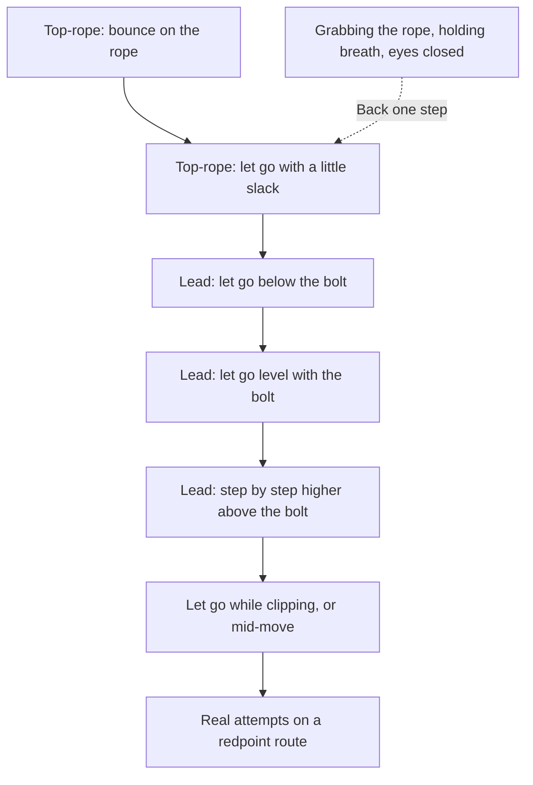

> 🌏 [中文版](/posts/climbing/2026-10-19-climbing-fear-of-falling)

You watch someone let go a metre above a quickdraw, swing back to the wall laughing, and think: I'll take a few falls and stop being scared. Your first one is two metres above the draw. You slam into the wall, and for the next month you won't climb above a bolt.

This is post 1 of the Climbing Mental Game and Tactics series. The [overview](/posts/climbing/2026-10-19-climbing-mental-tactics-overview-en) helped you work out whether you fear falling or failing; this post is for people who fear falling. The mechanics of falling, such as where to practise, what to call out and how to breathe, are already in the "How to practice lead falls" section of [gym lead climbing](/posts/climbing/2026-10-17-gym-lead-climbing-en). This post is only about the fear: how big each fall should be, when to move up, and when to step back.

## How much evidence is there for fall practice

Start with the evidence. Climbing research has no controlled trial comparing climbers who practise falling with climbers who don't. "Fall practice makes you less scared" is coach consensus plus the logic of exposure therapy.

Two studies give indirect support. In Germany, [Frenkel and colleagues (2019)](https://pmc.ncbi.nlm.nih.gov/articles/PMC6813738/) had 214 young male novices jump into the rope on top-rope on purpose (climbing to 12 m and falling about 3 m). Across four experiments, self-rated state anxiety rose after the fall every time, but salivary cortisol rose in only one. The stress of falling showed up mostly as a feeling; the hormonal stress response was less consistent.

In Spain, [Garrido-Palomino and España-Romero (2023)](https://pubmed.ncbi.nlm.nih.gov/37965818/) studied 11 women climbers with fear of falling and compared emotion-regulation psychological training, general training and a control group. Both training groups improved their climbing ability. The psychological group's cognitive and somatic anxiety both fell (the general training group's cognitive anxiety fell), and its self-confidence rose more. With so few people, and climbing ability self-reported, all you can say is that psychological training may help.

So each section below carries an evidence label. "Coach consensus" means the main coaches give similar advice that also fits exposure therapy principles. "Coaches disagree" means they don't. "Inference" means we translated it from psychology. "Our suggestion" marks rough rules of thumb we set ourselves, with no source behind them.

## Principle 1: the right dose, not the biggest one (coach consensus)

Thinking one big fall will cure your fear of falling is like thinking a bath of tarantulas will cure a fear of spiders. That's Hazel Findlay's comparison in [Where Climbers Go Wrong with Fall Practice on UKClimbing](https://www.ukclimbing.com/articles/skills/where_climbers_go_wrong_with_fall_practice-15536). A fall bigger than you're ready for leaves a bad experience behind and roots the fear deeper. She calls it an injury of the mind, and says a small trauma can do more damage to your climbing than a pulley tear.

Each fall should feel about as tense as a PG-13 horror film: a bit scary, but you'd watch another one ([Lattice Training with climbing psychologist Allegra Maguire](https://latticetraining.com/blog/fear-of-falling)). Findlay says much the same: take only falls that are a little uncomfortable, not ones that are genuinely frightening.

That doesn't mean fewer falls is better. One of the mistakes on Findlay's list is not falling enough: nobody expects their fingers to get stronger after one or two fingerboard sessions. Dave MacLeod's *9 out of 10 Climbers Make the Same Mistakes* has a section on falling. According to [a reader's review](http://wednesdaysrocks.blogspot.com/2010/01/9-out-of-10-climbers.html), he suggests taking a fall on every lead route at the gym; at 20 routes a session, three times a week, that adds up to thousands of falls a year.

Both camps agree you need to keep practising for a long time. Where they differ is the size of each fall. MacLeod stresses volume; Findlay and Maguire stress getting each fall right. You can take both: fall often, but keep each fall at "a little uncomfortable".

**Something to do tonight**: start a fall log in your phone's notes app. One line per fall: which quickdraw, how far above it you let go, and how nervous you were beforehand (0–10). When the score jumps, go back to the previous height next time. Where exactly to draw that line is our rough rule, not a number from a source.

## Principle 2: let your body decide whether to move up or back (coach consensus)

You might say "I'm fine", but your body may disagree. Findlay finds most climbers she coaches are less comfortable with falling than they think: they hold their breath, grab the rope, and sometimes close their eyes. Lattice uses almost the same checklist:

- Did you grab the rope?
- Did your body tense up and your face scrunch?
- Did you close your eyes?
- Was your breathing fast, or could you not breathe out?

The three coaches frame these signs differently but point the same way. Lattice says go back to an easier fall. Warrior's Way says don't add height until you're doing breathing, eyes and body well. Findlay says these signs mean you're ingraining the fear. This is the most important rule in the post.

Two more details that are easy to miss, also from Findlay:

- **Don't rush the fall.** Many people can fall only because they do it too fast to feel scared. But the hardest part is often the few seconds of anticipation before you let go. Pause, take one breath, and learn to sit with the anticipation.
- **Drop off, don't jump off.** Don't look down, pick a landing spot and leap. Stay in climbing position and leave the wall passively; look down once you're in the air.

The quality of a fall boils down to BEB: breathing, eyes, body. That's the shorthand of Arno Ilgner's [Warrior's Way](https://warriorsway.com/overcome-fear-of-falling/). In a [short piece for Climbing magazine](https://www.climbing.com/skills/learn-this-practice-falling-as-a-skill/) he gets specific: exhale through the whole fall; look down as you fall so your attention stays on the fall; bring your knees up to about hip height; don't grab the rope. The Warrior's Way article also says the time to add distance isn't when you think you're ready, but when your body has assimilated the stress.

**Something to do tonight**: next time you practise, ask your belayer to watch for three things: grabbing the rope, holding your breath, closing your eyes. Ask after every fall. If any answer is yes, don't go higher on the next one.

## A practice ladder (coach consensus)

Combining the sequences from Lattice and Warrior's Way gives roughly this. Practise each step until the body signals are gone before moving up:

Findlay's caution: the ladder is only a suggested order. Whether to move up a step depends on your body's signals that day, not on the chart. She specifically warns against following a fixed routine, because how much you can take depends on how comfortable you are with falling in that moment.

- **Top-rope stage**: Lattice suggests having the belayer take you tight, then bouncing and swinging on the rope from a comfortable spot with your arms relaxed by your sides. Once that feels normal, let go with a little slack in the rope.
- **Lead stage**: below the bolt, level with it, then gradually higher; then add letting go right after clipping and letting go mid-move. How to fall is covered in [gym lead climbing](/posts/climbing/2026-10-17-gym-lead-climbing-en).
- **Into normal climbing**: Warrior's Way suggests building it into your warm-up. Clip the draw above your head and take a top-rope-style fall, climb to the next bolt and take a small lead fall, then a longer one at the next. Make sure you're high enough not to hit your belayer.

Session length matters too. Fear itself is tiring, so limit the session; you should finish wanting to come back, not wiped out (Lattice). Warrior's Way's [10 Tips For Practicing Falling](https://warriorsway.com/wp-content/uploads/2024/04/Lead-Magnet-for-FCO_Falling-Tips.pdf) gives a more concrete number: after 6 to 10 falls, switch roles with your belayer, because more than that is fatiguing. On days when work is stressful or you're in a bad mood, stick to falls inside your comfort zone.

**Something to do tonight**: using the ladder, find the highest step where you feel no tension at all. Next time at the gym, practise only between that step and the next one, and switch with your belayer after every 6 to 10 falls.

## Terrain: slightly overhanging or vertical (coaches disagree)

Here the advice points in opposite directions. Lattice suggests starting on **slightly overhanging** walls, because you fall into space and the fear of hitting the wall is smallest, then moving on to vertical walls and slabs. The same article says the angle and terrain you practise on should match your goals as closely as possible: indoors and outdoors, vertical and overhanging, all feel different.

Warrior's Way takes the opposite view. Its 10 Tips says many people assume steep overhangs are the safest place to fall, but practice should match the terrain you'll actually climb, which is usually vertical, so pick vertical routes. More realistic falls, like falling while clipping or a pendulum, come after the step-by-step practice.

So this is a choice between two positions. Lattice's slightly overhanging wall buys you a good experience every time, at the cost of having to adapt to vertical walls later. Warrior's Way's vertical wall trains the falls you'll really take from the start, at the cost of more fear of hitting the wall, so each step has to be smaller. If you mostly climb vertical rock, such as the sandstone at Longdong in Taiwan, at least the later stages should be on vertical walls, not only on the gym's steep overhangs.

**Something to do tonight**: write down the angle of the route you most want to climb this season. Next time you practise, take at least half your falls on a wall of that angle.

## The belayer: soft catches and trust (coach consensus)

Many people who fear falling were actually scared by a hard catch: no give in the system, so they swing into the wall fast. Findlay points out two common mistakes:

- The belayer takes in rope by reflex to shorten your fall, which makes the catch harder.
- To make the catch soft, the belayer gives lots of slack, so you fall a long way and the cushioning comes from being pulled up. Findlay calls this a poor substitute for the skill of dynamic belaying, because you fall much further than you expect.

A real soft catch means the belayer lets themselves be pulled toward the first bolt at the right moment, controlling how much the system gives. Technique is in the belayer section of [gym lead climbing](/posts/climbing/2026-10-17-gym-lead-climbing-en).

Then there's letting go of ego: many people force falls because they don't want to look scared in front of friends, and they pile up bad experiences (Lattice). It's better to tell your belayer straight out what you're afraid of.

**Something to do tonight**: before you practise, say three things to your belayer: "I'm practising falls," "Soft catch please, but no extra slack," and "When I say stop, we stop."

## Three ideas borrowed from exposure therapy (inference)

These three ideas come from UCLA psychologist Michelle Craske and colleagues, [Maximizing Exposure Therapy: An Inhibitory Learning Approach (2014)](https://pmc.ncbi.nlm.nih.gov/articles/PMC4114726/). The paper is written for clinicians treating anxiety disorders and hasn't been tested in climbing, so the translation below is inference.

Its core idea: exposure therapy doesn't erase the old fear memory. It builds a new one next to it: "this time it was fine". The old memory is still there, so the fear can come back after a break, or in a new setting. Lattice uses a muscle comparison too: if you stop training it, it weakens. If fear returns after a few weeks without fall practice, that's normal. You haven't lost everything.

1. **Change the setting.** Craske writes that fear reduction is often tied to the setting where you practised. For climbing: don't always practise on the same wall with the same belayer. Change the wall angle, the gym, the belayer.
2. **Let the outcome clash with your expectation.** Before you fall, say what you expect ("I'm going to slam into the wall"). Afterwards, compare it with what happened. The bigger the gap, the more you learn.
3. **Don't wait for anxiety to vanish before moving on.** Craske notes that how much anxiety drops during a session doesn't predict whether the fear comes back later. Let body signals decide, rather than waiting until you feel no fear at all.

**Something to do tonight**: this month, change your fall practice setting at least once: a different wall, a different gym, or a different belayer you trust.

## When fall practice backfires

This section rests on personal experience and a psychologist's view, not research.

Climber and writer Alice Hafer wrote [For Me, Fall Practice Was Bad Advice](https://www.climbing.com/skills/for-me-climbing-fall-practice-was-bad-advice/) for Climbing magazine. While her father was recovering from a stroke, she followed the standard advice and practised falling, and the more she fell, the worse she felt. She quotes psychologist Madeleine Crane, founder of Climbing Psychology:

> "If someone is struggling in their day-to-day life, they're going to struggle to fall in that state."

Another climber in the piece broke an ankle hitting a ledge on lead. After that, fall practice worked "only for that day". Later he had EMDR (a trauma therapy); he says it seems to have helped, but when he's tired or on his first climb of the day he can still panic. Hafer also cites the distinction from Findlay's course: good stress (eustress) makes you stronger, while distress just wears you down.

So in these situations, don't force it:

- You're under heavy stress in your life, and fall practice is making you more scared.
- You've been hurt in a fall, and you panic whenever you get near a similar situation.
- You have an anxiety disorder, or panic is affecting your life outside climbing.

Then say "take" when you need to, put your attention back on the moves, and talk to a psychologist or psychiatrist. Hafer passes on Eric Hörst's point: some people learn to "try hard and fall" in a single season; for others it takes many years.

**Something to do tonight**: before practising falls this week, ask yourself two questions. How much stress is in your life right now? Does the kind of situation where you got hurt make you panic? If either answer is "a lot" or "yes", only do top-rope bounces today, or skip practice entirely (our suggestion).

## Where to learn in Taiwan

Lead courses at Taiwanese gyms usually include lead falls; examples are in the "Learning and testing in Taiwan" section of [gym lead climbing](/posts/climbing/2026-10-17-gym-lead-climbing-en). Few courses treat falling as a mental skill. One example is the fall training and dynamic belay course from trad climbing school [Wild Lily Rocks](https://www.wildlily.rocks/2025%E5%90%84%E9%9A%8E%E6%AE%B5%E8%AA%B2%E7%A8%8B) (in Mandarin), which covers mental training, protecting yourself when you fall, and using dynamic belays to reduce impact. Check their site for prerequisites and fees.

## Practice questions: four situations

**1. A friend says: "If you're scared of falling, find an overhang, take one huge fall from above the top bolt, and you'll be over it."**

Answer

That's Findlay's bath of tarantulas. A fall bigger than you're ready for is likely to leave a bad experience and make the fear more entrenched. Start at the highest step where you feel no tension, and go only a little past comfortable each time.

**2. Your belayer says you grab the rope on every fall, but you don't feel scared.**

Answer

Your body is more honest than your words. Findlay and Lattice both treat grabbing the rope, holding your breath and closing your eyes as signs the dose is too big. Go back one step and practise until you stop grabbing the rope before moving up.

**3. To give you soft falls, your belayer pays out a big loop of slack every time.**

Answer

Findlay calls this a poor substitute for dynamic belaying: you fall much further than you expect, which makes you more scared. Ask your belayer to learn a real soft catch, letting themselves be pulled toward the first bolt at the right moment, without extra slack.

**4. Work has been very stressful lately. You stick to your fall practice plan, and each session you're more scared.**

Answer

Hafer's experience and Crane's view point the same way: when life is stressful, fall practice can backfire. Lattice also suggests sticking to falls inside your comfort zone on stressful days. Stop for now, focus on your movement, and get help from a mental health professional if you need it.

## Next

Once you can fall, many people find they still freeze on hard routes, and the fear shifts to not finishing or being watched. That's [post 2: fear of failing, and how to handle performance anxiety](/posts/climbing/2026-10-19-climbing-performance-anxiety-en).

## References

- [Hazel Findlay: Where Climbers Go Wrong with Fall Practice (UKClimbing, 2024)](https://www.ukclimbing.com/articles/skills/where_climbers_go_wrong_with_fall_practice-15536)
- [Fear of Falling – with climbing psychologist, Allegra Maguire (Lattice Training, 2022)](https://latticetraining.com/blog/fear-of-falling)
- [Overcome Fear of Falling (The Warrior's Way, undated)](https://warriorsway.com/overcome-fear-of-falling/)
- [Arno Ilgner: 10 Tips For Practicing Falling (The Warrior's Way, PDF, 2024)](https://warriorsway.com/wp-content/uploads/2024/04/Lead-Magnet-for-FCO_Falling-Tips.pdf)
- [Arno Ilgner: Learn This: Practice Falling as a Skill (Climbing, 2018)](https://www.climbing.com/skills/learn-this-practice-falling-as-a-skill/)
- [Dave MacLeod: 9 out of 10 Climbers Make the Same Mistakes (author's shop page)](https://www.davemacleod.com/shop/9outof10climbers)
- [Fun With Rocks: 9 Out of 10 Climbers (reader review, 2010)](http://wednesdaysrocks.blogspot.com/2010/01/9-out-of-10-climbers.html)
- [Craske MG, et al. Maximizing Exposure Therapy: An Inhibitory Learning Approach (Behav Res Ther, 2014)](https://pmc.ncbi.nlm.nih.gov/articles/PMC4114726/)
- [Frenkel MO, et al. Heidelberg Risk Sport-Specific Stress Test: A Paradigm to Investigate the Risk Sport-Specific Psycho-Physiological Arousal (Front Psychol, 2019)](https://pmc.ncbi.nlm.nih.gov/articles/PMC6813738/)
- [Garrido-Palomino I, España-Romero V. Fear of falling in women: A psychological training intervention improves climbing performance (J Sports Sci, 2023)](https://pubmed.ncbi.nlm.nih.gov/37965818/)
- [Alice Hafer: For Me, Fall Practice Was Bad Advice (Climbing, 2025)](https://www.climbing.com/skills/for-me-climbing-fall-practice-was-bad-advice/)
- [Wild Lily Rocks: 2025 courses (in Mandarin)](https://www.wildlily.rocks/2025%E5%90%84%E9%9A%8E%E6%AE%B5%E8%AA%B2%E7%A8%8B)
- [Gym lead climbing: clipping, paying out, soft catches and lead falls](/posts/climbing/2026-10-17-gym-lead-climbing-en)
- [Why lead feels scarier than top-rope: series overview](/posts/climbing/2026-10-19-climbing-mental-tactics-overview-en)
