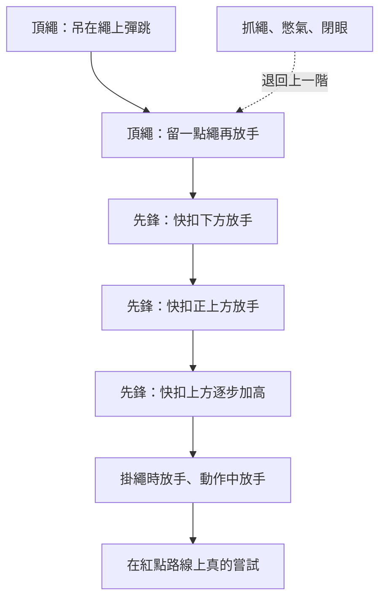

> 🌏 [English version](/posts/climbing/2026-10-19-climbing-fear-of-falling-en)

你看過有人在快扣上方一公尺放手，笑著盪回牆上，然後想：我也去摔幾次，應該就不怕了。結果第一次就從快扣上方兩公尺掉下去，撞牆的那一下讓你接下來一個月都不敢爬到快扣上方。

這是「攀岩心理與戰術」系列的第 1 篇。[總覽](/posts/climbing/2026-10-19-climbing-mental-tactics-overview)幫你分辨了自己怕的是摔還是失敗；這篇給怕摔的人。墜落的基本動作，像在哪裡練、怎麼喊、怎麼吐氣，已經在[岩館先鋒的墜落練習段](/posts/climbing/2026-10-17-gym-lead-climbing)寫過。這篇只講恐懼：每次練多大、什麼時候該往前、什麼時候該退。

## 墜落練習有多少證據

先講清楚它的證據等級。攀岩研究裡，目前還沒有直接比較「練摔」和「不練摔」的對照實驗。「練摔會讓人比較不怕」是教練共識，加上心理學「暴露治療」的道理。

有兩個研究可以當旁證。德國的 [Frenkel 等人（2019）](https://pmc.ncbi.nlm.nih.gov/articles/PMC6813738/)讓 214 位年輕男性新手在頂繩上刻意跳進繩子墜落（爬到 12 公尺，墜落約 3 公尺）。四個實驗裡，墜落後自評的狀態焦慮每次都升高，唾液皮質醇只有一次升高。也就是說，墜落的壓力主要是主觀感受，身體的壓力荷爾蒙反應沒有那麼一致。

西班牙的 [Garrido-Palomino 與 España-Romero（2023）](https://pubmed.ncbi.nlm.nih.gov/37965818/)找了 11 位有墜落恐懼的女性攀岩者，比較情緒調節心理訓練、一般訓練和對照組。心理組和一般訓練組的攀岩能力都進步；心理組的認知與身體焦慮都下降（一般訓練組只降了認知焦慮），自信也提升得比較多。人數這麼少，攀岩能力又是自評，只能說「心理訓練可能有幫助」。

所以下面各段會標出證據等級：「教練共識」是幾位主要教練做法相近、也和暴露治療原則一致的部分；「教練意見分歧」是他們說法不同的地方；「推論」是我們從心理學轉譯過來的；「本篇建議」是我們自己定的粗略判準，沒有來源背書。

## 原則一：劑量剛好，不是越大越好（教練共識）

以為摔一次大的就能治好所有墜落恐懼，就像以為跳進一缸狼蛛可以治好怕蜘蛛。這是 Hazel Findlay 在 [UKClimbing 的〈攀岩者練摔常犯的錯〉](https://www.ukclimbing.com/articles/skills/where_climbers_go_wrong_with_fall_practice-15536)裡的比喻。摔超過自己準備好的距離，會留下很壞的經驗，反而讓恐懼更根深。她把這叫做「心理上的傷」，說一次小創傷對攀岩的影響可能比滑車韌帶撕裂還大。

每次墜落帶來的緊張，大概像看一部 PG-13 的恐怖片：會怕一點，但看完還想再看（[Lattice Training 與攀岩心理師 Allegra Maguire](https://latticetraining.com/blog/fear-of-falling)）。Findlay 的說法相近：只摔「有一點不舒服」的距離，不要摔真的可怕的。

這不代表少摔就好。Findlay 列的錯誤裡也有「摔得不夠多」：沒有人會期待吊指力板一兩次手指就變強。Dave MacLeod 的《9 out of 10 Climbers Make the Same Mistakes》有一章談墜落，據[一篇讀者書評](http://wednesdaysrocks.blogspot.com/2010/01/9-out-of-10-climbers.html)轉述，他建議在岩館每爬一條先鋒就摔一次；如果每次爬 20 條、一週三次，一年就累積幾千次。

兩派都同意要長期練；分歧在每一次的強度。MacLeod 強調量，Findlay 和 Maguire 強調每一次都要剛好。讀者可以兩邊都拿：次數多、頻率高，但每一次都控制在「有一點不舒服」。

**今晚就能做的動作**：在手機記事本開一個「墜落紀錄」。每摔一次寫一行：哪一支快扣、放手時離快扣多高、摔前緊張幾分（0–10）。分數明顯跳高的那一次，下次就退回前一個高度。要退在幾分，是本篇建議的粗略判準，不是來源給的數字。

## 原則二：用身體訊號決定往前或退（教練共識）

你嘴上說「還好」，身體不一定同意。Findlay 帶過的攀岩者，多半比自己以為的更不習慣墜落：摔的時候憋氣、抓繩，有時還閉眼。Lattice 用的檢查清單幾乎一樣：

- 摔的時候抓了繩子？
- 身體繃緊、臉皺起來？
- 閉眼？
- 呼吸急促、吐不出氣？

出現這些訊號時，三位教練的說法角度不同、方向一致：Lattice 明說要退回比較簡單的墜落；Warrior's Way 說呼吸、眼睛、身體這三項做不好就不要往上加；Findlay 說這些訊號代表你正在加深恐懼。這是本篇最重要的一條規則。

另外兩個容易忽略的細節，同樣出自 Findlay：

- **不要急著摔。** 很多人能摔，是因為摔得快到來不及怕。可是最難受的常常是放手前那幾秒的預期。放手前停幾秒、呼吸一次，學會和預期相處。
- **用掉的，不要用跳的。** 不要先往下看、選好落點再跳。保持攀爬姿勢，被動地離開牆；人在空中之後再往下看。

練摔的品質可以濃縮成三個字母 BEB：呼吸（breathing）、眼睛（eyes）、身體（body），這是 Arno Ilgner 的 [Warrior's Way](https://warriorsway.com/overcome-fear-of-falling/) 的說法。他在 [Climbing 雜誌的短文](https://www.climbing.com/skills/learn-this-practice-falling-as-a-skill/)裡說得更具體：整個墜落過程都吐氣；掉的時候往下看，讓注意力留在墜落本身；膝蓋抬到和髖差不多高，不要抓繩。Warrior's Way 的文章也說，什麼時候可以加長距離，不是看你覺得自己準備好了，而是看身體是不是已經消化了這個壓力。

**今晚就能做的動作**：下次練摔請確保者幫你看三件事：有沒有抓繩、有沒有憋氣、有沒有閉眼。每摔完一次問他，答案只要有一個「有」，下一次就不要加高。

## 一張練習階梯（教練共識）

把 Lattice 和 Warrior's Way 的順序合起來，大致是這樣。每一階都練到身體訊號消失，才往上一階：

Findlay 提醒，階梯只是參考順序；每一階要不要往上，看你當下的身體訊號，不是照表操課。她特別反對照固定流程練，因為每次能承受多少，取決於你那一刻對墜落有多自在。

- **頂繩階段**：Lattice 建議先請確保者收緊，在舒服的位置吊在繩上彈跳、擺盪，雙手放鬆放在身側。習慣之後，才在繩子留一點鬆弛時放手。
- **先鋒階段**：從快扣下方、快扣正上方，再一點一點加高；之後加上「掛完快扣就放手」和「做動作到一半放手」。怎麼掉見[岩館先鋒](/posts/climbing/2026-10-17-gym-lead-climbing)。
- **融入一般攀爬**：Warrior's Way 建議把它放進熱身。在頭上的快扣掛好先摔一次頂繩式的，爬到下一支摔一次小的先鋒墜落，再下一支摔長一點。確定高度夠，不會撞到確保者。

一次練多久也有講究。恐懼本身就會讓人疲勞，所以要限制時間；練完的感覺應該是「下次還想再來」，不是筋疲力盡（Lattice）。Warrior's Way 的[〈練摔十個建議〉](https://warriorsway.com/wp-content/uploads/2024/04/Lead-Magnet-for-FCO_Falling-Tips.pdf)給了具體一點的數字：摔 6 到 10 次就和確保者換手，再多會累。那天工作壓力很大、心情不好，就只做舒服區內的墜落。

**今晚就能做的動作**：照上面的階梯，找出你目前「完全不緊張」的最高一階。下次去岩館，只在那一階和下一階之間練，每輪 6 到 10 次就換確保者。

## 地形：微外傾還是垂直（教練意見分歧）

這一點兩邊的建議剛好相反。Lattice 建議從**微外傾**的牆開始，因為墜落時人在空中，撞牆的恐懼最小，之後再進到垂直牆和 slab。但同一篇文章也說，練習的角度和地形應該盡量貼近你的目標：室內和戶外、垂直和外傾，摔起來感覺都不同。

Warrior's Way 的看法相反：它的〈練摔十個建議〉說，很多人以為在大外傾摔最安全，但練習應該貼近你實際會爬的地形，通常是垂直牆，所以直接選垂直路線。掛繩時墜落、盪擺這類比較真實的墜落，放在分段練習之後。

所以這是兩個立場之間的選擇。選 Lattice 的微外傾，你換到的是「每次都是好經驗」，代價是之後還要再適應一次垂直牆。選 Warrior's Way 的垂直牆，你一開始就練到真正會遇到的墜落，代價是撞牆的恐懼比較大，每一步要更小。你常爬的是龍洞的垂直砂岩，至少後期要回到垂直牆練，不要只在岩館的大外傾練。

**今晚就能做的動作**：寫下你這一季最想爬的路線是什麼角度。下次練摔，至少有一半的次數在同樣角度的牆上做。

## 確保者：軟確保和信任（教練共識）

很多人怕摔，其實是被「硬確保」嚇到：系統沒有緩衝，人用很快的速度擺進牆裡。Findlay 指出兩種常見的錯誤：

- 確保者下意識收繩，想讓你少掉一點，結果接得更硬。
- 為了接得軟，確保者放很多繩，讓你掉得很長，靠被拉起來的力道緩衝。Findlay 說這只是動態確保技術的差勁替代品，因為你掉得比預期遠很多。

真正的軟確保，是確保者在對的時機讓自己被往第一支快扣的方向帶，控制系統的延展。做法見[岩館先鋒的接墜段](/posts/climbing/2026-10-17-gym-lead-climbing)。

還有一件事是「放下自尊」：很多人怕在朋友面前顯得膽小，就硬撐著摔，結果累積壞經驗（Lattice）。最好的做法是直接告訴確保者你在怕什麼。

**今晚就能做的動作**：練摔前跟確保者說三句話：「我在練墜落」「請軟確保，但不要多放繩」「我說停就停」。

## 從暴露治療借來的三個做法（推論）

下面三個做法來自 UCLA 心理學家 Michelle Craske 等人[〈用抑制學習最佳化暴露治療〉（2014）](https://pmc.ncbi.nlm.nih.gov/articles/PMC4114726/)。這篇是寫給治療焦慮症的臨床人員，攀岩沒有直接測過，以下的轉譯是推論。

它的核心觀念是：暴露治療不是把舊的恐懼記憶擦掉，而是在旁邊學一個新的「這次沒事」。舊的記憶還在，所以恐懼可能隔一段時間又回來，或換個環境又回來。Lattice 也用肌肉來比喻：不練就會變弱。一陣子沒練摔，恐懼回來是正常的，不代表前功盡棄。

1. **換情境練。** Craske 寫道，恐懼的消退常常只綁在練習的那個情境。換成攀岩：不要永遠在同一面牆、同一位確保者下練。換牆角度、換岩館、換確保者。
2. **讓結果和預期對撞。** 摔之前先說出你預期會發生什麼（「我會撞得很痛」），摔完再對照實際發生的。差距越大，學到的越多。
3. **不要等焦慮完全消失才往前。** Craske 提到，練習當下焦慮降了多少，不太能預測之後恐懼會不會回來。照身體訊號決定進退，不必等到一點都不怕。

**今晚就能做的動作**：這個月至少換一次練摔的環境：另一面牆、另一間岩館，或另一位你信任的確保者。

## 什麼時候墜落練習會變成反效果

這一段的依據是個人經驗加上心理師的意見，不是研究。

[Climbing 雜誌的〈對我來說，練摔是個壞建議〉](https://www.climbing.com/skills/for-me-climbing-fall-practice-was-bad-advice/)是攀岩者兼作家 Alice Hafer 寫的。她父親中風那段時間，她照標準建議練摔，結果越摔越糟。她轉述心理師 Madeleine Crane（Climbing Psychology 創辦人）的話：

> 「如果一個人在日常生活裡就過得很辛苦，他在那種狀態下也會很難摔。」

文中另一個例子是一位攀岩者，先鋒時撞到岩階摔斷腳踝。之後練摔只有「當天有效」。後來接受 EMDR（一種創傷心理治療），他說似乎有幫助，但累的時候或當天第一條路線，還是會恐慌。Hafer 也引用 Findlay 課程的區分：良性的壓力會讓人變強，恐慌只會磨損你。

所以遇到下面這些情況，先不要硬練：

- 生活中正經歷很大的壓力，練摔讓你越來越怕。
- 摔傷過，一靠近類似情境就恐慌。
- 有焦慮症，或恐慌已經影響攀岩以外的生活。

這時候該說 take 就說 take，把注意力放回動作上，並找心理師或精神科醫師談。Hafer 轉述 Eric Hörst 的話：有人一季就學會「邊試邊摔」，有人要好幾年。

**今晚就能做的動作**：這週練摔前先問自己兩題：最近生活壓力有多大？摔傷過的情境會不會讓你恐慌？兩題有一題是「很大」或「會」，今天就只做頂繩彈跳，或乾脆不練（本篇建議）。

## 在台灣哪裡學

台灣岩館的先鋒課多半會帶到先鋒墜落，課程例子見[岩館先鋒的「在台灣怎麼學」](/posts/climbing/2026-10-17-gym-lead-climbing)。專門把墜落當成心理課來上的不多。傳攀工作室[百合搖滾的「墜落訓練以及動態確保」](https://www.wildlily.rocks/2025%E5%90%84%E9%9A%8E%E6%AE%B5%E8%AA%B2%E7%A8%8B)是一個例子，重點放在心理因素訓練、墜落時如何保護自己，以及用動態確保降低衝擊。報名資格與費用以官網為準。

## 練習題：四個情境

**1. 朋友說：「怕摔就去找一條外傾線，從最高的快扣上方摔一次大的，摔過就不怕了。」**

答案

這就是 Findlay 說的「跳進一缸狼蛛」。摔超過自己準備好的距離，容易留下壞經驗，讓恐懼更根深。從你目前不緊張的那一階開始，每次只比舒服多一點。

**2. 你練摔時確保者說你每次都抓繩，但你覺得自己不怕。**

答案

身體訊號比嘴巴誠實。Findlay 和 Lattice 都把抓繩、憋氣、閉眼當成「劑量太大」的訊號。退回上一階，練到不再抓繩再往前。

**3. 你的確保者為了讓你摔得軟，每次都多放一大段繩。**

答案

Findlay 說這是動態確保技術的差勁替代品：你掉得比預期遠很多，反而更怕。請確保者練真正的軟確保，在對的時機讓自己被往第一支快扣方向帶，繩不要多放。

**4. 最近工作壓力很大，你照計畫練摔，結果一次比一次怕。**

答案

Hafer 的經驗和 Crane 的說法都指向同一件事：生活壓力大時，墜落練習可能反效果。Lattice 也建議壓力大的日子只做舒服區內的墜落。先停下來，這段時間把注意力放在動作上，必要時找心理專業協助。

## 下一步

摔得下去之後，很多人發現自己還是會在難線前卡住，怕的變成「沒爬完」「被看」。這是[第 2 篇：怕失敗，表現焦慮怎麼處理](/posts/climbing/2026-10-19-climbing-performance-anxiety)。

## 參考資料

- [Hazel Findlay: Where Climbers Go Wrong with Fall Practice（UKClimbing，2024）](https://www.ukclimbing.com/articles/skills/where_climbers_go_wrong_with_fall_practice-15536)
- [Fear of Falling – with climbing psychologist, Allegra Maguire（Lattice Training，2022）](https://latticetraining.com/blog/fear-of-falling)
- [Overcome Fear of Falling（The Warrior's Way，未標日期）](https://warriorsway.com/overcome-fear-of-falling/)
- [Arno Ilgner: 10 Tips For Practicing Falling（The Warrior's Way，PDF，2024）](https://warriorsway.com/wp-content/uploads/2024/04/Lead-Magnet-for-FCO_Falling-Tips.pdf)
- [Arno Ilgner: Learn This: Practice Falling as a Skill（Climbing，2018）](https://www.climbing.com/skills/learn-this-practice-falling-as-a-skill/)
- [Dave MacLeod: 9 out of 10 Climbers Make the Same Mistakes（作者商店頁）](https://www.davemacleod.com/shop/9outof10climbers)
- [Fun With Rocks: 9 Out of 10 Climbers（讀者書評，2010）](http://wednesdaysrocks.blogspot.com/2010/01/9-out-of-10-climbers.html)
- [Craske MG, et al. Maximizing Exposure Therapy: An Inhibitory Learning Approach（Behav Res Ther，2014）](https://pmc.ncbi.nlm.nih.gov/articles/PMC4114726/)
- [Frenkel MO, et al. Heidelberg Risk Sport-Specific Stress Test: A Paradigm to Investigate the Risk Sport-Specific Psycho-Physiological Arousal（Front Psychol，2019）](https://pmc.ncbi.nlm.nih.gov/articles/PMC6813738/)
- [Garrido-Palomino I, España-Romero V. Fear of falling in women: A psychological training intervention improves climbing performance（J Sports Sci，2023）](https://pubmed.ncbi.nlm.nih.gov/37965818/)
- [Alice Hafer: For Me, Fall Practice Was Bad Advice（Climbing，2025）](https://www.climbing.com/skills/for-me-climbing-fall-practice-was-bad-advice/)
- [百合搖滾 Wild Lily Rocks：2025 各階段課程](https://www.wildlily.rocks/2025%E5%90%84%E9%9A%8E%E6%AE%B5%E8%AA%B2%E7%A8%8B)
- [岩館先鋒怎麼學：掛快扣、給繩、軟確保與先鋒墜落](/posts/climbing/2026-10-17-gym-lead-climbing)
- [先鋒為什麼比頂繩可怕：系列總覽](/posts/climbing/2026-10-19-climbing-mental-tactics-overview)
