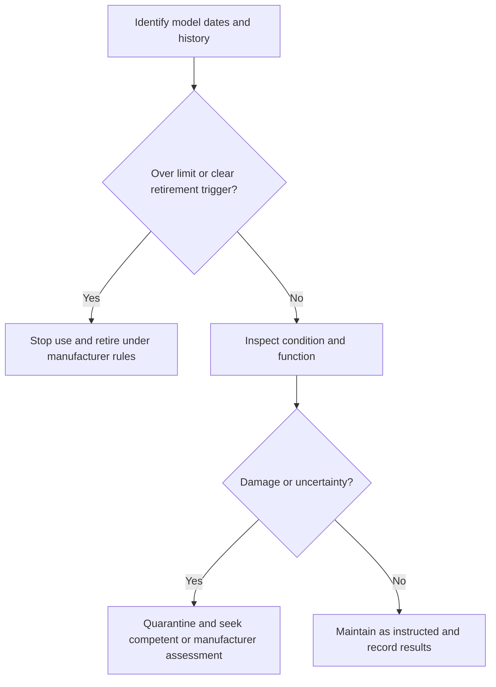

> 🌏 [中文版](/posts/climbing/2026-10-19-climbing-gear-care-retirement)

Closing the gear bag after a trip and leaving it in a cupboard until the next flight skips an easy opportunity to inspect it. Sand on a rope, damp harness webbing, or a carabiner gate that closes more slowly can disappear from attention during that final packing session.

This article builds a routine you can complete at home: identify each item, inspect it, clean it according to the manufacturer, and record the result. It follows the [travel packing article](/posts/climbing/2026-10-19-climbing-travel-packing-en). The aim is to recognize what needs assessment and what must immediately leave service, rather than use a photograph or an age formula to guarantee safety.

## Maximum lifespan is a ceiling, not a warranty period

[Petzl's equipment-protection document](https://www.petzl.com/sfc/servlet.shepherd/version/download/068Tx00000CayFIIAZ) gives plastic and textile products a maximum lifetime of ten years from manufacture. Metal products have no fixed age limit, but an exceptional event can require retirement after one use. “Under ten years old” cannot replace inspection, and “unlimited metal lifespan” does not mean permanently fit for use.

Find your exact model, manufacturing date, and instructions first. Purchase and manufacture dates differ, and warehouse storage belongs in the history. Brands, materials, and product types can follow different rules; do not apply Petzl's number to an entire mixed-brand bag.

Separate the age ceiling, current condition, and manufacturer recalls or inspection notices. Excellent appearance cannot extend a model's maximum lifetime. Conversely, possible exposure to an unknown chemical is not resolved by an item being only a year old.

## Begin with history, then inspect the surface

Use a clean, well-lit area and separate the equipment. Routine checks before and after use differ from a detailed periodic inspection. [Petzl's harness inspection guide](https://www.petzl.com/on/demandware.static/-/Sites-petzl-master-catalog/default/dwc708b57b/media/product/verif-EPI-harnais-SPORT-procedure-EN_068bK00000fXc8ZQAS.pdf) recommends a competent person's detailed inspection at least every twelve months, with closer assessment for intensive or exceptional use. This is not a universal interval for every brand.

First recall rock impacts, major loading events, unusual heat, chemical spills, or undocumented borrowing. Then follow the model's inspection procedure. Label and stop using anything questionable; equipment awaiting advice should not go back into the ready-to-climb bag.

| Item | A practical inspection action | Conditions requiring removal from service and assessment |
|---|---|---|
| Rope | Visually inspect the entire sheath, then feel the core section by section, comparing thickness and flexibility | Cuts, melting, exposed core, hard spots, soft or crushed areas, or suspected contamination; checking only near the ends is insufficient |
| Harness and slings | Examine both sides of webbing, load-bearing stitching, tie-in points, and belay loop; move permitted parts to reveal hidden areas | Cuts, heat damage, damaged safety stitching, unusual wear, contamination, or faulty buckles |
| Helmet | Examine the shell inside and out, energy-absorbing liner, attachments, and adjustment system; test adjustment function | Cracks, deformation, missing parts, or a significant impact history require the model's assessment criteria; a clean outer shell proves little |
| Carabiner | Inspect frame, rivet, gate, and sleeve; release the gate to verify complete automatic closure, then check locking | Cracks, deformation, corrosion, unusual wear, or incomplete closing or locking |
| Belay devices and other hardware | Inspect rope-contact surfaces and moving parts using the product diagrams, and perform the specified function checks | Unusual wear, sharp edges, cracks, deformation, or faulty operation; do not invent a universal millimeter wear allowance |

See [Petzl's rope inspection guidance](https://www.petzl.com/on/demandware.static/-/Sites-petzl-master-catalog/default/dwf2c4f0de/media/product/verif-EPI-cordes-procedure-EN_068bK00000uzxirQAA.pdf) for tactile checks, and its [helmet inspection guide](https://www.petzl.com/on/demandware.static/-/Sites-petzl-master-catalog/default/dw09aba595/media/product/verif-EPI-casques-SPORT-procedure-EN_068Tx00000PpQ29IAF.pdf) for liners and attachments. Removable comfort pads and protective liners are different. Do not detach a liner bonded to the shell to get a better view.

The [Petzl OK TRIACT-LOCK instructions](https://www.petzl.com/sfc/servlet.shepherd/version/download/06868000004GSfaAAG) give a specific carabiner example. Other locking systems still require their own checks. Inspection identifies problems; it does not mean every problem can be repaired. Sanding, gluing, or unauthorized replacement parts do not establish continued fitness for use.

## Before washing, rule out problems washing cannot solve

[Petzl's rope and harness washing advice](https://petzl.com/us/en/professional/we-are-petzl/rescue/how-do-i-wash-my-rope-or-harness-/-NEWS--PRO-Comment-laver-ma-corde-ou-mon-harnais_PRO_a7CbK0000000hGHUAY.html) starts by requiring equipment to meet inspection criteria. Stains suggesting chemical exposure can be grounds for retirement. Cleaning cannot restore questionable equipment's safety status.

For this Petzl guidance, hand washing uses only household face and body soap (pH-neutral) with water no warmer than 30°C, followed by thorough rinsing. Air-dry in a ventilated place away from UV and heat sources, without laundry detergent. Read these conditions alongside the particular product's instructions rather than extending them to every brand's cleaner, washing-machine use, or lubricant.

Manufacturer wording can differ. [BEAL Rope Cleaner](https://beal-planet.com/en/products/rope-cleaner) is a branded product intended for ropes and harnesses. Its existence does not establish that Petzl or another brand approves every product labeled “rope cleaner.” Establish the equipment maker's permitted method before choosing a cleaning product.

One easily missed step follows rope washing: measuring. Petzl notes that washing can reduce rope length. Reusing an old label to plan a rappel turns maintenance into a route problem. Follow the manufacturer procedure for measurement and remarking, and record actual length. If ends have been altered, establish whether the middle mark is still correct too.

## Travel storage: address moisture and contamination separately

Remove damp equipment at your accommodation so it can ventilate and dry; complete cleaning, inspection, and records at home. A wet item sealed in luggage for long-term storage does not dry automatically before the next trip.

Petzl's protection document calls for separation from sharp objects and chemicals, and protection from direct sunlight and extreme temperatures. Do not mix gear with fuel, batteries, or cleaning supplies, or leave helmets and textiles in a sun-heated vehicle. Store a helmet so it is protected from impacts. A backpack is an outer layer, not immunity from heat or contamination.

Once dry, use a dedicated ventilated location away from sunlight. Retain identification labels on ropes, harnesses, and helmets instead of removing them for tidier packing or photographs. Only use manufacturer-permitted marking methods. Travel pouches help organization; they do not replace individual checks.

## Keep a history instead of relying on memory

Make one record per item, with photographs in a folder you can find:

| Field | What to record |
|---|---|
| Identity | Brand, full model, version, serial number, and label photographs |
| Dates | Manufacture, purchase, first use, and latest inspection |
| Use | Main environments, frequency, borrowers, and significant events |
| Condition | Location of changes, photographs, inspector, and outcome |
| Rope-specific details | Current length and shortening or remarking history |
| Next action | In service, quarantined pending assessment, or retired; next inspection arrangement |

This record is not a strength certificate. It prevents guessing whether a rope was bought last year or has already served for years. Ask borrowers to report events. Understand a borrowed item's full history rather than treating attractive appearance as evidence of new condition.

Retired load-bearing equipment must clearly leave climbing service and be prevented from accidental reuse. **A rope no longer suitable for leading does not automatically become suitable for top-roping.** Top-roping is still a life-safety application. Changing climbing style does not cancel damage; cutting a section, adding a knot, or covering it with tape is not a universal repair.

## Three decision exercises

**One:** A rope bought two years ago shared a bag with a leaking unknown cleaning chemical. After washing it feels normal. Can it travel?

**Answer:** Washing and feel do not resolve contamination uncertainty. Stop use and follow the manufacturer's contamination and retirement rules. Petzl's protection guidance requires retirement when harmful chemical contact is in doubt; being below the age limit cannot override that.

**Two:** A carabiner has no visible crack, but its gate sometimes fails to close completely on its own. Can it be a spare?

**Answer:** Quarantine it first. Complete gate closure is part of the function check, and spare equipment must also meet use requirements. If permitted maintenance does not restore correct function, it cannot return to the load-bearing system.

**Three:** A nominal 60 m rope measures shorter after washing and shows no sheath damage. Is “washed” a sufficient log entry?

**Answer:** Record actual length, mark it according to manufacturer instructions, and reassess [multipitch descent requirements](/posts/climbing/2026-10-19-multipitch-rope-systems-en). Completed maintenance means current condition and intended use agree again.

<!-- climbing-gear-nav:start -->
> [Previous: Belay devices and hardware](/posts/climbing/2026-10-19-climbing-belay-hardware-en) · [Series overview](/posts/climbing/2026-10-19-climbing-gear-travel-overview-en)
<!-- climbing-gear-nav:end -->

## References

- [Petzl: equipment protection, transport, storage, and lifetime principles](https://www.petzl.com/sfc/servlet.shepherd/version/download/068Tx00000CayFIIAZ)
- [Petzl: rope inspection](https://www.petzl.com/on/demandware.static/-/Sites-petzl-master-catalog/default/dwf2c4f0de/media/product/verif-EPI-cordes-procedure-EN_068bK00000uzxirQAA.pdf)
- [Petzl: harness inspection](https://www.petzl.com/on/demandware.static/-/Sites-petzl-master-catalog/default/dwc708b57b/media/product/verif-EPI-harnais-SPORT-procedure-EN_068bK00000fXc8ZQAS.pdf)
- [Petzl: helmet inspection](https://www.petzl.com/on/demandware.static/-/Sites-petzl-master-catalog/default/dw09aba595/media/product/verif-EPI-casques-SPORT-procedure-EN_068Tx00000PpQ29IAF.pdf)
- [Petzl: washing ropes and harnesses](https://petzl.com/us/en/professional/we-are-petzl/rescue/how-do-i-wash-my-rope-or-harness-/-NEWS--PRO-Comment-laver-ma-corde-ou-mon-harnais_PRO_a7CbK0000000hGHUAY.html)
- [Petzl OK TRIACT-LOCK: inspection and retirement criteria](https://www.petzl.com/sfc/servlet.shepherd/version/download/06868000004GSfaAAG)
- [BEAL: Rope Cleaner intended use](https://beal-planet.com/en/products/rope-cleaner)
