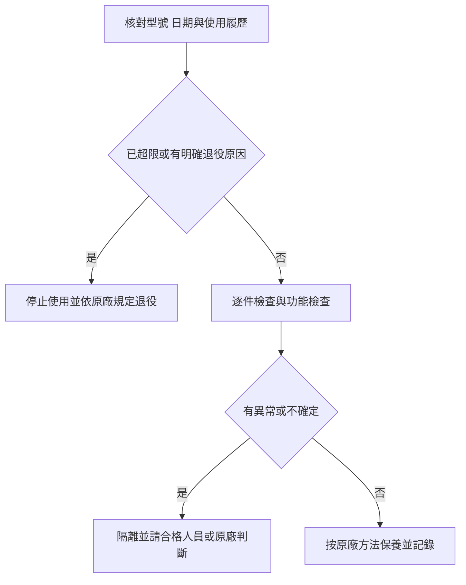

> 🌏 [English version](/posts/climbing/2026-10-19-climbing-gear-care-retirement-en)

旅行回來，把裝備包拉鍊拉上放進櫃子，下趟出國再打開，是最容易省掉的一次檢查。繩上有砂、吊帶還潮濕，某顆鉤環的門比以前慢一點，都可能在這次收納時被忽略。

這篇要建立一套回家就做得完的流程：辨識物品、逐件檢查、依原廠方法清理，最後留下紀錄。它接續[出國攀岩打包篇](/posts/climbing/2026-10-19-climbing-travel-packing)。目標是知道哪些裝備可以繼續評估、哪些應立即停止使用，不是靠照片或一條年限公式替器材保證安全。

## 原廠壽命上限，是最後期限而非保固期

[Petzl的裝備保護文件](https://www.petzl.com/sfc/servlet.shepherd/version/download/068Tx00000CayFIIAZ)把塑膠與紡織品的最長壽命列為自製造日起十年。金屬產品沒有固定年限上限；特殊事件仍可能讓產品只用一次就必須退役。因此「不到十年」不能取代檢查，「金屬不限年」也不能解讀成永久可用。

先找到自己的型號、製造日期與原廠說明。購買日不等於製造日，倉庫裡放過多久也屬於產品履歷。不同品牌、材質與品項可能採不同規則，不能把Petzl的數字套給整個裝備包。

還要分開看三件事：年限上限、實際狀態，以及原廠召回或檢查通知。某條繩外觀很好，若已超過該型號上限，外觀不能延長期限；反過來，才買一年卻接觸不明化學品，也不能用年輕說服自己繼續。

## 檢查從履歷開始，然後才看表面

準備乾淨、明亮的地方，把器材分開攤平。每次使用前後的例行檢查，和定期的詳細檢查不同。[Petzl吊帶PPE檢查程序](https://www.petzl.com/on/demandware.static/-/Sites-petzl-master-catalog/default/dwc708b57b/media/product/verif-EPI-harnais-SPORT-procedure-EN_068bK00000fXc8ZQAS.pdf)建議由具能力的人至少每十二個月詳細檢查。頻繁或特殊使用還需要更密集評估；其他品牌的週期則要另查。

先回想這趟有沒有落石撞擊、重大受力、異常高溫、化學品洩漏或不明借用。再依該型號的程序檢查。發現異常時先停用並做標記，別把「等我下次問人」的器材放回可直接出發的袋子。

| 品項 | 可以實際做的檢查 | 哪些狀況要停止使用並處理 |
|---|---|---|
| 繩索 | 全長看外皮，再逐段用手觸摸繩芯；比較粗細、柔軟度與局部變化 | 割傷、燒熔、露芯、異常硬塊、軟塌或疑似污染；不能只看繩端附近 |
| 吊帶與繩環 | 翻看織帶兩面、承重縫線、綁入點與確保環；移開可移動部位檢查遮住的區域 | 割傷、熱傷、承重縫線受損、異常磨損或化學污染；扣具失常也不能略過 |
| 頭盔 | 看外殼內外、吸能內襯、固定點與調整系統；操作調整確認功能 | 裂痕、變形、缺件或明顯撞擊史，依該款說明判定；不能只擦亮外殼 |
| 鉤環 | 看本體、鉚釘、門與鎖套；開門後確認會自動完整關閉，再檢查上鎖功能 | 裂痕、變形、腐蝕、異常磨耗或門不能完整關閉鎖定 |
| 確保器等金屬器材 | 依產品圖示查看繩索接觸面與活動部位，執行該款功能檢查 | 異常磨耗、銳邊、裂痕、變形或功能不正常；不要自行訂一個通用磨耗毫米數 |

繩索觸摸判準見[Petzl繩索PPE檢查程序](https://www.petzl.com/on/demandware.static/-/Sites-petzl-master-catalog/default/dwf2c4f0de/media/product/verif-EPI-cordes-procedure-EN_068bK00000uzxirQAA.pdf)；頭盔內襯與固定結構見[Petzl頭盔PPE檢查程序](https://www.petzl.com/on/demandware.static/-/Sites-petzl-master-catalog/default/dw09aba595/media/product/verif-EPI-casques-SPORT-procedure-EN_068Tx00000PpQ29IAF.pdf)。可拆舒適襯墊與承擔保護功能的內襯不同，不要為了看得更清楚，把黏在殼上的內襯拆掉。

鉤環的具體例子可看[Petzl OK TRIACT-LOCK說明書](https://www.petzl.com/sfc/servlet.shepherd/version/download/06868000004GSfaAAG)；不同鎖定形式仍按自己的版本檢查。檢查是找出問題，不是把每個問題都修到能再用。不要用打磨、黏補或未獲許可的零件改裝，替器材延長使用資格。

## 洗乾淨之前，先排除不能靠清洗解決的事

[Petzl的繩索與吊帶清洗建議](https://petzl.com/us/en/professional/we-are-petzl/rescue/how-do-i-wash-my-rope-or-harness-/-NEWS--PRO-Comment-laver-ma-corde-ou-mon-harnais_PRO_a7CbK0000000hGHUAY.html)先要求器材符合檢查條件；疑似化學污染的污漬可能是退役原因。清洗不是讓可疑裝備重新取得安全資格的程序。

以這份Petzl指引為例，手洗使用不超過三十度的溫水，再充分沖洗。皂液限原廠所說的家用洗臉／身體用皂液（pH中性），不用洗衣精。晾乾放在通風處，避開紫外線與熱源。這些條件應與自己的產品說明一起看，不能擴張成所有品牌都能用相同清潔劑、洗衣機或潤滑油。

品牌之間的文字就可能不同。[BEAL Rope Cleaner](https://beal-planet.com/en/products/rope-cleaner)是原廠為繩索與吊帶提供的專用清潔產品。它的存在不代表Petzl或其他品牌也允許任何標著「繩索清潔」的產品。買清潔用品前，先找器材原廠允許的方式，再核對用品適用對象。

洗完繩子還有一件容易漏掉的事：量長。Petzl指出洗繩可能使長度縮短。沿用舊標示去規劃下降，會把保養問題變成路線問題；量測與重標方式照原廠程序，並把目前實長寫進履歷。繩端如果曾處理過，也要同步確認中點標記是否仍正確。

## 旅行存放，把潮濕與污染分開處理

回住宿處先把潮濕器材拿出來，讓它有通風乾燥的空間；回家後再完成清潔、檢查與記錄。器材尚濕時就長期封在旅行袋裡，下一次打開也不會自動變乾。

Petzl的保護文件要求避開尖物、化學品、直射陽光與極端溫度。裝備不要和油料、電池或清潔用品混放，也別把頭盔與紡織器材留在曝曬車內。頭盔採取能避免受撞擊的收納方式；背包只是外層，不會讓裡面的裝備免於熱與污染。

晾乾後留一個固定、通風、避光的位置。繩索、吊帶與頭盔的識別資料不要為了拍照或收得整齊而拆掉；標記產品也只能採原廠允許的方法。旅行收納袋可拿來分類，不能取代逐件檢查。

## 裝備履歷，一張表比憑印象可靠

自己的裝備可各建一列，照片另存到能找到的資料夾：

| 欄位 | 要記什麼 |
|---|---|
| 身分 | 品牌、完整型號、版本、序號、標籤照片 |
| 日期 | 製造、購買、首次使用與最近檢查日期 |
| 使用 | 主要地點、頻率、借用者與重大事件 |
| 狀態 | 異常位置、照片、檢查人與處理結果 |
| 繩索額外資料 | 目前實長、裁短或重標記錄 |
| 下一步 | 可繼續使用、待查隔離或已退役；下次檢查安排 |

這張表不是強度證書。它讓你不用猜某條繩究竟是去年買的，還是已經用了多年。借給別人時，請對方回報事件；借入器材則先了解完整履歷，不能只因外觀漂亮就當成新裝備。

已退役的承重裝備，要明確移出攀登用途並防止再被誤用。**先鋒繩不適合繼續使用，不代表可以自動降級成頂繩。** 頂繩仍是人身保護用途，不能用另一種攀登方式掩蓋損傷。切掉局部、打結或貼膠帶也不是通用修復方案。

## 三個判斷練習

**一：** 一條才買兩年的繩，曾和洩漏的不明清潔劑放在同一袋；洗乾淨後摸起來正常，可以帶出國嗎？

**答案：** 不以清洗或觸感解除疑慮。立即停止使用並依污染與原廠規定處理；Petzl對疑似有害化學接觸的保護指引要求退役，不能以未到年限推翻。

**二：** 鉤環沒有裂，門卻偶爾不能自己關到底，可以當備用嗎？

**答案：** 先隔離。門完整關閉是功能檢查的一部分；備用器材也要符合使用條件。依原廠維護方法處理後仍失常，就不能帶回承重系統。

**三：** 六十公尺繩洗後量得不足原長，外皮也沒損傷，紀錄只寫「已清洗」夠嗎？

**答案：** 不夠。記下實長、依原廠方式標示，並重新評估[多繩距配置與下降需求](/posts/climbing/2026-10-19-multipitch-rope-systems)。保養完成的意思，是狀態與用途都重新對得上。

<!-- climbing-gear-nav:start -->
> [上一篇：確保器、鉤環與快扣](/posts/climbing/2026-10-19-climbing-belay-hardware) · [系列總覽](/posts/climbing/2026-10-19-climbing-gear-travel-overview)
<!-- climbing-gear-nav:end -->

## 參考資料

- [Petzl：裝備保護、運輸、存放與壽命原則](https://www.petzl.com/sfc/servlet.shepherd/version/download/068Tx00000CayFIIAZ)
- [Petzl：繩索檢查](https://www.petzl.com/on/demandware.static/-/Sites-petzl-master-catalog/default/dwf2c4f0de/media/product/verif-EPI-cordes-procedure-EN_068bK00000uzxirQAA.pdf)
- [Petzl：吊帶檢查](https://www.petzl.com/on/demandware.static/-/Sites-petzl-master-catalog/default/dwc708b57b/media/product/verif-EPI-harnais-SPORT-procedure-EN_068bK00000fXc8ZQAS.pdf)
- [Petzl：頭盔檢查](https://www.petzl.com/on/demandware.static/-/Sites-petzl-master-catalog/default/dw09aba595/media/product/verif-EPI-casques-SPORT-procedure-EN_068Tx00000PpQ29IAF.pdf)
- [Petzl：繩索與吊帶清洗](https://petzl.com/us/en/professional/we-are-petzl/rescue/how-do-i-wash-my-rope-or-harness-/-NEWS--PRO-Comment-laver-ma-corde-ou-mon-harnais_PRO_a7CbK0000000hGHUAY.html)
- [Petzl OK TRIACT-LOCK：檢查與汰換條件](https://www.petzl.com/sfc/servlet.shepherd/version/download/06868000004GSfaAAG)
- [BEAL：Rope Cleaner適用說明](https://beal-planet.com/en/products/rope-cleaner)
