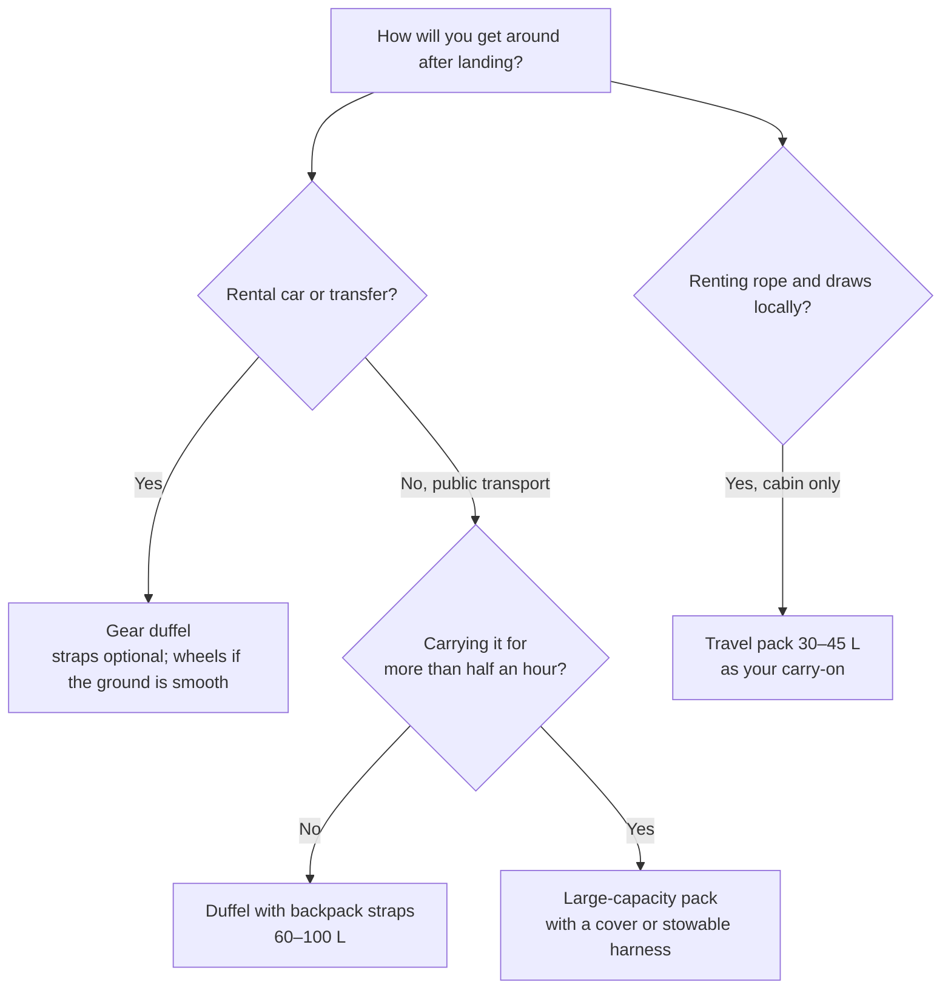

> 🌏 [中文版](/posts/climbing/2026-10-19-climbing-travel-luggage)

The [previous post](/posts/climbing/2026-10-19-climbing-travel-packing-examples-en) collected 30 packing setups from climbers. The most common split was rope and quickdraws in the hold, shoes, harness and helmet in the cabin. This post answers the next question: what do you pack it all in? Should the checked bag be a gear duffel, a large-capacity pack or a travel pack? And can your crag pack double as the carry-on?

Flying out of Taiwan, EVA Air, China Airlines and STARLUX all cap an economy checked bag at 23 kg and 158 cm in total linear dimensions, with a 7 kg carry-on. JAL, ANA and Tigerair Taiwan allow two cabin pieces totalling 10 kg. The bag's own size and empty weight have to fit inside those numbers. Each airline's full rules are in [Flying with Climbing Gear](/posts/climbing/2026-10-19-flying-with-climbing-gear-en).

By the end you should be able to pick a type of checked bag based on how you will get around after landing, choose a model from the tables that fits within 158 cm, and decide whether the crag pack you already own will work as a carry-on.

## Start with how you will travel, then pick the bag type

In the [previous post's examples](/posts/climbing/2026-10-19-climbing-travel-packing-examples-en), about 9 people checked a wheeled duffel or suitcase, about 8 used an expedition duffel, and 1 checked a haul bag as luggage. The three bag types differ in what happens after you land: how far you will carry the bag, and over what ground.

| Bag type | How you carry it | Best for | Trade-off |
|---|---|---|---|
| Gear duffel (no straps, straps, haul bag, wheels) | By hand or shoulder; strapped ones can be backpacked short distances; wheels on smooth ground | Car rental, staying in one place, a transfer from the airport | Straps rarely come with a hipbelt, so more than half an hour gets tiring; wheeled versions are heavy |
| Large-capacity pack (55–75 L travel/trekking pack) | Full back panel and hipbelt; you can carry it all day | Buses and trains between stays, gravel tracks, stairs with no lift | Smaller opening than a duffel, harder to stuff a rope and cams in; stow the harness or use a cover before checking it |
| Outdoor-brand travel pack (30–45 L) | Cabin size, shoulder straps, some with a hipbelt | Short trips where you rent rope and draws locally and fly cabin-only | No room for a rope; shoes, harness and clothes fill it |

If you travel as a pair, split the rope and quickdraws across both checked bags so that one lost bag still leaves you half a kit. Climbing.com gives the same advice: split the rack, because losing half beats losing all of it ([Climbing.com, 2025-10-14](https://www.climbing.com/travel/flying-with-climbing-gear-faqs/)).

## The checked-bag limit: how 158 cm and 23 kg work

158 cm is length plus width plus height. EVA Air states that the figure includes wheels and handles ([EVA Air checked baggage](https://www.evaair.com/zh-tw/fly-prepare/baggage/free-baggage/checked-baggage/), in Chinese). A soft bag bulges when it is full, so treat anything in the tables at 155 cm or more with care. Tigerair Taiwan sells allowance by the kilogram and allows up to 30 kg, 203 cm in total and 100 cm on any one side per piece ([Tigerair Taiwan baggage](https://www.tigerairtw.com/zh-tw/welcome-on-board/baggage), in Chinese), which is far more generous on size.

On weight, every gram of bag is a gram your gear cannot use. The Patagonia Black Hole 100 L wheeled duffel weighs 4.78 kg empty, a fifth of a 23 kg allowance; the same volume without wheels is 1.6 kg. The Kalymnos couple in the previous post checked bags of just under 20 kg each ([author's blog, 2024-12-02](https://www.tuomasheinonen.com/blog/kalymnos-a-paradise-for-climbers-what-i-learned-on-my-first-visit-to-the-island/)); in a wheeled duffel they would have been close to the limit.

## Gear duffels: current models compared

Prices below are each brand's official store price on 2026-10-19, in that store's currency, not converted. Total dimensions are converted to centimetres from the brand's figures; BD's pages for the Mission and Wall Hauler give no dimensions, so those come from REI's product pages. Independent reviews are listed only from 2020 on. Mountain Equipment's product pages and [size guide](https://us.mountain-equipment.com/pages/size-guide-wet-dry-roller-kit-bag) disagree on empty weight, so the tables give both figures.

### Soft duffels with backpack straps

| Model | Volume | Empty weight | Carry | L+W+H | Official price | Reviews since 2020 |
|---|---|---|---|---|---|---|
| [Patagonia Black Hole Duffel 55L](https://www.patagonia.com.au/products/black-hole-duffel-55l-49343-blk) | 55 L | 1,180 g | Removable straps | 116 cm ✓ | AUD 269.95 | [Switchback Travel review (2026-06-23)](https://www.switchbacktravel.com/travel/patagonia-black-hole-duffel-review); [OutdoorGearLab (2026)](https://www.outdoorgearlab.com/topics/travel/best-duffel-bag) |
| [Patagonia Black Hole Duffel 70L](https://www.patagonia.com.au/products/black-hole-duffel-70l-49348-aqst) | 70 L | 1,365 g | Removable straps | 130 cm ✓ | AUD 299.95 | As above |
| [Patagonia Black Hole Duffel 100L](https://www.patagonia.com.au/products/black-hole-duffel-100l-49353-blk) | 100 L | 1,595 g | Removable straps | 146 cm ✓ | AUD 339.95 | As above |
| [The North Face Base Camp Duffel M](https://www.thenorthface.com/en-us/p/bags-and-gear/luggage-and-duffels/duffel-bags-224547/base-camp-duffelm-NF0A52SA) | 71 L | 1,620 g | Removable straps | 135 cm ✓ | US$160 | [OutdoorGearLab (2026)](https://www.outdoorgearlab.com/topics/travel/best-duffel-bag); [Switchback Travel (2026)](https://www.switchbacktravel.com/best-travel-duffel-bags) |
| [The North Face Base Camp Duffel L](https://www.thenorthface.com/en-us/p/bags-and-gear/luggage-and-duffels/duffel-bags-224547/base-camp-duffell-NF0A52SB) | 95 L | 1,840 g | Removable straps | 152 cm ✓ | US$170 | — |
| [Black Diamond Stonehauler 65](https://blackdiamondequipment.com/products/stonehauler-65-l-duffel) | 65 L | 1.32 kg | Straps | Not published | US$209.95 | [Switchback Travel (2026, lists the previous 60 L)](https://www.switchbacktravel.com/best-travel-duffel-bags) |
| [Black Diamond Stonehauler 95](https://blackdiamondequipment.com/products/stonehauler-95-l-duffel) | 95 L | 1.62 kg | Straps | Not published | US$229.95 | — |
| [Mammut Cargo 70](https://www.mammut.com/us/en/products/2570-00400-3778/cargo-70) | 70 L | 1,150 g | Removable straps, stow in the lid | 138 cm ✓ | US$149.95 | — |
| [Mammut Cargo 100](https://www.mammut.com/us/en/products/2570-00410-0001/cargo-100) | 100 L | 1,350 g | Removable straps, stow in the lid | 161 cm ✗ | US$159.95 | — |
| [Osprey Transporter Duffel 65](https://www.osprey.com/gb/osprey-transporter-duffel-65-s25) | 65 L | 1.21 kg | Stowable straps | 137 cm ✓ | £145 | [Switchback Travel (2026)](https://www.switchbacktravel.com/best-travel-duffel-bags) |
| [Osprey Transporter Duffel 95](https://www.osprey.com/gb/osprey-transporter-duffel-95-s25) | 95 L | 1.27 kg | Stowable straps | 150 cm ✓ | £160 | As above |
| [Gregory Alpaca 60](https://www.gregory.com/travel/duffels/alpaca-60/147898XXXX.html) | 60 L | 1.61 kg | Removable straps | 141 cm ✓ | US$179.95 | [Switchback Travel (2026)](https://www.switchbacktravel.com/best-travel-duffel-bags) |
| [Gregory Alpaca Duffel 80](https://www.gregory.com/travel/duffels/alpaca-duffel-80/147899XXXX.html) | 80 L | — | Removable straps | 147 cm ✓ | US$199.95 | — |
| [Rab Expedition II 80L Kitbag](https://rab.equipment/us/rab-expedition-ii-80l-kitbag) | 80 L | 1.08 kg | Removable straps | 143 cm ✓ | US$145 | — |
| [Deuter Duffel Pro 60](https://www.deuter.com/us-en/duffel-pro-60/4046051167329) | 60 L | 1,300 g | Stowable straps | 128 cm ✓ | US$165 (excl. tax) | — |
| [Deuter Duffel Pro 90](https://www.deuter.com/us-en/duffel-pro-90/4046051167367) | 90 L | 1,500 g | Stowable straps | 154 cm ✓ | US$195 (excl. tax) | — |
| [Petzl Duffel 65](https://www.petzl.com/US/en/Professional/Packs-and-accessories/DUFFEL-65) | 65 L | 1,350 g | Removable straps | 127 cm ✓ | US$164.95 | — |
| [NEMO Double Haul 55L](https://nemoequipment.com/products/doublehaul-convertible-duffel-55-liter) | 55 L | 1.4 kg | Stowable straps, converts to a tote | 117 cm ✓ | US$169.95 | — |
| [NEMO Double Haul 70L](https://nemoequipment.com/products/doublehaul-convertible-duffel-70-liter) | 70 L | 1.74 kg | As above | 132 cm ✓ | US$199.95 | — |
| [Mountain Hardwear Expedition Duffel 75](https://www.mountainhardwear.com/p/expedition-duffel-75-2109963.html) | 75 L | 1,550 g | Removable straps | 140 cm ✓ | US$320 | — |
| [Mountain Hardwear Expedition Duffel 100](https://www.mountainhardwear.com/p/expedition-duffel-100-2109961.html) | 100 L | 1,735 g | Removable straps | 152 cm ✓ | US$330 | — |
| [Arc'teryx Carrier 75 Duffle](https://arcteryx.com/us/en/shop/carrier-75-duffle-7474) | 75 L | 920 g | Single shoulder strap | 140 cm ✓ | US$300 | — |
| [Thule Chasm 70L](https://www.thule.com/en-us/luggage/travel-duffel-bags/thule-chasm-70l-duffel-_-3204994) | 70 L | about 1.77 kg | Stowable straps | 140 cm ✓ | US$179.95 | — |
| [Thule Chasm 90L](https://www.thule.com/en-us/luggage/travel-duffel-bags/thule-chasm-90l-duffel-_-3204998) | 90 L | about 2.09 kg | Stowable straps | 150 cm ✓ | US$199.95 | — |
| [Sea to Summit Meridian Duffle 60L](https://seatosummit.com/products/meridian-duffle) | 60 L | 1,270 g | Removable straps, stow in an outside pocket | 131 cm ✓ | US$159.95 | — |
| [Sea to Summit Meridian Duffle 90L](https://seatosummit.com/products/meridian-duffle) | 90 L | 1,490 g | As above | 151 cm ✓ | US$179.95 | — |
| [Eagle Creek Cargo Hauler 90L Duffel](https://eaglecreek.com/products/cargo-hauler-90l-duffel-bag) | 90 L | 1.2 kg | Stowable straps | 142 cm ✓ | US$199 | — |
| [Mountain Equipment Wet & Dry Kitbag 70L](https://mountain-equipment.com/products/wet-dry-70l-kitbag) | 70 L | 1,670 g (product page says 2,630 g) | Straps plus grab handles | 136 cm ✓ | £140 | — |
| [Ortlieb Duffle 60L](https://de.ortlieb.com/en/products/duffle) | 60 L | 1,180 g | Padded handles double as shoulder straps | 122 cm ✓ | €185 | — |
| [Ortlieb Duffle 85L](https://de.ortlieb.com/en/products/duffle) | 85 L | 1,360 g | As above | 140 cm ✓ | €195 | — |
| [Black Diamond Mission 130](https://blackdiamondequipment.com/products/mission-130-l-duffel) | 130 L | about 1.13 kg | Handle doubles as a shoulder strap | 163 cm ✗ | US$219.95 | — |

What to look for:

- **Most soft duffels up to 100 L fit within 158 cm.** The exceptions are the Mammut Cargo 100, the [Gregory Alpaca 100](https://www.gregory.com/travel/duffels/alpaca-duffel-100/147932XXXX.html) (160 cm) and the BD Mission 130. If you want the big volume, Patagonia's 100 L, Mountain Hardwear's 100 and The North Face L still fit.
- **Stowable straps are less likely to be torn in the hold.** In one of the previous post's examples, a friend's Creek 50 came back from the hold with its straps wrecked by baggage handlers. Osprey, Deuter, NEMO, Thule and Eagle Creek tuck the straps into the bag body, Mammut stows them in the lid and Sea to Summit in an outside pocket; most others detach. The single-strap Arc'teryx and BD Mission, and the Ortlieb Duffle with its handles-as-straps, are for short carries only.
- **To stay clear of 158 cm, choose 60–80 L.** Every model in the table at that size is under the limit. The [previous post](/posts/climbing/2026-10-19-climbing-travel-packing-examples-en) estimated one person's 70 m rope plus a week of their own clothes at about 13–14 kg, well inside 23 kg.

The Black Hole line is the most-named bag in the examples, appearing in 3 of them. One person disagreed: he found the Mountain Hardwear Expedition Duffel more durable, and said his own Black Holes "have a few holes" ([Mountain Project, 2023](https://www.mountainproject.com/forum/topic/124138683/best-gear-bag-for-air-travel)). That is one user's experience, not a durability test.

If you are reading older reviews or buying second-hand, the BD Stonehauler Pro 45, Arc'teryx Carrier Duffle 55/80 and Mammut Cargon are previous generations. The brands' current lines are the Stonehauler, Carrier 40/75/100 and Mammut Cargo.

### Haul bags: still useful at the crag

Haul bags are built for hauling gear up big walls, with thick fabric and simple straps. In the [previous post](/posts/climbing/2026-10-19-climbing-travel-packing-examples-en), one climber checked a Metolius Quarter Dome on about 20 flights and it held up; at the crag it becomes the gear bag. The cost is roughly an extra kilogram of empty weight and a single round top opening.

| Model | Volume | Empty weight | Carry | L+W+H | Official price | Reviews since 2020 |
|---|---|---|---|---|---|---|
| [Metolius Haul Bag Sentinel](https://metoliusclimbing.com/products/haul-bag) | 46 L | 2.1 kg | Tuck-away haul straps | 117 cm ✓ (collar not extended) | US$189.95 | [OutdoorGearLab haul bags (2024)](https://www.outdoorgearlab.com/topics/climbing/best-haul-bag) |
| [Metolius Haul Bag Quarter Dome](https://metoliusclimbing.com/products/haul-bag) | 69 L | 2.3 kg | As above | 135 cm ✓ (149 cm with the collar up) | US$219.95 | As above |
| [Metolius Haul Bag Half Dome](https://metoliusclimbing.com/products/haul-bag) | 125 L | 3.4 kg | As above | 170 cm ✗ | US$279.95 | As above (Best Overall) |
| [Black Diamond Wall Hauler 70](https://blackdiamondequipment.com/products/wall-hauler-70-haul-bag) | 70 L | 2.46 kg | S-shaped haul straps | 146 cm ✓ | US$259.95 | As above (suited to weekend walls) |

A haul bag only makes sense if you are actually climbing big walls, or want the checked bag to double as a gear bag at the crag. For flying alone, a soft duffel of the same volume is at least 1 kg lighter.

### Wheeled duffels: easy in airports and on pavement, heavy empty

| Model | Volume | Empty weight | Carry | L+W+H | Official price | Reviews since 2020 |
|---|---|---|---|---|---|---|
| [Patagonia Black Hole Wheeled Duffel 40L](https://www.patagonia.com.au/products/black-hole-wheeled-duffel-40l-49379-blk) | 40 L | 3,521 g | Wheels, no straps | 120 cm ✓ | AUD 599.95 (out of stock; US store US$369) | [Switchback Travel wheeled duffels (2026, line named Best Overall)](https://www.switchbacktravel.com/best-wheeled-duffel-bags) |
| [Patagonia Black Hole Wheeled Duffel 70L](https://www.patagonia.com.au/products/black-hole-wheeled-duffel-70l-49382-bob) | 70 L | about 4,100 g | Wheels, no straps | 138 cm ✓ | AUD 629.95 | As above |
| [Patagonia Black Hole Wheeled Duffel 100L](https://www.patagonia.com.au/products/black-hole-wheeled-duffel-100l-49388-blk) | 100 L | 4,780 g | Wheels, no straps | 157.5 cm (0.5 cm to spare) | AUD 649.95 | As above |
| [The North Face Base Camp Duffel Roller](https://www.thenorthface.com/en-us/p/bags-and-gear/luggage-and-duffels/duffel-bags-224547/base-camp-duffel-roller-NF0A52RP) | 97 L | 2,940 g | Wheels plus shoulder straps | 145 cm ✓ | US$250 (out of stock) | — |
| [The North Face Base Camp Rolling Thunder 22"](https://www.thenorthface.com/en-us/p/bags-and-gear/luggage-and-duffels/rolling-luggage-224545/base-camp-rolling-thunder22-40l-NF0A87GB) | 40 L | 3,680 g | Wheels, no straps | 122 cm ✓ | US$300 (out of stock; [UK store](https://www.thenorthface.com/en-gb/p/bags-and-equipment-211747/base-camp-rolling-thunder-22-NF0A87GB) £280) | [OutdoorGearLab (2026, best wheeled bag for flying)](https://www.outdoorgearlab.com/topics/travel/best-duffel-bag); [Switchback Travel (2026)](https://www.switchbacktravel.com/best-wheeled-duffel-bags) |
| [The North Face Base Camp Rolling Thunder 28"](https://www.thenorthface.com/en-us/p/bags-and-gear/luggage-and-duffels/rolling-luggage-224545/base-camp-rolling-thunder28-NF0A87GC) | 95 L | 5,000 g | Wheels, no straps | 158 cm ✓ (right on the limit) | US$380 | [Switchback Travel (2026, best for outdoor use)](https://www.switchbacktravel.com/best-wheeled-duffel-bags) |
| [Osprey Transporter Wheeled Duffel 40](https://www.osprey.com/gb/osprey-transporter-wheeled-duffel-40-s25) | 40 L | 2.55 kg | Wheels, no straps | 128 cm ✓ | £220 | [Switchback Travel wheeled duffels (2026)](https://www.switchbacktravel.com/best-wheeled-duffel-bags) |
| [Osprey Rolling Transporter 90](https://www.osprey.com/gb/osprey-transporter-wheeled-duffel-90-s25) | 90 L | 3.23 kg | Wheels, no straps | 160 cm ✗ | £260 | As above |
| [Osprey Transporter Wheeled Duffel 120](https://www.osprey.com/gb/osprey-transporter-wheeled-duffel-120-s25) | 120 L | 3.5 kg | Wheels, no straps | 180 cm ✗ | £280 | As above |
| [Mammut Wheeled Cargo 45](https://www.mammut.com/us/en/products/2570-00430-0001/wheeled-cargo-45) | 45 L | 2,600 g | Wheels plus removable shoulder straps | 122 cm ✓ | US$299.95 (out of stock) | — |
| [Mammut Wheeled Cargo 90](https://www.mammut.com/us/en/products/2570-00440-0001/wheeled-cargo-90) | 90 L | 3,250 g | Wheels plus removable shoulder straps | 156 cm ✓ | US$339.95 | — |
| [Gregory Alpaca Wheeled Duffel 100L](https://www.gregory.com/travel/duffels/alpaca-wheeled-duffel-100l/155037XXXX.html) | 100 L | about 3.89 kg | Wheels, no straps | 157.5 cm (0.5 cm to spare) | US$299.95 | — |
| [Thule Chasm 40L wheeled](https://www.thule.com/en-us/luggage/carry-on-luggage/thule-chasm-wheeled-carry-on-duffel-_-3204986) | 40 L | about 3.3 kg | Wheels, no straps | 113 cm ✓ | US$369.95 | — |
| [Mountain Equipment Wet & Dry Roller Kit Bag 70L](https://us.mountain-equipment.com/products/wet-dry-roller-kit-bag-70l) | 70 L | 3,350 g (size guide says 3,370 g) | Wheels, no straps | 136 cm ✓ | US$299.95 | — |
| [Mountain Equipment Wet & Dry Roller Kit Bag 100L](https://us.mountain-equipment.com/products/wet-dry-roller-kit-bag-100l) | 100 L | 3,500 g (size guide says 3,860 g) | Wheels, no straps | 148 cm ✓ | US$374.95 | — |
| [Eagle Creek Cargo Hauler Wheeled Duffel 110L](https://eaglecreek.com/products/cargo-hauler-110l-rolling-duffel) | 108 L (brand-measured) | 1.9 kg | Wheels plus stowable straps | 149 cm ✓ | US$249 | [Switchback Travel (2026)](https://www.switchbacktravel.com/best-wheeled-duffel-bags) |
| [Eagle Creek Cargo Hauler XT 90L Wheeled Duffel](https://eaglecreek.com/products/cargo-hauler-xt-29-wheeled-duffel) | 90 L | 3.7 kg | Wheels plus stowable straps | 146 cm ✓ | US$349 | — |
| [Ortlieb Duffle RS 85L](https://de.ortlieb.com/en/products/duffle-rs) | 85 L | 2,790 g | Wheels plus shoulder strap, no telescoping handle | 147 cm ✓ | €340 | — |
| [Ortlieb Duffle RG 60L](https://de.ortlieb.com/en/products/duffle-rg) | 60 L | 3,250 g | Wheels, telescoping handle and shoulder strap | 135 cm ✓ | €360 | — |
| [Ortlieb Duffle RG 85L](https://de.ortlieb.com/en/products/duffle-rg) | 85 L | 3,450 g | As above | 151.5 cm ✓ | €380 | — |

Wheeled duffels suit car-rental trips, a single base, or an airport-to-lodging route on smooth ground. Among the big wheeled duffels, empty weight varies a lot: the lightest, the Eagle Creek Cargo Hauler 110L, is under 2 kg, while the heaviest, the Rolling Thunder 28", is 5 kg, and the difference comes straight out of your checked allowance.

If there is gravel or stairs, a roller with shoulder straps gives you more options: The North Face Roller, Mammut, Eagle Creek and Ortlieb all have them. The Mammut Wheeled Cargo 90 has removable shoulder straps and measures 156 cm, inside the limit; carry it on your back from the station to your lodging, then take the straps off before you check it so they are less likely to be torn. It weighs 3.25 kg empty, about 1.9 kg more than Mammut's wheel-less Cargo 100.

Most 40–45 L wheeled duffels are sold as carry-on size, but by EVA Air and China Airlines' 115 cm rule only the Thule Chasm 40L in the table passes. It weighs 3.3 kg on its own, nearly half of a 7 kg allowance, so this size works better as a small checked bag.

## Large-capacity packs: when you have to carry it

If you are changing lodgings by bus or train, walking from the station to a guesthouse, or the crag is walk-in only, carrying the main bag on your back beats hauling it by hand. These 55–75 L travel-trekking packs have a full back panel and hipbelt. They differ in how they protect the harness in the hold: some stow the harness behind a panel, others come with a travel cover that wraps the whole pack.

| Model | Volume | Empty weight | Harness protection for checking | L+W+H | Official price | Reviews since 2020 |
|---|---|---|---|---|---|---|
| [Osprey Farpoint Trek 70](https://osprey.com/farpointtm-trek-70-travel-pack) | 70 L | 1.98 kg | AirCover travel cover (doubles as raincover) | 150 cm ✓ | US$295 | [The Broke Backpacker (updated 2026-04)](https://www.thebrokebackpacker.com/osprey-farpoint-trek-75-review/) |
| [Osprey Fairview Trek 70](https://osprey.com/gb/fairview-trek-70-s26) (women's) | 70 L | 1.92 kg | AirCover travel cover | 148 cm ✓ | £235 | — |
| [Osprey Farpoint 70](https://osprey.com/farpointtm-70-travel-pack) | 70 L + 15 L daypack | 2.02 kg | Zip-away back panel, harness and hipbelt | 152 cm ✓ | US$275 | [Adventure Pending (2020-10, previous generation)](https://www.adventurepending.com/osprey-farpoint-70-backpack-review/) |
| [Deuter Access Pro 65](https://www.deuter.com/sk-en/shop/backpacks/p1714497-travel-backpack-access-pro-65) | 65 L + daypack | 2,540 g | Stowable back system | 134 cm ✓ (149 cm with daypack attached) | €280 | — |
| [Deuter Voyager 65+10](https://www.deuter.com/us-en/voyager-65-10/4046051167183) | 65 + 10 L | 2,830 g | Travel cover (doubles as raincover) | 142 cm ✓ (157 cm with daypack attached) | US$325 | [Tour du Mondiste (in French, 2025-08-06)](https://www.tourdumondiste.com/avis-sac-a-dos-deuter-voyager) |
| [Lowe Alpine Escape Trek 60:70](https://lowealpine.com/uk/lowe-alpine-escape-trek-60-70) | 60 + 10 L | 2.05 kg | Stowable harness plus travel cover | 149 cm ✓ | £210 (sold through select retailers) | — |
| [Gregory Border 50+15](https://eu.gregorypacks.com/uk-en/-border-50-15--black-lichen/154921-A653.html) | 50 + 15 L | 2.79 kg | Stowable shoulder straps plus travel cover | 139 cm ✓ | £260 | — |
| [Thule Landmark 70L](https://www.thule.com/en-us/backpacks/backpacking-travel-backpacks/thule-landmark-70l-_-3205317) | 70 L (including 20 L daypack) | about 2.09 kg | Zip cover over back panel, shoulder straps and hipbelt | 145 cm ✓ | US$279.95 | [Switchback Travel (2026-02, 60 L version)](https://switchbacktravel.com/best-travel-backpacks) |
| [Decathlon Forclaz Travel 900 70+6](https://www.decathlon.co.uk/p/men's-travel-trekking-rucksack-with-suitcase-opening-70-6-litre-travel-900/_/R-p-324139) | 70 + 6 L | 2.5 kg | Raincover doubles as a transport cover | 140 cm ✓ | £119.99 | [Live for the Outdoors (2024-02, women's 60+6)](https://livefortheoutdoors.com/hiking/rucksacks/decathlon-forclaz-womens-travel-900-backpack-review) |

These packs weigh 2–2.8 kg empty, about 1 kg more than a soft duffel of similar volume; what you get for it is a bag you can carry all day. With its daypack attached the Deuter Voyager totals 157 cm, right at the limit. Take the daypack off and carry it on, and the problem goes away.

A trekking pack with neither a cover nor a stowable harness, such as the [Rab Hyperon 65](https://rab.equipment/us/rab-hyperon-65l-trekking-pack) (165 cm, already over 158 cm), needs to go inside a cheap duffel before you check it. People in the [previous post](/posts/climbing/2026-10-19-climbing-travel-packing-examples-en) did exactly that to protect the straps, and some asked the airline for a heavy plastic bag. The Deuter Traveller recommended in one example now only turns up as clearance stock; Deuter's successor is the Voyager in the table.

## Outdoor-brand travel packs: one bag, travelling light

A 30–45 L travel pack is cabin-sized to begin with. It suits trips where you rent the rope and quickdraws locally (you can in Railay, Thailand and on Kalymnos; see [Climbing Trip Gear List by Destination](/posts/climbing/2026-10-19-climbing-trip-gear-list-by-destination-en)), packed with clothes, shoes, harness and chalk bag. In the previous post, a professional climber went to a festival in Italy with nothing but one cabin-sized travel bag, no rope and no quickdraws.

The three Taiwanese full-service airlines allow a carry-on of 56×36×23 cm, or 115 cm in total ([EVA Air carry-on](https://www.evaair.com/zh-tw/fly-prepare/baggage/free-baggage/carry-on-baggage/), [China Airlines carry-on](https://www.china-airlines.com/tw/zh/prepare-for-the-fly/information/baggage/carry-on-baggage), both in Chinese). JAL and ANA allow 55×40×25 cm ([ANA](https://www.ana.co.jp/en/jp/guide/boarding-procedures/baggage/international/carry-rule/)), and Tigerair Taiwan 54×38×23 cm. The "cabin size" column below uses EVA Air and China Airlines' 115 cm rule.

| Model | Volume | Empty weight | Brand dimensions | Cabin size | Official price | Reviews since 2020 |
|---|---|---|---|---|---|---|
| [Osprey Farpoint 40](https://osprey.com/gb/osprey-farpoint-40-f22) / [Fairview 40](https://osprey.com/eu/fairview-40-s26) (women's) | 40 L | 1.48 kg | 55×35×23 cm | ✓ | £170 / €180 (mid-refresh, old version out of stock) | [OutdoorGearLab (updated 2026-08)](https://outdoorgearlab.com/topics/travel/best-travel-backpack); [Pack Hacker (2022-12)](https://packhacker.com/travel-gear/osprey/farpoint-40) |
| [Osprey Transporter Travel Pack 44](https://osprey.com/gb/osprey-transporter-travel-pack-44-s25) | 44 L | 1.54 kg | 54×42×32 cm | ✗ (too wide and too deep) | £190 | — |
| [Osprey Farpoint 55](https://www.osprey.com/farpointtm-55-travel-pack) / Fairview 55 (women's) | 40 L + 15 L daypack | 1.87 kg | 55×35×46 cm (probably with the daypack attached) | Unconfirmed (brand says the main pack fits with the daypack detached) | US$240 | — |
| [Patagonia Black Hole MLC 45L](https://patagonia.com.au/products/black-hole-mlc-45l-49307-blk) | 45 L | 1,644 g | 56×37×19 cm | ✓ (112 cm total; 1 cm longer than JAL/ANA allow) | AUD 379.95 | [OutdoorGearLab (updated 2026-08)](https://outdoorgearlab.com/topics/travel/best-travel-backpack); [Pack Hacker (2024-10)](https://packhacker.com/travel-gear/patagonia/black-hole-mlc) |
| [Patagonia Black Hole Pack 32L](https://patagonia.com.au/products/black-hole-pack-32l-49302-pgta) | 32 L | 811 g | 56×25×17 cm | ✓ | AUD 269.95 | [Pack Hacker (2023-03)](https://www.packhacker.com/travel-gear/patagonia/black-hole-pack-32l/) |
| [Gregory Border Carry-On 40](https://gregory.com/travel/backpacks/border-carry-on-40/154920D789.html) | 40 L | 1.75 kg | 56×36×23 cm | ✓ | US$239.95 | [Pack Hacker (2026-02)](https://packhacker.com/travel-gear/gregory/border-carry-on-40-2) |
| [The North Face Base Camp Voyager Travel Pack 35L](https://www.thenorthface.com/en-us/p/bags-and-gear/backpacks-224451/base-camp-voyager-travel-pack-35l-NF0A81DN) | 35 L | about 1.57 kg (REI figure) | 49×30×16 cm (REI figure) | ✓ | US$180 | [Switchback Travel (2026-02)](https://switchbacktravel.com/best-travel-backpacks); [Pack Hacker (2025-01)](https://packhacker.com/travel-gear/the-north-face/base-camp-voyager-travel-pack) |
| [Thule Aion 40L](https://www.thule.com/en-us/luggage/thule-aion-collection/thule-aion-travel-backpack-40l-_-3204724) | 40 L | about 1.45 kg | 52×33×23 cm | ✓ (108 cm total) | US$209.95 | [Switchback Travel (2026-02)](https://switchbacktravel.com/best-travel-backpacks) |
| [Mystery Ranch Mission Rover 45](https://www.mysteryranch.com/mission-rover-45-pack) | 45 L | 1.77 kg | 53×33×30 cm | ✗ (117 cm total) | US$249 (out of stock, no restock date) | [Pack Hacker (2025-07)](https://www.packhacker.com/travel-gear/mystery-ranch/mission-rover-45/) |
| [Deuter Carry On 30](https://www.deuter.com/us-en/carry-on-30/4046051190693) | 30 L | 1,080 g | 52×33×22 cm | ✓ | US$170 (excl. tax) | — |
| [Lowe Alpine Escape Flight Pro 40L](https://lowealpine.com/lowe-alpine-escape-flight-pro-40l-cabin-pack) | 40 L | 1.36 kg | 55×33×25 cm | ✓ (113 cm total) | £145 (sold through select retailers) | — |
| [Decathlon Forclaz Travel 500 Organizer 40L](https://www.decathlon.co.uk/p/travel-backpack-40-l-travel-500-organizer-black/_/R-p-338564) | 40 L | 1.3 kg | 55×32×27 cm | ✓ (114 cm total; watch the depth) | £59.99 | [Pack Hacker (2025-04)](https://packhacker.com/travel-gear/forclaz/travel-500-organizer-40-l-backpack) |

Check two things first. One is empty weight: out of a 7 kg cabin allowance, the Gregory Border and Mystery Ranch take 1.75 kg or more, while the Patagonia Black Hole Pack is 811 g. The other is depth: the 23 cm side is the one most likely to overflow when the pack is full. The Forclaz lists 27 cm and the Lowe Alpine 25 cm; they pass only on the 115 cm total. If the gate agent uses a sizer, what goes in is your bag as packed.

## The carry-on: using your crag pack or multipitch pack

About 8 people in the previous post used their crag pack as the carry-on or personal item, then took it straight to the crag with no extra bag. According to Climbing.com, a pack of around 40 L holds quickdraws, a rope, a harness, two or three pairs of shoes and a small rack ([Climbing.com, 2024-10-21](https://www.climbing.com/skills/how-to-fly-with-a-crashpad/)). To double as a carry-on, it has to meet three conditions.

**1. It fits the cabin sizer.** On Taiwan's full-service airlines that is 56×36×23 cm or 115 cm in total. Crag packs are often long and deep: the [Metolius Crag Station Classic](https://metoliusclimbing.com/products/crag-station-classic) is listed at 28×13×10 in (71×33×25 cm), and its long side is over 56 cm. Some crag packs are designed to cabin size, such as the [Climbing Technology Falesia](https://climbingtechnology.com/en/outdoor-en/bags-and-backpacks/backpacks/falesia) at 55×35×20 cm.

**2. It is light enough for 7 kg to go somewhere.** EVA Air, China Airlines and STARLUX allow one 7 kg carry-on, and the pack counts. Within BD's own range, the [Crag 40](https://blackdiamondequipment.com/products/crag-40-backpack) is 941 g and the [Creek 50](https://blackdiamondequipment.com/products/creek-50-pack) is 2 kg; the [Patagonia Cragsmith 45L](https://www.patagonia.com/product/cragsmith-pack-45-liters/48066.html) is 1,420 g. That is a 1 kg difference before you pack anything. JAL, ANA and Tigerair Taiwan allow two pieces totalling 10 kg, which leaves more room.

**3. It opens wide enough for security to search.** If there are quickdraws or cams in there alongside shoes, harness and chalk bag, security may ask to open it. A pack with a full-length back-panel zip is easier to repack afterwards. If you are told to check it, you need to have arrived early enough to go back to the counter; see [Flying with Climbing Gear](/posts/climbing/2026-10-19-flying-with-climbing-gear-en).

**A multipitch pack as the personal item.** 15–30 L multipitch packs mostly weigh 400–800 g and can be your second piece. Personal-item limits are much smaller than carry-on limits: EVA Air allows 40×30×10 cm or 80 cm in total, China Airlines 40×30×15 cm or 85 cm, ANA 40×30×20 cm. EVA's 10 cm is the tightest, so pack the bag at home and measure its depth.

For opening styles, carry systems and volumes across crag packs, see [Choosing a Crag Pack](/posts/climbing/2026-10-19-climbing-crag-packs-en); for packs you climb with, see [Choosing a Multipitch Pack](/posts/climbing/2026-10-19-multipitch-climbing-backpacks-en).

## Three example combinations

| Trip | Checked bag | Carry-on | Personal item |
|---|---|---|---|
| A week of sport climbing with a rental car, one base | 70 L soft duffel with straps, or a wheeled duffel | Crag pack: shoes, harness, helmet, belay device | Small bag for documents and electronics |
| Public transport between stays | 60–70 L large pack (with cover), or a duffel with straps | Crag pack | Multipitch pack |
| Rope and draws rented locally, cabin only | Nothing checked | 40 L travel pack: clothes, shoes, harness | Small daypack or multipitch pack |

Once you have the bags, do one test at home before you leave: pack everything you are taking, measure the full bag on all three sides with a tape measure, and weigh both the checked bag and the carry-on with a luggage scale. Over 158 cm or 23 kg, switch to a smaller bag or move the rope to your partner's bag. Carry-on over 7 kg, move clothes into the hold first and keep the shoes and harness with you.

## Update log

- 2026-10-19: Added 17 models to the wheeled duffel table (including the Mammut Wheeled Cargo 90), 8 to the soft duffels with straps, 1 to the large-capacity packs and 2 to the travel packs; rewrote the wheeled duffel advice and updated the brand count and wheeled-duffel weight range.

## References

- [EVA Air: Checked baggage (in Chinese)](https://www.evaair.com/zh-tw/fly-prepare/baggage/free-baggage/checked-baggage/)
- [EVA Air: Carry-on baggage (in Chinese)](https://www.evaair.com/zh-tw/fly-prepare/baggage/free-baggage/carry-on-baggage/)
- [China Airlines: Carry-on baggage (in Chinese)](https://www.china-airlines.com/tw/zh/prepare-for-the-fly/information/baggage/carry-on-baggage)
- [Tigerair Taiwan: Baggage (in Chinese)](https://www.tigerairtw.com/zh-tw/welcome-on-board/baggage)
- [ANA: Carry-on baggage](https://www.ana.co.jp/en/jp/guide/boarding-procedures/baggage/international/carry-rule/)
- [Switchback Travel: Patagonia Black Hole Duffel Review (2026-06-23)](https://www.switchbacktravel.com/travel/patagonia-black-hole-duffel-review)
- [Switchback Travel: Best Duffel Bags (2026)](https://www.switchbacktravel.com/best-travel-duffel-bags)
- [Switchback Travel: Best Wheeled Duffel Bags (2026)](https://www.switchbacktravel.com/best-wheeled-duffel-bags)
- [Switchback Travel: Best Travel Backpacks (2026-02)](https://switchbacktravel.com/best-travel-backpacks)
- [OutdoorGearLab: Best Duffel Bags (2026)](https://www.outdoorgearlab.com/topics/travel/best-duffel-bag)
- [OutdoorGearLab: Best Haul Bags (2024)](https://www.outdoorgearlab.com/topics/climbing/best-haul-bag)
- [OutdoorGearLab: Best Travel Backpacks (updated 2026-08)](https://outdoorgearlab.com/topics/travel/best-travel-backpack)
- [Pack Hacker: Osprey Farpoint 40 (2022-12)](https://packhacker.com/travel-gear/osprey/farpoint-40)
- [Pack Hacker: Patagonia Black Hole MLC (2024-10)](https://packhacker.com/travel-gear/patagonia/black-hole-mlc)
- [Pack Hacker: Patagonia Black Hole Pack 32L (2023-03)](https://www.packhacker.com/travel-gear/patagonia/black-hole-pack-32l/)
- [Pack Hacker: Gregory Border Carry-On 40 V2 (2026-02)](https://packhacker.com/travel-gear/gregory/border-carry-on-40-2)
- [Pack Hacker: The North Face Base Camp Voyager (2025-01)](https://packhacker.com/travel-gear/the-north-face/base-camp-voyager-travel-pack)
- [Pack Hacker: Mystery Ranch Mission Rover 45 (2025-07)](https://www.packhacker.com/travel-gear/mystery-ranch/mission-rover-45/)
- [Pack Hacker: Forclaz Travel 500 Organizer 40L (2025-04)](https://packhacker.com/travel-gear/forclaz/travel-500-organizer-40-l-backpack)
- [The Broke Backpacker: Osprey Farpoint Trek 70 Review (updated 2026-04)](https://www.thebrokebackpacker.com/osprey-farpoint-trek-75-review/)
- [Adventure Pending: Osprey Farpoint 70 review (2020-10)](https://www.adventurepending.com/osprey-farpoint-70-backpack-review/)
- [Tour du Mondiste: Deuter Voyager (in French, 2025-08-06)](https://www.tourdumondiste.com/avis-sac-a-dos-deuter-voyager)
- [Live for the Outdoors: Forclaz Women's Travel 900 (2024-02)](https://livefortheoutdoors.com/hiking/rucksacks/decathlon-forclaz-womens-travel-900-backpack-review)
- [Climbing.com: How to Fly with a Crashpad (2024-10-21)](https://www.climbing.com/skills/how-to-fly-with-a-crashpad/)
- [Climbing.com: What Climbing Gear You Can Fly With, According to TSA (2025-10-14)](https://www.climbing.com/travel/flying-with-climbing-gear-faqs/)
- [Mountain Project: Best gear bag for air travel (2023)](https://www.mountainproject.com/forum/topic/124138683/best-gear-bag-for-air-travel)
- [Kalymnos – a paradise for climbers (2024-12-02)](https://www.tuomasheinonen.com/blog/kalymnos-a-paradise-for-climbers-what-i-learned-on-my-first-visit-to-the-island/)
- [Mountain Equipment: Wet & Dry Roller Kit Bag size guide](https://us.mountain-equipment.com/pages/size-guide-wet-dry-roller-kit-bag)
- [Mountain Equipment: Wet & Dry Kit Bag size guide](https://mountain-equipment.com/pages/size-guide-wet-dry-kit-bag)
- Official product pages are linked in the tables; prices checked 2026-10-19.
