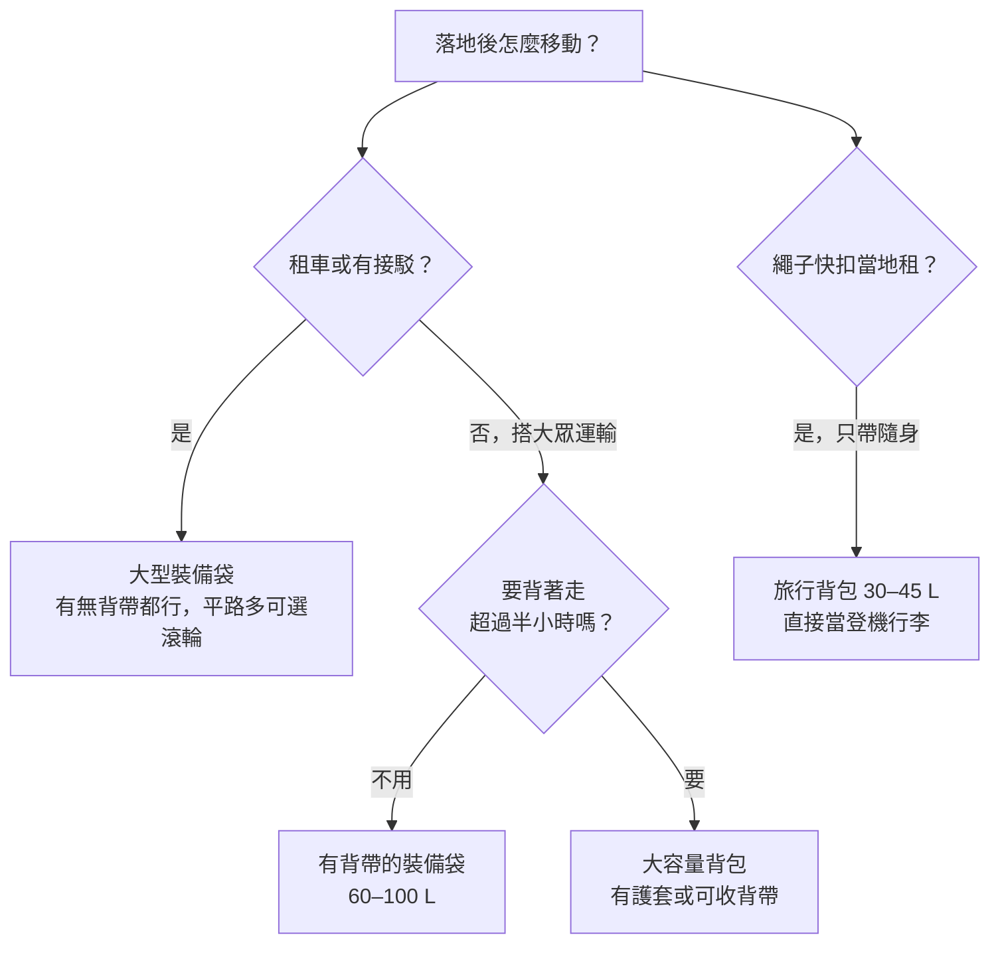

> 🌏 [English version](/posts/climbing/2026-10-19-climbing-travel-luggage-en)

[上一篇](/posts/climbing/2026-10-19-climbing-travel-packing-examples)整理了 45 個攀岩者的打包實例，最常見的分法是繩子和快扣托運，鞋、吊帶、頭盔帶上機。這篇接著回答用什麼袋子裝：托運的主袋選大型裝備袋、大容量背包，還是旅行背包？登機包能不能直接用岩場包？

從台灣出發，長榮、華航、星宇的經濟艙托運單件上限都是 23 kg、長寬高總和 158 cm，登機行李 7 kg。日航、全日空和台灣虎航的登機行李是兩件合計 10 kg。袋子本身的尺寸和空重，就是在這幾個數字裡分配空間。各航司的完整規定見[〈攀岩裝備上飛機〉](/posts/climbing/2026-10-19-flying-with-climbing-gear)。

讀完這篇，你可以依落地後的交通方式選一類主袋，從表裡挑出塞得進 158 cm 的款式，再判斷手上的岩場包能不能當登機包。

## 先看交通方式，再選主袋類型

[上一篇的實例](/posts/climbing/2026-10-19-climbing-travel-packing-examples)裡，托運用滾輪大袋或行李箱的約 9 例，用遠征大袋（duffel）的約 8 例，另有 1 例直接拿拖包（haul bag）當行李。三類主袋的差別在落地以後：你要扛著它走多遠、走什麼路。

| 主袋類型 | 怎麼背 | 適合的行程 | 代價 |
|---|---|---|---|
| 大型裝備袋（無背帶、有背帶、拖包、滾輪） | 手提、肩背；有背帶的可短距離背；滾輪在平路拖 | 租車自駕、住同一個地方、機場到住宿有接駁 | 背帶多半沒有腰帶，走超過半小時會累；滾輪款空重高 |
| 大容量背包（55–75 L 旅行登山包） | 有背板、腰帶，能背一整天 | 搭火車公車換宿、走碎石路或爬沒電梯的樓梯 | 開口比裝備袋小，繩子和活動岩楔不好塞；托運前要收背帶或套護套 |
| 戶外品牌旅行背包（30–45 L） | 登機尺寸，有背帶，部分附腰帶 | 繩子快扣在當地租、只帶隨身行李的短程 | 裝不下繩子；鞋、吊帶、衣服加起來就滿了 |

兩人同行時，把繩和快扣分在兩人的主袋裡，一袋遺失還有另一半能用。Climbing.com 也這樣建議：分開帶，丟一半總比全丟好（[Climbing.com，2025-10-14](https://www.climbing.com/travel/flying-with-climbing-gear-faqs/)）。

## 主袋的上限：158 cm 和 23 kg 怎麼算

158 cm 是長、寬、高三邊相加。長榮的規定寫明「包含腳輪和把手」（[長榮托運行李](https://www.evaair.com/zh-tw/fly-prepare/baggage/free-baggage/checked-baggage/)），軟袋塞滿以後會鼓起來，所以表上剛好卡在 155 cm 以上的款式要留意。台灣虎航按公斤買額度，單件上限是 30 kg、總和 203 cm、單邊 100 cm（[台灣虎航行李規定](https://www.tigerairtw.com/zh-tw/welcome-on-board/baggage)），尺寸寬鬆得多。

重量上，袋子越重，裝備能用的額度越少。Patagonia Black Hole 100 L 滾輪袋空重 4.78 kg，佔掉 23 kg 的兩成；同容量沒有輪子的版本是 1.6 kg。卡林諾斯那對夫妻的托運行李每件不到 20 kg（[作者部落格，2024-12-02](https://www.tuomasheinonen.com/blog/kalymnos-a-paradise-for-climbers-what-i-learned-on-my-first-visit-to-the-island/)），換成滾輪袋就會逼近上限。

## 大型裝備袋：現行款比較

以下價格是 2026-10-19 各品牌官網標價，幣別照官網所在地區，沒有換算。三邊總和由原廠尺寸換算成公分；BD Mission 和 Wall Hauler 原廠頁沒有尺寸，用 REI 商品頁的數字。第三方評測只列 2020 年以後的。Mountain Equipment 三款的空重取自原廠尺寸表（[Kit Bag](https://mountain-equipment.com/pages/size-guide-wet-dry-kit-bag)、[Roller Kit Bag](https://us.mountain-equipment.com/pages/size-guide-wet-dry-roller-kit-bag)）。

### 有背帶的軟質裝備袋

| 型號 | 容量 | 空重 | 背負方式 | 三邊總和 | 官方價格 | 2020 後評測 |
|---|---|---|---|---|---|---|
| [Patagonia Black Hole Duffel 55L](https://www.patagonia.com.au/products/black-hole-duffel-55l-49343-blk) | 55 L | 1,180 g | 可拆背帶 | 116 cm ✓ | AUD 269.95 | [Switchback Travel 單品評測（2026-06-23）](https://www.switchbacktravel.com/travel/patagonia-black-hole-duffel-review)；[OutdoorGearLab（2026）](https://www.outdoorgearlab.com/topics/travel/best-duffel-bag) |
| [Patagonia Black Hole Duffel 70L](https://www.patagonia.com.au/products/black-hole-duffel-70l-49348-aqst) | 70 L | 1,365 g | 可拆背帶 | 130 cm ✓ | AUD 299.95 | 同上 |
| [Patagonia Black Hole Duffel 100L](https://www.patagonia.com.au/products/black-hole-duffel-100l-49353-blk) | 100 L | 1,595 g | 可拆背帶 | 146 cm ✓ | AUD 339.95 | 同上 |
| [The North Face Base Camp Duffel M](https://www.thenorthface.com/en-us/p/bags-and-gear/luggage-and-duffels/duffel-bags-224547/base-camp-duffelm-NF0A52SA) | 71 L | 1,620 g | 可拆背帶 | 135 cm ✓ | US$160 | [OutdoorGearLab（2026）](https://www.outdoorgearlab.com/topics/travel/best-duffel-bag)；[Switchback Travel（2026）](https://www.switchbacktravel.com/best-travel-duffel-bags) |
| [The North Face Base Camp Duffel L](https://www.thenorthface.com/en-us/p/bags-and-gear/luggage-and-duffels/duffel-bags-224547/base-camp-duffell-NF0A52SB) | 95 L | 1,840 g | 可拆背帶 | 152 cm ✓ | US$170 | — |
| [Black Diamond Stonehauler 65](https://blackdiamondequipment.com/products/stonehauler-65-l-duffel) | 65 L | 1.32 kg | 背帶 | 原廠未標 | US$209.95 | [Switchback Travel（2026，列的是前一代 60 L）](https://www.switchbacktravel.com/best-travel-duffel-bags) |
| [Black Diamond Stonehauler 95](https://blackdiamondequipment.com/products/stonehauler-95-l-duffel) | 95 L | 1.62 kg | 背帶 | 原廠未標 | US$229.95 | — |
| [Mammut Cargo 70](https://www.mammut.com/us/en/products/2570-00400-3778/cargo-70) | 70 L | 1,150 g | 可拆背帶，收進頂蓋 | 138 cm ✓ | US$149.95 | — |
| [Mammut Cargo 100](https://www.mammut.com/us/en/products/2570-00410-0001/cargo-100) | 100 L | 1,350 g | 可拆背帶，收進頂蓋 | 161 cm ✗ | US$159.95 | — |
| [Osprey Transporter Duffel 65](https://www.osprey.com/gb/osprey-transporter-duffel-65-s25) | 65 L | 1.21 kg | 可收背帶 | 137 cm ✓ | £145 | [Switchback Travel（2026）](https://www.switchbacktravel.com/best-travel-duffel-bags) |
| [Osprey Transporter Duffel 95](https://www.osprey.com/gb/osprey-transporter-duffel-95-s25) | 95 L | 1.27 kg | 可收背帶 | 150 cm ✓ | £160 | 同上 |
| [Gregory Alpaca 60](https://www.gregory.com/travel/duffels/alpaca-60/147898XXXX.html) | 60 L | 1.61 kg | 可拆背帶 | 141 cm ✓ | US$179.95 | [Switchback Travel（2026）](https://www.switchbacktravel.com/best-travel-duffel-bags) |
| [Gregory Alpaca Duffel 80](https://www.gregory.com/travel/duffels/alpaca-duffel-80/147899XXXX.html) | 80 L | — | 可拆背帶 | 147 cm ✓ | US$199.95 | — |
| [Rab Expedition II 80L Kitbag](https://rab.equipment/us/rab-expedition-ii-80l-kitbag) | 80 L | 1.08 kg | 可拆背帶 | 143 cm ✓ | US$145 | — |
| [Deuter Duffel Pro 60](https://www.deuter.com/us-en/duffel-pro-60/4046051167329) | 60 L | 1,300 g | 可收背帶 | 128 cm ✓ | US$165（未稅） | — |
| [Deuter Duffel Pro 90](https://www.deuter.com/us-en/duffel-pro-90/4046051167367) | 90 L | 1,500 g | 可收背帶 | 154 cm ✓ | US$195（未稅） | — |
| [Petzl Duffel 65](https://www.petzl.com/US/en/Professional/Packs-and-accessories/DUFFEL-65) | 65 L | 1,350 g | 可拆背帶 | 127 cm ✓ | US$164.95 | — |
| [NEMO Double Haul 55L](https://nemoequipment.com/products/doublehaul-convertible-duffel-55-liter) | 55 L | 1.4 kg | 可收背帶，可變托特包 | 117 cm ✓ | US$169.95 | — |
| [NEMO Double Haul 70L](https://nemoequipment.com/products/doublehaul-convertible-duffel-70-liter) | 70 L | 1.74 kg | 同上 | 132 cm ✓ | US$199.95 | — |
| [Mountain Hardwear Expedition Duffel 75](https://www.mountainhardwear.com/p/expedition-duffel-75-2109963.html) | 75 L | 1,550 g | 可拆背帶 | 140 cm ✓ | US$320 | — |
| [Mountain Hardwear Expedition Duffel 100](https://www.mountainhardwear.com/p/expedition-duffel-100-2109961.html) | 100 L | 1,735 g | 可拆背帶 | 152 cm ✓ | US$330 | — |
| [Arc'teryx Carrier 75 Duffle](https://arcteryx.com/us/en/shop/carrier-75-duffle-7474) | 75 L | 920 g | 單肩背帶 | 140 cm ✓ | US$300 | — |
| [Thule Chasm 70L](https://www.thule.com/en-us/luggage/travel-duffel-bags/thule-chasm-70l-duffel-_-3204994) | 70 L | 約 1.77 kg | 可收背帶 | 140 cm ✓ | US$179.95 | — |
| [Thule Chasm 90L](https://www.thule.com/en-us/luggage/travel-duffel-bags/thule-chasm-90l-duffel-_-3204998) | 90 L | 約 2.09 kg | 可收背帶 | 150 cm ✓ | US$199.95 | — |
| [Sea to Summit Meridian Duffle 60L](https://seatosummit.com/products/meridian-duffle) | 60 L | 1,270 g | 可拆背帶，收在外側口袋 | 131 cm ✓ | US$159.95 | — |
| [Sea to Summit Meridian Duffle 90L](https://seatosummit.com/products/meridian-duffle) | 90 L | 1,490 g | 同上 | 151 cm ✓ | US$179.95 | — |
| [Eagle Creek Cargo Hauler 90L Duffel](https://eaglecreek.com/products/cargo-hauler-90l-duffel-bag) | 90 L | 1.2 kg | 可收背帶 | 142 cm ✓ | US$199 | — |
| [Mountain Equipment Wet & Dry Kitbag 70L](https://mountain-equipment.com/products/wet-dry-70l-kitbag) | 70 L | 1,670 g | 背帶加提把 | 136 cm ✓ | £140 | — |
| [Ortlieb Duffle 60L](https://de.ortlieb.com/en/products/duffle) | 60 L | 1,180 g | 加墊提把兼肩帶 | 122 cm ✓ | €185 | — |
| [Ortlieb Duffle 85L](https://de.ortlieb.com/en/products/duffle) | 85 L | 1,360 g | 同上 | 140 cm ✓ | €195 | — |
| [Black Diamond Mission 130](https://blackdiamondequipment.com/products/mission-130-l-duffel) | 130 L | 約 1.13 kg | 提把兼單肩背帶 | 163 cm ✗ | US$219.95 | — |

幾個挑選重點：

- **100 L 以下的軟袋，多數在 158 cm 以內。** 超過的是 Mammut Cargo 100、[Gregory Alpaca 100](https://www.gregory.com/travel/duffels/alpaca-duffel-100/147932XXXX.html)（160 cm）和 BD Mission 130。要用大容量，Patagonia 100 L、Mountain Hardwear 100 L 和 The North Face L 都還在範圍內。
- **背帶收得起來，托運時比較不會被扯壞。** 上一篇有一例，朋友的 Creek 50 托運後背帶被地勤扯壞。Osprey、Deuter、NEMO、Thule、Eagle Creek 的背帶收在袋身，Mammut 收進頂蓋，Sea to Summit 收進外側口袋；其餘多是拆下來另外放。單肩背帶的 Arc'teryx、BD Mission，和拿提把當肩帶的 Ortlieb Duffle 只適合短距離。
- **不想被 158 cm 卡住，選 60–80 L。** 表上這個容量的每一款都在 158 cm 以內。[上一篇](/posts/climbing/2026-10-19-climbing-travel-packing-examples)估算一個人帶 70 m 繩加自己一週的衣物約 13–14 kg，離 23 kg 還有餘裕。

Black Hole 系列是實例裡被點名最多的袋子，出現在 3 個實例。也有人持相反意見：他覺得 Mountain Hardwear Expedition Duffel 比較耐用，自己的 Black Hole「破了幾個洞」（[Mountain Project，2023](https://www.mountainproject.com/forum/topic/124138683/best-gear-bag-for-air-travel)）。這是單一使用者的說法，不是耐用度測試。

看舊評測或逛二手市場時，BD Stonehauler Pro 45、Arc'teryx Carrier Duffle 55／80 和 Mammut Cargon 都是前一代。現在官網賣的是 Stonehauler、Carrier 40／75／100 和 Mammut Cargo 系列。

### 拖包：到岩場還能用

拖包本來是大岩壁上拖運裝備用的，布料厚、背帶簡單。[上一篇](/posts/climbing/2026-10-19-climbing-travel-packing-examples)有人拿 Metolius Quarter Dome 當托運行李，飛了約 20 趟還好好的，到岩場直接當裝備袋。代價是空重多 1 kg 左右，而且只有圓筒形一個大開口。

| 型號 | 容量 | 空重 | 背負方式 | 三邊總和 | 官方價格 | 2020 後評測 |
|---|---|---|---|---|---|---|
| [Metolius Haul Bag Sentinel](https://metoliusclimbing.com/products/haul-bag) | 46 L | 2.1 kg | 可收拖包背帶 | 117 cm ✓（不含延伸口） | US$189.95 | [OutdoorGearLab 拖包比較（2024）](https://www.outdoorgearlab.com/topics/climbing/best-haul-bag) |
| [Metolius Haul Bag Quarter Dome](https://metoliusclimbing.com/products/haul-bag) | 69 L | 2.3 kg | 同上 | 135 cm ✓（拉高延伸口 149 cm） | US$219.95 | 同上 |
| [Metolius Haul Bag Half Dome](https://metoliusclimbing.com/products/haul-bag) | 125 L | 3.4 kg | 同上 | 170 cm ✗ | US$279.95 | 同上（評為最佳整體） |
| [Black Diamond Wall Hauler 70](https://blackdiamondequipment.com/products/wall-hauler-70-haul-bag) | 70 L | 2.46 kg | S 型拖包背帶 | 146 cm ✓ | US$259.95 | 同上（適合週末大岩壁） |

拖包只建議給真的要爬大岩壁、或想讓托運袋到岩場兼裝備袋的人。單純搭飛機，同容量的軟袋輕 1 kg 以上。

### 滾輪袋：機場和平路方便，空重偏高

| 型號 | 容量 | 空重 | 背負方式 | 三邊總和 | 官方價格 | 2020 後評測 |
|---|---|---|---|---|---|---|
| [Patagonia Black Hole Wheeled Duffel 40L](https://www.patagonia.com/product/black-hole-wheeled-duffel-bag-40-liters/49379.html) | 40 L | 3,521 g | 滾輪，無背帶 | 120 cm ✓ | US$369（部分顏色預購中） | [Switchback Travel 滾輪袋比較（2026，系列評為最佳整體）](https://www.switchbacktravel.com/best-wheeled-duffel-bags) |
| [Patagonia Black Hole Wheeled Duffel 70L](https://www.patagonia.com/product/black-hole-wheeled-duffel-bag-70-liters/49382.html) | 70 L | 4,100 g | 滾輪，無背帶 | 138 cm ✓ | US$409 | 同上 |
| [Patagonia Black Hole Wheeled Duffel 100L](https://www.patagonia.com/product/black-hole-wheeled-duffel-bag-100-liters/49388.html) | 100 L | 4,780 g | 滾輪，無背帶 | 157.5 cm（只差 0.5 cm） | US$425 | 同上 |
| [The North Face Base Camp Duffel Roller](https://www.thenorthface.com/en-us/p/bags-and-gear/luggage-and-duffels/duffel-bags-224547/base-camp-duffel-roller-NF0A52RP) | 97 L | 2,940 g | 滾輪加背帶 | 145 cm ✓ | US$250（缺貨中） | — |
| [The North Face Base Camp Rolling Thunder 22"](https://www.thenorthface.com/en-us/p/bags-and-gear/luggage-and-duffels/rolling-luggage-224545/base-camp-rolling-thunder22-40l-NF0A87GB) | 40 L | 3,680 g | 滾輪，無背帶 | 122 cm ✓ | US$320（[英國官網](https://www.thenorthface.com/en-gb/p/bags-and-equipment-211747/base-camp-rolling-thunder-22-NF0A87GB) £280） | [OutdoorGearLab（2026，最適合搭機的滾輪袋）](https://www.outdoorgearlab.com/topics/travel/best-duffel-bag)；[Switchback Travel（2026）](https://www.switchbacktravel.com/best-wheeled-duffel-bags) |
| [The North Face Base Camp Rolling Thunder 28"](https://www.thenorthface.com/en-us/p/bags-and-gear/luggage-and-duffels/rolling-luggage-224545/base-camp-rolling-thunder28-NF0A87GC) | 95 L | 5,000 g | 滾輪，無背帶 | 158 cm ✓（剛好壓線） | US$380 | [Switchback Travel（2026，最適合戶外用）](https://www.switchbacktravel.com/best-wheeled-duffel-bags) |
| [Osprey Transporter Wheeled Duffel 40](https://www.osprey.com/gb/osprey-transporter-wheeled-duffel-40-s25) | 40 L | 2.55 kg | 滾輪，無背帶 | 128 cm ✓ | £220 | [Switchback Travel 滾輪袋比較（2026）](https://www.switchbacktravel.com/best-wheeled-duffel-bags) |
| [Osprey Rolling Transporter 90](https://www.osprey.com/gb/osprey-transporter-wheeled-duffel-90-s25) | 90 L | 3.23 kg | 滾輪，無背帶 | 160 cm ✗ | £260 | 同上 |
| [Osprey Transporter Wheeled Duffel 120](https://www.osprey.com/gb/osprey-transporter-wheeled-duffel-120-s25) | 120 L | 3.5 kg | 滾輪，無背帶 | 180 cm ✗ | £280 | 同上 |
| [Mammut Wheeled Cargo 45](https://www.mammut.com/us/en/products/2570-00430-0001/wheeled-cargo-45) | 45 L | 2,600 g | 滾輪加可拆背帶 | 122 cm ✓ | US$299.95（缺貨中） | — |
| [Mammut Wheeled Cargo 90](https://www.mammut.com/us/en/products/2570-00440-0001/wheeled-cargo-90) | 90 L | 3,250 g | 滾輪加可拆背帶 | 156 cm ✓ | US$339.95 | — |
| [Gregory Alpaca Wheeled Duffel 100L](https://www.gregory.com/travel/duffels/alpaca-wheeled-duffel-100l/155037XXXX.html) | 100 L | 約 3.89 kg | 滾輪，無背帶 | 157.5 cm（只差 0.5 cm） | US$299.95 | — |
| [Thule Chasm 40L 滾輪款](https://www.thule.com/en-us/luggage/carry-on-luggage/thule-chasm-wheeled-carry-on-duffel-_-3204986) | 40 L | 約 3.3 kg | 滾輪，無背帶 | 113 cm ✓ | US$369.95 | — |
| [Mountain Equipment Wet & Dry Roller Kit Bag 70L](https://us.mountain-equipment.com/products/wet-dry-roller-kit-bag-70l) | 70 L | 3,370 g | 滾輪，無背帶 | 136 cm ✓ | US$299.95 | — |
| [Mountain Equipment Wet & Dry Roller Kit Bag 100L](https://us.mountain-equipment.com/products/wet-dry-roller-kit-bag-100l) | 100 L | 3,860 g | 滾輪，無背帶 | 148 cm ✓ | US$374.95 | — |
| [Eagle Creek Cargo Hauler Wheeled Duffel 110L](https://eaglecreek.com/products/cargo-hauler-110l-rolling-duffel) | 108 L（原廠實測） | 1.9 kg | 滾輪加可收背帶 | 149 cm ✓ | US$249 | [Switchback Travel（2026）](https://www.switchbacktravel.com/best-wheeled-duffel-bags) |
| [Eagle Creek Cargo Hauler XT 90L Wheeled Duffel](https://eaglecreek.com/products/cargo-hauler-xt-29-wheeled-duffel) | 90 L | 3.7 kg | 滾輪加可收背帶 | 146 cm ✓ | US$349 | — |
| [Ortlieb Duffle RS 85L](https://de.ortlieb.com/en/products/duffle-rs) | 85 L | 2,790 g | 滾輪加肩背帶，沒有拉桿 | 147 cm ✓ | €340 | — |
| [Ortlieb Duffle RG 60L](https://de.ortlieb.com/en/products/duffle-rg) | 60 L | 3,250 g | 滾輪、伸縮拉桿加肩背帶 | 135 cm ✓ | €360 | — |
| [Ortlieb Duffle RG 85L](https://de.ortlieb.com/en/products/duffle-rg) | 85 L | 3,450 g | 同上 | 151.5 cm ✓ | €380 | — |

滾輪袋適合租車、住同一個地方，或機場到住宿都是平路的行程。大容量滾輪袋的空重差很多，最輕的 Eagle Creek Cargo Hauler 110L 不到 2 kg，最重的 Rolling Thunder 28" 有 5 kg，差距直接從托運額度裡扣。

要走碎石路、爬樓梯時，輪子加背帶的款式比較有彈性：The North Face Roller、Mammut、Eagle Creek 和 Ortlieb 都有。Mammut Wheeled Cargo 90 的肩背帶可以拆，三邊 156 cm 在上限內；車站到住處那段改用背的，托運前拆下背帶，比較不會被扯壞。它空重 3.25 kg，比同品牌沒輪子的 Cargo 100 重了約 1.9 kg。

40–45 L 的小滾輪袋多半標榜能登機，但照長榮、華航的 115 cm 算，表上只有 Thule Chasm 40L 過關。它本身就重 3.3 kg，吃掉 7 kg 額度的將近一半，這一級當托運的小件比較實際。

## 大容量背包：要背著走的行程

搭公車火車換宿、從車站走到民宿，或岩場附近只能步行，主袋背在身上比手提輕鬆。這類 55–75 L 的旅行登山包有完整背板和腰帶，差別在托運時怎麼保護背帶：一種是背負系統能收進背板，另一種附運輸護套整個包起來。

| 型號 | 容量 | 空重 | 背帶托運保護 | 三邊總和 | 官方價格 | 2020 後評測 |
|---|---|---|---|---|---|---|
| [Osprey Farpoint Trek 70](https://osprey.com/farpointtm-trek-70-travel-pack) | 70 L | 1.98 kg | AirCover 運輸護套（兼防雨罩） | 150 cm ✓ | US$295 | [The Broke Backpacker（2026-04 更新）](https://www.thebrokebackpacker.com/osprey-farpoint-trek-75-review/) |
| [Osprey Fairview Trek 70](https://osprey.com/gb/fairview-trek-70-s26)（女款） | 70 L | 1.92 kg | AirCover 運輸護套 | 148 cm ✓ | £235 | — |
| [Osprey Farpoint 70](https://osprey.com/farpointtm-70-travel-pack) | 70 L＋15 L 小包 | 2.02 kg | 背板、肩帶、腰帶可拉鍊收起 | 152 cm ✓ | US$275 | [Adventure Pending（2020-10，前一代）](https://www.adventurepending.com/osprey-farpoint-70-backpack-review/) |
| [Deuter Access Pro 65](https://www.deuter.com/sk-en/shop/backpacks/p1714497-travel-backpack-access-pro-65) | 65 L＋小包 | 2,540 g | 背負系統可收 | 134 cm ✓（掛上小包 149 cm） | €280 | — |
| [Deuter Voyager 65+10](https://www.deuter.com/us-en/voyager-65-10/4046051167183) | 65＋10 L | 2,830 g | 運輸護套（兼防雨罩） | 142 cm ✓（掛上小包 157 cm） | US$325 | [Tour du Mondiste（法文，2025-08-06）](https://www.tourdumondiste.com/avis-sac-a-dos-deuter-voyager) |
| [Lowe Alpine Escape Trek 60:70](https://lowealpine.com/uk/lowe-alpine-escape-trek-60-70) | 60＋10 L | 2.05 kg | 背帶可收＋運輸護套 | 149 cm ✓ | £210（透過特定零售商販售） | — |
| [Gregory Border 50+15](https://eu.gregorypacks.com/uk-en/-border-50-15--black-lichen/154921-A653.html) | 50＋15 L | 2.79 kg | 肩帶可收＋運輸護套 | 139 cm ✓ | £260 | — |
| [Thule Landmark 70L](https://www.thule.com/en-us/backpacks/backpacking-travel-backpacks/thule-landmark-70l-_-3205317) | 70 L（含 20 L 小包） | 約 2.09 kg | 拉鍊護蓋包住背板、肩帶、腰帶 | 145 cm ✓ | US$279.95 | [Switchback Travel（2026-02，60 L 版本）](https://switchbacktravel.com/best-travel-backpacks) |
| [Decathlon Forclaz Travel 900 70+6](https://www.decathlon.co.uk/p/men's-travel-trekking-rucksack-with-suitcase-opening-70-6-litre-travel-900/_/R-p-324139) | 70＋6 L | 2.5 kg | 防雨罩兼運輸套 | 140 cm ✓ | £119.99 | [Live for the Outdoors（2024-02，女款 60+6）](https://livefortheoutdoors.com/hiking/rucksacks/decathlon-forclaz-womens-travel-900-backpack-review) |

這類包的空重多在 2–2.8 kg，比同容量軟袋重 1 kg 左右，換來的是能背一整天。掛上可拆小包時，Deuter Voyager 總和 157 cm，幾乎貼著上限；托運前把小包拆下來帶上機，就不用擔心。

沒有護套也收不起背帶的登山包，例如 [Rab Hyperon 65](https://rab.equipment/us/rab-hyperon-65l-trekking-pack)（三邊 165 cm，已超過 158 cm），就得另外套一個便宜的大袋再托運。[上一篇](/posts/climbing/2026-10-19-climbing-travel-packing-examples)有人這樣保護背帶，也有人向航空公司要厚塑膠袋。實例中被推薦的 Deuter Traveller 現在只剩出清品，Deuter 的後繼款是上表的 Voyager。

## 戶外品牌旅行背包：一包到底的輕裝行程

30–45 L 的旅行背包本身就是登機尺寸。它適合繩子和快扣在當地租的行程（泰國萊利、卡林諾斯租得到，見[〈出國攀岩依目的地列裝備清單〉](/posts/climbing/2026-10-19-climbing-trip-gear-list-by-destination)），裡面裝衣物、鞋、吊帶和粉袋。上一篇有一位職業攀岩者去義大利，全程只帶一個登機尺寸的旅行袋，沒帶繩也沒帶快扣。

台灣三家全服務航空的登機行李是單邊 56×36×23 cm，或三邊總和不超過 115 cm（[長榮登機行李](https://www.evaair.com/zh-tw/fly-prepare/baggage/free-baggage/carry-on-baggage/)、[華航登機行李](https://www.china-airlines.com/tw/zh/prepare-for-the-fly/information/baggage/carry-on-baggage)）。日航、全日空是 55×40×25 cm（[全日空](https://www.ana.co.jp/en/jp/guide/boarding-procedures/baggage/international/carry-rule/)），台灣虎航是 54×38×23 cm。下表的「登機尺寸」以長榮、華航的 115 cm 判斷。

| 型號 | 容量 | 空重 | 原廠尺寸 | 登機尺寸 | 官方價格 | 2020 後評測 |
|---|---|---|---|---|---|---|
| [Osprey Farpoint 40](https://osprey.com/gb/osprey-farpoint-40-f22)／[Fairview 40](https://osprey.com/eu/fairview-40-s26)（女款） | 40 L | 1.48 kg | 55×35×23 cm | ✓ | £170／€180（換代中，舊版缺貨） | [OutdoorGearLab（2026-08 更新）](https://outdoorgearlab.com/topics/travel/best-travel-backpack)；[Pack Hacker（2022-12）](https://packhacker.com/travel-gear/osprey/farpoint-40) |
| [Osprey Transporter Travel Pack 44](https://osprey.com/gb/osprey-transporter-travel-pack-44-s25) | 44 L | 1.54 kg | 54×42×32 cm | ✗（寬、厚都超過） | £190 | — |
| [Osprey Farpoint 55](https://www.osprey.com/farpointtm-55-travel-pack)／Fairview 55（女款） | 40 L＋15 L 小包 | 1.87 kg | 55×35×46 cm（原廠標示，對應掛上小包的 55 L 整組） | 未確認（原廠說拆下小包可登機） | US$240 | — |
| [Patagonia Black Hole MLC 45L](https://patagonia.com.au/products/black-hole-mlc-45l-49307-blk) | 45 L | 1,644 g | 56×37×19 cm | ✓（總和 112 cm；長邊比日航、全日空多 1 cm） | AUD 379.95 | [OutdoorGearLab（2026-08 更新）](https://outdoorgearlab.com/topics/travel/best-travel-backpack)；[Pack Hacker（2024-10）](https://packhacker.com/travel-gear/patagonia/black-hole-mlc) |
| [Patagonia Black Hole Pack 32L](https://patagonia.com.au/products/black-hole-pack-32l-49302-pgta) | 32 L | 811 g | 56×25×17 cm | ✓ | AUD 269.95 | [Pack Hacker（2023-03）](https://www.packhacker.com/travel-gear/patagonia/black-hole-pack-32l/) |
| [Gregory Border Carry-On 40](https://gregory.com/travel/backpacks/border-carry-on-40/154920D789.html) | 40 L | 1.75 kg | 56×36×23 cm | ✓ | US$239.95 | [Pack Hacker（2026-02）](https://packhacker.com/travel-gear/gregory/border-carry-on-40-2) |
| [The North Face Base Camp Voyager Travel Pack 35L](https://www.thenorthface.com/en-us/p/bags-and-gear/backpacks-224451/base-camp-voyager-travel-pack-35l-NF0A81DN) | 35 L | 約 1.57 kg（REI 標示） | 49×30×16 cm（REI 標示） | ✓ | US$180 | [Switchback Travel（2026-02）](https://switchbacktravel.com/best-travel-backpacks)；[Pack Hacker（2025-01）](https://packhacker.com/travel-gear/the-north-face/base-camp-voyager-travel-pack) |
| [Thule Aion 40L](https://www.thule.com/en-us/luggage/thule-aion-collection/thule-aion-travel-backpack-40l-_-3204724) | 40 L | 約 1.45 kg | 52×33×23 cm | ✓（總和 108 cm） | US$209.95 | [Switchback Travel（2026-02）](https://switchbacktravel.com/best-travel-backpacks) |
| [Mystery Ranch Mission Rover 45](https://www.mysteryranch.com/mission-rover-45-pack) | 45 L | 1.77 kg | 53×33×30 cm | ✗（總和 117 cm） | US$249（缺貨，未公布補貨日） | [Pack Hacker（2025-07）](https://www.packhacker.com/travel-gear/mystery-ranch/mission-rover-45/) |
| [Deuter Carry On 30](https://www.deuter.com/us-en/carry-on-30/4046051190693) | 30 L | 1,080 g | 52×33×22 cm | ✓ | US$170（未稅） | — |
| [Lowe Alpine Escape Flight Pro 40L](https://lowealpine.com/lowe-alpine-escape-flight-pro-40l-cabin-pack) | 40 L | 1.36 kg | 55×33×25 cm | ✓（總和 113 cm） | £145（透過特定零售商販售） | — |
| [Decathlon Forclaz Travel 500 Organizer 40L](https://www.decathlon.co.uk/p/travel-backpack-40-l-travel-500-organizer-black/_/R-p-338564) | 40 L | 1.3 kg | 55×32×27 cm | ✓（總和 114 cm，厚度要留意） | £59.99 | [Pack Hacker（2025-04）](https://packhacker.com/travel-gear/forclaz/travel-500-organizer-40-l-backpack) |

挑這類包，先看兩件事。第一是空重：7 kg 的登機額度裡，Gregory Border 和 Mystery Ranch 就佔掉 1.75 kg 以上，Patagonia Black Hole Pack 只有 811 g。第二是厚度：塞滿以後最容易超過的是 23 cm 那一邊，Forclaz 標 27 cm、Lowe Alpine 標 25 cm，靠的是三邊總和才過關。登機口如果拿量框檢查，放進去的是你塞滿以後的包。

## 登機包：岩場包或多繩距包兼當登機包

上一篇約 8 個實例把岩場包當登機包或個人物品，到了岩場就直接用，不用多帶一個袋子。Climbing.com 的說法是，40 L 左右的岩場包裝得下快扣、繩子、吊帶、兩三雙鞋和一小套傳攀裝備（[Climbing.com，2024-10-21](https://www.climbing.com/skills/how-to-fly-with-a-crashpad/)）。要兼當登機包，有三個條件。

**一、尺寸要在登機框內。** 台灣全服務航空是 56×36×23 cm 或總和 115 cm。岩場包常常又長又深：[Metolius Crag Station Classic](https://metoliusclimbing.com/products/crag-station-classic) 標 28×13×10 吋（71×33×25 cm），長邊超過 56 cm。也有岩場包直接照登機尺寸設計，例如 [Climbing Technology Falesia](https://climbingtechnology.com/en/outdoor-en/bags-and-backpacks/backpacks/falesia) 標 55×35×20 cm。

**二、空重要輕，7 kg 才夠用。** 長榮、華航、星宇的登機行李是一件 7 kg，包本身也算在內。同樣是 BD 的岩場包，[Crag 40](https://blackdiamondequipment.com/products/crag-40-backpack) 原廠 941 g，[Creek 50](https://blackdiamondequipment.com/products/creek-50-pack) 是 2 kg；[Patagonia Cragsmith 45L](https://www.patagonia.com/product/cragsmith-pack-45-liters/48066.html) 是 1,420 g。光是包本身就差了 1 kg。日航、全日空、虎航是兩件合計 10 kg，空間寬一些。

**三、開口要能讓安檢翻。** 鞋、吊帶、粉袋之外如果還放快扣或活動岩楔，安檢可能要求打開檢查。背板能整面拉開的包，翻完比較好收。被要求改托運時，提早到機場才有時間跑回櫃檯，這部分見[〈攀岩裝備上飛機〉](/posts/climbing/2026-10-19-flying-with-climbing-gear)。

**多繩距小包當個人物品。** 15–30 L 的多繩距包空重多在 400–800 g，可以當第二件。個人物品的尺寸比登機箱小得多：長榮是 40×30×10 cm 或總和 80 cm，華航是 40×30×15 cm 或總和 85 cm，全日空是 40×30×20 cm。長榮的 10 cm 最緊，出發前把小包裝好量一次厚度。

各款岩場包的開口、背負和容量比較見[〈岩場包怎麼挑〉](/posts/climbing/2026-10-19-climbing-crag-packs)；背上岩壁的小包見[〈多繩距攀登包怎麼挑〉](/posts/climbing/2026-10-19-multipitch-climbing-backpacks)。

## 三種行程的組合範例

| 行程 | 主袋 | 登機包 | 個人物品 |
|---|---|---|---|
| 租車運攀一週，住同一處 | 70 L 有背帶的軟袋，或滾輪袋 | 岩場包：鞋、吊帶、頭盔、確保器 | 證件、電子用品小包 |
| 搭大眾運輸換宿 | 60–70 L 大背包（有護套），或有背帶的裝備袋 | 岩場包 | 多繩距小包 |
| 繩子快扣當地租，只帶隨身 | 不托運 | 40 L 旅行背包：衣物、鞋、吊帶 | 小背包或多繩距小包 |

拿到袋子以後，出發前在家做一次：把要帶的東西全部裝進去，用捲尺量塞滿後的三邊，再用行李秤秤主袋和登機包。超過 158 cm 或 23 kg，就換小一號的袋子或把繩子移到同伴那邊；登機包超過 7 kg，先把衣服移去托運，鞋和吊帶留在身上。

## 更新紀錄

- 2026-10-19：滾輪袋表新增 17 款（含 Mammut Wheeled Cargo 90）、有背帶的軟質裝備袋表新增 8 款、大容量背包表新增 1 款、旅行背包表新增 2 款；改寫滾輪袋的挑選說明，更新品牌數與滾輪袋空重範圍。依原廠資料核對規格，修正 8 處。

## 參考資料

- [長榮航空：托運行李](https://www.evaair.com/zh-tw/fly-prepare/baggage/free-baggage/checked-baggage/)
- [長榮航空：手提行李](https://www.evaair.com/zh-tw/fly-prepare/baggage/free-baggage/carry-on-baggage/)
- [中華航空：手提行李](https://www.china-airlines.com/tw/zh/prepare-for-the-fly/information/baggage/carry-on-baggage)
- [台灣虎航：行李規定](https://www.tigerairtw.com/zh-tw/welcome-on-board/baggage)
- [ANA：Carry-on baggage](https://www.ana.co.jp/en/jp/guide/boarding-procedures/baggage/international/carry-rule/)
- [Switchback Travel：Patagonia Black Hole Duffel Review（2026-06-23）](https://www.switchbacktravel.com/travel/patagonia-black-hole-duffel-review)
- [Switchback Travel：Best Duffel Bags（2026）](https://www.switchbacktravel.com/best-travel-duffel-bags)
- [Switchback Travel：Best Wheeled Duffel Bags（2026）](https://www.switchbacktravel.com/best-wheeled-duffel-bags)
- [Switchback Travel：Best Travel Backpacks（2026-02）](https://switchbacktravel.com/best-travel-backpacks)
- [OutdoorGearLab：Best Duffel Bags（2026）](https://www.outdoorgearlab.com/topics/travel/best-duffel-bag)
- [OutdoorGearLab：Best Haul Bags（2024）](https://www.outdoorgearlab.com/topics/climbing/best-haul-bag)
- [OutdoorGearLab：Best Travel Backpacks（2026-08 更新）](https://outdoorgearlab.com/topics/travel/best-travel-backpack)
- [Pack Hacker：Osprey Farpoint 40（2022-12）](https://packhacker.com/travel-gear/osprey/farpoint-40)
- [Pack Hacker：Patagonia Black Hole MLC（2024-10）](https://packhacker.com/travel-gear/patagonia/black-hole-mlc)
- [Pack Hacker：Patagonia Black Hole Pack 32L（2023-03）](https://www.packhacker.com/travel-gear/patagonia/black-hole-pack-32l/)
- [Pack Hacker：Gregory Border Carry-On 40 V2（2026-02）](https://packhacker.com/travel-gear/gregory/border-carry-on-40-2)
- [Pack Hacker：The North Face Base Camp Voyager（2025-01）](https://packhacker.com/travel-gear/the-north-face/base-camp-voyager-travel-pack)
- [Pack Hacker：Mystery Ranch Mission Rover 45（2025-07）](https://www.packhacker.com/travel-gear/mystery-ranch/mission-rover-45/)
- [Pack Hacker：Forclaz Travel 500 Organizer 40L（2025-04）](https://packhacker.com/travel-gear/forclaz/travel-500-organizer-40-l-backpack)
- [The Broke Backpacker：Osprey Farpoint Trek 70 Review（2026-04 更新）](https://www.thebrokebackpacker.com/osprey-farpoint-trek-75-review/)
- [Adventure Pending：Osprey Farpoint 70 review（2020-10）](https://www.adventurepending.com/osprey-farpoint-70-backpack-review/)
- [Tour du Mondiste：Deuter Voyager（法文，2025-08-06）](https://www.tourdumondiste.com/avis-sac-a-dos-deuter-voyager)
- [Live for the Outdoors：Forclaz Women's Travel 900（2024-02）](https://livefortheoutdoors.com/hiking/rucksacks/decathlon-forclaz-womens-travel-900-backpack-review)
- [Climbing.com：How to Fly with a Crashpad（2024-10-21）](https://www.climbing.com/skills/how-to-fly-with-a-crashpad/)
- [Climbing.com：What Climbing Gear You Can Fly With, According to TSA（2025-10-14）](https://www.climbing.com/travel/flying-with-climbing-gear-faqs/)
- [Mountain Project：Best gear bag for air travel（2023）](https://www.mountainproject.com/forum/topic/124138683/best-gear-bag-for-air-travel)
- [Kalymnos – a paradise for climbers（2024-12-02）](https://www.tuomasheinonen.com/blog/kalymnos-a-paradise-for-climbers-what-i-learned-on-my-first-visit-to-the-island/)
- [Mountain Equipment：Wet & Dry Roller Kit Bag 尺寸表](https://us.mountain-equipment.com/pages/size-guide-wet-dry-roller-kit-bag)
- [Mountain Equipment：Wet & Dry Kit Bag 尺寸表](https://mountain-equipment.com/pages/size-guide-wet-dry-kit-bag)
- 各型號官方頁面見文中表格連結，價格查詢日 2026-10-19。
