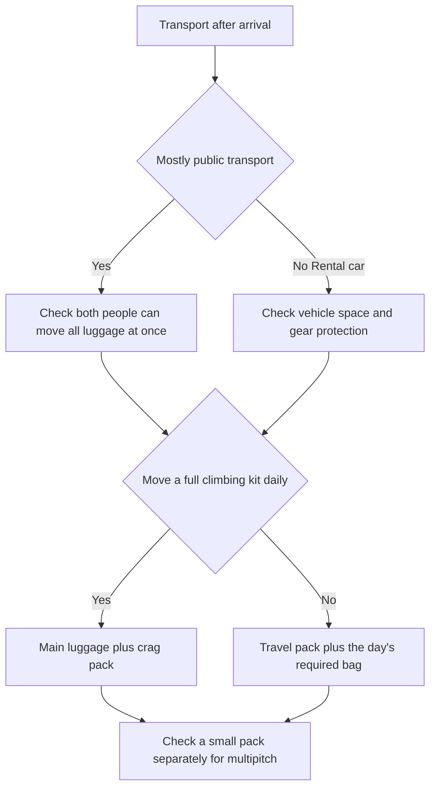

> 🌏 [中文版](/posts/climbing/2026-10-19-climbing-travel-packing)

A travel pack that fits clothing and a laptop may not carry climbing equipment comfortably to a cliff. A tough crag pack may be inconvenient on trains, at security, or around a city. Start with how you will move after arrival, then decide how many bags to use.

This guide is for climbing travelers who also want some bags to serve ordinary overseas trips. Choose a main luggage arrangement, allocate the team's packing responsibilities, and identify equipment and airline conditions still needing confirmation. For climbing while wearing the pack, start with the [multipitch-pack guide](/posts/climbing/2026-10-19-multipitch-climbing-backpacks-en).

## Three trips can need different main luggage

**An ordinary crag holiday** emphasizes carrying equipment between accommodation and cliffs. A crag pack with broad access makes daily rope, quickdraw, and shoe organization easier. A short driving trip does not automatically require an additional product called a travel pack.

**Overseas climbing** adds airports, checked luggage, connections, and equipment protection. A suitcase or duffel can carry clothing and equipment during transit; transfer equipment to a crag pack at your accommodation. Multipitch objectives also need an appropriate small climbing pack. The large crag pack need not go up the wall.

**Ordinary travel with some climbing** may prioritize cities or work. A travel pack can organize clothing and a laptop more conveniently. If climbing occupies one day, consider whether existing bags or rented equipment cover that day before making the everyday travel bag a heavy equipment carrier.

## A rental car versus public transport

A car lets you leave clothing at your accommodation and take only a crag pack. It is not a reason to leave ropes or helmets in a sun-heated vehicle. Check whether both travelers' luggage, food, and equipment fit the trunk before collection day.

For trains and buses, test the journey from your door to a platform at home: can each person move their assigned luggage? A large pack on your back, another on your chest, and a rope bag in hand may make stairs and crowded carriages harder than the approach. Wheels help on smooth surfaces; gravel and accommodation without lifts need consideration.

One bag suits smaller kits and simpler transport but means reorganizing clothing and equipment daily. Main luggage plus a crag pack separates duties but adds another item to carry. A duffel accommodates irregular objects but usually does not carry for long periods like a framed backpack. Choose the tradeoff for your itinerary.

## Four crag packs: access and load

These are comparison candidates, not a Taiwan sales ranking or our field-test results. Recent [Switchback](https://www.switchbacktravel.com/climbing/best-backpacks) and [Climbing](https://www.climbing.com/gear/best-climbing-backpack/) comparisons support Creek and Cragsmith. Other candidates add manufacturer-described differences. These buying guides may earn affiliate commissions.

| Model/capacity | Who should compare it | Main tradeoff |
|---|---|---|
| [BD Creek 50/50 L](https://blackdiamondequipment.com/products/creek-50-pack) | Large hardware loads, a standing base, abrasion resistance, and side access | Approximately 2 kg empty; potentially excessive for smaller sport kits; test torso fit |
| [Patagonia Cragsmith 45/45 L](https://www.patagonia.com/product/cragsmith-climbing-pack-45-liters/48066.html) | Full back-panel access for equipment and clothing | Current 420 D/1420 g differs from older versions; not a close-fitting climbing pack |
| [BD Crag 40/40 L](https://blackdiamondequipment.com/products/crag-40-backpack) | Less volume than Creek, with top and side loading | Manufacturer lists 941 g, but do not infer Creek-level hauling durability |
| [Mammut Neon 45/45 L](https://www.mammut.com/us/en/products/2510-01944/neon-45) | Internal hardware loops, dual access, and a removable rope bag/tarp | Manufacturer lists no rain cover; plan wet-weather protection; not a small multipitch pack |

## Four travel packs: clothing, electronics, and cities

[OutdoorGearLab](https://www.outdoorgearlab.com/topics/travel/best-travel-backpack) provides third-party comparisons of Farpoint, MLC, and Allpa. Current Aer 4 is added for its manufacturer-described design; the older Aer 3 in that comparison is not a test of the 4.

| Model/capacity | Who should compare it | Main tradeoff |
|---|---|---|
| [Osprey Farpoint 40/40 L](https://www.osprey.com/farpointtm-40-travel-pack-1) | Adjustable torso length, frame support, and stowable harness/belt; compare Fairview fit too | Current 1.48 kg differs from the older polyester model; limited compartmentalization |
| [Patagonia MLC 45/45 L](https://www.patagonia.com/product/black-hole-mlc-convertible-carry-on-backpack-45-liters/49307.html) | More clothing, separate electronics, backpack/shoulder/hand carry | Broad profile; reviewers warn of tight airline dimensions; cabin acceptance is not guaranteed |
| [Cotopaxi Allpa 35/35 L](https://uk.cotopaxi.com/products/cotopaxi-allpa-35l-travel-pack-black) | Compartments that make clothing easy to find | Fixed divisions may constrain bulky hardware; distinguish standard and DelDía versions |
| [Aer Travel Pack 4/35 L](https://aersf.com/products/travel-pack-4-35l) | City/work travel with laptop and small-item organization | Hipbelt sold separately; 3.90 lb empty; discontinued 3 reviews do not test the 4 |

### Read community experience with its generation in mind

In a [2023 MountainProject discussion](https://www.mountainproject.com/forum/topic/123738192/multi-pitch-pack), a climber seeking one pack for everything finds that approach-friendly daypacks move poorly while climbing. Replies also describe some burly packs as cumbersome on the wall. These individual older experiences do not rank the eight current products above.

[MLC customer reviews on the manufacturer's site](https://www.patagonia.com/product/black-hole-mlc-convertible-carry-on-backpack-45-liters/49307.html) disagree too: some appreciate the electronics organization while others prefer an old version's large open compartment. Their conditions and product generations differ. Load your own clothing and hardware instead of assuming more organization is always better. A customer’s flight experience does not establish universal cabin permission.

## A seven-day, two-person packing plan

Assume a trip combining city rest days, sport crags, and one multipitch day, with accommodation where equipment can dry. This is a responsibility example, not a complete safety list for every destination. Rope lengths, hardware quantities, water, and rescue equipment depend on actual routes, descent, and team competence.

| Category | Partner A checks | Partner B checks | Bag and later check |
|---|---|---|---|
| Personal climbing items | Own shoes, harness, helmet, and required personal belay equipment | Same; inspect personal equipment individually | Protect in main luggage; inspect after arrival and before climbing |
| Rope configuration | Route-required length/type, history, and condition | Independently cross-check descent needs, device compatibility, and duties | Contain in a rope bag; inspect after arrival; do not assume one rope suits every objective |
| Shared hardware | Route list of quickdraws/protection/connectors | Cross-check list, descent equipment, and emergency items | Contain hardware to keep sharp objects away from ropes and helmets |
| Daily load | Own clothing, water, headlamp | Own clothing, water, headlamp; assigned shared food | Repack nightly for weather; do not carry seven days' supplies up the wall |
| Documents/information | Identity, accommodation, transport, insurance information | Topos, descent information, local emergency contacts | Each person can access offline copies; do not depend on one phone |
| Ordinary travel | Personal clothing, toiletries, medication | Personal items; assign shared charging equipment to one person | Reduce clothing around laundry arrangements; separate liquids from equipment |
| Multipitch pack | Carry rope on approach; confirm whether descent returns to start | Carry small pack initially; jointly redistribute before climbing | Check both pairs of approach shoes, required layers, and water can travel with the team |
| Final packing | Actual airline/fare/segment dimensions, weight, and equipment rules | Measure loaded external size, weigh bags, cross-check list | Recheck current rules before departure; product names are not permission |

Give each shared item one accountable owner, with the other person cross-checking. Assuming the other person will bring it is not allocation. At the accommodation, transfer tomorrow's equipment into the crag pack; take only city necessities on a rest day. If the solution always seems to be a larger bag, first spread everything out and remove duplication or items unrelated to the trip.

## Packing ropes, helmets, and damp equipment

If the actual flight permits checking a rope, contain it in a rope bag or clean inner bag, separated from sharp hardware and liquids. Do not extend that permission to every other piece of equipment. Protect the helmet as its manufacturer recommends, keeping loose hardware from rubbing or puncturing it. [Petzl's equipment-protection guide](https://www.petzl.com/sfc/servlet.shepherd/version/download/068Tx00000CayFIIAZ) addresses sharp objects, heat, and chemicals during transport.

Keep cleaning products, fuel, leaking batteries, and other chemicals away from ropes, slings, and helmets. Suspected chemical contamination cannot be solved by moving the item to a different bag: follow manufacturer inspection and retirement requirements. [Petzl's washing guidance](https://petzl.com/us/en/professional/we-are-petzl/rescue/how-do-i-wash-my-rope-or-harness-/-NEWS--PRO-Comment-laver-ma-corde-ou-mon-harnais_PRO_a7CbK0000000hGHUAY.html) calls for drying indoors with ventilation, away from ultraviolet light and heat. Unpack damp equipment on arrival and arrange drying; a sealed bag is not long-term storage.

Check departure, connection, and return segments, including operating carrier and fare. Bag dimensions, weight, and whether equipment belongs in cabin or checked luggage are separate questions. Neither a manufacturer's “carry-on” label nor another traveler's successful flight replaces those checks.

## Eight price snapshots with conditions

Public product prices checked 19 October 2026, without checkout or Taiwan-shipping verification. Tax is unknown unless VAT is explicitly included. No currency conversion or lowest-delivered-price ranking is implied.

| Pack | Product-page price | Conditions |
|---|---|---|
| Creek 50 | [BD US USD 259.95](https://blackdiamondequipment.com/products/creek-50-pack) | Out of stock; torso size unselected; reference only |
| Cragsmith 45 | [Bergfreunde EU EUR 229.95](https://www.bergfreunde.eu/patagonia-cragsmith-45-climbing-backpack/) |420 D model; VAT included; color/size unselected |
| Crag 40 | [BD US USD 159.95](https://blackdiamondequipment.com/products/crag-40-backpack) | Carbon S/M; out-of-stock price |
| Neon 45 | [Oliunìd USD 138.39](https://www.oliunid.com/mammut-neon-45-crag-backpack) | Listed in stock; color/SKU not locked |
| Farpoint 40 | [Outdoorweb EUR 154.80](https://www.outdoorweb.eu/FARPOINT-40-black) | Black, 1.48 kg model; stock unconfirmed |
| MLC 45 | [Backpack Paris EUR 220](https://backpack.paris/en/products/black-hole-mlc-45) | Weathered Stone; Lyon pickup; exact SKU unconfirmed, not proof of Taiwan delivery |
| Allpa 35 | [Cotopaxi UK GBP 220](https://uk.cotopaxi.com/products/cotopaxi-allpa-35l-travel-pack-black) | Black standard current model, not DelDía; stock unclear |
| Travel Pack 4 35 L | [Aer USD 259](https://aersf.com/products/travel-pack-4-35l) | Black; sold-out/availability unresolved; hipbelt separate |

[Patagonia US](https://www.patagonia.com/product/cragsmith-climbing-pack-45-liters/48066.html?cgid=luggage-technical-packs&dwvar_48065_color=BLK) separately lists Cragsmith 45 at USD 229; the [US MLC 45 page](https://www.patagonia.com/product/black-hole-mlc-convertible-carry-on-backpack-45-liters/49307.html) lists USD 249. Match color, size, generation, tax, and shipping conditions before calculating a saving.

**Check your decision:** Two public-transport travelers plan two 50 L crag packs, each with another pack attached, because a shop labels them “hand luggage.” What is missing? **Answer:** Establish whether both people can move everything, whether loaded dimensions and weight meet each flight's rules, and whether both crag packs are needed daily. Product categories do not guarantee cabin acceptance; buying more bags does not reduce luggage weight.

Continue to [climbing shoes, harnesses, and helmets](/posts/climbing/2026-10-19-climbing-shoes-harness-helmet-en) to choose the personal equipment inside those bags.

<!-- climbing-gear-nav:start -->
> [Previous: Multipitch climbing packs](/posts/climbing/2026-10-19-multipitch-climbing-backpacks-en) · [Series overview](/posts/climbing/2026-10-19-climbing-gear-travel-overview-en) · [Next: Shoes, harnesses, and helmets](/posts/climbing/2026-10-19-climbing-shoes-harness-helmet-en)
<!-- climbing-gear-nav:end -->

## References

- [Switchback: climbing-pack comparison](https://www.switchbacktravel.com/climbing/best-backpacks)
- [Climbing: climbing packs and travel duffels](https://www.climbing.com/gear/best-climbing-backpack/)
- [OutdoorGearLab: travel-pack comparison](https://www.outdoorgearlab.com/topics/travel/best-travel-backpack)
- [Mammut: Neon 45 specifications](https://www.mammut.com/us/en/products/2510-01944/neon-45)
- [Aer: Travel Pack 4 35 L](https://aersf.com/products/travel-pack-4-35l)
- [Petzl: equipment-protection guide](https://www.petzl.com/sfc/servlet.shepherd/version/download/068Tx00000CayFIIAZ)
- [Petzl: washing ropes and harnesses](https://petzl.com/us/en/professional/we-are-petzl/rescue/how-do-i-wash-my-rope-or-harness-/-NEWS--PRO-Comment-laver-ma-corde-ou-mon-harnais_PRO_a7CbK0000000hGHUAY.html)
- [MountainProject: one-pack compromises](https://www.mountainproject.com/forum/topic/123738192/multi-pitch-pack)

- [BD Creek 50/50 L](https://blackdiamondequipment.com/products/creek-50-pack)
- [Patagonia Cragsmith 45/45 L](https://www.patagonia.com/product/cragsmith-climbing-pack-45-liters/48066.html)
- [BD Crag 40/40 L](https://blackdiamondequipment.com/products/crag-40-backpack)
- [Osprey Farpoint 40/40 L](https://www.osprey.com/farpointtm-40-travel-pack-1)
- [Patagonia MLC 45/45 L](https://www.patagonia.com/product/black-hole-mlc-convertible-carry-on-backpack-45-liters/49307.html)
- [Cotopaxi Allpa 35/35 L](https://uk.cotopaxi.com/products/cotopaxi-allpa-35l-travel-pack-black)
- [Bergfreunde EU EUR 229.95](https://www.bergfreunde.eu/patagonia-cragsmith-45-climbing-backpack/)
- [Oliunìd USD 138.39](https://www.oliunid.com/mammut-neon-45-crag-backpack)
- [Outdoorweb EUR 154.80](https://www.outdoorweb.eu/FARPOINT-40-black)
- [Backpack Paris EUR 220](https://backpack.paris/en/products/black-hole-mlc-45)
- [Patagonia US](https://www.patagonia.com/product/cragsmith-climbing-pack-45-liters/48066.html?cgid=luggage-technical-packs&dwvar_48065_color=BLK)
