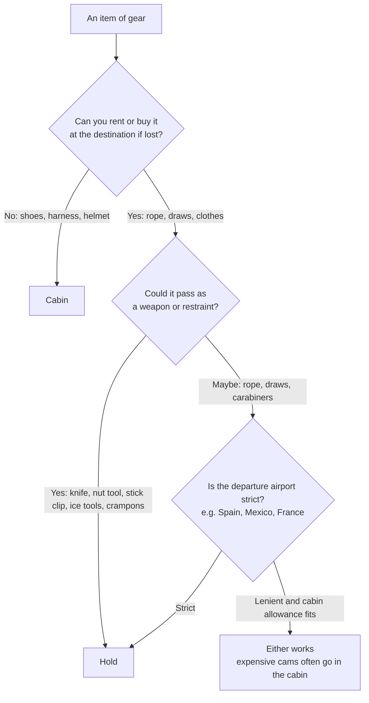

> 🌏 [中文版](/posts/climbing/2026-10-19-climbing-travel-packing-examples)

This post collects 45 packing setups that climbers shared publicly for fly-in climbing trips, dated September 2021 to October 2026. The sources are Mountain Project, the UKClimbing forums, Reddit, personal blogs (including Japanese climbers' trips to Long Dong in Taiwan), the Taiwan Outdoor Climbing Club (TOCC) and YouTube. Pick the one closest to your trip and adapt it into your own checked and carry-on lists.

One premise first: whether climbing gear gets on the plane is decided by the security officer on the day, and there are plenty of reports of the same airport passing gear outbound and refusing it on the return. Rules and airline limits are covered in [Flying with Climbing Gear](/posts/climbing/2026-10-19-flying-with-climbing-gear-en); this post looks only at how people actually packed.

## At a glance: 31 representative examples

| Example | Style | Rope | Draws / cams | Shoes, harness | Checked weight |
|---|---|---|---|---|---|
| Short European sport trips (2023) | Sport | Checked | Checked | Cabin | Not stated |
| Nine-day sport trip (2021) | Sport | Checked | Checked | Checked, shoes can go in cabin | About 16 kg |
| Kalymnos couple (2024) | Sport | Checked (two) | Checked | Cabin | About 20 kg per bag |
| A month in Cuenca, Spain (2025) | Sport | Checked | Checked | Checked | Not stated |
| UK to Phuket, Thailand (2026) | Sport | Not taken | A few in cabin | Cabin | No checked bag |
| UK to Kalymnos (2026) | Sport | Checked | Checked (trad gear dropped) | Shoes cabin, harness checked | One shared bag, just under 20 kg |
| Athens to Kos (2026) | Sport | Cabin | Not stated | Not stated | Not stated |
| Narita via Beijing to Kalymnos (2025) | Sport | Checked | Checked | Shoes checked; harness not stated | 28 kg across two bags |
| Washington to Las Vegas (2025) | Sport | Cabin | Cabin | Not stated | No checked bag |
| New York to Salt Lake City (2025) | Trad | Checked | Cabin | Cabin | Not stated |
| Seattle to Las Vegas (2021) | Trad + sport | Checked | Checked | Checked | Not stated |
| A full trad kit in one bag (2023) | Trad | Checked | Checked | Checked | About 23 kg |
| Barcelona to Argentina (2022) | Trad | — | Cabin, then forced to check | Cabin | Not stated |
| A year in Europe (2021) | Trad + multipitch | Bought on arrival | Checked | Checked | Not stated |
| Brazil to El Potrero Chico (2025) | Sport | Not stated | Not stated | Not stated | All gear planned for the cabin; one backpack forced into the hold on the domestic leg |
| Portland to El Calafate (2026) | Alpine + ice | Not stated | Ice tools and crampons belong in the hold | Not stated | One overweight 120 L duffel |
| Narita to Hanoi, Huu Lung (2025) | Sport | Checked | Checked | Not stated | Over 20 kg, upgraded to 30 kg |
| Kuala Lumpur to Krabi (2025) | Sport | Partner checked it (inferred) | Partner checked them (inferred) | Cabin | No checked bag, 7 kg carry-on |
| Siem Reap, Cambodia via Kuala Lumpur to Bali (2025) | Climbing (long trip) | Cabin, then refused | Not stated | Not stated | One bag already checked |
| Tokyo to Long Dong, Taiwan (2025) | Sport | Checked | Draws checked; cams not stated | Shoes checked | Not stated |
| Haneda to Taipei Songshan (2025) | Sport | Checked (inferred) | Checked (inferred) | Shoes checked (inferred) | Not stated (23 kg allowance) |
| Taiwan to Yosemite, USA (2025) | Trad + multipitch | Not stated | Not stated, some supplied by friends | Not stated | 30 kg across two bags outbound |
| LA to Europe bouldering (2025) | Bouldering | — | — | — | 50 lb limit per pad |
| Flying to Rocklands (2024) | Bouldering | — | — | — | Pad 6.9 kg |
| Rocklands advice (2026) | Bouldering | — | — | Cabin | Not stated |
| US to Fontainebleau (2025) | Bouldering | — | — | — | Two pads wrapped as one bag |
| UK to Albarracín (2025) | Bouldering | — | — | — | Three pads wrapped as one bag |
| Pro climber to Italy (2022) | Sport (festival) | Not taken | Not taken | Cabin | No checked bag |
| Personal-item-only weekend (2024) | Sport | — | — | Personal item | No checked bag |
| Crag pack as personal item (2024) | Trad | — | Worn | Worn | No checked bag |
| Tours airport, France (2026) | Carry-on only | — | Carabiner in cabin, confiscated | Not stated | No checked bag |

Every example uses the same fields: destination and year, airline (only when stated), checked, carry-on, which bag, total weight, and the problems hit. Brands and models are recorded as the source gave them, not as recommendations; for choosing bags, see [Climbing Travel Luggage](/posts/climbing/2026-10-19-climbing-travel-luggage-en).

## Sport-climbing holidays: rope and draws mostly go in the hold

### Short European sport trips (2023): rolling duffel with the crag pack inside

- **Checked**: a Patagonia Black Hole 70L rolling duffel holding a [Black Diamond Creek 50](https://www.blackdiamondequipment.com/products/creek-50-pack) crag pack, a stick clip and all the clothes
- **Carry-on**: a Black Diamond Transit 35L with a laptop, one set of street clothes, one set of climbing clothes, **harness and shoes**
- **Why**: a crag pack checked on its own gets its straps mangled by ground handlers, which happened to a friend's Creek 50. With shoes and harness in the cabin, a lost bag still leaves him able to climb on a friend's rope
- **Problems he has heard of**: several people he knows had a rope or draws refused in carry-on
- Source: [Mountain Project thread, 2023-01-24](https://www.mountainproject.com/forum/topic/123687187/travel-bags-to-fly-to-climbing-destination)

### Nine-day sport trip (2021): everything checked, about 16 kg for one person

- **Checked**: a 70 m rope, a set of draws, harness, three pairs of shoes and everything else for nine days, "about 16kg"
- **Carry-on**: others in the thread recommend at least the climbing shoes in the cabin; another always carries the helmet on to avoid crush damage
- **Weight tips**: the rope is the heaviest single item, and draws can be split with a partner. Dry the rope before the return flight, because a wet rope eats into the allowance
- Source: [UKClimbing thread, 2021-10-25](https://www.ukclimbing.com/forums/destinations/climbing_gear_on_a_plane-740523)

### Kalymnos couple (2024): two ropes checked, about 20 kg per bag

- **Route**: Helsinki to Kos, Greece, then bus and ferry to Kalymnos
- **Allowance**: 15 kg checked and 5 kg carry-on; both bought an extra 5 kg of checked allowance
- **Checked**: one 80 m and one 60 m rope; each bag was "just under 20 kg" on departure. On the way home they emptied their backpacks into the suitcases, about 21 kg each
- **Carry-on**: backpacks with harnesses, one pair of shoes, a belay device and cameras
- **Problems**: none. The author notes that shoes and gear can be bought on the island if luggage goes missing
- Source: [the author's personal blog, 2024-12-02](https://www.tuomasheinonen.com/blog/kalymnos-a-paradise-for-climbers-what-i-learned-on-my-first-visit-to-the-island/)

### A month in Cuenca, Spain (2025): all gear checked, daily essentials in the cabin

- **Checked**: a NEMO 55L Haul Duffel with a 70 m 9.5 mm dry rope, 12 quickdraws, two GriGris and an ATC, a personal anchor, helmet and crack gloves
- **Carry-on and personal item**: an REI Traverse 60L pack (the lid detaches as a daypack) with camera gear, passport, wallet and two go-to outfits
- **Why**: climber Delaney Michels reasons she can always find people to climb with if the gear is lost; what she needs day to day stays with her
- Source: [Delaney Michels' blog, 2025-10-09](https://delaneymichels.com/blog/pack-my-bags-spain)

### UK to Phuket, Thailand (2026): hoping to carry it all on

- **Route**: London Heathrow via New Delhi or Mumbai to Phuket, for the Krabi and Railay area
- **Planned carry-on**: harness, chalk bag, shoes, a couple of draws, a personal anchor and a Beta clip stick; she wanted to avoid checking a bag to save time and avoid losing it
- **Replies**: one person nearly had a GriGri, lockers and a sling confiscated in Mumbai. Another was told more than once in Tenerife to check quickdraws and rope. Someone else has seen travelers carry a rope bag into the cabin from Singapore to Krabi
- Source: [Reddit r/climbergirls, 2026-02-17](https://www.reddit.com/r/climbergirls/comments/1r72m8v/climbing_gear_in_carry_on/)

A related post from the same month: a couple who had flown to Spain before with rope and draws in carry-on were stopped in Madrid this time, told the rope and draws were not allowed, and had to run back to check them ([Reddit, 2026-02-21](https://www.reddit.com/r/climbergirls/comments/1rb2bhe/psa_madrid_airport_didnt_let_us_keep_the_rope_in/)).

### UK to Kalymnos (2026): one shared checked bag, under 20 kg once the trad gear came out

- **Allowance**: easyJet, one 23 kg checked bag shared between two
- **Original checked list**: an 80 m rope, 25 quickdraws, slings, belay devices, prusiks and spare carabiners, plus a set of nuts and a few cams. That made it hard to get under 23 kg
- **What came out**: replies said Kalymnos does not need trad gear, and his final list no longer had the nuts and cams; 4 draws came out (leaving 21), and a pair of shorts and a pair of trousers stayed home. The bag ended up just under 20 kg
- **Carry-on**: climbing shoes and rain jackets in the cabin backpack; harnesses and helmets stayed in the checked bag
- **Advice from the thread**: around 20 draws is plenty; wear your one pair of approach shoes and your down jacket on the plane so they do not count. Another poster flying to Costa Blanca shared one roughly 30 kg suitcase between two, topped up to 33 kg in the easyJet app the night before, and still paid less than for two bags
- Source: [UKClimbing thread, 2026-04-08](https://www.ukclimbing.com/forums/t.php?t=789450)

### Athens to Kos (2026): rope in carry-on, no trouble at Athens security

- **Route**: Sky Express from Athens to Kos, then a ferry to Kalymnos
- **Carry-on**: he had asked on the forum beforehand because carrying a rope on international flights had given him "mixed results". He later reported that the rope in his carry-on got through Athens security, and his Black Diamond 35 L pack was tagged as cabin baggage and waved through
- **Airline notes**: Sky Express was relaxed about cabin-bag weight and size. Another poster warned that the return from Kos on Sky Express had cost them an overweight fee, because its checked limit is lower than on long-haul flights
- Source: [Mountain Project thread, 2026-03-24](https://www.mountainproject.com/forum/topic/202193308/kalymnos-logistics)

### Narita via Beijing to Kalymnos (2025): 28 kg across two checked bags, and a suitcase that arrived broken in Athens

- **Route**: departing April 2025, Air China via Beijing to Athens, then Sky Express via Kos to Kalymnos: four flights in all, with a night in Athens on the way
- **Checked bag one**: a RIMOWA Salsa 87 L suitcase at 21 kg (23 kg limit), holding a 70 m rope, 20 quickdraws, helmet, belay device, two pairs of shoes, top-rope anchor gear, clothes, a folding chair and food; no harness is listed
- **Checked bag two**: a The North Face Base Camp Duffel 71 L at 7 kg (15 kg limit). Outbound it mostly held an empty crag pack; on the way home it took clothes and souvenirs
- **Carry-on**: an 18 L backpack and a shoulder bag, 5 kg (8 kg limit), with valuables, a laptop and a power bank
- **Problems**: the suitcase's lock and wheels were broken on arrival in Athens, patched with climbing tape for the time being. Each checked bag had an AirTag. Two thick guidebooks and souvenirs pushed the total, carry-on included, from 33 kg to 40 kg on the return. The author met the group on the island, and shared gear such as an 80 m rope, knee pads and extra draws was not in this list
- Source: [note (in Japanese), 2025-05-05](https://note.com/azusya/n/nadc5c74eec51)

US domestic flights are usually smoother. One climber flew from Washington to Las Vegas and back in 2025 with a rope, quickdraws, lockers, slings and a chalk bag all in carry-on, "no issues at all". In the same thread, someone else was less lucky: two lockers forgotten in a carry-on were confiscated at Tenerife ([Reddit r/ClimbingGear, 2025-10-26](https://www.reddit.com/r/ClimbingGear/comments/1ogrk0a/planes_transporting_chalk_bag_and_carabiners/)).

## Trad and multipitch: cams are expensive, so many people won't check them

### New York to Salt Lake City (2025): full trad rack in the cabin, rope checked

- **Trips**: New York to Salt Lake City, and New York to Rapid City (the Needles in the Black Hills)
- **Carry-on**: a full trad rack
- **Checked**: the rope and the nut tool
- **Why**: he did not want the rack lost for an indeterminate time, and figured at least one partner's rope would get through. His checked bag was also heavy, and the rack would have pushed it into a big surcharge
- **Problem**: at Salt Lake City the scanner found a small knife he had forgotten in a chalk-bag pocket
- Source: [Mountain Project thread, 2025-09-21](https://www.mountainproject.com/forum/topic/201722445/flying-with-climbing-gear)

### Seattle to Las Vegas (2021): everything but the helmet checked

- **Airline**: Southwest
- **Checked**: rope, sport and trad gear, everything except the helmet. He considered carrying the harness in case of delays but checked it
- **Carry-on**: helmet
- **His routine**: photograph all the gear laid out before the trip, for police and insurance claims if it is stolen. Zip-tie the duffel zippers with neon ties so any tampering is obvious. Pad the cams with clothes; none were damaged
- Source: [Mountain Project thread, 2022-01-16 (trip in December 2021)](https://www.mountainproject.com/forum/topic/121870168/flying-with-cams-other-climbing-gear)

### A full trad kit in one bag (2023): about 50 lb

- **Contents**: a double rack of cams, a 70 m rope and a couple of pairs of shoes, "just under 50 lbs" in total (about 23 kg)
- **Bags in the replies**:
  - A Metolius Quarter Dome haul bag as checked luggage, holding up well after about 20 flights and usable at the crag
  - A Mountain Hardwear Expedition Duffel
  - A Deuter Traveller, whose zip-on panel covers the straps and buckles when checked
  - A Patagonia Cragsmith as the carry-on: a rope and a double rack fill a little over half of it
- Source: [Mountain Project thread, 2023-05 to 2023-07](https://www.mountainproject.com/forum/topic/124138683/best-gear-bag-for-air-travel)

### Barcelona to Argentina (2022): fine on the international leg, forced to check on a domestic one

- **Carry-on**: a trad rack in a backpack; Barcelona to Argentina was fine
- **Problem**: at Buenos Aires' domestic airport (AEP), security made him check the whole carry-on backpack, and particularly disliked the look of a BD #4 cam
- **His advice**: have checked bags plastic-wrapped to deter pilfering
- Source: [Mountain Project thread, 2022-10-21](https://www.mountainproject.com/forum/topic/121621753/gear-in-carry-on-luggage)

### A year in Europe (2021): ropes bought on arrival

- **Checked**: a clothes suitcase each, plus a large "bag of bags" suitcase with hiking packs, poles and shoes
- **The checked bag of metal**: 16 quickdraws, 12 alpine draws, a double rack of cams, nuts, offsets, tricams, lockers and belay devices, plus two pairs of shoes each, helmets and harnesses
- **Carry-on**: a laptop bag, camera and drone bags, and a small backpack just for guidebooks ("those are so heavy!")
- **Space saver**: they bought ropes once in Europe
- Source: [Hello Hola Ni Hao blog, 2021-09-21](https://helloholanihao.com/2021/09/21/packing-for-a-year/)

### Brazil to El Potrero Chico (2025): everything in the cabin internationally, forced to check on the Mexican domestic leg

- **Trip**: nine days in January 2025, nearly 40 routes from 5.6 to 5.11a in a week, mostly in sectors with no approach hike. To avoid checked-bag fees he packed few clothes and filled the rest of the cabin backpack with warm layers and climbing gear
- **International leg**: São Paulo to Mexico City, with the gear in the cabin and no problems
- **Problem**: on the domestic leg from Mexico City to Monterrey, the gear was refused in the cabin on the grounds that "carabiners can be used as weapons", so the pair had to check one backpack
- **Other reports departing Monterrey**: two replies from December 2025 are about flying out of Monterrey airport. One says security will not let a carry-on through if it contains a harness, and will make you check it and pay the airport checked-bag fee; the other says a rope in the cabin gets stopped about half the time and has to go in a checked bag. Plan on checking one bag for Potrero Chico ([Mountain Project](https://www.mountainproject.com/forum/topic/202192082/help-me-pick-a-warm-winter-rock-climbing-destination), [Reddit](https://www.reddit.com/r/climbergirls/comments/1pynxcy/el_potrero_chico/))
- Source: [Gear Tips Club blog, 2025-08-27](https://geartips.club/blog/en/el-potrero-chico-epc-climbing-in-mexican-limestone/)

## Alpine and ice: ice tools and crampons cannot go in the cabin

### Portland to El Calafate (2026): a tight connection, a checked duffel carried to security, and ice tools that would not pass

- **Trip**: Patagonia in January 2026, aiming for Chiaro di Luna on Aguja Saint-Exupéry. Portland via Atlanta to Buenos Aires' international airport (EZE), with the domestic leg leaving from the other airport, AEP, about an hour away by taxi
- **Luggage**: one overweight 120 L duffel plus two stuffed backpacks; the ice tools and crampons were packed in the duffel to be checked
- **Problem**: the inbound flight ran late, and boarding had started by the time he reached AEP. He pulled the duffel off the check-in scale and carried it to security. The ice tools and crampons, "medieval torture devices" to look at, were pulled out, no explanation helped, and he missed the flight
- **Cost**: rebooking onto the next day's flight cost only $50, less than half his taxi fare between the airports
- Source: [Mountain Shop blog, 2026-03-18](https://mountainshop.net/patagonia-part-1-el-chalten-chiaro-di-luna-on-aguja-saint-exupery)

## Short-haul Asia: low-cost carriers' 7 kg carry-on limit gets you first

### Narita to Hanoi, Huu Lung (2025): over the VietJet allowance, upgraded to 30 kg at the last minute

- **Allowance**: some VietJet fares include no checked bag; the author bought one with 20 kg
- **Checked**: an 80 m rope, 20 quickdraws, a drone and a tripod. A weigh-in before leaving showed it "easily over", and 7,625 yen bought an upgrade to 30 kg
- **Carry-on**: VietJet weighs its 7 kg carry-on limit strictly
- **Author's advice**: Huu Lung is limestone with closely spaced bolts, so a route takes about 15–20 draws; one 40 m route has 28 bolts. The author brought an 80 m rope and two knee pads
- Source: [Kiisampo (in Japanese), 2025-10-13](https://kiisampo.com/huu-lung-rock-trip-1/)

### Kuala Lumpur to Krabi (2025): 7 kg carry-on only, with just shoes and a harness

- **Airline**: AirAsia. The author flew with cabin baggage only, limited to 7 kg
- **Carry-on**: just climbing shoes and a harness. The author found size harder to pass than weight, and even left the mosquito coils behind
- **Checked**: nothing of his own; in Krabi a partner collected the checked bags
- **Problem**: the flight slipped from late afternoon to after 9 pm, and the airline handed out meals at the gate
- Source: [haru356.com (in Japanese), 2025-02-05](https://haru356.com/text_010/Date250205_ClimbingKrabi.html)

### Siem Reap, Cambodia via Kuala Lumpur to Bali (2025): a rope that cleared six airports, stopped at Siem Reap

- **Carry-on**: a 60 m rope clipped to the outside of his backpack had passed six airports on a long backpacking trip, and he had checked the prohibited-items list before leaving
- **Problem**: in January 2025 at Siem Reap, security declared the rope a dangerous item, and several layers of supervisors would not budge. He tried to have it put in his already-checked bag and was told that was no longer possible; checking it separately at $30 per kilo would have cost twice what the rope was worth
- **Outcome**: he called a local climbing guide to the airport, and security handed the rope over directly. AirAsia then announced a 1.5-hour delay, so there would have been time to check it after all. The delay also left too little of his 2-hour layover in Kuala Lumpur, so he spent the night in an airport hotel while a prepaid hotel night in Bali went to waste. The missed connection came from the flight delay, not the rope
- Source: [dopaminerlifestyle.blog, 2025-01-31](https://dopaminerlifestyle.blog/2025/01/31/day-21-malaysia/)

## Climbing in Taiwan, and flying out of Taiwan

### Tokyo to Long Dong, Taiwan (2025): a 63 L suitcase with the rope, draws and two pairs of shoes

- **Airline**: EVA Air both ways, November 2025, a group of six
- **Checked**: one 63 L suitcase with a 60 m rope, 8 quickdraws, two pairs of climbing shoes and clothes
- **Carry-on**: a 40 L crag pack with a laptop, power bank and valuables
- **Group split**: each pair of partners brought a set of draws, three sets of about 15 for the group, and the group brought two sets of cams up to #4. The author notes that a 50 m rope is too short for Long Dong; bring a 60 m
- Source: [note (in Japanese), 2025-12-02](https://note.com/azusya/n/na21cb2f5b938)

### Haneda to Taipei Songshan (2025): no suitcase, just a large trekking pack and a small city backpack

- **Airline**: China Airlines economy, with 23 kg checked and 7 kg carry-on. Two people, departing Haneda Terminal 3 at 7:55 and landing at Songshan at 10:55 ([travel post](https://tsuyoshi74climb.com/2025/11/26/%E5%8F%B0%E6%B9%BE%E9%BE%8D%E6%B4%9E%E3%83%AA%E3%83%99%E3%83%B3%E3%82%B8%E3%83%84%E3%82%A2%E3%83%BC-%E7%A7%BB%E5%8B%95%E7%B7%A8/))
- **Two bags**: the author deliberately left the suitcase at home and took only a large trekking pack and the small backpack he uses around town. The gear list has a 60 m rope, 19 quickdraws (plus 1 for self-belay), a belay device, liquid and powder chalk, and two pairs of climbing shoes; he does not say which went in which bag
- **Checked**: another post in the series says they had checked in online, so at Haneda they "only had to drop off the luggage". It does not say which bag; given the sizes, it was most likely the trekking pack. The weight is not given ([first part](https://tsuyoshi74climb.com/2025/11/26/%E5%8F%B0%E6%B9%BE%E9%BE%8D%E6%B4%9E%E3%83%AA%E3%83%99%E3%83%B3%E3%82%B8%E3%83%84%E3%82%A2%E3%83%BC%EF%BC%88%E5%89%8D%E7%B7%A8%EF%BC%89/))
- **Carry-on**: not stated, presumably the small city backpack. His usual climbing pack is heavy on its own, so it stayed home
- **Problem**: online check-in made bag drop quick, but getting through the departure gates took a while; boarding time passed, both their names were announced, and they ran to make the flight ([first part](https://tsuyoshi74climb.com/2025/11/26/%E5%8F%B0%E6%B9%BE%E9%BE%8D%E6%B4%9E%E3%83%AA%E3%83%99%E3%83%B3%E3%82%B8%E3%83%84%E3%82%A2%E3%83%BC%EF%BC%88%E5%89%8D%E7%B7%A8%EF%BC%89/))
- Source: tsuyoshi74climb.com (in Japanese, 2025-11-26): [packing list](https://tsuyoshi74climb.com/2025/11/26/%E5%8F%B0%E6%B9%BE%E9%BE%8D%E6%B4%9E%E3%83%AA%E3%83%99%E3%83%B3%E3%82%B8%E3%83%84%E3%82%A2%E3%83%BC-%E6%8C%81%E3%81%A1%E7%89%A9%E7%B7%A8/), [travel post](https://tsuyoshi74climb.com/2025/11/26/%E5%8F%B0%E6%B9%BE%E9%BE%8D%E6%B4%9E%E3%83%AA%E3%83%99%E3%83%B3%E3%82%B8%E3%83%84%E3%82%A2%E3%83%BC-%E7%A7%BB%E5%8B%95%E7%B7%A8/), [first part](https://tsuyoshi74climb.com/2025/11/26/%E5%8F%B0%E6%B9%BE%E9%BE%8D%E6%B4%9E%E3%83%AA%E3%83%99%E3%83%B3%E3%82%B8%E3%83%84%E3%82%A2%E3%83%BC%EF%BC%88%E5%89%8D%E7%B7%A8%EF%BC%89/)

Flying out of Taiwan, one climber spent about two months on trad in Yosemite, Indian Creek and elsewhere from September to November 2025. Outbound it was two bags totaling 30 kg, probably 23 kg checked plus 7 kg carry-on; the return was three bags totaling 37 kg. The write-up does not say which gear went in which bag. The useful part is how the cams were pieced together: for the routes he chose, he felt he needed at least 6 sets of #0.5 to #1; with gear support from two friends, he got to 5 sets ([TOCC, 2025-12-15, in Chinese](https://www.tocc-climbing.org/post/2025-%E5%8C%97%E7%BE%8E%E6%94%80%E5%B2%A9-%E5%90%91%E5%A4%96%E8%B8%8F%E5%B0%8B%E8%88%87%E5%90%91%E5%85%A7%E6%91%B8%E7%B4%A2%E7%9A%84%E6%97%85%E7%A8%8B)).

## Bouldering: the pad is the biggest item

### LA to Europe bouldering (2025): crash pads checked as sports equipment

- **Airline**: American Airlines from Los Angeles; destinations included Spain and Mallorca
- **Checked**: pads filed as oversized sports equipment, or as a "gymnastics pad" if that option is missing. Each had a 50 lb limit, so they stuffed things inside. Cost was about $100–200
- **Other tactics**: on layovers the airline transferred the pads; they took the pads on trains in Europe and parked them with a luggage-storage app for 7 euros a day during side trips
- Source: [Asana Climbing blog, 2025-12-11](https://asanaclimbing.com/blogs/news/travelling-with-crash-pads)

### Flying to Rocklands (2024): choose a pad that fits checked-bag size

- **Background**: before a Rocklands trip, Dan Turner realized all his pads were over airline size limits, and switched to the [Organic Airline Trifold Pad](https://organicclimbing.com/products/airline-trifold-pad)
- **Size and weight**: folded it is 51×76×30 cm, 157 cm in linear dimensions. The video cites a 158 cm checked limit at easyJet, American Airlines and Ryanair, so it just fits. The listed weight is 15.25 lb (about 6.9 kg)
- **Setup**: one checked pad plus a cabin bag; you can stuff things inside the pad
- Source: [Dan Turner on YouTube, 2024-09-24](https://www.youtube.com/watch?v=-xOv5EYTnsk)

### Rocklands advice (2026): shoes always in the cabin, rent the pad locally

- **Carry-on**: everything you need to climb in, clothes, shoes and chalk, with at least one or two pairs of shoes in the cabin. The speakers say lost luggage hits "like five people a year at least", and climbing gear is very expensive to buy in South Africa
- **Pads**: renting locally costs about €150 for a month; if that beats the extra baggage fee, rent
- Source: [Paradigm Climbing webinar, 2026-04-07](https://www.youtube.com/watch?v=CAVBVDsqTzc)

A Japan bouldering example does the opposite: a staff member at the climbing shop Wild Rock says her "checked bag is always full of gear", with all her clothes in her carry-on Patagonia Black Hole MLC. The Okayama trip is a planned one; the packing is her usual habit ([Wild Rock, 2025-12-04](https://wildrock.net/blogs/the-journal/wish-list-trips-tori)).

### US to Fontainebleau (2025): two pads plastic-wrapped into one bag, $100 on the return

- **Airline**: the post mentions Delta for the return flight and does not say where the trip started (the poster's profile lists Fayetteville, West Virginia); five weeks
- **Checked**: plastic wrap from a hardware store bound two crash pads together so they counted as a single oversized bag. A friend covered the outbound oversize fee; the return cost $100 with a Delta credit card
- **Similar experiences**: another climber has checked a Metolius Session II on Icelandair and United without problems, except once when it was left behind in Paris for a day. The original poster, heading over in March 2026, read Delta's rules as an oversized fee of $300 each way ([Mountain Project, 2025-08-16](https://www.mountainproject.com/forum/topic/201512930/long-shot-but-anyone-have-a-organic-airline-trifold-crashpad-or-fountainbleu-adv)). The Session II owner added in another thread that the pad usually just barely makes it on planes without extra charges, albeit as oversized luggage ([Mountain Project, 2026-01-07](https://www.mountainproject.com/forum/topic/202316540/european-train-travel-with-a-bouldering-pad))
- Source: [Mountain Project thread, 2026-03-22 (trip in 2025)](https://www.mountainproject.com/forum/topic/202576896/font-w-or-wo-car)

### UK to Albarracín (2025): three pads wrapped as one bag, no extra charge on BA

- **Checked**: two Moon Warriors and a Moon Cirrus wrapped in one sheet of plastic as a single item, with no extra fee from British Airways. The condition is contacting the airline in advance with the item's weight and dimensions
- **Contrast in the thread**: the original poster has taken pads to Albarracín several times, two wrapped together, without trouble. The year before, he flew Air France to Fontainebleau and rented pads there, which cost about the same as bringing them and varied in quality. He had read older forum posts about pads running into trouble at Paris CDG; a reply suggested the problem was Air France's size rules rather than the airport, and he agreed that might be it
- **From the replies**: Air France and KLM are strict on checked dimensions, so a standard pad can be technically over; Ryanair, easyJet and Jet2 are usually fine with one or two strapped together. For Fontainebleau, flying into Orly is another option
- Source: [UKClimbing thread, 2025-10 to 11](https://www.ukclimbing.com/forums/bouldering/taking_bouldering_pads_as_luggage_through_charles_de_gaulle_airport-785763)

## Carry-on-only trips

### Pro climber to Italy (2022): a single cabin bag

- **Trip**: pro climber Anthony Gullsten at the Frasassi Climbing Festival in Italy
- **Bag**: a La Sportiva travel bag, "the only bag" he brought, cabin-sized, with a full clamshell opening and a laptop pocket
- **Contents**: harness, Solution climbing shoes, chalk bag, rain jacket, headlamp, tape, brush, power bank and clothes; no rope or draws
- Source: [EpicTV Climbing Daily, 2022-03-18](https://www.youtube.com/watch?v=1oYwrw6tnTY)

### Personal-item-only weekend (2024): shoes clipped outside the bag

- **Airline**: Frontier, with a fare that includes only a personal item
- **Plan**: wear two layers and clip the climbing shoes to the outside of the bag
- **Replies**: one person put the shoes in the water-bottle pocket and carried the bottle while boarding. Another warned that Frontier is strict on size, so put everything inside. Someone flew BA from London to Vancouver with shoes clipped outside without trouble. Another said TSA always flags her nut tool, so she packs it near the top
- Source: [Reddit r/climbergirls, 2024-12-27](https://www.reddit.com/r/climbergirls/comments/1hnfw12/flying_with_climbing_gear_on_personal_item/)

### Crag pack as personal item (2024): wear the gear

- **Bag**: a single Creek 50 as the personal item, no carry-on and no checked bag
- **Passing the bag check**: put on the harness, rack the gear on the loops, wear the helmet and all the jackets, and stuff the shoes in the jacket pockets
- **Reminders from the thread**: one person's checked gear went missing, and having shoes and harness on hand saved the trip. Another's helmet was thrown on the asphalt by a baggage handler and cracked, so the helmet now always goes in the cabin
- Source: [Mountain Project thread, 2024-04-08](https://www.mountainproject.com/forum/topic/125943134/traveling-with-gear)

### Tours airport, France (2026): a snapgate confiscated as a knuckleduster

- **Luggage**: cabin bag only. He usually carries plenty of carabiners in the cabin to keep the checked bag light
- **Problem**: at Tours airport at the end of September 2026, security said a carabiner could be used as a knuckleduster and confiscated one snapgate; pointing out that other airports had allowed it made no difference. He had packed carabiners this way on many trips over the years, and this time he was caught out
- **From the thread**: one person had a keyring carabiner taken at Chambéry, France, a few years ago. Another recently flew to France with a 70 m rope and carabiners in the cabin without trouble. Someone with an overweight checked bag asked security in advance whether draws could go in the cabin, and was told yes
- Source: [UKClimbing thread, 2026-10-01](https://www.ukclimbing.com/forums/rock_talk/confiscated_snap_link_at_airport_security-793700)

The counterexample to traveling light: a beginner couple climbing in Railay and Tonsai, Thailand, and Thakhek, Laos, did not bring a rope, and that was their one regret. Rope rental runs about 10 euros a day in Tonsai and Railay, and in Ao Nang they could not find one to rent ([Mountain Diaries, 2024-01-03](https://mountaindiaries.com/posts/climbing-in-thailand-laos/)).

## Patterns across the 45 examples

The counts below are the number of examples that explicitly state a practice or incident. These are volunteered community posts, skewed toward people who had trouble and like to post, so treat them as a sample, not as rates.

**Shoes, harness and helmet in the cabin: about 20 examples.** This is the most consistent habit. The reason is almost always the same: these three are fit-specific and hard to rent or buy in your size at the destination. Crushed or cracked helmets are a second reason; for checking a helmet that has been dropped, see [Climbing Gear Inspection and Retirement](/posts/climbing/2026-10-19-climbing-gear-inspection-retirement-en).

**Rope in the hold: about 20 examples; rope in the cabin or personal item: about 7.** A rope is heavy, relatively cheap to replace, and the item most often stopped at security, usually with a remark about tying someone up. At Siem Reap the rope was declared a dangerous item outright and never made it onto the plane.

**Metal depends on the region.** About 6 examples carry cams or a full trad rack in the cabin, mostly on US domestic flights, because a rack is too expensive to lose. Outside the US, about 11 examples put quickdraws and carabiners in the hold, some after being refused before, others simply because the checked allowance had room. About 8 examples state that the nut tool goes in the hold.

**Forced to check, confiscated or nearly confiscated: about 25 incidents, concentrated in two places.** Spanish airports (Madrid, Barcelona, Mallorca, Tenerife) account for about 8, and Mexico City and Monterrey airports (on the way to and from Potrero Chico) for about 5. One climber in Mexico City had to check all his climbing gear, which Aeromexico luckily checked for free ([Mountain Project, 2024-05-02](https://www.mountainproject.com/forum/topic/126025298/flying-with-climbing-gear-in-a-carry-on)). Another had carry-on quickdraws refused and had to run back to check the bag ([Reddit, 2022-12](https://www.reddit.com/r/RockClimbing/comments/zk8fmg/flying_with_climbing_gear/)). The rest are scattered across Melbourne, Buenos Aires, Venice, Paris CDG, Mumbai, Denver, New York JFK, Siem Reap in Cambodia and Tours in France. The reasons go beyond "you could tie someone up": a carabiner was treated as a knuckleduster in Tours and as a weapon in Mexico City, and ice tools and crampons cannot go in the cabin at all. At least 3 examples mention the same airport passing gear outbound and refusing it on the way back. If a trip changes to a domestic flight along the way, leave enough connection time to go back and check a bag: in Buenos Aires the international (EZE) and domestic (AEP) flights leave from different airports, and the Portland climber, short on time, carried his checked duffel to security, had the ice tools stopped and missed the flight.

**Stick clips are the item most likely to be taken: about 6 examples.** The fixes are checking it, buying a painter's pole locally and adapting it, or carrying it on and hoping.

**Crag pack as carry-on or personal item: about 10 examples.** When a pack has to be checked, people put it inside a cheap duffel, ask the airline for a heavy plastic bag, use a pack with a strap cover, or have it plastic-wrapped at the airport.

**Duffels and rollers dominate.** Rolling duffels or suitcases appear in about 9 examples, expedition duffels in about 8, a large trekking pack (most likely checked) in 1, and a haul bag as luggage in 1. The Patagonia Black Hole line is the most-named single line, in 3 examples.

**Crash pads wrapped together as one bag: 2 examples.** Two or three pads bound with plastic wrap or a plastic sheet count as a single oversized item: Delta charged $100 on the return, and BA charged nothing after advance notice. Air France and KLM are stricter on dimensions, and a standard pad can already be over.

**Weight tactics: about 15 examples.** They include pre-buying extra checked kilos, wearing heavy clothes and gear, splitting rope and draws with a partner, sharing one checked bag between two, choosing an airline with two free checked bags, renting or buying the rope at the destination, and getting cams from friends. The UK-to-Kalymnos pair simply left out trad gear they would not use. Carry-ons on non-US airlines often have weight limits; the examples mention 5 kg on Aerolíneas Argentinas domestic flights and 10 kg on LATAM ([Mountain Project, 2022-09](https://www.mountainproject.com/forum/topic/123085160/can-i-travel-internationally-with-my-climbing-gear-in-a-carry-on)), 8 kg on legs to Nepal ([Short Guys Beta Works, 2022-04-10](https://www.youtube.com/watch?v=dLF2qgIK2Nw)), a strictly weighed 7 kg on VietJet, and 7 kg plus size limits on AirAsia. A trad rack alone can push a carry-on over.

**Lost, delayed or damaged checked bags: about 9 examples.** These include easyJet losing a bag with an entire sport kit, where a bag is only considered irrevocably lost after 45 days ([UKClimbing, 2022-09-26](https://ukclimbing.com/forums/off_belay/easyjet_lost_luggage_-_all_my_sports_gear-752335)), Air Canada gouging a suitcase and slashing the pack inside it ([UKClimbing, 2022-08](https://www.ukclimbing.com/forums/gear/climbing_gear_in_hold_luggage-750778)), and the Narita-to-Kalymnos suitcase arriving in Athens with a broken lock and wheels. Mitigations named include AirTags, photographing gear before the trip, zip-tying zippers, padding cams with clothes, and travel insurance. If your rope was crushed in a suitcase, check it carefully when you flake it out at the crag.

Put together, these habits give the order most people use to decide where an item goes:

## Three setups you can copy

The weights below are estimated from the examples above and manufacturer specs, to check whether you will be over. Your actual allowance depends on your flight; weigh everything at home before you leave.

### Setup A: a week of sport climbing, two people

| | Climber A | Climber B |
|---|---|---|
| Checked | 70 m single rope, own clothes and kit | 14 quickdraws, stick clip (if bringing one), own clothes and kit |
| Carry-on | Climbing shoes, harness, helmet, chalk bag, belay device | Same |
| Estimated checked weight | About 13–14 kg | About 11 kg |

How the estimate works: in the UKClimbing nine-day example, one person's rope, draws, harness, three pairs of shoes and all other luggage came to about 16 kg. Using a 70 m [Petzl Arial 9.5 mm](https://www.petzl.com/US/en/Sport/Ropes/ARIAL-9-5-mm) at 58 g per metre, the rope is about 4.1 kg; 14 [Petzl Spirit Express](https://www.petzl.com/US/en/Sport/Carabiners-And-Quickdraws/SPIRIT-EXPRESS) 12 cm draws at 92 g each are about 1.3 kg. Take those two out of 16 kg and one person's clothes, shoes and bag come to about 9–10 kg. Split between two, each bag lands around 15 kg, the Kalymnos couple's base checked allowance.

Is there room in the cabin for shoes, harness and helmet? The Kalymnos couple's carry-ons had a 5 kg limit and held harnesses, one pair of shoes, a belay device and cameras.

To save another checked-bag fee, two people can share one bag. The 2026 UK-to-Kalymnos pair shared one 23 kg checked bag with an 80 m rope and 21 draws, and came in just under 20 kg after dropping the trad gear.

### Setup B: trad, one person with the full kit

| | Contents |
|---|---|
| Checked | 70 m single rope, nut tool, knife, clothes and kit; cams padded with clothes (if checked) |
| Carry-on | Double rack of cams, nuts, carabiners and slings, climbing shoes, harness, helmet |
| Carry-on bag | A crag pack, such as a Cragsmith-style pack in the 40-something-litre range with a full back-panel opening |
| Estimate | About 23 kg for the whole kit (checked plus carry-on) |

How the estimate works: in the "full trad kit in one bag" example, a double rack, a 70 m rope and a couple of pairs of shoes came to about 50 lb. Two sets of [Black Diamond Camalot C4](https://www.blackdiamondequipment.com/en_US/product/camalot-c4/) from 0.3 to 3 weigh about 1.6 kg in cams alone, before carabiners and nuts.

What to adjust: the US domestic examples mostly carry cams on. Departing Mexico City, a Spanish airport or a Buenos Aires domestic flight, expect to be told to check them, and arrive early enough to run back to the counter. On flights with a 5–8 kg carry-on limit (7 kg is common on Asian low-cost carriers) a full trad rack will not fit; split it between two people or check it.

### Setup C: bouldering with one pad

| | Contents |
|---|---|
| Checked | A crash pad that folds within checked-bag size, stuffed with clothes, a sleeping bag or other soft luggage |
| Carry-on | Two pairs of climbing shoes, chalk bag and chalk, brush, tape, one change of clothes |
| Estimate | About 6.9 kg for the pad itself, filled up to the airline's weight limit (50 lb, about 23 kg, on American Airlines in the LA example) |

How the estimate works: Organic lists the Airline Trifold Pad at 15.25 lb, 157 cm in linear dimensions when folded. A pad over the checked-size limit may have to go as oversized sports equipment; the LA example paid about $100–200.

Alternative: if the destination rents pads, compare the rental with the extra baggage fee. Rocklands rental runs about €150 a month, and the webinar speakers' advice is to rent if that is cheaper. If two or three of you each bring a pad, plastic-wrap them into one item and pay a single oversize fee; check the dimension rules first on Air France or KLM.

## Three things to do before you leave

1. **Weigh at home.** Buy a luggage scale and weigh both the checked bag and the carry-on once packed. If you are over, switch to hand-washing clothes and wear the heavy jackets before dropping any gear.
2. **Photograph your gear laid out.** You will need it for a police report or insurance claim if bags are stolen or lost. A tracker in the bag helps with high-value items like cams and ropes.
3. **Keep the top of your carry-on for items security will check.** Keep chalk in its original packaging, and move the nut tool and knife to the hold. If you are told to check something, arriving early gives you time to run back to the counter.

With the examples in hand, the next step is choosing bags: whether a gear duffel, a large backpack or a travel pack suits how you will get around, see [Climbing Travel Luggage](/posts/climbing/2026-10-19-climbing-travel-luggage-en). For what to bring to different destinations, see [Climbing Trip Gear List by Destination](/posts/climbing/2026-10-19-climbing-trip-gear-list-by-destination-en).

## Update log

- 2026-10-19: Added 15 examples from 2025–2026 and three new sections: "Alpine and ice", "Short-haul Asia" and "Climbing in Taiwan, and flying out of Taiwan". The at-a-glance table now has 31 representative examples, the patterns are recounted across 45 examples, and two patterns are folded in: new reasons ropes and carabiners get stopped, and crash pads wrapped together as one bag. The start of the collection range in the introduction is corrected to September 2021. The same day, each of the 15 new examples was checked against its original source and 37 statements that did not match the source or went beyond it were corrected, including a broken link to the TOCC post and two more posts cited for the Haneda example. The Siem Reap missed connection was caused by a flight delay, so "tight connections" is down to 1 example and is folded into the paragraph on refusals; shoes, harness and helmet in the cabin is now about 20 examples, and rope in the cabin about 7.

## References

- [Mountain Project: Travel bags to fly to climbing destination (2023-01)](https://www.mountainproject.com/forum/topic/123687187/travel-bags-to-fly-to-climbing-destination)
- [Mountain Project: Flying with climbing gear (2025-09)](https://www.mountainproject.com/forum/topic/201722445/flying-with-climbing-gear)
- [Mountain Project: Flying with cams / other climbing gear (2022-01)](https://www.mountainproject.com/forum/topic/121870168/flying-with-cams-other-climbing-gear)
- [Mountain Project: Flying with climbing gear in a carry-on (2024-04 to 05)](https://www.mountainproject.com/forum/topic/126025298/flying-with-climbing-gear-in-a-carry-on)
- [Mountain Project: Traveling with gear (2024-04)](https://www.mountainproject.com/forum/topic/125943134/traveling-with-gear)
- [Mountain Project: Best gear bag for air travel (2023-05 to 07)](https://www.mountainproject.com/forum/topic/124138683/best-gear-bag-for-air-travel)
- [Mountain Project: Gear in carry-on luggage (2021-11 to 2022-10)](https://www.mountainproject.com/forum/topic/121621753/gear-in-carry-on-luggage)
- [Mountain Project: Can I travel internationally with my climbing gear in a carry-on (2022-09)](https://www.mountainproject.com/forum/topic/123085160/can-i-travel-internationally-with-my-climbing-gear-in-a-carry-on)
- [Reddit r/RockClimbing: Flying with climbing gear (2022-12)](https://www.reddit.com/r/RockClimbing/comments/zk8fmg/flying_with_climbing_gear/)
- [Reddit r/climbergirls: Flying with climbing gear on personal item (2024-12-27)](https://www.reddit.com/r/climbergirls/comments/1hnfw12/flying_with_climbing_gear_on_personal_item/)
- [Reddit r/climbergirls: Climbing gear in carry on (2026-02-17)](https://www.reddit.com/r/climbergirls/comments/1r72m8v/climbing_gear_in_carry_on/)
- [Reddit r/climbergirls: Madrid airport didn't let us keep the rope in carry-on (2026-02-21)](https://www.reddit.com/r/climbergirls/comments/1rb2bhe/psa_madrid_airport_didnt_let_us_keep_the_rope_in/)
- [UKClimbing: Climbing gear on a plane (2021-10-25)](https://www.ukclimbing.com/forums/destinations/climbing_gear_on_a_plane-740523)
- [UKClimbing: easyJet lost luggage – all my sports gear (2022-09-26)](https://ukclimbing.com/forums/off_belay/easyjet_lost_luggage_-_all_my_sports_gear-752335)
- [UKClimbing: Climbing gear in hold luggage (2022-08)](https://www.ukclimbing.com/forums/gear/climbing_gear_in_hold_luggage-750778)
- [Kalymnos – a paradise for climbers (2024-12-02)](https://www.tuomasheinonen.com/blog/kalymnos-a-paradise-for-climbers-what-i-learned-on-my-first-visit-to-the-island/)
- [Delaney Michels: Pack my bags for Spain (2025-10-09)](https://delaneymichels.com/blog/pack-my-bags-spain)
- [Wild Rock: Wish list trips – Tori (2025-12-04)](https://wildrock.net/blogs/the-journal/wish-list-trips-tori)
- [Asana Climbing: Travelling with crash pads (2025-12-11)](https://asanaclimbing.com/blogs/news/travelling-with-crash-pads)
- [Dan Turner: The PERFECT bouldering pad for flying? (YouTube, 2024-09-24)](https://www.youtube.com/watch?v=-xOv5EYTnsk)
- [Paradigm Climbing: A Climber's Trip to Rocklands (YouTube, 2026-04-07)](https://www.youtube.com/watch?v=CAVBVDsqTzc)
- [EpicTV: What's In A Pro Climbers Travel Bag? (YouTube, 2022-03-18)](https://www.youtube.com/watch?v=1oYwrw6tnTY)
- [Hello Hola Ni Hao: Packing for a year (2021-09-21)](https://helloholanihao.com/2021/09/21/packing-for-a-year/)
- [Mountain Diaries: Climbing in Thailand & Laos (2024-01-03)](https://mountaindiaries.com/posts/climbing-in-thailand-laos/)
- [UKClimbing: More Kalymnos! (2026-04-08)](https://www.ukclimbing.com/forums/t.php?t=789450)
- [Mountain Project: Kalymnos logistics (2026-03)](https://www.mountainproject.com/forum/topic/202193308/kalymnos-logistics)
- [note: packing for Narita via Beijing to Kalymnos (in Japanese, 2025-05-05)](https://note.com/azusya/n/nadc5c74eec51)
- [Reddit r/ClimbingGear: Transporting chalk bag and carabiners onboard (2025-10)](https://www.reddit.com/r/ClimbingGear/comments/1ogrk0a/planes_transporting_chalk_bag_and_carabiners/)
- [Gear Tips Club: El Potrero Chico, climbing in Mexican limestone (2025-08-27)](https://geartips.club/blog/en/el-potrero-chico-epc-climbing-in-mexican-limestone/)
- [Mountain Project: Help me pick a warm winter rock climbing destination (2025-12)](https://www.mountainproject.com/forum/topic/202192082/help-me-pick-a-warm-winter-rock-climbing-destination)
- [Reddit r/climbergirls: El Potrero Chico (2025-12)](https://www.reddit.com/r/climbergirls/comments/1pynxcy/el_potrero_chico/)
- [Mountain Shop: Patagonia part 1, Chiaro di Luna on Aguja Saint-Exupéry (2026-03-18)](https://mountainshop.net/patagonia-part-1-el-chalten-chiaro-di-luna-on-aguja-saint-exupery)
- [Kiisampo: Huu Lung rock trip (in Japanese, 2025-10-13)](https://kiisampo.com/huu-lung-rock-trip-1/)
- [haru356.com: Climbing in Krabi (in Japanese, 2025-02-05)](https://haru356.com/text_010/Date250205_ClimbingKrabi.html)
- [dopaminerlifestyle.blog: Day 21 Malaysia (2025-01-31)](https://dopaminerlifestyle.blog/2025/01/31/day-21-malaysia/)
- [note: climbing trip to Long Dong, Taiwan (in Japanese, 2025-12-02)](https://note.com/azusya/n/na21cb2f5b938)
- [tsuyoshi74climb.com: Long Dong trip, packing list (in Japanese, 2025-11-26)](https://tsuyoshi74climb.com/2025/11/26/%E5%8F%B0%E6%B9%BE%E9%BE%8D%E6%B4%9E%E3%83%AA%E3%83%99%E3%83%B3%E3%82%B8%E3%83%84%E3%82%A2%E3%83%BC-%E6%8C%81%E3%81%A1%E7%89%A9%E7%B7%A8/)
- [tsuyoshi74climb.com: Long Dong trip, travel (in Japanese, 2025-11-26)](https://tsuyoshi74climb.com/2025/11/26/%E5%8F%B0%E6%B9%BE%E9%BE%8D%E6%B4%9E%E3%83%AA%E3%83%99%E3%83%B3%E3%82%B8%E3%83%84%E3%82%A2%E3%83%BC-%E7%A7%BB%E5%8B%95%E7%B7%A8/)
- [tsuyoshi74climb.com: Long Dong trip, first part (in Japanese, 2025-11-26)](https://tsuyoshi74climb.com/2025/11/26/%E5%8F%B0%E6%B9%BE%E9%BE%8D%E6%B4%9E%E3%83%AA%E3%83%99%E3%83%B3%E3%82%B8%E3%83%84%E3%82%A2%E3%83%BC%EF%BC%88%E5%89%8D%E7%B7%A8%EF%BC%89/)
- [TOCC: 2025 North America climbing trip (in Chinese, 2025-12-15)](https://www.tocc-climbing.org/post/2025-%E5%8C%97%E7%BE%8E%E6%94%80%E5%B2%A9-%E5%90%91%E5%A4%96%E8%B8%8F%E5%B0%8B%E8%88%87%E5%90%91%E5%85%A7%E6%91%B8%E7%B4%A2%E7%9A%84%E6%97%85%E7%A8%8B)
- [Mountain Project: Font w/ or w/o car (2026-03-22)](https://www.mountainproject.com/forum/topic/202576896/font-w-or-wo-car)
- [Mountain Project: Organic Airline Trifold crashpad or Fontainebleau advice (2025-08-16)](https://www.mountainproject.com/forum/topic/201512930/long-shot-but-anyone-have-a-organic-airline-trifold-crashpad-or-fountainbleu-adv)
- [Mountain Project: European train travel with a bouldering pad (2026-01-07)](https://www.mountainproject.com/forum/topic/202316540/european-train-travel-with-a-bouldering-pad)
- [UKClimbing: Taking bouldering pads as luggage through Charles de Gaulle airport (2025-10 to 11)](https://www.ukclimbing.com/forums/bouldering/taking_bouldering_pads_as_luggage_through_charles_de_gaulle_airport-785763)
- [UKClimbing: Confiscated snap link at airport security (2026-10-01)](https://www.ukclimbing.com/forums/rock_talk/confiscated_snap_link_at_airport_security-793700)
- [Short Guys Beta Works: Colorado to Nepal packing (YouTube, 2022-04-10)](https://www.youtube.com/watch?v=dLF2qgIK2Nw)
- [Petzl ARIAL 9.5 mm specifications](https://www.petzl.com/US/en/Sport/Ropes/ARIAL-9-5-mm)
- [Petzl SPIRIT EXPRESS specifications](https://www.petzl.com/US/en/Sport/Carabiners-And-Quickdraws/SPIRIT-EXPRESS)
- [Black Diamond Camalot C4 specifications](https://www.blackdiamondequipment.com/en_US/product/camalot-c4/)
- [Black Diamond Creek 50 specifications](https://www.blackdiamondequipment.com/products/creek-50-pack)
- [Organic Climbing Airline Tri-fold Pad specifications](https://organicclimbing.com/products/airline-trifold-pad)
