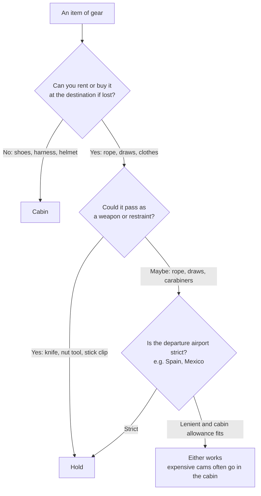

> 🌏 [中文版](/posts/climbing/2026-10-19-climbing-travel-packing-examples)

This post collects 30 packing setups that climbers shared publicly for fly-in climbing trips, dated October 2021 to February 2026. The sources are Mountain Project, the UKClimbing forums, Reddit, personal blogs and YouTube. Pick the one closest to your trip and adapt it into your own checked and carry-on lists.

One premise first: whether climbing gear gets on the plane is decided by the security officer on the day, and there are plenty of reports of the same airport passing gear outbound and refusing it on the return. Rules and airline limits are covered in [Flying with Climbing Gear](/posts/climbing/2026-10-19-flying-with-climbing-gear-en); this post looks only at how people actually packed.

## At a glance: 16 representative examples

| Example | Style | Rope | Draws / cams | Shoes, harness | Checked weight |
|---|---|---|---|---|---|
| Short European sport trips (2023) | Sport | Checked | Checked | Cabin | Not stated |
| Nine-day sport trip (2021) | Sport | Checked | Checked | Checked, shoes can go in cabin | About 16 kg |
| Kalymnos couple (2024) | Sport | Checked (two) | Checked | Cabin | About 20 kg per bag |
| A month in Cuenca, Spain (2025) | Sport | Checked | Checked | Checked | Not stated |
| UK to Phuket, Thailand (2026) | Sport | Not taken | A few in cabin | Cabin | No checked bag |
| New York to Salt Lake City (2025) | Trad | Checked | Cabin | Cabin | Not stated |
| Seattle to Las Vegas (2021) | Trad + sport | Checked | Checked | Checked | Not stated |
| A full trad kit in one bag (2023) | Trad | Checked | Checked | Checked | About 23 kg |
| Barcelona to Argentina (2022) | Trad | — | Cabin, then forced to check | Cabin | Not stated |
| A year in Europe (2021) | Trad + multipitch | Bought on arrival | Checked | Checked | Not stated |
| LA to Europe bouldering (2025) | Bouldering | — | — | — | 50 lb limit per pad |
| Flying to Rocklands (2024) | Bouldering | — | — | — | Pad 6.9 kg |
| Rocklands advice (2026) | Bouldering | — | — | Cabin | Not stated |
| Pro climber to Italy (2022) | Sport (festival) | Not taken | Not taken | Cabin | No checked bag |
| Personal-item-only weekend (2024) | Sport | — | — | Personal item | No checked bag |
| Crag pack as personal item (2024) | Trad | — | Worn | Worn | No checked bag |

Every example uses the same fields: destination and year, airline (only when stated), checked, carry-on, which bag, total weight, and the problems hit. Brands and models are recorded as the source gave them, not as recommendations; for choosing bags, see [Climbing Travel Luggage](/posts/climbing/2026-10-19-climbing-travel-luggage-en).

## Sport-climbing holidays: rope and draws mostly go in the hold

### Short European sport trips (2023): rolling duffel with the crag pack inside

- **Checked**: a Patagonia Black Hole 70L rolling duffel holding a [Black Diamond Creek 50](https://www.blackdiamondequipment.com/products/creek-50-pack) crag pack, a stick clip and all the clothes
- **Carry-on**: a Black Diamond Transit 35L with a laptop, one set of street clothes, one set of climbing clothes, **harness and shoes**
- **Why**: a crag pack checked on its own gets its straps mangled by ground handlers, which happened to a friend's Creek 50. With shoes and harness in the cabin, a lost bag still leaves him able to climb on a friend's rope
- **Problems he has heard of**: several people he knows had a rope or draws refused in carry-on
- Source: [Mountain Project thread, 2023-01-24](https://www.mountainproject.com/forum/topic/123687187/travel-bags-to-fly-to-climbing-destination)

### Nine-day sport trip (2021): everything checked, about 16 kg for one person

- **Checked**: a 70 m rope, a set of draws, harness, three pairs of shoes and everything else for nine days, "about 16kg"
- **Carry-on**: others in the thread recommend at least the climbing shoes in the cabin; another always carries the helmet on to avoid crush damage
- **Weight tips**: the rope is the heaviest single item, and draws can be split with a partner. Dry the rope before the return flight, because a wet rope eats into the allowance
- Source: [UKClimbing thread, 2021-10-25](https://www.ukclimbing.com/forums/destinations/climbing_gear_on_a_plane-740523)

### Kalymnos couple (2024): two ropes checked, about 20 kg per bag

- **Route**: Helsinki to Kos, Greece, then bus and ferry to Kalymnos
- **Allowance**: 15 kg checked and 5 kg carry-on; both bought an extra 5 kg of checked allowance
- **Checked**: one 80 m and one 60 m rope; each bag was "just under 20 kg" on departure. On the way home they emptied their backpacks into the suitcases, about 21 kg each
- **Carry-on**: backpacks with harnesses, one pair of shoes, a belay device and cameras
- **Problems**: none. The author notes that shoes and gear can be bought on the island if luggage goes missing
- Source: [the author's personal blog, 2024-12-02](https://www.tuomasheinonen.com/blog/kalymnos-a-paradise-for-climbers-what-i-learned-on-my-first-visit-to-the-island/)

### A month in Cuenca, Spain (2025): all gear checked, daily essentials in the cabin

- **Checked**: a NEMO 55L Haul Duffel with a 70 m 9.5 mm dry rope, 12 quickdraws, two GriGris and an ATC, a personal anchor, helmet and crack gloves
- **Carry-on and personal item**: an REI Traverse 60L pack (the lid detaches as a daypack) with camera gear, passport, wallet and two go-to outfits
- **Why**: climber Delaney Michels reasons she can always find people to climb with if the gear is lost; what she needs day to day stays with her
- Source: [Delaney Michels' blog, 2025-10-09](https://delaneymichels.com/blog/pack-my-bags-spain)

### UK to Phuket, Thailand (2026): hoping to carry it all on

- **Route**: London Heathrow via New Delhi or Mumbai to Phuket, for the Krabi and Railay area
- **Planned carry-on**: harness, chalk bag, shoes, a couple of draws, a personal anchor and a Beta clip stick; she wanted to avoid checking a bag to save time and avoid losing it
- **Replies**: one person nearly had a GriGri, lockers and a sling confiscated in Mumbai. Another was told more than once in Tenerife to check quickdraws and rope. Someone else has seen travelers carry a rope bag into the cabin from Singapore to Krabi
- Source: [Reddit r/climbergirls, 2026-02-17](https://www.reddit.com/r/climbergirls/comments/1r72m8v/climbing_gear_in_carry_on/)

A related post from the same month: a couple who had flown to Spain before with rope and draws in carry-on were stopped in Madrid this time, told the rope and draws were not allowed, and had to run back to check them ([Reddit, 2026-02-21](https://www.reddit.com/r/climbergirls/comments/1rb2bhe/psa_madrid_airport_didnt_let_us_keep_the_rope_in/)).

## Trad and multipitch: cams are expensive, so many people won't check them

### New York to Salt Lake City (2025): full trad rack in the cabin, rope checked

- **Trips**: New York to Salt Lake City, and New York to Rapid City (the Needles in the Black Hills)
- **Carry-on**: a full trad rack
- **Checked**: the rope and the nut tool
- **Why**: he did not want the rack lost for an indeterminate time, and figured at least one partner's rope would get through. His checked bag was also heavy, and the rack would have pushed it into a big surcharge
- **Problem**: at Salt Lake City the scanner found a small knife he had forgotten in a chalk-bag pocket
- Source: [Mountain Project thread, 2025-09-21](https://www.mountainproject.com/forum/topic/201722445/flying-with-climbing-gear)

### Seattle to Las Vegas (2021): everything but the helmet checked

- **Airline**: Southwest
- **Checked**: rope, sport and trad gear, everything except the helmet. He considered carrying the harness in case of delays but checked it
- **Carry-on**: helmet
- **His routine**: photograph all the gear laid out before the trip, for police and insurance claims if it is stolen. Zip-tie the duffel zippers with neon ties so any tampering is obvious. Pad the cams with clothes; none were damaged
- Source: [Mountain Project thread, 2022-01-16 (trip in December 2021)](https://www.mountainproject.com/forum/topic/121870168/flying-with-cams-other-climbing-gear)

### A full trad kit in one bag (2023): about 50 lb

- **Contents**: a double rack of cams, a 70 m rope and a couple of pairs of shoes, "just under 50 lbs" in total (about 23 kg)
- **Bags in the replies**:
  - A Metolius Quarter Dome haul bag as checked luggage, holding up well after about 20 flights and usable at the crag
  - A Mountain Hardwear Expedition Duffel
  - A Deuter Traveller, whose zip-on panel covers the straps and buckles when checked
  - A Patagonia Cragsmith as the carry-on: a rope and a double rack fill a little over half of it
- Source: [Mountain Project thread, 2023-05 to 2023-07](https://www.mountainproject.com/forum/topic/124138683/best-gear-bag-for-air-travel)

### Barcelona to Argentina (2022): fine on the international leg, forced to check on a domestic one

- **Carry-on**: a trad rack in a backpack; Barcelona to Argentina was fine
- **Problem**: at Buenos Aires' domestic airport (AEP), security made him check the whole carry-on backpack, and particularly disliked the look of a BD #4 cam
- **His advice**: have checked bags plastic-wrapped to deter pilfering
- Source: [Mountain Project thread, 2022-10-21](https://www.mountainproject.com/forum/topic/121621753/gear-in-carry-on-luggage)

### A year in Europe (2021): ropes bought on arrival

- **Checked**: a clothes suitcase each, plus a large "bag of bags" suitcase with hiking packs, poles and shoes
- **The checked bag of metal**: 16 quickdraws, 12 alpine draws, a double rack of cams, nuts, offsets, tricams, lockers and belay devices, plus two pairs of shoes each, helmets and harnesses
- **Carry-on**: a laptop bag, camera and drone bags, and a small backpack just for guidebooks ("those are so heavy!")
- **Space saver**: they bought ropes once in Europe
- Source: [Hello Hola Ni Hao blog, 2021-09-21](https://helloholanihao.com/2021/09/21/packing-for-a-year/)

## Bouldering: the pad is the biggest item

### LA to Europe bouldering (2025): crash pads checked as sports equipment

- **Airline**: American Airlines from Los Angeles; destinations included Spain and Mallorca
- **Checked**: pads filed as oversized sports equipment, or as a "gymnastics pad" if that option is missing. Each had a 50 lb limit, so they stuffed things inside. Cost was about $100–200
- **Other tactics**: on layovers the airline transferred the pads; they took the pads on trains in Europe and parked them with a luggage-storage app for 7 euros a day during side trips
- Source: [Asana Climbing blog, 2025-12-11](https://asanaclimbing.com/blogs/news/travelling-with-crash-pads)

### Flying to Rocklands (2024): choose a pad that fits checked-bag size

- **Background**: before a Rocklands trip, Dan Turner realized all his pads were over airline size limits, and switched to the [Organic Airline Trifold Pad](https://organicclimbing.com/products/airline-trifold-pad)
- **Size and weight**: folded it is 51×76×30 cm, 157 cm in linear dimensions. The video cites a 158 cm checked limit at easyJet, American Airlines and Ryanair, so it just fits. The listed weight is 15.25 lb (about 6.9 kg)
- **Setup**: one checked pad plus a cabin bag; you can stuff things inside the pad
- Source: [Dan Turner on YouTube, 2024-09-24](https://www.youtube.com/watch?v=-xOv5EYTnsk)

### Rocklands advice (2026): shoes always in the cabin, rent the pad locally

- **Carry-on**: everything you need to climb in, clothes, shoes and chalk, with at least one or two pairs of shoes in the cabin. The speakers say lost luggage hits "like five people a year at least", and climbing gear is very expensive to buy in South Africa
- **Pads**: renting locally costs about €150 for a month; if that beats the extra baggage fee, rent
- Source: [Paradigm Climbing webinar, 2026-04-07](https://www.youtube.com/watch?v=CAVBVDsqTzc)

A Japan bouldering example does the opposite: a staff member at the climbing shop Wild Rock says her "checked bag is always full of gear", with all her clothes in her carry-on Patagonia Black Hole MLC. The Okayama trip is a planned one; the packing is her usual habit ([Wild Rock, 2025-12-04](https://wildrock.net/blogs/the-journal/wish-list-trips-tori)).

## Carry-on-only trips

### Pro climber to Italy (2022): a single cabin bag

- **Trip**: pro climber Anthony Gullsten at the Frasassi Climbing Festival in Italy
- **Bag**: a La Sportiva travel bag, "the only bag" he brought, cabin-sized, with a full clamshell opening and a laptop pocket
- **Contents**: harness, Solution climbing shoes, chalk bag, rain jacket, headlamp, tape, brush, power bank and clothes; no rope or draws
- Source: [EpicTV Climbing Daily, 2022-03-18](https://www.youtube.com/watch?v=1oYwrw6tnTY)

### Personal-item-only weekend (2024): shoes clipped outside the bag

- **Airline**: Frontier, with a fare that includes only a personal item
- **Plan**: wear two layers and clip the climbing shoes to the outside of the bag
- **Replies**: one person put the shoes in the water-bottle pocket and carried the bottle while boarding. Another warned that Frontier is strict on size, so put everything inside. Someone flew BA from London to Vancouver with shoes clipped outside without trouble. Another said TSA always flags her nut tool, so she packs it near the top
- Source: [Reddit r/climbergirls, 2024-12-27](https://www.reddit.com/r/climbergirls/comments/1hnfw12/flying_with_climbing_gear_on_personal_item/)

### Crag pack as personal item (2024): wear the gear

- **Bag**: a single Creek 50 as the personal item, no carry-on and no checked bag
- **Passing the bag check**: put on the harness, rack the gear on the loops, wear the helmet and all the jackets, and stuff the shoes in the jacket pockets
- **Reminders from the thread**: one person's checked gear went missing, and having shoes and harness on hand saved the trip. Another's helmet was thrown on the asphalt by a baggage handler and cracked, so the helmet now always goes in the cabin
- Source: [Mountain Project thread, 2024-04-08](https://www.mountainproject.com/forum/topic/125943134/traveling-with-gear)

The counterexample to traveling light: a beginner couple climbing in Railay and Tonsai, Thailand, and Thakhek, Laos, did not bring a rope, and that was their one regret. Rope rental runs about 10 euros a day in Tonsai and Railay, and in Ao Nang they could not find one to rent ([Mountain Diaries, 2024-01-03](https://mountaindiaries.com/posts/climbing-in-thailand-laos/)).

## Patterns across the 30 examples

The counts below are the number of examples that explicitly state a practice or incident. These are volunteered community posts, skewed toward people who had trouble and like to post, so treat them as a sample, not as rates.

**Shoes, harness and helmet in the cabin: about 17 examples.** This is the most consistent habit. The reason is almost always the same: these three are fit-specific and hard to rent or buy in your size at the destination. Crushed or cracked helmets are a second reason; for checking a helmet that has been dropped, see [Climbing Gear Inspection and Retirement](/posts/climbing/2026-10-19-climbing-gear-inspection-retirement-en).

**Rope in the hold: about 14 examples; rope in the cabin or personal item: about 4.** A rope is heavy, relatively cheap to replace, and the item most often stopped at security, usually with a remark about tying someone up.

**Metal depends on the region.** About 6 examples carry cams or a full trad rack in the cabin, mostly on US domestic flights, because a rack is too expensive to lose. Outside the US, about 6 examples check quickdraws and carabiners because refusals are common. About 8 examples state that the nut tool goes in the hold.

**Forced to check, confiscated or nearly confiscated: about 20 incidents, concentrated in two places.** Spanish airports (Madrid, Barcelona, Mallorca, Tenerife) account for about 7, and Mexico City to Monterrey (the gateway to Potrero Chico) for about 4. One climber in Mexico City had to check all his climbing gear, which Aeromexico luckily checked for free ([Mountain Project, 2024-05-02](https://www.mountainproject.com/forum/topic/126025298/flying-with-climbing-gear-in-a-carry-on)). Another had carry-on quickdraws refused and had to run back to check the bag ([Reddit, 2022-12](https://www.reddit.com/r/RockClimbing/comments/zk8fmg/flying_with_climbing_gear/)). The rest are scattered across Melbourne, Buenos Aires, Venice, Paris CDG, Mumbai, Denver and New York JFK. At least 3 examples mention the same airport passing gear outbound and refusing it on the way back.

**Stick clips are the item most likely to be taken: about 6 examples.** The fixes are checking it, buying a painter's pole locally and adapting it, or carrying it on and hoping.

**Crag pack as carry-on or personal item: about 8 examples.** When a pack has to be checked, people put it inside a cheap duffel, ask the airline for a heavy plastic bag, use a pack with a strap cover, or have it plastic-wrapped at the airport.

**Duffels and rollers dominate.** Rolling duffels or suitcases appear in about 7 examples, expedition duffels in about 6, and a haul bag as luggage in 1. The Patagonia Black Hole line is the most-named single line, in 3 examples.

**Weight tactics: about 10 examples.** They include pre-buying extra checked kilos, wearing heavy clothes and gear, splitting rope and draws with a partner, choosing an airline with two free checked bags, and renting or buying the rope at the destination. Carry-ons on non-US airlines often have weight limits; the examples mention 5 kg on Aerolíneas Argentinas domestic flights and 10 kg on LATAM ([Mountain Project, 2022-09](https://www.mountainproject.com/forum/topic/123085160/can-i-travel-internationally-with-my-climbing-gear-in-a-carry-on)), and 8 kg on legs to Nepal ([Short Guys Beta Works, 2022-04-10](https://www.youtube.com/watch?v=dLF2qgIK2Nw)). A trad rack alone can push a carry-on over.

**Lost, delayed or damaged checked bags: about 7 examples.** These include easyJet losing a bag with an entire sport kit, where a bag is only considered irrevocably lost after 45 days ([UKClimbing, 2022-09-26](https://ukclimbing.com/forums/off_belay/easyjet_lost_luggage_-_all_my_sports_gear-752335)), and Air Canada gouging a suitcase and slashing the pack inside it ([UKClimbing, 2022-08](https://www.ukclimbing.com/forums/gear/climbing_gear_in_hold_luggage-750778)). Mitigations named include AirTags, photographing gear before the trip, zip-tying zippers, padding cams with clothes, and travel insurance. If your rope was crushed in a suitcase, check it carefully when you flake it out at the crag.

Put together, these habits give the order most people use to decide where an item goes:

## Three setups you can copy

The weights below are estimated from the examples above and manufacturer specs, to check whether you will be over. Your actual allowance depends on your flight; weigh everything at home before you leave.

### Setup A: a week of sport climbing, two people

| | Climber A | Climber B |
|---|---|---|
| Checked | 70 m single rope, own clothes and kit | 14 quickdraws, stick clip (if bringing one), own clothes and kit |
| Carry-on | Climbing shoes, harness, helmet, chalk bag, belay device | Same |
| Estimated checked weight | About 13–14 kg | About 11 kg |

How the estimate works: in the UKClimbing nine-day example, one person's rope, draws, harness, three pairs of shoes and all other luggage came to about 16 kg. Using a 70 m [Petzl Arial 9.5 mm](https://www.petzl.com/US/en/Sport/Ropes/ARIAL-9-5-mm) at 58 g per metre, the rope is about 4.1 kg; 14 [Petzl Spirit Express](https://www.petzl.com/US/en/Sport/Carabiners-And-Quickdraws/SPIRIT-EXPRESS) 12 cm draws at 92 g each are about 1.3 kg. Take those two out of 16 kg and one person's clothes, shoes and bag come to about 9–10 kg. Split between two, each bag lands around 15 kg, the Kalymnos couple's base checked allowance.

Is there room in the cabin for shoes, harness and helmet? The Kalymnos couple's carry-ons had a 5 kg limit and held harnesses, one pair of shoes, a belay device and cameras.

### Setup B: trad, one person with the full kit

| | Contents |
|---|---|
| Checked | 70 m single rope, nut tool, knife, clothes and kit; cams padded with clothes (if checked) |
| Carry-on | Double rack of cams, nuts, carabiners and slings, climbing shoes, harness, helmet |
| Carry-on bag | A crag pack, such as a Cragsmith-style pack in the 40-something-litre range with a full back-panel opening |
| Estimate | About 23 kg for the whole kit (checked plus carry-on) |

How the estimate works: in the "full trad kit in one bag" example, a double rack, a 70 m rope and a couple of pairs of shoes came to about 50 lb. Two sets of [Black Diamond Camalot C4](https://www.blackdiamondequipment.com/en_US/product/camalot-c4/) from 0.3 to 3 weigh about 1.6 kg in cams alone, before carabiners and nuts.

What to adjust: the US domestic examples mostly carry cams on. Departing Mexico City, a Spanish airport or a Buenos Aires domestic flight, expect to be told to check them, and arrive early enough to run back to the counter. On flights with a 5–8 kg carry-on limit a full trad rack will not fit; split it between two people or check it.

### Setup C: bouldering with one pad

| | Contents |
|---|---|
| Checked | A crash pad that folds within checked-bag size, stuffed with clothes, a sleeping bag or other soft luggage |
| Carry-on | Two pairs of climbing shoes, chalk bag and chalk, brush, tape, one change of clothes |
| Estimate | About 6.9 kg for the pad itself, filled up to the airline's weight limit (50 lb, about 23 kg, on American Airlines in the LA example) |

How the estimate works: Organic lists the Airline Trifold Pad at 15.25 lb, 157 cm in linear dimensions when folded. A pad over the checked-size limit may have to go as oversized sports equipment; the LA example paid about $100–200.

Alternative: if the destination rents pads, compare the rental with the extra baggage fee. Rocklands rental runs about €150 a month, and the webinar speakers' advice is to rent if that is cheaper.

## Three things to do before you leave

1. **Weigh at home.** Buy a luggage scale and weigh both the checked bag and the carry-on once packed. If you are over, switch to hand-washing clothes and wear the heavy jackets before dropping any gear.
2. **Photograph your gear laid out.** You will need it for a police report or insurance claim if bags are stolen or lost. A tracker in the bag helps with high-value items like cams and ropes.
3. **Keep the top of your carry-on for items security will check.** Keep chalk in its original packaging, and move the nut tool and knife to the hold. If you are told to check something, arriving early gives you time to run back to the counter.

With the examples in hand, the next step is choosing bags: whether a gear duffel, a large backpack or a travel pack suits how you will get around, see [Climbing Travel Luggage](/posts/climbing/2026-10-19-climbing-travel-luggage-en). For what to bring to different destinations, see [Climbing Trip Gear List by Destination](/posts/climbing/2026-10-19-climbing-trip-gear-list-by-destination-en).

## References

- [Mountain Project: Travel bags to fly to climbing destination (2023-01)](https://www.mountainproject.com/forum/topic/123687187/travel-bags-to-fly-to-climbing-destination)
- [Mountain Project: Flying with climbing gear (2025-09)](https://www.mountainproject.com/forum/topic/201722445/flying-with-climbing-gear)
- [Mountain Project: Flying with cams / other climbing gear (2022-01)](https://www.mountainproject.com/forum/topic/121870168/flying-with-cams-other-climbing-gear)
- [Mountain Project: Flying with climbing gear in a carry-on (2024-04 to 05)](https://www.mountainproject.com/forum/topic/126025298/flying-with-climbing-gear-in-a-carry-on)
- [Mountain Project: Traveling with gear (2024-04)](https://www.mountainproject.com/forum/topic/125943134/traveling-with-gear)
- [Mountain Project: Best gear bag for air travel (2023-05 to 07)](https://www.mountainproject.com/forum/topic/124138683/best-gear-bag-for-air-travel)
- [Mountain Project: Gear in carry-on luggage (2021-11 to 2022-10)](https://www.mountainproject.com/forum/topic/121621753/gear-in-carry-on-luggage)
- [Mountain Project: Can I travel internationally with my climbing gear in a carry-on (2022-09)](https://www.mountainproject.com/forum/topic/123085160/can-i-travel-internationally-with-my-climbing-gear-in-a-carry-on)
- [Reddit r/RockClimbing: Flying with climbing gear (2022-12)](https://www.reddit.com/r/RockClimbing/comments/zk8fmg/flying_with_climbing_gear/)
- [Reddit r/climbergirls: Flying with climbing gear on personal item (2024-12-27)](https://www.reddit.com/r/climbergirls/comments/1hnfw12/flying_with_climbing_gear_on_personal_item/)
- [Reddit r/climbergirls: Climbing gear in carry on (2026-02-17)](https://www.reddit.com/r/climbergirls/comments/1r72m8v/climbing_gear_in_carry_on/)
- [Reddit r/climbergirls: Madrid airport didn't let us keep the rope in carry-on (2026-02-21)](https://www.reddit.com/r/climbergirls/comments/1rb2bhe/psa_madrid_airport_didnt_let_us_keep_the_rope_in/)
- [UKClimbing: Climbing gear on a plane (2021-10-25)](https://www.ukclimbing.com/forums/destinations/climbing_gear_on_a_plane-740523)
- [UKClimbing: easyJet lost luggage – all my sports gear (2022-09-26)](https://ukclimbing.com/forums/off_belay/easyjet_lost_luggage_-_all_my_sports_gear-752335)
- [UKClimbing: Climbing gear in hold luggage (2022-08)](https://www.ukclimbing.com/forums/gear/climbing_gear_in_hold_luggage-750778)
- [Kalymnos – a paradise for climbers (2024-12-02)](https://www.tuomasheinonen.com/blog/kalymnos-a-paradise-for-climbers-what-i-learned-on-my-first-visit-to-the-island/)
- [Delaney Michels: Pack my bags for Spain (2025-10-09)](https://delaneymichels.com/blog/pack-my-bags-spain)
- [Wild Rock: Wish list trips – Tori (2025-12-04)](https://wildrock.net/blogs/the-journal/wish-list-trips-tori)
- [Asana Climbing: Travelling with crash pads (2025-12-11)](https://asanaclimbing.com/blogs/news/travelling-with-crash-pads)
- [Dan Turner: The PERFECT bouldering pad for flying? (YouTube, 2024-09-24)](https://www.youtube.com/watch?v=-xOv5EYTnsk)
- [Paradigm Climbing: A Climber's Trip to Rocklands (YouTube, 2026-04-07)](https://www.youtube.com/watch?v=CAVBVDsqTzc)
- [EpicTV: What's In A Pro Climbers Travel Bag? (YouTube, 2022-03-18)](https://www.youtube.com/watch?v=1oYwrw6tnTY)
- [Hello Hola Ni Hao: Packing for a year (2021-09-21)](https://helloholanihao.com/2021/09/21/packing-for-a-year/)
- [Mountain Diaries: Climbing in Thailand & Laos (2024-01-03)](https://mountaindiaries.com/posts/climbing-in-thailand-laos/)
- [Short Guys Beta Works: Colorado to Nepal packing (YouTube, 2022-04-10)](https://www.youtube.com/watch?v=dLF2qgIK2Nw)
- [Petzl ARIAL 9.5 mm specifications](https://www.petzl.com/US/en/Sport/Ropes/ARIAL-9-5-mm)
- [Petzl SPIRIT EXPRESS specifications](https://www.petzl.com/US/en/Sport/Carabiners-And-Quickdraws/SPIRIT-EXPRESS)
- [Black Diamond Camalot C4 specifications](https://www.blackdiamondequipment.com/en_US/product/camalot-c4/)
- [Black Diamond Creek 50 specifications](https://www.blackdiamondequipment.com/products/creek-50-pack)
- [Organic Climbing Airline Tri-fold Pad specifications](https://organicclimbing.com/products/airline-trifold-pad)
