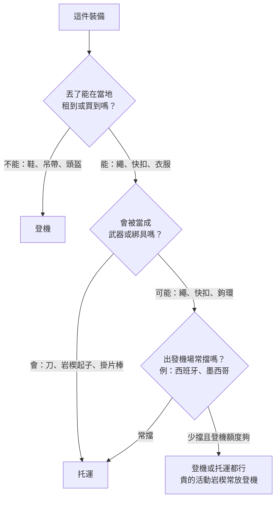

> 🌏 [English version](/posts/climbing/2026-10-19-climbing-travel-packing-examples-en)

本文收錄 30 個攀岩者公開分享的搭機攀岩打包實例，時間從 2021 年 10 月到 2026 年 2 月。來源是 Mountain Project、UKClimbing 論壇、Reddit、個人部落格和 YouTube。讀完，你可以挑一個最像自己行程的配置，照著改成自己的托運和登機清單。

先講一個前提：攀岩裝備能不能帶上飛機，最後由當天的安檢人員決定，同一個機場去程放行、回程被擋的例子不少。規定和航司限制另外整理在[〈攀岩裝備上飛機〉](/posts/climbing/2026-10-19-flying-with-climbing-gear)，本文只看大家實際怎麼裝。

## 一眼對照：16 個代表實例

| 實例 | 型態 | 繩子 | 快扣／活動岩楔 | 鞋、吊帶 | 托運總重 |
|---|---|---|---|---|---|
| 歐洲短程運攀（2023） | 運攀 | 托運 | 托運 | 登機 | 未寫 |
| 九天運攀（2021） | 運攀 | 托運 | 托運 | 托運，鞋可登機 | 約 16 kg |
| 卡林諾斯島兩人（2024） | 運攀 | 托運（兩條） | 托運 | 登機 | 每件約 20 kg |
| 西班牙昆卡一個月（2025） | 運攀 | 托運 | 托運 | 托運 | 未寫 |
| 英國到泰國普吉（2026） | 運攀 | 不帶 | 少量登機 | 登機 | 不托運 |
| 紐約到鹽湖城（2025） | 傳攀 | 托運 | 登機 | 登機 | 未寫 |
| 西雅圖到拉斯維加斯（2021） | 傳攀＋運攀 | 托運 | 托運 | 托運 | 未寫 |
| 一袋裝完傳攀整套（2023） | 傳攀 | 托運 | 托運 | 托運 | 約 23 kg |
| 巴塞隆納到阿根廷（2022） | 傳攀 | — | 登機→被迫托運 | 登機 | 未寫 |
| 在歐洲住一年（2021） | 傳攀＋多繩距 | 到當地買 | 托運 | 托運 | 未寫 |
| 洛杉磯飛歐洲抱石（2025） | 抱石 | — | — | — | 每塊墊上限 50 磅 |
| 飛南非 Rocklands（2024） | 抱石 | — | — | — | 墊子 6.9 kg |
| Rocklands 經驗談（2026） | 抱石 | — | — | 登機 | 未寫 |
| 職業攀岩者去義大利（2022） | 運攀（攀岩節） | 不帶 | 不帶 | 登機 | 不托運 |
| 只帶個人物品的週末（2024） | 運攀 | — | — | 個人物品 | 不托運 |
| 用岩場包當個人物品（2024） | 傳攀 | — | 穿在身上 | 穿在身上 | 不托運 |

每個實例的格式一致：目的地與年份、航司（原文有寫才列）、托運、登機、用什麼袋、總重、踩到的問題。品牌型號照原文記錄，不代表推薦；挑袋子請看[〈托運主袋與登機包怎麼挑〉](/posts/climbing/2026-10-19-climbing-travel-luggage)。

## 運攀度假：繩子和快扣多半托運

### 歐洲短程運攀（2023）：托運滾輪大袋，岩場包塞在裡面

- **托運**：Patagonia Black Hole 70L 滾輪大袋，裡面裝 [Black Diamond Creek 50](https://www.blackdiamondequipment.com/products/creek-50-pack) 岩場包、棒式掛片器（stick clip）和全部衣服
- **登機**：Black Diamond Transit 35L 背包，放電腦、一套日常衣服和一套攀岩衣服、**吊帶和攀岩鞋**
- **為什麼這樣裝**：岩場包直接托運，背帶容易被地勤扯壞，他朋友的 Creek 50 就遇過。鞋和吊帶帶上機，行李遺失時還能跟朋友借繩照爬
- **聽說過的問題**：他知道好幾個人的繩子或快扣在登機行李裡被拒
- 來源：[Mountain Project 討論串，2023-01-24](https://www.mountainproject.com/forum/topic/123687187/travel-bags-to-fly-to-climbing-destination)

### 九天運攀（2021）：全部托運，一個人約 16 kg

- **托運**：70 m 繩、一組快扣、吊帶、三雙鞋，加上九天的其他行李，「大約 16 kg」
- **登機**：同串其他人建議至少把攀岩鞋放登機；另一人固定把頭盔帶上機，避免被壓壞
- **重量技巧**：繩子是最重的單品，快扣可以和同伴分開裝；回程前把繩子晾乾，濕繩會吃掉托運額度
- 來源：[UKClimbing 討論串，2021-10-25](https://www.ukclimbing.com/forums/destinations/climbing_gear_on_a_plane-740523)

### 卡林諾斯島兩人（2024）：兩條繩托運，每件約 20 kg

- **航線**：芬蘭赫爾辛基飛希臘科斯島，再搭巴士和渡輪到卡林諾斯（Kalymnos）
- **額度**：托運 15 kg、登機 5 kg，兩人各加買 5 kg 托運
- **托運**：一條 80 m、一條 60 m 繩，出發時每件「不到 20 kg」；回程把背包裡的東西倒進行李箱，每件約 21 kg
- **登機**：背包裝吊帶、一雙鞋、確保器和相機
- **踩到的問題**：沒有。作者提到島上買得到鞋和裝備，萬一行李遺失可以就地補
- 來源：[作者個人部落格，2024-12-02](https://www.tuomasheinonen.com/blog/kalymnos-a-paradise-for-climbers-what-i-learned-on-my-first-visit-to-the-island/)

### 西班牙昆卡一個月（2025）：裝備全托運，日常用品帶上機

- **托運**：NEMO 55L Haul Duffel，裝 70 m 9.5 mm 防水繩、12 條快扣、兩個 GriGri 和一個 ATC、個人確保繩、頭盔、裂隙手套
- **登機與個人物品**：REI Traverse 60L 背包（頂袋可拆下當日用包），放相機、護照、錢包和兩套常穿的衣服
- **為什麼這樣裝**：攀岩者 Delaney Michels 的想法是裝備丟了還找得到人一起爬，每天真正需要的東西才要跟著人走
- 來源：[Delaney Michels 部落格，2025-10-09](https://delaneymichels.com/blog/pack-my-bags-spain)

### 英國到泰國普吉（2026）：想全部帶上機

- **航線**：倫敦希斯洛經新德里或孟買到普吉，目的地是喀比、萊利一帶
- **登機（計畫）**：吊帶、粉袋、鞋、幾條快扣、個人確保繩和一支 Beta 掛片棒，不想托運是為了省時間，也怕行李丟
- **回覆裡的經驗**：有人在孟買機場差點被沒收 GriGri、鎖鉤和扁帶。有人在特內里費不只一次被要求把快扣和繩子改托運。也有人看過從新加坡飛喀比的旅客把繩袋帶上機
- 來源：[Reddit r/climbergirls，2026-02-17](https://www.reddit.com/r/climbergirls/comments/1r72m8v/climbing_gear_in_carry_on/)

同一個月還有一則相關貼文。一對攀岩者以前帶著繩和快扣登機飛西班牙都沒事，這次在馬德里被安檢擋下繩子和快扣，只好跑回去托運（[Reddit，2026-02-21](https://www.reddit.com/r/climbergirls/comments/1rb2bhe/psa_madrid_airport_didnt_let_us_keep_the_rope_in/)）。

## 傳攀與多繩距：活動岩楔貴，很多人捨不得托運

### 紐約到鹽湖城（2025）：整套傳攀裝備登機，繩子托運

- **行程**：紐約飛鹽湖城，另一次紐約飛拉皮德城（Black Hills 的 Needles）
- **登機**：一整套傳攀裝備（full trad rack）
- **托運**：繩子和岩楔起子（nut tool）
- **為什麼這樣裝**：不想讓整套裝備在行李轉運中消失不知多久；繩子丟了，隊友總有一條會到。另一個理由是托運行李已經很重，再放裝備會被收超重費
- **踩到的問題**：在鹽湖城，掃描機抓到他忘在粉袋口袋裡的小刀
- 來源：[Mountain Project 討論串，2025-09-21](https://www.mountainproject.com/forum/topic/201722445/flying-with-climbing-gear)

### 西雅圖到拉斯維加斯（2021）：除了頭盔全部托運

- **航司**：Southwest
- **托運**：繩子、運攀和傳攀裝備，頭盔以外全部；他考慮過帶吊帶上機以防延誤，最後還是托運
- **登機**：頭盔
- **他的做法**：出發前把全部裝備攤開拍照，萬一被偷可以報案和申請保險。大袋拉鍊用螢光束帶綁住，被打開一眼就看得出來。活動岩楔用衣物包好，這趟沒有一個壞
- 來源：[Mountain Project 討論串，2022-01-16（行程為 2021 年 12 月）](https://www.mountainproject.com/forum/topic/121870168/flying-with-cams-other-climbing-gear)

### 一袋裝完傳攀整套（2023）：約 50 磅

- **內容**：雙套活動岩楔、70 m 繩、兩三雙鞋，全部加起來「不到 50 磅」（約 23 kg）
- **回覆裡的袋子**：
  - Metolius Quarter Dome 拖包當托運行李，飛了約 20 趟還好好的，到了岩場直接拿來用
  - Mountain Hardwear Expedition Duffel
  - Deuter Traveller，拉鍊護蓋能把背帶和扣具收起來再托運
  - Patagonia Cragsmith 當登機包，一條繩加雙套活動岩楔只佔一半多一點
- 來源：[Mountain Project 討論串，2023-05 至 2023-07](https://www.mountainproject.com/forum/topic/124138683/best-gear-bag-for-air-travel)

### 巴塞隆納到阿根廷（2022）：國際段放行，國內段被要求托運

- **登機**：傳攀裝備放在背包裡，巴塞隆納飛阿根廷沒事
- **踩到的問題**：在布宜諾斯艾利斯的國內線機場（AEP），安檢要他把整個登機背包改托運，特別不喜歡 #4 號 BD 活動岩楔的樣子
- **他的建議**：托運行李用保鮮膜包起來，降低被翻找的機會
- 來源：[Mountain Project 討論串，2022-10-21](https://www.mountainproject.com/forum/topic/121621753/gear-in-carry-on-luggage)

### 在歐洲住一年（2021）：繩子到當地再買

- **托運**：每人一個衣物行李箱，加一個「袋中袋」大行李箱，裝健行背包、登山杖和鞋
- **托運的金屬袋**：16 條快扣、12 條長扁帶快扣、雙套活動岩楔、岩楔、偏心岩楔、tricam、鎖鉤、確保器，以及每人兩雙鞋、頭盔、吊帶
- **登機**：電腦包、相機和空拍機包，加一個小背包專裝攀岩指南書（「那些超重」）
- **省空間做法**：繩子到歐洲再買
- 來源：[Hello Hola Ni Hao 部落格，2021-09-21](https://helloholanihao.com/2021/09/21/packing-for-a-year/)

## 抱石：墊子是最大的一件

### 洛杉磯飛歐洲抱石（2025）：抱石墊當運動器材托運

- **航司**：American Airlines，洛杉磯出發，目的地包括西班牙與馬約卡
- **托運**：抱石墊以超大運動器材申報，選單裡沒有就選「體操墊」；每件上限 50 磅，所以把東西塞進墊子裡；費用約 100–200 美元
- **其他做法**：轉機時航空公司直接轉運墊子；在歐洲搭火車也帶著墊子；短程旅行時用行李寄放 app，一天 7 歐元
- 來源：[Asana Climbing 部落格，2025-12-11](https://asanaclimbing.com/blogs/news/travelling-with-crash-pads)

### 飛南非 Rocklands（2024）：挑一塊塞得進托運尺寸的墊子

- **背景**：Dan Turner 去 Rocklands 前發現手上的墊子全部超過航空尺寸上限，因此改用 [Organic Airline Trifold Pad](https://organicclimbing.com/products/airline-trifold-pad)
- **尺寸與重量**：折起來 51×76×30 cm，三邊相加 157 cm。影片引用 easyJet、American Airlines、Ryanair 的托運上限是 158 cm，剛好塞得進。原廠標示重 15.25 磅（約 6.9 kg）
- **配置**：托運一塊墊子，再帶一個登機行李箱；墊子裡也能塞東西
- 來源：[Dan Turner YouTube，2024-09-24](https://www.youtube.com/watch?v=-xOv5EYTnsk)

### Rocklands 經驗談（2026）：鞋子一定登機，墊子在當地租

- **登機**：所有攀岩時要穿用的東西，衣服、鞋、粉，至少一兩雙鞋放登機；講者說行李遺失每年「至少五個人」遇到，而南非買攀岩裝備非常貴
- **墊子**：當地租一個月約 150 歐元，比加購托運便宜就租
- 來源：[Paradigm Climbing 線上講座，2026-04-07](https://www.youtube.com/watch?v=CAVBVDsqTzc)

另一個日本抱石的例子做法剛好相反：攀岩用品店 Wild Rock 的一位員工說她的托運行李「永遠裝滿裝備」，衣服全部放進登機的 Patagonia Black Hole MLC。這是她計畫中的岡山行程，打包方式是她平常的習慣（[Wild Rock，2025-12-04](https://wildrock.net/blogs/the-journal/wish-list-trips-tori)）。

## 只帶隨身行李的輕裝行程

### 職業攀岩者去義大利（2022）：只有一個登機袋

- **行程**：職業攀岩者 Anthony Gullsten 參加義大利 Frasassi 攀岩節
- **袋子**：一個 La Sportiva 旅行袋，是這趟「唯一帶的袋子」，尺寸可以登機，全開口，有筆電夾層
- **內容**：吊帶、Solution 攀岩鞋、粉袋、雨衣、頭燈、貼布、刷子、行動電源和衣服；沒有繩子和快扣
- 來源：[EpicTV Climbing Daily，2022-03-18](https://www.youtube.com/watch?v=1oYwrw6tnTY)

### 只帶個人物品的週末（2024）：鞋子掛在包外

- **航司**：Frontier，票價只含一件個人物品
- **計畫**：多穿兩層衣服，攀岩鞋掛在包外
- **回覆裡的做法**：鞋子塞進水壺側袋，登機時手拿水壺。有人提醒 Frontier 對尺寸很嚴，最好全部塞進包裡。有人搭英航從倫敦飛溫哥華，鞋掛包外沒問題。另有人說 TSA 常抓她的岩楔起子，所以放在最上層方便拿出
- 來源：[Reddit r/climbergirls，2024-12-27](https://www.reddit.com/r/climbergirls/comments/1hnfw12/flying_with_climbing_gear_on_personal_item/)

### 用岩場包當個人物品（2024）：把裝備穿在身上

- **袋子**：只帶一個 Creek 50 當個人物品，沒有登機箱也沒有托運
- **過量測的做法**：穿上吊帶、把裝備掛在裝備環上、戴頭盔、穿上所有外套、鞋子塞進外套口袋
- **同串的提醒**：有人托運的裝備不見，幸好鞋和吊帶帶在身上，旅程才沒毀掉。有人的頭盔被地勤摔在柏油地上裂了，從此頭盔一定帶上機
- 來源：[Mountain Project 討論串，2024-04-08](https://www.mountainproject.com/forum/topic/125943134/traveling-with-gear)

輕裝的反例也有：一對去泰國萊利、東賽和寮國他曲的初學者沒帶繩子，事後最後悔的就是這件。東賽和萊利租繩一天約 10 歐元，奧南找不到地方租（[Mountain Diaries，2024-01-03](https://mountaindiaries.com/posts/climbing-in-thailand-laos/)）。

## 30 個實例歸納出的配置模式

以下數字是這 30 個實例裡明確寫出這種做法或遭遇的數量。它們是社群自願分享的樣本，會偏向出過事、愛發文的人，不能當成發生率。

**鞋、吊帶、頭盔放登機：約 17 個實例。** 這是最一致的做法。理由幾乎都一樣：這三樣跟身形有關，丟了很難在當地租到或買到合腳的。頭盔被壓壞或摔裂是另一個理由；被摔過的頭盔要怎麼檢查，見[〈攀岩裝備怎麼檢查與汰換〉](/posts/climbing/2026-10-19-climbing-gear-inspection-retirement)。

**繩子放托運：約 14 個實例；放登機或個人物品：約 4 個。** 繩子重、相對便宜好補，又是最常在安檢被擋的一件，常見說法是「可以拿來綁人」。

**金屬看地區。** 把活動岩楔或整套傳攀裝備帶上機的約 6 個實例，多數飛美國國內線，理由是整套很貴、丟不起。美國以外，約 6 個實例選擇把快扣和鉤環托運，因為被擋的經驗多。岩楔起子放托運，約 8 個實例寫明這樣做。

**被要求改托運、被沒收或差點被沒收：約 20 次，集中在兩個地方。** 西班牙機場（馬德里、巴塞隆納、馬約卡、特內里費）約 7 次，墨西哥市飛蒙特雷（Potrero Chico 的門戶）約 4 次。有人在墨西哥市被要求把所有攀岩裝備改托運，幸好 Aeromexico 免費托運（[Mountain Project，2024-05-02](https://www.mountainproject.com/forum/topic/126025298/flying-with-climbing-gear-in-a-carry-on)）。也有人登機包裡的快扣被擋，只好跑回去托運（[Reddit，2022-12](https://www.reddit.com/r/RockClimbing/comments/zk8fmg/flying_with_climbing_gear/)）。其餘零星分布在墨爾本、布宜諾斯艾利斯、威尼斯、巴黎戴高樂、孟買、丹佛和紐約甘迺迪。同一個機場去程放行、回程被擋的情況，至少 3 個實例提到。

**棒式掛片器最容易被拿走：約 6 個實例。** 解法是托運、到當地買油漆桿自己改，或乾脆手拿上機碰運氣。

**岩場包兼登機包或個人物品：約 8 個實例。** 一定要托運背包時，有人把它塞進便宜大袋、向航空公司要厚塑膠袋套住、用有背帶護蓋的背包，或在機場包保鮮膜。

**大袋與滾輪袋最常見。** 滾輪大袋或行李箱約 7 個實例，遠征大袋（duffel）約 6 個，拖包當行李 1 個。Patagonia Black Hole 系列是被點名最多的一個系列，出現在 3 個實例。

**重量技巧：約 10 個實例。** 做法包括事先加買托運公斤數、把重的衣服和裝備穿在身上、跟同伴分攤繩和快扣、挑免費托運兩件的航司、繩子到當地租或買。非美國航司的登機行李常有重量上限，實例中出現過阿根廷航空國內線 5 kg、LATAM 10 kg（[Mountain Project，2022-09](https://www.mountainproject.com/forum/topic/123085160/can-i-travel-internationally-with-my-climbing-gear-in-a-carry-on)），以及飛尼泊爾沿途各段 8 kg（[Short Guys Beta Works，2022-04-10](https://www.youtube.com/watch?v=dLF2qgIK2Nw)）。傳攀裝備一放進去就可能超重。

**行李遺失、延誤或損壞：約 7 個實例。** 包括 easyJet 遺失整袋運攀裝備、行李要等 45 天才會被視為永久遺失（[UKClimbing，2022-09-26](https://ukclimbing.com/forums/off_belay/easyjet_lost_luggage_-_all_my_sports_gear-752335)），以及 Air Canada 托運時割破行李箱、連裡面的背包一起劃開（[UKClimbing，2022-08](https://www.ukclimbing.com/forums/gear/climbing_gear_in_hold_luggage-750778)）。被提到的對策有 AirTag、出發前拍照、束帶綁拉鍊、活動岩楔用衣物包好和旅遊保險。繩子在行李箱裡被擠壓過，到岩場理繩時要多看一眼。

把這些做法合起來，就是大多數人判斷一件東西放哪邊的順序：

## 三套可以照抄的配置範本

下面的估重從上面的實例和原廠規格推算，用來檢查會不會超重。實際額度依你的航班而定，出發前在家用行李秤量一次。

### 範本 A：一週運攀，兩人

| | 甲 | 乙 |
|---|---|---|
| 托運 | 70 m 單繩、自己的衣服雜物 | 14 條快扣、掛片棒（要帶的話）、自己的衣服雜物 |
| 登機 | 攀岩鞋、吊帶、頭盔、粉袋、確保器 | 同左 |
| 托運估重 | 約 13–14 kg | 約 11 kg |

估重怎麼來：UKClimbing 那個九天實例，一個人裝了繩、快扣、吊帶、三雙鞋和全部行李，約 16 kg。以 70 m 的 [Petzl Arial 9.5 mm](https://www.petzl.com/US/en/Sport/Ropes/ARIAL-9-5-mm) 每公尺 58 g，整條約 4.1 kg；14 條 12 cm 的 [Petzl Spirit Express](https://www.petzl.com/US/en/Sport/Carabiners-And-Quickdraws/SPIRIT-EXPRESS) 每條 92 g，約 1.3 kg。從 16 kg 扣掉這兩樣，一個人的衣服、鞋和袋子約 9–10 kg。兩人分攤後，各自都在 15 kg 上下，也就是卡林諾斯那對夫妻加購前的托運額度。

鞋、吊帶、頭盔放登機有空間嗎？卡林諾斯那對夫妻的登機背包限重 5 kg，裝得下吊帶、一雙鞋、確保器和相機。

### 範本 B：傳攀，一人帶整套裝備

| | 內容 |
|---|---|
| 托運 | 70 m 單繩、岩楔起子、刀、衣服雜物；活動岩楔用衣服包好（若選托運） |
| 登機 | 雙套活動岩楔、岩楔、鉤環與扁帶、攀岩鞋、吊帶、頭盔 |
| 登機袋 | 岩場包，例如 Cragsmith 這類 40 多公升、背板全開的款式 |
| 估重 | 整套約 23 kg（托運加登機） |

估重怎麼來：「一袋裝完傳攀整套」那個實例，雙套活動岩楔、70 m 繩和兩三雙鞋全部約 50 磅。[Black Diamond Camalot C4](https://www.blackdiamondequipment.com/en_US/product/camalot-c4/) 0.3 到 3 號兩套，光活動岩楔就約 1.6 kg，還沒算鉤環和岩楔。

要調整的地方：美國國內線的實例多半把活動岩楔帶上機。如果從墨西哥市、西班牙機場或布宜諾斯艾利斯國內線出發，先預期會被要求改托運，提早到機場留時間跑回櫃檯。登機行李限重 5–8 kg 的航班，整套傳攀裝備放不進去，改成兩人各帶一半，或直接托運。

### 範本 C：抱石，帶一塊墊子

| | 內容 |
|---|---|
| 托運 | 一塊能折到托運尺寸內的抱石墊，裡面塞衣服、睡袋或其他軟的行李 |
| 登機 | 兩雙攀岩鞋、粉袋與粉、刷子、貼布、一套換洗衣服 |
| 估重 | 墊子本身約 6.9 kg，塞到航司重量上限為止（洛杉磯實例的 American Airlines 是 50 磅，約 23 kg） |

估重怎麼來：Organic Airline Trifold Pad 原廠標示 15.25 磅，折起來三邊相加 157 cm。三邊相加超過托運上限的墊子，就可能要以超大運動器材付費，洛杉磯那個實例付了約 100–200 美元。

替代做法：目的地有租墊服務時，先比租金和加購托運的價格。Rocklands 租一個月約 150 歐元，那位講者的建議是比加購托運便宜就租。

## 出發前做三件事

1. **在家秤重。** 買一個行李秤，打包完把托運和登機各秤一次。超重就先把衣服換成手洗、把重的外套穿在身上，最後才拿掉裝備。
2. **把裝備攤開拍一張照片。** 行李被偷或遺失時，報案和申請保險都用得到。活動岩楔、繩子這類高價品也可以在袋裡放一個追蹤器。
3. **登機包最上層留給會被檢查的東西。** 粉放在原包裝，岩楔起子和刀改放托運。被要求改托運時，提早到機場才有時間跑回櫃檯。

看完實例，下一步是決定用什麼袋子裝：大型裝備袋、大背包還是旅行背包，各適合哪種交通方式，見[〈托運主袋與登機包怎麼挑〉](/posts/climbing/2026-10-19-climbing-travel-luggage)。不同目的地要帶哪些裝備，見[〈出國攀岩依目的地列裝備清單〉](/posts/climbing/2026-10-19-climbing-trip-gear-list-by-destination)。

## 參考資料

- [Mountain Project：Travel bags to fly to climbing destination（2023-01）](https://www.mountainproject.com/forum/topic/123687187/travel-bags-to-fly-to-climbing-destination)
- [Mountain Project：Flying with climbing gear（2025-09）](https://www.mountainproject.com/forum/topic/201722445/flying-with-climbing-gear)
- [Mountain Project：Flying with cams / other climbing gear（2022-01）](https://www.mountainproject.com/forum/topic/121870168/flying-with-cams-other-climbing-gear)
- [Mountain Project：Flying with climbing gear in a carry-on（2024-04 至 05）](https://www.mountainproject.com/forum/topic/126025298/flying-with-climbing-gear-in-a-carry-on)
- [Mountain Project：Traveling with gear（2024-04）](https://www.mountainproject.com/forum/topic/125943134/traveling-with-gear)
- [Mountain Project：Best gear bag for air travel（2023-05 至 07）](https://www.mountainproject.com/forum/topic/124138683/best-gear-bag-for-air-travel)
- [Mountain Project：Gear in carry-on luggage（2021-11 至 2022-10）](https://www.mountainproject.com/forum/topic/121621753/gear-in-carry-on-luggage)
- [Mountain Project：Can I travel internationally with my climbing gear in a carry-on（2022-09）](https://www.mountainproject.com/forum/topic/123085160/can-i-travel-internationally-with-my-climbing-gear-in-a-carry-on)
- [Reddit r/RockClimbing：Flying with climbing gear（2022-12）](https://www.reddit.com/r/RockClimbing/comments/zk8fmg/flying_with_climbing_gear/)
- [Reddit r/climbergirls：Flying with climbing gear on personal item（2024-12-27）](https://www.reddit.com/r/climbergirls/comments/1hnfw12/flying_with_climbing_gear_on_personal_item/)
- [Reddit r/climbergirls：Climbing gear in carry on（2026-02-17）](https://www.reddit.com/r/climbergirls/comments/1r72m8v/climbing_gear_in_carry_on/)
- [Reddit r/climbergirls：Madrid airport didn't let us keep the rope in carry-on（2026-02-21）](https://www.reddit.com/r/climbergirls/comments/1rb2bhe/psa_madrid_airport_didnt_let_us_keep_the_rope_in/)
- [UKClimbing：Climbing gear on a plane（2021-10-25）](https://www.ukclimbing.com/forums/destinations/climbing_gear_on_a_plane-740523)
- [UKClimbing：easyJet lost luggage – all my sports gear（2022-09-26）](https://ukclimbing.com/forums/off_belay/easyjet_lost_luggage_-_all_my_sports_gear-752335)
- [UKClimbing：Climbing gear in hold luggage（2022-08）](https://www.ukclimbing.com/forums/gear/climbing_gear_in_hold_luggage-750778)
- [Kalymnos – a paradise for climbers（2024-12-02）](https://www.tuomasheinonen.com/blog/kalymnos-a-paradise-for-climbers-what-i-learned-on-my-first-visit-to-the-island/)
- [Delaney Michels：Pack my bags for Spain（2025-10-09）](https://delaneymichels.com/blog/pack-my-bags-spain)
- [Wild Rock：Wish list trips – Tori（2025-12-04）](https://wildrock.net/blogs/the-journal/wish-list-trips-tori)
- [Asana Climbing：Travelling with crash pads（2025-12-11）](https://asanaclimbing.com/blogs/news/travelling-with-crash-pads)
- [Dan Turner：The PERFECT bouldering pad for flying?（YouTube，2024-09-24）](https://www.youtube.com/watch?v=-xOv5EYTnsk)
- [Paradigm Climbing：A Climber's Trip to Rocklands（YouTube，2026-04-07）](https://www.youtube.com/watch?v=CAVBVDsqTzc)
- [EpicTV：What's In A Pro Climbers Travel Bag?（YouTube，2022-03-18）](https://www.youtube.com/watch?v=1oYwrw6tnTY)
- [Hello Hola Ni Hao：Packing for a year（2021-09-21）](https://helloholanihao.com/2021/09/21/packing-for-a-year/)
- [Mountain Diaries：Climbing in Thailand & Laos（2024-01-03）](https://mountaindiaries.com/posts/climbing-in-thailand-laos/)
- [Short Guys Beta Works：Colorado to Nepal packing（YouTube，2022-04-10）](https://www.youtube.com/watch?v=dLF2qgIK2Nw)
- [Petzl ARIAL 9.5 mm 規格頁](https://www.petzl.com/US/en/Sport/Ropes/ARIAL-9-5-mm)
- [Petzl SPIRIT EXPRESS 規格頁](https://www.petzl.com/US/en/Sport/Carabiners-And-Quickdraws/SPIRIT-EXPRESS)
- [Black Diamond Camalot C4 規格頁](https://www.blackdiamondequipment.com/en_US/product/camalot-c4/)
- [Black Diamond Creek 50 規格頁](https://www.blackdiamondequipment.com/products/creek-50-pack)
- [Organic Climbing Airline Tri-fold Pad 規格頁](https://organicclimbing.com/products/airline-trifold-pad)
