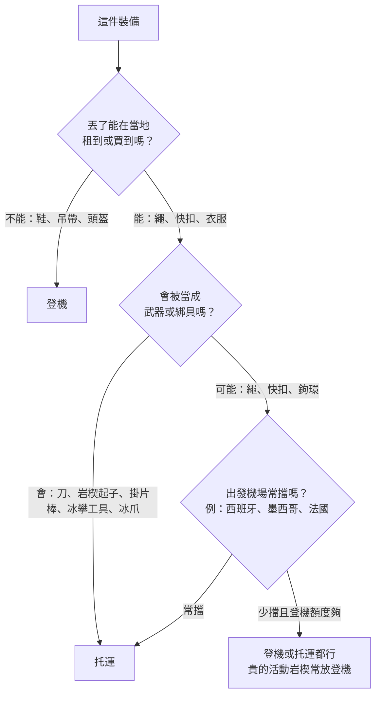

> 🌏 [English version](/posts/climbing/2026-10-19-climbing-travel-packing-examples-en)

本文收錄 45 個攀岩者公開分享的搭機攀岩打包實例，時間從 2021 年 9 月到 2026 年 10 月。來源是 Mountain Project、UKClimbing 論壇、Reddit、個人部落格（包括日本攀岩者來台灣爬龍洞的紀錄）、臺灣戶外攀岩協會和 YouTube。讀完，你可以挑一個最像自己行程的配置，照著改成自己的托運和登機清單。

先講一個前提：攀岩裝備能不能帶上飛機，最後由當天的安檢人員決定，同一個機場去程放行、回程被擋的例子不少。規定和航司限制另外整理在[〈攀岩裝備上飛機〉](/posts/climbing/2026-10-19-flying-with-climbing-gear)，本文只看大家實際怎麼裝。

## 一眼對照：31 個代表實例

| 實例 | 型態 | 繩子 | 快扣／活動岩楔 | 鞋、吊帶 | 托運總重 |
|---|---|---|---|---|---|
| 歐洲短程運攀（2023） | 運攀 | 托運 | 托運 | 登機 | 未寫 |
| 九天運攀（2021） | 運攀 | 托運 | 托運 | 托運，鞋可登機 | 約 16 kg |
| 卡林諾斯島兩人（2024） | 運攀 | 托運（兩條） | 托運 | 登機 | 每件約 20 kg |
| 西班牙昆卡一個月（2025） | 運攀 | 托運 | 托運 | 托運 | 未寫 |
| 英國到泰國普吉（2026） | 運攀 | 不帶 | 少量登機 | 登機 | 不托運 |
| 英國到卡林諾斯（2026） | 運攀 | 托運 | 托運（傳攀裝備捨棄） | 鞋登機、吊帶托運 | 兩人共用一件，略低於 20 kg |
| 雅典到科斯島（2026） | 運攀 | 登機 | 未寫 | 未寫 | 未寫 |
| 成田經北京到卡林諾斯（2025） | 運攀 | 托運 | 托運 | 托運 | 兩件共 28 kg |
| 華盛頓州到拉斯維加斯（2025） | 運攀 | 登機 | 登機 | 未寫 | 不托運 |
| 紐約到鹽湖城（2025） | 傳攀 | 托運 | 登機 | 登機 | 未寫 |
| 西雅圖到拉斯維加斯（2021） | 傳攀＋運攀 | 托運 | 托運 | 托運 | 未寫 |
| 一袋裝完傳攀整套（2023） | 傳攀 | 托運 | 托運 | 托運 | 約 23 kg |
| 巴塞隆納到阿根廷（2022） | 傳攀 | — | 登機→被迫托運 | 登機 | 未寫 |
| 在歐洲住一年（2021） | 傳攀＋多繩距 | 到當地買 | 托運 | 托運 | 未寫 |
| 巴西到 El Potrero Chico（2025） | 運攀＋多繩距 | 登機→被迫托運 | 登機→被迫托運 | 登機→被迫托運 | 原本不托運 |
| 波特蘭到 El Calafate（2026） | 高山＋冰雪 | 未寫 | 冰攀工具、冰爪應托運 | 未寫 | 一件超重的 120 L 旅行袋 |
| 成田到河內 Huu Lung（2025） | 運攀 | 托運 | 托運 | 未寫 | 超過 20 kg，加購到 30 kg |
| 吉隆坡到喀比（2025） | 運攀 | 隊友托運 | 隊友托運 | 登機 | 不托運，登機 7 kg |
| 柬埔寨暹粒到吉隆坡（2025） | 運攀（長途旅行） | 登機→被擋 | 未寫 | 未寫 | 已托運一件 |
| 東京到台北龍洞（2025） | 運攀 | 托運 | 托運 | 鞋托運 | 未寫 |
| 羽田到松山（2025） | 運攀 | 托運（推測） | 托運（推測） | 鞋托運（推測） | 未寫（額度 23 kg） |
| 台灣到美國 Yosemite（2025） | 傳攀＋多繩距 | 未寫 | 未寫，部分在當地借 | 未寫 | 去程兩件共 30 kg |
| 洛杉磯飛歐洲抱石（2025） | 抱石 | — | — | — | 每塊墊上限 50 磅 |
| 飛南非 Rocklands（2024） | 抱石 | — | — | — | 墊子 6.9 kg |
| Rocklands 經驗談（2026） | 抱石 | — | — | 登機 | 未寫 |
| 美國到楓丹白露（2025） | 抱石 | — | — | — | 兩塊墊包成一件 |
| 英國到阿爾巴拉辛（2025） | 抱石 | — | — | — | 三塊墊包成一件 |
| 職業攀岩者去義大利（2022） | 運攀（攀岩節） | 不帶 | 不帶 | 登機 | 不托運 |
| 只帶個人物品的週末（2024） | 運攀 | — | — | 個人物品 | 不托運 |
| 用岩場包當個人物品（2024） | 傳攀 | — | 穿在身上 | 穿在身上 | 不托運 |
| 法國 Tours 回英國（2026） | 只帶登機行李 | — | 鉤環登機→被沒收 | 未寫 | 不托運 |

每個實例的格式一致：目的地與年份、航司（原文有寫才列）、托運、登機、用什麼袋、總重、踩到的問題。品牌型號照原文記錄，不代表推薦；挑袋子請看[〈托運主袋與登機包怎麼挑〉](/posts/climbing/2026-10-19-climbing-travel-luggage)。

## 運攀度假：繩子和快扣多半托運

### 歐洲短程運攀（2023）：托運滾輪大袋，岩場包塞在裡面

- **托運**：Patagonia Black Hole 70L 滾輪大袋，裡面裝 [Black Diamond Creek 50](https://www.blackdiamondequipment.com/products/creek-50-pack) 岩場包、棒式掛片器（stick clip）和全部衣服
- **登機**：Black Diamond Transit 35L 背包，放電腦、一套日常衣服和一套攀岩衣服、**吊帶和攀岩鞋**
- **為什麼這樣裝**：岩場包直接托運，背帶容易被地勤扯壞，他朋友的 Creek 50 就遇過。鞋和吊帶帶上機，行李遺失時還能跟朋友借繩照爬
- **聽說過的問題**：他知道好幾個人的繩子或快扣在登機行李裡被拒
- 來源：[Mountain Project 討論串，2023-01-24](https://www.mountainproject.com/forum/topic/123687187/travel-bags-to-fly-to-climbing-destination)

### 九天運攀（2021）：全部托運，一個人約 16 kg

- **托運**：70 m 繩、一組快扣、吊帶、三雙鞋，加上九天的其他行李，「大約 16 kg」
- **登機**：同串其他人建議至少把攀岩鞋放登機；另一人固定把頭盔帶上機，避免被壓壞
- **重量技巧**：繩子是最重的單品，快扣可以和同伴分開裝；回程前把繩子晾乾，濕繩會吃掉托運額度
- 來源：[UKClimbing 討論串，2021-10-25](https://www.ukclimbing.com/forums/destinations/climbing_gear_on_a_plane-740523)

### 卡林諾斯島兩人（2024）：兩條繩托運，每件約 20 kg

- **航線**：芬蘭赫爾辛基飛希臘科斯島，再搭巴士和渡輪到卡林諾斯（Kalymnos）
- **額度**：托運 15 kg、登機 5 kg，兩人各加買 5 kg 托運
- **托運**：一條 80 m、一條 60 m 繩，出發時每件「不到 20 kg」；回程把背包裡的東西倒進行李箱，每件約 21 kg
- **登機**：背包裝吊帶、一雙鞋、確保器和相機
- **踩到的問題**：沒有。作者提到島上買得到鞋和裝備，萬一行李遺失可以就地補
- 來源：[作者個人部落格，2024-12-02](https://www.tuomasheinonen.com/blog/kalymnos-a-paradise-for-climbers-what-i-learned-on-my-first-visit-to-the-island/)

### 西班牙昆卡一個月（2025）：裝備全托運，日常用品帶上機

- **托運**：NEMO 55L Haul Duffel，裝 70 m 9.5 mm 防水繩、12 條快扣、兩個 GriGri 和一個 ATC、個人確保繩、頭盔、裂隙手套
- **登機與個人物品**：REI Traverse 60L 背包（頂袋可拆下當日用包），放相機、護照、錢包和兩套常穿的衣服
- **為什麼這樣裝**：攀岩者 Delaney Michels 的想法是裝備丟了還找得到人一起爬，每天真正需要的東西才要跟著人走
- 來源：[Delaney Michels 部落格，2025-10-09](https://delaneymichels.com/blog/pack-my-bags-spain)

### 英國到泰國普吉（2026）：想全部帶上機

- **航線**：倫敦希斯洛經新德里或孟買到普吉，目的地是喀比、萊利一帶
- **登機（計畫）**：吊帶、粉袋、鞋、幾條快扣、個人確保繩和一支 Beta 掛片棒，不想托運是為了省時間，也怕行李丟
- **回覆裡的經驗**：有人在孟買機場差點被沒收 GriGri、鎖鉤和扁帶。有人在特內里費不只一次被要求把快扣和繩子改托運。也有人看過從新加坡飛喀比的旅客把繩袋帶上機
- 來源：[Reddit r/climbergirls，2026-02-17](https://www.reddit.com/r/climbergirls/comments/1r72m8v/climbing_gear_in_carry_on/)

同一個月還有一則相關貼文。一對攀岩者以前帶著繩和快扣登機飛西班牙都沒事，這次在馬德里被安檢擋下繩子和快扣，只好跑回去托運（[Reddit，2026-02-21](https://www.reddit.com/r/climbergirls/comments/1rb2bhe/psa_madrid_airport_didnt_let_us_keep_the_rope_in/)）。

### 英國到卡林諾斯（2026）：兩人共用一件托運，拿掉傳攀裝備才壓到 20 kg 以下

- **額度**：easyJet，兩人共用一件 23 kg 的托運行李
- **原本的托運清單**：80 m 繩、25 條快扣、扁帶、確保器、普魯士繩環和備用鉤環，再加一套岩楔和幾個活動岩楔，結果超過 23 kg
- **怎麼減**：論壇回覆說卡林諾斯用不到傳攀裝備，作者就拿掉岩楔和活動岩楔，快扣減到 21 條，再少帶一條短褲和一條長褲，最後略低於 20 kg
- **登機**：攀岩鞋和雨衣放登機背包，吊帶和頭盔留在托運
- **同串建議**：快扣帶 20 條左右就夠；接近鞋和羽絨外套穿在身上，不佔額度。另一人去西班牙 Costa Blanca 時，兩人共用一件約 30 kg 的行李箱，前一晚在 easyJet App 加購到 33 kg，還是比各買一件划算
- 來源：[UKClimbing 討論串，2026-04-08](https://www.ukclimbing.com/forums/t.php?t=789450)

### 雅典到科斯島（2026）：繩子放 35 L 背包帶上機，雅典安檢放行

- **航線**：雅典搭 Sky Express 飛科斯島，再搭渡輪到卡林諾斯
- **登機**：繩子放在 Black Diamond 35 L 背包裡。作者出發前在論壇問過，因為他帶繩搭國際線「結果不一」；這次雅典安檢沒有意見，背包也順利掛上手提行李吊牌
- **航司觀察**：Sky Express 對登機行李的重量和尺寸檢查得很鬆。同串另一人提醒，從科斯島回程搭 Sky Express 曾被收超重費，因為它的托運上限比長程航班低
- 來源：[Mountain Project 討論串，2026-03-24](https://www.mountainproject.com/forum/topic/202193308/kalymnos-logistics)

### 成田經北京到卡林諾斯（2025）：兩件托運共 28 kg，行李箱到雅典時鎖和輪子壞了

- **航線**：2025 年 4 月出發，中國國際航空經北京飛雅典，再轉 Sky Express 經科斯島到卡林諾斯，一路轉機 4 次
- **托運一**：RIMOWA Salsa 87 L 行李箱，21 kg，裝繩子、快扣、頭盔、吊帶、確保器、兩雙攀岩鞋、架頂繩用的確保站器材、衣服、折疊椅和食物
- **托運二**：The North Face Base Camp Duffel 71 L，約 7 kg。去程裡面主要是空的岩場包，回程拿來裝衣服和伴手禮
- **登機**：一個小背包加側背包，放電腦和行動電源
- **踩到的問題**：抵達雅典時行李箱的鎖和輪子都壞了，先用攀岩貼布應急。兩件托運各放一個 AirTag。回程多了兩本厚厚的岩場指南和伴手禮，連同登機行李，總重從 33 kg 變成 40 kg；第二條繩和多的快扣交給同行朋友分攤
- 來源：[note（日文），2025-05-05](https://note.com/azusya/n/nadc5c74eec51)

美國國內線的經驗多半比較順。一位攀岩者 2025 年從華盛頓州飛拉斯維加斯來回，繩子、快扣、有鎖鉤環、扁帶和粉袋全放登機行李，「一點問題都沒有」。同一串裡，另一人就沒這麼幸運：他在特內里費機場被沒收兩個忘在手提行李裡的有鎖鉤環（[Reddit r/ClimbingGear，2025-10-26](https://www.reddit.com/r/ClimbingGear/comments/1ogrk0a/planes_transporting_chalk_bag_and_carabiners/)）。

## 傳攀與多繩距：活動岩楔貴，很多人捨不得托運

### 紐約到鹽湖城（2025）：整套傳攀裝備登機，繩子托運

- **行程**：紐約飛鹽湖城，另一次紐約飛拉皮德城（Black Hills 的 Needles）
- **登機**：一整套傳攀裝備（full trad rack）
- **托運**：繩子和岩楔起子（nut tool）
- **為什麼這樣裝**：不想讓整套裝備在行李轉運中消失不知多久；繩子丟了，隊友總有一條會到。另一個理由是托運行李已經很重，再放裝備會被收超重費
- **踩到的問題**：在鹽湖城，掃描機抓到他忘在粉袋口袋裡的小刀
- 來源：[Mountain Project 討論串，2025-09-21](https://www.mountainproject.com/forum/topic/201722445/flying-with-climbing-gear)

### 西雅圖到拉斯維加斯（2021）：除了頭盔全部托運

- **航司**：Southwest
- **托運**：繩子、運攀和傳攀裝備，頭盔以外全部；他考慮過帶吊帶上機以防延誤，最後還是托運
- **登機**：頭盔
- **他的做法**：出發前把全部裝備攤開拍照，萬一被偷可以報案和申請保險。大袋拉鍊用螢光束帶綁住，被打開一眼就看得出來。活動岩楔用衣物包好，這趟沒有一個壞
- 來源：[Mountain Project 討論串，2022-01-16（行程為 2021 年 12 月）](https://www.mountainproject.com/forum/topic/121870168/flying-with-cams-other-climbing-gear)

### 一袋裝完傳攀整套（2023）：約 50 磅

- **內容**：雙套活動岩楔、70 m 繩、兩三雙鞋，全部加起來「不到 50 磅」（約 23 kg）
- **回覆裡的袋子**：
  - Metolius Quarter Dome 拖包當托運行李，飛了約 20 趟還好好的，到了岩場直接拿來用
  - Mountain Hardwear Expedition Duffel
  - Deuter Traveller，拉鍊護蓋能把背帶和扣具收起來再托運
  - Patagonia Cragsmith 當登機包，一條繩加雙套活動岩楔只佔一半多一點
- 來源：[Mountain Project 討論串，2023-05 至 2023-07](https://www.mountainproject.com/forum/topic/124138683/best-gear-bag-for-air-travel)

### 巴塞隆納到阿根廷（2022）：國際段放行，國內段被要求托運

- **登機**：傳攀裝備放在背包裡，巴塞隆納飛阿根廷沒事
- **踩到的問題**：在布宜諾斯艾利斯的國內線機場（AEP），安檢要他把整個登機背包改托運，特別不喜歡 #4 號 BD 活動岩楔的樣子
- **他的建議**：托運行李用保鮮膜包起來，降低被翻找的機會
- 來源：[Mountain Project 討論串，2022-10-21](https://www.mountainproject.com/forum/topic/121621753/gear-in-carry-on-luggage)

### 在歐洲住一年（2021）：繩子到當地再買

- **托運**：每人一個衣物行李箱，加一個「袋中袋」大行李箱，裝健行背包、登山杖和鞋
- **托運的金屬袋**：16 條快扣、12 條長扁帶快扣、雙套活動岩楔、岩楔、偏心岩楔、tricam、鎖鉤、確保器，以及每人兩雙鞋、頭盔、吊帶
- **登機**：電腦包、相機和空拍機包，加一個小背包專裝攀岩指南書（「那些超重」）
- **省空間做法**：繩子到歐洲再買
- 來源：[Hello Hola Ni Hao 部落格，2021-09-21](https://helloholanihao.com/2021/09/21/packing-for-a-year/)

### 巴西到 El Potrero Chico（2025）：國際段全部登機，墨西哥國內段被要求托運

- **行程**：2025 年 1 月，九天的運攀與多繩距。為了省托運費，衣服盡量少帶，保暖衣物、繩子、快扣、鞋和吊帶都裝在登機背包
- **國際段**：聖保羅飛墨西哥市，裝備在客艙沒有問題
- **踩到的問題**：墨西哥市轉蒙特雷的國內段，安檢以「鉤環可以當武器」為由不讓裝備上機，只好托運一件背包
- **同一座機場的其他說法**：另有兩則 2025 年 12 月的回覆提到蒙特雷機場：安檢連登機行李裡的吊帶都可能不放行，帶繩上機大約一半機率被擋。去 Potrero Chico 最好預備托運一件（[Mountain Project](https://www.mountainproject.com/forum/topic/202192082/help-me-pick-a-warm-winter-rock-climbing-destination)、[Reddit](https://www.reddit.com/r/climbergirls/comments/1pynxcy/el_potrero_chico/)）
- 來源：[Gear Tips Club 部落格，2025-08-27](https://geartips.club/blog/en/el-potrero-chico-epc-climbing-in-mexican-limestone/)

## 高山與冰雪：冰攀工具和冰爪進不了客艙

### 波特蘭到 El Calafate（2026）：轉機太趕把托運袋扛去安檢，冰攀工具過不了

- **行程**：2026 年 1 月去巴塔哥尼亞，目標是 Aguja Saint-Exupéry 的 Chiaro di Luna。波特蘭經亞特蘭大飛布宜諾斯艾利斯的國際機場（EZE），國內段卻要從另一座 AEP 機場出發，兩地計程車約 1 小時
- **行李**：一個超重的 120 L 旅行袋，加兩個塞滿的背包；冰攀工具和冰爪本來放在旅行袋裡托運
- **踩到的問題**：前一段晚到，趕到 AEP 時已經開始登機。他把旅行袋從櫃檯秤上拿下來，直接扛去安檢。冰攀工具和冰爪被挑出來，「看起來像中世紀刑具」，怎麼解釋都沒用，結果錯過班機
- **代價**：隔天改搭下一班，改票費 50 美元；趕機場的計程車錢還是改票費的兩倍以上
- 來源：[Mountain Shop 部落格，2026-03-18](https://mountainshop.net/patagonia-part-1-el-chalten-chiaro-di-luna-on-aguja-saint-exupery)

## 亞洲短程：廉航的 7 kg 登機上限常先卡住你

### 成田到河內 Huu Lung（2025）：VietJet 托運超重，臨時加購到 30 kg

- **額度**：VietJet 有些票種不含托運，作者買的是含 20 kg 托運的票價
- **托運**：80 m 繩、20 條快扣，再加空拍機和腳架，出發前一秤「輕鬆超重」，多付約 7,600 日圓把額度升到 30 kg
- **登機**：VietJet 的 7 kg 登機上限秤得很嚴
- **作者的建議**：Huu Lung 的石灰岩路線長，帶 80 m 繩，每條路線準備 15–20 條快扣，另帶護膝
- 來源：[きい山歩（日文），2025-10-13](https://kiisampo.com/huu-lung-rock-trip-1/)

### 吉隆坡到喀比（2025）：只買 7 kg 登機，繩和快扣交給隊友托運

- **航司**：AirAsia，票種只含 7 kg 手提行李
- **登機**：只帶攀岩鞋和吊帶。作者覺得尺寸比重量更難過關，連蚊香都拿掉
- **托運**：繩子和快扣由同行隊友托運，到喀比後隊友去領
- **踩到的問題**：班機從傍晚延到晚上九點多，航空公司在登機口發餐點
- 來源：[haru356.com（日文），2025-02-05](https://haru356.com/text_010/Date250205_ClimbingKrabi.html)

### 柬埔寨暹粒到吉隆坡（2025）：繩子過了 6 座機場，在暹粒被擋下

- **登機**：一條 60 m 繩掛在背包外，長途背包旅行一路過了 6 座機場都沒事，出發前他也查過禁帶物品清單
- **踩到的問題**：2025 年 1 月在暹粒機場，安檢把繩子認定為危險物品，找了好幾層主管都沒用。櫃檯不讓他把繩子塞進已托運的行李，另外托運要每公斤 30 美元，算下來是繩子價值的兩倍
- **結果**：他打電話請當地攀岩嚮導來機場，由安檢直接把繩子交給對方。之後 AirAsia 宣布延誤，其實有時間改托運；他還錯過吉隆坡的轉機，自付機場旅館
- 來源：[dopaminerlifestyle.blog，2025-01-31](https://dopaminerlifestyle.blog/2025/01/31/day-21-malaysia/)

## 來台灣與從台灣出發

### 東京到台北龍洞（2025）：63 L 行李箱托運繩子、快扣和兩雙鞋

- **航司**：長榮航空來回，2025 年 11 月，六人同行
- **托運**：一個 63 L 行李箱，裝 60 m 繩、8 條快扣、兩雙攀岩鞋和換洗衣服
- **登機**：40 L 岩場背包，放電腦、行動電源和貴重物品
- **全團分工**：快扣由每對繩伴帶一組，全團 3 組、每組約 15 條；活動岩楔全團帶兩套到 4 號。作者提醒龍洞用 50 m 繩不夠，要帶 60 m
- 來源：[note（日文），2025-12-02](https://note.com/azusya/n/na21cb2f5b938)

### 羽田到松山（2025）：不帶行李箱，大登山背包裝繩和 19 條快扣

- **航司**：中華航空經濟艙，額度是托運 23 kg、登機 7 kg；兩人同行
- **托運**：作者刻意不帶行李箱，60 m 繩、19 條快扣、確保器、粉袋和兩雙攀岩鞋都裝進大型登山背包。文中說在羽田「只把行李拿去托運」，這件應該就是托運，實際重量沒寫
- **登機**：一個城市用的小背包。平常用的攀岩背包本身太重，這次沒帶
- **踩到的問題**：線上報到後托運很順，但出境排隊太久，兩人在登機口被廣播點名
- 來源：[tsuyoshi74climb.com（日文），2025-11-26](https://tsuyoshi74climb.com/2025/11/26/%E5%8F%B0%E6%B9%BE%E9%BE%8D%E6%B4%9E%E3%83%AA%E3%83%99%E3%83%B3%E3%82%B8%E3%83%84%E3%82%A2%E3%83%BC-%E6%8C%81%E3%81%A1%E7%89%A9%E7%B7%A8/)

從台灣出發的方向，有一位攀岩者 2025 年 9 月到 11 月在美國 Yosemite 和 Indian Creek 爬了約兩個月傳攀。去程兩件共 30 kg，推測是托運 23 kg 加登機 7 kg；回程變成三件共 37 kg。文章沒寫哪件裝備放哪件行李。值得參考的是減量方式：Indian Creek 的路線常要 0.5 到 1 號活動岩楔至少 6 套，他沒有全部從台灣帶，而是跟當地朋友借，湊到 5 套（[臺灣戶外攀岩協會，2025-12-15](https://www.tocc-climbing.org/post/2025-%E5%8C%97%E7%BE%8E%E6%94%80%E5%B2%A9-%E5%90%91%E5%A4%96%E8%B8%8F%E5%B0%8B%E8%88%87%E5%90%91%E5%85%A7%E6%8E%A2%E7%B4%A2%E7%9A%84%E6%97%85%E7%A8%8B)）。

## 抱石：墊子是最大的一件

### 洛杉磯飛歐洲抱石（2025）：抱石墊當運動器材托運

- **航司**：American Airlines，洛杉磯出發，目的地包括西班牙與馬約卡
- **托運**：抱石墊以超大運動器材申報，選單裡沒有就選「體操墊」；每件上限 50 磅，所以把東西塞進墊子裡；費用約 100–200 美元
- **其他做法**：轉機時航空公司直接轉運墊子；在歐洲搭火車也帶著墊子；短程旅行時用行李寄放 app，一天 7 歐元
- 來源：[Asana Climbing 部落格，2025-12-11](https://asanaclimbing.com/blogs/news/travelling-with-crash-pads)

### 飛南非 Rocklands（2024）：挑一塊塞得進托運尺寸的墊子

- **背景**：Dan Turner 去 Rocklands 前發現手上的墊子全部超過航空尺寸上限，因此改用 [Organic Airline Trifold Pad](https://organicclimbing.com/products/airline-trifold-pad)
- **尺寸與重量**：折起來 51×76×30 cm，三邊相加 157 cm。影片引用 easyJet、American Airlines、Ryanair 的托運上限是 158 cm，剛好塞得進。原廠標示重 15.25 磅（約 6.9 kg）
- **配置**：托運一塊墊子，再帶一個登機行李箱；墊子裡也能塞東西
- 來源：[Dan Turner YouTube，2024-09-24](https://www.youtube.com/watch?v=-xOv5EYTnsk)

### Rocklands 經驗談（2026）：鞋子一定登機，墊子在當地租

- **登機**：所有攀岩時要穿用的東西，衣服、鞋、粉，至少一兩雙鞋放登機；講者說行李遺失每年「至少五個人」遇到，而南非買攀岩裝備非常貴
- **墊子**：當地租一個月約 150 歐元，比加購托運便宜就租
- 來源：[Paradigm Climbing 線上講座，2026-04-07](https://www.youtube.com/watch?v=CAVBVDsqTzc)

另一個日本抱石的例子做法剛好相反：攀岩用品店 Wild Rock 的一位員工說她的托運行李「永遠裝滿裝備」，衣服全部放進登機的 Patagonia Black Hole MLC。這是她計畫中的岡山行程，打包方式是她平常的習慣（[Wild Rock，2025-12-04](https://wildrock.net/blogs/the-journal/wish-list-trips-tori)）。

### 美國到楓丹白露（2025）：兩塊墊子用保鮮膜包成一件，回程付 100 美元

- **航司**：Delta，從西維吉尼亞州 Fayetteville 出發，五週行程
- **托運**：在五金行買保鮮膜，把兩塊抱石墊包在一起，只算一件超大行李。去程的超大行李費由朋友出，回程付了 100 美元
- **同類經驗**：另一位攀岩者把一塊 Metolius Session II 托運，搭過 United 和 Icelandair，通常不加價但要走超大行李，有一次在巴黎晚到一天。也有人 2026 年 3 月要去，Delta 報的抱石墊超大行李費是單程 300 美元（[Mountain Project，2025-08-16](https://www.mountainproject.com/forum/topic/201512930/long-shot-but-anyone-have-a-organic-airline-trifold-crashpad-or-fountainbleu-adv)）
- 來源：[Mountain Project 討論串，2026-03-22（行程為 2025 年）](https://www.mountainproject.com/forum/topic/202576896/font-w-or-wo-car)

### 英國到阿爾巴拉辛（2025）：三塊墊子包成一件，英航不加價

- **托運**：兩塊 Moon Warrior 和一塊 Moon Cirrus，用一張塑膠布包成一件，英國航空沒有收額外費用。條件是事先聯絡航空公司，報上這件行李的重量和尺寸
- **同串的對照**：發問者帶墊子去阿爾巴拉辛好幾次，兩塊包在一起都沒問題。前一年搭法航，卻在巴黎戴高樂遇到超大行李的麻煩，最後在楓丹白露改租墊子，租金和帶去差不多，品質參差
- **回覆整理**：法航和荷航的托運尺寸比較嚴，標準尺寸的墊子就可能超標；Ryanair、easyJet、Jet2 把一兩塊綁在一起托運通常沒問題。去楓丹白露也可以改飛奧利機場
- 來源：[UKClimbing 討論串，2025-10 至 11](https://www.ukclimbing.com/forums/bouldering/taking_bouldering_pads_as_luggage_through_charles_de_gaulle_airport-785763)

## 只帶隨身行李的輕裝行程

### 職業攀岩者去義大利（2022）：只有一個登機袋

- **行程**：職業攀岩者 Anthony Gullsten 參加義大利 Frasassi 攀岩節
- **袋子**：一個 La Sportiva 旅行袋，是這趟「唯一帶的袋子」，尺寸可以登機，全開口，有筆電夾層
- **內容**：吊帶、Solution 攀岩鞋、粉袋、雨衣、頭燈、貼布、刷子、行動電源和衣服；沒有繩子和快扣
- 來源：[EpicTV Climbing Daily，2022-03-18](https://www.youtube.com/watch?v=1oYwrw6tnTY)

### 只帶個人物品的週末（2024）：鞋子掛在包外

- **航司**：Frontier，票價只含一件個人物品
- **計畫**：多穿兩層衣服，攀岩鞋掛在包外
- **回覆裡的做法**：鞋子塞進水壺側袋，登機時手拿水壺。有人提醒 Frontier 對尺寸很嚴，最好全部塞進包裡。有人搭英航從倫敦飛溫哥華，鞋掛包外沒問題。另有人說 TSA 常抓她的岩楔起子，所以放在最上層方便拿出
- 來源：[Reddit r/climbergirls，2024-12-27](https://www.reddit.com/r/climbergirls/comments/1hnfw12/flying_with_climbing_gear_on_personal_item/)

### 用岩場包當個人物品（2024）：把裝備穿在身上

- **袋子**：只帶一個 Creek 50 當個人物品，沒有登機箱也沒有托運
- **過量測的做法**：穿上吊帶、把裝備掛在裝備環上、戴頭盔、穿上所有外套、鞋子塞進外套口袋
- **同串的提醒**：有人托運的裝備不見，幸好鞋和吊帶帶在身上，旅程才沒毀掉。有人的頭盔被地勤摔在柏油地上裂了，從此頭盔一定帶上機
- 來源：[Mountain Project 討論串，2024-04-08](https://www.mountainproject.com/forum/topic/125943134/traveling-with-gear)

### 法國 Tours 回英國（2026）：一個無鎖鉤環被當成指虎沒收

- **行李**：只帶登機行李。作者平常會把很多鉤環放登機，讓托運輕一點
- **踩到的問題**：2026 年 9 月底在法國 Tours 機場，安檢說鉤環可能被當成指虎，沒收了一個無鎖鉤環；他解釋其他機場都放行過也沒用。這是他第一次被攔
- **同串的經驗**：有人幾年前在法國 Chambéry 被收走鑰匙圈上的鉤環。也有人最近飛法國，70 m 繩和鉤環放登機都沒事。還有人托運超重時先去問安檢快扣能不能放登機，得到可以的答覆
- 來源：[UKClimbing 討論串，2026-10-01](https://www.ukclimbing.com/forums/rock_talk/confiscated_snap_link_at_airport_security-793700)

輕裝的反例也有：一對去泰國萊利、東賽和寮國他曲的初學者沒帶繩子，事後最後悔的就是這件。東賽和萊利租繩一天約 10 歐元，奧南找不到地方租（[Mountain Diaries，2024-01-03](https://mountaindiaries.com/posts/climbing-in-thailand-laos/)）。

## 45 個實例歸納出的配置模式

以下數字是這 45 個實例裡明確寫出這種做法或遭遇的數量。它們是社群自願分享的樣本，會偏向出過事、愛發文的人，不能當成發生率。

**鞋、吊帶、頭盔放登機：約 21 個實例。** 這是最一致的做法。理由幾乎都一樣：這三樣跟身形有關，丟了很難在當地租到或買到合腳的。頭盔被壓壞或摔裂是另一個理由；被摔過的頭盔要怎麼檢查，見[〈攀岩裝備怎麼檢查與汰換〉](/posts/climbing/2026-10-19-climbing-gear-inspection-retirement)。

**繩子放托運：約 20 個實例；放登機或個人物品：約 8 個。** 繩子重、相對便宜好補，又是最常在安檢被擋的一件，常見說法是「可以拿來綁人」。暹粒那位的繩子更被直接認定為危險物品，沒能帶上飛機。

**金屬看地區。** 把活動岩楔或整套傳攀裝備帶上機的約 6 個實例，多數飛美國國內線，理由是整套很貴、丟不起。美國以外，約 11 個實例把快扣和鉤環放托運，有的是被擋過，有的是托運額度本來就夠。岩楔起子放托運，約 8 個實例寫明這樣做。

**被要求改托運、被沒收或差點被沒收：約 25 次，集中在兩個地方。** 西班牙機場（馬德里、巴塞隆納、馬約卡、特內里費）約 8 次，墨西哥市飛蒙特雷（Potrero Chico 的門戶）約 5 次。有人在墨西哥市被要求把所有攀岩裝備改托運，幸好 Aeromexico 免費托運（[Mountain Project，2024-05-02](https://www.mountainproject.com/forum/topic/126025298/flying-with-climbing-gear-in-a-carry-on)）。也有人登機包裡的快扣被擋，只好跑回去托運（[Reddit，2022-12](https://www.reddit.com/r/RockClimbing/comments/zk8fmg/flying_with_climbing_gear/)）。其餘零星分布在墨爾本、布宜諾斯艾利斯、威尼斯、巴黎戴高樂、孟買、丹佛、紐約甘迺迪、柬埔寨暹粒和法國 Tours。被擋的理由不只「可以綁人」：鉤環在 Tours 被當成指虎，在墨西哥市被說成武器，冰攀工具和冰爪則根本進不了客艙。同一個機場去程放行、回程被擋的情況，至少 3 個實例提到。

**轉機太趕，裝備被擋就會變成錯過班機：2 個實例。** 布宜諾斯艾利斯的國際線（EZE）和國內線（AEP）在不同機場，波特蘭那位把托運袋扛去安檢，結果冰攀工具被擋、錯過班機。暹粒那位處理繩子耽擱，接著錯過吉隆坡的轉機。要在途中轉國內線，轉機時間至少留到來得及回櫃檯重新托運。

**棒式掛片器最容易被拿走：約 6 個實例。** 解法是托運、到當地買油漆桿自己改，或乾脆手拿上機碰運氣。

**岩場包兼登機包或個人物品：約 10 個實例。** 一定要托運背包時，有人把它塞進便宜大袋、向航空公司要厚塑膠袋套住、用有背帶護蓋的背包，或在機場包保鮮膜。

**大袋與滾輪袋最常見。** 滾輪大袋或行李箱約 9 個實例，遠征大袋（duffel）約 8 個，大型登山背包直接托運 1 個，拖包當行李 1 個。Patagonia Black Hole 系列是被點名最多的一個系列，出現在 3 個實例。

**抱石墊合併成一件托運：2 個實例。** 兩三塊墊子用保鮮膜或塑膠布包在一起，只算一件超大行李：Delta 回程收了 100 美元，英航事先報備後沒收費。法航和荷航的尺寸規定比較嚴，標準尺寸的墊子就可能超標。

**重量技巧：約 15 個實例。** 做法包括事先加買托運公斤數、把重的衣服和裝備穿在身上、跟同伴分攤繩和快扣、兩人共用一件托運、挑免費托運兩件的航司、繩子到當地租或買、活動岩楔跟當地朋友借。英國到卡林諾斯那兩人則是直接拿掉用不到的傳攀裝備。非美國航司的登機行李常有重量上限，實例中出現過阿根廷航空國內線 5 kg、LATAM 10 kg（[Mountain Project，2022-09](https://www.mountainproject.com/forum/topic/123085160/can-i-travel-internationally-with-my-climbing-gear-in-a-carry-on)）、飛尼泊爾沿途各段 8 kg（[Short Guys Beta Works，2022-04-10](https://www.youtube.com/watch?v=dLF2qgIK2Nw)），以及 VietJet 和 AirAsia 秤得很嚴的 7 kg。傳攀裝備一放進去就可能超重。

**行李遺失、延誤或損壞：約 9 個實例。** 包括 easyJet 遺失整袋運攀裝備、行李要等 45 天才會被視為永久遺失（[UKClimbing，2022-09-26](https://ukclimbing.com/forums/off_belay/easyjet_lost_luggage_-_all_my_sports_gear-752335)），Air Canada 托運時割破行李箱、連裡面的背包一起劃開（[UKClimbing，2022-08](https://www.ukclimbing.com/forums/gear/climbing_gear_in_hold_luggage-750778)），以及成田飛卡林諾斯那件行李箱到雅典時鎖和輪子都壞了。被提到的對策有 AirTag、出發前拍照、束帶綁拉鍊、活動岩楔用衣物包好和旅遊保險。繩子在行李箱裡被擠壓過，到岩場理繩時要多看一眼。

把這些做法合起來，就是大多數人判斷一件東西放哪邊的順序：

## 三套可以照抄的配置範本

下面的估重從上面的實例和原廠規格推算，用來檢查會不會超重。實際額度依你的航班而定，出發前在家用行李秤量一次。

### 範本 A：一週運攀，兩人

| | 甲 | 乙 |
|---|---|---|
| 托運 | 70 m 單繩、自己的衣服雜物 | 14 條快扣、掛片棒（要帶的話）、自己的衣服雜物 |
| 登機 | 攀岩鞋、吊帶、頭盔、粉袋、確保器 | 同左 |
| 托運估重 | 約 13–14 kg | 約 11 kg |

估重怎麼來：UKClimbing 那個九天實例，一個人裝了繩、快扣、吊帶、三雙鞋和全部行李，約 16 kg。以 70 m 的 [Petzl Arial 9.5 mm](https://www.petzl.com/US/en/Sport/Ropes/ARIAL-9-5-mm) 每公尺 58 g，整條約 4.1 kg；14 條 12 cm 的 [Petzl Spirit Express](https://www.petzl.com/US/en/Sport/Carabiners-And-Quickdraws/SPIRIT-EXPRESS) 每條 92 g，約 1.3 kg。從 16 kg 扣掉這兩樣，一個人的衣服、鞋和袋子約 9–10 kg。兩人分攤後，各自都在 15 kg 上下，也就是卡林諾斯那對夫妻加購前的托運額度。

鞋、吊帶、頭盔放登機有空間嗎？卡林諾斯那對夫妻的登機背包限重 5 kg，裝得下吊帶、一雙鞋、確保器和相機。

想再省一件托運費，可以兩人共用一件。2026 年英國到卡林諾斯那兩人共用一件 23 kg 托運，裝 80 m 繩和 21 條快扣，拿掉傳攀裝備後略低於 20 kg。

### 範本 B：傳攀，一人帶整套裝備

| | 內容 |
|---|---|
| 托運 | 70 m 單繩、岩楔起子、刀、衣服雜物；活動岩楔用衣服包好（若選托運） |
| 登機 | 雙套活動岩楔、岩楔、鉤環與扁帶、攀岩鞋、吊帶、頭盔 |
| 登機袋 | 岩場包，例如 Cragsmith 這類 40 多公升、背板全開的款式 |
| 估重 | 整套約 23 kg（托運加登機） |

估重怎麼來：「一袋裝完傳攀整套」那個實例，雙套活動岩楔、70 m 繩和兩三雙鞋全部約 50 磅。[Black Diamond Camalot C4](https://www.blackdiamondequipment.com/en_US/product/camalot-c4/) 0.3 到 3 號兩套，光活動岩楔就約 1.6 kg，還沒算鉤環和岩楔。

要調整的地方：美國國內線的實例多半把活動岩楔帶上機。如果從墨西哥市、西班牙機場或布宜諾斯艾利斯國內線出發，先預期會被要求改托運，提早到機場留時間跑回櫃檯。登機行李限重 5–8 kg 的航班（亞洲廉航常是 7 kg），整套傳攀裝備放不進去，改成兩人各帶一半，或直接托運。

### 範本 C：抱石，帶一塊墊子

| | 內容 |
|---|---|
| 托運 | 一塊能折到托運尺寸內的抱石墊，裡面塞衣服、睡袋或其他軟的行李 |
| 登機 | 兩雙攀岩鞋、粉袋與粉、刷子、貼布、一套換洗衣服 |
| 估重 | 墊子本身約 6.9 kg，塞到航司重量上限為止（洛杉磯實例的 American Airlines 是 50 磅，約 23 kg） |

估重怎麼來：Organic Airline Trifold Pad 原廠標示 15.25 磅，折起來三邊相加 157 cm。三邊相加超過托運上限的墊子，就可能要以超大運動器材付費，洛杉磯那個實例付了約 100–200 美元。

替代做法：目的地有租墊服務時，先比租金和加購托運的價格。Rocklands 租一個月約 150 歐元，那位講者的建議是比加購托運便宜就租。兩三個人同行、各有一塊墊子時，可以用保鮮膜把墊子包成一件，只付一件超大行李費；搭法航或荷航前先問尺寸規定。

## 出發前做三件事

1. **在家秤重。** 買一個行李秤，打包完把托運和登機各秤一次。超重就先把衣服換成手洗、把重的外套穿在身上，最後才拿掉裝備。
2. **把裝備攤開拍一張照片。** 行李被偷或遺失時，報案和申請保險都用得到。活動岩楔、繩子這類高價品也可以在袋裡放一個追蹤器。
3. **登機包最上層留給會被檢查的東西。** 粉放在原包裝，岩楔起子和刀改放托運。被要求改托運時，提早到機場才有時間跑回櫃檯。

看完實例，下一步是決定用什麼袋子裝：大型裝備袋、大背包還是旅行背包，各適合哪種交通方式，見[〈托運主袋與登機包怎麼挑〉](/posts/climbing/2026-10-19-climbing-travel-luggage)。不同目的地要帶哪些裝備，見[〈出國攀岩依目的地列裝備清單〉](/posts/climbing/2026-10-19-climbing-trip-gear-list-by-destination)。

## 更新紀錄

- 2026-10-19：新增 15 個 2025–2026 年實例，新增「高山與冰雪」「亞洲短程」「來台灣與從台灣出發」三節；對照表擴為 31 個代表實例，配置模式依 45 個實例重新統計，並整合繩子與鉤環被擋的新理由、抱石墊合併托運、轉機太趕三個模式；開頭的收錄起始月份更正為 2021 年 9 月。

## 參考資料

- [Mountain Project：Travel bags to fly to climbing destination（2023-01）](https://www.mountainproject.com/forum/topic/123687187/travel-bags-to-fly-to-climbing-destination)
- [Mountain Project：Flying with climbing gear（2025-09）](https://www.mountainproject.com/forum/topic/201722445/flying-with-climbing-gear)
- [Mountain Project：Flying with cams / other climbing gear（2022-01）](https://www.mountainproject.com/forum/topic/121870168/flying-with-cams-other-climbing-gear)
- [Mountain Project：Flying with climbing gear in a carry-on（2024-04 至 05）](https://www.mountainproject.com/forum/topic/126025298/flying-with-climbing-gear-in-a-carry-on)
- [Mountain Project：Traveling with gear（2024-04）](https://www.mountainproject.com/forum/topic/125943134/traveling-with-gear)
- [Mountain Project：Best gear bag for air travel（2023-05 至 07）](https://www.mountainproject.com/forum/topic/124138683/best-gear-bag-for-air-travel)
- [Mountain Project：Gear in carry-on luggage（2021-11 至 2022-10）](https://www.mountainproject.com/forum/topic/121621753/gear-in-carry-on-luggage)
- [Mountain Project：Can I travel internationally with my climbing gear in a carry-on（2022-09）](https://www.mountainproject.com/forum/topic/123085160/can-i-travel-internationally-with-my-climbing-gear-in-a-carry-on)
- [Reddit r/RockClimbing：Flying with climbing gear（2022-12）](https://www.reddit.com/r/RockClimbing/comments/zk8fmg/flying_with_climbing_gear/)
- [Reddit r/climbergirls：Flying with climbing gear on personal item（2024-12-27）](https://www.reddit.com/r/climbergirls/comments/1hnfw12/flying_with_climbing_gear_on_personal_item/)
- [Reddit r/climbergirls：Climbing gear in carry on（2026-02-17）](https://www.reddit.com/r/climbergirls/comments/1r72m8v/climbing_gear_in_carry_on/)
- [Reddit r/climbergirls：Madrid airport didn't let us keep the rope in carry-on（2026-02-21）](https://www.reddit.com/r/climbergirls/comments/1rb2bhe/psa_madrid_airport_didnt_let_us_keep_the_rope_in/)
- [UKClimbing：Climbing gear on a plane（2021-10-25）](https://www.ukclimbing.com/forums/destinations/climbing_gear_on_a_plane-740523)
- [UKClimbing：easyJet lost luggage – all my sports gear（2022-09-26）](https://ukclimbing.com/forums/off_belay/easyjet_lost_luggage_-_all_my_sports_gear-752335)
- [UKClimbing：Climbing gear in hold luggage（2022-08）](https://www.ukclimbing.com/forums/gear/climbing_gear_in_hold_luggage-750778)
- [Kalymnos – a paradise for climbers（2024-12-02）](https://www.tuomasheinonen.com/blog/kalymnos-a-paradise-for-climbers-what-i-learned-on-my-first-visit-to-the-island/)
- [Delaney Michels：Pack my bags for Spain（2025-10-09）](https://delaneymichels.com/blog/pack-my-bags-spain)
- [Wild Rock：Wish list trips – Tori（2025-12-04）](https://wildrock.net/blogs/the-journal/wish-list-trips-tori)
- [Asana Climbing：Travelling with crash pads（2025-12-11）](https://asanaclimbing.com/blogs/news/travelling-with-crash-pads)
- [Dan Turner：The PERFECT bouldering pad for flying?（YouTube，2024-09-24）](https://www.youtube.com/watch?v=-xOv5EYTnsk)
- [Paradigm Climbing：A Climber's Trip to Rocklands（YouTube，2026-04-07）](https://www.youtube.com/watch?v=CAVBVDsqTzc)
- [EpicTV：What's In A Pro Climbers Travel Bag?（YouTube，2022-03-18）](https://www.youtube.com/watch?v=1oYwrw6tnTY)
- [Hello Hola Ni Hao：Packing for a year（2021-09-21）](https://helloholanihao.com/2021/09/21/packing-for-a-year/)
- [Mountain Diaries：Climbing in Thailand & Laos（2024-01-03）](https://mountaindiaries.com/posts/climbing-in-thailand-laos/)
- [UKClimbing：More Kalymnos!（2026-04-08）](https://www.ukclimbing.com/forums/t.php?t=789450)
- [Mountain Project：Kalymnos logistics（2026-03）](https://www.mountainproject.com/forum/topic/202193308/kalymnos-logistics)
- [note：成田經北京到卡林諾斯的打包紀錄（日文，2025-05-05）](https://note.com/azusya/n/nadc5c74eec51)
- [Reddit r/ClimbingGear：Transporting chalk bag and carabiners onboard（2025-10）](https://www.reddit.com/r/ClimbingGear/comments/1ogrk0a/planes_transporting_chalk_bag_and_carabiners/)
- [Gear Tips Club：El Potrero Chico, climbing in Mexican limestone（2025-08-27）](https://geartips.club/blog/en/el-potrero-chico-epc-climbing-in-mexican-limestone/)
- [Mountain Project：Help me pick a warm winter rock climbing destination（2025-12）](https://www.mountainproject.com/forum/topic/202192082/help-me-pick-a-warm-winter-rock-climbing-destination)
- [Reddit r/climbergirls：El Potrero Chico（2025-12）](https://www.reddit.com/r/climbergirls/comments/1pynxcy/el_potrero_chico/)
- [Mountain Shop：Patagonia part 1, Chiaro di Luna on Aguja Saint-Exupéry（2026-03-18）](https://mountainshop.net/patagonia-part-1-el-chalten-chiaro-di-luna-on-aguja-saint-exupery)
- [きい山歩：Huu Lung 攀岩行（日文，2025-10-13）](https://kiisampo.com/huu-lung-rock-trip-1/)
- [haru356.com：喀比攀岩（日文，2025-02-05）](https://haru356.com/text_010/Date250205_ClimbingKrabi.html)
- [dopaminerlifestyle.blog：Day 21 Malaysia（2025-01-31）](https://dopaminerlifestyle.blog/2025/01/31/day-21-malaysia/)
- [note：台灣龍洞攀岩之旅（日文，2025-12-02）](https://note.com/azusya/n/na21cb2f5b938)
- [tsuyoshi74climb.com：台灣龍洞之旅 持ち物編（日文，2025-11-26）](https://tsuyoshi74climb.com/2025/11/26/%E5%8F%B0%E6%B9%BE%E9%BE%8D%E6%B4%9E%E3%83%AA%E3%83%99%E3%83%B3%E3%82%B8%E3%83%84%E3%82%A2%E3%83%BC-%E6%8C%81%E3%81%A1%E7%89%A9%E7%B7%A8/)
- [臺灣戶外攀岩協會：2025 北美攀岩：向外踏尋與向內探索的旅程（2025-12-15）](https://www.tocc-climbing.org/post/2025-%E5%8C%97%E7%BE%8E%E6%94%80%E5%B2%A9-%E5%90%91%E5%A4%96%E8%B8%8F%E5%B0%8B%E8%88%87%E5%90%91%E5%85%A7%E6%8E%A2%E7%B4%A2%E7%9A%84%E6%97%85%E7%A8%8B)
- [Mountain Project：Font w/ or w/o car（2026-03-22）](https://www.mountainproject.com/forum/topic/202576896/font-w-or-wo-car)
- [Mountain Project：Organic Airline Trifold crashpad or Fontainebleau advice（2025-08-16）](https://www.mountainproject.com/forum/topic/201512930/long-shot-but-anyone-have-a-organic-airline-trifold-crashpad-or-fountainbleu-adv)
- [UKClimbing：Taking bouldering pads as luggage through Charles de Gaulle airport（2025-10 至 11）](https://www.ukclimbing.com/forums/bouldering/taking_bouldering_pads_as_luggage_through_charles_de_gaulle_airport-785763)
- [UKClimbing：Confiscated snap link at airport security（2026-10-01）](https://www.ukclimbing.com/forums/rock_talk/confiscated_snap_link_at_airport_security-793700)
- [Short Guys Beta Works：Colorado to Nepal packing（YouTube，2022-04-10）](https://www.youtube.com/watch?v=dLF2qgIK2Nw)
- [Petzl ARIAL 9.5 mm 規格頁](https://www.petzl.com/US/en/Sport/Ropes/ARIAL-9-5-mm)
- [Petzl SPIRIT EXPRESS 規格頁](https://www.petzl.com/US/en/Sport/Carabiners-And-Quickdraws/SPIRIT-EXPRESS)
- [Black Diamond Camalot C4 規格頁](https://www.blackdiamondequipment.com/en_US/product/camalot-c4/)
- [Black Diamond Creek 50 規格頁](https://www.blackdiamondequipment.com/products/creek-50-pack)
- [Organic Climbing Airline Tri-fold Pad 規格頁](https://organicclimbing.com/products/airline-trifold-pad)
