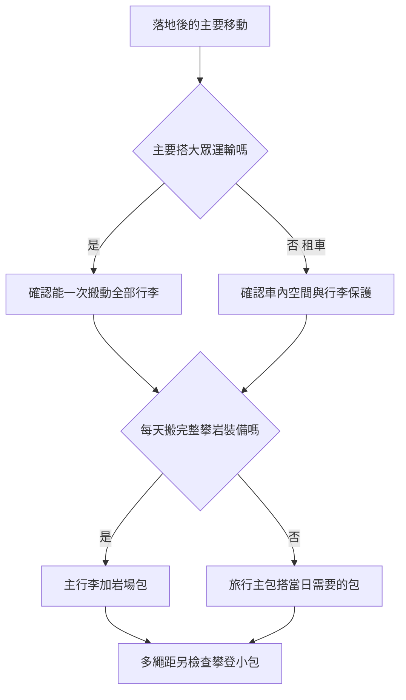

> 🌏 [English version](/posts/climbing/2026-10-19-climbing-travel-packing-en)

旅行包裝得下衣服和筆電，不代表能舒服地搬一整套攀岩裝備走到岩場。岩場包很耐磨，也不代表適合每天搭地鐵、過安檢，或背著逛城市。打包先想落地之後的移動方式，再決定要幾個包。

本文寫給安排攀岩旅行，又希望部分包款能兼一般出國的人。看完要能選一個主行李配置，完成兩人的分工清單，並知道哪些裝備與航空條件仍須確認。若主要問題是背著攀爬，先看[多繩距背包篇](/posts/climbing/2026-10-19-multipitch-climbing-backpacks)。

## 三種旅行，主行李可以不同

**一般岩場旅行**重視住宿到岩場的裝備搬運。每天都要拿繩、快扣與鞋，背板能整面打開、方便整理的岩場包很實用。若只是開車短住，不必為了「旅行包」名稱再買一個。

**出國攀岩**多了機場、托運和轉車，還要保護器材。行李箱或旅行提袋（duffel）可以裝旅運階段的衣物與器材，到了住宿再分裝岩場包。要去多繩距，另帶適合攀爬的小包；岩場大包未必要上岩壁。

**一般出國兼攀岩**若攀岩只占一天，其餘是城市與工作，旅行主包更容易處理衣物和筆電。先確認岩場那天能否用現有小包或租借裝備，不必把每天都背的主行李變成重型器材袋。

## 租車與大眾運輸，差在能不能一次搬走

租車可以把衣物留在住宿、只帶岩場包出門；但別把繩與頭盔長時間放在曝曬的車內。也要想清楚兩人的主行李、食品和器材能不能放進後車廂，而不是到取車時才發現空間不夠。

搭火車與公車則先在家做「從房門走到月台」測試。兩人能否各自搬動分配到的行李？一個人背大包、胸前再掛小包、手提繩袋，樓梯或擁擠車廂可能比岩場接近更麻煩。輪式行李適合平整路面，碎石路和無電梯住宿要另想。

一包兼用適合裝備少、交通單純的人；代價是衣物和器材每天重新整理。主行李加岩場包比較好分工，但多一個袋子需要搬。duffel可放較不規則的物品，通常也不如有框架的背包適合長時間背負。依行程取捨，沒有一種配置能省下所有麻煩。

## 岩場包四款：挑裝載方式與負重

以下是比較候選，並非台灣銷量排行或本站實背心得。[Switchback](https://www.switchbacktravel.com/climbing/best-backpacks)與[Climbing](https://www.climbing.com/gear/best-climbing-backpack/)的近期比較支持Creek與Cragsmith；其他款依原廠用途加入，導購評測可能有聯盟分潤。

| 型號／容量 | 適合誰 | 主要取捨 |
|---|---|---|
| [BD Creek50／50L](https://blackdiamondequipment.com/products/creek-50-pack) | 硬體多，重視站立底部、耐磨與側面取物 | 空重約2kg；小量運動攀可能用不到這麼大，背長要試 |
| [Patagonia Cragsmith45／45L](https://www.patagonia.com/product/cragsmith-climbing-pack-45-liters/48066.html) | 喜歡整面背板開口、衣物器材容易攤開 | 現行420D／1420g與舊款不同；不是貼背攀登小包 |
| [BD Crag40／40L](https://blackdiamondequipment.com/products/crag-40-backpack) | 想比Creek小，保留頂部與側拉鍊裝載 | 原廠941g，但不能推定有Creek相同耐拖能力 |
| [Mammut Neon45／45L](https://www.mammut.com/us/en/products/2510-01944/neon-45) | 想要硬體內掛、雙開口和可拆繩袋／地布 | 原廠列無雨罩，濕天保護另安排；不是多繩距小包 |

## 旅行主包四款：衣物、筆電與城市移動

[OutdoorGearLab旅行包比較](https://www.outdoorgearlab.com/topics/travel/best-travel-backpack)提供Farpoint、MLC及Allpa的第三方參考。Aer現行4是另依原廠設計加入，不能拿比較中的舊3當新版實測。

| 型號／容量 | 適合誰 | 主要取捨 |
|---|---|---|
| [Osprey Farpoint40／40L](https://www.osprey.com/farpointtm-40-travel-pack-1) | 想要可調背長、框架與可收肩帶腰帶；另可比較Fairview適配 | 現行1.48kg與舊聚酯版不同；收納分隔較少 |
| [Patagonia MLC45／45L](https://www.patagonia.com/product/black-hole-mlc-convertible-carry-on-backpack-45-liters/49307.html) | 衣物較多，筆電分區，背、肩、手提切換 | 包體較寬；評測提醒部分航空尺寸吃緊，不能保證登機 |
| [Cotopaxi Allpa35／35L](https://uk.cotopaxi.com/products/cotopaxi-allpa-35l-travel-pack-black) | 喜歡衣物分艙，開包就能找東西 | 固定分艙可能限制大型硬體裝載；標準版與DelDía分開看 |
| [Aer TravelPack4／35L](https://aersf.com/products/travel-pack-4-35l) | 城市與工作旅行，重視筆電及小物整理 | 腰帶另購，空重3.90lb；舊3已停產，別照舊評測下單 |

### 社群心得要看它在說哪個版本

[MountainProject的旅行兼多繩距討論](https://www.mountainproject.com/forum/topic/123738192/multi-pitch-pack)裡，發問者想一包兼用，卻發現接近好背的日用包不適合攀爬。回覆也有人覺得耐操包在岩壁上笨重。這是2023年的個人經驗，不能拿它替表中八款做當代排名。

MLC的[原廠顧客評論](https://www.patagonia.com/product/black-hole-mlc-convertible-carry-on-backpack-45-liters/49307.html)也有相反看法：有人喜歡科技用品分區，另有人懷念舊版的大空艙。這些自述的使用條件和商品版本不同。試裝自己的衣物與硬體，比只看「收納多」更有用；顧客評論也不能證明航空普遍允許帶上機。

## 七天兩人的打包表：先分人，再分袋

假設七天行程含城市休息日、運動攀岩場和一天多繩距，住宿能晾乾器材。以下是分工範例，不是任何岩場都適用的完整安全清單；繩長、硬體數量、水量和救援裝備必須依實際路線、下降與隊伍能力決定。

| 類別 | 甲負責核對 | 乙負責核對 | 放在哪、何時再查 |
|---|---|---|---|
| 個人攀登用品 | 自己的鞋、吊帶、頭盔及所需個人確保用品 | 同左，各自檢查自己的裝備 | 保護後放主行李；落地與起攀前各查一次 |
| 繩與路線配置 | 按路線核對繩長、型態、歷史與狀態 | 獨立核對下降需求、確保器相容及隊伍分工 | 繩袋收整，落地檢查；不預設一條繩適用所有路線 |
| 共用硬體 | 按路線清單點快扣／保護器材及連接器 | 對照清單覆核，核對需要的下降與緊急用品 | 內袋集中，避免尖物接觸繩與頭盔 |
| 當日物品 | 個人衣物、水、頭燈 | 個人衣物、水、頭燈及共用食物分工 | 每晚按隔日天候重裝，不用七天份塞上岩壁 |
| 文件與資訊 | 證件、訂房、交通與保險資料 | 路線圖、下降資料、當地緊急聯絡資訊 | 各有可離線取得的副本，不只放一支手機 |
| 一般旅行 | 個人衣物、盥洗用品、藥品 | 個人用品；共用充電器由一人統整 | 依住宿洗衣安排減量，液體與器材分袋 |
| 多繩距小包 | 接近先帶繩，確認回程是否回起攀點 | 先帶小包，起攀前共同重分配 | 兩人的接近鞋、必要衣物與水能否一起帶走 |
| 打包收尾 | 按實際票種、航段查尺寸重量與裝備規則 | 量裝滿的外尺寸、秤重、覆核清單 | 出發前再核當前規則，不能只相信包款名稱 |

清單上每件共用裝備要有一個主要負責人，再由另一人覆核；「以為對方會帶」不是分工。到住宿後把明天用的器材放進岩場包，休息日則只帶城市需要的東西。若只能靠買更大包才裝得下，先攤開清點有沒有重複或用不到的物品。

## 繩、頭盔與濕裝備，怎麼進主行李

若實際航段允許把繩托運，用繩袋或乾淨內袋包好，與尖銳硬體及液體分開；不要由「繩可托運」推成所有器材都適用同一規則。頭盔用原廠建議的保護方式收納，不把鬆散硬體放在旁邊摩擦或刺傷它。[Petzl保護裝備指南](https://www.petzl.com/sfc/servlet.shepherd/version/download/068Tx00000CayFIIAZ)提醒運輸時保護裝備免受尖物、熱與化學品影響。

清潔劑、燃料、電池滲漏與其他化學物不要和繩、繩環或頭盔混放；若疑似化學污染，不是換個袋子就能恢復使用。按原廠處置與檢查要求處理。[Petzl清洗指引](https://petzl.com/us/en/professional/we-are-petzl/rescue/how-do-i-wash-my-rope-or-harness-/-NEWS--PRO-Comment-laver-ma-corde-ou-mon-harnais_PRO_a7CbK0000000hGHUAY.html)要求在通風室內、遠離紫外線和熱源乾燥。落地先取出潮濕物品，安排晾乾，不把密封袋當長期存放方式。

航空部分，查出發、轉機與回程各航段的規則，包含實際承運公司與票種。主行李尺寸、重量及裝備是否可隨身或托運，要分開確認。原廠寫「carry-on」、網友某次成功登機，都不能代替這一步。

## 八款價格快照，連條件一起看

2026年10月19日公開商品價，未確認寄台灣或結帳；除明列含VAT外稅額未知。以下不換算成台幣，也不是最低到手價。

| 包款 | 店頁價格 | 條件 |
|---|---|---|
| Creek50 | [BD US USD259.95](https://blackdiamondequipment.com/products/creek-50-pack) | 缺貨、背長未選，僅標價參考 |
| Cragsmith45 | [Bergfreunde EU EUR229.95](https://www.bergfreunde.eu/patagonia-cragsmith-45-climbing-backpack/) | 420D版、含VAT，顏色／尺碼待選 |
| Crag40 | [BD US USD159.95](https://blackdiamondequipment.com/products/crag-40-backpack) | CarbonS/M，缺貨標價 |
| Neon45 | [Oliunìd USD138.39](https://www.oliunid.com/mammut-neon-45-crag-backpack) | 列現貨，顏色／SKU未鎖 |
| Farpoint40 | [Outdoorweb EUR154.80](https://www.outdoorweb.eu/FARPOINT-40-black) | Black、1.48kg版，庫存未確認 |
| MLC45 | [BackpackParis EUR220](https://backpack.paris/en/products/black-hole-mlc-45) | WeatheredStone，Lyon可取，精確SKU待核；不等於可寄台灣 |
| Allpa35 | [Cotopaxi UK GBP220](https://uk.cotopaxi.com/products/cotopaxi-allpa-35l-travel-pack-black) | Black標準新版、非DelDía，庫存未明 |
| TravelPack4 35L | [Aer USD259](https://aersf.com/products/travel-pack-4-35l) | Black，缺貨／可售未確認；腰帶另購 |

Cragsmith45的[Patagonia US](https://www.patagonia.com/product/cragsmith-climbing-pack-45-liters/48066.html?cgid=luggage-technical-packs&dwvar_48065_color=BLK)另列USD229；MLC45的[美國官網](https://www.patagonia.com/product/black-hole-mlc-convertible-carry-on-backpack-45-liters/49307.html)列USD249。要比較跨店差額，先對齊顏色、尺寸、版次、稅與運送條件。

**自我檢查：** 兩人搭大眾運輸，想買兩個50L岩場包，再各掛一個小包搭機，因為商店寫「hand luggage」。這個計畫還缺什麼？**答案：** 先確認兩人能一次搬動、尺寸重量符合各航段，以及岩場大包是否真有每天使用的必要。包型名稱不能保證登機，額外買包也不會減少行李重量。

下一步看[攀岩鞋、吊帶與頭盔的選購](/posts/climbing/2026-10-19-climbing-shoes-harness-helmet)，把包內個人裝備選對。

<!-- climbing-gear-nav:start -->
> [上一篇：多繩距背包](/posts/climbing/2026-10-19-multipitch-climbing-backpacks) · [系列總覽](/posts/climbing/2026-10-19-climbing-gear-travel-overview) · [下一篇：攀岩鞋、吊帶與頭盔](/posts/climbing/2026-10-19-climbing-shoes-harness-helmet)
<!-- climbing-gear-nav:end -->

## 參考資料

- [Switchback：攀岩包比較](https://www.switchbacktravel.com/climbing/best-backpacks)
- [Climbing：攀岩包與旅行提袋比較](https://www.climbing.com/gear/best-climbing-backpack/)
- [OutdoorGearLab：旅行背包比較](https://www.outdoorgearlab.com/topics/travel/best-travel-backpack)
- [Mammut：Neon45原廠規格](https://www.mammut.com/us/en/products/2510-01944/neon-45)
- [Aer：TravelPack4 35L](https://aersf.com/products/travel-pack-4-35l)
- [Petzl：保護裝備指南](https://www.petzl.com/sfc/servlet.shepherd/version/download/068Tx00000CayFIIAZ)
- [Petzl：繩與吊帶清洗指引](https://petzl.com/us/en/professional/we-are-petzl/rescue/how-do-i-wash-my-rope-or-harness-/-NEWS--PRO-Comment-laver-ma-corde-ou-mon-harnais_PRO_a7CbK0000000hGHUAY.html)
- [MountainProject：一包兼用的使用討論](https://www.mountainproject.com/forum/topic/123738192/multi-pitch-pack)

- [BD Creek50／50L](https://blackdiamondequipment.com/products/creek-50-pack)
- [Patagonia Cragsmith45／45L](https://www.patagonia.com/product/cragsmith-climbing-pack-45-liters/48066.html)
- [BD Crag40／40L](https://blackdiamondequipment.com/products/crag-40-backpack)
- [Osprey Farpoint40／40L](https://www.osprey.com/farpointtm-40-travel-pack-1)
- [Patagonia MLC45／45L](https://www.patagonia.com/product/black-hole-mlc-convertible-carry-on-backpack-45-liters/49307.html)
- [Cotopaxi Allpa35／35L](https://uk.cotopaxi.com/products/cotopaxi-allpa-35l-travel-pack-black)
- [Bergfreunde EU EUR229.95](https://www.bergfreunde.eu/patagonia-cragsmith-45-climbing-backpack/)
- [Oliunìd USD138.39](https://www.oliunid.com/mammut-neon-45-crag-backpack)
- [Outdoorweb EUR154.80](https://www.outdoorweb.eu/FARPOINT-40-black)
- [BackpackParis EUR220](https://backpack.paris/en/products/black-hole-mlc-45)
- [Patagonia US](https://www.patagonia.com/product/cragsmith-climbing-pack-45-liters/48066.html?cgid=luggage-technical-packs&dwvar_48065_color=BLK)
