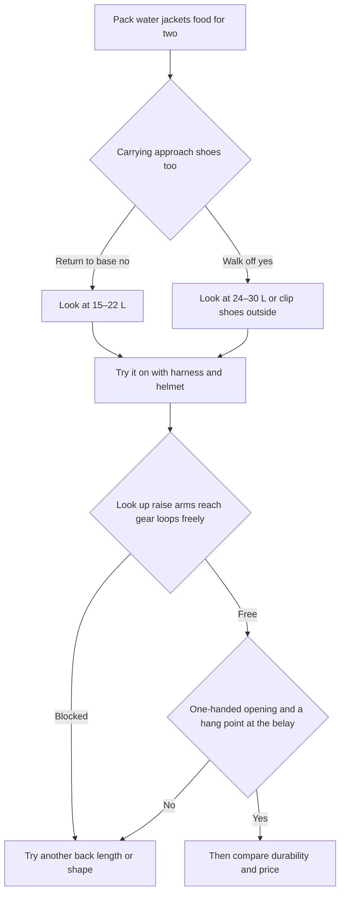

> 🌏 [中文版](/posts/climbing/2026-10-19-multipitch-climbing-backpacks)

The [crag pack from the previous article](/posts/climbing/2026-10-19-climbing-crag-packs-en) stays on the ground at the base. A multipitch pack climbs with you and spends the whole day on the wall. A pack that carries well on the trail can get in the way everywhere once you climb. You look up at the next pitch and your helmet hits the top of the pack. You reach for a quickdraw and the hipbelt is sitting on your gear loop. You open a zip at a hanging belay and your jacket nearly falls out.

This article is for people planning a multipitch trip abroad and buying their first climbing pack. The first half covers six criteria. The second half compares 31 current models from 20 climbing and mountaineering brands, then gives a two-person day plan, an in-store fitting checklist, and a note on using the pack as cabin baggage. By the end you should be able to try a pack on with your harness and helmet and decide whether it can go on the wall.

## How it differs from a crag pack

A crag pack carries the rope, the full rack, and lunch for two to the base of the wall. It is large, and its suspension is designed for walking. A multipitch pack holds only what you need while climbing: water, jackets, food, headlamps, and sometimes approach shoes. [Climbing's 2026 pack roundup](https://www.climbing.com/gear/best-climbing-backpack/) puts these packs at 25 L or less, with a low profile that sits snug against the back and few external pockets and straps, because extra straps snag on rock. The hipbelt is usually a simple webbing strap that stabilizes the pack rather than carrying load.

[Switchback Travel's roundup](https://www.switchbacktravel.com/best-climbing-backpacks) calls these "follower packs": the leader climbs light and the follower carries the pack. The two-person plan below starts from that.

Whether you bring one rope or two, and how long, is covered in the rope section of [the gear list by destination](/posts/climbing/2026-10-19-climbing-trip-gear-list-by-destination-en). This article is only about the pack.

## Six criteria

### 1. Narrow and tall, so turning and reaching stay free

The wider the pack, the more your arms and shoulders brush its sides when you reach back or twist. Switchback describes the [BD Rock Blitz 15](https://blackdiamondequipment.com/products/rock-blitz-15-backpack) as shaped like a bullet that "rides high on the back, close against the body, and out of the way of a harness." Look at the front width first. Between two packs of the same volume, pick the narrower, taller one.

### 2. Helmet and harness clearance

A pack that is too long causes trouble at both ends. The top edge hits the back of your helmet, so looking up at the next pitch pushes your neck forward. The bottom edge sits on your harness waistbelt and rear gear loops, so you can't reach your gear. Back length matters more than volume; if a model comes in two sizes, try both. Choosing the harness itself is covered in [Harness and Helmet](/posts/climbing/2026-10-19-climbing-harness-helmet-en).

A removable hipbelt helps. Buckle it on the approach, then remove or stow it before you climb so it doesn't stack on top of your harness. The webbing belt on the [Wadi 15](https://us.blueice.com/products/wadi-15-pack) and the belt on the [Petzl BUG](https://www.petzl.com/us/en/sport/products/climbing-packs-rope-bags/bug/BUG_SPO_a2mTx000003PXGnIAO.html) both come off, as do the belts on larger packs such as the [Rab Latok 28](https://rab.equipment/us/rab-latok-28l-mountain-pack) and [Hyperlite Summit 30](https://www.hyperlitemountaingear.com/products/summit-30).

### 3. Water and jackets you can reach at the belay

A belay ledge often has room for two feet and nowhere to set a pack down. A top opening is safer. [Gripped's 2026 review of the BUG](https://gripped.com/gear/the-petzl-bug-multi-pitch-pack-a-review) praises its top-mounted main opening because nothing falls out when you open it at a hanging belay. The same review warns that the front pocket's vertical zip needs care. A full U-shaped zip is handy on the ground and risky on the wall.

There are two ways to carry water. A bladder lets you drink while climbing, but route the hose along the shoulder strap so it doesn't hang near your harness gear. Bottles are easier to manage, but you have to open the pack to reach them. Pack the jacket on top so it's the first thing you grab when the wind picks up.

### 4. Which point to hang it from, which to haul from: check the manual

Clipping the pack to the anchor at a belay lets you get things out without wearing it. The rope strap on the [Wadi 15](https://us.blueice.com/products/wadi-15-pack) doubles as a tether with a 2 kN carabiner. That carabiner is for hanging the pack and is not for protecting people. The [Osprey Mutant 22](https://www.osprey.com/mutant-22-mutant22f22-376) has a three-point haul system, the [Edelrid Rubi](https://edelrid.com/eu-en/sport/backpacks-and-rope-bags-shop/rubi) has haul loops, and according to Gripped's review and Climbing's roundup, the BUG and the Patagonia Ascensionist 35L have them too.

When you need to haul the pack through a hard section, use only a loop the brand says is for hauling. An ordinary grab handle is made for lifting by hand; if the brand doesn't say it can be hauled, treat it as a hand-carry handle only. Climbing's roundup also says the Wadi is fine for occasional hauling through cruxes, but they wouldn't use it as a daily haulbag. If you plan to haul the whole route, get a haulbag, which is outside the scope of this article.

### 5. Fabric that stands up to abrasion

A multipitch pack gets dragged across rock, and chimneys are worse. Fabric denier (D) is a rough guide: higher usually means thicker. Switchback says the 840D Rock Blitz holds up in chimneys, and the Wadi 15 uses even heavier fabric. Lightweight packs often use thinner fabric to save weight, like the [BD Blitz 20](https://blackdiamondequipment.com/products/blitz-20-backpack). Choose heavy fabric for granite crack routes. For limestone face routes or alpine days with unsettled weather, a light, waterproof pack is worth considering, such as the X-Pac [Grivel Spartan X](https://grivel.com/products/spartan-x-20).

### 6. Size it from water and clothing: 15–30 L

Put the real items in: water for two (about 1 kg per liter), two wind shells, an insulating layer if needed, food, headlamps, the topo, and a first-aid kit. If you rappel or walk back to the base and can leave your shoes there, 15–22 L is usually enough. If you walk off the other side and both pairs of approach shoes come with you, look at 24–30 L or clip the shoes outside.

Shoes clipped outside swing and snag on rock, so check whether the route allows it. A bigger pack invites stuffing; when it's half full, the compression straps should cinch it tight so it doesn't sway.

## 31 current models from 20 brands

Prices are list prices on each brand's official store on 2026-10-19, in the store's currency, not converted; where the brand lists no price, a retail price is noted. Weights are the brands' empty weights; where the brand lists none, the retailer figure is marked. The "Review" column lists only third-party reviews from 2020 onward, with personal blogs marked; "—" means none. Models from the same brand are grouped together. Check the official page for haul loop and hipbelt details before you buy.

### 15–20 L: the core follower packs

| Model | Volume | Weight | Features | Official price | Review | Who it suits / downsides |
|---|---|---|---|---|---|---|
| [Black Diamond Rock Blitz 15](https://blackdiamondequipment.com/products/rock-blitz-15-backpack) | 15 L | 403 g | 840D fabric, drawstring top opening, side zip pocket, removable hipbelt | USD 99.95 | [Switchback 2026](https://www.switchbacktravel.com/best-climbing-backpacks): best follower pack for multipitch | Rock-only days, durability; no hydration sleeve, no haul loop listed |
| [Black Diamond Blitz 20](https://blackdiamondequipment.com/products/blitz-20-backpack) | 20 L | 374 g | One-hand top closure, rope strap, hydration compatible, strippable | USD 119.95 | Mentioned in Switchback 2026 | Low weight, alpine use; thinner fabric than the Rock Blitz |
| [Blue Ice Wadi 15](https://us.blueice.com/products/wadi-15-pack) | 15 L | 500 g (450 g stripped) | 1000D nylon, tether with 2 kN carabiner, helmet carry | USD 99.95 (out of stock on the US store) | [Climbing 2026](https://www.climbing.com/gear/best-climbing-backpack/): best for multipitch | People who hang the pack at belays; not waterproof, Climbing suggests fair weather |
| [Blue Ice Dragonfly 18](https://us.blueice.com/products/dragonfly-18l-pack) | 18 L | 415 g (325 g stripped) | Strips down to minimal, ice tool carry | USD 109.95 | Climbing 2026: wet-weather alternative | Alpine rock, low weight; no haul loop listed |
| [Mammut Trion 15](https://mammut.com/us/en/products/2520-00981-0243/trion-15) | 15 L | 420 g | Running-vest harness, zippered roll-top, side access | USD 169.95 | — | Fans of a vest fit; no hipbelt, pricey |
| [Petzl BUG](https://www.petzl.com/us/en/sport/products/climbing-packs-rope-bags/bug/BUG_SPO_a2mTx000003PXGnIAO.html) | 18 L | 665 g | Top opening, laptop/hydration sleeve, removable helmet holder and waistbelt | USD 109.95 | [Gripped 2026-03](https://gripped.com/gear/the-petzl-bug-multi-pitch-pack-a-review) | Doubles as a daily bag and cabin bag; heavy for its size |
| [Edelrid Rubi](https://edelrid.com/eu-en/sport/backpacks-and-rope-bags-shop/rubi) | 19 L | 498 g | Haul loops, gear loops, simple hipbelt | EUR 70 | — | Tight budget but want haul loops; few features |
| [Grivel Spartan X 20](https://grivel.com/products/spartan-x-20) | 20 L | 480 g | Water-resistant X-Pac fabric, roll-top, thermoformed back panel, ice tool attachment | EUR 165 / USD 215 | — | Low weight with weather resistance; no haul loop listed, out of stock on the EU store (in stock in the US) |
| [Rab Latok 20](https://rab.equipment/us/rab-latok-20l-mountain-pack) | 20 L | 480 g | Cordura and Spectra ripstop, roll-top, vest-style sternum strap, zip pocket on the shoulder strap, removable webbing hipbelt | USD 175 | — | Latok 28 fans who want a smaller follower pack; no haul loop listed |
| [C.A.M.P. M20](https://www.camp.it/info/item/3205) | 20 L | 780 g | Full back-panel opening, zippered lid plus drawcord, removable hipbelt with 2 gear loops, stowable helmet and rope straps | Not listed by the brand (EUR 134.95 at European retailers) | — | Long approaches, comfortable carry; heaviest at this size |
| [Arc'teryx Alpha FL 20](https://arcteryx.com/us/en/shop/alpha-fl-20-backpack-0348) | 20 L (24 L with the extension skirt) | 635 g | 315D Hadron waterproof fabric, glove-friendly drawcord opening, top rope strap, twin ice tool attachments | USD 250 | — | The Alpha FL 30 fabric in a smaller size; expensive, no hipbelt or haul loop in the specs |

### 22–25 L: more room for layers

| Model | Volume | Weight | Features | Official price | Review | Who it suits / downsides |
|---|---|---|---|---|---|---|
| [Black Diamond Speed 22](https://blackdiamondequipment.com/en_US/product/speed-22-backpack) | 22 L | 587 g | Coated 210D ripstop, reinforced front panel, removable lid, framesheet and hipbelt, stowable rope strap | USD 169.95 | — | Mixed rock and ice, strips down to minimal; the US store notes it doesn't ship to some states |
| [Osprey Mutant 22](https://www.osprey.com/mutant-22-mutant22f22-376) | 22 L | 650 g | Three-point haul system, hydration sleeve, removable hipbelt | USD 140 | — | More layers, mixed rock and ice; remove the external webbing straps before climbing |
| [Millet Prolighter 22](https://millet.com/eu_en/mis2274-n7317-prolighter-22-unisex-navy-blue.html) | 22 L | 630 g | Removable hipbelt, ice axe holder | EUR 100 (on sale at EUR 75) | — | Buying locally in Europe; on sale, so colors and sizes may be limited |
| [Ortovox Trad 22 Dry](https://ortovox.com/us-en/shop/backpacks/p249732-climbing-backpacks-trad-22-dry) | 22 L | 600 g | Waterproof fabric, welded seams, roll-top, helmet, rope and axe attachments outside the rain cover | USD 270 | — | Long routes in rainy regions; expensive |
| [Ortovox Trad Zero 24](https://www.ortovox.com/us-en/backpacks/specials/ultra-lightweight-backpacks/trad-zero-24/5000753) | 24 L | 570 g | Lid flap doubles as rope and helmet strap, grippy lining, gear loops, hydration port | USD 130 | — | Light but 24 L; no lid pocket for small items |
| [Deuter Guide Lite 24](https://www.deuter.com/uk-en/guide-lite-24/4046051185729) | 24 L | 670 g | U-frame, removable lid and hipbelt, stowable rope strap | GBP 130 | [Climbing 2020-04](https://climbing.com/gear/2020-alpine-kit-deuter-guide-lite-24-review) | Long approaches, stable carry; the review covers the 2020 version |
| [Salewa Ortles Climb 25](https://salewa.com/en-gb/ortles-climb-25l-backpack-00-0000001283) | 25 L | 605 g | Split shoulder straps, roll-top plus side access, twin axe and rope attachment | GBP 130 | — | Want side access; brand says the fabric handles hauling, but no haul loop listed |
| [La Sportiva Granite 22](https://lasportiva.com/en/backpack-climbing-granite-22-backpack-unisex-zecp002) | 22 L | Not listed by the brand (retailers such as Climbsmart and Lake State Mountaineering list 300–570 g, a wide spread) | 210D ripstop, drawstring top plus side zip, lid holds a rope, thermoformed back panel | EUR 110 / USD 119 | — | Side access on a mid-range budget; no haul loop listed |
| [Simond Alpinism 22](https://simond.com/en-GB/product/versatile-and-modular-mountaineering-backpack-alpinism-22-blue_371534--c59m89) | 22 L | 580 g | 200D ripstop nylon, large front opening with two zips, ice axe attachment, hydration sleeve | GBP 34.99 | [Olympus Mountaineering 2020-07](https://olympusmountaineering.com/2020/07/25/simond-alpinism-22-backpack-long-term-review) (personal blog) | Lowest-budget first multipitch pack; thinner fabric, be careful with the big front zip at belays, hard to buy outside Decathlon |
| [Wild Country Syncro](https://wildcountry.com/syncro-backpack-40-0000010006) | 22 L | Not listed by the brand (Oliunìd, BananaFingers and EpicTV list 600 g) | Roll-top, narrow body, long side zip, two daisy chains, top rope strap, removable hipbelt | EUR 110 (on sale at EUR 77) | — | The brand designed it for multipitch; on sale, possibly an end-of-season clearance |
| [Wild Country Progress 25L](https://www.wildcountry.com/progress-backpack-25l-40-0000010049) | 25 L | Not listed by the brand (retailers list 615 g) | 420D ripstop nylon, drawstring top, side zip, hidden daisy chains, front pocket | EUR 115 / USD 129.95 | — | Alpine multipitch with snowy approaches; no haul loop listed |

### 27–30 L: carrying approach shoes or going alpine (plus one 35 L)

| Model | Volume | Weight | Features | Official price | Review | Who it suits / downsides |
|---|---|---|---|---|---|---|
| [Black Diamond Speed 30](https://blackdiamondequipment.com/en_US/product/speed-30-backpack) | 30 L | 938 g (S/M) / 984 g (M/L) | 210D ripstop, two back lengths, removable lid, framesheet and hipbelt, ice axe attachment | USD 219.95 | [Advnture 2023-05](https://www.advnture.com/reviews/black-diamond-speed-30) | Sized fit, heavier loads; heavier than roll-tops of the same volume |
| [Blue Ice Warthog 30](https://blueice.com/products/warthog-30) | 30 L | 630 g (530 g stripped) | 210D ripstop, two sizes, close-fitting shoulder straps, strips down to minimal | EUR 150 | [Rock Van Life 2026-08](https://rockvanlife.com/blue-ice-warthog-30-review) (blog) | Wadi or Dragonfly users who want a size up; for waterproofing there's the roll-top [Warthog 30 WMO](https://blueice.com/products/warthog-30-wmo) (660 g, EUR 160); no haul loop listed |
| [Rab Latok 28](https://rab.equipment/us/rab-latok-28l-mountain-pack) | 28 L | 810 g | Spectra fabric, expandable roll-top, removable hipbelt | USD 225 | — | Walk-offs with shoes; on the heavy side |
| [Rab Ascendor 27L](https://rab.equipment/us/rab-ascendor-27l-mountain-pack) | 27 L | 729 g | 210D Robic ripstop, TRI-FLEX back system, 48 cm back length, 54×27×28 cm | GBP 130 / USD 150 | — | Around 28 L for less than the Latok 28; some colours out of stock |
| [Gregory Alpinisto LT 28](https://eu.gregorypacks.com/uk-en/-alpinisto-28-lt-sm-md--piton-blue/126853-9986.html) | 28 L | 990 g | Removable lid, framesheet, and hipbelt | GBP 150 (on sale at GBP 105) | — | Long approaches, load carrying; heaviest here, and the sale may be a clearance |
| [Arc'teryx Alpha FL 30](https://arcteryx.com/us/en/shop/alpha-fl-30-backpack-0349) | 30 L | 665 g | 315D laminated waterproof fabric, roll-top plus drawcord, RECCO | USD 280 | Switchback 2026: best ultralight alpine pack | Long alpine routes, bad weather; expensive |
| [Hyperlite Summit 30](https://www.hyperlitemountaingear.com/products/summit-30) | 30 L | 383 g (white) / 448 g (black) | Frameless Dyneema roll-top, removable webbing hipbelt | USD 210 | — | Lightest 30 L here; frameless, no haul loop listed |
| [Grivel Spartan X 30](https://grivel.com/products/spartan-x-30) | 30 L | 620 g | Water-resistant X-Pac fabric, roll-top, side-back opening, thermoformed back panel, ice tool attachment | EUR 210 / USD 273 | — | Light 30 L with side access; no haul loop listed |
| [Patagonia Ascensionist 35L](https://www.patagonia.com/product/ascensionist-climbing-backpack-35-liters/47985.html) | 35 L | 771 g | 210D recycled nylon with TPU coating, lid pocket, removable hipbelt and framesheet, ice axe attachment; Climbing notes two haul loops | USD 239 | [Climbing 2026](https://www.climbing.com/gear/best-climbing-backpack/): best all-around alpine pack | One shared pack for two, long approaches; 35 L is beyond this range and sways when not full, and Switchback finds it less comfortable than the Osprey Mutant |

How to narrow it down: for rock-only days in good weather, pick from the Rock Blitz 15, Wadi 15, and Rubi; on the tightest budget, look at the Simond Alpinism 22. If the same pack should also be your city bag and cabin bag, look at the BUG. For lots of layers or mixed rock and ice, look at the Mutant 22, Trad Zero 24, or Speed 22. If you often climb where it rains, look at the Trad 22 Dry or the Alpha FL packs. For walk-offs with shoes, look at the 28–30 L group.

## How two climbers split a day

Say two people climb a route of about eight pitches and walk off the other side, so both pairs of approach shoes come along. The leader climbs light with only the rack on the harness; the follower carries the pack.

| Stage | Climber A | Climber B |
|---|---|---|
| Approach | Carries the rope and own rack | Carries the climbing pack: water, jackets, food, headlamps for both, two pairs of approach shoes |
| Before the climb | Changes into climbing shoes, hands approach shoes to B | Removes or stows the pack's hipbelt, moves jackets to the top |
| A leads | No pack | Follows with the pack, clips it to the anchor at each belay before getting things out |
| B leads | Takes the pack at the belay and adjusts the straps | Hands over the pack and leads light |
| Descent | Coils the rope, splits the rack | Both change back into approach shoes; check jackets and headlamps are in the pack |

If you swap leads, the pack changes hands at every belay, so the straps need to adjust quickly and the hang point needs to be easy to find. If one person leads all day, the other carries the pack all day, and comfort matters more than handover speed.

If water, jackets, and two pairs of shoes already fill a 15 L pack, you have two options: go up to 24–30 L, or clip one pair of shoes outside. Don't leave a necessary warm layer behind just to fit the pack you like.

## In-store fitting checklist

Bring your own harness, helmet, water bottle or bladder, a jacket, and if possible your approach shoes.

1. Load the pack, with water filled to what you'd actually carry. An empty pack tells you very little.
2. Put on the harness and helmet, then the pack, and adjust the shoulder and sternum straps.
3. Look up at the ceiling: does the back of your helmet hit the top of the pack?
4. Raise both arms and twist left and right: do the pack's sides catch your arms or shoulders?
5. Reach for the front and rear gear loops with each hand: does the bottom of the pack cover the rear loops?
6. High-step with one foot, then squat: does the pack swing to one side?
7. Remove or stow the hipbelt: is the pack still stable, and are the leftover straps tidy?
8. Find the brand's hang point, hang the pack from a hook, and get the jacket out one-handed through the main opening.
9. Confirm the haul loop (if any) and the ordinary grab handle are two different things.

If it fails item 3 or 5, change size or model. Don't try to fix it by adjusting the straps.

## When you fly, it often doubles as the cabin bag

On a multipitch trip abroad, the climbing pack is usually also the carry-on. Shoes, harness, helmet, and jacket travel in it, so you can still climb if your checked bag is lost. In a [January 2023 Mountain Project thread](https://www.mountainproject.com/forum/topic/123687187/travel-bags-to-fly-to-climbing-destination), one user said he uses his 15 L multipitch pack as his personal item and his crag pack with the gear as his carry-on. Gripped's review also calls the BUG a brilliant little carry-on for travel.

Personal-item limits are much smaller than cabin-bag limits (EVA Air allows only 10 cm of depth), so measure your pack when it's full. For each airline's cabin and personal-item sizes and how the climbing pack fits with your checked bag and crag pack, see [Checked Bags and Cabin Bags](/posts/climbing/2026-10-19-climbing-travel-luggage-en). For which hardware security may stop, see [Flying with Climbing Gear](/posts/climbing/2026-10-19-flying-with-climbing-gear-en).

This is the last article in the Climbing Travel Gear series. Go back to the [series overview](/posts/climbing/2026-10-19-climbing-gear-travel-overview-en) to revisit the reading paths by trip type.

## Update log

- 2026-10-19: Expanded the comparison tables from 16 models across 14 brands to 30 models across 20 brands, adding brands such as Grivel, La Sportiva, C.A.M.P., Simond and Wild Country, plus the BD Speed packs, Rab Latok 20, Blue Ice Warthog 30, Ortovox Trad 22 Dry and Arc'teryx Alpha FL 20. Models from the same brand are now grouped, the Patagonia Ascensionist 35L moved into the 28–30 L table, and links to the new official pages and reviews were added. Checked specs against brand data and fixed 4 items, and added the Rab Ascendor 27L to the 28–30 L table, for 31 models.

## References

- [Climbing: The Best Climbing Backpacks of 2026 (updated 2026-04)](https://www.climbing.com/gear/best-climbing-backpack/)
- [Switchback Travel: Best Climbing Backpacks of 2026 (2026-06-23)](https://www.switchbacktravel.com/best-climbing-backpacks)
- [Gripped: The Petzl Bug Multi-Pitch Pack: A Review (2026-03-31)](https://gripped.com/gear/the-petzl-bug-multi-pitch-pack-a-review)
- [Climbing: Gear Guide 2020: Deuter Guide Lite 24 Review (2020-04-14)](https://climbing.com/gear/2020-alpine-kit-deuter-guide-lite-24-review)
- [Mountain Project: Travel bags to fly to climbing destination (2023-01)](https://www.mountainproject.com/forum/topic/123687187/travel-bags-to-fly-to-climbing-destination)
- [EVA Air: Carry-on baggage (in Chinese)](https://www.evaair.com/zh-tw/fly-prepare/baggage/free-baggage/carry-on-baggage/)
- [Black Diamond: Rock Blitz 15](https://blackdiamondequipment.com/products/rock-blitz-15-backpack)
- [Black Diamond: Blitz 20](https://blackdiamondequipment.com/products/blitz-20-backpack)
- [Blue Ice: Wadi 15](https://us.blueice.com/products/wadi-15-pack)
- [Blue Ice: Dragonfly 18](https://us.blueice.com/products/dragonfly-18l-pack)
- [Mammut: Trion 15](https://mammut.com/us/en/products/2520-00981-0243/trion-15)
- [Petzl: BUG](https://www.petzl.com/us/en/sport/products/climbing-packs-rope-bags/bug/BUG_SPO_a2mTx000003PXGnIAO.html)
- [Edelrid: Rubi](https://edelrid.com/eu-en/sport/backpacks-and-rope-bags-shop/rubi)
- [Osprey: Mutant 22](https://www.osprey.com/mutant-22-mutant22f22-376)
- [Millet: Prolighter 22](https://millet.com/eu_en/mis2274-n7317-prolighter-22-unisex-navy-blue.html)
- [Ortovox: Trad Zero 24](https://www.ortovox.com/us-en/backpacks/specials/ultra-lightweight-backpacks/trad-zero-24/5000753)
- [Deuter: Guide Lite 24](https://www.deuter.com/uk-en/guide-lite-24/4046051185729)
- [Salewa: Ortles Climb 25](https://salewa.com/en-gb/ortles-climb-25l-backpack-00-0000001283)
- [Rab: Latok 28](https://rab.equipment/us/rab-latok-28l-mountain-pack)
- [Gregory: Alpinisto LT 28](https://eu.gregorypacks.com/uk-en/-alpinisto-28-lt-sm-md--piton-blue/126853-9986.html)
- [Arc'teryx: Alpha FL 30](https://arcteryx.com/us/en/shop/alpha-fl-30-backpack-0349)
- [Hyperlite Mountain Gear: Summit 30](https://www.hyperlitemountaingear.com/products/summit-30)
- [Patagonia: Ascensionist 35L](https://www.patagonia.com/product/ascensionist-climbing-backpack-35-liters/47985.html)
- [Advnture: Black Diamond Speed 30 review (2023-05)](https://www.advnture.com/reviews/black-diamond-speed-30)
- [Rock Van Life: Blue Ice Warthog 30 review (2026-08)](https://rockvanlife.com/blue-ice-warthog-30-review)
- [Olympus Mountaineering: Simond Alpinism 22 long-term review (2020-07-25)](https://olympusmountaineering.com/2020/07/25/simond-alpinism-22-backpack-long-term-review)
- [C.A.M.P.: M20](https://www.camp.it/info/item/3205)
- [C.A.M.P.: M20 technical specifications (PDF)](https://www.camp.it/api/GetSystemResource/210/3205)
- [Planetmountain: C.A.M.P. M20 press release](https://www.planetmountain.com/en/products/lightweight-climbing-backpack-m20.html)
- [Black Diamond: Speed 22](https://blackdiamondequipment.com/en_US/product/speed-22-backpack)
- [Black Diamond: Speed 30](https://blackdiamondequipment.com/en_US/product/speed-30-backpack)
- [Blue Ice: Warthog 30](https://blueice.com/products/warthog-30)
- [Grivel: Spartan X 20](https://grivel.com/products/spartan-x-20)
- [Grivel: Spartan X 30](https://grivel.com/products/spartan-x-30)
- [Rab: Latok 20](https://rab.equipment/us/rab-latok-20l-mountain-pack)
- [Rab: Ascendor 27L](https://rab.equipment/us/rab-ascendor-27l-mountain-pack)
- [Arc'teryx: Alpha FL 20](https://arcteryx.com/us/en/shop/alpha-fl-20-backpack-0348)
- [Ortovox: Trad 22 Dry](https://ortovox.com/us-en/shop/backpacks/p249732-climbing-backpacks-trad-22-dry)
- [La Sportiva: Granite 22](https://lasportiva.com/en/backpack-climbing-granite-22-backpack-unisex-zecp002)
- [Simond: Alpinism 22](https://simond.com/en-GB/product/versatile-and-modular-mountaineering-backpack-alpinism-22-blue_371534--c59m89)
- [Wild Country: Syncro](https://wildcountry.com/syncro-backpack-40-0000010006)
- [Wild Country: Progress 25L](https://www.wildcountry.com/progress-backpack-25l-40-0000010049)
