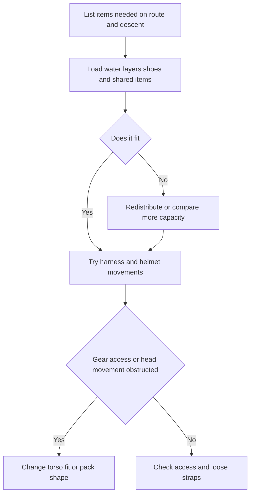

> 🌏 [中文版](/posts/climbing/2026-10-19-multipitch-climbing-backpacks)

A pack that feels comfortable walking to a cliff may interfere once you climb. Its belt can cover harness gear loops, while its top catches your helmet when you look up. A multipitch pack carries water and layers with you up the route; choose it while considering those movements.

This guide is for climbers buying a first small pack for multipitch travel. The decisions are how much space you need, who carries what, and which two models deserve a loaded fitting. Belaying, attaching a pack, and hauling still require the relevant instructions and practical training.

## Carrying to the cliff and climbing with a pack

A crag pack transports rope, hardware, and lunch before being opened at the base. A climbing pack moves with your torso and must leave room to reach overhead, look up, and access harness equipment. [Climbing’s comparison](https://www.climbing.com/gear/best-climbing-backpack/) separates these uses. Simple webbing belts on small packs mainly stabilize them; they do not provide the load transfer of a substantial pack belt.

Before seeking one pack for everything, ask whether the descent returns to the start. If you walk down the other side, how will you retrieve a large pack left below? If everything must travel up the route, will the small pack also fit approach shoes, layers, and descent equipment? These questions precede popular capacity recommendations.

## Derive capacity from water, layers, and shoes

Two day routes can require very different loads. One team walks off in approach shoes; another returns to the starting point. Cold conditions may require bulkier clothing. Put the real objects in the pack and fill water containers to the amount planned for your route. A liter of water weighs approximately a kilogram: ignoring it turns a loaded fitting into an empty-pack test.

Consider 15 L as a starting point for a small load and 18–22 L for additional room, rather than fixed formulas for people or hours. Do not remove equipment required by weather, route, or retreat plans to fit a favorite bag. Additional capacity need not be filled; test whether the pack rolls around when partly empty.

Separate approach duties from on-route duties. If one partner carries the rope to the start, that does not mean they carry that same weight all day: the rope enters use while the other partner may carry the main pack up the wall.

## Do a complete fitting

Bring your harness, helmet, water container or bladder, approach shoes, and layers. Adjust the shoulder straps, look up, reach both arms overhead, turn, and retrieve equipment from front and rear harness loops with each hand. The pack should leave required gear loops accessible and allow natural head movement. Height alone does not establish fit.

Squat and move sideways to check rolling. Check whether the waistbelt can be secured out of the way and whether shoulder straps restrict your arms. Tidy hydration tubing and loose adjustment straps so they do not hang beside equipment. Do not cut or modify structural or attachment components merely to save weight.

Finally, simulate access at a belay: can you retrieve layers and food while the pack remains secured? Top openings, zippers, and pockets have different advantages, but needing to unpack everything is awkward at a small stance. Learn the opening before taking it onto a wall.

## Hanging at a belay is different from hauling

A handle is not automatically a haul point, and abrasion-resistant fabric does not establish suitability for repeated dragging. [Wadi 15](https://us.blueice.com/products/wadi-15-pack) includes a rope strap and a 2 kN clip for pack attachment. This is a pack feature, not personal protection. Consult the exact model’s instructions for attachment points and limitations.

For repeated hauling, choose a manufacturer-designed pack and system for that purpose. Thick fabric alone cannot resolve chimneys, sharp rock, or snagging. Externally attached shoes and rope may swing or catch too; assess whether the route suits that arrangement. Reducing unnecessary external items deserves attention before adding more attachment points.

## Four candidates with different priorities

These models combine recent English-language reviews with manufacturer-described uses. This is neither a Taiwan sales ranking nor our own field test. [Switchback](https://www.switchbacktravel.com/climbing/best-backpacks) selects Rock Blitz; [Climbing](https://www.climbing.com/gear/best-climbing-backpack/) selects Wadi for multipitch use. Both buying guides may earn affiliate commissions. BUG and Mutant add daily-use crossover and greater capacity.

| Model | Manufacturer capacity/weight | Why compare it | Tradeoff |
|---|---|---|---|
| [BD Rock Blitz 15](https://blackdiamondequipment.com/products/rock-blitz-15-backpack) | 15 L/403 g | Minimal profile and a side pocket for a phone or topo | Limited room; not a dedicated haul bag or a guaranteed whole-team carrier |
| [Blue Ice Wadi 15](https://us.blueice.com/products/wadi-15-pack) | 15 L/500 g; 450 g stripped of accessories | Belay attachment, helmet carry, abrasion resistance | Climbing reports limited weather protection; plan accordingly |
| [Petzl BUG](https://www.petzl.com/US/en/Sport/Packs-And-Accessories/BUG) | 18 L/665 g | Daily use as well as climbing; laptop/hydration sleeve and removable helmet holder | Different from the older 525 g version; old reviews do not test the current model |
| [Osprey Mutant 22](https://www.osprey.com/mutant-22-mutant22f22-376) | 22 L/650 g | More layers, or day objectives involving rock or ice | More external attachments; a 38 L review cannot establish the 22 L fit |

### What community reports change

In a [2023 MountainProject discussion](https://www.mountainproject.com/forum/topic/123738192/multi-pitch-pack), the original poster favors more capacity because of large approach shoes, a hydration bladder, and their body shape. Other climbers prefer smaller packs. In a [2021 thread](https://www.mountainproject.com/forum/topic/121539838/best-pack-for-multi-pitch), one person describes years of satisfactory Blitz 20 use while another finds it insufficiently burly. Blitz 20 is not Rock Blitz 15; these older personal accounts cannot become a durability ranking for current products.

Turn them into fitting questions: how much space remains after your shoes go inside? Does the pack sit too low? Can straps be contained? The disagreement over carrying no pack at all is not a reason to omit route-required water or clothing.

### Compare capacity and model generation before prices

Public prices checked 19 October 2026; no checkout or Taiwan-shipping eligibility verified. Tax treatment is unknown except where VAT is explicitly included. These are not delivered totals.

| Model | Product-page price | Conditions |
|---|---|---|
| Rock Blitz 15 | [Oliunìd USD 55.63](https://www.oliunid.com/bd-black-diamond-rock-blitz-15-l-multi-pitch-climbing-backpack) | Listed in stock; color and current-generation SKU not locked |
| Wadi 15 | [BananaFingers EU EUR 76.90](https://bananafingers.com/eu/blue-ice-wadi-15-pack-climbing-and-mountaineering-backpack) | Listed available; color unselected. [Blue Ice US](https://us.blueice.com/products/wadi-15-pack) lists USD 99.95 but the selected North Atlantic is sold out |
| Current BUG 18 L | [Petzl US USD 109.95](https://www.petzl.com/US/en/Sport/Packs-And-Accessories/BUG) |665 g model; stock unclear; do not compare directly with discounted old versions |
| Mutant 22 | [CDC Greece EUR 140](https://www.cdc.gr/climbing/packs/osprey-mutant-22-unisex-en/) | Tungsten Grey; listed in stock; VAT included |

## A two-person day example

Assume a multipitch route with a descent that does not return to the start. Both pairs of approach shoes must travel with the team. The following allocation is illustrative: determine water and clothing from the actual route and conditions, not this table.

| Stage | Partner A | Partner B |
|---|---|---|
| Approach | Rope and personal items | Shared pack, food, and personal items |
| Before climbing | Jointly check both pairs of shoes, water, layers, headlamps, and route information | Put layers and frequently used items near the opening; secure straps |
| Climbing | Handle rope and hardware according to pitch duties | Carry the pack; readjust and check attachment if changing carriers |
| Descent | Redistribute rope and hardware | Check nothing was left at a stance |

Try this with an existing bag at home. If both pairs of shoes and layers already fill 15 L, compare 22 L or redistribute equipment rather than assuming everything can hang outside.

**Check your decision:** A 15 L pack fits well but cannot hold required clothing; a 22 L pack holds the load but obstructs your harness. Which should you buy? **Neither is suitable yet.** Keep necessary equipment, reconsider the allocation, and try other torso fits or shapes. Capacity and climbing clearance must both work.

Continue to [climbing travel packing](/posts/climbing/2026-10-19-climbing-travel-packing-en) to place this small pack within the whole trip’s luggage arrangement.

<!-- climbing-gear-nav:start -->
> [Previous: Multipitch rope systems](/posts/climbing/2026-10-19-multipitch-rope-systems-en) · [Series overview](/posts/climbing/2026-10-19-climbing-gear-travel-overview-en) · [Next: Climbing and ordinary travel packing](/posts/climbing/2026-10-19-climbing-travel-packing-en)
<!-- climbing-gear-nav:end -->

## References

- [Climbing: 2026 climbing-pack comparison](https://www.climbing.com/gear/best-climbing-backpack/)
- [Switchback: climbing-pack comparison](https://www.switchbacktravel.com/climbing/best-backpacks)
- [Black Diamond: Rock Blitz 15](https://blackdiamondequipment.com/products/rock-blitz-15-backpack)
- [Blue Ice: Wadi 15](https://us.blueice.com/products/wadi-15-pack)
- [Petzl: BUG](https://www.petzl.com/US/en/Sport/Packs-And-Accessories/BUG)
- [Osprey: Mutant 22](https://www.osprey.com/mutant-22-mutant22f22-376)
- [MountainProject: 2023 discussion](https://www.mountainproject.com/forum/topic/123738192/multi-pitch-pack)
- [MountainProject: 2021 experiences](https://www.mountainproject.com/forum/topic/121539838/best-pack-for-multi-pitch)

- [Oliunìd USD 55.63](https://www.oliunid.com/bd-black-diamond-rock-blitz-15-l-multi-pitch-climbing-backpack)
- [BananaFingers EU EUR 76.90](https://bananafingers.com/eu/blue-ice-wadi-15-pack-climbing-and-mountaineering-backpack)
- [CDC Greece EUR 140](https://www.cdc.gr/climbing/packs/osprey-mutant-22-unisex-en/)
