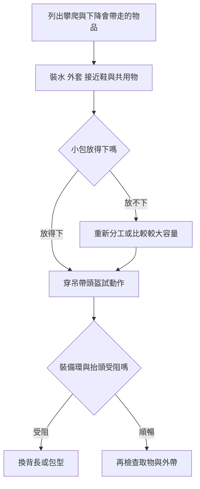

> 🌏 [English version](/posts/climbing/2026-10-19-multipitch-climbing-backpacks-en)

走到岩壁下很好背的包，上了岩壁不一定好用。彎腰拿快扣時，腰帶可能壓住裝備環；抬頭看下一段，頭盔又碰到包頂。多繩距小包是跟著你爬上去、裝水和外套的包，選它時要把攀爬動作一起考慮。

本文寫給準備多繩距旅行、想買第一個攀登小包的人。看完要能決定：自己需要多少空間、誰背什麼，以及哪兩款值得帶著裝備去試。確保、掛包與拖拉的操作，仍要按產品說明及現場訓練執行。

## 先分清楚：搬到岩壁，還是背上岩壁

岩場大包可以裝繩、完整硬體與兩人的午餐，到了路線底下才攤開。攀登小包則會跟著身體轉動，需要留出抬手、抬頭和拿吊帶裝備的空間。[Climbing的背包比較](https://www.climbing.com/gear/best-climbing-backpack/)也把這兩種用途分開，小包的簡單腰帶主要穩定位置，不能當成大包腰帶的負重能力。

想一包包辦，先問回程是否經過起攀點。若從另一邊走下山，留在底下的大包怎麼拿回來？

若要帶所有東西上去，小包又能否裝下接近鞋、外套和下降需要的裝備？這些答案比「大家都買幾公升」更早決定配置。

## 容量從水、衣物與鞋算，不從天數猜

同樣爬一天，有人穿接近鞋走下山，有人回到起攀點；有人需要厚保暖衣，有人只帶薄外套。先把這些實物放進包，水也要裝到行程預計的量。每公升水約一公斤，忽略它，很容易把空包試背當成負重測試。

15L可以列為少量物品的起點；18–22L則多一點調整空間，並不是固定的人數或時數配方。不要為了塞進喜歡的包，臨時刪掉按天候、路線與撤退計畫需要的東西。多出的空間也不代表應該塞滿，先看它在半滿時會不會晃。

兩人分工要區分接近和攀爬。例如接近時甲背繩，乙背共用食物；起攀後繩開始使用，乙可能成為主要背包者。把「誰拿繩」直接當成整天都比較重，往往會錯估岩壁上的負擔。

## 到店裡做一次完整試背

帶自己的吊帶、頭盔、水瓶或水袋、接近鞋和外套。調好肩帶後，依序抬頭、兩手舉高、轉身，再用左右手拿吊帶前後的裝備。包底不能妨礙你實際要用的裝備環，包頂也不該逼得頭頸無法自然抬起。這是合身判準，不能只按身高買。

接著蹲下、側身，感受包有沒有明顯左右滾動；再檢查腰帶能否收妥，以及肩帶是否妨礙手臂。水袋管與多餘調節帶要收整，避免垂在器材旁邊。不要僅為了減重自行剪改承重或固定結構。

最後模擬確保站取物：包還固定著時，能不能拿到外套和食物？頂開口、拉鍊與口袋各有方便之處。把整個包攤開才找得到東西，通常不適合狹小站位。購買前先練熟開口，別到岩壁上才發現操作不順。

## 掛在確保站、偶爾拖拉，是不同要求

有提把，不代表每個提把都能拖包；有耐磨布，也不代表能長期在岩石上拖行。[Wadi15原廠](https://us.blueice.com/products/wadi-15-pack)提供掛包用的繩帶與2kN扣具，那是背包功能，不能拿來做人身確保。要掛哪一個點、如何固定及負重限制，查自己那款的說明。

需要反覆拖拉時，另選原廠設計對應用途的包與系統。煙囪、尖銳岩面和卡包風險，不能只靠「布料很厚」解決。外掛鞋和繩也可能晃動、卡住，先確認路線是否容許這種配置。減少不必要外掛，通常比再買一個掛點更多的包更值得先做。

## 四款常見候選，按需求比較

這份名單綜合近期英語評測與原廠用途，並非台灣銷量排行，也沒有本站實背測試。[Switchback](https://www.switchbacktravel.com/climbing/best-backpacks)與[Climbing](https://www.climbing.com/gear/best-climbing-backpack/)分別推薦RockBlitz與Wadi；兩者都是可能有聯盟分潤的導購來源。BUG與Mutant則補上日常兼用及較大容量選擇。

| 型號 | 原廠容量／重量 | 適合先比較的需求 | 取捨 |
|---|---|---|---|
| [BD Rock Blitz15](https://blackdiamondequipment.com/products/rock-blitz-15-backpack) | 15L／403g | 想要精簡包型、側袋取手機或路線圖 | 容量小，別預設能容納全隊裝備；不是專業拖包 |
| [Blue Ice Wadi15](https://us.blueice.com/products/wadi-15-pack) | 15L／500g，拆配件450g | 重視確保站掛包、頭盔固定與耐磨 | Climbing指出天候防護較弱，濕天要另作安排 |
| [Petzl BUG](https://www.petzl.com/US/en/Sport/Packs-And-Accessories/BUG) | 18L／665g | 想兼日用，有筆電／水袋夾層與可拆頭盔網 | 現行款和舊525g版本不同，舊款心得不能直接套用 |
| [Osprey Mutant22](https://www.osprey.com/mutant-22-mutant22f22-376) | 22L／650g | 衣物較多、混合岩攀或冰攀的一日行程 | 外掛附件較多；22L的背負不能靠38L評測代替驗證 |

### 社群提醒：同一容量，感受也可能相反

[MountainProject的2023討論](https://www.mountainproject.com/forum/topic/123738192/multi-pitch-pack)中，發問者因大接近鞋、水袋與身形，偏向較大容量；其他人則滿意小包。[2021另一串](https://www.mountainproject.com/forum/topic/121539838/best-pack-for-multi-pitch)有人說Blitz20用了幾年仍好用，也有人覺得不夠耐操。Blitz20並非RockBlitz15，這些又是舊版個人經驗，不能混成現售型號的耐用排名。

把分享轉成試背問題更有用：自己的鞋放進去還剩多少？包會不會坐得太低？外帶能否收整？

帖內對「乾脆不背包」也有分歧，不能因此省掉路線所需的水與衣物。

### 電商價格看同容量，也要看版次

2026年10月19日公開商品價；未確認寄台灣、未結帳，除標明含VAT外稅額未知，均不是到手價。

| 型號 | 店頁價格 | 必須一起看的條件 |
|---|---|---|
| RockBlitz15 | [Oliunìd USD55.63](https://www.oliunid.com/bd-black-diamond-rock-blitz-15-l-multi-pitch-climbing-backpack) | 列現貨；顏色與新版SKU未鎖定 |
| Wadi15 | [BananaFingers EU EUR76.90](https://bananafingers.com/eu/blue-ice-wadi-15-pack-climbing-and-mountaineering-backpack) | 列Available，顏色未鎖；[BlueIce US](https://us.blueice.com/products/wadi-15-pack)另列USD99.95，但NorthAtlantic缺貨 |
| 新BUG18L | [Petzl US USD109.95](https://www.petzl.com/US/en/Sport/Packs-And-Accessories/BUG) | 665g版；庫存未明，別和舊款折扣直接比 |
| Mutant22 | [CDC Greece EUR140](https://www.cdc.gr/climbing/packs/osprey-mutant-22-unisex-en/) | TungstenGrey、列現貨、含VAT |

## 兩人一天的裝載例子

假設兩人同攀一條多繩距，下降後不回起攀點，兩人的接近鞋都要帶走。以下是分工示例，水量與衣物由實際天候和行程決定，不能照表當安全足量。

| 階段 | 甲 | 乙 |
|---|---|---|
| 接近 | 繩與個人用品 | 共用小包、食物與個人用品 |
| 起攀前 | 與乙共同確認兩人的鞋、水、保暖層、頭燈及路線資料 | 把衣物與常取物品放上層，收整外帶 |
| 攀爬 | 按當段分工處理繩與硬體 | 背小包；若換人背，重新調整並確認掛點 |
| 下山 | 重新分配繩和硬體 | 核對帶走物品，別把外套或鞋留在站位 |

先用家中現有包裝一次。如果兩人的鞋與衣物已擠滿15L，改比較22L或重新分配，比買完再把所有東西掛外面更實際。

**自我檢查：** 15L試背順暢，但必需的衣物裝不下；22L容量足夠，包底卻擋住吊帶。應選哪個？**答案：兩個都還沒合適。** 保留必要裝備，調整兩人分工，繼續找不同背長或包型。容量夠與攀爬順暢必須同時成立。

下一篇看[攀岩旅行打包與主行李分工](/posts/climbing/2026-10-19-climbing-travel-packing)，把攀登小包放回整趟旅行配置。

<!-- climbing-gear-nav:start -->
> [上一篇：多繩距繩索配置](/posts/climbing/2026-10-19-multipitch-rope-systems) · [系列總覽](/posts/climbing/2026-10-19-climbing-gear-travel-overview) · [下一篇：攀岩旅行與一般出國打包](/posts/climbing/2026-10-19-climbing-travel-packing)
<!-- climbing-gear-nav:end -->

## 參考資料

- [Climbing：2026攀岩背包比較](https://www.climbing.com/gear/best-climbing-backpack/)
- [Switchback：攀岩背包比較](https://www.switchbacktravel.com/climbing/best-backpacks)
- [BlackDiamond：RockBlitz15](https://blackdiamondequipment.com/products/rock-blitz-15-backpack)
- [BlueIce：Wadi15](https://us.blueice.com/products/wadi-15-pack)
- [Petzl：BUG](https://www.petzl.com/US/en/Sport/Packs-And-Accessories/BUG)
- [Osprey：Mutant22](https://www.osprey.com/mutant-22-mutant22f22-376)
- [MountainProject：2023多繩距背包討論](https://www.mountainproject.com/forum/topic/123738192/multi-pitch-pack)
- [MountainProject：2021背包使用經驗](https://www.mountainproject.com/forum/topic/121539838/best-pack-for-multi-pitch)

- [Oliunìd USD55.63](https://www.oliunid.com/bd-black-diamond-rock-blitz-15-l-multi-pitch-climbing-backpack)
- [BananaFingers EU EUR76.90](https://bananafingers.com/eu/blue-ice-wadi-15-pack-climbing-and-mountaineering-backpack)
- [CDC Greece EUR140](https://www.cdc.gr/climbing/packs/osprey-mutant-22-unisex-en/)
