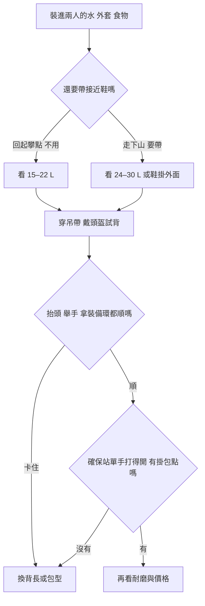

> 🌏 [English version](/posts/climbing/2026-10-19-multipitch-climbing-backpacks-en)

[上一篇的岩場包](/posts/climbing/2026-10-19-climbing-crag-packs)走到岩壁下就放在地上。多繩距的包會跟著你爬上去，在岩壁上待一整天。走路時好背的包，爬起來可能處處礙事。抬頭看下一段，頭盔撞到包頂；伸手拿快扣，腰帶壓住裝備環；在懸吊確保站打開拉鍊，外套差點掉下去。

這篇寫給準備出國爬多繩距、想買第一個攀登小包的人。前半是六個判準，後半是 20 個攀岩與登山品牌、31 款現行款的比較、兩人一天怎麼分工、店內試背清單，最後講這個包出國時怎麼兼當登機包。讀完你應該能穿著吊帶和頭盔試背，判斷一個包能不能帶上岩壁。

## 它跟岩場包差在哪

岩場包負責把繩、整套五金和兩人的午餐搬到岩壁下，容量大，背負系統為走路設計。多繩距包只裝爬的時候要用的東西：水、外套、食物、頭燈，有時加上接近鞋。[Climbing 的 2026 背包評比](https://www.climbing.com/gear/best-climbing-backpack/)把這類包定在 25 L 以下，包型低、貼背，外袋和帶子少，因為多出來的帶子會勾到岩石。腰帶多半只是一條織帶，用來穩住包，不負責承重。

[Switchback Travel 的評比](https://www.switchbacktravel.com/best-climbing-backpacks)把這類包叫「跟攀包」（follower pack）：先鋒輕裝爬，跟攀者背包。這也是後面分工例子的前提。

繩子要帶一條還是兩條、多長，看[依目的地列裝備清單](/posts/climbing/2026-10-19-climbing-trip-gear-list-by-destination)的繩子一節，這篇只管包。

## 六個判準

### 1. 包型窄而高，轉頭和抬手不被擋

包越寬，手臂往後伸、身體側轉時越容易刮到包側。Switchback 形容 [BD Rock Blitz 15](https://blackdiamondequipment.com/products/rock-blitz-15-backpack) 像子彈，「背得高、貼近身體、讓開吊帶」。挑包時先看正面寬度，比兩個同容量的包，選窄而高的那個。

### 2. 頭盔與吊帶腰帶不能互相干涉

包太長會兩頭出事：上緣頂到頭盔後緣，抬頭看下一段時脖子被逼著往前；下緣壓在吊帶腰帶和後方裝備環上，伸手拿裝備時摸不到。所以背長比容量重要，同一款有分尺寸就兩個都試。吊帶本身怎麼選見[吊帶與頭盔](/posts/climbing/2026-10-19-climbing-harness-helmet)。

腰帶最好能拆。走接近路時扣上，上岩壁前拆掉或收起，免得跟吊帶腰帶疊在一起。[Wadi 15](https://us.blueice.com/products/wadi-15-pack) 的織帶腰帶、[Petzl BUG](https://www.petzl.com/us/en/sport/products/climbing-packs-rope-bags/bug/BUG_SPO_a2mTx000003PXGnIAO.html) 的腰帶都可以拆，[Rab Latok 28](https://rab.equipment/us/rab-latok-28l-mountain-pack)、[Hyperlite Summit 30](https://www.hyperlitemountaingear.com/products/summit-30) 這類較大的包也一樣。

### 3. 水和外套要在確保站拿得到

確保站常常只站得下兩隻腳，包也不能放下來。頂部開口比較安全。[Gripped 2026 年的 BUG 評測](https://gripped.com/gear/the-petzl-bug-multi-pitch-pack-a-review)稱讚它主開口在頂部，懸吊確保時打開不會倒出東西。同一篇也提醒，正面直立拉鍊的口袋要留意。整面拉開的 U 型拉鍊在地面方便，到岩壁上就要小心。

喝水有兩種做法。水袋可以邊爬邊喝，但吸管要沿肩帶收好，別垂在吊帶裝備旁；水瓶較好整理，但要打開包才拿得到。外套放最上層，起風時先拿得到它。

### 4. 掛包用哪個點、拖拉用哪個點，查說明書

在確保站把包掛到固定點上，取物時才不用一直背著。[Wadi 15](https://us.blueice.com/products/wadi-15-pack) 的繩帶兼掛包帶，附一個 2 kN 的鉤環；那是掛包用的，不能拿來確保人。[Osprey Mutant 22](https://www.osprey.com/mutant-22-mutant22f22-376) 有三點式拖拉系統，[Edelrid Rubi](https://edelrid.com/eu-en/sport/backpacks-and-rope-bags-shop/rubi) 有拖拉環，BUG 依 Gripped 評測、Patagonia Ascensionist 35L 依 Climbing 評比也都有拖拉環。

遇到難段要把包拖上去（hauling）時，只用原廠標明可拖拉的環。一般提把是給手提的，原廠沒寫可拖拉，就當它只能手提。Climbing 的評比也說，Wadi 偶爾在難段拖一下沒問題，但不會拿它當每天用的拖包。需要整條路線一直拖，另選拖包，不在這篇範圍。

### 5. 布料夠耐磨

多繩距包會在岩面上刮，鑽煙囪地形更傷。布料的丹尼數（D）越高通常越厚：Switchback 說 840D 的 Rock Blitz 鑽煙囪也撐得住，Wadi 15 的布更厚。輕量款常改用薄布換重量，像 [BD Blitz 20](https://blackdiamondequipment.com/products/blitz-20-backpack)。花崗岩裂隙多的路線選厚布，石灰岩面路線或天氣不穩的高山，可以考慮輕而防水的款式，像用 X-Pac 布的 [Grivel Spartan X](https://grivel.com/products/spartan-x-20)。

### 6. 容量從水和衣物算，15–30 L

先把實物放進去：兩人的水（每公升約 1 公斤）、兩件防風外套、需要的話加保暖層、食物、頭燈、路線圖、急救包。回到起攀點下山、鞋可以留在地上的話，15–22 L 多半夠。從另一側走下山、兩雙接近鞋都要帶走，才需要看 24–30 L，或者把鞋扣在包外。

鞋掛外面會晃、會勾岩石，先確認路線容不容許。包大了就會想塞滿，半滿時壓縮帶要能把包收緊、不晃。

## 20 個品牌、31 款現行款比較

以下價格是 2026-10-19 各品牌官網標價，幣別照官網，未換算；原廠沒標價的另註零售價。重量是原廠空重，原廠沒標的註明零售商數字。「評測」欄只列 2020 年後的第三方評測，個人部落格會註明，「—」表示沒有。同品牌的型號排在一起。各款的拖拉環、腰帶規格以官網為準，買之前再點進去看一次。

### 15–20 L：跟攀包主力

| 型號 | 容量 | 空重 | 特色 | 官方價格 | 評測 | 適合誰／缺點 |
|---|---|---|---|---|---|---|
| [Black Diamond Rock Blitz 15](https://blackdiamondequipment.com/products/rock-blitz-15-backpack) | 15 L | 403 g | 840D 布、頂部抽繩開口、側拉鍊袋、腰帶可拆 | USD 99.95 | [Switchback 2026](https://www.switchbacktravel.com/best-climbing-backpacks) 多繩距跟攀包首選 | 純攀岩、要耐磨；沒有水袋隔層，原廠沒標拖拉環 |
| [Black Diamond Blitz 20](https://blackdiamondequipment.com/products/blitz-20-backpack) | 20 L | 374 g | 單手頂部開口、繩帶、水袋相容、可拆到極簡 | USD 119.95 | Switchback 2026 提及 | 要輕、兼高山；布料比 Rock Blitz 薄 |
| [Blue Ice Wadi 15](https://us.blueice.com/products/wadi-15-pack) | 15 L | 500 g（拆配件 450 g） | 1000D 尼龍、掛包帶附 2 kN 鉤環、頭盔外掛 | USD 99.95（美國官網缺貨） | [Climbing 2026](https://www.climbing.com/gear/best-climbing-backpack/) 多繩距首選 | 確保站常掛包的人；不防水，Climbing 建議晴天用 |
| [Blue Ice Dragonfly 18](https://us.blueice.com/products/dragonfly-18l-pack) | 18 L | 415 g（拆到 325 g） | 可拆到極簡、冰斧掛點 | USD 109.95 | Climbing 2026 列為雨天替代 | 高山岩攀、要輕；原廠沒標拖拉環 |
| [Mammut Trion 15](https://mammut.com/us/en/products/2520-00981-0243/trion-15) | 15 L | 420 g | 越野背心式肩帶、拉鍊捲頂、側開口 | USD 169.95 | — | 喜歡背心貼身感的人；沒有腰帶，價格偏高 |
| [Petzl BUG](https://www.petzl.com/us/en/sport/products/climbing-packs-rope-bags/bug/BUG_SPO_a2mTx000003PXGnIAO.html) | 18 L | 665 g | 頂部開口、筆電／水袋隔層、可拆頭盔網、腰帶可拆 | USD 109.95 | [Gripped 2026-03](https://gripped.com/gear/the-petzl-bug-multi-pitch-pack-a-review) | 兼當日常包、登機包；同容量裡偏重 |
| [Edelrid Rubi](https://edelrid.com/eu-en/sport/backpacks-and-rope-bags-shop/rubi) | 19 L | 498 g | 拖拉環、裝備環、簡易腰帶 | EUR 70 | — | 預算有限又要拖拉環；功能精簡 |
| [Grivel Spartan X 20](https://grivel.com/products/spartan-x-20) | 20 L | 480 g | X-Pac 防潑水布、捲頂、熱塑背板、冰斧掛點 | EUR 165／USD 215 | — | 要輕又要防潑水；原廠沒標拖拉環，歐洲官網缺貨（美國官網有貨） |
| [Rab Latok 20](https://rab.equipment/us/rab-latok-20l-mountain-pack) | 20 L | 480 g | Cordura 加 Spectra 防撕裂布、捲頂、背心式胸帶、肩帶拉鍊袋、織帶腰帶可拆 | USD 175 | — | 喜歡 Latok 28、想要跟攀用的小一號；原廠沒標拖拉環 |
| [C.A.M.P. M20](https://www.camp.it/info/item/3205) | 20 L | 780 g | 背板全開、拉鍊頂蓋加抽繩、腰帶附 2 個裝備環且可拆、可收式頭盔與繩帶 | 原廠未標（歐洲零售 EUR 134.95） | — | 接近路長、要背得舒服；同容量裡最重 |
| [Arc'teryx Alpha FL 20](https://arcteryx.com/us/en/shop/alpha-fl-20-backpack-0348) | 20 L（延伸裙展開 24 L） | 635 g | 315D Hadron 防水布、手套可操作的抽繩開口、頂部繩帶、雙冰斧掛點 | USD 250 | — | 想要 Alpha FL 30 的布料但更小；貴，規格沒列腰帶與拖拉環 |

### 22–25 L：多一點衣物空間

| 型號 | 容量 | 空重 | 特色 | 官方價格 | 評測 | 適合誰／缺點 |
|---|---|---|---|---|---|---|
| [Black Diamond Speed 22](https://blackdiamondequipment.com/en_US/product/speed-22-backpack) | 22 L | 587 g | 210D 防撕裂布加塗層、前片耐磨補強、頂蓋／背板／腰帶都可拆、可收式繩帶 | USD 169.95 | — | 混合冰岩、要能拆到極簡；美國官網註明部分州不出貨 |
| [Osprey Mutant 22](https://www.osprey.com/mutant-22-mutant22f22-376) | 22 L | 650 g | 三點式拖拉系統、水袋隔層、腰帶可拆 | USD 140 | — | 衣物多、混合冰岩；外掛織帶可拆，上岩壁前拆掉 |
| [Millet Prolighter 22](https://millet.com/eu_en/mis2274-n7317-prolighter-22-unisex-navy-blue.html) | 22 L | 630 g | 腰帶可拆、冰斧掛點 | EUR 100（特價 EUR 75） | — | 在歐洲當地買；特價中，顏色尺寸可能不齊 |
| [Ortovox Trad 22 Dry](https://ortovox.com/us-en/shop/backpacks/p249732-climbing-backpacks-trad-22-dry) | 22 L | 600 g | 防水布、熔接接縫、捲頂、頭盔／繩／冰斧掛點在雨套外 | USD 270 | — | 常在多雨地區爬長路線；貴 |
| [Ortovox Trad Zero 24](https://www.ortovox.com/us-en/backpacks/specials/ultra-lightweight-backpacks/trad-zero-24/5000753) | 24 L | 570 g | 頂蓋兼繩帶與頭盔帶、內裡止滑、裝備環、水袋孔 | USD 130 | — | 要輕又要 24 L；沒有頂袋，小東西要另外收 |
| [Deuter Guide Lite 24](https://www.deuter.com/uk-en/guide-lite-24/4046051185729) | 24 L | 670 g | U 形框架、頂蓋與腰帶可拆、可收式繩帶 | GBP 130 | [Climbing 2020-04](https://climbing.com/gear/2020-alpine-kit-deuter-guide-lite-24-review) | 接近路長、要背得穩；評測是 2020 年版 |
| [Salewa Ortles Climb 25](https://salewa.com/en-gb/ortles-climb-25l-backpack-00-0000001283) | 25 L | 605 g | 分離式肩帶、捲頂加側開口、雙冰斧與繩帶 | GBP 130 | — | 要側開口取物；原廠說布料耐拖拉，但沒標拖拉環 |
| [La Sportiva Granite 22](https://lasportiva.com/en/backpack-climbing-granite-22-backpack-unisex-zecp002) | 22 L | 原廠未標（Climbsmart、Lake State Mountaineering 等零售商標 300–570 g，差異大） | 210D 防撕裂布、頂部抽繩加側拉鍊、頂蓋可壓繩、熱塑背板 | EUR 110／USD 119 | — | 要側開口、預算中等；原廠沒標拖拉環 |
| [Simond Alpinism 22](https://simond.com/en-GB/product/versatile-and-modular-mountaineering-backpack-alpinism-22-blue_371534--c59m89) | 22 L | 580 g | 200D 防撕裂尼龍、正面雙拉鍊大開口、冰斧掛點、水袋隔層 | GBP 34.99 | [Olympus Mountaineering 2020-07](https://olympusmountaineering.com/2020/07/25/simond-alpinism-22-backpack-long-term-review)（個人部落格） | 預算最低的第一個多繩距包；布料較薄，正面大拉鍊在確保站要小心，Decathlon 以外不好買 |
| [Wild Country Syncro](https://wildcountry.com/syncro-backpack-40-0000010006) | 22 L | 原廠未標（Oliunìd、BananaFingers、EpicTV 標 600 g） | 捲頂、窄身、長側拉鍊、兩條掛物織帶、頂部繩帶、腰帶可拆 | EUR 110（特價 EUR 77） | — | 原廠定位為多繩距包；特價中，可能是換季出清 |
| [Wild Country Progress 25L](https://www.wildcountry.com/progress-backpack-25l-40-0000010049) | 25 L | 原廠未標（零售商標 615 g） | 420D 防撕裂尼龍、頂部抽繩、側拉鍊、隱藏式掛物織帶、前袋 | EUR 115／USD 129.95 | — | 接近路有雪的高山多繩距；原廠沒標拖拉環 |

### 27–30 L：要帶接近鞋或上高山（含一款 35 L）

| 型號 | 容量 | 空重 | 特色 | 官方價格 | 評測 | 適合誰／缺點 |
|---|---|---|---|---|---|---|
| [Black Diamond Speed 30](https://blackdiamondequipment.com/en_US/product/speed-30-backpack) | 30 L | 938 g（S/M）／984 g（M/L） | 210D 防撕裂布、兩種背長、頂蓋／背板／腰帶都可拆、冰斧掛點 | USD 219.95 | [Advnture 2023-05](https://www.advnture.com/reviews/black-diamond-speed-30) | 要分尺寸、要負重；比同容量的捲頂包重 |
| [Blue Ice Warthog 30](https://blueice.com/products/warthog-30) | 30 L | 630 g（拆到 530 g） | 210D 防撕裂布、兩種尺寸、貼身肩帶、可拆到極簡 | EUR 150 | [Rock Van Life 2026-08](https://rockvanlife.com/blue-ice-warthog-30-review)（部落格） | 用慣 Wadi、Dragonfly 想換大一號；要防水另有捲頂的 [Warthog 30 WMO](https://blueice.com/products/warthog-30-wmo)（660 g、EUR 160），原廠沒標拖拉環 |
| [Rab Latok 28](https://rab.equipment/us/rab-latok-28l-mountain-pack) | 28 L | 810 g | Spectra 布、捲頂可擴充、腰帶可拆 | USD 225 | — | 走下山要帶鞋；偏重 |
| [Rab Ascendor 27L](https://rab.equipment/us/rab-ascendor-27l-mountain-pack) | 27 L | 729 g | 210D Robic 防撕裂布、TRI-FLEX 背負系統、背長 48 cm、54×27×28 cm | GBP 130／USD 150 | — | 要 28 L 上下的容量、預算比 Latok 28 低；部分顏色缺貨 |
| [Gregory Alpinisto LT 28](https://eu.gregorypacks.com/uk-en/-alpinisto-28-lt-sm-md--piton-blue/126853-9986.html) | 28 L | 990 g | 頂蓋、背板、腰帶都可拆 | GBP 150（特價 GBP 105） | — | 接近路長、要背負；最重，特價中可能是出清 |
| [Arc'teryx Alpha FL 30](https://arcteryx.com/us/en/shop/alpha-fl-30-backpack-0349) | 30 L | 665 g | 315D 貼合防水布、捲頂加抽繩、RECCO | USD 280 | Switchback 2026 超輕高山包首選 | 高山長路線、天氣差；貴 |
| [Hyperlite Summit 30](https://www.hyperlitemountaingear.com/products/summit-30) | 30 L | 383 g（白）／448 g（黑） | Dyneema 無框捲頂、織帶腰帶可拆 | USD 210 | — | 最輕的 30 L；無框，原廠沒標拖拉環 |
| [Grivel Spartan X 30](https://grivel.com/products/spartan-x-30) | 30 L | 620 g | X-Pac 防潑水布、捲頂、側背開口、熱塑背板、冰斧掛點 | EUR 210／USD 273 | — | 要輕又要 30 L、想從側面取物；原廠沒標拖拉環 |
| [Patagonia Ascensionist 35L](https://www.patagonia.com/product/ascensionist-climbing-backpack-35-liters/47985.html) | 35 L | 771 g | 210D 回收尼龍加 TPU 塗層、頂袋、腰帶／背板都可拆、冰斧掛點、Climbing 提到有兩個拖拉環 | USD 239 | [Climbing 2026](https://www.climbing.com/gear/best-climbing-backpack/) 最佳全能高山包 | 兩人共用一個包、接近路長；35 L 超出本級距，裝不滿會晃，Switchback 認為背起來不如 Osprey Mutant 舒服 |

怎麼縮小範圍？只爬岩、天氣好，從 Rock Blitz 15、Wadi 15、Rubi 裡挑；預算最緊，看 Simond Alpinism 22。同一個包還想當城市日用和登機包，看 BUG。衣物多或爬冰岩混合，看 Mutant 22、Trad Zero 24、Speed 22。常在多雨的地方爬，看 Trad 22 Dry 或 Alpha FL 系列。走下山要帶鞋，看 28–30 L 那一組。

## 兩人一天怎麼分工

假設兩人爬一條 8 段左右的多繩距，從另一側健行下山，所以兩雙接近鞋都要帶走。先鋒輕裝，只帶吊帶上的五金；跟攀者背包。

| 階段 | 甲 | 乙 |
|---|---|---|
| 接近 | 背繩、自己的五金 | 背攀登包：兩人的水、外套、食物、頭燈、兩雙接近鞋 |
| 起攀前 | 換攀岩鞋，接近鞋交給乙 | 拆掉或收起包的腰帶，外套移到最上層 |
| 甲先鋒 | 不背包 | 背包跟攀，到確保站把包掛上固定點再取物 |
| 換乙先鋒 | 在確保站接過包，調好肩帶 | 交出包後輕裝先鋒 |
| 下山 | 收繩、分五金 | 兩人換回接近鞋，確認外套和頭燈都在包裡 |

兩人輪流先鋒，包就在確保站換手，所以肩帶要好調、掛包點要好找。整天由同一人先鋒，包就一直由另一人背，這時包的舒適度比換手速度重要。

如果水、外套和兩雙鞋已經把 15 L 擠滿，有兩條路：換 24–30 L，或把一雙鞋扣在包外。不要為了塞進喜歡的包，把該帶的保暖層拿掉。

## 店內試背檢查清單

帶自己的吊帶、頭盔、水瓶或水袋、一件外套，可以的話帶接近鞋。

1. 把東西裝進去，水裝到你實際會帶的量。空包試背量不出什麼。
2. 穿吊帶、戴頭盔，再背包，調好肩帶和胸帶。
3. 抬頭看天花板：頭盔後緣有沒有撞到包頂？
4. 雙手舉高、身體左右轉：手臂和肩膀有沒有被包側刮到？
5. 左右手輪流去拿吊帶前後的裝備環：包底有沒有壓住後方的裝備環？
6. 抬高一隻腳、蹲下：包有沒有往一側晃？
7. 拆掉腰帶，或把它收起來：拆完包還穩嗎？剩下的帶子收得乾淨嗎？
8. 找出原廠的掛包點，把包掛在掛鉤上，單手打開主開口拿外套。
9. 確認拖拉環（若有）和一般提把是不同的兩個東西。

第 3、5 項任一項過不了，換尺寸或換款，不要靠調肩帶硬撐。

## 出國時，它常兼當登機包

出國爬多繩距時，攀登包通常也是登機的隨身包，鞋、吊帶、頭盔和外套放在裡面上機，托運行李遺失也還能爬。[Mountain Project 2023 年 1 月的一串討論](https://www.mountainproject.com/forum/topic/123687187/travel-bags-to-fly-to-climbing-destination)中，有位使用者說他把 15 L 的多繩距包當個人物品，岩場包裝五金當手提行李。Gripped 的評測也說 BUG 很適合當旅行隨身包。

個人物品的尺寸比登機箱小得多，長榮只有 10 cm 厚，裝滿的攀登包要自己量過。各航空的登機與個人物品尺寸、攀登包怎麼跟托運主袋和岩場包搭配，見[〈托運主袋與登機包〉](/posts/climbing/2026-10-19-climbing-travel-luggage)；哪些五金可能在安檢被擋，見[〈攀岩裝備上飛機〉](/posts/climbing/2026-10-19-flying-with-climbing-gear)。

這篇是「出國攀岩裝備」系列的最後一篇。回到[系列導讀](/posts/climbing/2026-10-19-climbing-gear-travel-overview)可以依旅行型態重看閱讀路線。

## 更新紀錄

- 2026-10-19：比較表從 14 個品牌 16 款擴充為 20 個品牌 30 款，新增 Grivel、La Sportiva、C.A.M.P.、Simond、Wild Country 等品牌與 BD Speed、Rab Latok 20、Blue Ice Warthog 30、Ortovox Trad 22 Dry、Arc'teryx Alpha FL 20；同品牌改排在一起，Patagonia Ascensionist 35L 移進 28–30 L 表；補上新款的原廠頁與評測連結。依原廠資料核對規格，修正 4 處，28–30 L 表新增 Rab Ascendor 27L，共 31 款。

## 參考資料

- [Climbing：The Best Climbing Backpacks of 2026（2026-04 更新）](https://www.climbing.com/gear/best-climbing-backpack/)
- [Switchback Travel：Best Climbing Backpacks of 2026（2026-06-23）](https://www.switchbacktravel.com/best-climbing-backpacks)
- [Gripped：The Petzl Bug Multi-Pitch Pack: A Review（2026-03-31）](https://gripped.com/gear/the-petzl-bug-multi-pitch-pack-a-review)
- [Climbing：Gear Guide 2020: Deuter Guide Lite 24 Review（2020-04-14）](https://climbing.com/gear/2020-alpine-kit-deuter-guide-lite-24-review)
- [Mountain Project：Travel bags to fly to climbing destination（2023-01）](https://www.mountainproject.com/forum/topic/123687187/travel-bags-to-fly-to-climbing-destination)
- [長榮航空：手提行李](https://www.evaair.com/zh-tw/fly-prepare/baggage/free-baggage/carry-on-baggage/)
- [Black Diamond：Rock Blitz 15](https://blackdiamondequipment.com/products/rock-blitz-15-backpack)
- [Black Diamond：Blitz 20](https://blackdiamondequipment.com/products/blitz-20-backpack)
- [Blue Ice：Wadi 15](https://us.blueice.com/products/wadi-15-pack)
- [Blue Ice：Dragonfly 18](https://us.blueice.com/products/dragonfly-18l-pack)
- [Mammut：Trion 15](https://mammut.com/us/en/products/2520-00981-0243/trion-15)
- [Petzl：BUG](https://www.petzl.com/us/en/sport/products/climbing-packs-rope-bags/bug/BUG_SPO_a2mTx000003PXGnIAO.html)
- [Edelrid：Rubi](https://edelrid.com/eu-en/sport/backpacks-and-rope-bags-shop/rubi)
- [Osprey：Mutant 22](https://www.osprey.com/mutant-22-mutant22f22-376)
- [Millet：Prolighter 22](https://millet.com/eu_en/mis2274-n7317-prolighter-22-unisex-navy-blue.html)
- [Ortovox：Trad Zero 24](https://www.ortovox.com/us-en/backpacks/specials/ultra-lightweight-backpacks/trad-zero-24/5000753)
- [Deuter：Guide Lite 24](https://www.deuter.com/uk-en/guide-lite-24/4046051185729)
- [Salewa：Ortles Climb 25](https://salewa.com/en-gb/ortles-climb-25l-backpack-00-0000001283)
- [Rab：Latok 28](https://rab.equipment/us/rab-latok-28l-mountain-pack)
- [Gregory：Alpinisto LT 28](https://eu.gregorypacks.com/uk-en/-alpinisto-28-lt-sm-md--piton-blue/126853-9986.html)
- [Arc'teryx：Alpha FL 30](https://arcteryx.com/us/en/shop/alpha-fl-30-backpack-0349)
- [Hyperlite Mountain Gear：Summit 30](https://www.hyperlitemountaingear.com/products/summit-30)
- [Patagonia：Ascensionist 35L](https://www.patagonia.com/product/ascensionist-climbing-backpack-35-liters/47985.html)
- [Advnture：Black Diamond Speed 30 review（2023-05）](https://www.advnture.com/reviews/black-diamond-speed-30)
- [Rock Van Life：Blue Ice Warthog 30 review（2026-08）](https://rockvanlife.com/blue-ice-warthog-30-review)
- [Olympus Mountaineering：Simond Alpinism 22 long-term review（2020-07-25）](https://olympusmountaineering.com/2020/07/25/simond-alpinism-22-backpack-long-term-review)
- [C.A.M.P.：M20](https://www.camp.it/info/item/3205)
- [C.A.M.P.：M20 技術規格（PDF）](https://www.camp.it/api/GetSystemResource/210/3205)
- [Planetmountain：C.A.M.P. M20 原廠產品稿](https://www.planetmountain.com/en/products/lightweight-climbing-backpack-m20.html)
- [Black Diamond：Speed 22](https://blackdiamondequipment.com/en_US/product/speed-22-backpack)
- [Black Diamond：Speed 30](https://blackdiamondequipment.com/en_US/product/speed-30-backpack)
- [Blue Ice：Warthog 30](https://blueice.com/products/warthog-30)
- [Grivel：Spartan X 20](https://grivel.com/products/spartan-x-20)
- [Grivel：Spartan X 30](https://grivel.com/products/spartan-x-30)
- [Rab：Latok 20](https://rab.equipment/us/rab-latok-20l-mountain-pack)
- [Rab：Ascendor 27L](https://rab.equipment/us/rab-ascendor-27l-mountain-pack)
- [Arc'teryx：Alpha FL 20](https://arcteryx.com/us/en/shop/alpha-fl-20-backpack-0348)
- [Ortovox：Trad 22 Dry](https://ortovox.com/us-en/shop/backpacks/p249732-climbing-backpacks-trad-22-dry)
- [La Sportiva：Granite 22](https://lasportiva.com/en/backpack-climbing-granite-22-backpack-unisex-zecp002)
- [Simond：Alpinism 22](https://simond.com/en-GB/product/versatile-and-modular-mountaineering-backpack-alpinism-22-blue_371534--c59m89)
- [Wild Country：Syncro](https://wildcountry.com/syncro-backpack-40-0000010006)
- [Wild Country：Progress 25L](https://www.wildcountry.com/progress-backpack-25l-40-0000010049)
