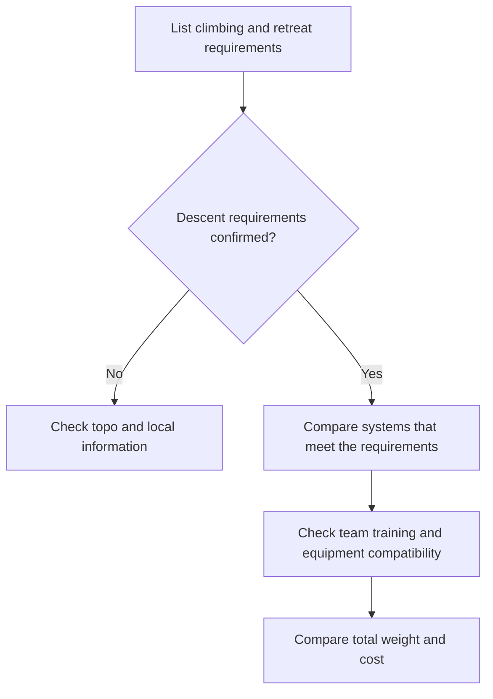

> 🌏 [中文版](/posts/climbing/2026-10-19-multipitch-rope-systems)

Whether to pack one rope or two for a multipitch trip starts with how you intend to get down. A 60 m rope used as one strand for climbing provides only a nominal 30 m when doubled for a rappel. Being able to climb a route does not establish that you can retreat down it when rain arrives.

This guide is for climbers who have learned rope belaying and want to choose a travel system. It helps turn route requirements into buying criteria. The [previous article on triple ratings](/posts/climbing/2026-10-19-dynamic-rope-triple-rating-en) explains rope types; half-rope management, rappelling, and rescue still require practical training.

## Make an itinerary card before choosing a brand

Use local route information and managing authorities' guidance to collect four things on one card:

| Requirement | Information to find | How it affects the system |
|---|---|---|
| Climbing | Longest pitch and whether the rope line wanders | Determines usable length and rope-management demands |
| Normal descent | Walk-off or rappels, and longest station spacing | Determines the length needed for retrievable rappels |
| Retreat | Available stations, spacing, and departure from the climbing line | A walk-off at the summit does not establish an escape partway up |
| Team | Two or three climbers and each person's skills | Affects belaying, transitions, and problems the team can manage |

If a topo says “60 m rope,” establish whether it means the longest climbing pitch or a pair of 60 m ropes for descent. Total route height cannot replace station spacing. When information is unclear, ask a local guide or someone familiar with the route before departure.

## Four configurations buy different kinds of flexibility

[Petzl's dynamic-rope instructions](https://www.petzl.com/sfc/servlet.shepherd/version/download/0681r00000DUhtWAAT) distinguish single, half, and twin use. This table explains buying decisions, not clipping or system-conversion procedures.

| Configuration | When to consider it | Limitation to accept |
|---|---|---|
| One single rope | Climbing and every planned descent and retreat fit its limits; a summit walk-off may be available | A doubled rappel is limited by half its length; there is no second climbing rope |
| Two half ropes | The route suits half-rope management and the team knows the relevant belaying and descent methods | Two strands need management; a half-only rope cannot simply become a single lead rope |
| Two triple-rated ropes | The same trip includes separate single-rope use and paired use | Weight and volume can exceed dedicated half ropes; ratings do not supply technique |
| A single rope plus retrieval cord | A defined itinerary and training in that exact system | The cord is not a second lead rope; blocking, snagging, and failed retrieval create different problems |

Similar diameters do not establish that two ropes form a suitable pair. Check both ropes' manufacturer restrictions, the device's permitted types and diameters, and the intended descent mode. Thin, new, or wet ropes can handle differently. The first day abroad is a poor time to rehearse an unfamiliar complete system for the first time.

## Climbing 60 m does not mean rappelling 60 m

[Petzl's single-rope multipitch descent guidance](https://www.petzl.com/INT/en/Sport/Multi-pitch-rappelling-with-a-single-rope?ActivityName=Multi-pitch-climbing) states that a doubled-rope rappel cannot exceed half the rope's total length. That is a geometric ceiling, before knots, shrinkage, end allowances, and terrain uncertainty.

Suppose the longest climbing pitch is 45 m and the longest rappel is also 45 m. A 60 m single may nominally cover the climbing pitch, but provides only 30 m doubled. A 70 m single provides a nominal 35 m doubled, so that purchase does not resolve the descent problem either.

Two 60 m ropes in a suitable retrievable two-rope rappel system can provide a descent range approaching one rope's length, subject to system allowances and actual station spacing. Their combined 120 m does not mean a 120 m rappel. Unequal ropes cannot be evaluated using their average length.

If a rope has been shortened or its end label is unreliable, establish its actual length first. Rope stretch is not a planned substitute for missing length. The [care and retirement article](/posts/climbing/2026-10-19-climbing-gear-care-retirement-en) covers measuring after washing and keeping a history.

## Count both ropes to see the travel cost

Using manufacturer-listed figures for [Petzl VOLTA 9.2](https://www.petzl.com/US/en/Sport/Ropes/VOLTA-9-2-mm) and [TANGO 8.5](https://www.petzl.com/US/en/Sport/Ropes/TANGO-8-5-mm), assume every rope is 60 m:

| Hypothetical purchase | Calculation | Listed rope weight |
|---|---|---|
| One VOLTA | 55 g/m × 60 m | 3.30 kg |
| Two VOLTAs | 55 g/m × 60 m × 2 | 6.60 kg |
| Two TANGOs | 47 g/m × 60 m × 2 | 5.64 kg |

The paired systems differ by 0.96 kg. That difference appears on the luggage scale, approach, and in your pack, but does not decide suitability. Two VOLTAs offer value if the trip also calls for using each separately as a single. Two TANGOs belong in a comparison after choosing a suitable half/twin system. These figures exclude bags, wet-rope weight, and other equipment, and do not imply that the systems are interchangeable on every route.

## A third climber changes more than the shopping list

A two-person team coordinates leading, following, and rope organization at each station. A third person adds another follower, arrival sequencing, pack allocation, and the possibility that the followers' movements affect one another. Station capacity and whether the device supports the intended following mode matter too.

The [Petzl REVERSO](https://www.petzl.com/US/en/Sport/Belay-Devices-And-Descenders/REVERSO) has following applications defined by its modes. That does not mean any device can belay two followers in the same way. Following on a half rope and leading on one half-only strand are different questions.

Before departure, everyone should be able to explain their role: who knows the system, who carries what, and how the group will communicate and seek help if someone cannot continue. A third person does not increase rope length. Sharing the load does not fix a descent plan that fails its length requirements.

## Models and budgets: choose the system first

For combined travel and single-rope use, compare VOLTA, [BEAL JOKER 9.1 Golden Dry](https://us.beal-planet.com/products/joker-9-1mm-unicore-golden-dry), and [EDELRID SWIFT 48 ECO DRY](https://edelrid.com/int-en/sport/ropes/swift-48-eco-dry-8-9mm). Their triple ratings justify consideration; competence with thin ropes remains a prerequisite. If paired half ropes are the chosen system, compare TANGO and relevant alternatives rather than excluding dedicated half ropes because triple ratings sound more versatile.

For a budget example checked on 19 October 2026, [Summits lists the orange 60 m VOLTA](https://summits.co.uk/products/petzl-volta-rope-9-2mm-x-60m-orange) at GBP199.99, with stock and Taiwan tax/shipping treatment unconfirmed. Two at that price give an arithmetic budget of GBP399.98, not a complete delivered-system quote. [Taunton's pink 60 m SWIFT 48](https://www.tauntonleisure.com/climbing-equipment-accessories/ropes-slings/edelrid-swift-48-eco-dry-89mm-x-60m-climbing-rope--pink__24239) is GBP157.50 but on pre-order with dispatch undetermined; do not count on it being available for a fixed departure.

See the [previous article's price tables](/posts/climbing/2026-10-19-dynamic-rope-triple-rating-en) for more models and starting prices. Match treatment, length, and color. The cheapest family starting price may not buy the rope your itinerary needs.

A single plus retrieval cord deserves more than a grams-saved comparison. Petzl specifies that the cord is for retrieval; if the climbing rope becomes stuck out of reach, the cord cannot serve as a climbing belay rope to recover it. Long rappel sequences also raise efficiency and error-management concerns. Without practical training, put this system on an advanced-training list rather than completing a travel plan from an online diagram.

## Practice: explain the missing condition

**Scenario one:** The longest pitch is 40 m, normal rappels are 25 m, and retreat spacing is unknown. Is one 60 m single enough?

**Answer:** These numbers support only a preliminary climbing and normal-descent assessment. Establish retreat information, actual rope length, and allowances before deciding. A normal descent does not establish an escape from every point.

**Scenario two:** Can a three-person team buy two triple-rated ropes and immediately use its usual two-person plan?

**Answer:** Buying ropes does not establish a suitable following mode, compatible devices, station capacity, roles, or practiced technique. Ratings extend permitted rope uses, not team experience.

**Scenario three:** A washed rope has shortened but its label still says 60 m. Can the original descent schedule be used?

**Answer:** Measure it, update the record, and reassess. The label cannot replace current length. Change ropes, route, or plan if needed; do not rely on stretch to close a gap.

<!-- climbing-gear-nav:start -->
> [Previous: Dynamic rope ratings](/posts/climbing/2026-10-19-dynamic-rope-triple-rating-en) · [Series overview](/posts/climbing/2026-10-19-climbing-gear-travel-overview-en) · [Next: Multipitch climbing packs](/posts/climbing/2026-10-19-multipitch-climbing-backpacks-en)
<!-- climbing-gear-nav:end -->

## References

- [Petzl: dynamic-rope instructions](https://www.petzl.com/sfc/servlet.shepherd/version/download/0681r00000DUhtWAAT)
- [Petzl: single-rope multipitch rappelling and retrieval-cord limitations](https://www.petzl.com/INT/en/Sport/Multi-pitch-rappelling-with-a-single-rope?ActivityName=Multi-pitch-climbing)
- [Petzl VOLTA 9.2 mm](https://www.petzl.com/US/en/Sport/Ropes/VOLTA-9-2-mm)
- [Petzl TANGO 8.5 mm](https://www.petzl.com/US/en/Sport/Ropes/TANGO-8-5-mm)
- [Petzl REVERSO](https://www.petzl.com/US/en/Sport/Belay-Devices-And-Descenders/REVERSO)
- [BEAL JOKER 9.1 UNICORE Golden Dry](https://us.beal-planet.com/products/joker-9-1mm-unicore-golden-dry)
- [EDELRID SWIFT 48 ECO DRY 8.9](https://edelrid.com/int-en/sport/ropes/swift-48-eco-dry-8-9mm)

- [Summits lists the orange 60 m VOLTA](https://summits.co.uk/products/petzl-volta-rope-9-2mm-x-60m-orange)
- [Taunton's pink 60 m SWIFT 48](https://www.tauntonleisure.com/climbing-equipment-accessories/ropes-slings/edelrid-swift-48-eco-dry-89mm-x-60m-climbing-rope--pink__24239)
