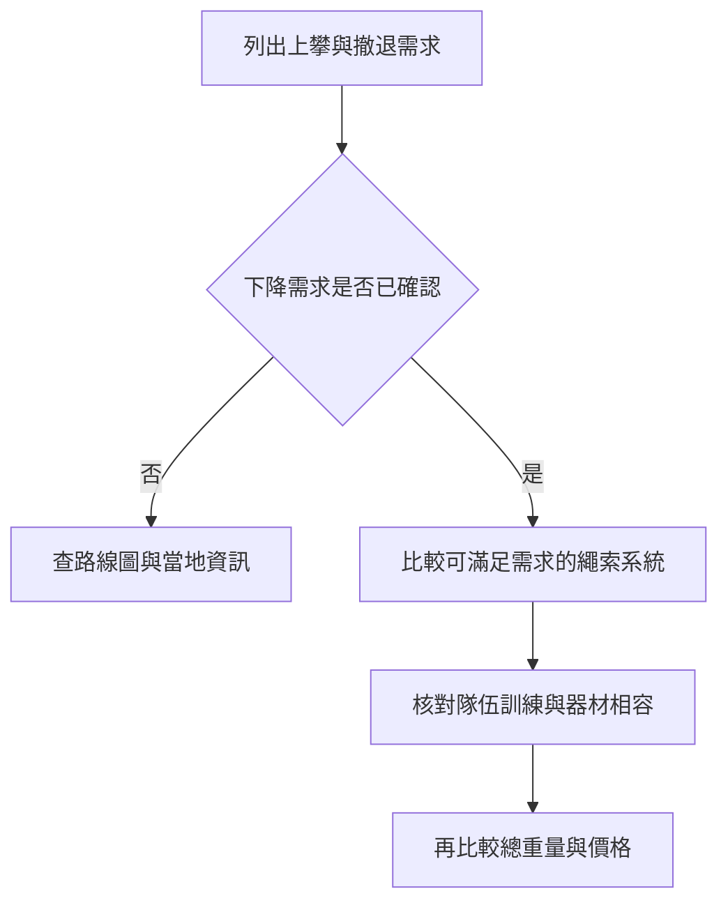

> 🌏 [English version](/posts/climbing/2026-10-19-multipitch-rope-systems-en)

出國多繩距帶一條還是兩條繩，先看你打算怎麼回到地面。同樣是一條六十公尺繩，攀登時用一股，對折下降時卻只有名目三十公尺；路線能爬上去，不代表下雨時能沿原路撤退。

這篇寫給已學過繩索確保、準備挑選旅行配置的人。讀完應能把路線需求轉成採購條件，不會因為繩子標了三認證，就以為下降方案也一起解決。[前篇的三認證說明](/posts/climbing/2026-10-19-dynamic-rope-triple-rating)先釐清繩型；半繩管理、下降與救援仍需要實地訓練。

## 先做一張行程卡，別先挑品牌

查當地路線圖與管理單位資訊，把以下四項寫在同一張卡：

| 需求 | 要查到什麼 | 為什麼會改變帶繩方式 |
|---|---|---|
| 上攀 | 最長一段、繩路是否曲折 | 決定有效繩長與繩索管理需求 |
| 正常下降 | 步行下山或垂降、最長站距 | 決定回收式下降需要的繩長 |
| 中途撤退 | 可用站點、站距、是否會偏離上攀線 | 走到頂能步行下山，不代表中途也能走掉 |
| 隊伍 | 兩人或三人、每人會哪些操作 | 決定確保方式、轉站時間與可處理的問題 |

路線圖寫「六十公尺繩可用」時，繼續確認這是在說最長攀登段，還是在說一對六十公尺繩的下降需求。圖上的總高度也不能代替站距。路線資訊不清楚，就先問當地嚮導或熟悉該路線的人，把不確定留在出發前處理。

## 四種配置，買的是不同使用彈性

依[Petzl動力繩說明書](https://www.petzl.com/sfc/servlet.shepherd/version/download/0681r00000DUhtWAAT)，單繩、半繩與雙子繩有各自的使用型態。下表談採購邏輯，不提供掛繩或轉換步驟。

| 配置 | 適合先考慮的條件 | 需要接受的限制 |
|---|---|---|
| 一條單繩 | 上攀與所有預定下降、撤退站距都符合；也可能從頂端步行下降 | 對折下降受半條繩長限制；沒有第二條攀登繩 |
| 兩條半繩 | 路線適合半繩管理，且隊伍已熟悉相關確保與下降 | 要同時管理兩股；一條只有半繩認證的繩，不能直接拿來單繩先鋒 |
| 兩條三認證繩 | 同趟旅行會分別需要單繩與成對使用，希望每條都能擔任單繩 | 兩條的重量與體積可能比專用半繩大；認證不等於已學會所有模式 |
| 單繩加回收拉繩 | 有明確行程需求，且已受過對應系統訓練的隊伍 | 拉繩不是另一條先鋒繩；阻擋、卡繩與回收失敗有不同處置需求 |

兩條繩也不是看直徑接近就能配。核對兩條繩的原廠限制、確保器允許的繩型與範圍，以及下降模式。攜帶的繩更細、更新或濕了，操作手感都可能不同；出國第一天不適合才第一次練習整套配置。

## 攀登六十公尺，不等於下降六十公尺

[Petzl的單繩多繩距下降說明](https://www.petzl.com/INT/en/Sport/Multi-pitch-rappelling-with-a-single-rope?ActivityName=Multi-pitch-climbing)指出，單繩對折下降的距離不能超過繩索總長的一半。這是幾何上限，沒有把繩結、縮水、末端保留與地形誤差算進去。

假設路線最長攀登段四十五公尺，下降最長站距也是四十五公尺。一條六十公尺單繩的名目長度雖足以涵蓋上攀段，對折卻只有三十公尺，無法因此滿足下降。改買七十公尺單繩，對折也只是名目三十五公尺，問題依然存在。

兩條六十公尺繩在適用的雙繩回收式下降系統中，可提供接近單條長度的下降範圍，但仍要扣掉系統佔用並核對實際站距。不能把「兩條加起來一百二十公尺」理解成能下降一百二十公尺。兩條長短不一，也不能用平均長度判斷。

如果其中一條曾裁短、繩端標示已不可信，先重新確認實長。伸展不能當作彌補差距的計畫；可用繩長需要在無法靠猜測的條件下成立。[保養與汰換篇](/posts/climbing/2026-10-19-climbing-gear-care-retirement)會接著說明洗後量長與履歷。

## 把兩條的重量一起算，才看得到旅行成本

用原廠標示的[Petzl VOLTA 9.2](https://www.petzl.com/US/en/Sport/Ropes/VOLTA-9-2-mm)與[TANGO 8.5](https://www.petzl.com/US/en/Sport/Ropes/TANGO-8-5-mm)做假設比較，長度都取六十公尺：

| 假設採購配置 | 計算 | 標示繩重 |
|---|---|---|
| 一條VOLTA | 55 g/m × 60 m | 3.30 kg |
| 兩條VOLTA | 55 g/m × 60 m × 2 | 6.60 kg |
| 兩條TANGO | 47 g/m × 60 m × 2 | 5.64 kg |

同樣帶兩條，差了零點九六公斤。這個差異會同時出現在行李秤、接近步道與背包裡；卻不能單靠重量決定哪組適合。兩條VOLTA的價值，是同趟也需要分開使用單繩；兩條TANGO則應放在已決定採用半繩／雙子繩系統的條件下比較。表中沒有繩袋、濕繩增重與其他裝備，也沒有宣稱兩種配置能在每條路線互換。

## 兩人與三人，別只多買一條繩

兩人隊通常要協調先鋒、跟攀與每站的繩索整理。三人隊再多出另一位跟攀者，還要安排誰先到站、如何分配背包，以及兩人的移動是否會互相影響。站上能容納幾人、確保器是否適用該跟攀模式，也得一起考慮。

[Petzl REVERSO](https://www.petzl.com/US/en/Sport/Belay-Devices-And-Descenders/REVERSO)提供依模式設計的跟攀確保用途；這不代表任意器材都能用相同方式帶兩位跟攀者。半繩的跟攀使用和「拿一條半繩先鋒」是不同問題，不能相互推論。

出發前，讓每個人說得出自己的角色：誰熟悉這套系統、誰帶什麼、如果一人無法繼續，隊伍如何聯絡與求援。三人的總繩長不會憑空增加；若原本的下降計畫不成立，多一個人分攤重量也不會使它成立。

## 型號與預算：先挑系統，再進商店

旅行兼單繩用途，可從VOLTA、[BEAL JOKER 9.1 Golden Dry](https://us.beal-planet.com/products/joker-9-1mm-unicore-golden-dry)與[EDELRID SWIFT 48 ECO DRY](https://edelrid.com/int-en/sport/ropes/swift-48-eco-dry-8-9mm)比較；三認證是選入理由，細繩操作能力仍是前提。若確定需要成對半繩，先看TANGO等對應型號，別因為三認證看起來用途多就排除專用半繩。

以2026年10月19日的商品頁為預算例子，[Summits的六十公尺橘色VOLTA](https://summits.co.uk/products/petzl-volta-rope-9-2mm-x-60m-orange)列GBP199.99，庫存與寄台稅運未確認。買兩條同價商品的算術預算為GBP399.98，仍不是整套到手價。[Taunton的六十公尺粉色SWIFT 48](https://www.tauntonleisure.com/climbing-equipment-accessories/ropes-slings/edelrid-swift-48-eco-dry-89mm-x-60m-climbing-rope--pink__24239)列GBP157.50，但為出貨日未定的預購，不能當作趕得上行程的現貨。

其他款式與電商起價見[前篇的價格表](/posts/climbing/2026-10-19-dynamic-rope-triple-rating)。同款還要對齊處理、長度與顏色；最便宜的起價，未必是行程需要的那條。

單繩加拉繩也不能只看省下幾克。Petzl明列拉繩僅用於回收，若主繩卡在遠處，它不能當作攀登確保繩去取回主繩；長串下降則建議考慮效率與操作失誤。還沒練過這種系統，就把它留在進階訓練清單，不用網路圖解補齊旅行計畫。

## 出發前練習：把理由說完整

**情境一：** 最長攀登段四十公尺，正常下降每段二十五公尺，撤退站距仍不清楚。一條六十公尺單繩夠嗎？

**答案：** 已知數字只能支持初步上攀與正常下降評估，還不能完成撤退計畫。先查撤退資訊，再核對實長與各段所需餘量；不能把「正常能下來」當成所有位置都能撤。

**情境二：** 三人隊買兩條三認證繩，就能直接照兩人隊方式出發嗎？

**答案：** 不能只靠採購決定。還要確認跟攀確保模式、器材、站點容量、角色與實地練習。認證擴充繩的允許用途，沒有替隊伍增加操作經驗。

**情境三：** 一條繩洗後變短，繩端仍寫六十公尺，可以依原本站距表下降嗎？

**答案：** 先量長、更新記錄並重新評估；原標籤不能取代目前實長。若無法滿足需求，就換繩、換路線或重新規劃，不能寄望伸展補足。

<!-- climbing-gear-nav:start -->
> [上一篇：動力繩三認證](/posts/climbing/2026-10-19-dynamic-rope-triple-rating) · [系列總覽](/posts/climbing/2026-10-19-climbing-gear-travel-overview) · [下一篇：多繩距背包](/posts/climbing/2026-10-19-multipitch-climbing-backpacks)
<!-- climbing-gear-nav:end -->

## 參考資料

- [Petzl：動力繩使用說明](https://www.petzl.com/sfc/servlet.shepherd/version/download/0681r00000DUhtWAAT)
- [Petzl：單繩多繩距下降與回收拉繩的限制](https://www.petzl.com/INT/en/Sport/Multi-pitch-rappelling-with-a-single-rope?ActivityName=Multi-pitch-climbing)
- [Petzl VOLTA 9.2 mm](https://www.petzl.com/US/en/Sport/Ropes/VOLTA-9-2-mm)
- [Petzl TANGO 8.5 mm](https://www.petzl.com/US/en/Sport/Ropes/TANGO-8-5-mm)
- [Petzl REVERSO](https://www.petzl.com/US/en/Sport/Belay-Devices-And-Descenders/REVERSO)
- [BEAL JOKER 9.1 UNICORE Golden Dry](https://us.beal-planet.com/products/joker-9-1mm-unicore-golden-dry)
- [EDELRID SWIFT 48 ECO DRY 8.9](https://edelrid.com/int-en/sport/ropes/swift-48-eco-dry-8-9mm)

- [Summits的六十公尺橘色VOLTA](https://summits.co.uk/products/petzl-volta-rope-9-2mm-x-60m-orange)
- [Taunton的六十公尺粉色SWIFT 48](https://www.tauntonleisure.com/climbing-equipment-accessories/ropes-slings/edelrid-swift-48-eco-dry-89mm-x-60m-climbing-rope--pink__24239)
