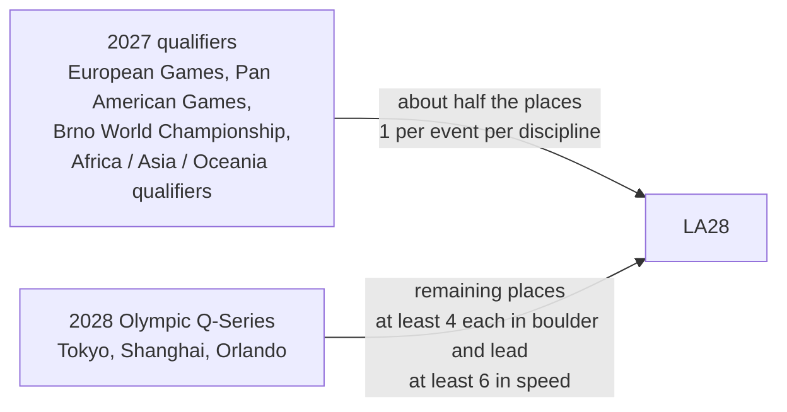

> 🌏 [中文版](/posts/climbing/2026-10-19-olympic-climbing-history)

At the Tokyo Olympics in 2021, Poland's Aleksandra Mirosław set a women's speed world record in the final and still went home without a medal. Three years later in Paris, she won the first Olympic speed gold ever awarded. She hadn't changed that much. The format had.

This is post 4 of the "Climbing Competitions and Pro Climbing" series. The first three posts covered how [bouldering](/posts/climbing/2026-10-19-competition-bouldering-rules-en), [lead](/posts/climbing/2026-10-19-competition-lead-rules-en) and [speed](/posts/climbing/2026-10-19-competition-speed-climbing-en) are scored. This one looks at how the Olympics combine the three, and why the format keeps changing. By the end, you should be able to say how Los Angeles differs from Paris, and how an athlete earns a place in Los Angeles.

## A quick recap of the three disciplines

- **Boulder**: solve as many problems as you can within the time limit, in as few attempts as possible. Since 2025 World Climbing uses points: 25 for a top, 10 for the zone, minus 0.1 per failed attempt.
- **Lead**: one attempt; athletes are ranked by the last hold they controlled, with a "+" if they moved for the next one.
- **Speed**: a standard 15-metre route used worldwide, raced against the clock.

Boulder and lead are about solving; speed is about going fast on a fixed route. Fitting those two kinds of sport into one result was the problem the first two Olympic formats tried to solve.

## Tokyo 2020: one medal for three disciplines, ranks multiplied

When climbing first entered the Olympics, there was one gold for men and one for women. [World Climbing's Tokyo page](https://www.worldclimbing.com/olympics/2020-tokyo) says 20 men and 20 women competed in the Combined at Aomi Urban Sports Park on 3–6 August 2021: everyone had to do speed, boulder and lead.

Scores were the three discipline ranks **multiplied together**, lowest wins. The example from [olympics.com's preview (archived)](https://web.archive.org/web/2021/https://www.olympics.com/en/news/top-five-things-to-know-about-olympic-sport-climbing-at-tokyo-2020): first, second and third in the three disciplines gives 1 × 2 × 3 = 6.

The men's final (the gold and silver arithmetic is from [The Guardian](https://www.theguardian.com/sport/2021/aug/05/climbing-scoring-tokyo-2020-olympics-adam-ondra); Schubert's discipline ranks are from the [Wikipedia men's combined article](https://en.wikipedia.org/wiki/Sport_climbing_at_the_2020_Summer_Olympics_%E2%80%93_Men%27s_combined)):

| Athlete | Speed | Boulder | Lead | Product | Place |
|---|---|---|---|---|---|
| Alberto Ginés López (Spain) | 1 | 7 | 4 | 28 | Gold |
| Nathaniel Coleman (USA) | 6 | 1 | 5 | 30 | Silver |
| Jakob Schubert (Austria) | 7 | 5 | 1 | 35 | Bronze |

On the women's side, Janja Garnbret (Slovenia) won gold with 5 points, Japan's Miho Nonaka took silver with 45 and Akiyo Noguchi bronze with 64 ([World Climbing report](https://worldclimbing.com/news/gold-for-garnbret-in-olympic-games-sport-climbing-combined)).

### The trouble with multiplying ranks

Multiplication inflates the value of first place. First place times anything stays small, so one discipline win plus two ordinary results can still put you in the medals. Ginés López was only seventh in boulder and won gold on the strength of his speed win.

Specialists, on the other hand, lose out. [Climbing.com's analysis](https://www.climbing.com/competition/olympics/how-can-you-set-a-world-record-and-not-medal-in-the-olympics/) points out that Mirosław set a 6.84-second world record in the women's speed final but finished last in both boulder and lead, and missed the podium. The author argues this, more than the hard-to-follow arithmetic, was the format's real problem.

Multiplication also makes your result depend on everyone else. Schubert, the last man to climb in the final, became the only one to top the lead route, which reshuffled everyone else's ranks at once. Who won gold and who dropped off the podium wasn't known until he finished.

## Paris 2024: speed split off, boulder and lead at 100 points each

Paris went from 2 medal events to 4, and from 40 athletes to 68 ([World Climbing Paris page](https://www.worldclimbing.com/olympics/2024-paris)). The [Paris 2024 official results book (archived)](https://web.archive.org/web/20240817190023/https:/olympics.com/OG2024/pdf/OG2024/CLB/OG2024_CLB_B99_CLB-------------------------------.pdf) says speed became a separate medal event for men and women, and the old combined became two stages with a new scoring system.

**Speed** was contested on its own, under the knockout rules from post 3.

**Boulder & Lead** became one event with two stages worth 100 points each, 200 in total:

- **Boulder stage**: 4 problems, each worth 25 for a top, 10 for the high zone and 5 for the low zone, minus 0.1 per failed attempt. Note the **two zones**, unlike the single zone in the series since 2025.
- **Lead stage**: only the top 40 holds of the route score. The top 10 are worth 4 points each, the next 10 three, the next 10 two, and the next 10 one, so a top is 100 points.

Semi-final points are not carried into the final.

The Paris podiums (official results book):

| Event | Gold | Silver | Bronze |
|---|---|---|---|
| Men's Boulder & Lead | Toby Roberts (GB) | Sorato Anraku (Japan) | Jakob Schubert (Austria) |
| Women's Boulder & Lead | Janja Garnbret (Slovenia) | Brooke Raboutou (USA) | Jessica Pilz (Austria) |
| Men's Speed | Veddriq Leonardo (Indonesia) | Wu Peng (China) | Sam Watson (USA) |
| Women's Speed | Aleksandra Mirosław (Poland) | Deng Lijuan (China) | Aleksandra Kałucka (Poland) |

Roberts won with 63.1 in boulder plus 92.1 in lead, 155.2 in total ([olympics.com report (archived)](https://web.archive.org/web/2024/https://olympics.com/en/news/paris-2024-sport-climbing-results-anraku-sorato-mens-boulder-lead)). He was only third in boulder, 6.2 points behind Anraku; in lead he scored 92.1 to Anraku's 76.1 and made up the gap there (discipline results in the official results book).

The Paris combined still tied two different abilities together; it just left speed out. World Climbing's own competitions have dropped combined altogether: the [2025 Seoul World Championships](https://en.wikipedia.org/wiki/2025_IFSC_Climbing_World_Championships) awarded its six golds separately for each discipline and gender, and the 2026 [Event Regulations](https://images.ifsc-climbing.org/ifsc/image/private/t_q_good/prd/brsjsyh2ea4fxinl8nsa.pdf) have only four annexes: lead, speed, boulder and team speed.

## Los Angeles 2028: each discipline its own medal

The [LA28 press release](https://la28.org/en/newsroom/los-angeles-2028-medal-event-program-and-athlete-quota.html) says climbing splits boulder and lead, giving three separate medal events: speed, boulder and lead. Per [World Climbing, quoting the IOC decision](https://www.worldclimbing.com/news/sport-climbing-s-three-disciplines-get-standalone-medals-for-la28), that means six golds and 76 athletes (38 men, 38 women).

Dates and venue ([World Climbing Los Angeles page](https://www.worldclimbing.com/olympics/2028-los-angeles)): climbing runs 24–29 July 2028 at the Long Beach Climbing Theater in Long Beach Sports Park.

Los Angeles is also the first Games where climbing is a program sport; at the previous two it was an additional sport ([World Climbing Los Angeles page](https://www.worldclimbing.com/olympics/2028-los-angeles)).

### How an athlete gets to Los Angeles

From the [qualification system](https://worldclimbing.com/events/olympic-games-la28/news/qualification-system-for-la28-released) World Climbing published in February 2026:

**Quotas**

- Boulder and lead: at least 12 men and 12 women each; speed: 14 men and 14 women.
- Each country may enter at most 2 athletes per gender per discipline.
- The host nation, the USA, gets one place per gender per discipline, and there is one Universality place.
- An athlete who qualifies in both boulder and lead counts as one entry against the 76 total, so boulder and lead may end up with more than 12.

**Two phases**

1. **2027 qualification events** award about half the places, with a single place per discipline at each event. They include the European Games in Istanbul in June, the Pan American Games in Lima in July, the [Brno World Championship](https://worldclimbing.com/news/world-climbing-unveils-2027-international-competition-calendar) in August, and continental qualifiers in Africa, Asia and Oceania. In the 2027 calendar, the Asian qualifier is in Shanghai (10–14 November).
2. **The 2028 Olympic qualification series** awards the rest: at least 4 each in boulder and lead, and at least 6 in speed. From Los Angeles it is called the Olympic Q-Series, and the three climbing stops were [announced in July 2026](https://worldclimbing.com/news/climbing-confirmed-for-olympic-q-series-events-in-tokyo-shanghai-and-orlando): Tokyo (4–7 May), Shanghai (11–14 May) and Orlando (8–11 June).

For Asian athletes, the most direct routes are the 2027 Asian qualifier and the Brno World Championship. Each offers one place per discipline, which means winning the continental title or beating every other not-yet-qualified athlete at the Worlds.

## Para climbing: first time at the Paralympics

Para climbing wasn't on the Paralympic programme. On [26 June 2024 the International Paralympic Committee (IPC)](https://www.paralympic.org/news/para-climbing-be-included-la28-paralympic-games) announced it had approved adding Para climbing to the 2028 Los Angeles Paralympics.

**How it is contested**: Para climbing is on top rope. [World Climbing's Para Climbing Regulations](https://images.ifsc-climbing.org/ifsc/image/private/t_q_good/prd/j4p9tjj4kwngy5qykrsr.pdf) call the annual circuit the World Climbing Para Series, with a Para Championship every two years.

**Sport classes**: under the [2025 Para Climbing Classification Rules](https://images.ifsc-climbing.org/ifsc/image/private/t_q_good/prd/hvqnhow69zfxtrnfdgz8.pdf), athletes are classed by impairment type, ten classes per gender:

- **B1–B3**: visual impairment, B1 the most severe.
- **AU2, AU3**: upper-limb impairment (for example, reduced function of the forearm or hand).
- **AL1, AL2**: lower-limb impairment; AL1 is bilateral, AL2 unilateral.
- **RP1–RP3**: impairment of range and power, RP1 the most severe.

**The LA28 Paralympics** ([qualification pathway published by World Climbing](https://worldclimbing.com/news/ipc-releases-qualification-pathway-to-la28)):

- 15–27 August 2028, 8 medal events, 80 athletes (40 men, 40 women).
- Women: B2, RP1, AU2, AL2; men: B1, RP1, AU2, AL2.
- The first qualifier is the 2027 Brno Para Championship, where the top 3 in each event qualify; athletes must be born before 1 January 2012.

One discrepancy in the official material: the pathway announcement lists the women's visually impaired event as B2, and the event list and qualification schedule on [World Climbing's Paralympics page](https://www.worldclimbing.com/paralympics/2028-los-angeles) also say women's B2, but one line of the finals schedule says "Women's B1 final". That is probably a typo, but it needs an official update to confirm.

## One thread through Olympic climbing

The three Games fit one sentence: **from "one medal for three abilities" to "one medal per ability".**

| | Tokyo 2020 | Paris 2024 | Los Angeles 2028 |
|---|---|---|---|
| Gold medals | 2 | 4 | 6 |
| Athletes | 40 | 68 | 76 |
| Speed | Combined with boulder and lead | Separate | Separate |
| Boulder and lead | Combined with speed | One event, 100 points each | Separate |
| Scoring | Ranks multiplied | Points added | Each discipline's own rules |

In Los Angeles each discipline gets its own medals, so the single-discipline rules from the first three posts give you the basis for following the Games. The exact rounds and field sizes for each Olympic event will be whatever the official format, published later, says.

## Practice: four scenarios

The answer is under each question. Think first, then check.

**1. Under the Tokyo format, athlete A places 2, 2 and 2 in the three disciplines; athlete B places 1, 5 and 3. Who ranks higher?**

Answer

A scores 2 × 2 × 2 = 8 and B scores 1 × 5 × 3 = 15. Lower is better, so A is ahead. But if B moves up in just one discipline (say boulder from 5th to 2nd), B scores 6 and overtakes A. With multiplied ranks, every change in one discipline is amplified.

**2. Under the Paris format, athlete C flashes all four boulders, then in lead controls the 26th of the 40 scoring holds (counting from the bottom) and falls. What is the total?**

Answer

Boulder: 4 × 25 = 100. Lead, counting up from the bottom: holds 1–10 are worth 1 point each (10), holds 11–20 two each (20), holds 21–26 three each (18), for 48. Total 148. The same six holds would be worth 24 at the top of the route but only 18 here: the higher up, the more each hold is worth.

**3. A country has three men ranked in the world top ten in bouldering. How many can it send to men's boulder in Los Angeles?**

Answer

Two at most. The qualification system limits each country to 2 athletes per gender per discipline.

**4. A Taiwanese lead climber wants to go to Los Angeles. What chances are there in 2027?**

Answer

The 2027 qualifiers open to Asian athletes are mainly the Brno World Championship (August) and the Asian qualifier (listed in Shanghai on the 2027 calendar). Each offers one place per discipline. Missing out in 2027 still leaves the 2028 Olympic Q-Series stops in Tokyo, Shanghai and Orlando. Whether the athlete can actually enter also depends on national-team selection at home, which is covered in post 5.

## Next

The first gate to the Olympics is actually national selection. Which competitions can climbers in Taiwan enter? From gym comps to national championships, Asian events and the national team, what are the gates? And what happened when Taiwan earned three places at the 2026 Asian Games but sent no one? That is [post 5: competitions in Asia and Taiwan](/posts/climbing/2026-10-19-climbing-competitions-asia-taiwan-en).

## References

- [Olympics: 2020 Tokyo (World Climbing)](https://www.worldclimbing.com/olympics/2020-tokyo)
- [Top five things to know about Olympic sport climbing at Tokyo 2020 (olympics.com, Wayback archive)](https://web.archive.org/web/2021/https://www.olympics.com/en/news/top-five-things-to-know-about-olympic-sport-climbing-at-tokyo-2020)
- [Climbing is a hit at the Tokyo Olympics – but does it reward the best athletes? (The Guardian, 2021-08-05)](https://www.theguardian.com/sport/2021/aug/05/climbing-scoring-tokyo-2020-olympics-adam-ondra)
- [Sport climbing at the 2020 Summer Olympics – Men's combined (Wikipedia)](https://en.wikipedia.org/wiki/Sport_climbing_at_the_2020_Summer_Olympics_%E2%80%93_Men%27s_combined)
- [Gold for Garnbret in Olympic Games sport climbing combined (World Climbing, 2021-08-06)](https://worldclimbing.com/news/gold-for-garnbret-in-olympic-games-sport-climbing-combined)
- [How Can You Set a World Record and Not Medal in the Olympics? (Climbing.com, 2021-08-10)](https://www.climbing.com/competition/olympics/how-can-you-set-a-world-record-and-not-medal-in-the-olympics/)
- [Olympics: 2024 Paris (World Climbing)](https://www.worldclimbing.com/olympics/2024-paris)
- [Paris 2024 Sport Climbing Official Results Book (olympics.com, Wayback archive, PDF)](https://web.archive.org/web/20240817190023/https:/olympics.com/OG2024/pdf/OG2024/CLB/OG2024_CLB_B99_CLB-------------------------------.pdf)
- [Paris 2024 sport climbing results: men's boulder and lead (olympics.com, Wayback archive)](https://web.archive.org/web/2024/https://olympics.com/en/news/paris-2024-sport-climbing-results-anraku-sorato-mens-boulder-lead)
- [2025 IFSC Climbing World Championships (Wikipedia)](https://en.wikipedia.org/wiki/2025_IFSC_Climbing_World_Championships)
- [World Climbing Event Regulations v3 (2026-01, PDF)](https://images.ifsc-climbing.org/ifsc/image/private/t_q_good/prd/brsjsyh2ea4fxinl8nsa.pdf)
- [Los Angeles 2028 medal event program and athlete quota (LA28, 2025-04-09)](https://la28.org/en/newsroom/los-angeles-2028-medal-event-program-and-athlete-quota.html)
- [Sport climbing's three disciplines get standalone medals for LA28 (World Climbing, 2025-04-09)](https://www.worldclimbing.com/news/sport-climbing-s-three-disciplines-get-standalone-medals-for-la28)
- [Olympics: 2028 Los Angeles (World Climbing)](https://www.worldclimbing.com/olympics/2028-los-angeles)
- [Qualification system for LA28 released (World Climbing, 2026-02-02)](https://worldclimbing.com/events/olympic-games-la28/news/qualification-system-for-la28-released)
- [Climbing confirmed for Olympic Q-Series events in Tokyo, Shanghai and Orlando (World Climbing, 2026-07-08)](https://worldclimbing.com/news/climbing-confirmed-for-olympic-q-series-events-in-tokyo-shanghai-and-orlando)
- [World Climbing unveils 2027 international competition calendar (World Climbing)](https://worldclimbing.com/news/world-climbing-unveils-2027-international-competition-calendar)
- [Para climbing to be included in LA28 Paralympic Games (IPC, 2024-06-26)](https://www.paralympic.org/news/para-climbing-be-included-la28-paralympic-games)
- [IPC releases qualification pathway to LA28 (World Climbing, 2026-08-12)](https://worldclimbing.com/news/ipc-releases-qualification-pathway-to-la28)
- [Paralympics: 2028 Los Angeles (World Climbing)](https://www.worldclimbing.com/paralympics/2028-los-angeles)
- [Para Climbing Classification Rules (World Climbing, 2025-03, PDF)](https://images.ifsc-climbing.org/ifsc/image/private/t_q_good/prd/hvqnhow69zfxtrnfdgz8.pdf)
- [Para Climbing Competition Regulations v2 (World Climbing, 2026-01, PDF)](https://images.ifsc-climbing.org/ifsc/image/private/t_q_good/prd/j4p9tjj4kwngy5qykrsr.pdf)
