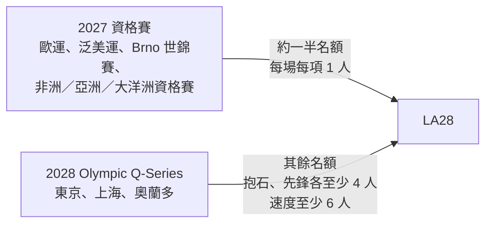

> 🌏 [English version](/posts/climbing/2026-10-19-olympic-climbing-history-en)

2021 年東京奧運，波蘭的 Aleksandra Mirosław 在速度決賽跑出女子世界紀錄，最後卻沒拿到獎牌。三年後在巴黎，她拿下奧運史上第一面速度金牌。差別不在她變強，而在賽制改了。

這是「攀岩賽事與職業攀岩」系列的第 4 篇。前三篇分別講了[抱石](/posts/climbing/2026-10-19-competition-bouldering-rules)、[先鋒](/posts/climbing/2026-10-19-competition-lead-rules)、[速度](/posts/climbing/2026-10-19-competition-speed-climbing)怎麼計分。這篇看奧運怎麼把三個項目組合起來，以及為什麼每一屆都在改。讀完之後，你可以說出洛杉磯跟巴黎差在哪，以及一位選手要怎麼拿到洛杉磯的門票。

## 先回顧三個項目

- **抱石**：限時內解開幾題、用幾次嘗試。2025 年起 World Climbing 用積分制，完攀 25 分、Zone 10 分，每次失敗扣 0.1。
- **先鋒**：一次機會，用最後控制住的點排名，往下一顆出手加「+」。
- **速度**：全世界統一的 15 公尺路線，比時間。

抱石和先鋒都是解題，速度是在固定路線上比快。把這兩種東西放進同一個成績裡，就是奧運攀岩前兩屆的難題。

## 東京 2020：三項合一，名次相乘

攀岩第一次進奧運時，男女各只有一面金牌。[World Climbing 的東京頁面](https://www.worldclimbing.com/olympics/2020-tokyo)寫，2021 年 8 月 3–6 日，男女各 20 人在青海都市運動公園比「三項全能」（Combined）：每個人都要比速度、抱石、先鋒。

計分方式是把三項的名次**相乘**，數字越小越好。[olympics.com 賽前說明（封存）](https://web.archive.org/web/2021/https://www.olympics.com/en/news/top-five-things-to-know-about-olympic-sport-climbing-at-tokyo-2020)舉的例子：三項分別第 1、2、3 名，總分是 1 × 2 × 3 ＝ 6。

男子決賽的結果（金銀兩人的算式見[《衛報》](https://www.theguardian.com/sport/2021/aug/05/climbing-scoring-tokyo-2020-olympics-adam-ondra)，Schubert 的分項名次見 [Wikipedia 男子全能條目](https://en.wikipedia.org/wiki/Sport_climbing_at_the_2020_Summer_Olympics_%E2%80%93_Men%27s_combined)）：

| 選手 | 速度 | 抱石 | 先鋒 | 相乘 | 名次 |
|---|---|---|---|---|---|
| Alberto Ginés López（西班牙） | 1 | 7 | 4 | 28 | 金 |
| Nathaniel Coleman（美國） | 6 | 1 | 5 | 30 | 銀 |
| Jakob Schubert（奧地利） | 7 | 5 | 1 | 35 | 銅 |

女子是 Janja Garnbret（斯洛維尼亞）以 5 分奪金，日本的野中生萌（Miho Nonaka）45 分銀牌、野口啟代（Akiyo Noguchi）64 分銅牌（[World Climbing 賽報](https://worldclimbing.com/news/gold-for-garnbret-in-olympic-games-sport-climbing-combined)）。

### 名次相乘的問題

相乘會放大第一名的價值。第一名乘上任何數字都不會變大，所以只要有一項拿第一，其他兩項普通也能爭牌。Ginés López 抱石只排第 7，靠速度第一拿下金牌。

反過來，專攻一項的人很吃虧。[Climbing.com 的分析](https://www.climbing.com/competition/olympics/how-can-you-set-a-world-record-and-not-medal-in-the-olympics/)指出，Mirosław 在女子速度決賽跑出 6.84 秒的世界紀錄，但抱石和先鋒都墊底，最後沒有站上頒獎台。作者認為這比難算的數學更是這個賽制真正的問題。

名次相乘還讓結果取決於別人。男子決賽最後一位上場的 Schubert 成為先鋒唯一完攀的人，一口氣改變了其他人的名次，誰拿金、誰掉出頒獎台，要等他爬完才知道。

## 巴黎 2024：速度拆出來，抱石＋先鋒各 100 分

巴黎的獎牌從 2 面變成 4 面，選手從 40 人增加到 68 人（[World Climbing 巴黎頁面](https://www.worldclimbing.com/olympics/2024-paris)）。[巴黎奧運官方成績手冊（封存）](https://web.archive.org/web/20240817190023/https:/olympics.com/OG2024/pdf/OG2024/CLB/OG2024_CLB_B99_CLB-------------------------------.pdf)寫：速度改成男女各自獨立的獎牌項目，原本的全能改成兩個階段、新的計分方式。

**速度**單獨比，規則就是第 3 篇講的淘汰賽。

**抱石＋先鋒**合成一項，兩個階段各 100 分、滿分 200 分：

- **抱石階段**：4 題，每題完攀 25 分、高 Zone 10 分、低 Zone 5 分，每次失敗嘗試扣 0.1。注意這裡有**兩個 Zone**，和 2025 年起系列賽的單一 Zone 不同。
- **先鋒階段**：路線最高的 40 顆點才有分。最上面 10 顆每顆 4 分、往下 10 顆每顆 3 分、再往下 10 顆每顆 2 分、再往下 10 顆每顆 1 分，爬到頂就是 100 分。

準決賽的分數不帶進決賽。

巴黎的頒獎台（官方成績手冊）：

| 項目 | 金 | 銀 | 銅 |
|---|---|---|---|
| 男子抱石＋先鋒 | Toby Roberts（英國） | 安樂宙斗 Anraku Sorato（日本） | Jakob Schubert（奧地利） |
| 女子抱石＋先鋒 | Janja Garnbret（斯洛維尼亞） | Brooke Raboutou（美國） | Jessica Pilz（奧地利） |
| 男子速度 | Veddriq Leonardo（印尼） | 伍鵬 Wu Peng（中國） | Sam Watson（美國） |
| 女子速度 | Aleksandra Mirosław（波蘭） | 鄧麗娟 Deng Lijuan（中國） | Aleksandra Kałucka（波蘭） |

Roberts 的金牌是抱石 63.1 分加先鋒 92.1 分，總分 155.2（[olympics.com 賽報（封存）](https://web.archive.org/web/2024/https://olympics.com/en/news/paris-2024-sport-climbing-results-anraku-sorato-mens-boulder-lead)）。他抱石只排第 3，落後安樂 6.2 分；先鋒他拿 92.1、安樂 76.1，靠先鋒追了回來（決賽分項見官方成績手冊）。

巴黎的複合還是把兩種不同的能力綁在一起，只是不再把速度算進去。World Climbing 自己的比賽已經不辦複合：[2025 年首爾世錦賽](https://en.wikipedia.org/wiki/2025_IFSC_Climbing_World_Championships)的 6 面金牌是三項男女分開頒，2026 年版[賽事規程](https://images.ifsc-climbing.org/ifsc/image/private/t_q_good/prd/brsjsyh2ea4fxinl8nsa.pdf)也只剩先鋒、速度、抱石和團體速度四個附件。

## 洛杉磯 2028：三項各自頒獎

[LA28 官方新聞稿](https://la28.org/en/newsroom/los-angeles-2028-medal-event-program-and-athlete-quota.html)寫，攀岩把抱石和先鋒拆開，變成速度、抱石、先鋒三個獨立的獎牌項目。依 [World Climbing 引述的國際奧會決定](https://www.worldclimbing.com/news/sport-climbing-s-three-disciplines-get-standalone-medals-for-la28)，男女共 6 面金牌、76 名選手（男女各 38 人）。

時間與地點（[World Climbing 洛杉磯頁面](https://www.worldclimbing.com/olympics/2028-los-angeles)）：攀岩賽程在 2028 年 7 月 24–29 日，場地是長灘運動公園（Long Beach Sports Park）裡的 Long Beach Climbing Theater。

洛杉磯也是攀岩第一次以正式計畫項目（program sport）出現在奧運，前兩屆都是追加項目（additional sport）（[World Climbing 洛杉磯頁面](https://www.worldclimbing.com/olympics/2028-los-angeles)）。

### 一位選手怎麼拿到洛杉磯門票

依 World Climbing 2026 年 2 月公布的[資格制度](https://worldclimbing.com/events/olympic-games-la28/news/qualification-system-for-la28-released)：

**名額**

- 抱石和先鋒，男女各至少 12 人；速度男女各 14 人。
- 每個國家每個性別、每個項目最多 2 人。
- 主辦國美國每個性別、每個項目保留 1 個名額，另有 1 個普及名額（Universality place）。
- 同時拿到抱石和先鋒資格的人，在 76 人總額裡只算一個名額，所以抱石和先鋒的實際人數可能比 12 人多。

**兩個階段**

1. **2027 年的資格賽**發出約一半名額，每場比賽每個項目只有 1 個名額。資格賽包括 6 月伊斯坦堡歐洲運動會、7 月利馬泛美運動會、8 月 [Brno 世錦賽](https://worldclimbing.com/news/world-climbing-unveils-2027-international-competition-calendar)，以及非洲、亞洲、大洋洲的洲際資格賽。2027 年賽程公告列出的洲際資格賽中，亞洲站在上海（11 月 10–14 日）。
2. **2028 年的奧運資格系列賽**發出剩下的名額，抱石和先鋒各至少 4 人、速度至少 6 人。這個系列賽從洛杉磯起改名 Olympic Q-Series，[2026 年 7 月公布](https://worldclimbing.com/news/climbing-confirmed-for-olympic-q-series-events-in-tokyo-shanghai-and-orlando)攀岩的三站：東京（5 月 4–7 日）、上海（5 月 11–14 日）、奧蘭多（6 月 8–11 日）。

對亞洲選手來說，最直接的路是 2027 年的亞洲資格賽和 Brno 世錦賽：每項只有一個名額，等於要拿洲冠軍或在世錦賽贏過其他還沒取得資格的人。

## 帕拉攀登：第一次進帕運

帕拉攀登原本不在帕運裡。[國際帕拉林匹克委員會（IPC）2024 年 6 月 26 日](https://www.paralympic.org/news/para-climbing-be-included-la28-paralympic-games)宣布，核准把帕拉攀登納入 2028 洛杉磯帕運。

**比賽方式**：帕拉攀登用上方確保（top rope）比賽，[World Climbing 的帕拉攀登規程](https://images.ifsc-climbing.org/ifsc/image/private/t_q_good/prd/j4p9tjj4kwngy5qykrsr.pdf)把每年的巡迴賽叫 World Climbing Para Series，另有兩年一次的帕拉世錦賽。

**運動等級**：依 [2025 年的帕拉攀登分級規則](https://images.ifsc-climbing.org/ifsc/image/private/t_q_good/prd/hvqnhow69zfxtrnfdgz8.pdf)，選手依障礙類型分級，每個性別 10 級：

- **B1–B3**：視障，B1 最重。
- **AU2、AU3**：上肢障礙（例如前臂或手部功能受限）。
- **AL1、AL2**：下肢障礙，AL1 是雙側、AL2 是單側。
- **RP1–RP3**：肌力或關節活動度受限（range and power），RP1 最重。

**洛杉磯帕運**（[World Climbing 公布的資格路徑](https://worldclimbing.com/news/ipc-releases-qualification-pathway-to-la28)）：

- 2028 年 8 月 15–27 日，共 8 個獎牌項目、80 人（男女各 40 人）。
- 女子：B2、RP1、AU2、AL2；男子：B1、RP1、AU2、AL2。
- 第一場資格賽是 2027 年 Brno 帕拉世錦賽，每項前 3 名取得資格；選手要在 2012 年 1 月 1 日以前出生。

官方資料有一處對不上：資格路徑公告寫女子視障項目是 B2，[World Climbing 帕運頁面](https://www.worldclimbing.com/paralympics/2028-los-angeles)的項目清單和資格賽賽程也寫女子 B2，只有決賽那一行寫「Women's B1 final」，比較可能是誤植，但要等官方更新確認。

## 看懂奧運攀岩的一條線

三屆的變化可以用一句話串起來：**從「一面金牌裝三種能力」，慢慢拆成「一種能力一面金牌」**。

| | 東京 2020 | 巴黎 2024 | 洛杉磯 2028 |
|---|---|---|---|
| 金牌數 | 2 | 4 | 6 |
| 選手數 | 40 | 68 | 76 |
| 速度 | 和抱石、先鋒合算 | 獨立 | 獨立 |
| 抱石與先鋒 | 和速度合算 | 合成一項、各 100 分 | 各自獨立 |
| 計分 | 名次相乘 | 分數相加 | 各項用自己的規則 |

到了洛杉磯，三項各自頒獎，看懂前三篇的單項規則，就有了看洛杉磯比賽的基礎。奧運各項實際的輪次和人數安排，要以官方之後公布的賽制為準。

## 練習題：四個情境

答案在每題下方，先自己想再看。

**1. 東京賽制下，選手 A 三項是 2、2、2 名，選手 B 是 1、5、3 名。誰排前面？**

答案

A 是 2 × 2 × 2 ＝ 8，B 是 1 × 5 × 3 ＝ 15。數字越小越好，A 排前面。不過只要 B 某一項再前進一名（例如抱石從 5 變 2），就變成 6，反超 A。名次相乘下，每一項的名次變動都會被放大。

**2. 巴黎賽制下，選手 C 抱石四題都在第 1 次完攀，先鋒在 40 顆計分點中的第 26 顆（由下往上數）穩住後掉下來。總分多少？**

答案

抱石 4 × 25 ＝ 100 分。先鋒由下往上算：第 1–10 顆每顆 1 分（10 分）、第 11–20 顆每顆 2 分（20 分）、第 21–26 顆每顆 3 分（18 分），共 48 分。總分 148 分。同樣多爬 6 顆點，在路線最上面那一段值 24 分，在這一段只值 18 分，越接近頂端越值錢。

**3. 某國有三位男子抱石選手世界排名都在前十，洛杉磯最多能派幾位比男子抱石？**

答案

最多 2 位。資格制度規定每個國家每個性別、每個項目最多 2 人。

**4. 一位台灣先鋒選手想去洛杉磯，2027 年有哪些機會？**

答案

亞洲選手能參加的 2027 年資格賽主要是 Brno 世錦賽（8 月）和亞洲資格賽（2027 年賽程列在上海）。每場每個項目只有 1 個名額。如果 2027 年沒拿到，2028 年還有 Olympic Q-Series 的東京、上海、奧蘭多三站。實際能不能報名，還要先經過國內的國手選拔，這部分在第 5 篇。

## 下一步

奧運門票的第一關，其實是國內的選拔。台灣攀岩者能參加哪些比賽？從岩館賽到全國賽、亞洲賽、國家隊要過哪些關？2026 年亞運拿到配額卻沒有出賽又是怎麼回事？這是[第 5 篇：亞洲與台灣的比賽](/posts/climbing/2026-10-19-climbing-competitions-asia-taiwan)。

## 參考資料

- [Olympics: 2020 Tokyo（World Climbing）](https://www.worldclimbing.com/olympics/2020-tokyo)
- [Top five things to know about Olympic sport climbing at Tokyo 2020（olympics.com，Wayback 封存）](https://web.archive.org/web/2021/https://www.olympics.com/en/news/top-five-things-to-know-about-olympic-sport-climbing-at-tokyo-2020)
- [Climbing is a hit at the Tokyo Olympics – but does it reward the best athletes?（The Guardian，2021-08-05）](https://www.theguardian.com/sport/2021/aug/05/climbing-scoring-tokyo-2020-olympics-adam-ondra)
- [Sport climbing at the 2020 Summer Olympics – Men's combined（Wikipedia）](https://en.wikipedia.org/wiki/Sport_climbing_at_the_2020_Summer_Olympics_%E2%80%93_Men%27s_combined)
- [Gold for Garnbret in Olympic Games sport climbing combined（World Climbing，2021-08-06）](https://worldclimbing.com/news/gold-for-garnbret-in-olympic-games-sport-climbing-combined)
- [How Can You Set a World Record and Not Medal in the Olympics?（Climbing.com，2021-08-10）](https://www.climbing.com/competition/olympics/how-can-you-set-a-world-record-and-not-medal-in-the-olympics/)
- [Olympics: 2024 Paris（World Climbing）](https://www.worldclimbing.com/olympics/2024-paris)
- [Paris 2024 Sport Climbing Official Results Book（olympics.com，Wayback 封存，PDF）](https://web.archive.org/web/20240817190023/https:/olympics.com/OG2024/pdf/OG2024/CLB/OG2024_CLB_B99_CLB-------------------------------.pdf)
- [Paris 2024 sport climbing results: men's boulder and lead（olympics.com，Wayback 封存）](https://web.archive.org/web/2024/https://olympics.com/en/news/paris-2024-sport-climbing-results-anraku-sorato-mens-boulder-lead)
- [2025 IFSC Climbing World Championships（Wikipedia）](https://en.wikipedia.org/wiki/2025_IFSC_Climbing_World_Championships)
- [World Climbing Event Regulations v3（2026-01，PDF）](https://images.ifsc-climbing.org/ifsc/image/private/t_q_good/prd/brsjsyh2ea4fxinl8nsa.pdf)
- [Los Angeles 2028 medal event program and athlete quota（LA28，2025-04-09）](https://la28.org/en/newsroom/los-angeles-2028-medal-event-program-and-athlete-quota.html)
- [Sport climbing's three disciplines get standalone medals for LA28（World Climbing，2025-04-09）](https://www.worldclimbing.com/news/sport-climbing-s-three-disciplines-get-standalone-medals-for-la28)
- [Olympics: 2028 Los Angeles（World Climbing）](https://www.worldclimbing.com/olympics/2028-los-angeles)
- [Qualification system for LA28 released（World Climbing，2026-02-02）](https://worldclimbing.com/events/olympic-games-la28/news/qualification-system-for-la28-released)
- [Climbing confirmed for Olympic Q-Series events in Tokyo, Shanghai and Orlando（World Climbing，2026-07-08）](https://worldclimbing.com/news/climbing-confirmed-for-olympic-q-series-events-in-tokyo-shanghai-and-orlando)
- [World Climbing unveils 2027 international competition calendar（World Climbing）](https://worldclimbing.com/news/world-climbing-unveils-2027-international-competition-calendar)
- [Para climbing to be included in LA28 Paralympic Games（IPC，2024-06-26）](https://www.paralympic.org/news/para-climbing-be-included-la28-paralympic-games)
- [IPC releases qualification pathway to LA28（World Climbing，2026-08-12）](https://worldclimbing.com/news/ipc-releases-qualification-pathway-to-la28)
- [Paralympics: 2028 Los Angeles（World Climbing）](https://www.worldclimbing.com/paralympics/2028-los-angeles)
- [Para Climbing Classification Rules（World Climbing，2025-03，PDF）](https://images.ifsc-climbing.org/ifsc/image/private/t_q_good/prd/hvqnhow69zfxtrnfdgz8.pdf)
- [Para Climbing Competition Regulations v2（World Climbing，2026-01，PDF）](https://images.ifsc-climbing.org/ifsc/image/private/t_q_good/prd/j4p9tjj4kwngy5qykrsr.pdf)
