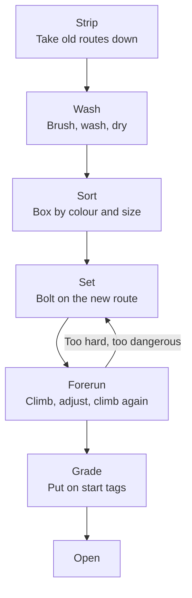

> 🌏 [中文版](/posts/climbing/2026-10-19-route-setter-career)

You've been stuck on one of these: everything flows until one move in the middle, and however many times you try, you're just short. Resting, you wonder: is that move deliberate? Who decided it?

A route setter did. Coaches teach you by talking; setters teach you through routes. They usually work when the gym is closed or a section is roped off, so most climbers have barely seen them at work. The previous post, [Climbing Coaches and Certifications](/posts/climbing/2026-10-19-climbing-coach-certification-en), covered the levels of coaching certificates. Setters have levels too, in a different system.

This post looks first at how a route gets set, then at how to become a setter in Taiwan and abroad, and finally at the job's physical cost and pay.

## One V3 boulder: a day from bare wall to open

Resetting a bouldering wall goes roughly like this:

Take a problem meant to be V3:

1. **Strip**: take every old hold off the wall.
2. **Wash**: hold maker [Rock City](https://rockcityclimbingholds.com/resources/hold-care-and-maintenance) recommends brushing holds on main bouldering walls every 1–2 weeks and washing them monthly. Dry-brush first, then wash in a citric acid solution, rinse thoroughly and let them dry completely before they go back up. Holds that go up wet rust the T-nuts in the wall. Once dry, sort them into boxes by colour and size so they're easy to pick from when setting.
3. **Set**: the setter first decides what move they want climbers to make, say "a side-pull into a high step", then picks holds, chooses positions and angles, and bolts them on.
4. **Forerun**: the setter climbs it and gets colleagues to climb it. If a move feels awkward, only works at one height, or a fall would hit another hold, it comes off and gets changed.
5. **Grade**: once everyone agrees it's right, the start tags and grade go on.

Forerunning is one of the most time-consuming parts of the job. Evelyne Lajoie, a physiotherapist in Montreal, Canada, ran an [online survey](https://theclimbingdoctor.com/work-injuries-amongst-routesetters-and-occupational-hazards) of 162 setters. The results: setters worked on average 2.5 days a week, 7.3 hours a day, and spent about 40% of that time forerunning.

### How often routes change

Every gym resets on its own schedule. A few public examples:

- [Petra Cliffs](https://petracliffs.com/routesetting) in the US: routes stay up 2–3 months, one wall reset at a time; training areas change weekly or every two weeks.
- [E4 bouldering gym](https://boulderhalle-e4.de/nothing-but-problems-with-dirk) in Germany: resets every week, with about 60 problems per colour.

That's why gyms close off a section on certain days. Nobody's slacking; they're resetting.

### Grades only hold inside the gym

Petra Cliffs puts it bluntly: grades in the gym only reflect that gym's own consistency. At another gym, the same V3 may feel different.

Some gyms skip exact grades and use circuit grading. [Teton Rock Gym](https://tetonrockgym.com/routesetting) uses start-tag colours to stand for a range, such as V2–4, with ranges deliberately overlapping; hold colours can be mixed, so a route needn't be one colour. The approach comes from the bouldering circuits of Fontainebleau in France, and it takes some of the pressure off chasing grades.

**Something you can do tonight**: next time you're at the gym, find a freshly set route. Before you climb it, guess what move the setter wants from you, then compare afterwards. If you want to set your own problems, see [Resting, Route Reading, and Setting Your Own Problems](/posts/climbing/2026-10-18-resting-route-reading-en).

## Why setters don't want you marking the wall

This ties directly into the setter's job. Chalk marks on holds or tape marking your beta pull everyone after you into your solution, and they undo the moves the setter designed. The etiquette of setting your own problems is covered in more detail in Resting, Route Reading, and Setting Your Own Problems.

## Becoming a setter in Taiwan

Setter certification in Taiwan is handled by the sport climbing division of the [Chinese Taipei Alpine Association](https://itsrcowebs.com/Files/archives/article/100015/ca082412cc9446b1b699fc57b8a1c755_%E4%B8%AD%E8%8F%AF%E6%B0%91%E5%9C%8B%E5%B1%B1%E5%B2%B3%E5%8D%94%E6%9C%83%E9%81%8B%E5%8B%95%E6%94%80%E7%99%BB%E9%83%A8%E7%B5%84%E7%B9%94%E7%B0%A1%E5%89%87-20180902.pdf) (CTAA, in Mandarin) under its sport climbing route setter rules. The public course notices show the Level C setter course. Since 2025, applying for Level C has required an "entry-level setter certificate", but we couldn't find a public notice for the entry-level course itself.

Take the [Level C setter course held at T-UP Zhonghe in October 2025](https://itsrcowebs.com/Files/archives/article/100015/0f598e0ea30a4fa5a5fe9263952bb0a6_%E4%B8%AD%E8%8F%AF%E6%B0%91%E5%9C%8B%E5%B1%B1%E5%B2%B3%E5%8D%94%E6%9C%83%20114%20%E5%B9%B4%E5%BA%A6%E9%81%8B%E5%8B%95%E6%94%80%E7%99%BBC%E7%B4%9A%E5%AE%9A%E7%B7%9A%E5%93%A1%E8%AC%9B%E7%BF%92%E7%B0%A1%E7%AB%A01019-1020.pdf) (in Mandarin):

- **Eligibility**: at least 18, high school education, CTAA member; redpoint 5.12a and bouldering V5 or above; an entry-level setter certificate and the CBT; and 60 or above on the Level C judge course written exam (if you're missing this, you have a year to make it up).
- **Course**: two days, covering speed wall layout and lead quickdraw placement, competition route design principles, competition rules, system changeovers, route marking and stripping, rope work and lead route design.
- **Fee and size**: NT$7,000, at most 20 people.
- **Certificate**: after passing, the CTAA issues a "Level C sport climbing route setting certificate".

Requirements change. The [2021 Level C course](https://itsrcowebs.com/Files/archives/article/100015/1705b29d129a4ef2b438b17701722f48_2021%E5%B9%B4%E5%B1%B1%E5%8D%94C%E7%B4%9A%E5%AE%9A%E7%B7%9A%E5%93%A1%E8%AC%9B%E7%BF%92%E7%B0%A1%E7%AB%A0-3.pdf) (in Mandarin) ran four days, required a redpoint of 5.12b and bouldering V4, and didn't need an entry-level setter certificate. Always check that year's notice before applying.

The syllabus shows the CTAA's setter courses centre on **competition setting**. The requirements and courses for Level A and B setters are not publicly available.

### Do you need a certificate to set in a gym?

No national rule requires one. But [Taipei's Department of Sports notice of February 2026](https://industry.sports.gov.taipei/announcement/?K=286) (in Mandarin) added climbing gyms to its inspection form for private sports venues, requiring climbing coaches, judges and route setters on site to hold a Level C (or equivalent) or higher certificate valid within four years. So at a private gym in Taipei, whether the setters hold Level C or above is something the city checks during inspections.

Compare Japan: commercial gym setting there [requires no qualification at all](https://www.climbers-web.jp/feature/article-81/) (in Japanese); certificates only matter for competitions.

### How people actually get in

Many setters in Taiwan work part-time. When route setter Liu Han-chieh was [interviewed](https://500times.udn.com/wtimes/story/12671/5886300) (in Mandarin) in 2021, he was a freelance coach and setter who set regularly with a team at a gym in Taoyuan, aiming for "routes that are safe but carry a sense of adventure". Coach Wei, owner of boulder space in Kaohsiung, said in a 2021 [panel write-up](http://kateberrysblog.blogspot.com/2021/02/rock-climb-generation-6.html) (in Mandarin) that Taiwan's gym setting market "still can't support full-time setters the way Japan does".

A common way in is to work at a gym as a coach or on the front desk, start by helping strip and wash holds, then learn setting and forerunning from experienced setters, while taking the CBT, building your climbing level, and signing up for the entry-level and Level C courses.

**Something you can do tonight**: ask your regular gym whether they need help stripping and washing holds when they reset. Plenty of setters started exactly there.

## Setter certifications abroad

Other countries separate "commercial setting" from "competition setting" more clearly:

| Region | Certification | Focus | Structure |
|---|---|---|---|
| US | [USA Climbing](https://usaclimbing.org/community/routesetters/routesetting-clinics/) L1–L5 | Competition | L1 clinic US$500, L2 US$1,000; minimum age 16; L5s can be nominated for international events |
| US | [CWA PRS](https://assets.noviams.com/novi-file-uploads/cwa/pdfs-and-documents/Certifications/PRS_Certification_Standards-d0cec824.pdf) | Commercial gyms | Launched 2024; Intro → L1 (18+, V2) → L2 bouldering / top-rope → L3 (600 hours) → Provider (21+, 2,000 hours); expires after three years |
| UK | [ABC setting courses](https://abcwalls.co.uk/2025/10/09) | Commercial gyms | New pathway (a year old when announced in October 2025): Setting Basics (1 day) → Setting in Practice (1 day) → Commercial Roped Setter (2 days) |
| International | [World Climbing](https://worldclimbing.com/development/dev-officials) Level 1–4 | Competition | Restructure announced in 2023; national federations nominated setters when the new system was set up ([Sewell interview](https://epsets.substack.com/p/an-interview-with-ifsc-routesetter)) |

A few things worth noting:

- USA Climbing's clinic page says outright that it teaches competition setting, not commercial setting.
- Official documents contradict each other. USA Climbing's [2025 pathway PDF](https://usaclimbing.org/wp-content/uploads/2025/11/Path-of-a-Routesetter-9.2025.pdf) gives the L1 forerunning standard as V5; the clinic page says "V4 and 5.12".
- For the CWA's L2 bouldering, the standards PDF recommends 150 hours and the certification page 200. Check the latest documents before you sign up.
- For international competitions, the route from Taiwan goes through a CTAA nomination, because under World Climbing's new system setters are nominated by national federations, and Taiwan's member federation is the CTAA.

## The physical cost

Setting is creative work, but it's also physical labour: hauling boxes of holds, spending all day on a ladder or rope with a drill, forerunning one route over and over.

Lajoie's survey found:

- 78.5% of setters had been injured at work.
- 61% had acute injuries, such as falls, equipment accidents and strains from heavy lifting.
- 71% had chronic work-related problems, most often in the lower back, shoulders, elbows and wrists; vibration from impact drivers was listed as a risk factor.

This is a survey, not a large epidemiological study. The only comparison it draws with climbers in general is the lower back: 25% of setters reported lower-back problems.

## Pay: no public data for Taiwan

There's no public data on hourly or per-route pay for setters in Taiwan. A [January 2026 job-listing analysis](https://blog.104.com.tw/104data-rock-climbing-recruit-salary/) (in Mandarin) by 104 Job Bank mentions listings that include "setting in the gym" in the job duties, but the pay listed is for coaches; it gives no figure for setters.

US numbers are only a comparison and can't be used to estimate Taiwan:

- A February 2026 decision from the US National Labor Relations Board puts [setter pay at Touchstone's Bay Area gyms at about US$28 an hour](https://onthelaborfront.com/chalk-up-the-vote-nlrb-orders-separate-union-elections-for-touchstone-climbing), against about US$22 for front desk and US$20 for instructors in the same document.
- A [reading](https://vertigemedia.fr/en/working-in-climbing-pay-wages-us-gyms) of *Climbing Business Journal*'s 2026 pay survey notes that assistant setters rated job satisfaction 3.47 out of 5, the lowest among non-management roles.
- US gym workers have started unionising. On 24 March 2025, Touchstone setters in Southern California went on an unfair labour practice strike; the union's [press release](https://climbingbusinessjournal.com/touchstone-workers-united-calls-first-routesetter-ulp-strike-in-america) called it the first route setter strike in the US.

### Is this path for you?

Ask yourself three questions:

1. **Do you like designing moves, or just climbing?** Setters spend most of their time designing for other people, and their own routes often come down and start over.
2. **Can your body take it?** Hauling, climbing, bolting, forerunning: a day's load is bigger than a normal climbing session.
3. **Can you live with uncertain income?** In Taiwan, setting is often part of a coaching job or other work.

**Something you can do tonight**: on a spray wall or an empty section, set a five-hold problem for a friend and see whether they climb it the way you designed.

## Practice: four scenarios

The answer is under each one. Think first, then look.

**1. You chalk an arrow next to the crux of a boulder to remind yourself where to put your foot next time. A setter sees it and asks you to wipe it off.**

Answer

Marks make everyone after you climb your solution, and the moves the setter designed lose their point. If you want to remember the beta, take a photo or keep it in your head.

**2. You want to set for competitions. What's the first step?**

Answer

In Taiwan: take the CBT, get your climbing to a redpoint of 5.12a and bouldering V5 or above, get the CTAA's entry-level setter certificate (ask the CTAA's sport climbing division about the next intake), then apply for Level C. Check that year's notice before applying, since requirements can change year to year. Meanwhile, look for chances to help strip, wash and set at a gym to build hands-on experience. For international events you'll need a CTAA nomination.

**3. A wall at your gym is closed all day and it's annoying.**

Answer

It's almost certainly a reset. A wall has to be stripped, washed, set, forerun, adjusted and graded. In Lajoie's survey, forerunning alone took about 40% of setters' hours. The reset is what gives you new routes to climb.

**4. A friend says: "US setters make US$28 an hour, that's nearly NT$900. Taiwan must be about the same."**

Answer

You can't reason that way. US$28 is a figure for one US gym chain in one labour board document, and US prices, wages and industry size are all different from Taiwan's. There's no public data on setter pay in Taiwan.

## Next

Setters' injury rates are a reminder that a gym is a place where risk has to be managed. The next post starts with the form you sign every time you walk in: how is gym safety managed? Is the waiver valid in Taiwan? What does the insurance cover for you? That's [Part 4: Gym Safety, Waivers and Insurance](/posts/climbing/2026-10-19-climbing-gym-safety-waivers-en).

## References

- [An Interview with IFSC Routesetter Ryan Sewell (Elevated Perspective, 2025)](https://epsets.substack.com/p/an-interview-with-ifsc-routesetter)
- [Evelyne Lajoie: Work Injuries Amongst Routesetters and Occupational Hazards (The Climbing Doctor, 2025)](https://theclimbingdoctor.com/work-injuries-amongst-routesetters-and-occupational-hazards)
- [Hold Care and Maintenance (Rock City Climbing Holds)](https://rockcityclimbingholds.com/resources/hold-care-and-maintenance)
- [Routesetting (Petra Cliffs)](https://petracliffs.com/routesetting)
- [Nothing but Problems with Dirk (Boulderhalle E4)](https://boulderhalle-e4.de/nothing-but-problems-with-dirk)
- [Routesetting and circuit grading (Teton Rock Gym)](https://tetonrockgym.com/routesetting)
- [CTAA 2025 Level C sport climbing route setter course notice, T-UP Zhonghe (in Mandarin)](https://itsrcowebs.com/Files/archives/article/100015/0f598e0ea30a4fa5a5fe9263952bb0a6_%E4%B8%AD%E8%8F%AF%E6%B0%91%E5%9C%8B%E5%B1%B1%E5%B2%B3%E5%8D%94%E6%9C%83%20114%20%E5%B9%B4%E5%BA%A6%E9%81%8B%E5%8B%95%E6%94%80%E7%99%BBC%E7%B4%9A%E5%AE%9A%E7%B7%9A%E5%93%A1%E8%AC%9B%E7%BF%92%E7%B0%A1%E7%AB%A01019-1020.pdf)
- [CTAA 2021 Level C sport climbing route setter course notice (in Mandarin)](https://itsrcowebs.com/Files/archives/article/100015/1705b29d129a4ef2b438b17701722f48_2021%E5%B9%B4%E5%B1%B1%E5%8D%94C%E7%B4%9A%E5%AE%9A%E7%B7%9A%E5%93%A1%E8%AC%9B%E7%BF%92%E7%B0%A1%E7%AB%A0-3.pdf)
- [CTAA sport climbing division organisational rules (2018, in Mandarin)](https://itsrcowebs.com/Files/archives/article/100015/ca082412cc9446b1b699fc57b8a1c755_%E4%B8%AD%E8%8F%AF%E6%B0%91%E5%9C%8B%E5%B1%B1%E5%B2%B3%E5%8D%94%E6%9C%83%E9%81%8B%E5%8B%95%E6%94%80%E7%99%BB%E9%83%A8%E7%B5%84%E7%B9%94%E7%B0%A1%E5%89%87-20180902.pdf)
- [Taipei City Department of Sports: climbing and bouldering gym safety items added to the venue inspection form (2026-02-11, in Mandarin)](https://industry.sports.gov.taipei/announcement/?K=286)
- [How to get certified: the road to route setter (CLIMBERS, 2020, in Japanese)](https://www.climbers-web.jp/feature/article-81/)
- [Interview with Taiwanese route setter Liu Han-chieh (500 Times, in Mandarin)](https://500times.udn.com/wtimes/story/12671/5886300)
- [Rock Climb Generation panel notes, part 6 (blog, 2021, in Mandarin)](http://kateberrysblog.blogspot.com/2021/02/rock-climb-generation-6.html)
- [Routesetting Clinics (USA Climbing)](https://usaclimbing.org/community/routesetters/routesetting-clinics/)
- [Path of a Routesetter (USA Climbing, 2025-09)](https://usaclimbing.org/wp-content/uploads/2025/11/Path-of-a-Routesetter-9.2025.pdf)
- [PRS Certification Standards (Climbing Wall Association, 2024)](https://assets.noviams.com/novi-file-uploads/cwa/pdfs-and-documents/Certifications/PRS_Certification_Standards-d0cec824.pdf)
- [Certification Dashboard (Climbing Wall Association)](https://cwapro.org/certification-dashboard)
- [New route setting development pathway announcement (Association of British Climbing Walls, 2025-10-09)](https://abcwalls.co.uk/2025/10/09)
- [Development of Officials (World Climbing)](https://worldclimbing.com/development/dev-officials)
- [104 Job Bank: climbing jobs and pay (2026-01, in Mandarin)](https://blog.104.com.tw/104data-rock-climbing-recruit-salary/)
- [Chalk Up the Vote: NLRB Orders Separate Union Elections for Touchstone Climbing (On the Labor Front, 2026)](https://onthelaborfront.com/chalk-up-the-vote-nlrb-orders-separate-union-elections-for-touchstone-climbing)
- [Working in Climbing: Passion Still Doesn't Pay the Rent (Vertige Media, 2026)](https://vertigemedia.fr/en/working-in-climbing-pay-wages-us-gyms)
- [Touchstone Workers United Calls First Routesetter ULP Strike in America (Climbing Business Journal, 2025)](https://climbingbusinessjournal.com/touchstone-workers-united-calls-first-routesetter-ulp-strike-in-america)
