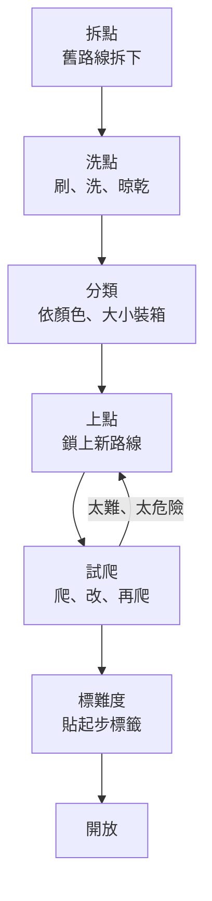

> 🌏 [English version](/posts/climbing/2026-10-19-route-setter-career-en)

你一定卡過這種線：前面都很順，到了中間某一步，怎麼試都差一點。休息時你可能會想：這一步是故意的嗎？誰決定的？

是定線員決定的。教練用說的教你，定線員用路線教你。他們通常在岩館關門或某一區封起來的時候工作，所以多數攀岩者幾乎沒看過他們上班的樣子。上一篇〈[攀岩教練與證照](/posts/climbing/2026-10-19-climbing-coach-certification)〉講了教練證的分層，定線員也有類似的分層，但走的是另一套系統。

這篇先看一條線是怎麼定出來的，再看在台灣和國外怎麼成為定線員，最後是這份工作的身體代價和收入。

## 一條 V3 抱石：從空牆到開放的一天

把一面抱石牆換線，大致是這個流程：

以一條預計 V3 的題目為例：

1. **拆點**：把這面牆上舊的岩點全部卸下來。
2. **洗點**：岩點廠商 [Rock City](https://rockcityclimbingholds.com/resources/hold-care-and-maintenance) 建議，主要抱石牆的岩點每 1–2 週刷一次、每月洗一次。先乾刷，再用檸檬酸溶液洗，徹底沖乾淨、完全晾乾才上牆。沒乾就上牆，牆裡的螺帽會生鏽。乾了之後依顏色、大小分類裝箱，上點時才好挑。
3. **上點**：定線員先想好要讓攀爬者做什麼動作，例如「一個側拉接一個高腳」，再挑岩點、決定位置和角度，用起子鎖上。
4. **試爬**：定線員自己爬，也請同事爬。動作不順、某一步只有特定身高做得到、墜落時會撞到別的岩點，就拆下來改。
5. **標難度**：大家都覺得對了，才貼上起步標籤和難度。

試爬是這份工作最花時間的部分之一。加拿大蒙特婁的物理治療師 Evelyne Lajoie 做了一份 162 位定線員的[網路問卷](https://theclimbingdoctor.com/work-injuries-amongst-routesetters-and-occupational-hazards)，結果是：定線員平均每週工作 2.5 天、每天 7.3 小時，約 40% 的工時在試爬。

### 換線多久一次

每間岩館的換線週期不同。幾個公開的例子：

- 美國的 [Petra Cliffs](https://petracliffs.com/routesetting)：路線保留 2–3 個月，一次換一面牆；訓練用的區塊每週或每兩週換。
- 德國的 [E4 抱石館](https://boulderhalle-e4.de/nothing-but-problems-with-dirk)：每週換線，每個顏色約有 60 條題目。

這也是為什麼岩館常在某幾天封住一區。那不是在偷懶，是在換線。

### 難度只在館內有效

Petra Cliffs 的頁面寫得很直接：館內標的難度，只代表這間岩館自己的一致性。換一間岩館，同一個 V3 可能感覺不一樣。

有些岩館乾脆不給精確難度，改用區間分級。[Teton Rock Gym](https://tetonrockgym.com/routesetting) 的做法是用起步標籤的顏色代表一個範圍，例如 V2–4，範圍之間刻意重疊；岩點顏色可以混用，不用一條線一種顏色。這種做法源自法國楓丹白露的抱石區，好處是減少大家追難度的壓力。

**今晚就能做的事**：下次去岩館，找一條剛換的線，爬之前先猜定線員想讓你做什麼動作，爬完對照一下。想自己出題，可以看〈[休息、讀線與自己定線](/posts/climbing/2026-10-18-resting-route-reading)〉。

## 為什麼定線員不喜歡你在牆上畫記號

這跟定線員的工作直接相關。在岩點上畫粉筆記號、貼膠帶標自己的 beta，會讓後面的人被你的解法牽著走，也讓定線員設計的動作失去意義。自己出題的禮儀，〈休息、讀線與自己定線〉有更多說明。

## 在台灣怎麼成為定線員

台灣的定線員證照由[中華民國山岳協會](https://itsrcowebs.com/Files/archives/article/100015/ca082412cc9446b1b699fc57b8a1c755_%E4%B8%AD%E8%8F%AF%E6%B0%91%E5%9C%8B%E5%B1%B1%E5%B2%B3%E5%8D%94%E6%9C%83%E9%81%8B%E5%8B%95%E6%94%80%E7%99%BB%E9%83%A8%E7%B5%84%E7%B9%94%E7%B0%A1%E5%89%87-20180902.pdf)的運動攀登部負責，依「運動攀登定線員制度實施辦法」辦理。公開簡章看得到的是 C 級定線員講習；2025 年起，報名 C 級要先有「初級定線員證書」，但初級講習的公開簡章本次沒有找到。

以 [2025 年 10 月在原岩中和辦的 C 級定線員講習](https://itsrcowebs.com/Files/archives/article/100015/0f598e0ea30a4fa5a5fe9263952bb0a6_%E4%B8%AD%E8%8F%AF%E6%B0%91%E5%9C%8B%E5%B1%B1%E5%B2%B3%E5%8D%94%E6%9C%83%20114%20%E5%B9%B4%E5%BA%A6%E9%81%8B%E5%8B%95%E6%94%80%E7%99%BBC%E7%B4%9A%E5%AE%9A%E7%B7%9A%E5%93%A1%E8%AC%9B%E7%BF%92%E7%B0%A1%E7%AB%A01019-1020.pdf)為例：

- **報名資格**：年滿 18 歲、高中職學歷、山協會員；攀登能力紅點 5.12a 以及抱石 V5 以上；已取得初級定線員證書和 CBT；C 級裁判講習筆試 60 分以上（缺這一項，要在一年內補上）。
- **課程**：兩天，包括速度賽場地配置與先鋒賽快扣位置、競賽路線設計原則、攀登競賽規則、系統轉換、路線標記與拆裝、繩索操作和先鋒路線設計。
- **費用與人數**：7,000 元，上限 20 人。
- **證書**：測驗合格後，由山協核發「C 級運動攀登定線證書」。

門檻會變。[2021 年的 C 級講習](https://itsrcowebs.com/Files/archives/article/100015/1705b29d129a4ef2b438b17701722f48_2021%E5%B9%B4%E5%B1%B1%E5%8D%94C%E7%B4%9A%E5%AE%9A%E7%B7%9A%E5%93%A1%E8%AC%9B%E7%BF%92%E7%B0%A1%E7%AB%A0-3.pdf)是四天，攀爬門檻是紅點 5.12b、抱石 V4，當時還不需要初級定線員證書。報名前一定要看當年度的簡章。

從課表看得出來，山協的定線講習是以**賽事定線**為核心。A、B 級定線員的報名條件和課程，目前沒有公開資料。

### 在岩館定線，要不要有證

全國性法規沒有規定。但[臺北市體育局 2026 年 2 月的公告](https://industry.sports.gov.taipei/announcement/?K=286)把攀岩館加進民營運動場館的檢查表，要求岩館現場的攀登教練、裁判和定線員持有 C 級或丙級以上、四年內有效的證照。所以在台北的民營岩館，定線員有沒有 C 級以上證照，是市府檢查時會確認的項目。

對照日本：日本的商業岩館定線[不需要任何資格](https://www.climbers-web.jp/feature/article-81/)，證照只跟比賽有關。

### 實際的入行路徑

台灣的定線員很多是兼職。定線員劉翰杰在 2021 年接受[專訪](https://500times.udn.com/wtimes/story/12671/5886300)時的身分是自由教練兼定線員，和團隊固定在桃園一間岩館定線，他追求的是「安全又帶有冒險感的路線」。高雄 boulder space 岩館的老闆 coach 魏，在 2021 年的[座談整理](http://kateberrysblog.blogspot.com/2021/02/rock-climb-generation-6.html)裡則說，台灣的岩館定線市場「仍無法跟日本一樣養活專職的定線員」。

常見的入行方式是先在岩館當教練或櫃台，從協助拆點、洗點開始，再跟著資深定線員學上點和試爬，同時考 CBT、累積攀爬程度、報初級和 C 級講習。

**今晚就能做的事**：問你常去的岩館，換線時需不需要人幫忙拆點、洗點。很多定線員就是從這裡開始的。

## 國外的定線認證

國外把「商業定線」和「賽事定線」分得比較清楚：

| 地區 | 認證 | 方向 | 結構 |
|---|---|---|---|
| 美國 | [USA Climbing](https://usaclimbing.org/community/routesetters/routesetting-clinics/) L1–L5 | 賽事 | L1 研習 500 美元、L2 1,000 美元；最低 16 歲；L5 可被提名到國際賽 |
| 美國 | [CWA PRS](https://assets.noviams.com/novi-file-uploads/cwa/pdfs-and-documents/Certifications/PRS_Certification_Standards-d0cec824.pdf) | 商業岩館 | 2024 年推出；Intro → L1（18 歲、V2）→ L2 抱石／上攀 → L3（600 小時）→ Provider（21 歲、2,000 小時）；三年到期 |
| 英國 | [ABC 定線課程](https://abcwalls.co.uk/2025/10/09) | 商業岩館 | 新路徑（2025-10 公告時已滿一年）：Setting Basics（1 天）→ Setting in Practice（1 天）→ Commercial Roped Setter（2 天） |
| 國際 | [World Climbing](https://worldclimbing.com/development/dev-officials) Level 1–4 | 賽事 | 2023 年宣布改制；新制建立時由各國協會提名（[Sewell 專訪](https://epsets.substack.com/p/an-interview-with-ifsc-routesetter)） |

幾個值得注意的地方：

- USA Climbing 的研習頁明講，它教的是賽事定線，不是商業定線。
- 官方文件之間也會打架。USA Climbing 的 [2025 年晉升路徑 PDF](https://usaclimbing.org/wp-content/uploads/2025/11/Path-of-a-Routesetter-9.2025.pdf) 寫 L1 的試爬門檻是 V5，研習頁寫的是「V4 和 5.12」。
- CWA 的 L2 抱石建議時數，標準 PDF 寫 150 小時、認證頁寫 200 小時。報名前以最新文件為準。
- 想走國際賽事，台灣的路徑要經過山協提名，因為 World Climbing 新制的定線員由各國協會提名，台灣的會員協會是山協。

## 身體的代價

定線不只是有創意的工作，也是體力活：搬岩點箱、在梯子或吊繩上一整天拿著起子、一條線試爬好幾次。

Lajoie 的問卷結果：

- 78.5% 的定線員在工作中受過傷。
- 61% 有外傷，例如墜落、器材意外、搬重物拉傷。
- 71% 有慢性的工作相關問題，常見在下背、肩、肘和手腕；衝擊起子的震動被列為風險因子。

這份資料是問卷，不是大型流行病學研究。跟一般攀岩者比，它只特別指出下背：25% 的定線員回報下背問題。

## 收入：台灣沒有公開資料

台灣定線員的時薪或按條計酬，目前沒有公開資料。104 人力銀行 2026 年 1 月的[職缺分析](https://blog.104.com.tw/104data-rock-climbing-recruit-salary/)提到有職缺把「館內定線」寫進工作內容，但列的是教練薪資，沒有定線員的薪資。

美國的數字只能當作對照，不能拿來推估台灣：

- 美國勞資關係委員會 2026 年 2 月的一份裁決文件提到，連鎖岩館 Touchstone 灣區的[定線員時薪約 28 美元](https://onthelaborfront.com/chalk-up-the-vote-nlrb-orders-separate-union-elections-for-touchstone-climbing)，同一份文件裡櫃台約 22 美元、指導員（instructors）約 20 美元。
- 《Climbing Business Journal》2026 年薪資調查的[解讀](https://vertigemedia.fr/en/working-in-climbing-pay-wages-us-gyms)指出，助理定線員的工作滿意度是 3.47 分（滿分 5 分），在非管理職裡最低。
- 美國岩館員工開始組工會。2025 年 3 月 24 日，Touchstone 南加州的定線員發動不當勞動行為罷工，工會在[新聞稿](https://climbingbusinessjournal.com/touchstone-workers-united-calls-first-routesetter-ulp-strike-in-america)裡稱這是全美第一次定線員罷工。

### 這條路適合你嗎

可以用三個問題問自己：

1. **你喜歡設計動作，還是只喜歡爬？** 定線員大部分時間在替別人設計，自己的那條線常常要拆掉重來。
2. **你的身體撐得住嗎？** 搬、爬、鎖、試爬，一天下來的負擔比一般攀岩大。
3. **你能接受收入不確定嗎？** 在台灣，定線常常是教練或其他工作的一部分。

**今晚就能做的事**：找一面空牆或 spray wall，用五個岩點替朋友出一條題，看他爬的動作是不是你設計的那樣。

## 練習題：四個情境

答案在每題下方，先自己想再看。

**1. 你在一條抱石的關鍵點旁邊用粉筆畫了一個箭頭，提醒自己下次腳要踩那裡。定線員看到後請你擦掉。**

答案

記號會讓後面的人照著你的解法爬，定線員設計的動作就失去意義。想記 beta，用手機拍照或記在腦子裡。

**2. 你想走賽事定線，第一步做什麼？**

答案

在台灣，先考 CBT、把攀爬程度練到紅點 5.12a 和抱石 V5 以上，先取得山協的初級定線員證書（向山協運動攀登部詢問最近的梯次），再報 C 級。報名前看當年度的簡章，門檻每年可能不同。同時找機會在岩館協助拆點、洗點、上點，累積實作。想走國際賽事，要經過山協提名。

**3. 你常去的岩館一面牆封了一整天，你覺得很不方便。**

答案

那多半是在換線。一面牆要拆點、洗點、上點、試爬、修線、標難度。Lajoie 的問卷裡，試爬就占了定線員約 40% 的工時。換線讓你有新路線可以爬。

**4. 朋友說：「美國定線員時薪 28 美元，換算台幣一小時快 900 元，台灣應該也差不多。」**

答案

不能這樣推。28 美元是一家美國連鎖岩館在一份裁決文件裡的數字，美國的物價、工資和產業規模都跟台灣不同。台灣定線員的薪資目前沒有公開資料。

## 下一步

定線員的受傷率提醒我們：岩館是一個需要管理風險的地方。下一篇從你每次入館簽的那張紙開始：岩館的安全怎麼管？切結書在台灣有效嗎？保險保障你什麼？這是[第 4 篇：岩館安全、切結書與保險](/posts/climbing/2026-10-19-climbing-gym-safety-waivers)。

## 參考資料

- [An Interview with IFSC Routesetter Ryan Sewell（Elevated Perspective，2025）](https://epsets.substack.com/p/an-interview-with-ifsc-routesetter)
- [Evelyne Lajoie: Work Injuries Amongst Routesetters and Occupational Hazards（The Climbing Doctor，2025）](https://theclimbingdoctor.com/work-injuries-amongst-routesetters-and-occupational-hazards)
- [Hold Care and Maintenance（Rock City Climbing Holds）](https://rockcityclimbingholds.com/resources/hold-care-and-maintenance)
- [Routesetting（Petra Cliffs）](https://petracliffs.com/routesetting)
- [Nothing but Problems with Dirk（Boulderhalle E4）](https://boulderhalle-e4.de/nothing-but-problems-with-dirk)
- [Routesetting and circuit grading（Teton Rock Gym）](https://tetonrockgym.com/routesetting)
- [中華民國山岳協會 114 年度運動攀登 C 級定線員講習簡章（2025-10，原岩中和）](https://itsrcowebs.com/Files/archives/article/100015/0f598e0ea30a4fa5a5fe9263952bb0a6_%E4%B8%AD%E8%8F%AF%E6%B0%91%E5%9C%8B%E5%B1%B1%E5%B2%B3%E5%8D%94%E6%9C%83%20114%20%E5%B9%B4%E5%BA%A6%E9%81%8B%E5%8B%95%E6%94%80%E7%99%BBC%E7%B4%9A%E5%AE%9A%E7%B7%9A%E5%93%A1%E8%AC%9B%E7%BF%92%E7%B0%A1%E7%AB%A01019-1020.pdf)
- [中華民國山岳協會 110 年度運動攀登 C 級定線員講習簡章（2021）](https://itsrcowebs.com/Files/archives/article/100015/1705b29d129a4ef2b438b17701722f48_2021%E5%B9%B4%E5%B1%B1%E5%8D%94C%E7%B4%9A%E5%AE%9A%E7%B7%9A%E5%93%A1%E8%AC%9B%E7%BF%92%E7%B0%A1%E7%AB%A0-3.pdf)
- [中華民國山岳協會運動攀登部組織簡則（2018）](https://itsrcowebs.com/Files/archives/article/100015/ca082412cc9446b1b699fc57b8a1c755_%E4%B8%AD%E8%8F%AF%E6%B0%91%E5%9C%8B%E5%B1%B1%E5%B2%B3%E5%8D%94%E6%9C%83%E9%81%8B%E5%8B%95%E6%94%80%E7%99%BB%E9%83%A8%E7%B5%84%E7%B9%94%E7%B0%A1%E5%89%87-20180902.pdf)
- [臺北市政府體育局：轄管場館檢查表增列攀岩館、抱石館安全規範（2026-02-11）](https://industry.sports.gov.taipei/announcement/?K=286)
- [公認資格の取得方法：ルートセッターへの道（CLIMBERS，2020）](https://www.climbers-web.jp/feature/article-81/)
- [台灣定線員劉翰杰專訪（500 輯）](https://500times.udn.com/wtimes/story/12671/5886300)
- [Rock Climb Generation 座談整理之六（部落格，2021）](http://kateberrysblog.blogspot.com/2021/02/rock-climb-generation-6.html)
- [Routesetting Clinics（USA Climbing）](https://usaclimbing.org/community/routesetters/routesetting-clinics/)
- [Path of a Routesetter（USA Climbing，2025-09）](https://usaclimbing.org/wp-content/uploads/2025/11/Path-of-a-Routesetter-9.2025.pdf)
- [PRS Certification Standards（Climbing Wall Association，2024）](https://assets.noviams.com/novi-file-uploads/cwa/pdfs-and-documents/Certifications/PRS_Certification_Standards-d0cec824.pdf)
- [Certification Dashboard（Climbing Wall Association）](https://cwapro.org/certification-dashboard)
- [Route Setting Development 新課程路徑公告（Association of British Climbing Walls，2025-10-09）](https://abcwalls.co.uk/2025/10/09)
- [Development of Officials（World Climbing）](https://worldclimbing.com/development/dev-officials)
- [104 人力銀行：攀岩相關職缺與薪資（2026-01）](https://blog.104.com.tw/104data-rock-climbing-recruit-salary/)
- [Chalk Up the Vote: NLRB Orders Separate Union Elections for Touchstone Climbing（On the Labor Front，2026）](https://onthelaborfront.com/chalk-up-the-vote-nlrb-orders-separate-union-elections-for-touchstone-climbing)
- [Working in Climbing: Passion Still Doesn’t Pay the Rent（Vertige Media，2026）](https://vertigemedia.fr/en/working-in-climbing-pay-wages-us-gyms)
- [Touchstone Workers United Calls First Routesetter ULP Strike in America（Climbing Business Journal，2025）](https://climbingbusinessjournal.com/touchstone-workers-united-calls-first-routesetter-ulp-strike-in-america)
