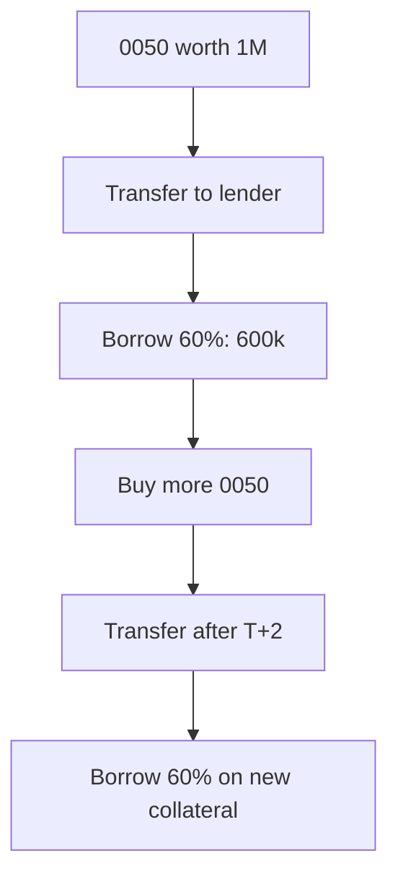

> 🌏 [中文版](/posts/investing/2026-10-17-0050-stock-pledge-loan-lenders)

Pledging 0050 for a loan, buying more 0050 with it, then pledging that too is the most-discussed leverage routine among Taiwanese ETF holders. The official name is 不限用途款項借貸 (unrestricted-purpose loans): you transfer stocks or ETFs into a collateral account at a broker or at the securities finance company [Yuanta Securities Finance](https://www.yuantafinance.com.tw/brief/) (元大證金), and borrow up to 60% of market value. The shares stay yours and cash dividends still arrive. It is not a bank credit loan: the limit depends on the collateral, and the risk depends on the maintenance ratio.

This post answers three questions: how rates and margin-call rules differ by lender, how much you must top up when looping, and which contract clauses can stop the loop.

## How the loop works

At Yuanta Securities Finance, newly bought 0050 must finish T+2 settlement before it can be transferred into the collateral account ([a hands-on test by Hamster Life Lab](https://hamr-lab.com/to-imoney/)), so each round takes at least two business days. Since the cap is 60% of market value, a fully looped position borrows 1.5× your principal (0.6 ÷ 0.4): NT$1 million of principal supports NT$1.5 million of debt against NT$2.5 million of collateral, a ratio of 166.7%, the same as a single round. Later rounds add no cushion.

A price rise does not let you borrow the gain directly. Under [Article 20 of the TWSE operating rules](https://twse-regulation.twse.com.tw/m/LawContent.aspx?FID=FL080086), brokers may not hand over cash for a rise in value unless the client applies to change the credit line. Looping only works by buying new shares and transferring them in.

## Rules side by side

| Lender | Rate | Call threshold | Deadline after notice | Top up to |
|---|---|---|---|---|
| Yuanta Securities Finance | List 5.88%; promo from 3.92% (to Dec 30) | Below 140% | 3 business days | Above 166% |
| Cathay Securities | List 6.45% | Below 130% | 2 business days (by 15:00) | 166% |
| Capital Securities | List 6.45% | Below 130% | 2 business days | 166% |
| Mega Securities | Tiered by stock, floating | Below 130% | 2 business days | 166% |

- **Yuanta Securities Finance** is a securities finance company with its own [operating rules](https://www.selaw.com.tw/Chinese/RegulatoryInformationResult?sysNumber=LW10869567&releaseDate=2025-10-21) and [contract](https://www.selaw.com.tw/Chinese/RegulatoryInformationResult/Article?isIntegratedSearch=True&sysNumber=LW10869584&searchString1=%E6%9C%89%E5%83%B9%E8%AD%89%E5%88%B8%E6%93%94%E4%BF%9D%E6%94%BE%E6%AC%BE), not the broker rules above. Its promo rate was [reset to 3.92% from July 1](https://www.yuantafinance.com.tw/The.aspx?The=232&Role=1&Lang=1); the promo needs NT$10,000 or more borrowed per day, and the site says rates may be adjusted on the first of January, April, July and October.
- **Cathay Securities and Capital:** [Cathay Securities](https://istockapp.cathaysec.com.tw/Marketing/loan/) calculates the ratio on the previous business day's closing price. [Capital's](https://goplus.capital.com.tw/unlimitedcredit/qa.asp) site gives two different top-up targets on the same page (166% and 130%), so get it confirmed in writing before borrowing.
- **Mega:** under its [兆好貸 terms](https://www.emega.com.tw/emegaTran/faqList.do?layer1_name=%E5%85%86%E5%A5%BD%E8%B2%B8) each stock gets its own rate; the fee is 0.1425% and is waived when interest reaches NT$200. 0050 used to sit in the top "diamond" tier; [that tier's promotional rate was cancelled from April 30](https://www.emega.com.tw/emegaTran/bulletin.do?id=20260429111437812480) and those stocks fall back to the platinum and gold tiers, so older low Mega rates for 0050 no longer apply.
- **SinoPac:** its [loan page](https://service.sinotrade.com.tw/newweb/loan-zone/) lists no setup fee and disbursement in as little as 2.5 hours; rates appear only after login.
- **Banks:** [Cathay United Bank](https://www.cathaybk.com.tw/cathaybk/personal/loan/product/stock-collateral-loan/) starts at 2.95% with a one-year term, revolving use and a NT$20,000 account-management fee. Its maintenance-ratio and margin-call terms sit in the contract; ask the branch for a copy.

## How much a margin call costs

Take NT$1 million of principal looped to the ceiling: NT$1.5 million of debt against NT$2.5 million of collateral. Yuanta Securities Finance calls at a ratio below 140%, which is a 16% price drop (collateral down to NT$2.1 million). To get back above 166%:

| Way to top up | Amount |
|---|---|
| Add shares (counted at full market value) | About NT$390,000 |
| Repay cash | About NT$235,000 |

Your net worth has gone from NT$1 million to NT$600,000: a 16% price drop, a 40% drop in equity. Brokers calling at 130% need a 22% drop; the arithmetic is the same. Yuanta's official formula also adds accrued interest and rounds the call up to the next NT$1,000.

## Contract limits on looping

- **The credit line can be pulled.** Yuanta's contract says it may "adjust, reduce or stop" the line at any time as collateral value changes, and you must repay part or all on notice.
- **Renewals and roll-overs need approval.** The TWSE rules set a six-month term with two extensions, 18 months in all, subject to credit review. Yuanta's contract reserves the right to approve or refuse a roll-over and to ask for more collateral. [Mega's new contracts stopped auto-renewing on May 1](https://www.emega.com.tw/emegaTran/bulletin.do?id=20260429120158563004); to continue you must ask a branch for a roll-over.
- **Repayment and withdrawal have conditions.** At Yuanta, if the ratio on the remaining loans would be below 150% after you repay, it may hold back the shares due to you. Cathay Securities and Mega require the ratio to stay at or above 166% when you take back part of the collateral. Capital repays the oldest loan first; picking a specific loan means paying cash and going through a branch.
- **Ex-dividend adjustments.** From six business days before an ex-rights or ex-dividend date, the lender may deduct the payout before computing the ratio, so a 0050 distribution lowers your ratio early.
- **Per-security caps.** Article 32 of the TWSE rules limits each broker's total lending against a single security; once a popular ETF hits the cap, new loans against it are refused.

## The October 2026 backdrop

- **Tightening.** Some brokers tightened from May; [Fubon Securities announced a halt to new unrestricted-purpose loans from May 13](https://www.money101.com.tw/blog/%E8%82%A1%E7%A5%A8%E8%B3%AA%E6%8A%BC-%E8%82%A1%E7%A5%A8). Yuanta Securities Finance at one point capped borrowing at NT$100,000 per person per day with one loan per share ([a PTT user's phone call on May 5](https://www.ptt.cc/bbs/Stock/M.1777961184.A.52A.html)); [reports on July 8 said an announcement lifted it](https://tw.stock.yahoo.com/news/%E5%85%83%E5%A4%A7%E8%AD%89%E9%87%91%E8%B3%AA%E6%8A%BC%E9%99%90%E9%A1%8D%E4%BB%A4%E8%A7%A3%E9%99%A4%EF%BC%81%E9%84%89%E6%B0%91%E5%96%8A%E3%80%8C%E8%B2%AA%E7%8B%97%E5%87%BA%E7%B1%A0%E3%80%8D%E4%B8%80%E7%9C%8B%E5%88%A9%E7%8E%87%E6%9B%B4%E5%97%A8%EF%BC%9A1%E5%B9%B4%E6%80%8E%E5%8F%AF%E8%83%BD%E8%B3%BA%E4%B8%8D%E5%88%B0-124500529.html), but its site FAQ states no daily limit, so ask support for the current position.
- **The ceiling stays.** Brokers' total lending may not exceed four times net worth. The [FSC said on August 27 it will not relax this](https://udn.com/news/story/7251/9717902) and told brokers to raise capital; at the end of July lending stood at about 162% of net worth.
- **Cross-sector credit lookups are due by end-October.** Once the Joint Credit Information Center and TWSE link up, with your consent a bank can see your broker loans and a broker can see your bank loans ([Economic Daily News](https://udn.com/news/story/7251/9771424)). The FSC [says this is not a cap on "four loans at once"](https://www.chinatimes.com/realtimenews/20261001004944-260410) and banks still assess on the 5P principles. If you plan to pair a mortgage or credit loan with a pledge, the bank will see it.

## What to do

1. **Borrow 50% or less.** At 50% the starting ratio is 200%: Yuanta calls after a 30% price drop, brokers after 35%.
2. **Set your alarm 20 points above the call threshold.** That is 160% at Yuanta and 150% at brokers. When the ratio reaches it, repay cash or add shares without waiting for a notice.
3. **Keep cash worth 15–20% of the loan.** On NT$1.5 million of debt, hold NT$220,000–300,000; that covers the 16% drop above.
4. **Call before opening an account and ask three things:** the call threshold and what you must top up to, daily and per-security limits, and what happens if the loan is not renewed. Phone numbers: Yuanta Securities Finance 02-2173-6883, Cathay Securities 02-7732-6888, Capital 02-412-8878, Mega 02-2351-7017, SinoPac 0800-038-123.
5. **Do not put all collateral with one lender.** Split across two so that if one tightens or pulls a line, the other can still renew.

This post summarizes rules and is not investment advice. Borrowing carries risk of principal loss and forced sale.

## References

- [Operating rules for brokers' unrestricted-purpose loans (2026-08-20 version)](https://twse-regulation.twse.com.tw/m/LawContent.aspx?FID=FL080086) (in Chinese)
- [Yuanta Securities Finance: securities-backed lending operating rules](https://www.selaw.com.tw/Chinese/RegulatoryInformationResult?sysNumber=LW10869567&releaseDate=2025-10-21) (in Chinese)
- [Yuanta Securities Finance: securities-backed lending contract](https://www.selaw.com.tw/Chinese/RegulatoryInformationResult/Article?isIntegratedSearch=True&sysNumber=LW10869584&searchString1=%E6%9C%89%E5%83%B9%E8%AD%89%E5%88%B8%E6%93%94%E4%BF%9D%E6%94%BE%E6%AC%BE) (in Chinese)
- [Yuanta Securities Finance: stock loans](https://www.yuantafinance.com.tw/brief/) (in Chinese)
- [Yuanta Securities Finance: maintenance ratio FAQ](https://www.yuantafinance.com.tw/QA/QA_03_11.aspx) (in Chinese)
- [Yuanta Securities Finance: interest rate FAQ](https://www.yuantafinance.com.tw/QA/QA_03_10.aspx) (in Chinese)
- [Yuanta Securities Finance: promotional rate program](https://www.yuantafinance.com.tw/SF_event_page/) (in Chinese)
- [Yuanta Securities Finance: rate adjustment notice (2026-06-30)](https://www.yuantafinance.com.tw/The.aspx?The=232&Role=1&Lang=1) (in Chinese)
- [Cathay Securities: stock loans](https://istockapp.cathaysec.com.tw/Marketing/loan/) (in Chinese)
- [Capital Securities: loan Q&A](https://goplus.capital.com.tw/unlimitedcredit/qa.asp) (in Chinese)
- [Mega Securities: 兆好貸 FAQ](https://www.emega.com.tw/emegaTran/faqList.do?layer1_name=%E5%85%86%E5%A5%BD%E8%B2%B8) (in Chinese)
- [Mega Securities: 兆好貸 promotional-rate change notice (2026-04-29)](https://www.emega.com.tw/emegaTran/bulletin.do?id=20260429111437812480) (in Chinese)
- [Mega Securities notice (2026-04-29)](https://www.emega.com.tw/emegaTran/bulletin.do?id=20260429120158563004) (in Chinese)
- [SinoPac Securities: loan zone](https://service.sinotrade.com.tw/newweb/loan-zone/) (in Chinese)
- [Cathay United Bank: stock-collateral loan](https://www.cathaybk.com.tw/cathaybk/personal/loan/product/stock-collateral-loan/) (in Chinese)
- [Hamster Life Lab: Yuanta online transfer test](https://hamr-lab.com/to-imoney/) (in Chinese)
- [Money101: stock-pledge rates and maintenance ratio](https://www.money101.com.tw/blog/%E8%82%A1%E7%A5%A8%E8%B3%AA%E6%8A%BC-%E8%82%A1%E7%A5%A8) (in Chinese)
- [PTT Stock board: Yuanta daily limit (2026-05-05)](https://www.ptt.cc/bbs/Stock/M.1777961184.A.52A.html) (in Chinese)
- [FTNN / Yahoo: Yuanta lifts pledge limit](https://tw.stock.yahoo.com/news/%E5%85%83%E5%A4%A7%E8%AD%89%E9%87%91%E8%B3%AA%E6%8A%BC%E9%99%90%E9%A1%8D%E4%BB%A4%E8%A7%A3%E9%99%A4%EF%BC%81%E9%84%89%E6%B0%91%E5%96%8A%E3%80%8C%E8%B2%AA%E7%8B%97%E5%87%BA%E7%B1%A0%E3%80%8D%E4%B8%80%E7%9C%8B%E5%88%A9%E7%8E%87%E6%9B%B4%E5%97%A8%EF%BC%9A1%E5%B9%B4%E6%80%8E%E5%8F%AF%E8%83%BD%E8%B3%BA%E4%B8%8D%E5%88%B0-124500529.html) (in Chinese)
- [Economic Daily News: FSC will not relax broker lending cap](https://udn.com/news/story/7251/9717902) (in Chinese)
- [Economic Daily News: cross-sector credit lookups due end-October](https://udn.com/news/story/7251/9771424) (in Chinese)
- [China Times: FSC says no "four loans" curb](https://www.chinatimes.com/realtimenews/20261001004944-260410) (in Chinese)
