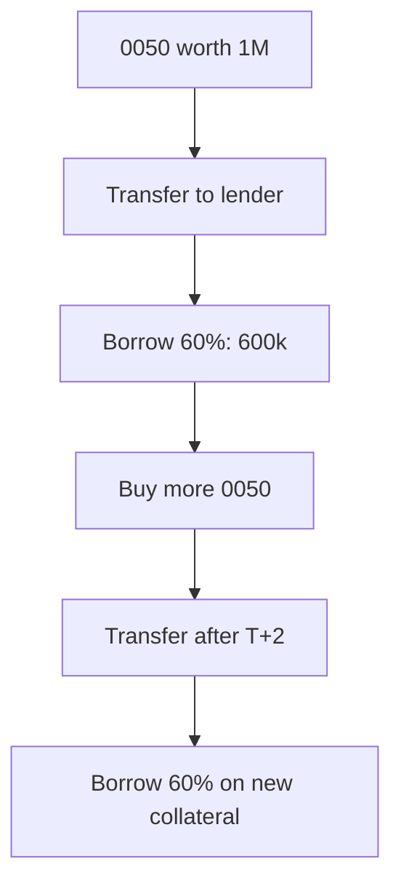

> 🌏 [中文版](/posts/investing/2026-10-17-0050-stock-pledge-loan-lenders)

Pledging 0050 for a loan, buying more 0050 with it, then pledging that too is the most-discussed leverage routine among Taiwanese ETF holders. The official name is 不限用途款項借貸 (unrestricted-purpose loans): you transfer stocks or ETFs into a collateral account at a broker or at the securities finance company [Yuanta Securities Finance](https://www.yuantafinance.com.tw/brief/) (元大證金), and borrow up to 60% of market value. The shares stay yours and cash dividends still arrive. It is not a bank credit loan: the limit depends on the collateral, and the risk depends on the maintenance ratio.

This post answers four questions: how far October's effective rates differ by lender, whether margin-call rules differ, how much you must top up when looping, and which clauses can stop the loop.

## How the loop works

At Yuanta Securities Finance, newly bought 0050 must finish T+2 settlement before it can be transferred into the collateral account ([a hands-on test by Hamster Life Lab](https://hamr-lab.com/to-imoney/)), so each round takes at least two business days. Since the cap is 60% of market value, a fully looped position borrows 1.5× your principal (0.6 ÷ 0.4): NT$1 million of principal supports NT$1.5 million of debt against NT$2.5 million of collateral, a ratio of 166.7%, the same as a single round. Later rounds add no cushion.

A price rise does not let you borrow the gain directly. Under [Article 20 of the TWSE operating rules](https://twse-regulation.twse.com.tw/m/LawContent.aspx?FID=FL080086), brokers may not hand over cash for a rise in value unless the client applies to change the credit line. Looping only works by buying new shares and transferring them in.

## October quotes and posted rates at 17 lenders

The "October quote" column comes from the account 存股的陪跑者's [Threads roundup of 2026-10-09](https://www.threads.com/@yourstockbuddy/post/DeS7fwPIxXV), [republished by NOWnews on 10-15](https://www.nownews.com/news/6883616). These are crowd-sourced figures; your app's quote is what counts. The "Official site" column is the posted or promotional rate each lender's own site shows; "—" means this post has no official data for that lender.

| Lender | October quote (crowd-sourced) | Official site | Other |
|---|---|---|---|
| Yuanta Securities Finance | 3.92–3.98% | List 5.88%; promo from 3.92% (to Dec 30) | Own rulebook |
| Yuanta Securities | 3.5–3.85%, NT$500k cap | — | [Explainer on its site](<https://www.yuanta.com.tw/file-repository/content/articles/%E8%82%A1%E7%A5%A8%E5%80%9F%E8%B2%B8%E6%98%AF%E4%BB%80%E9%BA%BC%EF%BC%9F%E6%9C%89%E5%93%AA%E4%BA%9B%E8%B2%BB%E7%94%A8%EF%BC%9F%E5%A6%82%E4%BD%95%E6%93%8D%E4%BD%9C%E8%82%A1%E7%A5%A8%E5%80%9F%E8%B2%B8%EF%BC%9F/index.html>): 130%, 2 business days |
| SinoPac | 4–6%; 0.15 pt off with a cash-management account | [No rate listed](https://service.sinotrade.com.tw/newweb/loan-zone/); no setup fee | Extend or roll over at six months |
| TCFHC (合庫) | 3.5%, no roll-over | [List 6.25%](https://luckydraw.tcfhc-sec.com.tw/websites/loan/index.html); Sep 1–Dec 31 promo, 0050 included | Sign in branch; pay interest to extend |
| KGI | 3.8–4%, capacity unstable | [List 6.45%](https://www.kgi.com.tw/zh-tw/product-overview/borrow-n-lending/stock-loans) | Online borrowing capped at NT$20 million |
| Mega | 3.5–4%, manual review, 2× leveraged ETFs accepted | Tiered by stock, floating | Top-tier promo cancelled Apr 30 |
| Capital | 3.88–5%, capacity unstable | [List 6.45%](https://goplus.capital.com.tw/unlimitedcredit/qa.asp) | Repayment is first-in, first-out |
| E.SUN | 4.25%, no capacity | [Online 4.25%](https://www.esunsec.com.tw/cus_service/loan/index.html) for ETFs and TW50/Mid-100 constituents | One request per business day |
| Shin Kong | 3.8% | — | [Official notice (Sept 2022 edition)](https://www.skis.com.tw/CusService_WebAPI/api/file/15edfa8485d24e19b0813a5b3926a731): 130%, 2 business days, top up to 166% |
| Taishin Securities | 3.5%, no capacity | [Margin list rate](https://www.tssco.com.tw/tssloan/) | One request per day; funds next business day at the earliest |
| Yuanta-Hua Nan (華南永昌) | 3.5% / 4%, no roll-over | [List 6.45%](https://www.entrust.com.tw/Marketing/entrustLoan/index.html) | Branch or account officer only |
| Fubon | 3.88%, terms to be confirmed | [List 6.40%](https://www.fbs.com.tw/DomesticStocks/UnrestrictedLoan) | NT$20 draw-down fee |
| CTBC | 3.5%; below 3% with a monthly contribution target | [List 6.4%](<https://www.ctbcsec.com/Stock/Collateral>) | Ratio denominator is the amount applied for; stock dividends of 20% or more become collateral |
| Uni-President | 3.5%, manual application, 2× leveraged ETFs accepted | [List 6.4%](https://eservices.pscnet.com.tw/dm/LOAN/index.html) plus 0.1425% fee | Online NT$1 million per loan, NT$5 million per day |
| Grand Cathay (國票) | 4% | [Site example uses 6.25%](https://www.ibfs.com.tw/my/cash/) | No list rate stated |
| First Securities | NT$10 million per loan; below 3% negotiable at volume | [List rate 6.45%](<https://www.firstsec.com.tw/uploadImages/%E7%AC%AC%E4%B8%80%E9%87%91%E8%AD%89%E5%88%B8115%E5%B9%B4%E4%B8%8A%E5%8D%8A%E5%B9%B4%E5%BA%A6%E5%80%8B%E9%AB%94%E8%B2%A1%E5%8B%99%E5%A0%B1%E5%91%8A.pdf>) (from its first-half 2026 financial report); the site says the online rate shows on the logged-in screen | [Extensions need a 166% whole-account ratio](https://events.firstsec.com.tw/%E4%B8%8D%E9%99%90%E7%94%A8%E9%80%94%E6%AC%BE%E9%A0%85%E5%80%9F%E8%B2%B8-37994) |
| Cathay Securities | 6.45% | [List 6.45%](https://istockapp.cathaysec.com.tw/Marketing/loan/) | Ratio uses the previous business day's close |

Two numbers conflict: NOWnews quotes a user saying Fubon's ordinary-account rate has reached 4.5%, while the Threads list says 3.88%. For Yuanta Securities Finance the list matches the official site.

## Banks

Bank stock-pledge loans differ from broker loans: most charge a one-off account fee, the term is one year renewable (no 18-month broker cap), and rates float with the bank's index. The table lists only numbers from each bank's own site or contract.

| Bank | Posted rate | Fees | Other |
|---|---|---|---|
| [Cathay United](https://www.cathaybk.com.tw/cathaybk/personal/loan/product/stock-collateral-loan/) | From 2.95% (as of 24 May 2025) | NT$20,000 account fee | One year, revolving |
| [Hua Nan](https://www.hncb.com.tw/wps/portal/HNCB/per_finance/loan/personal/stock_fund_loan) | From 2.99% (as of 7 Apr 2024) | 2.5‰ fee (min NT$5,000), NT$300 credit check | One-year limit, each draw up to six months, monthly interest |
| [Yuanta Bank](https://www.yuantabank.com.tw/bank/loan/stock/list.do) | 2.98%–5.40% (as of 23 Feb 2026) | NT$3,000–20,000 in total; promotional account fee 1.625%–2.99% of the limit | Renewed yearly, up to three years |
| [SinoPac Bank](https://bank.sinopac.com/sinopacBT/personal/loan/other-personal-loan/stock.html) | From 3.41% (as of 21 Jan 2026) | NT$15,000 per loan | Borrower aged 20–65 |
| [Taishin Bank](https://www.taishinbank.com.tw/TSB/customer-service-center/qa/index.html?nav1=type02&nav2=type0205) | From 3.99% (no date seen on the FAQ) | No guarantor or proof of income; fees on the [product page](https://www.taishinbank.com.tw/TSB/personal/loan/stock-fund/stock/) | Interest on daily drawn balance |
| [CTBC Bank](https://www.ctbcbank.com/content/dam/twrbo/pdf/aboutctbc/contract_5-3-1.pdf) | Not published | Setup fee set in the contract | Contract edition 15 June 2026 |

The base dates vary widely: Cathay United's and Hua Nan's rate pages are one to two years old, so rely on a branch quote. Margin-call terms are in the next section.

Two bank-only details: [Yuanta Bank](https://www.yuantabank.com.tw/bank/loan/stock/list.do) sets the limit from an "appraised price", the lowest of the previous close, the 60-day average and the 120-day average, so a sharp rally lends you less than a broker would, and dividends on pledged shares go to the bank rather than to your account.

Banks whose margin-call terms are not public: Cathay United, Taishin, Hua Nan and SinoPac keep them in the contract, so ask the branch for a copy. For First Bank, E.SUN Bank, Mega Bank and Taipei Fubon Bank I only found fund-pledge or credit-loan pages, not an official stock-pledge page, so they are not listed.

## Margin-call rules

| Lender | Call threshold | Deadline after notice | Top up to |
|---|---|---|---|
| Yuanta Securities Finance | Below 140% | 3 business days | Above 166% (call record cancelled at 180%) |
| Cathay Securities, Mega, Grand Cathay | Below 130% | 2 business days | 166% |
| Capital | Below 130% | 2 business days | The same page states both 166% and 130% |
| TCFHC | Below 130% | 2 business days | Call cancelled only when the ratio is back at 166% |
| KGI | Below 130% (whole account) | 2 business days | Above 166% (stated in both the [Q&A](https://www.kgieworld.com.tw/news/20160822/qa.html) and the [contract notice](https://event.kgi.com.tw/uploadfiles/euploadfile/%E8%AD%89%E5%88%B8%E5%95%86%E8%BE%A6%E7%90%86%E4%B8%8D%E9%99%90%E7%94%A8%E9%80%94%E6%AC%BE%E9%A0%85%E5%80%9F%E8%B2%B8%E6%A5%AD%E5%8B%99.pdf)) |
| Yuanta Securities | Below 130% | 2 business days | The explainer does not say what to top up to |
| CTBC | Below 130% (whole account) | 2 business days from delivery of notice | The [contract](<https://www.ctbcsec.com/2020/renew/contract-list/pdf/%E4%B8%8D%E9%99%90%E7%94%A8%E9%80%94%E6%AC%BE%E9%A0%85%E5%80%9F%E8%B2%B8%E7%B7%9A%E4%B8%8A%E9%96%8B%E6%88%B6%E5%A5%91%E7%B4%84.pdf>) gives no target figure and points to the TWSE rules |
| CTBC Bank | Below 140% | Four bank business days from the notice | The [contract](https://www.ctbcbank.com/content/dam/twrbo/pdf/aboutctbc/contract_5-3-1.pdf) allows disposal only if the ratio is still under 140% after that; no top-up target is stated. From seven bank business days before ex-dividend it uses the post-ex price |
| Yuanta Bank | No figure published; the limit is frozen first | Three days after a registered letter and call | Its [Q&A](https://www.yuantabank.com.tw/bank/loan/stock/list.do) says it sells if you do not top up in three days or the ratio hits the disposal line; everything pledged in one batch is sold together |
| Shin Kong, SinoPac | Below 130% | 2 business days | Shin Kong: 166%. SinoPac's [guide](https://www.sinotrade.com.tw/richclub/primary/%E4%B8%8D%E9%99%90%E7%94%A8%E9%80%94%E7%B6%AD%E6%8C%81%E7%8E%87%E6%9F%A5%E8%A9%A2-%E4%B8%8D%E9%99%90%E7%94%A8%E9%80%94%E7%B6%AD%E6%8C%81%E7%8E%87%E6%80%8E%E9%BA%BC%E7%AE%97-%E6%94%B6%E5%88%B0%E8%BF%BD%E7%B9%B3%E9%80%9A%E7%9F%A5%E6%80%8E%E9%BA%BC%E8%BE%A6-%E4%B8%8D%E9%99%90%E7%94%A8%E9%80%94%E6%AC%BE%E9%A0%85%E5%80%9F%E8%B2%B8%E8%A3%9C%E7%B9%B3%E6%B5%81%E7%A8%8B-66b4755115fc4d4560494b23) advises topping up below 145%; its ratio denominator is the approved limit |
| Taishin Securities | Below 130% (whole account) | Two days | Its [FAQ](<https://cash.tssco.com.tw/ui/view/main/FAQ>) says top up to 130% or more, unlike the 166% elsewhere |
| Fubon, E.SUN, Uni-President | Below 130% | 2 business days | Site states only 130%; shares are sold from the third business day |
| Yuanta-Hua Nan | Below 130% | No deadline stated | Asks you to raise the ratio |

Yuanta Securities Finance, a securities finance company, follows its own [operating rules](https://www.selaw.com.tw/Chinese/RegulatoryInformationResult?sysNumber=LW10869567&releaseDate=2025-10-21) and [contract](https://www.selaw.com.tw/Chinese/RegulatoryInformationResult/Article?isIntegratedSearch=True&sysNumber=LW10869584&searchString1=%E6%9C%89%E5%83%B9%E8%AD%89%E5%88%B8%E6%93%94%E4%BF%9D%E6%94%BE%E6%AC%BE). Brokers follow the [TWSE rules](https://twse-regulation.twse.com.tw/m/LawContent.aspx?FID=FL080086) (130%, two business days, top up above 166%), which a contract may vary. For First Securities, this post has no margin-call terms (its contract sits behind the logged-in portal and public pages do not carry it); get them in writing before borrowing.

Yuanta Securities Finance's promo rate was [reset to 3.92% from July 1](https://www.yuantafinance.com.tw/The.aspx?The=232&Role=1&Lang=1); the promo needs NT$10,000 or more borrowed per day, and the site says rates may be adjusted on the first of January, April, July and October. Mega's 0050 used to sit in the top "diamond" tier; [that tier's promotional rate was cancelled from April 30](https://www.emega.com.tw/emegaTran/bulletin.do?id=20260429111437812480) and those stocks fall back to the platinum and gold tiers.

## How much a margin call costs

Take NT$1 million of principal looped to the ceiling: NT$1.5 million of debt against NT$2.5 million of collateral. Yuanta Securities Finance calls at a ratio below 140%, which is a 16% price drop (collateral down to NT$2.1 million). To get back above 166%:

| Way to top up | Amount |
|---|---|
| Add shares (counted at full market value) | About NT$390,000 |
| Repay cash | About NT$235,000 |

Your net worth has gone from NT$1 million to NT$600,000: a 16% price drop, a 40% drop in equity. Brokers calling at 130% need a 22% drop; the arithmetic is the same. Yuanta's official formula also adds accrued interest and rounds the call up to the next NT$1,000.

## Contract limits on looping

- **The credit line can be pulled.** Yuanta's contract says it may "adjust, reduce or stop" the line at any time as collateral value changes, and you must repay part or all on notice.
- **Renewals and roll-overs need approval, and some carry a ratio test.** The TWSE rules set a six-month term with two extensions, 18 months in all, subject to credit review. First Securities requires a whole-account ratio of 166% or more to extend at a branch; a fully looped position sits at 166.7%, so a small dip is enough to fail. Yuanta's contract reserves the right to approve or refuse a roll-over. [Mega's new contracts stopped auto-renewing on May 1](https://www.emega.com.tw/emegaTran/bulletin.do?id=20260429120158563004); to continue you must ask a branch for a roll-over. Fubon decides on roll-overs after the 18 months by credit review, and the October roundup says TCFHC and Yuanta-Hua Nan refuse them.
- **Repayment and withdrawal have conditions.** At Yuanta, if the ratio on the remaining loans would be below 150% after you repay, it may hold back the shares due to you. Cathay Securities and Mega require the ratio to stay at or above 166% when you take back part of the collateral. Capital repays the oldest loan first; picking a specific loan means paying cash and going through a branch.
- **Ex-dividend adjustments.** From six business days before an ex-rights or ex-dividend date, the lender may deduct the payout before computing the ratio, so a 0050 distribution lowers your ratio early.
- **Per-security caps.** Article 32 of the TWSE rules limits each broker's total lending against a single security, and Yuanta-Hua Nan's site adds that once market-wide lending against a security exceeds 10% of its shares outstanding, it can no longer serve as collateral. Once a popular ETF hits a cap, new loans against it are refused.
- **Operational pace differs.** Taishin Securities allows one request per business day with funds at the earliest the next business day; E.SUN allows one request per business day; KGI requires the brokerage account to be three months old before you can sign. How fast a round can go depends on the lender you pick.

## The October 2026 backdrop

- **Tightening and repricing.** Some brokers tightened from May; [Fubon Securities announced a halt to new unrestricted-purpose loans from May 13](https://www.money101.com.tw/blog/%E8%82%A1%E7%A5%A8%E8%B3%AA%E6%8A%BC-%E8%82%A1%E7%A5%A8). Yuanta Securities Finance at one point capped borrowing at NT$100,000 per person per day with one loan per share ([a PTT user's phone call on May 5](https://www.ptt.cc/bbs/Stock/M.1777961184.A.52A.html)); [reports on July 8 said an announcement lifted it](https://tw.stock.yahoo.com/news/%E5%85%83%E5%A4%A7%E8%AD%89%E9%87%91%E8%B3%AA%E6%8A%BC%E9%99%90%E9%A1%8D%E4%BB%A4%E8%A7%A3%E9%99%A4%EF%BC%81%E9%84%89%E6%B0%91%E5%96%8A%E3%80%8C%E8%B2%AA%E7%8B%97%E5%87%BA%E7%B1%A0%E3%80%8D%E4%B8%80%E7%9C%8B%E5%88%A9%E7%8E%87%E6%9B%B4%E5%97%A8%EF%BC%9A1%E5%B9%B4%E6%80%8E%E5%8F%AF%E8%83%BD%E8%B3%BA%E4%B8%8D%E5%88%B0-124500529.html), but its site FAQ states no daily limit, so ask support for the current position. A PTT user who pledged TSMC and a 2× leveraged ETF says last year's contract cost about NT$500,000 a year in interest and a renewal at an unchanged line could reach NT$800,000, with no guarantee of getting the new line ([UDN, Oct 15](https://udn.com/news/story/12806/9816173)).
- **The ceiling stays.** Brokers' total lending may not exceed four times net worth. The [FSC said on August 27 it will not relax this](https://udn.com/news/story/7251/9717902) and told brokers to raise capital; at the end of July lending stood at about 162% of net worth.
- **Cross-sector credit lookups are due by end-October.** Once the Joint Credit Information Center and TWSE link up, with your consent a bank can see your broker loans and a broker can see your bank loans ([Economic Daily News](https://udn.com/news/story/7251/9771424)). The FSC [says this is not a cap on "four loans at once"](https://www.chinatimes.com/realtimenews/20261001004944-260410) and banks still assess on the 5P principles. If you plan to pair a mortgage or credit loan with a pledge, the bank will see it.

## What to do

1. **Borrow 50% or less.** At 50% the starting ratio is 200%: Yuanta calls after a 30% price drop, brokers after 35%. On October 15, the day of the big drop, one Vocus writer said he borrowed only 40% for a 250% starting ratio ([Round Cat's Nest](https://vocus.cc/article/6ad0b368fd89780001e94c7f)).
2. **Set your alarm 20 points above the call threshold.** That is 160% at Yuanta and 150% at brokers. When the ratio reaches it, repay cash or add shares without waiting for a notice.
3. **Keep cash worth 15–20% of the loan.** On NT$1.5 million of debt, hold NT$220,000–300,000; that covers the 16% drop above.
4. **Call before opening an account and ask three things:** the call threshold and what you must top up to, daily and per-security limits, and what happens if the loan is not renewed. Phone numbers: Yuanta Securities Finance 02-2173-6883, Cathay Securities 02-7732-6888, Capital 02-412-8878, Mega 02-2351-7017, SinoPac 0800-038-123.
5. **Do not put all collateral with one lender.** Split across two so that if one tightens or pulls a line, the other can still renew.

This post summarizes rules and is not investment advice. Borrowing carries risk of principal loss and forced sale.

## References

- [Operating rules for brokers' unrestricted-purpose loans (2026-08-20 version)](https://twse-regulation.twse.com.tw/m/LawContent.aspx?FID=FL080086) (in Chinese)
- [Yuanta Securities Finance: securities-backed lending operating rules](https://www.selaw.com.tw/Chinese/RegulatoryInformationResult?sysNumber=LW10869567&releaseDate=2025-10-21) (in Chinese)
- [Yuanta Securities Finance: securities-backed lending contract](https://www.selaw.com.tw/Chinese/RegulatoryInformationResult/Article?isIntegratedSearch=True&sysNumber=LW10869584&searchString1=%E6%9C%89%E5%83%B9%E8%AD%89%E5%88%B8%E6%93%94%E4%BF%9D%E6%94%BE%E6%AC%BE) (in Chinese)
- [Yuanta Securities Finance: stock loans](https://www.yuantafinance.com.tw/brief/) (in Chinese)
- [Yuanta Securities Finance: maintenance ratio FAQ](https://www.yuantafinance.com.tw/QA/QA_03_11.aspx) (in Chinese)
- [Yuanta Securities Finance: interest rate FAQ](https://www.yuantafinance.com.tw/QA/QA_03_10.aspx) (in Chinese)
- [Yuanta Securities Finance: promotional rate program](https://www.yuantafinance.com.tw/SF_event_page/) (in Chinese)
- [Yuanta Securities Finance: rate adjustment notice (2026-06-30)](https://www.yuantafinance.com.tw/The.aspx?The=232&Role=1&Lang=1) (in Chinese)
- [Cathay Securities: stock loans](https://istockapp.cathaysec.com.tw/Marketing/loan/) (in Chinese)
- [Capital Securities: loan Q&A](https://goplus.capital.com.tw/unlimitedcredit/qa.asp) (in Chinese)
- [Mega Securities: 兆好貸 FAQ](https://www.emega.com.tw/emegaTran/faqList.do?layer1_name=%E5%85%86%E5%A5%BD%E8%B2%B8) (in Chinese)
- [Mega Securities: 兆好貸 promotional-rate change notice (2026-04-29)](https://www.emega.com.tw/emegaTran/bulletin.do?id=20260429111437812480) (in Chinese)
- [Mega Securities notice (2026-04-29)](https://www.emega.com.tw/emegaTran/bulletin.do?id=20260429120158563004) (in Chinese)
- [KGI Securities: Quick e-Loan Q&A](<https://www.kgieworld.com.tw/news/20160822/qa.html>) (in Chinese)
- [Yuanta Securities: stock-loan explainer](<https://www.yuanta.com.tw/file-repository/content/articles/%E8%82%A1%E7%A5%A8%E5%80%9F%E8%B2%B8%E6%98%AF%E4%BB%80%E9%BA%BC%EF%BC%9F%E6%9C%89%E5%93%AA%E4%BA%9B%E8%B2%BB%E7%94%A8%EF%BC%9F%E5%A6%82%E4%BD%95%E6%93%8D%E4%BD%9C%E8%82%A1%E7%A5%A8%E5%80%9F%E8%B2%B8%EF%BC%9F/index.html>) (in Chinese)
- [CTBC Securities: unrestricted-purpose loan contract (April 2026 edition)](<https://www.ctbcsec.com/2020/renew/contract-list/pdf/%E4%B8%8D%E9%99%90%E7%94%A8%E9%80%94%E6%AC%BE%E9%A0%85%E5%80%9F%E8%B2%B8%E7%B7%9A%E4%B8%8A%E9%96%8B%E6%88%B6%E5%A5%91%E7%B4%84.pdf>) (in Chinese)
- [KGI Securities: loan contract notice](<https://event.kgi.com.tw/uploadfiles/euploadfile/%E8%AD%89%E5%88%B8%E5%95%86%E8%BE%A6%E7%90%86%E4%B8%8D%E9%99%90%E7%94%A8%E9%80%94%E6%AC%BE%E9%A0%85%E5%80%9F%E8%B2%B8%E6%A5%AD%E5%8B%99.pdf>) (in Chinese)
- [Taishin Securities: unrestricted-purpose loan FAQ](<https://cash.tssco.com.tw/ui/view/main/FAQ>) (in Chinese)
- [CTBC Securities: collateral and Q&A](https://www.ctbcsec.com/Stock/Collateral) (in Chinese)
- [First Securities: first-half 2026 standalone financial report](<https://www.firstsec.com.tw/uploadImages/%E7%AC%AC%E4%B8%80%E9%87%91%E8%AD%89%E5%88%B8115%E5%B9%B4%E4%B8%8A%E5%8D%8A%E5%B9%B4%E5%BA%A6%E5%80%8B%E9%AB%94%E8%B2%A1%E5%8B%99%E5%A0%B1%E5%91%8A.pdf>) (in Chinese)
- [SinoPac Securities: loan zone](https://service.sinotrade.com.tw/newweb/loan-zone/) (in Chinese)
- [SinoPac Securities academy: maintenance ratio](https://www.sinotrade.com.tw/richclub/primary/%E4%B8%8D%E9%99%90%E7%94%A8%E9%80%94%E7%B6%AD%E6%8C%81%E7%8E%87%E6%9F%A5%E8%A9%A2-%E4%B8%8D%E9%99%90%E7%94%A8%E9%80%94%E7%B6%AD%E6%8C%81%E7%8E%87%E6%80%8E%E9%BA%BC%E7%AE%97-%E6%94%B6%E5%88%B0%E8%BF%BD%E7%B9%B3%E9%80%9A%E7%9F%A5%E6%80%8E%E9%BA%BC%E8%BE%A6-%E4%B8%8D%E9%99%90%E7%94%A8%E9%80%94%E6%AC%BE%E9%A0%85%E5%80%9F%E8%B2%B8%E8%A3%9C%E7%B9%B3%E6%B5%81%E7%A8%8B-66b4755115fc4d4560494b23) (in Chinese)
- [Shin Kong Securities: unrestricted-purpose loan notice](https://www.skis.com.tw/CusService_WebAPI/api/file/15edfa8485d24e19b0813a5b3926a731) (in Chinese)
- [Hua Nan Bank: stock loan](https://www.hncb.com.tw/wps/portal/HNCB/per_finance/loan/personal/stock_fund_loan) (in Chinese)
- [Fubon Securities: unrestricted-purpose loans](https://www.fbs.com.tw/DomesticStocks/UnrestrictedLoan) (in Chinese)
- [TCFHC Securities: 不限輕鬆貸](https://luckydraw.tcfhc-sec.com.tw/websites/loan/index.html) (in Chinese)
- [KGI Securities: stock loans](https://www.kgi.com.tw/zh-tw/product-overview/borrow-n-lending/stock-loans) (in Chinese)
- [Taishin Securities: unrestricted-purpose loans](https://www.tssco.com.tw/tssloan/) (in Chinese)
- [E.SUN Securities: unrestricted-purpose loans](https://www.esunsec.com.tw/cus_service/loan/index.html) (in Chinese)
- [Uni-President Securities: 統e貸](https://eservices.pscnet.com.tw/dm/LOAN/index.html) (in Chinese)
- [Grand Cathay Securities: lending](https://www.ibfs.com.tw/my/cash/) (in Chinese)
- [Yuanta-Hua Nan Securities: unrestricted-purpose loans](https://www.entrust.com.tw/Marketing/entrustLoan/index.html) (in Chinese)
- [First Securities: online function guide](https://events.firstsec.com.tw/%E4%B8%8D%E9%99%90%E7%94%A8%E9%80%94%E6%AC%BE%E9%A0%85%E5%80%9F%E8%B2%B8-37994) (in Chinese)
- [Yuanta Commercial Bank: stock loan](https://www.yuantabank.com.tw/bank/loan/stock/list.do) (in Chinese)
- [SinoPac Bank: stock loan](https://bank.sinopac.com/sinopacBT/personal/loan/other-personal-loan/stock.html) (in Chinese)
- [CTBC Bank: securities-collateral loan agreement (15 June 2026 edition)](https://www.ctbcbank.com/content/dam/twrbo/pdf/aboutctbc/contract_5-3-1.pdf) (in Chinese)
- [Taishin Bank: FAQ](https://www.taishinbank.com.tw/TSB/customer-service-center/qa/index.html?nav1=type02&nav2=type0205) (in Chinese)
- [Cathay United Bank: stock-collateral loan](https://www.cathaybk.com.tw/cathaybk/personal/loan/product/stock-collateral-loan/) (in Chinese)
- [Taishin Bank: stock pledge loan](https://www.taishinbank.com.tw/TSB/personal/loan/stock-fund/stock/) (in Chinese)
- [存股的陪跑者: October pledge rate update (Threads, 2026-10-09)](https://www.threads.com/@yourstockbuddy/post/DeS7fwPIxXV) (in Chinese)
- [NOWnews: 17 brokers' October pledge rates at a glance](https://www.nownews.com/news/6883616) (in Chinese)
- [UDN: take profit at the high? (PTT pledge user)](https://udn.com/news/story/12806/9816173) (in Chinese)
- [Round Cat's Nest: 115/10/15](https://vocus.cc/article/6ad0b368fd89780001e94c7f) (in Chinese)
- [Hamster Life Lab: Yuanta online transfer test](https://hamr-lab.com/to-imoney/) (in Chinese)
- [Money101: stock-pledge rates and maintenance ratio](https://www.money101.com.tw/blog/%E8%82%A1%E7%A5%A8%E8%B3%AA%E6%8A%BC-%E8%82%A1%E7%A5%A8) (in Chinese)
- [PTT Stock board: Yuanta daily limit (2026-05-05)](https://www.ptt.cc/bbs/Stock/M.1777961184.A.52A.html) (in Chinese)
- [FTNN / Yahoo: Yuanta lifts pledge limit](https://tw.stock.yahoo.com/news/%E5%85%83%E5%A4%A7%E8%AD%89%E9%87%91%E8%B3%AA%E6%8A%BC%E9%99%90%E9%A1%8D%E4%BB%A4%E8%A7%A3%E9%99%A4%EF%BC%81%E9%84%89%E6%B0%91%E5%96%8A%E3%80%8C%E8%B2%AA%E7%8B%97%E5%87%BA%E7%B1%A0%E3%80%8D%E4%B8%80%E7%9C%8B%E5%88%A9%E7%8E%87%E6%9B%B4%E5%97%A8%EF%BC%9A1%E5%B9%B4%E6%80%8E%E5%8F%AF%E8%83%BD%E8%B3%BA%E4%B8%8D%E5%88%B0-124500529.html) (in Chinese)
- [Economic Daily News: FSC will not relax broker lending cap](https://udn.com/news/story/7251/9717902) (in Chinese)
- [Economic Daily News: cross-sector credit lookups due end-October](https://udn.com/news/story/7251/9771424) (in Chinese)
- [China Times: FSC says no "four loans" curb](https://www.chinatimes.com/realtimenews/20261001004944-260410) (in Chinese)
