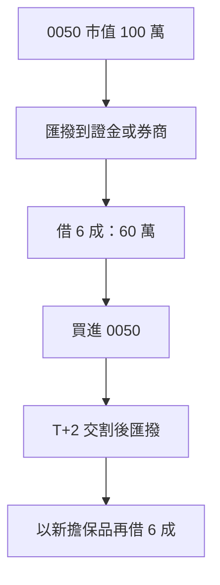

> 🌏 [English version](/posts/investing/2026-10-17-0050-stock-pledge-loan-lenders-en)

把 0050 質押借錢、再買 0050、再質押，是台灣存 ETF 的人最常談的槓桿做法。它的正式名稱是「不限用途款項借貸」：把股票或 ETF 匯撥到券商或證券金融公司[元大證金](https://www.yuantafinance.com.tw/brief/)的擔保品專戶，最高借市值的 6 成，股票仍是你的，現金股利照領。它不是銀行信貸：額度看擔保品，風險看維持率。

這篇回答四件事：各家 10 月的實際利率差多少、追繳規則有沒有不同、循環借款要補多少錢、哪些條款會讓循環做不下去。

## 循環怎麼運作

在元大證金，新買的 0050 要等 T+2 交割完成，才能匯撥進擔保品專戶（[倉鼠人生實驗室的實測](https://hamr-lab.com/to-imoney/)），所以每一輪至少隔兩個營業日。借款上限是市值 6 成，循環做到底，借款額是本金的 1.5 倍（0.6 ÷ 0.4）：100 萬本金最多借 150 萬，擔保品共 250 萬，維持率 166.7%，跟只借一輪時一樣，後面每一輪都沒有多出緩衝。

股價漲了，不能把增加的部分直接再借出來。[證交所操作辦法第 20 條](https://twse-regulation.twse.com.tw/m/LawContent.aspx?FID=FL080086)規定，券商不得因股價上漲交付現金，除非客戶申請變更額度。循環只能靠「新買股票再撥入」。

## 17 家的 10 月報價與官網牌告

「10 月報價」欄來自粉專「存股的陪跑者」2026/10/09 的 [Threads 整理](https://www.threads.com/@yourstockbuddy/post/DeS7fwPIxXV)，[NOWnews 10/15](https://www.nownews.com/news/6883616) 轉載。這是網友眾包的數字，實際利率以 App 試算為準。「官網」欄是各家官網寫的牌告或專案利率，「—」表示這篇沒有取得該家的官方資料。

| 機構 | 10 月報價（網友整理） | 官網牌告／專案 | 其他 |
|---|---|---|---|
| 元大證金 | 3.92–3.98% | 牌告 5.88%；專案 3.92% 起（至 12/30） | 適用自己的辦法 |
| 元大證券 | 3.5–3.85%，上限 50 萬 | — | [官網刊載的說明文](<https://www.yuanta.com.tw/file-repository/content/articles/%E8%82%A1%E7%A5%A8%E5%80%9F%E8%B2%B8%E6%98%AF%E4%BB%80%E9%BA%BC%EF%BC%9F%E6%9C%89%E5%93%AA%E4%BA%9B%E8%B2%BB%E7%94%A8%EF%BC%9F%E5%A6%82%E4%BD%95%E6%93%8D%E4%BD%9C%E8%82%A1%E7%A5%A8%E5%80%9F%E8%B2%B8%EF%BC%9F/index.html>)寫 130%、2 個營業日 |
| 永豐 | 4–6%，資管帳戶可減 0.15% | [未列利率](https://service.sinotrade.com.tw/newweb/loan-zone/)，開辦費 0 元 | 6 個月到期可展延或借新還舊 |
| 合庫 | 3.5%，無法借新還舊 | [牌告 6.25%](https://luckydraw.tcfhc-sec.com.tw/websites/loan/index.html)；9/1–12/31 專案，0050 在標的內 | 須臨櫃簽約；展延要先還息 |
| 凱基 | 3.8–4%，額度不穩 | [牌告 6.45%](https://www.kgi.com.tw/zh-tw/product-overview/borrow-n-lending/stock-loans) | 線上借款總額上限 2,000 萬 |
| 兆豐 | 3.5–4%，人工審核，可押正二 | 依標的分群，機動調整 | 4/30 起取消鑽石級優惠 |
| 群益 | 3.88–5%，額度不穩定 | [牌告 6.45%](https://goplus.capital.com.tw/unlimitedcredit/qa.asp) | 還款先進先出 |
| 玉山 | 4.25%，沒額度 | [線上 4.25%](https://www.esunsec.com.tw/cus_service/loan/index.html)，限 ETF、台灣 50 與中型 100 成分股 | 同一營業日只能申請一次 |
| 新光 | 3.8% | — | [官網注意事項（2022.09 版）](https://www.skis.com.tw/CusService_WebAPI/api/file/15edfa8485d24e19b0813a5b3926a731)：130%、2 個營業日、補到 166% |
| 台新證券 | 3.5%，沒額度 | [依融資牌告利率](https://www.tssco.com.tw/tssloan/) | 每營業日單筆，最快次一營業日撥款 |
| 華南永昌 | 3.5%、4%，無法借新還舊 | [牌告 6.45%](https://www.entrust.com.tw/Marketing/entrustLoan/index.html) | 須臨櫃或洽營業員 |
| 富邦 | 3.88%，條件待確認 | [牌告 6.40%](https://www.fbs.com.tw/DomesticStocks/UnrestrictedLoan) | 動撥手續費 20 元 |
| 中信 | 3.5%，每月貢獻到一定數字可到 3% 以下 | [牌告 6.4%](<https://www.ctbcsec.com/Stock/Collateral>) | 維持率分母是已申請借款；配股率達 20% 以上的配股列為擔保品 |
| 統一 | 3.5%，走人工申請，可押正二 | [牌告 6.4%](https://eservices.pscnet.com.tw/dm/LOAN/index.html)＋手續費 1.425‰ | 線上單筆 100 萬、單日 500 萬 |
| 國票 | 4% | [官網範例用 6.25%](https://www.ibfs.com.tw/my/cash/) | 官網未標牌告 |
| 第一金 | 一筆 1,000 萬，量大可談到 3% 以下 | [牌告 6.45%](<https://www.firstsec.com.tw/uploadImages/%E7%AC%AC%E4%B8%80%E9%87%91%E8%AD%89%E5%88%B8115%E5%B9%B4%E4%B8%8A%E5%8D%8A%E5%B9%B4%E5%BA%A6%E5%80%8B%E9%AB%94%E8%B2%A1%E5%8B%99%E5%A0%B1%E5%91%8A.pdf>)（出自 115 年上半年財報）；官網說線上借款利率顯示在登入後的畫面 | [展延要整戶維持率 166% 以上](https://events.firstsec.com.tw/%E4%B8%8D%E9%99%90%E7%94%A8%E9%80%94%E6%AC%BE%E9%A0%85%E5%80%9F%E8%B2%B8-37994) |
| 國泰證券 | 6.45% | [牌告 6.45%](https://istockapp.cathaysec.com.tw/Marketing/loan/) | 用前一營業日收盤價算維持率 |

表上有兩處數字互相對不上：NOWnews 引網友說富邦一般戶已升到 4.5%，Threads 表上是 3.88%；元大證金表上與官網相同。

## 銀行端

銀行的股票質借跟券商不同：多數收一次性的帳務管理費，期限是一年續約（不受券商 18 個月上限），利率看銀行指標利率機動調整。下表只放銀行自己官網或契約寫的數字。

| 銀行 | 官網利率 | 費用 | 其他 |
|---|---|---|---|
| [國泰世華](https://www.cathaybk.com.tw/cathaybk/personal/loan/product/stock-collateral-loan/) | 2.95% 起（基準日 114/5/24） | 帳務管理費 2 萬元 | 一年期、循環動用 |
| [華南](https://www.hncb.com.tw/wps/portal/HNCB/per_finance/loan/personal/stock_fund_loan) | 2.99% 起（基準日 113/4/7） | 手續費 2.5‰（最低 5,000 元）、徵信費 300 元 | 額度一年、每筆最長 6 個月、按月付息 |
| [元大銀行](https://www.yuantabank.com.tw/bank/loan/stock/list.do) | 2.98%–5.40%（基準日 115/2/23） | 總費用 3,000–20,000 元；優惠專案管理費為動支額度的 1.625%–2.99% | 每年續約，最長 3 年 |
| [永豐銀行](https://bank.sinopac.com/sinopacBT/personal/loan/other-personal-loan/stock.html) | 3.41% 起（基準日 2026/1/21） | 15,000 元／筆 | 借款人 20–65 歲 |
| [台新銀行](https://www.taishinbank.com.tw/TSB/customer-service-center/qa/index.html?nav1=type02&nav2=type0205) | 3.99% 起（FAQ 未見基準日） | 免保證人、免財力證明；[商品頁](https://www.taishinbank.com.tw/TSB/personal/loan/stock-fund/stock/)另列費用 | 依每日動用餘額計息 |
| [中信銀行](https://www.ctbcbank.com/content/dam/twrbo/pdf/aboutctbc/contract_5-3-1.pdf) | 官網未公開 | 開辦費寫在契約 | 契約版本 115.6.15 |

基準日差很多，國泰世華和華南的利率頁已經是一到兩年前的數字，要以分行報價為準。銀行的追繳條款見下一節。

有兩個銀行才有的細節：[元大銀行](https://www.yuantabank.com.tw/bank/loan/stock/list.do)的額度是用前一日收盤價、60 日均價、120 日均價三者取最低的「評定單價」乘以成數，而且設質股票的孳息由銀行領取；也就是說股價急漲時借得到的比券商少，現金股利也不會直接進你的戶頭。

銀行端沒有公開條款的：國泰世華、台新、華南、永豐的維持率與追繳條款在契約裡，要向分行索取。第一銀行、玉山銀行、兆豐銀行、台北富邦銀行我只找到基金質借或信貸頁面，沒有找到股票質借的官方頁，所以沒有列入。

## 追繳規則

| 機構 | 追繳門檻 | 通知後期限 | 補繳目標 |
|---|---|---|---|
| 元大證金 | 低於 140% | 3 個營業日 | 高於 166%（回升到 180% 取消追繳紀錄） |
| 國泰證券、兆豐、國票 | 低於 130% | 2 個營業日 | 166% |
| 群益 | 低於 130% | 2 個營業日 | 同一頁寫了 166% 與 130% 兩種 |
| 合庫 | 低於 130% | 2 個營業日 | 回升到 166% 才取消追繳 |
| 凱基 | 低於 130%（整戶計算） | 2 個營業日 | 補到高於 166%（[Q&A](https://www.kgieworld.com.tw/news/20160822/qa.html)與[契約告知書](https://event.kgi.com.tw/uploadfiles/euploadfile/%E8%AD%89%E5%88%B8%E5%95%86%E8%BE%A6%E7%90%86%E4%B8%8D%E9%99%90%E7%94%A8%E9%80%94%E6%AC%BE%E9%A0%85%E5%80%9F%E8%B2%B8%E6%A5%AD%E5%8B%99.pdf)都寫） |
| 元大證券 | 低於 130% | 2 個營業日 | 說明文未寫補到多少 |
| 中信 | 低於 130%（整戶計算） | 通知送達日起 2 個營業日 | [契約](<https://www.ctbcsec.com/2020/renew/contract-list/pdf/%E4%B8%8D%E9%99%90%E7%94%A8%E9%80%94%E6%AC%BE%E9%A0%85%E5%80%9F%E8%B2%B8%E7%B7%9A%E4%B8%8A%E9%96%8B%E6%88%B6%E5%A5%91%E7%B4%84.pdf>)未寫目標數字，只指向證交所辦法 |
| 中信銀行 | 低於 140% | 通知日起 4 個銀行營業日 | [契約](https://www.ctbcbank.com/content/dam/twrbo/pdf/aboutctbc/contract_5-3-1.pdf)寫：期限內仍未達 140% 才可處分；補繳目標沒寫。除息前 7 個銀行營業日起改用除息後參考價算維持率 |
| 元大銀行 | 官網未寫數字，維持率不足先凍結額度 | 存證信函與電話通知後 3 天 | [Q&A](https://www.yuantabank.com.tw/bank/loan/stock/list.do)寫：3 天內未補足，或維持率達處分線就處分；整次設質的股票一起處分 |
| 新光、永豐 | 低於 130% | 2 個營業日 | 新光補到 166%；永豐[教學文](https://www.sinotrade.com.tw/richclub/primary/%E4%B8%8D%E9%99%90%E7%94%A8%E9%80%94%E7%B6%AD%E6%8C%81%E7%8E%87%E6%9F%A5%E8%A9%A2-%E4%B8%8D%E9%99%90%E7%94%A8%E9%80%94%E7%B6%AD%E6%8C%81%E7%8E%87%E6%80%8E%E9%BA%BC%E7%AE%97-%E6%94%B6%E5%88%B0%E8%BF%BD%E7%B9%B3%E9%80%9A%E7%9F%A5%E6%80%8E%E9%BA%BC%E8%BE%A6-%E4%B8%8D%E9%99%90%E7%94%A8%E9%80%94%E6%AC%BE%E9%A0%85%E5%80%9F%E8%B2%B8%E8%A3%9C%E7%B9%B3%E6%B5%81%E7%A8%8B-66b4755115fc4d4560494b23)建議低於 145% 就先補，維持率分母是已申請額度 |
| 台新證券 | 低於 130%（整戶計算） | 兩天內 | [FAQ](<https://cash.tssco.com.tw/ui/view/main/FAQ>) 寫補到 130% 以上，跟其他家的 166% 不同 |
| 富邦、玉山、統一 | 低於 130% | 2 個營業日 | 官網只寫 130%；第 3 個營業日起處分 |
| 華南永昌 | 低於 130% | 官網未寫期限 | 要求提高維持率 |

元大證金是證金公司，適用自己的[業務操作辦法](https://www.selaw.com.tw/Chinese/RegulatoryInformationResult?sysNumber=LW10869567&releaseDate=2025-10-21)和[契約書](https://www.selaw.com.tw/Chinese/RegulatoryInformationResult/Article?isIntegratedSearch=True&sysNumber=LW10869584&searchString1=%E6%9C%89%E5%83%B9%E8%AD%89%E5%88%B8%E6%93%94%E4%BF%9D%E6%94%BE%E6%AC%BE)，其餘券商依[證交所辦法](https://twse-regulation.twse.com.tw/m/LawContent.aspx?FID=FL080086)（130%、2 個營業日、補到高於 166%），契約可另外約定。第一金的追繳條款這篇沒有取得（開戶契約在登入後的金證通，公開頁面搜不到），借款前請營業員書面確認。

元大證金的專案利率是 [7/1 調整後的 3.92% 起](https://www.yuantafinance.com.tw/The.aspx?The=232&Role=1&Lang=1)，單日累計借款要達 1 萬元才享優惠，官網寫明每年 1、4、7、10 月 1 日可調整。兆豐的 0050 原屬最優惠的鑽石級，[4/30 起這一級的優惠取消](https://www.emega.com.tw/emegaTran/bulletin.do?id=20260429111437812480)，回歸白金級、黃金級利率。

## 追繳要補多少

以 100 萬本金借到循環上限為例：借款 150 萬，擔保品 250 萬。元大證金在維持率低於 140% 時追繳，也就是市價跌 16%（擔保品剩 210 萬）。要補回高於 166%：

| 補繳方式 | 金額 |
|---|---|
| 追加股票（按市值全額計入） | 約 39 萬 |
| 還現金 | 約 23.5 萬 |

這時你的淨資產從 100 萬變成 60 萬，股價跌 16%，淨資產跌 40%。券商（130% 觸發）要跌到 22% 才追繳，算法相同。元大證金的官方公式會再加上應收利息，補繳金額無條件進位到千元。

## 循環的合約限制

- **額度可以被收回。** 元大證金的契約載明，它可因擔保品價值變動「隨時調整、減少或停止」放款額度，你要依通知立即償還部分或全部。
- **展延與借新還舊要審核，而且有維持率門檻。** 證交所辦法規定期限 6 個月、展延 2 次，合計 18 個月，展延看信用狀況。第一金要整戶維持率 166% 以上才能在分公司申請展延，而循環借到上限時維持率剛好是 166.7%，稍微下跌就不夠。元大證金契約寫明借新還舊它有權准駁。[兆豐 5/1 起新契約不自動展延](https://www.emega.com.tw/emegaTran/bulletin.do?id=20260429120158563004)，想續借要洽分公司辦借新還舊。富邦到期後是否借新還舊要看信用狀況，10 月網友整理中合庫、華南永昌表示無法借新還舊。
- **還款與退券有門檻。** 元大證金還款後若剩餘借款的維持率低於 150%，可以扣住應退還的股票。國泰證券與兆豐退部分擔保品時，維持率要保持在 166% 以上。群益還款依借款先後順序（先進先出），要指定某一筆只能用現金並洽分公司。
- **除權息前 6 個營業日起，可扣掉配息再算維持率。** 0050 配息前，維持率會先降。
- **單一標的有融通上限。** 證交所辦法第 32 條限制每家券商對同一檔證券的融通餘額；華南永昌的官網還寫明，全市場餘額超過某檔證券流通股數 10% 時，該檔不能再當擔保品。熱門 ETF 額度滿了就借不到。
- **各家的作業節奏不同。** 台新證券每營業日只能申請單筆、最快次一營業日撥款；玉山同一營業日只能申請一次；凱基要證券戶開立滿三個月才能簽約。循環一輪能多快做完，取決於你選的那家。

## 2026 年 10 月的環境

- **限貸與調息。** 5 月起有券商收緊，例如[富邦證券 5/13 公告暫停不限用途借款新案](https://www.money101.com.tw/blog/%E8%82%A1%E7%A5%A8%E8%B3%AA%E6%8A%BC-%E8%82%A1%E7%A5%A8)。元大證金一度限制每人每天 10 萬元、一張股票只能借一次（[PTT 網友 5/5 打電話問到的回覆](https://www.ptt.cc/bbs/Stock/M.1777961184.A.52A.html)），[7/8 傳出公告解除](https://tw.stock.yahoo.com/news/%E5%85%83%E5%A4%A7%E8%AD%89%E9%87%91%E8%B3%AA%E6%8A%BC%E9%99%90%E9%A1%8D%E4%BB%A4%E8%A7%A3%E9%99%A4%EF%BC%81%E9%84%89%E6%B0%91%E5%96%8A%E3%80%8C%E8%B2%AA%E7%8B%97%E5%87%BA%E7%B1%A0%E3%80%8D%E4%B8%80%E7%9C%8B%E5%88%A9%E7%8E%87%E6%9B%B4%E5%97%A8%EF%BC%9A1%E5%B9%B4%E6%80%8E%E5%8F%AF%E8%83%BD%E8%B3%BA%E4%B8%8D%E5%88%B0-124500529.html)，但官網常見問題沒有寫單日限額，現況要問客服。一位質押台積電與正二的 PTT 網友說，舊合約全年利息約 50 萬元，新約若額度不變可能到 80 萬元，也不確定能否拿到新額度（[聯合新聞網 10/15](https://udn.com/news/story/12806/9816173)）。
- **上限不放寬。** 券商融通總額不得超過淨值 4 倍。[金管會 8/27 表示不放寬](https://udn.com/news/story/7251/9717902)，建議券商增資；7 月底融通占淨值約 162%。
- **跨業信用查詢預計 10 月底上線。** 聯徵中心與證交所對接後，取得你同意，銀行能看到你在券商的借款，券商也能看到銀行借款（[經濟日報](https://udn.com/news/story/7251/9771424)）。金管會[澄清這不是「四貸同堂」管制](https://www.chinatimes.com/realtimenews/20261001004944-260410)，銀行放款仍依 5P 原則。要用房貸或信貸搭配質押的人，銀行端會看得到。

## 照著做的動作

1. **借 5 成以下。** 借 5 成時起始維持率是 200%，元大證金要跌 30% 才追繳，券商要跌 35%。10/15 大跌當天，一位方格子作者說他只借 40%，初始維持率 250%（[圓滾滾的貓窩](https://vocus.cc/article/6ad0b368fd89780001e94c7f)）。
2. **警戒線設在追繳門檻加 20 個百分點。** 元大證金是 160%，券商是 150%。到線就還現金或補股票，不等通知。
3. **預留借款額 15% 到 20% 的現金。** 借 150 萬就留 22 萬到 30 萬，這是上面「市價跌 16%」的補繳量。
4. **開戶前打電話問三件事。** 追繳門檻與補到多少、單日與單一標的限額、到期不續借時怎麼處理。電話：元大證金 02-2173-6883、國泰證券 02-7732-6888、群益 02-412-8878、兆豐 02-2351-7017、永豐 0800-038-123。
5. **不要把全部擔保品放同一家。** 分兩家，一家被限貸或收回額度時，另一家還能續借。

以上是對規則的整理，不是投資建議。借款有本金損失與被強制賣出的風險。

## 參考資料

- [證券商辦理不限用途款項借貸業務操作辦法（115.08.20）](https://twse-regulation.twse.com.tw/m/LawContent.aspx?FID=FL080086)
- [元大證金：有價證券擔保放款業務操作辦法](https://www.selaw.com.tw/Chinese/RegulatoryInformationResult?sysNumber=LW10869567&releaseDate=2025-10-21)
- [元大證金：有價證券擔保放款契約書](https://www.selaw.com.tw/Chinese/RegulatoryInformationResult/Article?isIntegratedSearch=True&sysNumber=LW10869584&searchString1=%E6%9C%89%E5%83%B9%E8%AD%89%E5%88%B8%E6%93%94%E4%BF%9D%E6%94%BE%E6%AC%BE)
- [元大證金：股票借款](https://www.yuantafinance.com.tw/brief/)
- [元大證金：放款之擔保維持率](https://www.yuantafinance.com.tw/QA/QA_03_11.aspx)
- [元大證金：放款之利率](https://www.yuantafinance.com.tw/QA/QA_03_10.aspx)
- [元大證金：快馬貸專案](https://www.yuantafinance.com.tw/SF_event_page/)
- [元大證金：快馬貸利率調整公告（2026/6/30）](https://www.yuantafinance.com.tw/The.aspx?The=232&Role=1&Lang=1)
- [國泰證券：股票貸款](https://istockapp.cathaysec.com.tw/Marketing/loan/)
- [群益金鼎證券：便利貸 Q&A](https://goplus.capital.com.tw/unlimitedcredit/qa.asp)
- [兆豐證券：兆好貸常見問題](https://www.emega.com.tw/emegaTran/faqList.do?layer1_name=%E5%85%86%E5%A5%BD%E8%B2%B8)
- [兆豐證券：兆好貸優惠利率調整通知（2026/4/29）](https://www.emega.com.tw/emegaTran/bulletin.do?id=20260429111437812480)
- [兆豐證券公告（2026/4/29）](https://www.emega.com.tw/emegaTran/bulletin.do?id=20260429120158563004)
- [凱基證券：快e貸 Q&A](<https://www.kgieworld.com.tw/news/20160822/qa.html>)
- [元大證券：股票借貸說明文](<https://www.yuanta.com.tw/file-repository/content/articles/%E8%82%A1%E7%A5%A8%E5%80%9F%E8%B2%B8%E6%98%AF%E4%BB%80%E9%BA%BC%EF%BC%9F%E6%9C%89%E5%93%AA%E4%BA%9B%E8%B2%BB%E7%94%A8%EF%BC%9F%E5%A6%82%E4%BD%95%E6%93%8D%E4%BD%9C%E8%82%A1%E7%A5%A8%E5%80%9F%E8%B2%B8%EF%BC%9F/index.html>)
- [中國信託證券：不限用途款項借貸契約書（115.04.17 版）](<https://www.ctbcsec.com/2020/renew/contract-list/pdf/%E4%B8%8D%E9%99%90%E7%94%A8%E9%80%94%E6%AC%BE%E9%A0%85%E5%80%9F%E8%B2%B8%E7%B7%9A%E4%B8%8A%E9%96%8B%E6%88%B6%E5%A5%91%E7%B4%84.pdf>)
- [凱基證券：不限用途開戶契約告知事項](<https://event.kgi.com.tw/uploadfiles/euploadfile/%E8%AD%89%E5%88%B8%E5%95%86%E8%BE%A6%E7%90%86%E4%B8%8D%E9%99%90%E7%94%A8%E9%80%94%E6%AC%BE%E9%A0%85%E5%80%9F%E8%B2%B8%E6%A5%AD%E5%8B%99.pdf>)
- [台新證券：不限用途款項借貸 FAQ](<https://cash.tssco.com.tw/ui/view/main/FAQ>)
- [中國信託證券：不限用途擔保品與 Q&A](https://www.ctbcsec.com/Stock/Collateral)
- [第一金證券：115 年上半年度個體財務報告](<https://www.firstsec.com.tw/uploadImages/%E7%AC%AC%E4%B8%80%E9%87%91%E8%AD%89%E5%88%B8115%E5%B9%B4%E4%B8%8A%E5%8D%8A%E5%B9%B4%E5%BA%A6%E5%80%8B%E9%AB%94%E8%B2%A1%E5%8B%99%E5%A0%B1%E5%91%8A.pdf>)
- [永豐金證券：借貸專區](https://service.sinotrade.com.tw/newweb/loan-zone/)
- [永豐金證券豐雲學堂：不限用途維持率](https://www.sinotrade.com.tw/richclub/primary/%E4%B8%8D%E9%99%90%E7%94%A8%E9%80%94%E7%B6%AD%E6%8C%81%E7%8E%87%E6%9F%A5%E8%A9%A2-%E4%B8%8D%E9%99%90%E7%94%A8%E9%80%94%E7%B6%AD%E6%8C%81%E7%8E%87%E6%80%8E%E9%BA%BC%E7%AE%97-%E6%94%B6%E5%88%B0%E8%BF%BD%E7%B9%B3%E9%80%9A%E7%9F%A5%E6%80%8E%E9%BA%BC%E8%BE%A6-%E4%B8%8D%E9%99%90%E7%94%A8%E9%80%94%E6%AC%BE%E9%A0%85%E5%80%9F%E8%B2%B8%E8%A3%9C%E7%B9%B3%E6%B5%81%E7%A8%8B-66b4755115fc4d4560494b23)
- [新光證券：不限用途款項借貸注意事項](https://www.skis.com.tw/CusService_WebAPI/api/file/15edfa8485d24e19b0813a5b3926a731)
- [華南銀行：股票靈活金](https://www.hncb.com.tw/wps/portal/HNCB/per_finance/loan/personal/stock_fund_loan)
- [富邦證券：不限用途款項借貸](https://www.fbs.com.tw/DomesticStocks/UnrestrictedLoan)
- [合庫證券：不限輕鬆貸](https://luckydraw.tcfhc-sec.com.tw/websites/loan/index.html)
- [凱基證券：股票貸款](https://www.kgi.com.tw/zh-tw/product-overview/borrow-n-lending/stock-loans)
- [台新證券：不限用途款項借貸](https://www.tssco.com.tw/tssloan/)
- [玉山證券：不限用途款項借貸](https://www.esunsec.com.tw/cus_service/loan/index.html)
- [統一證券：統e貸](https://eservices.pscnet.com.tw/dm/LOAN/index.html)
- [國票證券：借貸業務](https://www.ibfs.com.tw/my/cash/)
- [華南永昌證券：不限用途款項借貸](https://www.entrust.com.tw/Marketing/entrustLoan/index.html)
- [第一金證券：不限用途款項借貸線上功能說明](https://events.firstsec.com.tw/%E4%B8%8D%E9%99%90%E7%94%A8%E9%80%94%E6%AC%BE%E9%A0%85%E5%80%9F%E8%B2%B8-37994)
- [元大商業銀行：股票貸款](https://www.yuantabank.com.tw/bank/loan/stock/list.do)
- [永豐銀行：股票貸款](https://bank.sinopac.com/sinopacBT/personal/loan/other-personal-loan/stock.html)
- [中國信託商業銀行：有價證券擔保借據暨約定書（115.6.15 版）](https://www.ctbcbank.com/content/dam/twrbo/pdf/aboutctbc/contract_5-3-1.pdf)
- [台新銀行：常見問題](https://www.taishinbank.com.tw/TSB/customer-service-center/qa/index.html?nav1=type02&nav2=type0205)
- [國泰世華銀行：股票質押貸款](https://www.cathaybk.com.tw/cathaybk/personal/loan/product/stock-collateral-loan/)
- [台新銀行：股票質借貸款](https://www.taishinbank.com.tw/TSB/personal/loan/stock-fund/stock/)
- [存股的陪跑者：質押利率更新 10 月版（Threads，2026/10/09）](https://www.threads.com/@yourstockbuddy/post/DeS7fwPIxXV)
- [NOWnews：17 券商十月股票質押利率一表看](https://www.nownews.com/news/6883616)
- [聯合新聞網：台股高點該停利嗎（PTT 質押網友）](https://udn.com/news/story/12806/9816173)
- [圓滾滾的貓窩：115/10/15-不要怕](https://vocus.cc/article/6ad0b368fd89780001e94c7f)
- [倉鼠人生實驗室：元大證金線上匯撥實測](https://hamr-lab.com/to-imoney/)
- [Money101：股票質押利率與維持率](https://www.money101.com.tw/blog/%E8%82%A1%E7%A5%A8%E8%B3%AA%E6%8A%BC-%E8%82%A1%E7%A5%A8)
- [PTT Stock 板：元大證金質押最新單日限制（2026/5/5）](https://www.ptt.cc/bbs/Stock/M.1777961184.A.52A.html)
- [FTNN／Yahoo：元大證金質押限額令解除](https://tw.stock.yahoo.com/news/%E5%85%83%E5%A4%A7%E8%AD%89%E9%87%91%E8%B3%AA%E6%8A%BC%E9%99%90%E9%A1%8D%E4%BB%A4%E8%A7%A3%E9%99%A4%EF%BC%81%E9%84%89%E6%B0%91%E5%96%8A%E3%80%8C%E8%B2%AA%E7%8B%97%E5%87%BA%E7%B1%A0%E3%80%8D%E4%B8%80%E7%9C%8B%E5%88%A9%E7%8E%87%E6%9B%B4%E5%97%A8%EF%BC%9A1%E5%B9%B4%E6%80%8E%E5%8F%AF%E8%83%BD%E8%B3%BA%E4%B8%8D%E5%88%B0-124500529.html)
- [經濟日報：金管會確定不放寬券商融通上限](https://udn.com/news/story/7251/9717902)
- [經濟日報：銀行券商跨業信用查詢 10 月底上線](https://udn.com/news/story/7251/9771424)
- [工商時報：金管會澄清沒有「四貸同堂」管制](https://www.chinatimes.com/realtimenews/20261001004944-260410)
