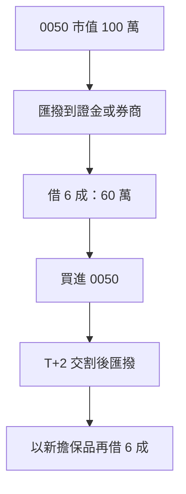

> 🌏 [English version](/posts/investing/2026-10-17-0050-stock-pledge-loan-lenders-en)

把 0050 質押借錢、再買 0050、再質押，是台灣存 ETF 的人最常談的槓桿做法。它的正式名稱是「不限用途款項借貸」：把股票或 ETF 匯撥到券商或證券金融公司[元大證金](https://www.yuantafinance.com.tw/brief/)的擔保品專戶，最高借市值的 6 成，股票仍是你的，現金股利照領。它不是銀行信貸：額度看擔保品，風險看維持率。

這篇回答三件事：各家利率和追繳規則差在哪、循環借款要補多少錢、哪些合約條款會讓循環做不下去。

## 循環怎麼運作

在元大證金，新買的 0050 要等 T+2 交割完成，才能匯撥進擔保品專戶（[倉鼠人生實驗室的實測](https://hamr-lab.com/to-imoney/)），所以每一輪至少隔兩個營業日。借款上限是市值 6 成，循環做到底，借款額是本金的 1.5 倍（0.6 ÷ 0.4）：100 萬本金最多借 150 萬，擔保品共 250 萬，維持率 166.7%，跟只借一輪時一樣，後面每一輪都沒有多出緩衝。

股價漲了，不能把增加的部分直接再借出來。[證交所操作辦法第 20 條](https://twse-regulation.twse.com.tw/m/LawContent.aspx?FID=FL080086)規定，券商不得因股價上漲交付現金，除非客戶申請變更額度。循環只能靠「新買股票再撥入」。

## 各家規則並排

| 機構 | 利率 | 追繳門檻 | 通知後期限 | 補到 |
|---|---|---|---|---|
| 元大證金 | 牌告 5.88%；專案 3.92% 起（至 12/30） | 低於 140% | 3 個營業日 | 高於 166% |
| 國泰證券 | 牌告 6.45% | 低於 130% | 2 個營業日（15:00 前） | 166% |
| 群益 | 牌告 6.45% | 低於 130% | 2 個營業日 | 166% |
| 兆豐 | 依標的分群，機動調整 | 低於 130% | 2 個營業日 | 166% |

- **元大證金**：它是證金公司，適用自己的[業務操作辦法](https://www.selaw.com.tw/Chinese/RegulatoryInformationResult?sysNumber=LW10869567&releaseDate=2025-10-21)和[契約書](https://www.selaw.com.tw/Chinese/RegulatoryInformationResult/Article?isIntegratedSearch=True&sysNumber=LW10869584&searchString1=%E6%9C%89%E5%83%B9%E8%AD%89%E5%88%B8%E6%93%94%E4%BF%9D%E6%94%BE%E6%AC%BE)，不是前面那套券商辦法。專案利率是 [7/1 調整後的 3.92% 起](https://www.yuantafinance.com.tw/The.aspx?The=232&Role=1&Lang=1)，單日累計借款要達 1 萬元才享優惠，官網寫明每年 1、4、7、10 月 1 日可調整。
- **國泰證券與群益**：[國泰證券](https://istockapp.cathaysec.com.tw/Marketing/loan/)用前一營業日收盤價算維持率。[群益](https://goplus.capital.com.tw/unlimitedcredit/qa.asp)的官網同一頁有兩種補繳目標（166% 與 130%），借款前要請營業員書面確認。
- **兆豐**：[兆好貸的規則](https://www.emega.com.tw/emegaTran/faqList.do?layer1_name=%E5%85%86%E5%A5%BD%E8%B2%B8)是一檔股票一個利率，手續費 1.425‰，利息達 200 元就免收。
- **永豐**：[官網](https://service.sinotrade.com.tw/newweb/loan-zone/)寫開辦費 0 元、最快 2.5 小時撥款，利率要登入後試算。
- **銀行**：[國泰世華銀行](https://www.cathaybk.com.tw/cathaybk/personal/loan/product/stock-collateral-loan/)是 2.95% 起、期限一年、可循環動用，另收帳務管理費 2 萬元。維持率與追繳條款在契約裡，要向分行索取。

## 追繳要補多少

以 100 萬本金借到循環上限為例：借款 150 萬，擔保品 250 萬。元大證金在維持率低於 140% 時追繳，也就是市價跌 16%（擔保品剩 210 萬）。要補回高於 166%：

| 補繳方式 | 金額 |
|---|---|
| 追加股票（按市值全額計入） | 約 39 萬 |
| 還現金 | 約 23.5 萬 |

這時你的淨資產從 100 萬變成 60 萬，股價跌 16%，淨資產跌 40%。券商（130% 觸發）要跌到 22% 才追繳，算法相同。元大證金的官方公式會再加上應收利息，補繳金額無條件進位到千元。

## 循環的合約限制

- **額度可以被收回。** 元大證金的契約載明，它可因擔保品價值變動「隨時調整、減少或停止」放款額度，你要依通知立即償還部分或全部。
- **展延與借新還舊要審核。** 證交所辦法規定期限 6 個月、展延 2 次，合計 18 個月，展延看信用狀況。元大證金契約寫明借新還舊它有權准駁，必要時要求增提擔保品。[兆豐 5/1 起新契約不自動展延](https://www.emega.com.tw/emegaTran/bulletin.do?id=20260429120158563004)，想續借要洽分公司辦借新還舊。
- **還款與退券有門檻。** 元大證金還款後若剩餘借款的維持率低於 150%，可以扣住應退還的股票。國泰證券與兆豐退部分擔保品時，維持率要保持在 166% 以上。群益還款依借款先後順序（先進先出），要指定某一筆只能用現金並洽分公司。
- **除權息前 6 個營業日起，可扣掉配息再算維持率。** 0050 配息前，維持率會先降。
- **單一券商對單一標的有融通上限。** 證交所辦法第 32 條限制每家券商對同一檔證券的融通餘額，熱門標的額度滿了就借不到。

## 2026 年 10 月的環境

- **限貸。** 5 月起有券商收緊，例如[富邦證券 5/13 公告暫停不限用途借款新案](https://www.money101.com.tw/blog/%E8%82%A1%E7%A5%A8%E8%B3%AA%E6%8A%BC-%E8%82%A1%E7%A5%A8)。元大證金一度限制每人每天 10 萬元、一張股票只能借一次（[PTT 網友 5/5 打電話問到的回覆](https://www.ptt.cc/bbs/Stock/M.1777961184.A.52A.html)），[7/8 傳出公告解除](https://tw.stock.yahoo.com/news/%E5%85%83%E5%A4%A7%E8%AD%89%E9%87%91%E8%B3%AA%E6%8A%BC%E9%99%90%E9%A1%8D%E4%BB%A4%E8%A7%A3%E9%99%A4%EF%BC%81%E9%84%89%E6%B0%91%E5%96%8A%E3%80%8C%E8%B2%AA%E7%8B%97%E5%87%BA%E7%B1%A0%E3%80%8D%E4%B8%80%E7%9C%8B%E5%88%A9%E7%8E%87%E6%9B%B4%E5%97%A8%EF%BC%9A1%E5%B9%B4%E6%80%8E%E5%8F%AF%E8%83%BD%E8%B3%BA%E4%B8%8D%E5%88%B0-124500529.html)，但官網常見問題沒有寫單日限額，現況要問客服。
- **上限不放寬。** 券商融通總額不得超過淨值 4 倍。[金管會 8/27 表示不放寬](https://udn.com/news/story/7251/9717902)，建議券商增資；7 月底融通占淨值約 162%。
- **跨業信用查詢預計 10 月底上線。** 聯徵中心與證交所對接後，取得你同意，銀行能看到你在券商的借款，券商也能看到銀行借款（[經濟日報](https://udn.com/news/story/7251/9771424)）。金管會[澄清這不是「四貸同堂」管制](https://www.chinatimes.com/realtimenews/20261001004944-260410)，銀行放款仍依 5P 原則。要用房貸或信貸搭配質押的人，銀行端會看得到。

## 照著做的動作

1. **借 5 成以下。** 借 5 成時起始維持率是 200%，元大證金要跌 30% 才追繳，券商要跌 35%。
2. **警戒線設在追繳門檻加 20 個百分點。** 元大證金是 160%，券商是 150%。到線就還現金或補股票，不等通知。
3. **預留借款額 15% 到 20% 的現金。** 借 150 萬就留 22 萬到 30 萬，這是上面「市價跌 16%」的補繳量。
4. **開戶前打電話問三件事。** 追繳門檻與補到多少、單日與單一標的限額、到期不續借時怎麼處理。電話：元大證金 02-2173-6883、國泰證券 02-7732-6888、群益 02-412-8878、兆豐 02-2351-7017、永豐 0800-038-123。
5. **不要把全部擔保品放同一家。** 分兩家，一家被限貸或收回額度時，另一家還能續借。

以上是對規則的整理，不是投資建議。借款有本金損失與被強制賣出的風險。

## 參考資料

- [證券商辦理不限用途款項借貸業務操作辦法（115.08.20）](https://twse-regulation.twse.com.tw/m/LawContent.aspx?FID=FL080086)
- [元大證金：有價證券擔保放款業務操作辦法](https://www.selaw.com.tw/Chinese/RegulatoryInformationResult?sysNumber=LW10869567&releaseDate=2025-10-21)
- [元大證金：有價證券擔保放款契約書](https://www.selaw.com.tw/Chinese/RegulatoryInformationResult/Article?isIntegratedSearch=True&sysNumber=LW10869584&searchString1=%E6%9C%89%E5%83%B9%E8%AD%89%E5%88%B8%E6%93%94%E4%BF%9D%E6%94%BE%E6%AC%BE)
- [元大證金：股票借款](https://www.yuantafinance.com.tw/brief/)
- [元大證金：放款之擔保維持率](https://www.yuantafinance.com.tw/QA/QA_03_11.aspx)
- [元大證金：放款之利率](https://www.yuantafinance.com.tw/QA/QA_03_10.aspx)
- [元大證金：快馬貸專案](https://www.yuantafinance.com.tw/SF_event_page/)
- [元大證金：快馬貸利率調整公告（2026/6/30）](https://www.yuantafinance.com.tw/The.aspx?The=232&Role=1&Lang=1)
- [國泰證券：股票貸款](https://istockapp.cathaysec.com.tw/Marketing/loan/)
- [群益金鼎證券：便利貸 Q&A](https://goplus.capital.com.tw/unlimitedcredit/qa.asp)
- [兆豐證券：兆好貸常見問題](https://www.emega.com.tw/emegaTran/faqList.do?layer1_name=%E5%85%86%E5%A5%BD%E8%B2%B8)
- [兆豐證券公告（2026/4/29）](https://www.emega.com.tw/emegaTran/bulletin.do?id=20260429120158563004)
- [永豐金證券：借貸專區](https://service.sinotrade.com.tw/newweb/loan-zone/)
- [國泰世華銀行：股票質押貸款](https://www.cathaybk.com.tw/cathaybk/personal/loan/product/stock-collateral-loan/)
- [倉鼠人生實驗室：元大證金線上匯撥實測](https://hamr-lab.com/to-imoney/)
- [Money101：股票質押利率與維持率](https://www.money101.com.tw/blog/%E8%82%A1%E7%A5%A8%E8%B3%AA%E6%8A%BC-%E8%82%A1%E7%A5%A8)
- [PTT Stock 板：元大證金質押最新單日限制（2026/5/5）](https://www.ptt.cc/bbs/Stock/M.1777961184.A.52A.html)
- [FTNN／Yahoo：元大證金質押限額令解除](https://tw.stock.yahoo.com/news/%E5%85%83%E5%A4%A7%E8%AD%89%E9%87%91%E8%B3%AA%E6%8A%BC%E9%99%90%E9%A1%8D%E4%BB%A4%E8%A7%A3%E9%99%A4%EF%BC%81%E9%84%89%E6%B0%91%E5%96%8A%E3%80%8C%E8%B2%AA%E7%8B%97%E5%87%BA%E7%B1%A0%E3%80%8D%E4%B8%80%E7%9C%8B%E5%88%A9%E7%8E%87%E6%9B%B4%E5%97%A8%EF%BC%9A1%E5%B9%B4%E6%80%8E%E5%8F%AF%E8%83%BD%E8%B3%BA%E4%B8%8D%E5%88%B0-124500529.html)
- [經濟日報：金管會確定不放寬券商融通上限](https://udn.com/news/story/7251/9717902)
- [經濟日報：銀行券商跨業信用查詢 10 月底上線](https://udn.com/news/story/7251/9771424)
- [工商時報：金管會澄清沒有「四貸同堂」管制](https://www.chinatimes.com/realtimenews/20261001004944-260410)
