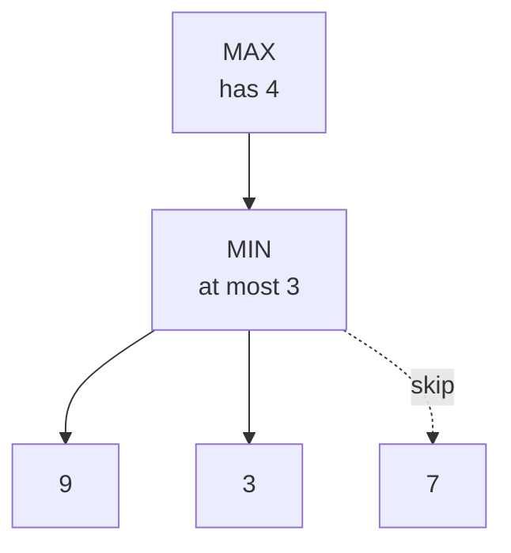

> 🌏 [中文版](/posts/learning/2026-10-13-diagrams-in-teaching-articles)

This article answers three questions. Which content in a teaching article deserves a diagram or a table? Which kind? And how do you draw it so that readers learn more?

The questions came from this site's course guides. I write them from lecture captions, and captions don't show the slides, so the guides were almost entirely text, tables, and formulas. Readers asked for pictures. I started by adding three [mermaid](https://mermaid.js.org/) diagrams to the [Harvard CS50 AI Week 0 guide](/posts/tech/2026-08-27-harvard-cs50ai-w00-search-en). One of them, a tree with nine leaves, ended up with labels about 8px tall on a 390px-wide phone. Nobody could read it. So I went back to the research: how much graphics help learning, which content suits which kind of diagram, and whether any standard covers small screens. This is part 2 of the series "Writing Articles That Teach." Part 5 covers [where to put a video](/posts/learning/2026-10-13-instructional-video-in-articles-en), and part 6 covers [how to lay out the screen when a reader wants the video mid-article](/posts/learning/2026-10-13-video-beside-text-layout-en).

Here is my reading after going through it. This is an inference, and the sections below give its basis. I think whether a diagram helps depends mainly on two things: readers can find the correspondence between the diagram and the text, and readers do something with the diagram (predict the next step, fill in a cell). Each has research behind it (though only one experiment isolated the prediction step, and it found no detectable difference; see the algorithm section) and both are cheap, so I rank them ahead of drawing more diagrams or making diagrams move. No experiment has compared that ordering directly.

Before reading on, know which way this evidence leans. Most of the studies I read are meta-analyses in English-language journals and papers whose full text I could obtain. Their participants are mostly undergraduates and their materials mostly run a few minutes to about fifteen. I found no study of long-form material, and none of adding diagrams to an article that already has tables and formulas. The teaching sites I looked at are mostly well-known English-language ones, plus three in Chinese, one page each. So some recommendations below are carried over from short material, and every inference is marked where it appears.

## The short version: which representation for which content

| Content | Recommended representation | Basis |
|---|---|---|
| Step-by-step execution of an algorithm (how the state changes at each step) | A state table, one row per step, with a question first that asks readers to write down the next step and why. Small frames are worth trying | Algorithm visualization research: viewing is not enough, and experiments where students actively do something more often detect a difference; only one experiment isolated prediction, and it found no detectable difference. Asking for the reason borrows from Bisra and colleagues' meta-analysis of self-explanation prompts, cited in [part 1 of this series](/posts/learning/2026-10-13-teaching-text-evidence-en), and is my inference; in the worked-example meta-analysis in this article's section "One kind of support per worked example," math examples with self-explanation prompts had smaller effects, which the authors say is only a descriptive cross-study comparison. Frames have an argument behind them, but in the one direct experiment I read, four frames did not beat a single picture |
| Hierarchies and trees (search trees, decision trees, parse trees) | Node-link diagram; split into several small diagrams once a rank has more than 3 nodes | My inference from Larkin and Simon's point that grouping information used together saves search, plus width measurements on this site |
| Data flow and causation between components | Boxes and arrows | Arrows make readers interpret a diagram as "how it works" |
| A single-path flow, or a loop with one or two exits | A numbered list or pseudocode | My inference: the list already states the order |
| Several options compared on the same dimensions | A table | My inference: a table already aligns the dimensions; concept maps' advantage over lists is modest in both meta-analyses |
| Quantities (curves, growth, distributions) | Charts that encode quantity as position: lines, scatter, bars | Position beats angle and area when comparing sizes: one crowdsourced perception experiment (not learning outcomes); the parts about lines and trends are my judgment |
| Geometry and space (decision boundaries, a gradient descent path) | An actual picture | The content is spatial |

Four cases where you should not draw:

1. Decorative pictures and illustrations unrelated to the section's learning goal.
2. Simple content the text has already covered, where the diagram only repeats it.
3. Any diagram whose text falls below 12px on a phone.
4. Important content that appears only after a click or a hover.

The sections below give the source of each recommendation. The second-to-last section covers what this evidence cannot tell you, and the appendix has each study's full design and numbers.

## Where this site started: guides written from captions had almost no diagrams

Diagrams on this site are written as mermaid text and rendered in the browser. Two constraints follow. Every node is the same color (custom colors don't follow the light and dark themes, so the site's rules forbid them). And a diagram scales down to its container's width, so more nodes means smaller text.

The three diagrams added to Week 0 were a small demonstration graph (six nodes, A to F), a flowchart of the search loop, and an Alpha-Beta pruning tree. Measured in a browser at 390px wide on the Chinese page, the pruning tree's labels were about 8px tall when laid out top to bottom. Laid out left to right they came back to about 19px, at the cost of a diagram about 940px tall on desktop.

I also rendered the three diagrams from the English page in headless Chromium with the same mermaid version the site uses, and read their natural sizes. The font differs from the production site, so expect a few percent of error.

| Diagram | Nodes | Natural width × height | Font size on a phone |
|---|---|---|---|
| Demonstration graph | 6 | 254 × 382 | 16px, no scaling |
| Search flowchart | 7 | 630 × 810 | about 8.3px |
| Pruning tree, top to bottom | 13 | 1042 × 350 | about 5px |
| Pruning tree, left to right | 13 | 470 × 902 | about 11px |
| Pruning tree, one branch only (trial) | 5 | 324 × 350 | 16px, no scaling |

Font sizes assume about 326px of usable width. Mermaid's default font size is 16px and one line of label is about 24px tall, so "5px font" and "8px label height" describe the same thing.

Two things show up in this table. In a top-to-bottom layout, each extra node in a rank adds about 115 to 120px of width (three leaves, 324px; nine leaves, 1042px). And the flowchart nobody complained about is unreadable too.

These are the English page's numbers. The Chinese page has shorter labels, and the same three diagrams measure 270 × 382, 556 × 770, and 435 × 902 there: the flowchart comes to about 9.4px and the left-to-right pruning tree to about 12px. On the English page that tree is about 11px, already under the 12px floor used below.

## How much one diagram adds

**It helps on average, by a moderate amount, and it depends on the test.** [Guo et al. (2020)](https://files.eric.ed.gov/fulltext/EJ1248499.pdf) pooled 39 experiments comparing text with graphics against text alone on reading comprehension. The overall effect size was g = 0.39. An effect size is the difference between two group means divided by the standard deviation; around 0.2 counts as small and around 0.5 as medium. The benefit was larger on short-answer and mixed-format tests and much smaller on true/false and multiple-choice questions; the authors lean toward explaining this by the low reliability of true/false items. Graphic types (pictures, diagrams, flow diagrams) did not differ significantly from one another.

**How text and graphic fit together may matter as much as whether there is a graphic.** [Noetel et al.'s overview of reviews](https://doi.org/10.31234/osf.io/pynzr) (I read the preprint) pooled 29 systematic reviews. Placing related words and pictures together, compared with placing them apart, had an effect size of 0.63. That number cannot be ranked against Guo's 0.39. It compares "together versus apart," with a graphic on both sides, while Guo compares "graphic versus no graphic," and the two draw on different sets of studies. My inference is to line up the diagrams and text you already have before drawing more, because that is cheaper, not because 0.63 is larger than 0.39. Every number in that overview comes from an individual meta-analysis. The next section says who is citing whom, and how much of each original I read.

Two moderators in Noetel's overview apply directly to a blog:

- Design principles matter more for complex material. For material whose elements interact heavily the effect size was 0.70; for simple material, 0.20 (this comparison rests on only 4 pooled effect sizes).
- Effects are smaller when readers set the pace. System-paced material, like a lecture, came in at 0.41; learner-paced material, like a web page, at 0.27.

So an article that readers can stop and reread should expect the low end of these numbers, and only complex content repays the effort of drawing.

The overview also reports a result that differs from the usual account: prior knowledge did not reliably moderate the effects. Theory predicts good design helps novices more, but the meta-analyses pointed in different directions and the pooled difference was not significant.

## Fitting diagram and text together

### Keep them together

Noetel cites [Schroeder and Cenkci's (2018)](https://link.springer.com/article/10.1007/s10648-018-9435-9) meta-analysis (I read only its abstract): placing related text and graphics together beat placing them apart by 0.63. The same overview relays eye-tracking findings that integrated layouts focus attention and improve integration of words and pictures.

What to do: put the paragraph that explains a diagram directly against it, with nothing in between, and use exactly the same words in the diagram as in the prose. If the prose says frontier, the node says frontier.

This site's rule had been "keep node text short and put details in a list below the diagram." That is a compromise forced by phone widths. What survives the compromise: nodes carry "name plus current value," and the reasoning goes in the adjacent paragraph.

### Mark what matters

Noetel cites [Schneider et al. (2018)](https://www.sciencedirect.com/science/article/abs/pii/S1747938X17300581) (I read only its abstract): cues such as arrows, labels, and emphasis that tell readers where to look had an effect size of 0.43. It is the principle with the most evidence in that overview.

Without color, the cues left are line style, grouping boxes, and node text. The Week 0 pruning tree uses dashed lines for leaves that need not be examined, which is the version of this principle the site can do. What to do: use at most two line styles per diagram and say in the caption what each means.

### Remove what is irrelevant

Noetel cites [Sundararajan and Adesope (2020)](https://link.springer.com/article/10.1007/s10648-020-09522-4) (I read only its abstract): removing interesting but irrelevant details had an effect size of 0.33. The harm was larger when the details stayed on screen (the two were not tested against each other, and the confidence interval for transient details crosses zero); a picture in an article stays on screen, which is my inference.

[Cooper, Sidney, and Alibali (2018)](https://doi.org/10.1002/acp.3371) had 92 undergraduates solve trigonometry word problems. Students were more accurate when a problem included a mathematical diagram. Contextual illustrations helped students with high mathematics ability and hurt students with lower ability.

### Don't repeat the diagram sentence by sentence

[Trypke, Stebner, and Wirth's (2023)](https://www.frontiersin.org/journals/psychology/articles/10.3389/fpsyg.2023.1148035/pdf) literature review separates two kinds of redundancy. Saying the same thing once as a graphic and once as narration is positive overall according to the abstract, but the body has only 4 studies of this kind and concludes that it may help novices and hurts those who already know the material; all 4 paired graphics with narration, which a blog article does not have. A graphic and written text share the visual channel, and the abstract classes that combination as negative. The individual studies in their Table 4 go both ways: in some experiments the diagram-only group beat the diagram-plus-text group, and in others the picture-plus-text group won.

My inference: let the text carry the reasoning (why you can stop once you see a 3) and the diagram carry the structure (which leaves were pruned), and don't map one onto the other sentence by sentence. No experiment I read tests this on long course guides.

## Which diagram for which content

This question has the least direct experimental evidence. What I can cite is two theoretical analyses and one graphical perception experiment. Most of the mapping table above is my inference.

### Diagrams save search and matching

[Larkin and Simon (1987)](https://onlinelibrary.wiley.com/doi/pdfdirect/10.1111/j.1551-6708.1987.tb00863.x) used production-system models to simulate how the same problem is solved under two representations (a pulley problem and a geometry problem). It is a computational model, with no human participants. Their claim: a diagram and a text can hold the same information and still differ in the computation needed to use it. Diagrams have three advantages:

- Information used together sits at adjacent locations, which removes search.
- Information about one element is grouped at one location, so there are no symbolic labels to match.
- They support many easy perceptual inferences.

They then add two caveats (I take these to be what the "sometimes" in the title refers to; the paper does not explain it):

> None of these points insure that an arbitrary diagram is worth 10,000 of any set of words.

The second caveat: a diagram is useful only to someone who knows how to use it.

Applied to choosing (my inference): content is worth drawing when readers must keep going back to find things, or compare several elements at once. A search tree qualifies, because readers compare a parent's value with its siblings' values. A single-path flow does not; you read it once and move on.

The paper closest to this question is [Novick and Hurley (2001)](https://www.sciencedirect.com/science/article/abs/pii/S0010028500907461), which analyzes what kinds of information suit matrices, networks, and hierarchies. I read only the abstract. According to it, the study observed how college students choose a diagram and justify the choice, not which diagram produces better learning, so I do not use it as a basis here.

### Arrows are read as process

[Tversky (2011)](https://tc.columbia.edu/faculty/bt2158/faculty-profile/files/2011_Tversky_VisualizingThoughts.pdf) surveys how diagram elements carry meaning. Tversky cites an experiment by [Heiser and Tversky (2006)](https://doi.org/10.1207/s15516709cog0000_70): three mechanical diagrams, with arrows added to the version half the participants saw. Descriptions of diagrams without arrows more often covered parts and their configuration; with arrows, they more often covered how the system operates. The difference is relative, and the paper counts movement and causality in one category without separating them.

What to do: use arrows only for causation, data flow, and order. To show "A contains B" or "A relates to B," use a grouping box or a line without an arrowhead.

### Encode quantity as position

[Cleveland and McGill (1984)](https://doi.org/10.1080/01621459.1984.10478080) studied the perceptual tasks people perform when reading quantities from a graph; the study exists, but I could not find a full text made public by its authors or publisher, so I do not cite its ranking. [Heer and Bostock (2010)](http://vis.stanford.edu/files/2010-MTurk-CHI.pdf) reran its spatial encoding experiments on Mechanical Turk and added angle and circle area: when estimating proportions on bar charts, position along a common scale was more accurate than length; angle and circle area were both worse than position, and area worse than angle. This is perceptual accuracy, not learning, and it did not test lines, scatter plots, trends, or color depth.

What to do: when readers need to compare sizes, use position along a common scale (bars, scatter) rather than pie angles or bubble area; that half has the perception experiment above behind it. Using lines for trends and avoiding color depth for quantity is my judgment. Mermaid has no suitable quantitative chart, so on this site that content currently goes in a table or a separately generated SVG.

## Algorithm diagrams: differences show up more often when readers act

Most of this site's content is algorithms and models, so this line of research fits best.

[Hundhausen, Douglas, and Stasko (2002)](https://faculty.cc.gatech.edu/~stasko/papers/jvlc02.pdf) analyzed 24 controlled experiments on algorithm visualization. They sorted the experiments into four groups by guiding learning theory. The table shows the two largest groups (the other two both came in at 50%; see the appendix):

| What the experiment varied | Share with a significant difference |
|---|---|
| How the visualization looks (representation, labels, data size) | 30% |
| What students do (design their own input, predict the next step, write code) | 71% |

The 71% is 10 of 14 experiments. Checking them one by one against Table 2, I found the 10 include Byrne and colleagues' two experiments where prediction and animation could not be separated; without them it is 8 of 14. The paper does not say this.

The authors conclude:

> how students use AV technology has a greater impact on effectiveness than what AV technology shows them

They also reclassified the experiments by how much effort the two groups of students expended. Of the 9 experiments where effort was roughly equivalent, 6 found no significant difference. Of the 14 where one group expended more effort, the higher-effort group did significantly better in 10. In their conclusion (section 6.3) the authors write that, with few exceptions, students who merely viewed visualizations showed no significant learning advantage over students who used conventional materials. In the other direction, once the comparison group's activity was matched, the gap disappeared: in Hansen and colleagues' Study III the text-only group also did paper-and-pencil exercises and did not differ significantly from the visualization group, and Gurka, replicating Byrne's experiment without the prediction condition and with group discussion in both groups, also found no significant difference. The authors attribute these null results to the groups' engagement being equalized; my reading is that the benefit follows the engagement and need not come from the visualization tool itself. The exceptions are real: in Table 2 of the same paper, all four groups in Kann and colleagues' experiment wrote programs and differed only in whether they viewed an animation, and those who viewed it scored significantly higher on the post-test. Byrne and colleagues' two experiments were also significant, but the result was that students who "viewed the animation and/or made predictions" beat those who did neither, and the authors say the separate effects of prediction and animation could not be disentangled statistically.

The same year, an [ITiCSE working group report (Naps et al., 2002)](https://users.cs.duke.edu/~rodger/jflappapers/Naps2002.pdf) sorted learner engagement into six forms: no viewing, viewing, responding (answering questions about the visualization), changing (supplying your own input), constructing (building a visualization), and presenting. The report's first hypothesis is that viewing alone produces the same learning outcomes as no viewing. The report carries its own reservation: the studies behind that hypothesis used small samples, and the group planned to verify it with larger ones.

A diagram in a static article is "viewing." The cheapest step up is "responding": ask what happens next before showing the diagram. This is my inference: Hundhausen supports the broad category of having students do something. Only one experiment, by Jarc and colleagues, isolated prediction, and its prediction group showed no significant post-test difference (it only spent significantly more time); Byrne and colleagues' two experiments could not separate prediction from animation. The result closest to "ask, then show" also points the other way: Hansen and colleagues' Study VI compared the full system with versions that each removed one feature, one of them the interactive questions, and found no significant differences among the groups. Tversky and colleagues' 2002 review discusses the same study (Byrne, Catrambone, and Stasko 1999) and describes the benefit of viewing the animation as about the same as making predictions with static diagrams, whereas Hundhausen says the two effects cannot be separated. The two secondhand accounts differ, and I have not read the original. This site's guides already have a "Check yourself. Write your answer down before opening the fold." format. Moving it in front of the diagram is all it takes.

Later developments are not encouraging. [Shaffer et al. (2010)](https://cs.utep.edu/makbar/papers/TOCE.pdf) catalogued over 500 algorithm visualizations and concluded that many are of low quality and more than a quarter depict sorting. [Sibia, Liut, and Nobre's (2025)](https://diglib.eg.org/bitstreams/c65f8ea5-9633-4a64-8758-906ce2e446e1/download) systematic review selected 90 papers and reports, in its abstract, a lack of rigorous evaluations; its discussion is quite positive about learning gains, but the authors did not assess the quality of the studies they collected.

## Static diagrams, frames, animation, interaction

### Animation's edge over static graphics is modest, and two meta-analyses describe it differently

[Berney and Bétrancourt (2016)](https://access.archive-ouverte.unige.ch/access/metadata/75bf6876-cb91-4e2c-8ac6-9d0767449449/download) pooled 140 pairwise comparisons of animation against static graphics. In 59.3% of them there was no significant difference. The overall effect favored animation (g = 0.226), and the authors themselves call it small.

I read only the abstract of the earlier [Höffler and Leutner (2007)](https://www.sciencedirect.com/science/article/abs/pii/S0959475207001077). Berney and Bétrancourt report its overall effect as d = 0.37, calling it medium in their introduction and small-to-medium in their discussion. Ploetzner and colleagues, discussed below, describe both meta-analyses as finding only small overall effects. The two meta-analyses give different magnitudes and later authors label them differently. I list both and do not pick one for you.

Berney and Bétrancourt found animation's advantage concentrated in three conditions: system pacing, spoken commentary, and no accompanying text. An article that readers scroll themselves, with no narration and always with text, meets none of the three. All three are subgroup comparisons across studies, which the authors themselves say have low statistical power, and 6 of the 14 comparisons with no accompanying text come from a single paper (Kühl et al. 2012).

[Tversky, Morrison, and Bétrancourt (2002)](https://www.tc.columbia.edu/faculty/bt2158/faculty-profile/files/_Morrison_Betrancourt_AnimationCanitfacilitate.pdf) had already selected a set of studies where animation won and gone through them and found the two sides were often not equivalent. The animated version carried information the static version lacked, or the animation group also got interactivity or prediction. One of their examples: an animated diagram of the heart showed blood pathways and the static diagram did not.

### Frames: an argument in favor, and one experiment against

Tversky and colleagues explain why animation often fails. An animation that is too fast or too complex cannot be perceived accurately. And people conceive of many continuous processes as sequences of discrete steps. The authors then describe what several static diagrams offer:

> multiple diagrams have an additional advantage: they easily allow comparison and reinspection of the details of the actions

[Rey et al.'s (2019)](https://maria-wirzberger.de/wp-content/uploads/2019/01/Rey2019_Article_AMeta-analysisOfTheSegmentingE.pdf) meta-analysis is often cited for "cut it into pieces": segmenting multimedia instruction had an effect size of 0.32 on retention tests. But a study qualified if it had either segmentation or learner pacing, including segments that the system advanced automatically, and the learner-paced part was significant only on transfer tests. Segmented material took longer to study, but that result shows significant publication bias, and the authors say to interpret it with caution. None of this is the same thing as splitting one diagram into several frames.

I read only one experiment that compares frames directly, and it does not support them. [Ploetzner, Berney, and Bétrancourt (2021)](https://link.springer.com/article/10.1007/s11251-021-09541-w) had 88 university students in a teacher education program study a six-bar gear linkage in three groups: one picture, four numbered pictures in sequence, or a non-interactive animation without narration; each group viewed its material once before each of the two question types (2 minutes each time) and answered immediately afterward. When students had to identify how each part moves, the animation group far outperformed the other two, and four pictures did no better than one. When they had to identify the spatial arrangement of parts, one picture was best, and four pictures did no better than the animation. The authors suggest that both the four pictures and the animation gave learners too much information to know where to look.

That experiment differs from step-by-step algorithm execution in two ways, and I do not know whether its result carries over. Its content is continuous, irregular mechanical motion, so learners must fill in what happens between the four pictures in their heads. Each step of a search algorithm is a discrete state, with no "motion in between" to fill in. And it measured identification at the perceptual level; the authors say they did not study conceptual understanding.

So this is where frames stand. An argument supports them. Measurements on this site show they stay readable on a phone. No experiment shows they improve learning, and one experiment in a neighboring setting found they did not help.

### Interaction: readers may not use it

[Conlen, Kale, and Heer (2019)](https://idl.cs.washington.edu/files/2019-IdyllAnalytics-EuroVis.pdf) instrumented three published interactive articles and collected over 50,000 reader sessions. For an introductory article on dimensionality reduction, 41% of the readers who reached the end had not clicked the buttons that reveal the other algorithms. For an article teaching rhythm, only 10% of mobile readers played the examples at the end.

Archie Tse of The New York Times put their experience into three rules in a [2016 talk](https://github.com/archietse/malofiej-2016/blob/master/tse-malofiej-2016-slides.pdf). The second:

> If you make a tooltip or rollover, assume no one will ever see it.

The talk reports practitioner experience and publishes no data. [Hohman et al. (2020)](https://distill.pub/2020/communicating-with-interactive-articles/), writing in Distill, cite the same talk but discuss a different New York Times claim: that only a fraction of readers interact with non-static content and designers should move away from interactivity. They caution that this claim, which they call an anecdote, has hardened into a rule of thumb that may steer designers away from cases where interactivity fits. They also note that building an interactive article is closer to building a website than to writing a blog post.

### Cost comparison

The cost column is my judgment.

| Form | Evidence | Cost to make and maintain |
|---|---|---|
| Static diagram | Adding a graphic: about 0.39 | Low |
| Framed static diagrams | An argument in favor; one direct experiment against | Medium: the same diagram written 3 to 5 times |
| Animation | A small to medium edge over static graphics, concentrated in conditions this site lacks | High: playback controls, light and dark themes, and two languages each need separate work |
| Interaction (ask, then show) | The broad category of having students do something is supported; the one experiment that isolated prediction found no difference, and neither did the one that removed interactive questions | Low: an HTML `
` element is enough |
| Interaction (a manipulable diagram) | No learning comparison that I read | Very high: each diagram is a small program |

## Having readers draw

### Concept maps: studying one has a small to medium edge over lists

[Nesbit and Adesope (2006)](https://doi.org/10.3102/00346543076003413) pooled 55 studies of concept maps. Studying a ready-made map beat studying an outline or list by 0.28 standard deviations. Constructing a map, compared with writing a summary or outline, differed by even less (0.19). The authors write that once an effect size drops below 0.2 standard deviations, there is reason to question its pedagogical significance. They also suggest that much of the benefit of constructing maps may come from greater learner engagement, not from the concept map as a medium.

[Schroeder et al. (2018)](https://summit.sfu.ca/_flysystem/fedora/sfu_migrate/17789/schroedernesbitanguianoadesope2017.pdf) updated that meta-analysis with studies published since 2005 (I read the authors' manuscript). Constructing maps had an effect size of 0.72 and studying them 0.43. Studying a ready-made map, compared with studying or constructing lists, came out at 0.43, which the authors call small to moderate. That is larger than the earlier 0.28, and the two papers do not define the comparison group in quite the same way. The comparison with the most studies, against studying text, was 0.29. The authors caution that interventions and comparison conditions varied widely across studies and that these comparisons call for care.

Taken together: studying a ready-made map has an advantage over lists, estimated at 0.28 and 0.43 in the two papers. The overall figures in both papers also put constructing above studying: 0.72 against 0.43 in Schroeder and colleagues, and 0.82 against 0.37 in Nesbit and Adesope. Neither pair comes from a direct comparison within the same studies. In Nesbit and Adesope, the studies where students constructed maps were none of them laboratory studies and mostly ran entirely in classrooms, often against lecture or discussion, while the studies where students studied maps were mostly run with undergraduates in the laboratory, against text or lists. Their 0.82 is also pulled up by seven effect sizes from Nigeria and Egypt; for the United States and Canada alone it is 0.47, and the authors restrict their later analyses to that subset. Changing the comparison group moves it further: constructing a map came out at 0.74 against lecture and only 0.19 against writing a summary or outline.

### Drawing: when a diagram is already provided, "draw first, then compare"

[Fiorella and Mayer (2016)](https://doi.org/10.1007/s10648-015-9348-9) review eight strategies in which learners generate something themselves, drawing among them; the review exists, but I could not find a full text made public by its authors or publisher, so I do not cite the conditions it identifies.

Two later pieces address how drawing compares with viewing provided illustrations: [Fiorella and Zhang's (2018)](https://ecrhub.org/publications/drawing-boundary-conditions-learning-drawing) review and [Zhang and Fiorella's (2021)](https://www.sciencedirect.com/science/article/abs/pii/S0361476X21000497) two experiments. I read only their abstracts, so I note here that they exist and do not rely on them.

Whether extra support for students who draw helps is a point on which two meta-analyses disagree. [Leutner and Biele (2025)](https://link.springer.com/article/10.1007/s10648-025-10067-7) compared supported drawing with simply asking students to draw and found no overall effect (comprehension g = 0.04). Only one kind of support worked: the kind that helps students integrate (combining the text, the picture, and prior knowledge into one coherent understanding), such as comparing their own drawing with a provided one; but that is a subgroup analysis of 6 studies, preregistered as exploratory, just past the threshold (p = 0.048), and it analyzed only comprehension; there were too few transfer studies (7 effect sizes) to run this analysis. That paper itself points out that [Cromley et al. (2020)](https://link.springer.com/article/10.1007/s10956-019-09807-6) found a significant overall effect with more studies, which does not match its result. The authors' main explanation is that Cromley's analysis included drag-and-drop and collaborative drawing, defined its comparisons inconsistently, and counted large effect sizes from comparisons where not both groups drew, so its overall effect may be overestimated; having fewer studies is a limitation they acknowledge separately. I read only the abstract of the Cromley paper. I cannot adjudicate this disagreement, so both are listed here.

The one point both sides agree on: comparing your own drawing with a provided one helps.

What to do: write a new kind of self-check. Ask readers to draw, on paper, the search tree expanded to the third step, then open the answer, which contains the diagram. The material in these studies is science text, chemistry and biology and the like, some distance from algorithms.

### One kind of support per worked example

[Barbieri et al. (2023)](https://danamillercotto.com/uploads/4/7/7/2/47725475/barbieri_et_al__2023__we_meta-analysis.pdf) pooled 55 studies of worked examples in mathematics; the overall effect size was 0.48. The surprise: worked examples paired with self-explanation prompts did worse than worked examples without them. The authors caution that these moderator analyses are descriptive, not causal.

What they studied is asking students to explain each step beside a worked example. Retrieval practice that comes after the explanation is a different thing, so this result cannot be used against an end-of-section self-check. The conservative takeaway: putting a diagram, a table, and a prompt beside the same example is not better merely because there is more of it. I found no meta-analysis that directly compares worked examples with and without diagrams.

## Phones and accessibility

### No standard sets a minimum font size

I read three relevant WCAG 2.2 success criteria. None sets a pixel floor:

- [1.4.4 Resize Text](https://www.w3.org/WAI/WCAG22/Understanding/resize-text): text can be resized up to 200% without loss of content or functionality.
- [1.4.10 Reflow](https://www.w3.org/WAI/WCAG22/Understanding/reflow): at a width of 320 CSS pixels, content must not require scrolling in two dimensions. Content that needs a two-dimensional layout for its meaning is exempt. The note names "maps and diagrams" and data tables, and says two-dimensional scrolling is acceptable for those parts.
- [1.4.5 Images of Text](https://www.w3.org/WAI/WCAG22/Understanding/images-of-text): if real text can do the job, don't use an image of text.

[Apple's Human Interface Guidelines](https://developer.apple.com/design/human-interface-guidelines/typography) do give numbers: on iOS the default text size is 17pt and the minimum is 11pt.

So the 12px floor in this article is my judgment: Apple's minimum plus a small margin, because Chinese characters are denser than Latin letters.

### Width rules from the measurements

- Once a mermaid diagram's natural width exceeds about 435px, its text falls below 12px on a phone.
- In a top-to-bottom layout, put at most 3 nodes side by side in a rank. That figure is for node text of one or two words; longer labels fit fewer.
- Switching to left-to-right trades width for height. On this English page the pruning tree's text grew from about 5px to about 11px, still just under 12px; on the Chinese page, with shorter labels, it reaches about 12px. On both pages the tree now grows sideways, which no longer matches the prose ("I'm on top, the opponent is below").

Order of fixes (my judgment): split into several small diagrams first; if that fails, switch to a table or a list; change direction only after that. One more option is to change the site's styles so that an over-wide diagram scrolls horizontally inside its container without shrinking. WCAG 1.4.10 explicitly allows it.

### A diagram needs a text equivalent

[WCAG 1.1.1](https://www.w3.org/WAI/WCAG22/Understanding/non-text-content) requires text alternatives for charts and diagrams. [W3C's tutorial on complex images](https://www.w3.org/WAI/tutorials/images/complex/) goes further and recommends putting the long description in the main content for everyone, because complex images are hard for people with low vision, learning disabilities, or limited subject-matter experience.

Mermaid lets you write `accTitle` and `accDescr` in the diagram source ([documentation](https://mermaid.js.org/config/accessibility.html)). They become the SVG's title and description, which screen readers can read.

What to do: give every mermaid diagram an `accTitle` line. Write the surrounding text so that someone who cannot see the diagram reaches the same conclusion, without reciting it node by node.

## Options besides mermaid

The costs below are my judgment. I read official documentation this time only for the two items marked "docs checked"; the others reflect what I already knew and did not re-verify. Whichever you choose, the Chinese and English versions each need their own copy.

| Approach | Good for | Light and dark themes | Cost and risk |
|---|---|---|---|
| mermaid (current) | Flows, trees, states, sequences | Handled | Low. Automatic layout makes width hard to control; no color |
| Tables | Comparisons, state tables for step-by-step execution | Automatic | Lowest |
| Annotated code | The algorithm itself | Automatic | Lowest |
| KaTeX | Formulas, aligned derivations | Automatic | Low |
| ASCII diagrams in a code block | Very small chains or trees | Automatic | Low. Full-width Chinese characters don't align with half-width symbols |
| Hand-written inline SVG | Diagrams that need exact layout | Follows the theme if you use `currentColor` | Medium to high. Font size can be fixed, but you compute coordinates by hand |
| [rehype-mermaid](https://github.com/remcohaszing/rehype-mermaid) | Same as mermaid, rendered at build time | Docs checked: two of its output strategies support a `dark` option | Docs checked: the build environment needs Playwright and a browser |
| [D2](https://d2lang.com/) | Architecture diagrams, nested containers | Docs checked: the dark theme follows the system preference, not this site's manual toggle | Medium. One more command in the build |
| Graphviz | Large graphs | You handle it yourself | Medium |
| Excalidraw | Hand-drawn-style concept diagrams | Export two files | High. Two languages times two themes is four files that drift apart |

My suggested order: start with tables, code, and KaTeX, which cost nothing. Use mermaid for structure diagrams and keep to the width rules. Hand-write SVG only when mermaid cannot lay the diagram out well and the diagram is central to the lecture.

## What other teaching sites do

I first listed 19 candidates: the 10 English-language sites I started with, the official notes of courses this site covers, and searches for English interactive articles and Chinese algorithm teaching sites. I picked a few of each kind, fetched the raw HTML of one page per site, and counted. These are tag counts, not the number of pictures a person sees, and anything inserted by JavaScript is missed (which is why Hello Algo was counted from a reader's Markdown output instead). Khan Academy and MLU-Explain returned empty shells. R2D3's interactive graphics are generated by JavaScript and do not appear in the HTML. VisuAlgo's page is an application, so word and figure counts are not comparable. None of those four is listed.

| Page | Words (excluding code blocks) | Figures | Observation |
|---|---|---|---|
| [CS50 AI official notes, Lecture 0](https://cs50.harvard.edu/ai/notes/0/) | about 3,300 | 6 | Pictured: the 15 puzzle, state space, Manhattan distance, two Minimax trees, Alpha-Beta. The step-by-step runs of DFS and BFS have no picture |
| [The Illustrated Transformer](https://jalammar.github.io/illustrated-transformer/) | about 4,150 | 37 | About one per 110 words; none has alt text |
| [Distill: Attention and Augmented RNNs](https://distill.pub/2016/augmented-rnns/) | about 4,000 | 21 figure elements | About one per 190 words |
| [Red Blob Games: Introduction to A*](https://www.redblobgames.com/pathfinding/a-star/introduction.html) | about 2,350 | 19 figure elements | About one per 120 words, plus 21 canvas elements |
| [3Blue1Brown text lesson: neural networks](https://www.3blue1brown.com/lessons/neural-networks) | about 4,650 | 16 figure elements | Each has a caption; 6 video clips as well |
| [Hugging Face course, chapter 1](https://huggingface.co/learn/llm-course/chapter1/4) | about 2,300 | SVG figures | Each figure has a light file and a dark file, with descriptive alt text |
| [CS231n notes: convolutional networks](https://cs231n.github.io/convolutional-networks/) | about 9,100 | 9 | About one per 1,000 words |
| [Dive into Deep Learning: the Transformer](https://d2l.ai/chapter_attention-mechanisms-and-transformers/transformer.html) | about 1,900 | 5 | One architecture diagram plus 4 plots produced by code, about one per 380 words. The HTML holds a copy for each of four framework tabs, so it contains 16 output images and 93 code blocks |
| [MIT Missing Semester: version control](https://missing.csail.mit.edu/2020/version-control/) | about 2,400 | 1 | The directory tree and commit history are ASCII diagrams in code blocks |
| [Josh Comeau: interactive guide to Flexbox](https://www.joshwcomeau.com/css/interactive-guide-to-flexbox/) | about 5,400 | not counted | 92 inputs or buttons |
| [Hello Algo: graph traversal](https://www.hello-algo.com/zh-hant/chapter_graph/graph_traversal/) (in Chinese) | about 1,200 Chinese characters | 24 | One overview picture each for BFS and DFS, then 11 step-by-step pictures each |
| [演算法筆記: Graph](https://web.ntnu.edu.tw/~algo/Graph.html) (in Chinese) | about 2,500 Chinese characters | 28 | Short and dense with pictures |
| [Dive into Deep Learning, Chinese edition: the Transformer](https://zh.d2l.ai/chapter_attention-mechanisms/transformer.html) (in Chinese) | about 2,800 Chinese characters | 5 | Same as the English edition: one architecture diagram plus 4 code-produced plots, with a copy for each of four framework tabs |

Figure density ranges from one per 110 words to one per 1,000. The two sets of course notes, CS50 and CS231n, have few figures; Dive into Deep Learning lands in the middle once code is excluded. CS50's own notes for the same lecture as Week 0 have 6 pictures. Hello Algo teaches the same BFS and DFS with one picture per step.

This table can only say what these sites do, not which approach is better. I have no traffic or learning data for them, and I did not view any of them at phone width. One maintenance fact about the interactive kind: Distill [announced a one-year hiatus in July 2021](https://distill.pub/2021/distill-hiatus/), citing burnout on the editorial team and saying the hiatus might be extended indefinitely.

## Applying this to the three Week 0 diagrams

These are changes that follow from the sections above. None has been made yet.

### The demonstration graph: add a state table

This graph has six nodes and needs no scaling on a phone, so legibility is fine. Its problem is that it shows only structure, while the section is about how the frontier changes.

The change is to keep the graph and add a state table after it. Here is an example I worked out on that graph (A connects to B, B to C and D, C to E, D to F; the goal is E; assume B's expansion adds C and then D, and the frontier is a last-in, first-out stack):

| Step | Removed | Goal? | Frontier afterwards |
|---|---|---|---|
| 0 | | | A |
| 1 | A | no | B |
| 2 | B | no | C, D |
| 3 | D | no | C, F |
| 4 | F | no | C |
| 5 | C | no | E |
| 6 | E | yes | |

Pair the same graph with a first-in, first-out version, and readers comparing row by row can see the two diverge at step 3. Put a question before the tables: when the frontier is a stack, which node comes out after B?

### The search flowchart: replace it with a list

On the English page this diagram's natural width is 630px, about 8.3px text on a phone. I tried shortening the node text on the Chinese page, where the diagram is 556px wide, and got only from about 9.4px to about 10.8px.

The deeper problem is that it duplicates the numbered list above it almost entirely. All the flowchart adds is the line that loops back, and step 5 of the list already says "go back to step 2."

The change is to remove the diagram and rewrite the corrected procedure as one complete numbered list, with the two additions in bold. For an at-a-glance view, six or seven lines of pseudocode work and lead into the project code that follows. This item is my judgment, not a conclusion the research supports directly.

### The pruning tree: put a question before it first; splitting it in three is worth a try

The current left-to-right version brings the English page's text to about 11px, just under this article's own 12px floor, and it has three more problems. The tree grows sideways, which doesn't match the prose about upper and lower levels. It is about 626px tall on a phone, most of a screen. And it shows the finished state all at once, while the prose explains it in three steps.

The cheapest change is a question in front of the diagram: the left branch already guarantees 4; in the middle branch you have seen 9 and then 3; do you still need the third leaf? That turns viewing into responding. Algorithm visualization research supports the broad category of having students do something; only one experiment isolated prediction, and it found no detectable difference, so I cannot promise this question works.

The second change is worth trying, though no evidence says it improves learning: split the tree into three small top-to-bottom diagrams, each placed right after the sentence it belongs to. The second would look like this:

Solid lines are leaves that were examined; the dashed line is the pruned one. This diagram's natural width is about 324px, so it needs no scaling on a phone.

What splitting reliably buys is legibility: the text returns to 16px and each diagram sits against the sentence that explains it. Whether it buys learning is uncertain. As noted above, four frames did not beat a single picture in Ploetzner and colleagues' experiment. That experiment taught continuous mechanical motion and this is three discrete branches; the earlier section describes the gap.

## Three things you can do tonight

1. **Open your most recent article that has a diagram and look at it on a phone.** If you have to squint at any word in a diagram, split that diagram in two or turn it into a table.
2. **Pick one diagram that explains an algorithm and put a question in front of it.** Ask about the next step and have readers write one sentence on why: "Which node comes out next? Why that one?" Put the answer inside `
`.
3. **Check whether each flowchart has a numbered list above it saying the same thing.** If so, keep one. Keep the list.

## What this evidence cannot tell you

- **Short material, student participants, immediate tests.** Most multimedia learning experiments use undergraduates and material lasting a few minutes to about fifteen, tested right away. Whether graphics work differently in a guide of several thousand words that may be read over several sittings is not reported separately in the meta-analyses I read.
- **The control is usually plain text.** How much a diagram adds to an article that already has tables and formulas has no direct evidence. The closest number is concept maps against lists, 0.28.
- **Quality of the meta-analyses.** Noetel notes that only 1 of the 29 included reviews assessed the quality of its primary studies and that almost none were preregistered. Effect sizes in this field may be inflated overall. Guo's authors read their data as showing no sign of publication bias (Egger's test was not significant); they also report a Trim and Fill adjusted effect of 0.28, still significant. The authors also caution that the graphics in these studies were carefully designed for a single text, so the effect may be inflated by their quality, and ordinary textbook graphics may not do as well.
- **Three principles' numbers are second-hand.** For contiguity, signaling, and removing irrelevant details, the numbers come from Noetel's account. I read only the abstracts of the original meta-analyses, not their methods and limitations.
- **The algorithm visualization experiments are old.** All 24 predate 2002 and used the animation tools of the time. The study counts how many experiments were significant; it does not pool effect sizes. I found no meta-analysis with pooled effect sizes after 2002.
- **Most of the content-to-diagram mapping is inference.** I could not obtain the full text of Novick and Hurley (2001), the paper closest to the question, and the body only notes that it exists.
- **Eight sources were read as abstracts only.** Each is marked where the body mentions it, and none is in the reference list: Schroeder and Cenkci 2018, Schneider et al. 2018, Sundararajan and Adesope 2020, Höffler and Leutner 2007, Novick and Hurley 2001, Fiorella and Zhang 2018, Zhang and Fiorella 2021, and Cromley et al. 2020.
- **Known to exist, no legal full text read**: [Cleveland and McGill (1984)](https://doi.org/10.1080/01621459.1984.10478080) on graphical perception and [Fiorella and Mayer (2016)](https://doi.org/10.1007/s10648-015-9348-9) on generative learning strategies. An earlier draft cited their content from copies on a course website and a secondary school website; the source check found no version made public by the authors or publishers, so on 2026-10-14 the content was removed and both were taken out of the references.
- **Frames have no positive experimental evidence.** The one direct experiment I read does not support them, and its content differs from algorithms. For now, splitting a diagram into small ones is only a fix for legibility on phones.
- **Two pairs of sources disagree and I did not adjudicate:** the overall effect of animation over static graphics (two meta-analyses), and the overall effect of drawing support (two meta-analyses).
- **The interactive article data measure behavior, not learning.** Traffic logs from three articles say nothing about how much readers learned.
- **One page per site** for the site observations. They are HTML tag counts, the sites lean toward well-known English-language ones, and none was viewed at phone width.
- **This site's size measurements** used a headless browser and a substitute font. The 390px label heights were measured separately in an ordinary browser.

## Appendix: study designs and numbers

The body keeps one number per item. The others are here.

**Guo, Zhang, Wright, and McTigue (2020)**, AERA Open. 39 experimental studies published 1985 to 2018, 2,103 participants (1,053 experimental, 1,050 control). Participants ranged from elementary school to university; 21 studies used adults. Overall g = 0.39, 95% confidence interval 0.26 to 0.51. Egger's test was not significant (p = .21) and the authors conclude the results are not sensitive to publication bias; with 7 studies added by Trim and Fill the effect is 0.28, still significant. Individual study effect sizes ranged from −0.23 to 1.24. Descriptive subgroup results: pictures 0.37, pictorial diagrams 0.63, flow diagrams 0.35, mixed graphics 0.14; in the regression only "mixed versus pictures" was significant. By assessment format: true/false 0.22, multiple choice 0.22, short answer 0.67, mixed 0.60. Grade level was not a significant moderator. Limitations the authors list: materials were mostly one graphic supporting one text; 9 studies did not report the source of their texts and only 6 used textbook material; too few studies reported prior knowledge or reading time to analyze them. I read it in full.

**Noetel et al.'s overview of reviews** (preprint; the journal version appeared in Review of Educational Research). 29 systematic reviews, 1,189 primary studies. The preprint gives the number of participants as 78,177 in the abstract and 79,415 in the results; the two do not match. All principles pooled: g = 0.38 (95% confidence interval 0.27 to 0.49, 808 effect sizes). Cited results: spatial contiguity 0.63 (58 effect sizes, Schroeder and Cenkci 2018); signaling 0.43 (209, Schneider et al. 2018), which also reduced cognitive load by 0.25; segmenting 0.34 (123, Rey et al. 2019; Rey's original reports retention 0.32 with 67 and transfer 0.36 with 56 separately, so the count of 123 matches but the pooled 0.34 does not appear in the original, see below); removing seductive details 0.33 (68, Sundararajan and Adesope 2020), 0.43 when the details were displayed persistently and 0.12 when transient; meaningful animation 0.40 and decorative animation −0.05 (Höffler and Leutner 2007; Noetel's Table 1 gives 0.05, the text −0.05, used here); presenting words both as text and as speech 0.15 (Adesope and Nesbit 2012), 0.29 for adding text to audio and −0.04 for adding audio to text. The authors point out that these effect sizes are more conservative than the d > 1.0 reported in earlier non-systematic reviews. Limitations: only 2 of the 29 reviews reported duplicate screening; most reviews ran dozens of moderator tests at p < 0.05.

**Cooper, Sidney, and Alibali (2018)**, Applied Cognitive Psychology. 92 undergraduates in introductory psychology, mean age 19.0. A 2 × 2 within-subjects design (diagram present or absent × illustration present or absent), four problems per person. The problem text was identical across conditions and sufficient on its own to answer. The problems were fairly hard: 50% correct overall. In the mixed-effects logistic regression, diagrams gave an odds ratio of 5.94 for a correct answer; the effect of illustrations depended on mathematics ability and was detrimental for students one standard deviation below the mean. The effect of diagrams also depended on how much students valued mathematics: for those one standard deviation below the mean, diagrams showed no detectable effect. Illustrations made lower-ability students perform worse, yet those students liked the illustrated problems more. The illustrations here also depicted the spatial relations in the problem rather than being pure decoration, which the authors list as a limitation. Another limitation they list: the problem contexts were not ones where trigonometry is used in daily life, which reduces authenticity. I read it in full.

**Trypke, Stebner, and Wirth (2023)**, Frontiers in Psychology. A literature review, not a meta-analysis. Four implementations of redundancy: adding narration to visualizations, adding written text to visualizations, adding written text to narration, and adding written text to narrated visualizations. Limitations the authors list: only studies that explicitly investigated the redundancy effect were included; individual differences among learners and different post-test formats were not considered. I read it in full.

**Larkin and Simon (1987)**, Cognitive Science. A production-system simulation comparing sentential and diagrammatic representations. I read it in full.

**Tversky (2011)**, Topics in Cognitive Science. A theoretical survey. I read it in full.

**Heer and Bostock (2010)**, CHI. Reran some of Cleveland and McGill's proportion-judgment experiments on Mechanical Turk and added angle and circle area. Position along a common scale was more accurate than length; angle and circle area were both worse than position, and area worse than angle; angle was not worse than length. It measures perceptual accuracy in estimating proportions from a chart, not learning. I read it in full.

**Hundhausen, Douglas, and Stasko (2002)**, Journal of Visual Languages and Computing. 24 controlled experiments, which the authors say is close to every published experiment at the time. 11 yielded a significant difference and 10 did not. Share significant by guiding theory: Cognitive Constructivism 71% (10 of 14 experiments), Individual Differences 50%, Dual-coding 50%, Epistemic Fidelity 30%. By effort across the two groups: not equivalent 71%, equivalent 33%. By type of knowledge tested: procedural only 67%, conceptual only 67%, both 38%. Limitations the authors list: pre-to-post-test improvement detects differences more readily than post-test alone, but that finding rests largely on one line of studies, and the pre-test itself may teach participants something; the experiments measured a narrow range of outcomes, almost all conceptual and procedural knowledge.

**Naps et al. (2002)**, ITiCSE working group report. The authors state that the six forms of engagement are not an ordinal scale; the last four all include viewing and can overlap. The Hundhausen study the report cites is an earlier version (21 experiments) whose numbers differ from the journal version used in this article; I use only the journal version. I read it in full.

**Shaffer et al. (2010)**, ACM Transactions on Computing Education. Only 18 visualizations (3.5%) cover compression algorithms, and only 9 cover NP-completeness. I read it in full.

**Sibia, Liut, and Nobre (2025)**, EuroVis education paper. 90 papers selected from 288. I read it in full.

**Berney and Bétrancourt (2016)**, Computers & Education. 50 papers, 61 studies, 7,036 participants, 140 pairwise comparisons. Overall g = 0.226 (95% confidence interval 0.12 to 0.33). Animation was better in 43 comparisons (30.7%), static graphics in 14 (10%), and 83 (59.3%) showed no significant difference. Moderators: system pacing 0.309, spoken commentary 0.320, no accompanying text 0.886 (Table 3 values; the abstract and text give 0.336 and 0.883). 6 of the 14 comparisons with no accompanying text come from one paper, Kühl et al. 2012. All are subgroup comparisons across studies. Limitations the authors list: very few comparisons for some moderators, which lowers statistical power; learning outcomes were hard to categorize; 16.4% of studies provided no picture of the material. The paper reports Höffler and Leutner's (2007) overall effect size as d = 0.37.

**Tversky, Morrison, and Bétrancourt (2002)**, International Journal of Human-Computer Studies. A selective review limited to animation for teaching complex systems (mechanical, biological, physical, operational, computational). The authors restrict their conclusions to that scope and say that conveying real-time changes and reorientations may be a suitable use of animation. Two principles: Congruence (the structure and content of the graphic should correspond to the mental representation you want readers to form) and Apprehension (the graphic should be readily and accurately perceived and comprehended). I read it in full.

**Conlen, Kale, and Heer (2019)**, EuroVis. Three interactive articles written in Idyll. The rhythm article: desktop readers' median time on page was 86 seconds and 85% interacted with the interactive content; mobile readers' median was 20 seconds. The dimensionality reduction article: 7,055 visits from 4,549 readers; 76% reached the end and 59% of those clicked a button; the median number of interactions with the slider and with the algorithm details button was zero. The guitar tuning article: 55,193 sessions. All three were promoted through social media.

**Nesbit and Adesope (2006)**, Review of Educational Research. 55 studies, 67 effect sizes, 5,818 participants, Grade 4 to postsecondary. Overall figures from Table 2: all 0.60; maps constructed 0.82 (27 effect sizes), of which United States and Canada 0.47 (18), Africa 1.45 (7), and Taiwan −0.003 (2); maps studied 0.37 (40). Because the differences across locations were so large, the authors restrict the remaining analyses of constructed maps to the United States and Canada. Table 6, by comparison group: studying ready-made maps, 0.39 against studying text (29 effect sizes, 2,027 participants) and 0.28 against studying an outline or list (10, 561); constructing maps, 0.74 against lecture or discussion (10) and 0.19 against writing text or an outline (7). None of the studies in which maps were constructed was a laboratory study; of the 40 effect sizes for studied maps, 32 came from the laboratory and 38 from postsecondary students. Studying ready-made maps helped students with low verbal ability (0.44, 2 effect sizes) and showed no significant effect for those with high verbal ability. For the same participants, the effect on recall of central ideas (0.60) was larger than on recall of details (0.20). Heterogeneity was significant in most subsets. I read the abstract, the whole Results section (Tables 1 through 8), and the conclusion; I read it in full.

**Schroeder, Nesbit, Anguiano, and Adesope (2018)**, Educational Psychology Review. I read the authors' manuscript. 142 effect sizes, 11,814 participants, overall g = 0.58, with high heterogeneity (I² = 87.5). Against each comparison: discussion or lecture 1.05 (37 effect sizes), lists 0.43 (13), outlines 0.48 (8), studied text 0.29 (44), constructed text 0.39 (13). In the list and outline rows the comparison group either studied or constructed lists and outlines. Split out (Table 9): studying ready-made maps against lists 0.43 (p = .02) and against studying text 0.29 (39 effect sizes); against outlines 0.72 and against lecture 1.09, with only 2 and 5 effect sizes. Constructing maps against outlines 0.40 and against constructing text 0.48. The authors say the effects for constructing maps are all considerably stronger than Nesbit and Adesope's estimates. Using fail-safe N and Egger's test, the authors found no publication bias large enough to change the interpretation. By region, studying ready-made maps gave only 0.25 in the United States and Canada (51 effect sizes), well below the overall 0.43; the authors call it still a small, robust positive effect and do not speculate about the regional differences. I read it in full.

**Rey, Beege, Nebel, Wirzberger, Schmitt, and Schneider (2019)**, Educational Psychology Review. 56 investigations, 88 pairwise comparisons. Retention d = 0.32 (67 effect sizes), transfer d = 0.36 (56). Overall cognitive load fell by 0.23. The effect size for learning time was −0.92, meaning segmented material took longer. Learners with high prior knowledge benefited more on retention, but there were only 7 high-prior-knowledge comparisons, and by my count from Table 2 four of them come from one paper (Singh et al. 2012); the authors say the variance in this variable is very limited, and prior knowledge did not moderate transfer. System-paced segmentation was significant on all four outcomes; learner-paced segmentation only on transfer. The learning time result shows significant publication bias, and the authors say to interpret it with caution. Limitations the authors list: a meta-analysis is not an experiment, and two explanations, more processing time and the ability to adapt the pace, are confounded and cannot be separated. I read the abstract, the overall results, the tests of the three hypotheses, and the limitations.

**Ploetzner, Berney, and Bétrancourt (2021)**, Instructional Science. 88 university students in three groups of 30, 28, and 30. The animation had no narration or interaction; participants viewed their material once before each of the two question types (2 minutes each time), and each test came immediately; participants were teacher education students at one university. Identifying motions: animation against one picture d = 2.33, against four pictures d = 2.41, and no significant difference between one and four pictures. Identifying spatial arrangements: one picture against four pictures d = 1.11, against animation d = 1.30, and no significant difference between four pictures and animation. Learners' spatial ability was not significantly related to performance. The motion items were four-choice, and the two static groups scored about 35% and 33%, against a chance rate of 25%; this is my observation from the table, and the paper does not mention it. The authors state that the experiment examined perceptual processing only and did not investigate conceptual understanding. I read the abstract, materials, results, and discussion.

**Leutner and Biele (2025)**, Educational Psychology Review 37(4) (article 93). 14 studies, 16 independent comparisons, 1,213 participants. Comprehension g = 0.04 (p = 0.738), transfer g = −0.10 (p = 0.696), with significant heterogeneity in both. The "facilitation of integration" moderator stayed significant after adjusting for the other two moderators. The authors say the small number of studies calls for caution, and note that Cromley et al. (2020) found a significant overall effect with more studies, while Zhang et al. (2021) likewise found no main effect. I read it in full.

**Barbieri, Chawla, Miller-Cotto, and Clerjuste (2023)**, Educational Psychology Review. 8,033 abstracts screened; 43 articles, 55 studies, and 181 effect sizes included, with only 2 of the 55 studies quasi-experimental. Correct examples alone had larger effects than incorrect examples alone or the two combined. I read the abstract, parts of the introduction, the start of the methods, and the strengths and limitations section.

**Apple Human Interface Guidelines**. Default and minimum text sizes by platform: iOS and iPadOS 17pt and 11pt, macOS 13pt and 10pt, visionOS 17pt and 12pt. Controls on iOS default to 44 × 44pt with a minimum of 28 × 28pt. [WCAG 2.5.8](https://www.w3.org/WAI/WCAG22/Understanding/target-size-minimum) sets a 24 × 24 CSS pixel minimum for pointer targets, which matters only if a diagram has clickable nodes.

**This site's size measurements**. Mermaid 11, Chromium, PingFang TC font, measured on 2026-10-13 from the files as they stood. The English page's pruning tree laid out top to bottom is also 1042 × 350. On the Chinese page I also drew a trial flowchart with shortened node text; its natural size was 481 × 730.

## References

- [Guo, Zhang, Wright & McTigue (2020), Do You Get the Picture? A Meta-Analysis of the Effect of Graphics on Reading Comprehension](https://files.eric.ed.gov/fulltext/EJ1248499.pdf): the effect of graphics on reading comprehension. Read in full.
- [Noetel et al., Multimedia Design for Learning: An Overview of Reviews With Meta-Meta-Analysis](https://doi.org/10.31234/osf.io/pynzr): effect sizes and moderators for each design principle. Read the preprint in full; did not read the journal version.
- [Cooper, Sidney & Alibali (2018), Who Benefits from Diagrams and Illustrations in Math Problems?](https://doi.org/10.1002/acp.3371): diagrams versus contextual illustrations. Read in full. (Read as the published version on Alibali's lab site.)
- [Trypke, Stebner & Wirth (2023), Two types of redundancy in multimedia learning: a literature review](https://www.frontiersin.org/journals/psychology/articles/10.3389/fpsyg.2023.1148035/pdf): two kinds of redundancy. Read in full.
- [Larkin & Simon (1987), Why a Diagram is (Sometimes) Worth Ten Thousand Words](https://onlinelibrary.wiley.com/doi/pdfdirect/10.1111/j.1551-6708.1987.tb00863.x): the computational advantages of diagrams. Read in full.
- [Tversky (2011), Visualizing Thought](https://tc.columbia.edu/faculty/bt2158/faculty-profile/files/2011_Tversky_VisualizingThoughts.pdf): what diagram elements mean, and the arrow experiment. Read in full.
- [Heiser & Tversky (2006), Arrows in Comprehending and Producing Mechanical Diagrams](https://doi.org/10.1207/s15516709cog0000_70): the arrow experiments. Read in full, the free published version on Wiley.
- [Heer & Bostock (2010), Crowdsourcing Graphical Perception: Using Mechanical Turk to Assess Visualization Design](http://vis.stanford.edu/files/2010-MTurk-CHI.pdf): proportion judgments for position, length, angle, and area. Read in full.
- [Hundhausen, Douglas & Stasko (2002), A Meta-Study of Algorithm Visualization Effectiveness](https://faculty.cc.gatech.edu/~stasko/papers/jvlc02.pdf): the analysis of 24 experiments. Read in full, with Tables 2 to 7 and the figures checked against the PDF layout.
- [Naps et al. (2002), Exploring the Role of Visualization and Engagement in Computer Science Education](https://users.cs.duke.edu/~rodger/jflappapers/Naps2002.pdf): the six forms of engagement. Read in full.
- [Shaffer et al. (2010), Algorithm Visualization: The State of the Field](https://cs.utep.edu/makbar/papers/TOCE.pdf): a catalogue of over 500 visualizations. Read in full.
- [Sibia, Liut & Nobre (2025), Exploring the Role of Visualization Tools in Enhancing Computing Education: A Systematic Literature Review](https://diglib.eg.org/bitstreams/c65f8ea5-9633-4a64-8758-906ce2e446e1/download): a systematic review of 90 papers. Read in full.
- [Berney & Bétrancourt (2016), Does animation enhance learning? A meta-analysis](https://access.archive-ouverte.unige.ch/access/metadata/75bf6876-cb91-4e2c-8ac6-9d0767449449/download): animation versus static graphics. Read the abstract, sections 3.1 and 3.2, and section 4.4.
- [Tversky, Morrison & Bétrancourt (2002), Animation: can it facilitate?](https://www.tc.columbia.edu/faculty/bt2158/faculty-profile/files/_Morrison_Betrancourt_AnimationCanitfacilitate.pdf): a critical review of animation research. Read in full.
- [Ploetzner, Berney & Bétrancourt (2021), When learning from animations is more successful than learning from static pictures: learning the specifics of change](https://link.springer.com/article/10.1007/s11251-021-09541-w): the experiment with one picture, four pictures, and an animation. Read the abstract, materials, results, and discussion.
- [Rey et al. (2019), A Meta-analysis of the Segmenting Effect](https://maria-wirzberger.de/wp-content/uploads/2019/01/Rey2019_Article_AMeta-analysisOfTheSegmentingE.pdf): segmenting. Read the abstract, the overall results, the tests of the three hypotheses, and the limitations.
- [Conlen, Kale & Heer (2019), Capture & Analysis of Active Reading Behaviors for Interactive Articles on the Web](https://idl.cs.washington.edu/files/2019-IdyllAnalytics-EuroVis.pdf): reading logs from interactive articles. Read in full (supplementary material and raw logs not read).
- [Tse (2016), Why We Are Doing Fewer Interactives](https://github.com/archietse/malofiej-2016/blob/master/tse-malofiej-2016-slides.pdf): a talk from The New York Times graphics desk. Read all the slide text.
- [Hohman, Conlen, Heer & Chau (2020), Communicating with Interactive Articles](https://distill.pub/2020/communicating-with-interactive-articles/): the cost of interactive articles and reader interaction. Read in full (Table 1, rendered by JavaScript, was not obtained).
- [Nesbit & Adesope (2006), Learning With Concept and Knowledge Maps: A Meta-Analysis](https://doi.org/10.3102/00346543076003413): concept maps. Read in full. (Read as the published version on Nesbit's personal page.)
- [Schroeder, Nesbit, Anguiano & Adesope (2018), Studying and Constructing Concept Maps: a Meta-Analysis](https://summit.sfu.ca/_flysystem/fedora/sfu_migrate/17789/schroedernesbitanguianoadesope2017.pdf): the concept map update. Read the authors' manuscript in full.
- [Leutner & Biele (2025), Without Integration, Everything Is Nothing: A Meta-Analysis of the Effectiveness of Instructional Support for Drawing-to-Learn](https://link.springer.com/article/10.1007/s10648-025-10067-7): drawing support. Read in full.
- [Barbieri, Chawla, Miller-Cotto & Clerjuste (2023), A Meta-analysis of the Worked Examples Effect on Mathematics Performance](https://danamillercotto.com/uploads/4/7/7/2/47725475/barbieri_et_al__2023__we_meta-analysis.pdf): worked examples and self-explanation prompts. Read the abstract, parts of the introduction, the start of the methods, and the strengths and limitations section.
- W3C: Understanding WCAG 2.2 for [1.1.1](https://www.w3.org/WAI/WCAG22/Understanding/non-text-content), [1.4.4](https://www.w3.org/WAI/WCAG22/Understanding/resize-text), [1.4.5](https://www.w3.org/WAI/WCAG22/Understanding/images-of-text), [1.4.10](https://www.w3.org/WAI/WCAG22/Understanding/reflow), and [2.5.8](https://www.w3.org/WAI/WCAG22/Understanding/target-size-minimum), plus the [Complex Images tutorial](https://www.w3.org/WAI/tutorials/images/complex/). Read each criterion and its Intent section; read the first half of the tutorial.
- Apple Human Interface Guidelines: [Typography](https://developer.apple.com/design/human-interface-guidelines/typography) and [Accessibility](https://developer.apple.com/design/human-interface-guidelines/accessibility). Read the text size and control size tables and the text around them.
- [Mermaid: Accessibility Options](https://mermaid.js.org/config/accessibility.html), the [rehype-mermaid README](https://github.com/remcohaszing/rehype-mermaid), and [D2's themes documentation](https://d2lang.com/tour/themes/). Read the relevant passages of each.
- Teaching site pages observed: [CS50 AI notes](https://cs50.harvard.edu/ai/notes/0/), [The Illustrated Transformer](https://jalammar.github.io/illustrated-transformer/), [Distill](https://distill.pub/2016/augmented-rnns/), [Red Blob Games](https://www.redblobgames.com/pathfinding/a-star/introduction.html), [3Blue1Brown](https://www.3blue1brown.com/lessons/neural-networks), [Hugging Face course](https://huggingface.co/learn/llm-course/chapter1/4), [CS231n](https://cs231n.github.io/convolutional-networks/), [Dive into Deep Learning](https://d2l.ai/chapter_attention-mechanisms-and-transformers/transformer.html), [Missing Semester](https://missing.csail.mit.edu/2020/version-control/), [Josh Comeau](https://www.joshwcomeau.com/css/interactive-guide-to-flexbox/), [Hello Algo](https://www.hello-algo.com/zh-hant/chapter_graph/graph_traversal/) (in Chinese), [演算法筆記](https://web.ntnu.edu.tw/~algo/Graph.html) (in Chinese), [Dive into Deep Learning, Chinese edition](https://zh.d2l.ai/chapter_attention-mechanisms/transformer.html) (in Chinese), and [Distill's hiatus announcement](https://distill.pub/2021/distill-hiatus/).
- On this site: [Pairing a Teaching Article with Video](/posts/learning/2026-10-13-instructional-video-in-articles-en), [When a Reader Wants the Video Mid-Article](/posts/learning/2026-10-13-video-beside-text-layout-en), and the [Harvard CS50 AI Week 0 guide](/posts/tech/2026-08-27-harvard-cs50ai-w00-search-en) (the page used for the measurements).
