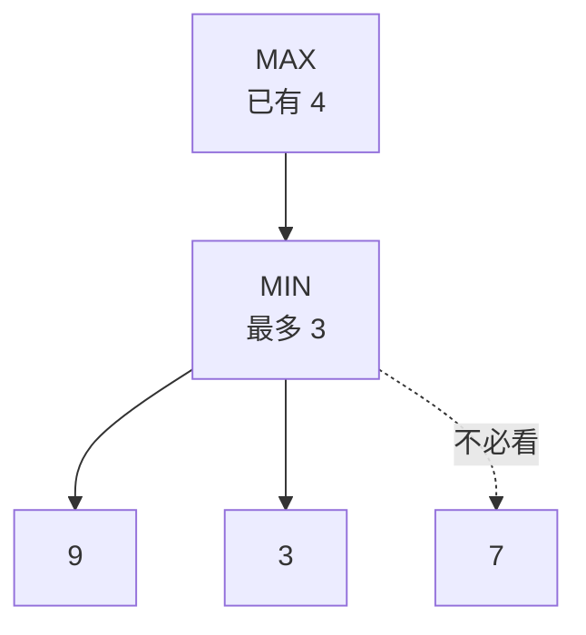

> 🌏 [English version](/posts/learning/2026-10-13-diagrams-in-teaching-articles-en)

這篇要回答三個問題：教學文章裡哪些內容值得畫成圖或表，該畫哪一種，以及怎麼畫讀者才真的學得比較好。

起因是本站的課程導讀。這些導讀依講課字幕寫成，字幕看不到投影片，所以原本幾乎只有文字、表格和公式。讀者反映想看圖，我先在 [Harvard CS50 AI 第 0 週導讀](/posts/tech/2026-08-27-harvard-cs50ai-w00-search)補了三張 [mermaid](https://mermaid.js.org/) 圖，結果其中一張九個葉子的樹，在 390px 寬的手機上標籤只剩約 8px 高，根本讀不了。於是回頭查：圖對學習的效果有多大、什麼內容配什麼圖、手機上有沒有可依循的標準。這是「教學文章怎麼寫」系列的第 2 篇；第 5 篇談[影片該放哪裡](/posts/learning/2026-10-13-instructional-video-in-articles)，第 6 篇談[讀到一半想看影片時畫面怎麼排](/posts/learning/2026-10-13-video-beside-text-layout)。

先說我讀完之後的看法，這是推論，依據在後面各節。圖有沒有用，我認為主要看兩件事：讀者找得到圖和文字之間的對應，以及讀者有沒有拿圖做事（預測下一步、自己填一格）。這兩件事各有研究支持（不過能把「預測」這一步單獨分開的直接證據只有一個實驗，沒有測到差異，見演算法那一節），做起來也便宜，所以我把它們排在「多畫幾張」和「讓圖動起來」前面；沒有實驗直接比過這個先後順序。

讀之前要先知道這些證據偏向哪裡。我讀的研究多半是英語期刊上的統合分析與拿得到全文的論文，受試者多半是大學生，教材多半只有幾分鐘到十幾分鐘。長篇教材的研究我一篇都沒有找到，「已經有表格與公式的文章再加圖」也沒有。教學網站那一節挑的多半是英語圈有名的站，另外補了三個中文的，每站只看一頁。所以下面有一部分建議是從短教材推過來的，凡是推論都當場標明。

## 先看結論：哪類內容用哪種表示法

| 內容 | 建議的表示法 | 依據 |
|---|---|---|
| 演算法逐步執行（每一步的狀態怎麼變） | 狀態表，一列一步，前面放一題，要讀者寫出下一步和理由。分格小圖可以試 | 演算法視覺化的研究：只看圖不夠，讓學生動手的實驗比較常測到差異；能把「預測」單獨分開的只有一個實驗，沒有測到差異。要讀者寫出理由，是借[系列第 1 篇](/posts/learning/2026-10-13-teaching-text-evidence)引的 Bisra 等人自我解釋提示統合分析，是我的推論；本篇「範例旁邊的輔助」一節的數學範例統合分析裡，加了自我解釋提示的範例效果反而較低，作者說那只是跨研究的描述性比較。分格圖有論述支持，但唯一一個我讀到的直接實驗裡，四張分格圖沒有贏過單張圖 |
| 階層與樹（搜尋樹、決策樹、語法樹） | 節點連線圖；同一層超過 3 個節點就拆成多張小圖 | Larkin 與 Simon 的分析加上本站的寬度實測 |
| 元件之間的資料流向與因果 | 方塊加箭頭 | 箭頭會讓讀者把圖讀成「怎麼運作」 |
| 單一路徑的流程、一兩個出口的迴圈 | 編號清單或虛擬碼 | 我的推論：清單已經把順序講完 |
| 幾個方案在相同面向上的比較 | 表格 | 我的推論：表格已經把面向對齊；概念圖對條列的優勢在兩篇統合分析裡都不大 |
| 數量關係（曲線、成長、分布） | 用位置表示數量的圖：折線、散點、長條 | 圖形知覺實驗 |
| 幾何與空間（決策邊界、梯度下降的路徑） | 真的圖 | 內容本身是空間的 |

不要畫的情況有四種：

1. 裝飾用的圖、和這一節學習目標無關的插圖。
2. 文字已經講完、內容又簡單，圖只是重說一遍。
3. 手機上圖內文字會小於 12px。
4. 要點一下或滑過去才看得到的重要內容。

後面各節說明這些建議的來源。倒數第二節是這些證據管不到的地方，每項研究的完整設計與數字放在附錄。

## 本站的現況：依字幕寫的導讀幾乎沒有圖

本站的圖用 mermaid 寫成文字，在瀏覽器端渲染。有兩個限制：所有節點同一個顏色（自訂顏色不會跟著深淺色切換，所以站上規定不指定），而且圖會縮到容器寬度，節點一多字就變小。

第 0 週補的三張圖是：一張示範用的圖（A 到 F 六個節點）、一張搜尋流程的流程圖、一張 Alpha-Beta 剪枝的樹。用瀏覽器在 390px 寬度量，剪枝樹由上往下排的時候標籤約 8px 高。改成由左往右排之後回到約 19px，代價是圖在桌機上變成約 940px 高。

我另外用站上同一版 mermaid 在無畫面的 Chromium 裡渲染這三張圖，讀它們的原始尺寸（字型和正式站不同，會有幾個百分點的差距）：

| 圖 | 節點數 | 原始寬 × 高 | 換算到手機的字級 |
|---|---|---|---|
| 示範用的圖 | 6 | 270 × 382 | 16px，不必縮 |
| 搜尋流程圖 | 7 | 556 × 770 | 約 9.4px |
| 剪枝樹，由上往下 | 13 | 1042 × 350 | 約 5px |
| 剪枝樹，由左往右 | 13 | 435 × 902 | 約 12px |
| 剪枝樹只畫一個分支（試畫） | 5 | 324 × 350 | 16px，不必縮 |

表中的字級以可用寬度約 326px 估算。mermaid 的預設字級是 16px，一行標籤高約 24px，所以「字級 5px」和瀏覽器量到的「標籤高 8px」是同一件事。

從這張表看得出兩件事。由上往下排的時候，同一層每多一個節點，圖大約寬 115 到 120px（三個葉子 324px、九個葉子 1042px）。另一件事是，被忽略的那張流程圖其實也讀不了。

這些是中文頁的數字。英文頁的標籤比較長，同樣三張圖量到的是 254 × 382、630 × 810、470 × 902：流程圖換算約 8.3px，由左往右的剪枝樹約 11px，已經低於下面用的 12px 下限。

## 加一張圖能多學到多少

**平均有幫助，幅度中等，而且看題型。**[Guo 等人（2020）](https://files.eric.ed.gov/fulltext/EJ1248499.pdf)彙整 39 個實驗，比較「文字加圖」與「只有文字」的閱讀理解，整體效果量 g = 0.39。效果量是兩組平均分數的差距除以標準差，0.2 上下算小，0.5 上下算中。圖的好處集中在要自己組織答案的簡答題；是非題與選擇題上小得多。圖的類型（圖片、圖解、流程圖）之間沒有顯著差異。

**圖文怎麼搭，可能和有沒有圖一樣要緊**。[Noetel 等人的統合回顧](https://doi.org/10.31234/osf.io/pynzr)（我讀的是預印本）彙整 29 篇系統性回顧。其中把相關的文字和圖放在一起，對照分開放，效果量是 0.63。這個數字和 Guo 的 0.39 不能直接比大小：它比的是「放在一起對分開放」，兩邊都有圖；Guo 比的是「有圖對沒圖」；兩者納入的研究也不是同一批。我的推論是先把既有的圖和文字對好，再考慮多畫，理由是前者便宜，而不是 0.63 大於 0.39。這篇回顧的各項數字都取自個別的統合分析，下一節逐項標明是誰轉引誰，以及原文我讀到什麼程度。

Noetel 的回顧裡有兩個調節效果和部落格直接相關：

- 教材越複雜，設計原則越有用。元素之間互相牽連多的教材效果量 0.70，簡單教材只有 0.20。
- 讀者自己控制步調時，效果比較小。像聽課那樣由系統控制步調時是 0.41，像讀網頁那樣自己控制時是 0.27。

所以對一篇讀者可以隨時停下來重讀的文章，預期落在這些數字的低端；而且只有複雜的內容值得花力氣畫。

這篇回顧還有一個和常見說法不同的結果：先備知識沒有穩定地調節效果。理論預測好的設計對新手幫助比較大，但各統合分析的方向不一致，合併之後不顯著。

## 圖和文字怎麼搭

### 放在一起

Noetel 轉引 [Schroeder 與 Cenkci（2018）](https://link.springer.com/article/10.1007/s10648-018-9435-9)的統合分析（原文我只讀到摘要）：相關的文字和圖放在一起，比分開放的效果量高 0.63。同一篇回顧轉述眼動研究的發現：放在一起時，讀者的注意力更集中，圖文整合得更好。

動作：解釋一張圖的段落緊貼著圖，中間不隔別的內容；圖裡的用詞和正文一模一樣。正文叫 frontier，節點上就寫 frontier。

本站原本的規則是「節點文字寫短，細節放在圖下方的條列」。這是手機寬度逼出來的折衷。折衷之後能守住的是：節點上寫「名稱加當下的值」，推理寫在緊鄰的段落。

### 標出重點

Noetel 轉引 [Schneider 等人（2018）](https://www.sciencedirect.com/science/article/abs/pii/S1747938X17300581)（原文我只讀到摘要）：用箭頭、標示、強調告訴讀者該看哪裡，效果量 0.43。這是那篇回顧裡證據量最大的一項。

沒有顏色可用的時候，訊號靠線型、外框與節點文字。第 0 週的剪枝樹用虛線表示「不必看的葉子」，是這個原則能做到的版本。動作：一張圖最多兩種線型，並在圖說裡講明各代表什麼。

### 拿掉無關的

Noetel 轉引 [Sundararajan 與 Adesope（2020）](https://link.springer.com/article/10.1007/s10648-020-09522-4)（原文我只讀到摘要）：拿掉有趣但無關的細節，效果量 0.33。細節一直留在畫面上時傷害比較大，文章裡的圖正是這一種。

[Cooper、Sidney 與 Alibali（2018）](https://alibali.psych.wisc.edu/wp-content/uploads/sites/371/2018/02/CooperSidneyAlibali2018.pdf)讓 92 位大學生解三角函數應用題。題目附上數學圖解時答對率比較高；附上情境插圖時，數學能力高的學生受益，能力低的學生反而受害。

### 圖和文字不要逐句重複

[Trypke、Stebner 與 Wirth（2023）](https://www.frontiersin.org/journals/psychology/articles/10.3389/fpsyg.2023.1148035/pdf)的文獻回顧把重複分成兩種。同一件事用兩種形式各說一次，整體是正面的；但圖和書面文字走的是同一個視覺通道，摘要把這個組合歸在負面。他們的表 4 列出的個別研究兩個方向都有：有的實驗只看圖解的組贏過圖解加文字的組，也有實驗是圖加文字的組贏。

我的推論：文字寫推理（為什麼看到 3 就可以停），圖呈現結構（哪些葉子被剪掉），兩者不要逐句對應。這一條沒有針對長篇導讀的直接實驗。

## 哪種內容配哪種圖

這一題的直接實驗最少。能引用的是兩個理論分析和一條圖形知覺的實驗線，上面那張對應表大部分是我依它們推出來的。

### 圖省的是搜尋與比對

[Larkin 與 Simon（1987）](https://mechanism.ucsd.edu/bill/teaching/F12/cs200/Readings/larkin.whyadiagramissometimesworth.1987.pdf)用電腦模擬同一道題在兩種表徵下的求解過程（一道滑輪題、一道幾何題），不是受試者實驗。他們的主張是：圖和文字可以裝一樣的資訊，差別在使用時的計算成本。圖有三個優勢：

- 一起用的資訊放在相鄰的位置，省掉搜尋。
- 同一個元素的資訊聚在同一個位置，不必比對符號標籤。
- 支援很多容易的知覺推論。

他們接著寫了兩個但書，題目裡那個「有時候」就是為此而加：

> None of these points insure that an arbitrary diagram is worth 10,000 of any set of words.

以及，圖只對知道怎麼用它的人有用。

落到選圖（我的推論）：一段內容值不值得畫，看讀者是不是要反覆回頭找東西，或同時比對好幾個元素。搜尋樹符合，讀者要對照父節點的值和兄弟節點的值。單一路徑的流程不符合，讀一次就過去了。

最對題的一篇是 [Novick 與 Hurley（2001）](https://www.sciencedirect.com/science/article/abs/pii/S0010028500907461)，分析矩陣、網路、階層三種圖各適合什麼結構的資訊。我只讀到摘要，而且依摘要，它觀察的是大學生怎麼選圖與怎麼說明理由，不是用哪種圖學得比較好，所以這裡不拿它當依據。

### 箭頭會被讀成過程

[Tversky（2011）](https://tc.columbia.edu/faculty/bt2158/faculty-profile/files/2011_Tversky_VisualizingThoughts.pdf)整理了圖解元素怎麼帶出意義。她引用 Heiser 與 Tversky（2006）的實驗：同一張機械圖，沒有箭頭時學生寫出零件的空間關係，加了箭頭就寫出一步步的因果運作。

動作：箭頭只用在因果、資料流向、先後順序。只想表達「A 包含 B」「A 和 B 有關」時，用外框分組或不帶箭頭的線。

### 數量用位置表示

[Cleveland 與 McGill（1984）](https://dsciclass.org/dsci310/Notes/Cleveland_McGill_EPT.pdf)列出從圖上讀數量的基本知覺任務，並依準確度排序。同一條軸上的位置最準，其次是不同軸上的位置。再來是長度、方向與角度，然後是面積，再來是體積與曲率，最後是明暗與色彩飽和度。[Heer 與 Bostock（2010）](http://vis.stanford.edu/files/2010-MTurk-CHI.pdf)後來在 Mechanical Turk 上重做了空間編碼的實驗。

動作：要讓讀者比大小、看趨勢，用折線、散點或長條。不要用圓餅的角度、氣泡的面積或顏色深淺表示數量。mermaid 沒有合用的數量圖，這類內容目前只能用表格，或另外產生 SVG。

## 演算法的圖：讀者動手時比較容易測到差異

本站的內容大半是演算法與模型，這條研究線最對題。

[Hundhausen、Douglas 與 Stasko（2002）](https://faculty.cc.gatech.edu/~stasko/papers/jvlc02.pdf)彙整 24 個演算法視覺化的對照實驗。他們依實驗背後的學習理論把實驗分成四組，下表是實驗數最多的兩組（另外兩組都是 50%，見附錄）：

| 實驗在比什麼 | 得到顯著差異的比例 |
|---|---|
| 圖怎麼畫（表徵方式、有沒有標籤、資料量） | 30% |
| 學生做什麼（自己設計輸入、預測下一步、寫程式） | 71% |

71% 是 14 個實驗裡 10 個。我照表 2 逐一對過，這 10 個包含 Byrne 等人那兩個「預測與動畫分不開」的實驗；扣掉它們，是 14 個裡 8 個。原文沒有明說這一點。

作者的結論是：

> how students use AV technology has a greater impact on effectiveness than what AV technology shows them

他們另外依兩組學生投入的心力重新分類：投入大致相等的 9 個實驗裡，6 個沒有顯著差異；一組投入較多的 14 個實驗裡，10 個是投入多的那一組顯著較好。作者在結論（第 6.3 節）寫，除了少數例外，只是觀看視覺化的學生和用傳統教材的學生相比沒有顯著優勢。反過來，把對照組的活動補齊之後，差距就不見了：Hansen 等人的第三個研究讓只讀文字的組另外做紙筆練習，和視覺化組沒有顯著差異；Gurka 複製 Byrne 的實驗時拿掉預測條件、兩組都有小組討論，也沒有顯著差異。作者把這兩個不顯著歸因於兩組的投入被拉平；我的解讀是好處跟著投入走，不一定要靠視覺化工具本身。例外確實有：同一篇的表 2 裡，Kann 等人的實驗四組都要寫程式，差別在有沒有看動畫，看了動畫的組後測顯著較好。Byrne 等人的兩個實驗也顯著，但結果是「看了動畫或做了預測（或兩者都有）」的組勝過兩者都沒做的組，作者說預測與動畫各自的效果在統計上分不開。

同一年的 [ITiCSE 工作小組報告（Naps 等，2002）](https://users.cs.duke.edu/~rodger/jflappapers/Naps2002.pdf)把學習者的投入方式分成六類：不看、觀看、回應（回答關於圖的問題）、改變（自己給輸入）、建構（自己做圖）、發表。報告列的第一個假設就是：只觀看和完全不看，學習成果相當。報告自己帶著保留：支持這個假設的幾個研究樣本都小，所以才列為待驗證的假設。

靜態文章裡的圖屬於「觀看」。要往上一級，最便宜的做法是「回應」：給圖之前先問下一步會發生什麼。這是我的推論：Hundhausen 支持的是「讓學生動手」這一大類。能把「先預測」單獨分開的只有 Jarc 等人一個實驗，預測組後測沒有顯著差異，只是花的時間顯著較多；Byrne 等人的兩個實驗分不出是預測還是動畫的功勞。和「先問再給圖」最接近的還有一個反向結果：Hansen 等人的第六個研究比較完整版與拿掉某一項功能的版本，其中一組拿掉了互動提問，各組之間沒有顯著差異。本站的導讀已經有「自我檢查｜先寫下答案，再展開」的格式，把它移到圖的前面就做到了。

後續的狀況不樂觀。[Shaffer 等人（2010）](https://cs.utep.edu/makbar/papers/TOCE.pdf)清點了超過 500 個演算法視覺化，結論是許多品質不佳，而且超過四分之一都在畫排序。[Sibia、Liut 與 Nobre（2025）](https://diglib.eg.org/bitstreams/c65f8ea5-9633-4a64-8758-906ce2e446e1/download)的系統性回顧選了 90 篇論文，摘要的結論是缺少嚴謹的評估。

## 靜態圖、分格圖、動畫、互動圖

### 動畫贏靜態圖的幅度不大，兩篇統合分析的說法不同

[Berney 與 Bétrancourt（2016）](https://access.archive-ouverte.unige.ch/access/metadata/75bf6876-cb91-4e2c-8ac6-9d0767449449/download)彙整 140 組「動畫對靜態圖」的比較，其中 59.3% 沒有顯著差異。整體效果量偏向動畫（g = 0.226），作者自己歸類為小效果。

更早的 [Höffler 與 Leutner（2007）](https://www.sciencedirect.com/science/article/abs/pii/S0959475207001077)我只讀到摘要。Berney 與 Bétrancourt 轉述它的整體效果量是 d = 0.37，在前言稱之為中等，在討論又稱為小到中等；後面會提到的 Ploetzner 等人則把這兩篇都說成只有小的整體效果。兩篇統合分析的量值不同，後人的定性描述也不一致，我把它們並列，不替讀者選一個。

Berney 與 Bétrancourt 發現動畫的優勢集中在三種情況：系統控制步調、配旁白、沒有搭配文字。一篇讀者自己捲動、沒有旁白、一定有文字的文章，三種都不符合。這三項都是跨研究的子群比較，作者自己說這類比較的檢定力低；而且「沒有搭配文字」的 14 個比較裡，有 6 個出自同一篇（Kühl 等 2012）。

[Tversky、Morrison 與 Bétrancourt（2002）](https://hci.stanford.edu/courses/cs448b/papers/Tversky_AnimationFacilitate_IJHCS02.pdf)更早就逐一檢查了「動畫贏」的研究，發現兩邊常常不對等：動畫版本多了靜態版本沒有的資訊，或者動畫組同時多了互動或預測。他們舉的例子包括心臟的動畫有畫血流路徑，靜態圖卻沒畫。

### 分格圖：有論述支持，也有一個反例

Tversky 等人解釋動畫為什麼常常失敗：動畫太快、太複雜時看不清楚；而且很多連續的過程，人本來就是當成一連串離散的步驟來理解的。作者接著寫到多張靜態圖的好處：

> multiple diagrams have an additional advantage: they easily allow comparison and reinspection of the details of the actions

[Rey 等人（2019）](https://maria-wirzberger.de/wp-content/uploads/2019/01/Rey2019_Article_AMeta-analysisOfTheSegmentingE.pdf)的統合分析也常被拿來支持「切小段」：把多媒體教材切成段落，保留測驗的效果量是 0.32。但它納入的研究只要符合「切段」或「學習者控制步調」其中一項就算，也包括切段後由系統自動往下播的；學習者控制步調的那部分，只在遷移測驗上顯著。分段的教材學習時間比較長，不過這一項有顯著的出版偏誤，作者說要小心解讀。這些都和「把一張圖拆成幾格」不是同一件事。

直接比較過分格圖的實驗，我只讀到一個，結果不支持。[Ploetzner、Berney 與 Bétrancourt（2021）](https://link.springer.com/article/10.1007/s11251-021-09541-w)讓 88 位師資培育學程的大學生學一組六連桿齒輪機構，分三組：看一張圖、看四張依序編號的圖、看沒有旁白、不能操作的動畫；每種題目之前各看一次（每次 2 分鐘），看完立刻作答。要辨認各零件怎麼動的時候，動畫組遠勝另外兩組，四張圖和一張圖沒有差別。要辨認零件的空間配置時，一張圖最好，四張圖和動畫沒有差別。作者推測四張圖和動畫都給了太多資訊，學習者不知道該看哪裡。

這個實驗和演算法的逐步執行有兩個落差，能不能類推我不知道。它的內容是連續、不規則的機械運動，四張圖之間的過程要靠學習者自己在腦中補；搜尋演算法的每一步是離散的狀態，兩步之間沒有「中間的運動」要補。它量的是知覺層次的辨認，作者明講沒有研究概念理解。

所以分格圖目前的位置是：有論述支持，有站上的實測顯示它在手機上讀得到，沒有實驗說它讓人學得比較好，而且有一個鄰近情境的實驗說它沒有幫助。

### 互動：讀者不一定會去操作

[Conlen、Kale 與 Heer（2019）](https://idl.cs.washington.edu/files/2019-IdyllAnalytics-EuroVis.pdf)在三篇公開發表的互動文章裡埋了紀錄，收集超過 5 萬個閱讀工作階段。其中一篇降維演算法的入門文章，讀到文末的讀者有 41% 沒有點按鈕去看其他演算法的說明。另一篇節奏教學文章，手機讀者只有 10% 播放了文末的範例。

紐約時報的 Archie Tse 在 [2016 年的簡報](https://github.com/archietse/malofiej-2016/blob/master/tse-malofiej-2016-slides.pdf)裡把他們的經驗寫成三條規則，第二條是：

> If you make a tooltip or rollover, assume no one will ever see it.

這份簡報是實務者的經驗，沒有公開資料。[Hohman 等人（2020）](https://distill.pub/2020/communicating-with-interactive-articles/)在 Distill 的文章裡引了同一份簡報，但談的是紐約時報的另一個說法：只有一小部分讀者會操作非靜態的內容，設計者應該少做互動。他們提醒這個說法已經被設計者當成經驗法則，而它只是一則軼聞，可能讓人錯過適合互動的情況；他們同時指出做一篇互動文章的工夫接近做一個網站。

### 成本對照

下表的成本欄是我的判斷。

| 形式 | 證據 | 製作與維護成本 |
|---|---|---|
| 靜態圖 | 加圖的效果量約 0.39 | 低 |
| 分格靜態圖 | 論述支持；一個直接實驗不支持 | 中：同一張圖要寫 3 到 5 份 |
| 動畫 | 相對靜態圖有小到中等的優勢，集中在本站沒有的條件 | 高：播放控制、深淺色、雙語都要另做 |
| 互動（先問再給圖） | 讓學生動手這一大類有支持；能單獨分開「預測」的一個實驗沒有差異，拿掉互動提問的實驗也沒有差異 | 低：用 HTML 的 `
` 就能做 |
| 互動（可操作的圖） | 沒有我讀到的學習成效對照 | 很高：每張圖是一支小程式 |

## 讓讀者自己畫

### 概念圖：讀現成的對條列有小到中等的優勢

[Nesbit 與 Adesope（2006）](https://sfu.ca/~jcnesbit/articles/NesbitAdesope2006.pdf)彙整 55 個概念圖的研究。讀現成的概念圖，比讀大綱或條列好 0.28 個標準差。自己畫概念圖和自己寫摘要或大綱相比，差距更小（0.19）。作者寫道，效果量低於 0.2 個標準差時，有理由懷疑它在教學上有沒有意義。他們也認為，概念圖的好處大部分可能來自學生更投入，而不是概念圖這種媒介本身。

[Schroeder 等人（2018）](https://summit.sfu.ca/_flysystem/fedora/sfu_migrate/17789/schroedernesbitanguianoadesope2017.pdf)用 2005 年之後的研究更新了這份統合分析（我讀的是作者稿）。自己畫的效果量 0.72，讀現成的 0.43。讀現成的概念圖，對照「讀或寫條列」，是 0.43，作者稱為小到中等；這比前一篇的 0.28 大，兩篇的對照組定義也不完全一樣。對照讀文字的那一項研究最多，效果量是 0.29。作者提醒，各研究的實驗組與對照組做法差異很大，這些對照要保守解讀。

兩篇放在一起看：讀現成的概念圖對條列有優勢，兩篇的估計是 0.28 與 0.43。兩篇的整體數字也都是畫大於讀：Schroeder 是 0.72 對 0.43，Nesbit 與 Adesope 是 0.82 對 0.37。但這兩組數字都不是在同一批研究裡直接比出來的。在 Nesbit 與 Adesope 那裡，畫概念圖的研究都不是實驗室研究、多數全程在教室裡做，對照組常是聽課或討論；讀現成概念圖的研究多半是大學生在實驗室裡做，對照組是讀文字或條列。他們的 0.82 還被奈及利亞與埃及的七個效果量拉高，只看美國與加拿大是 0.47，作者後面的分析也只用這一部分。對照組一換差距更明顯：畫概念圖對聽課是 0.74，對自己寫摘要或大綱只有 0.19。

### 畫圖：已經有圖的時候，要「先畫再對照」

[Fiorella 與 Mayer（2016）](https://doi.org/10.1007/s10648-015-9348-9)回顧八種讓學習者自己產出東西的策略，畫圖是其中之一。他們整理的條件是：畫圖在幾種情況下比較有效，包括先教怎麼畫、明確告訴學生該畫進哪些元素、給一張畫了一半的底圖，或者畫完之後拿自己的圖去對照作者提供的圖。他們也提醒，如果學生的心力花在「怎麼畫」上，畫圖反而添亂。

後續還有兩篇直接處理「自己畫」與「看現成的圖」怎麼比的研究：[Fiorella 與 Zhang（2018）](https://ecrhub.org/publications/drawing-boundary-conditions-learning-drawing)的回顧，以及 [Zhang 與 Fiorella（2021）](https://www.sciencedirect.com/science/article/abs/pii/S0361476X21000497)的兩個實驗。這兩篇我只讀到摘要，這裡只記下它們存在，不拿它們當依據。

給畫圖的學生更多輔助有沒有用，兩篇統合分析的結論不同。[Leutner 與 Biele（2025）](https://link.springer.com/article/10.1007/s10648-025-10067-7)比較「有輔助地畫」與「只叫學生畫」，整體沒有效果（理解 g = 0.04）；有效的只有幫學生把圖和文字整合起來的那一類，例如拿自己的圖去對照提供的圖。這篇文章自己指出，[Cromley 等人（2020）](https://link.springer.com/article/10.1007/s10956-019-09807-6)用比較多的研究得到顯著的整體效果，和它的結果不一致；它的解釋是自己的納入標準比較嚴、研究比較少。Cromley 那篇我只讀到摘要。這個不一致我沒有能力裁決，兩邊都列在這裡。

兩邊都同意的只有一點：對照自己的圖與提供的圖是有用的。

動作：做一種新的自我檢查題。請讀者先在紙上畫出展開到第三步的搜尋樹，再展開答案，答案裡放圖。這些研究的教材是化學、生物一類的科學文本，離演算法有一段距離。

### 範例旁邊的輔助，一次一種

[Barbieri 等人（2023）](https://danamillercotto.com/uploads/4/7/7/2/47725475/barbieri_et_al__2023__we_meta-analysis.pdf)彙整 55 個數學範例（worked example）的研究，範例的整體效果量是 0.48。意外的結果是，範例加上自我解釋提示，效果反而比不加的低。作者提醒這些調節分析是描述性的，不能當成因果。

這裡研究的是「在範例旁邊要求學生解釋每一步」，和講解之後才出現的檢索練習不是同一件事，不能直接拿來否定文末的自我檢查。能帶走的是比較保守的一句：同一個範例旁邊同時放圖、表與提示題，不見得越多越好。我沒有找到直接比較「範例配圖」與「範例不配圖」的統合分析。

## 手機與無障礙

### 沒有哪一份標準規定最小字級

我讀了 WCAG 2.2 三則相關的成功準則，都沒有像素下限：

- [1.4.4 Resize Text](https://www.w3.org/WAI/WCAG22/Understanding/resize-text)：文字要能放大到 200% 而不失去內容或功能。
- [1.4.10 Reflow](https://www.w3.org/WAI/WCAG22/Understanding/reflow)：寬度 320 CSS px 時，內容不得需要雙向捲動。但需要二維版面才能理解的內容除外，註解明列「地圖與圖解」與資料表格，並說這些部分提供二維捲動是可接受的。
- [1.4.5 Images of Text](https://www.w3.org/WAI/WCAG22/Understanding/images-of-text)：能用真的文字呈現，就不要用文字的圖片。

[Apple 的 Human Interface Guidelines](https://developer.apple.com/design/human-interface-guidelines/typography) 有數字：iOS 的預設字級 17pt，最小 11pt。

所以本文用的 12px 下限是我的判斷，依據是 Apple 的最小值再留一點餘裕，因為中文筆畫比拉丁字母密。

### 從實測得到的寬度規則

- mermaid 圖的原始寬度超過約 435px，手機上的字就小於 12px。
- 由上往下排的圖，同一層最多並排 3 個節點。這是節點文字只有一兩個詞時的數字，標籤越長能並排的越少。
- 改成由左往右排是把寬度換成高度。中文頁的剪枝樹改完之後字讀得到（約 12px），英文頁因為標籤較長只到約 11px；兩頁的樹都變成橫著長，和正文「上面是我、下面是對手」的說法對不上。

處理順序（我的判斷）：先拆成多張小圖；拆不了就換成表格或清單；再不行才改方向。還有一個選項是改站上的樣式，讓超寬的圖在容器內橫向捲動而不縮小，WCAG 1.4.10 明文允許這樣做。

### 圖要有文字等價物

[WCAG 1.1.1](https://www.w3.org/WAI/WCAG22/Understanding/non-text-content) 要求圖表與圖解有文字替代。[W3C 的複雜圖片教學](https://www.w3.org/WAI/tutorials/images/complex/)進一步建議把長說明放在正文裡給所有人看，理由是複雜的圖對低視能、學習障礙，以及對主題不熟的人都難懂。

mermaid 支援在圖的原始碼裡寫 `accTitle` 與 `accDescr`（[官方文件](https://mermaid.js.org/config/accessibility.html)），會變成 SVG 的標題與描述，螢幕閱讀器讀得到。

動作：每張 mermaid 圖寫一行 `accTitle`。圖前後的文字要讓讀不到圖的人得到同樣的結論，但不逐節點複述。

## mermaid 以外的做法

下表的成本是我的判斷。只有標「已查文件」的兩項，我在這次讀過官方文件；其餘是既有的認識，沒有另外查證。每一種做法，中文版和英文版都要各有一份。

| 做法 | 適合什麼 | 深淺色 | 成本與風險 |
|---|---|---|---|
| mermaid（現況） | 流程、樹、狀態、序列 | 已處理 | 低。自動排版，寬度難控制；不能用顏色 |
| 表格 | 比較、逐步執行的狀態表 | 自動 | 最低 |
| 帶註解的程式碼 | 演算法本身 | 自動 | 最低 |
| KaTeX | 公式、對齊的推導 | 自動 | 低 |
| 程式碼區塊裡的 ASCII 圖 | 很小的鏈或樹 | 自動 | 低。中文是全形字，和半形符號混排會對不齊 |
| 手寫的行內 SVG | 需要精確版面的圖 | 用 `currentColor` 就會跟著切換 | 中到高。字級可以固定，但要手算座標 |
| [rehype-mermaid](https://github.com/remcohaszing/rehype-mermaid) | 同 mermaid，改在建置時渲染 | 已查文件：兩種輸出方式支援 `dark` 選項 | 已查文件：建置環境要裝 Playwright 與瀏覽器 |
| [D2](https://d2lang.com/) | 架構圖、有巢狀容器的圖 | 已查文件：深色主題跟著系統偏好，不跟站上的手動切換 | 中。建置流程要多一個指令 |
| Graphviz | 大型的圖 | 要自己處理 | 中 |
| Excalidraw | 手繪風格的概念圖 | 要匯出兩份 | 高。兩種語言乘兩種主題，四個檔容易不同步 |

我的建議順序：先用表格、程式碼、KaTeX 這三種不花成本的。結構圖用 mermaid，守住寬度規則。mermaid 排不好，而且那張圖是該堂課的核心，才手寫 SVG。

## 其他教學網站怎麼做

我先列了 19 個候選（一開始列的 10 個英語站、本站導讀涵蓋的課程的官方筆記、再用搜尋補英語的互動文章與中文的演算法教學站），從中依形態各挑幾個，每站抓一頁原始 HTML 來數。以下是標籤數，不是肉眼看到的圖數；用 JavaScript 動態插入的內容數不到（Hello 演算法因此改用閱讀器輸出的 Markdown 來數）。Khan Academy 與 MLU-Explain 抓到的是空殼；R2D3 的互動圖由 JavaScript 產生，HTML 裡數不到；VisuAlgo 整頁是一個操作介面，字數與圖數沒有可比性。這四個都不列。

| 頁面 | 正文字數（不含程式碼區塊） | 圖 | 觀察 |
|---|---|---|---|
| [CS50 AI 官方筆記 Lecture 0](https://cs50.harvard.edu/ai/notes/0/) | 約 3,300 | 6 張 | 有圖的是：15 puzzle、狀態空間、曼哈頓距離、兩張 Minimax、Alpha-Beta。DFS 與 BFS 的逐步過程沒有圖 |
| [The Illustrated Transformer](https://jalammar.github.io/illustrated-transformer/) | 約 4,150 | 37 張 | 約每 110 字一張；圖都沒有替代文字 |
| [Distill：Attention and Augmented RNNs](https://distill.pub/2016/augmented-rnns/) | 約 4,000 | 21 個 figure | 約每 190 字一張 |
| [Red Blob Games：A* 入門](https://www.redblobgames.com/pathfinding/a-star/introduction.html) | 約 2,350 | 19 個 figure | 約每 120 字一張，另有 21 個 canvas 元素 |
| [3Blue1Brown 文字版：神經網路第一課](https://www.3blue1brown.com/lessons/neural-networks) | 約 4,650 | 16 個 figure | 每張都有圖說，另有 6 段影片 |
| [Hugging Face 課程第 1 章](https://huggingface.co/learn/llm-course/chapter1/4) | 約 2,300 | SVG 圖 | 每張圖有淺色與深色兩個檔，有描述性的替代文字 |
| [CS231n 筆記：卷積網路](https://cs231n.github.io/convolutional-networks/) | 約 9,100 | 9 張 | 約每 1,000 字一張 |
| [Dive into Deep Learning：Transformer](https://d2l.ai/chapter_attention-mechanisms-and-transformers/transformer.html) | 約 1,900 | 5 張 | 1 張架構圖加 4 張程式輸出的圖，約每 380 字一張。HTML 裡因為四個框架的分頁各存一份，數得到 16 張輸出圖與 93 個程式碼區塊 |
| [MIT Missing Semester：版本控制](https://missing.csail.mit.edu/2020/version-control/) | 約 2,400 | 1 張 | 目錄樹與 commit 歷史用程式碼區塊裡的 ASCII 圖 |
| [Josh Comeau：Flexbox 互動指南](https://www.joshwcomeau.com/css/interactive-guide-to-flexbox/) | 約 5,400 | 未計 | 92 個輸入框或按鈕 |
| [Hello 演算法：圖的走訪](https://www.hello-algo.com/zh-hant/chapter_graph/graph_traversal/) | 約 1,200 個中文字 | 24 張 | BFS 與 DFS 各一張總圖，再各配 11 張逐步圖 |
| [演算法筆記：Graph](https://web.ntnu.edu.tw/~algo/Graph.html) | 約 2,500 個中文字 | 28 張 | 篇幅短、圖很密 |
| [動手學深度學習：Transformer](https://zh.d2l.ai/chapter_attention-mechanisms/transformer.html) | 約 2,800 個中文字 | 5 張 | 和英文版相同：1 張架構圖加 4 張程式輸出的圖，四個框架的分頁各存一份 |

圖的密度從每 110 字一張到每 1,000 字一張都有。CS50 與 CS231n 這兩份課程筆記的圖少；Dive into Deep Learning 扣掉程式碼之後，密度落在中間。和第 0 週同一堂課的 CS50 官方筆記只有 6 張圖。同樣教 BFS 與 DFS，Hello 演算法用的是一步一張的分格圖。

這張表只能說這些站怎麼做，不能說哪種做法比較好：我沒有它們的流量或學習成效資料，也沒有在手機寬度下看過任何一站。互動文章那一類還有一個維護上的事實：Distill 在 [2021 年 7 月宣布暫停一年](https://distill.pub/2021/distill-hiatus/)，公告裡提到編輯團隊過勞，並說暫停可能無限期延長。

## 拿第 0 週的三張圖對照

以下是依前面各節推出來的改法，還沒有動手改。

### 示範用的圖：補一張狀態表

這張圖六個節點，手機上不必縮，可讀性沒有問題。它的問題是只給了結構，而這一節要學的是 frontier 怎麼變。

改法是保留圖，在後面加一張狀態表。下面是我依那張圖自己排的例子（A 連到 B，B 連到 C 和 D，C 連到 E，D 連到 F，目標是 E；假設展開 B 時先放 C 再放 D，frontier 是後進先出的 stack）：

| 步 | 拿出 | 是目標？ | 之後的 frontier |
|---|---|---|---|
| 0 | | | A |
| 1 | A | 否 | B |
| 2 | B | 否 | C、D |
| 3 | D | 否 | C、F |
| 4 | F | 否 | C |
| 5 | C | 否 | E |
| 6 | E | 是 | |

同一張圖再配一張先進先出的版本，讀者逐列對照就看得到兩者從第 3 步開始分岔。表格之前先放一題：frontier 是 stack 的時候，拿出 B 之後下一個拿出誰？

### 搜尋流程圖：換成清單

這張圖原始寬度 556px，手機上字級約 9.4px。我試過把節點文字縮短，也只回到約 10.8px。

更根本的問題是它和上方的編號清單幾乎完全重疊。流程圖多給的只有回頭的那條線，而清單的第 5 步已經寫了「回到第 2 步」。

改法是拿掉這張圖，把修正後的流程重寫成一份完整的編號清單，新增的兩處用粗體標出。想要一眼看到全貌，可以用六七行虛擬碼，也接得上後面專案的程式碼。這一項是我的判斷，不是研究直接支持的結論。

### 剪枝樹：先在圖前面加一題，拆成三張可以試

目前由左往右排的版本讀得到字，但有三個問題：樹橫著長，和正文的上下層說法對不上；圖在手機上約 676px 高，接近一整個螢幕；而且它一次呈現算完之後的狀態，正文其實是分三步講的。

成本最低的改法是在圖前面加一題：左邊已經保證 4 分，中間這一支看到 9、再看到 3，第三個葉子還要看嗎？這是把「觀看」變成「回應」。演算法視覺化研究支持的是讓學生動手這一大類；能單獨分開「先預測」的只有一個實驗，沒有測到差異，所以這一題的效果我不能保證。

第二個改法可以試，但沒有證據說它讓人學得比較好：把樹拆成三張由上往下的小圖，各自緊跟在對應的那句話後面。第二張會長這樣：

實線是實際看過的葉子，虛線是被剪掉的。這張圖原始寬度約 324px，手機上不必縮。

拆圖確定能換到的是可讀性：字級回到 16px，圖和解釋它的那句話貼在一起。換不換得到學習效果不確定。前面提過，Ploetzner 等人的實驗裡四張分格圖沒有贏過單張圖；那個實驗教的是連續的機械運動，這裡是三個離散的分支，落差在哪裡前面寫過。

## 今晚可以做的三件事

1. **打開你最近一篇有圖的文章，在手機上看**。圖裡有哪個字要瞇眼才讀得到，就把那張圖拆成兩張，或換成表格。
2. **挑一張講演算法的圖，在它前面加一題**。題目問下一步，並請讀者寫一句為什麼：「接下來被拿出來的是哪個節點？為什麼是它？」答案收在 `
` 裡。
3. **檢查每一張流程圖上方有沒有一份編號清單在講同一件事**。有的話留一個就好，留清單。

## 這些證據的限制

- **教材短、受試者是學生、立刻測驗**。多媒體學習的實驗大多用大學生、幾分鐘到十幾分鐘的教材，讀完馬上考。幾千字、可能分好幾次讀完的長篇導讀，圖的效果有沒有不同，我讀到的統合分析沒有分開報告。
- **對照組通常是純文字**。一篇已經有表格與公式的文章，再加圖能多多少，沒有直接證據。最接近的數字是概念圖對條列的 0.28。
- **統合分析的品質**。Noetel 指出，納入的 29 篇回顧只有 1 篇評估過原始研究的品質，幾乎沒有預先註冊。這個領域的效果量可能整體偏高。Guo 的作者判讀是沒有出版偏誤的跡象（Egger 檢定不顯著），他們另外報告 Trim and Fill 調整後的效果量是 0.28，仍然顯著。
- **三個原則的數字是轉引**。圖文鄰近、訊號、拿掉無關細節這三項，數字來自 Noetel 的轉述，原統合分析我只讀到摘要，沒有讀到它們的方法與限制。
- **演算法視覺化的實驗很舊**。24 個實驗都在 2002 年之前，用的是當時的動畫工具，而且是數「幾個實驗顯著」，不是合併效果量。2002 年之後，我沒有找到有合併效果量的統合分析。
- **哪種內容配哪種圖，大部分是推論**。最對題的 Novick 與 Hurley（2001）我拿不到全文，只在正文提了它的存在。
- **只讀到摘要的有八篇**，正文提到時都當場標明，也都沒有列進參考資料：Schroeder 與 Cenkci 2018、Schneider 等 2018、Sundararajan 與 Adesope 2020、Höffler 與 Leutner 2007、Novick 與 Hurley 2001、Fiorella 與 Zhang 2018、Zhang 與 Fiorella 2021、Cromley 等 2020。
- **分格圖沒有正面的實驗證據**。唯一讀到的直接實驗不支持它，而那個實驗的內容和演算法有落差。「拆成小圖」目前只能當成解決手機可讀性的做法。
- **兩處來源互相不一致，我沒有裁決**：動畫對靜態圖的整體效果（兩篇統合分析），以及畫圖輔助的整體效果（兩篇統合分析）。
- **互動文章的資料量的是行為，不是學習**。三篇文章的流量紀錄，不能說明讀者學到多少。
- **網站觀察每站只有一頁**，數的是 HTML 標籤，挑的站偏英語圈與有名的站，而且沒有任何一站在手機寬度下看過。
- **本站的尺寸實測**用的是無畫面的瀏覽器與替代字型，390px 的標籤高度是另外在一般瀏覽器裡量的。

## 附錄：各研究的設計與數字

正文每項只留一個數字，其餘放在這裡。

**Guo、Zhang、Wright、McTigue（2020）**，AERA Open。39 個實驗研究，發表於 1985 到 2018 年，共 2,103 人（實驗組 1,053、對照組 1,050）。受試者從小學到大學，其中 21 個研究是成人。整體 g = 0.39，95% 信賴區間 0.26 到 0.51。Egger 檢定不顯著（p = .21），作者的結論是結果不受出版偏誤影響；Trim and Fill 補上 7 個研究後是 0.28，仍顯著。個別研究的效果量從 −0.23 到 1.24。分組的描述性結果：圖片 0.37、圖像式圖解 0.63、流程圖 0.35、混用多種圖 0.14；迴歸分析裡只有「混用對圖片」達顯著。依測驗形式：是非題 0.22、選擇題 0.22、簡答題 0.67、混合 0.60。年級不是顯著的調節變項。作者列的限制：教材多半是一段文字配一張圖；9 個研究沒有交代文字來源，只有 6 個用課本內容；先備知識與閱讀時間的資料不足，無法分析。

**Noetel 等的統合回顧**（預印本；期刊版刊於 Review of Educational Research）。29 篇系統性回顧，1,189 個原始研究。受試人數在預印本的摘要寫 78,177，結果段寫 79,415，兩處不一致。各原則合計 g = 0.38（95% 信賴區間 0.27 到 0.49，808 個效果量）。轉引的各項：空間鄰近 0.63（58 個效果量，Schroeder 與 Cenkci 2018）；訊號 0.43（209 個，Schneider 等 2018），另報告降低認知負荷 0.25；分段 0.34（123 個，Rey 等 2019；Rey 的原文分開報告保留 0.32、67 個與遷移 0.36、56 個，個數合計 123 對得上，0.34 這個合併值原文沒有，見下）；拿掉無關細節 0.33（68 個，Sundararajan 與 Adesope 2020），細節持續顯示時 0.43、一閃而過時 0.12；有意義的動畫 0.40、裝飾性動畫 −0.05（Höffler 與 Leutner 2007）；同時給文字與旁白 0.15（Adesope 與 Nesbit 2012），在旁白上加文字 0.29、在文字上加旁白 −0.04。作者指出這些效果量比早期非系統性回顧報的 d > 1.0 保守。限制：29 篇裡只有 2 篇報告雙人獨立篩選；多數回顧用 p < 0.05 做了幾十個調節檢定。

**Cooper、Sidney、Alibali（2018）**，Applied Cognitive Psychology。92 位修心理學導論的大學生，平均 19.0 歲。2 × 2 受試者內設計（有無圖解 × 有無情境插圖），每人四題，題目文字在各條件下相同，光靠文字就能作答。題目偏難，整體答對率 50%。混合效果邏輯迴歸裡，圖解讓答對的勝算比是 5.94；插圖的效果依數學能力而定，能力低一個標準差的學生受害。作者列的限制：題目的情境不是日常會用到三角函數的場合，真實性不足。我讀了摘要、方法、結果與限制。

**Trypke、Stebner、Wirth（2023）**，Frontiers in Psychology。文獻回顧，不是統合分析。四種重複的做法：在圖上加旁白、在圖上加書面文字、在旁白上加書面文字、在有旁白的圖上加書面文字。作者列的限制：只納入明確以重複效應為題的研究；沒有考慮學習者的個別差異與不同的測驗形式。我讀了摘要、引言開頭、表 4 與限制一節。

**Larkin 與 Simon（1987）**，Cognitive Science。以產生式系統模擬，比較語句式與圖解式表徵。我讀了摘要、引言與結論，中間的模擬細節沒有讀。

**Tversky（2011）**，Topics in Cognitive Science。理論性的綜述。我讀了摘要，以及關於排列與箭頭的段落。

**Cleveland 與 McGill（1984）**，Journal of the American Statistical Association。我讀了摘要與基本知覺任務排序的段落，沒有讀實驗細節。

**Heer 與 Bostock（2010）**，CHI：只讀了摘要與引言。

**Hundhausen、Douglas、Stasko（2002）**，Journal of Visual Languages and Computing。24 個對照實驗，作者說接近當時已發表實驗的全部。11 個得到顯著差異，10 個沒有。依理論分組的顯著比例：認知建構論 71%（14 個實驗裡 10 個）、個別差異 50%、雙碼理論 50%、知識保真 30%。依兩組投入的心力：不相等 71%，相等 33%。依測驗的知識類型：只測程序知識 67%、只測概念知識 67%、兩者都測 38%。作者列的限制：「前後測進步」比「只有後測」容易測到差異，但這個發現大半來自同一系列研究，而且前測本身可能讓受試者學到東西；所有實驗量的東西很窄，幾乎都是概念知識與程序知識。

**Naps 等（2002）**，ITiCSE 工作小組報告。作者說明六類投入方式不是嚴格的順序量表，後四類都包含「觀看」而且彼此可以重疊。我讀了摘要、第 3 節開頭與 5.1 節。

**Shaffer 等（2010）**，ACM Transactions on Computing Education。只有 18 個視覺化（3.5%）涵蓋壓縮演算法，NP-completeness 只有 9 個。我讀了摘要與 4.4 節的片段。

**Sibia、Liut、Nobre（2025）**，EuroVis 教育論文。從 288 篇裡選出 90 篇。我讀了摘要、引言與相關研究。

**Berney 與 Bétrancourt（2016）**，Computers & Education。50 篇論文、61 個研究、7,036 人、140 組成對比較。整體 g = 0.226（95% 信賴區間 0.12 到 0.33）。動畫較好 43 組（30.7%）、靜態圖較好 14 組（10%）、沒有顯著差異 83 組（59.3%）。調節結果：系統控制步調 0.309、配旁白 0.320、沒有搭配文字 0.886（這是表 3 的數字；摘要與正文寫 0.336 與 0.883）。「沒有搭配文字」的 14 個比較裡有 6 個出自 Kühl 等 2012 同一篇。這些都是跨研究的子群比較。作者列的限制：部分調節變項的比較數很少，檢定力低；學習成果的分類很困難；16.4% 的研究沒有提供教材的圖片。文中轉述 Höffler 與 Leutner（2007）的整體效果量 d = 0.37。

**Tversky、Morrison、Bétrancourt（2002）**，International Journal of Human-Computer Studies。選擇性的文獻回顧，範圍是用動畫教複雜系統（機械、生物、物理、運算）。作者說明結論只適用這個範圍；動畫用來呈現即時的方位變化，可能是合適的用途。提出兩個原則：對應原則（圖的結構與內容要對應想讓人形成的心智表徵）與可理解原則（圖要能被正確地感知與理解）。我讀了第 1.4 到第 4 節。

**Conlen、Kale、Heer（2019）**，EuroVis。三篇以 Idyll 寫成的互動文章。節奏教學文章：桌機讀者停留時間的中位數 86 秒，85% 有操作互動內容；手機讀者停留的中位數 20 秒。降維入門文章：7,055 次造訪、4,549 位讀者，76% 讀到文末，其中 59% 點了按鈕；滑桿與「演算法細節」按鈕的操作次數中位數是 0。吉他調音文章：55,193 個工作階段。三篇都透過社群媒體推廣。

**Nesbit 與 Adesope（2006）**，Review of Educational Research。55 個研究、67 個效果量、5,818 人，小學四年級到大學。表 2 的整體數字：全部 0.60；畫概念圖 0.82（27 個效果量），其中美國與加拿大 0.47（18 個）、非洲 1.45（7 個）、台灣 −0.003（2 個）；讀現成的 0.37（40 個）。作者因為各地差距太大，畫概念圖的後續分析只用美國與加拿大的研究。表 6 依對照組分：讀現成的概念圖對照讀文字 0.39（29 個效果量，2,027 人），對照讀大綱或條列 0.28（10 個，561 人）；自己畫對照聽課或討論 0.74（10 個），對照自己寫摘要或大綱 0.19（7 個）。畫概念圖的研究沒有一個是實驗室研究；讀現成概念圖的 40 個效果量裡 32 個來自實驗室、38 個是大專以上。讀現成的概念圖對語文能力低的學生有幫助（0.44，2 個效果量），對語文能力高的學生不顯著。同一批受試者回想中心概念的效果量（0.60）比回想細節（0.20）大。多數子集的異質性顯著。我讀了摘要、結果一節全部（表 1 到表 8）與結論；引言只讀了片段，方法與附錄 A 到 C 沒有讀。

**Schroeder、Nesbit、Anguiano、Adesope（2018）**，Educational Psychology Review。讀的是作者稿。142 個效果量、11,814 人，整體 g = 0.58，異質性很高（I² = 87.5）。和各種對照比：討論或講課 1.05（37 個效果量）、條列 0.43（13 個）、大綱 0.48（8 個）、讀文字 0.29（44 個）、寫文字 0.39（13 個）；條列與大綱兩項的對照組是「讀或寫」條列與大綱。分開看（表 9）：讀現成的概念圖對條列 0.43（p = .02）、對讀文字 0.29（39 個效果量）；對大綱 0.72 與對講課 1.09 各只有 2 個與 5 個效果量。畫概念圖對大綱 0.40、對寫文字 0.48。作者說畫概念圖的各項效果都比 Nesbit 與 Adesope 的估計大得多。作者用 fail-safe N 與 Egger 檢定，沒有發現足以影響解讀的出版偏誤。我讀了摘要、方法開頭、兩處對照條件的段落（含表 1 與表 9 的說明）與結論。

**Rey、Beege、Nebel、Wirzberger、Schmitt、Schneider（2019）**，Educational Psychology Review。56 個研究、88 組比較。保留 d = 0.32（67 個效果量），遷移 d = 0.36（56 個）；整體認知負荷降低 0.23；學習時間的效果量是 −0.92，也就是分段的教材花的時間比較長。先備知識高的學習者在保留成績上受益較大，但高先備只有 7 個比較，我從表 2 數到其中 4 個出自同一篇（Singh 等 2012）；作者自己說這個變項的變異很有限；遷移成績則不受先備知識調節。系統控制步調的分段四項結果都顯著，學習者控制步調的只有遷移顯著。學習時間這一項有顯著的出版偏誤，作者說要小心解讀。作者列的限制：統合分析不是實驗，「多了處理時間」與「能調整步調」這兩種解釋互相混在一起，分不開。我讀了摘要、整體結果、三個假說的檢定與限制。

**Ploetzner、Berney、Bétrancourt（2021）**，Instructional Science。88 位大學生，三組各 30、28、30 人。動畫沒有旁白、不能操作；兩種題目之前各看一次教材（每次 2 分鐘），看完立刻測；受試者是同一所大學師資培育學程的學生。辨認運動：動畫對單張圖 d = 2.33，對四張圖 d = 2.41，單張與四張無顯著差異。辨認空間配置：單張圖對四張圖 d = 1.11，對動畫 d = 1.30，四張與動畫無顯著差異。學習者的空間能力和成績沒有顯著關聯。運動題是四選一，兩個靜態圖組的答對率約 35% 與 33%，亂猜的期望值是 25%；這是我讀表的觀察，原文沒有提。作者說明這個實驗只看知覺層次的處理，沒有研究概念理解。我讀了摘要、材料、結果與討論。

**Fiorella 與 Mayer（2016）**，Educational Psychology Review。敘述性回顧，涵蓋摘要、畫概念圖、畫圖、想像、自我測驗、自我解釋、教別人、動手操作八種策略，作者說每一種的效果量中位數都在 d = 0.4 以上。畫圖一節舉的例子是 Schwamborn 等（2010）：九年級學生讀一段肥皂去污的化學文字，在預先畫好背景的紙上畫圖，遷移測驗 d = 0.81。我讀了畫概念圖與畫圖兩節、結語。

**Leutner 與 Biele（2025）**，Educational Psychology Review 37 卷 4 期（作者與卷期取自 Crossref；我存的原文檔沒有作者區塊）。14 個研究、16 個獨立比較、1,213 人。理解 g = 0.04（p = 0.738），遷移 g = −0.10（p = 0.696），兩者異質性都顯著。「幫助整合」這個調節變項在控制另外兩個調節變項之後仍然顯著。作者說明納入的研究少，結果要保守解讀；並提到 Cromley 等（2020）用較多研究得到顯著的整體效果，Zhang 等（2021）則同樣沒有找到主效果。我讀了結果、討論開頭與限制。

**Barbieri、Chawla、Miller-Cotto、Clerjuste（2023）**，Educational Psychology Review。篩選 8,033 篇摘要，納入 43 篇文章、55 個研究、181 個效果量，55 個研究裡只有 2 個是準實驗。只用正確範例的效果，比只用錯誤範例或正誤混用的大。我讀了摘要、引言片段、方法開頭與優缺點一節。

**Apple Human Interface Guidelines**。各平台的預設與最小字級：iOS 與 iPadOS 17pt 與 11pt，macOS 13pt 與 10pt，visionOS 17pt 與 12pt。觸控目標在 iOS 上預設 44 × 44pt、最小 28 × 28pt。[WCAG 2.5.8](https://www.w3.org/WAI/WCAG22/Understanding/target-size-minimum) 的觸控目標下限是 24 × 24 CSS px，只在圖上有可點的節點時相關。

**本站的尺寸實測**。mermaid 11，Chromium，字型 PingFang TC，2026-10-13 以當時的檔案量。英文頁的剪枝樹由上往下排時同樣是 1042 × 350。另外試畫了一張縮短節點文字的流程圖，原始尺寸 481 × 730。

## 參考資料

- [Guo, Zhang, Wright & McTigue (2020), Do You Get the Picture? A Meta-Analysis of the Effect of Graphics on Reading Comprehension](https://files.eric.ed.gov/fulltext/EJ1248499.pdf)：加圖對閱讀理解的效果。讀了摘要、方法、結果、表 3 與表 4、限制。
- [Noetel et al., Multimedia Design for Learning: An Overview of Reviews With Meta-Meta-Analysis](https://doi.org/10.31234/osf.io/pynzr)：各設計原則的效果量與調節效果。讀了預印本的摘要、方法、結果、討論與限制；沒有讀期刊版。
- [Cooper, Sidney & Alibali (2018), Who Benefits from Diagrams and Illustrations in Math Problems?](https://alibali.psych.wisc.edu/wp-content/uploads/sites/371/2018/02/CooperSidneyAlibali2018.pdf)：圖解與情境插圖的差別。讀了摘要、方法、結果與限制。
- [Trypke, Stebner & Wirth (2023), Two types of redundancy in multimedia learning: a literature review](https://www.frontiersin.org/journals/psychology/articles/10.3389/fpsyg.2023.1148035/pdf)：兩種重複。讀了摘要、引言開頭、表 4 與限制。
- [Larkin & Simon (1987), Why a Diagram is (Sometimes) Worth Ten Thousand Words](https://mechanism.ucsd.edu/bill/teaching/F12/cs200/Readings/larkin.whyadiagramissometimesworth.1987.pdf)：圖解的計算優勢。讀了摘要、引言與結論。
- [Tversky (2011), Visualizing Thought](https://tc.columbia.edu/faculty/bt2158/faculty-profile/files/2011_Tversky_VisualizingThoughts.pdf)：圖解元素的意義與箭頭實驗。讀了摘要與相關段落。
- [Cleveland & McGill (1984), Graphical Perception](https://dsciclass.org/dsci310/Notes/Cleveland_McGill_EPT.pdf)：知覺任務的準確度排序。讀了摘要與排序段落。
- [Heer & Bostock (2010), Crowdsourcing Graphical Perception](http://vis.stanford.edu/files/2010-MTurk-CHI.pdf)：重做圖形知覺實驗。讀了摘要與引言。
- [Hundhausen, Douglas & Stasko (2002), A Meta-Study of Algorithm Visualization Effectiveness](https://faculty.cc.gatech.edu/~stasko/papers/jvlc02.pdf)：24 個實驗的彙整。讀了全文，表 2 到表 7 與各圖對過 PDF 版面。
- [Naps et al. (2002), Exploring the Role of Visualization and Engagement in Computer Science Education](https://users.cs.duke.edu/~rodger/jflappapers/Naps2002.pdf)：投入方式的六個類別。讀了摘要、第 3 節開頭與 5.1 節。
- [Shaffer et al. (2010), Algorithm Visualization: The State of the Field](https://cs.utep.edu/makbar/papers/TOCE.pdf)：超過 500 個視覺化的清點。讀了摘要與 4.4 節片段。
- [Sibia, Liut & Nobre (2025), Exploring the Role of Visualization Tools in Enhancing Computing Education](https://diglib.eg.org/bitstreams/c65f8ea5-9633-4a64-8758-906ce2e446e1/download)：90 篇論文的系統性回顧。讀了摘要、引言與相關研究。
- [Berney & Bétrancourt (2016), Does animation enhance learning? A meta-analysis](https://access.archive-ouverte.unige.ch/access/metadata/75bf6876-cb91-4e2c-8ac6-9d0767449449/download)：動畫對靜態圖。讀了摘要、3.1 與 3.2 節、4.4 節。
- [Tversky, Morrison & Bétrancourt (2002), Animation: can it facilitate?](https://hci.stanford.edu/courses/cs448b/papers/Tversky_AnimationFacilitate_IJHCS02.pdf)：動畫研究的檢討。讀了第 1.4 到第 4 節。
- [Ploetzner, Berney & Bétrancourt (2021), When learning from animations is more successful than learning from static pictures: learning the specifics of change](https://link.springer.com/article/10.1007/s11251-021-09541-w)：單張圖、四張圖與動畫的實驗。讀了摘要、材料、結果與討論。
- [Rey et al. (2019), A Meta-analysis of the Segmenting Effect](https://maria-wirzberger.de/wp-content/uploads/2019/01/Rey2019_Article_AMeta-analysisOfTheSegmentingE.pdf)：分段。讀了摘要、整體結果、三個假說的檢定與限制。
- [Conlen, Kale & Heer (2019), Capture & Analysis of Active Reading Behaviors for Interactive Articles on the Web](https://idl.cs.washington.edu/files/2019-IdyllAnalytics-EuroVis.pdf)：互動文章的閱讀紀錄。讀了摘要與第 6 節。
- [Tse (2016), Why We Are Doing Fewer Interactives](https://github.com/archietse/malofiej-2016/blob/master/tse-malofiej-2016-slides.pdf)：紐約時報圖表部門的簡報。讀了全部投影片文字。
- [Hohman, Conlen, Heer & Chau (2020), Communicating with Interactive Articles](https://distill.pub/2020/communicating-with-interactive-articles/)：互動文章的製作成本與讀者互動。讀了相關段落。
- [Nesbit & Adesope (2006), Learning With Concept and Knowledge Maps: A Meta-Analysis](https://sfu.ca/~jcnesbit/articles/NesbitAdesope2006.pdf)：概念圖。讀了摘要、結果一節全部（表 1 到表 8）與結論；引言只讀片段，方法與附錄沒有讀。
- [Schroeder, Nesbit, Anguiano & Adesope (2018), Studying and Constructing Concept Maps: a Meta-Analysis](https://summit.sfu.ca/_flysystem/fedora/sfu_migrate/17789/schroedernesbitanguianoadesope2017.pdf)：概念圖的更新。讀了作者稿的摘要、方法開頭、兩處對照條件的段落與結論。
- [Fiorella & Mayer (2016), Eight Ways to Promote Generative Learning](https://doi.org/10.1007/s10648-015-9348-9)：畫圖有效的條件。讀了畫概念圖與畫圖兩節、結語。
- [Leutner & Biele (2025), Without Integration, Everything Is Nothing: A Meta-Analysis of the Effectiveness of Instructional Support for Drawing-to-Learn](https://link.springer.com/article/10.1007/s10648-025-10067-7)：畫圖輔助。讀了結果、討論開頭與限制。
- [Barbieri, Chawla, Miller-Cotto & Clerjuste (2023), A Meta-analysis of the Worked Examples Effect on Mathematics Performance](https://danamillercotto.com/uploads/4/7/7/2/47725475/barbieri_et_al__2023__we_meta-analysis.pdf)：範例與自我解釋提示。讀了摘要、引言片段、方法開頭與優缺點一節。
- W3C：Understanding WCAG 2.2 的 [1.1.1](https://www.w3.org/WAI/WCAG22/Understanding/non-text-content)、[1.4.4](https://www.w3.org/WAI/WCAG22/Understanding/resize-text)、[1.4.5](https://www.w3.org/WAI/WCAG22/Understanding/images-of-text)、[1.4.10](https://www.w3.org/WAI/WCAG22/Understanding/reflow)、[2.5.8](https://www.w3.org/WAI/WCAG22/Understanding/target-size-minimum)，以及 [Complex Images 教學](https://www.w3.org/WAI/tutorials/images/complex/)。讀了準則本文與 Intent 段；教學讀了前半。
- Apple Human Interface Guidelines：[Typography](https://developer.apple.com/design/human-interface-guidelines/typography) 與 [Accessibility](https://developer.apple.com/design/human-interface-guidelines/accessibility)。讀了字級與控制項大小的表格及前後文。
- [Mermaid：Accessibility Options](https://mermaid.js.org/config/accessibility.html)、[rehype-mermaid README](https://github.com/remcohaszing/rehype-mermaid)、[D2 的主題文件](https://d2lang.com/tour/themes/)。各讀了相關段落。
- 觀察的教學網站頁面：[CS50 AI 筆記](https://cs50.harvard.edu/ai/notes/0/)、[The Illustrated Transformer](https://jalammar.github.io/illustrated-transformer/)、[Distill](https://distill.pub/2016/augmented-rnns/)、[Red Blob Games](https://www.redblobgames.com/pathfinding/a-star/introduction.html)、[3Blue1Brown](https://www.3blue1brown.com/lessons/neural-networks)、[Hugging Face 課程](https://huggingface.co/learn/llm-course/chapter1/4)、[CS231n](https://cs231n.github.io/convolutional-networks/)、[Dive into Deep Learning](https://d2l.ai/chapter_attention-mechanisms-and-transformers/transformer.html)、[Missing Semester](https://missing.csail.mit.edu/2020/version-control/)、[Josh Comeau](https://www.joshwcomeau.com/css/interactive-guide-to-flexbox/)、[Hello 演算法](https://www.hello-algo.com/zh-hant/chapter_graph/graph_traversal/)、[演算法筆記](https://web.ntnu.edu.tw/~algo/Graph.html)、[動手學深度學習](https://zh.d2l.ai/chapter_attention-mechanisms/transformer.html)，以及 [Distill 的暫停公告](https://distill.pub/2021/distill-hiatus/)。
- 本站文章：[教學文章搭配影片怎麼做](/posts/learning/2026-10-13-instructional-video-in-articles)、[讀到一半想看影片時，畫面怎麼排](/posts/learning/2026-10-13-video-beside-text-layout)、[Harvard CS50 AI 第 0 週導讀](/posts/tech/2026-08-27-harvard-cs50ai-w00-search)（實測用的頁面）。
