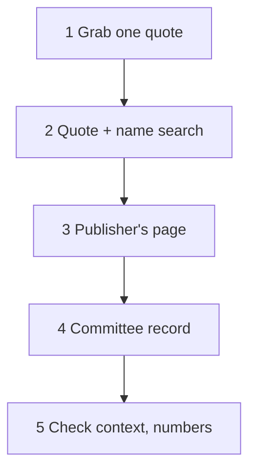

> 🌏 [中文版](/posts/learning/2026-10-16-trace-viral-political-clip-source)

A common social media post: a clip of a foreign senator questioning a witness, with Chinese subtitles, plus the reposter's own commentary tying it to another issue. Before you share it, you should know three things: who said this and in what setting, whether the subtitles follow the original meaning, and whether the commentary underneath was said live or added by the reposter.

This guide walks through one example: the clip from the January 2026 Senate hearing where Josh Hawley asked a witness whether men can get pregnant.

## Split the post into three layers

Sort every piece of information into one of these:

| Layer | Content | How to confirm |
|---|---|---|
| Live | Who said what, in what order | The full video |
| Added by the reposter | Subtitles, narration, commentary, title | Compare against the video |
| Background | Hearing topic, where numbers come from, what led up to it | Official records and independent reporting |

## Five steps



1. **Grab one quote.** An English line in the subtitles is ideal. Here it was "real people in their real lives." With no quote, take names and titles from the audio.
2. **Search the quote plus a name.** With "Hawley" added, results included his office's press release and reports from [KTUL](https://ktul.com/news/nation-world/senate-hearing-erupts-as-obgyn-refuses-to-answer-if-men-can-get-pregnant-josh-hawley) and [ABC News](https://abcnews.com/US/republican-lawmakers-call-fda-review-abortion-pill-restrictions/story?id=129218725).
3. **Find the publisher's page.** [Hawley's office post](https://www.hawley.senate.gov/watch-hawley-grills-pro-abortion-doctor-over-refusal-to-say-men-cant-get-pregnant) is dated January 14, 2026, with a partial transcript and a link to the full exchange. The publisher is the speaker's own office and has a clear stance. Use it to confirm what was said, not what it means.
4. **Find the committee record.** [Congress.gov's event page](https://www.congress.gov/event/119th-congress/senate-event/337863) lists this as the Senate HELP Committee hearing on the morning of January 14, 2026, and the committee posted the [full stream](https://www.youtube.com/live/M3PNge7JnRQ) titled "Protecting Women: Exposing the Dangers of Chemical Abortion Drugs."
5. **Check context and numbers.** Put the clip back into the whole hearing and see what is missing before and after.

```youtube
url: https://www.youtube.com/watch?v=kJFuhgeNbSE
title: Full exchange linked by Hawley's office (Senate HELP hearing, 2026-01-14)
```

## Example: what the clip left out

Live, Florida Senator Ashley Moody asked the same question first, then Hawley. The witness, Dr. Nisha Verma, an OB-GYN with Physicians for Reproductive Health called by Democrats, answered that she cares for patients with many identities and that yes-or-no questions are a political tool. Hawley replied that his aim was to establish a biological reality.

The line most easily misread is "real people in their real lives." Just before it, Hawley said the Supreme Court had heard arguments on this question the day before. KTUL reports those were two cases on state bans on transgender girls in girls' sports. Without that sentence, viewers may assume "real people" means abortion-pill patients, when Hawley was pointing at a different issue.

Second, the number. In the same remarks Hawley said the drug causes adverse health events in 11% of cases, 22 times the figure on the label. That number comes from [a report the conservative think tank EPPC published in April 2025](https://eppc.org/publication/insurance-data-reveals-one-in-ten-patients-experiences-a-serious-adverse-event/), which analyzed insurance claims and arrived at 10.93%. The Washington Post Fact Checker noted that the report had no external peer review and that EPPC said an in-house physician panel reviewed it. It also noted that part of the rate is emergency room visits, and the drug's own label says emergency visits in trials ran as high as 4.6% ([the fact check](https://www.washingtonpost.com/politics/2025/05/12/abortion-pill-medication-abortion-study-mifepristone/)). EPPC's position is that real-world data reflects practice better than clinical trials. Both arguments are on the table; you don't need to side with either, but anyone reposting should tell readers where the number comes from.

Third, the hearing's actual subject. ABC reports it centered on whether to restrict prescribing abortion pills by telehealth and restore in-person visits; "can men get pregnant" was one exchange in a two-hour session.

The tactic isn't new either. At a Senate Judiciary hearing on July 12, 2022, John Cornyn and Hawley questioned Berkeley Law professor Khiara Bridges, and the Wall Street Journal titled its excerpt ["Can Men Get Pregnant?"](https://www.wsj.com/opinion/can-men-get-pregnnt-transgender-hawley-cornyn-bridges-abortion-gender-nonbinary-pro-life-choice-dobbs-roe-11657918662).

## Motives are inference, not record

The record confirms the reasons each side gave out loud. Hawley said he wanted to test her veracity as a medical professional and scientist, and that he didn't know how to take her seriously. Verma said she paused because she wasn't sure of the goal of the question and called yes-or-no questions a political tool.

Anything beyond that, such as "if she answered no, she would be denying her transgender male patients," is a reason an analyst supplied; Verma did not say it. That is fine in commentary, but label it as interpretation and keep it out of the paragraph that reports what was said.

## When you use an AI assistant, add three steps

An AI assistant speeds this up, but its answer needs three fixes from you:

1. **Open the sources.** In this case the answer cited a Substack post for the hearing's name. Secondary sources are leads; confirm names and dates against Congress.gov or the committee stream.
2. **Check details against the original page.** The answer said Hawley asked a Berkeley professor the same question in 2022. The precise version from the record: it was the July 2022 Judiciary hearing, and the professor, Khiara Bridges, was questioned by both Cornyn and Hawley.
3. **File motive as inference.** "Why did he ask that" reads like fact but is analysis. Separate it from the record and mark it as interpretation.

## Limits

I did not see the original post, so I haven't compared the subtitle translation with the speech; you can check it against the full video above. Hawley's office and EPPC both have clear positions, and I cite them to confirm what they said themselves. This guide takes no view on abortion-pill safety or on how sex should be defined. It covers one thing: before you repost, how to let readers know where the words came from and what is missing.

## Four actions before reposting

- Link the original video, with the date and setting.
- If you translated the subtitles yourself, mark them as your translation.
- Keep your commentary separate from the live content, not in the same paragraph.
- When you cite a number, add its source and review status.

## References

- [Hawley's office: Watch: Hawley Grills Pro-Abortion Doctor Over Refusal to Say Men Can't Get Pregnant (2026-01-14)](https://www.hawley.senate.gov/watch-hawley-grills-pro-abortion-doctor-over-refusal-to-say-men-cant-get-pregnant)
- [KTUL: Senate hearing erupts as OB/GYN refuses to answer if men can get pregnant](https://ktul.com/news/nation-world/senate-hearing-erupts-as-obgyn-refuses-to-answer-if-men-can-get-pregnant-josh-hawley)
- [ABC News: Republican lawmakers call for FDA to review abortion pill restrictions at Senate hearing](https://abcnews.com/US/republican-lawmakers-call-fda-review-abortion-pill-restrictions/story?id=129218725)
- [Congress.gov: Hearings to examine chemical abortion drugs (Senate HELP, 2026-01-14)](https://www.congress.gov/event/119th-congress/senate-event/337863)
- [Senate HELP Hearing (1/14/26) - Protecting Women (committee stream)](https://www.youtube.com/live/M3PNge7JnRQ)
- [EPPC: The Abortion Pill Harms Women (2025-04-28)](https://eppc.org/publication/insurance-data-reveals-one-in-ten-patients-experiences-a-serious-adverse-event/)
- [The Washington Post Fact Checker: Digging into the math of a study attacking the safety of the abortion pill](https://www.washingtonpost.com/politics/2025/05/12/abortion-pill-medication-abortion-study-mifepristone/)
- [WSJ: Notable & Quotable: Can Men Get Pregnant? (2022-07-15)](https://www.wsj.com/opinion/can-men-get-pregnnt-transgender-hawley-cornyn-bridges-abortion-gender-nonbinary-pro-life-choice-dobbs-roe-11657918662)
