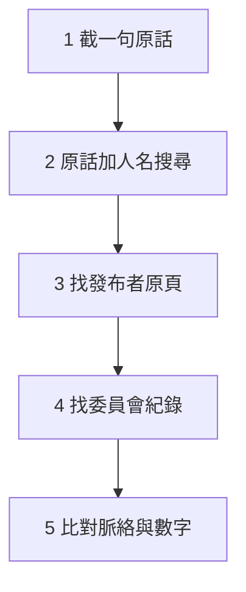

> 🌏 [English version](/posts/learning/2026-10-16-trace-viral-political-clip-source-en)

社群上常看到這種貼文：一段外國參議員質詢證人的片段，配上中文字幕，轉貼者再加一段自己的評論，把它接到另一個議題。轉發之前，你至少要知道三件事：這段話是誰、在什麼場合說的；字幕有沒有照原意翻；底下那段評論是現場說的，還是轉貼者加的。

這篇用一則實例走完查法：2026 年 1 月參議院聽證會上，霍利（Josh Hawley）問證人「男人能不能懷孕」的片段。

## 先把貼文拆成三層

查之前先分層，之後每一條資訊都歸到其中一層：

| 層 | 內容 | 怎麼確認 |
|---|---|---|
| 現場 | 誰說了什麼、順序、語氣 | 完整影片 |
| 轉貼者加的 | 中文字幕、旁白、評論、標題 | 對照影片，看哪些不在現場 |
| 背景 | 聽證會主題、數字出處、前因後果 | 官方紀錄與獨立報導 |

## 五步查法



1. **截一句原話。** 字幕裡有英文原話最好。這則的關鍵句是 "real people in their real lives"。沒有原話就從音訊抓人名與職稱。
2. **用原話加人名搜尋。** 這句話加上 Hawley，搜出的是他辦公室的新聞稿，以及 [KTUL](https://ktul.com/news/nation-world/senate-hearing-erupts-as-obgyn-refuses-to-answer-if-men-can-get-pregnant-josh-hawley) 和 [ABC News](https://abcnews.com/US/republican-lawmakers-call-fda-review-abortion-pill-restrictions/story?id=129218725) 的報導。
3. **找發布者原頁。** [霍利辦公室的貼文](https://www.hawley.senate.gov/watch-hawley-grills-pro-abortion-doctor-over-refusal-to-say-men-cant-get-pregnant)日期是 2026 年 1 月 14 日，附上對話的逐字節錄與完整片段連結。發布者是當事人的辦公室，立場鮮明，拿來確認「說了什麼」，不拿來判斷「這代表什麼」。
4. **找委員會的紀錄。** [Congress.gov 的事件頁](https://www.congress.gov/event/119th-congress/senate-event/337863)登錄這是參議院衛生、教育、勞工與退休金委員會（HELP）2026 年 1 月 14 日上午的聽證會；委員會也放了[完整直播](https://www.youtube.com/live/M3PNge7JnRQ)，標題是 "Protecting Women: Exposing the Dangers of Chemical Abortion Drugs"。
5. **比對脈絡與數字。** 把片段放回整場聽證會，看前後少了什麼。

```youtube
url: https://www.youtube.com/watch?v=kJFuhgeNbSE
title: 霍利辦公室連結的質詢完整片段（2026-01-14 參議院 HELP 聽證會）
```

## 實例：片段被剪掉了什麼

現場的順序是這樣：先由佛羅里達州的參議員穆迪（Ashley Moody）問過同一題，霍利接著問。證人維爾瑪（Nisha Verma）是婦產科醫師，代表 Physicians for Reproductive Health，由民主黨邀請。她回答自己照顧各種身分的病人，並說是非題是一種政治工具；霍利回應，他的目的是確立生物學上的事實。

片段裡最容易被誤讀的是那句 "real people in their real lives"。它前面還有一句：霍利說最高法院前一天才就這個問題聽了言詞辯論。依 KTUL 的報導，那是兩件各州禁止跨性別女性參加女子運動的案子。拿掉這一句，觀眾會以為「真實的人」指的是墮胎藥的使用者，其實霍利指的是另一個議題。

第二個要補的是數字。霍利在同一段話裡說這種藥造成不良健康事件的比例是 11%，是藥品標示的 22 倍。這個數字來自[保守派智庫 EPPC 在 2025 年 4 月發表的報告](https://eppc.org/publication/insurance-data-reveals-one-in-ten-patients-experiences-a-serious-adverse-event/)，分析保險理賠資料，算出 10.93%。《華盛頓郵報》事實查核專欄指出，這份報告沒有經過外部同儕審查，EPPC 的說法是由內部的醫師小組審過；專欄也點出，這個比例裡有一部分是急診就診，而藥品標示本身就寫了臨床試驗中急診的比例最高到 4.6%（見[該篇查核](https://www.washingtonpost.com/politics/2025/05/12/abortion-pill-medication-abortion-study-mifepristone/)）。EPPC 的立場則是真實世界的資料比臨床試驗更能反映現況。兩邊的論點都在這裡，不必替任何一邊下結論，但轉貼的人該讓讀者知道這個數字從哪來。

第三個是整場聽證會的主軸。ABC 的報導寫到，這場聽證會的焦點是要不要限制以遠距醫療開立墮胎藥、恢復親自看診的要求；「男人能不能懷孕」只是兩小時裡的一段交鋒。

這種問法也不是第一次。2022 年 7 月 12 日的參議院司法委員會聽證會上，柯寧（John Cornyn）和霍利質詢柏克萊法學院教授布里奇斯（Khiara Bridges），《華爾街日報》把那段摘錄的標題訂為 ["Can Men Get Pregnant?"](https://www.wsj.com/opinion/can-men-get-pregnnt-transgender-hawley-cornyn-bridges-abortion-gender-nonbinary-pro-life-choice-dobbs-roe-11657918662)。

## 動機是推論，不是紀錄

紀錄能確認的是各方自己說出口的理由。霍利說他要「測試妳作為醫師與科學家的可信度」，並說「我不知道怎麼才能認真看待妳」。維爾瑪說她停頓，是因為不確定這個問題的目的，並認為是非題是政治工具。

再往下的說法，例如「她若回答『不能』，就等於否認跨性別男性病患」，是分析者替她補上的理由，維爾瑪本人沒有這樣說。寫評論可以用，但要標明是解讀，不要和現場的話混在同一段。

## 用 AI 查出處時，自己補三步

用 AI 助理查這類片段很快，但它給的答案有三處要自己補：

1. **來源要點開。** 這次的回答把聽證會名稱標在一篇 Substack 文章上。這類二手來源可以當線索，名稱與日期要回到 Congress.gov 或委員會直播核對。
2. **細節逐項回原始頁。** 回答說霍利在 2022 年也問過柏克萊教授同樣的問題；原始紀錄的精確版本是：那是 2022 年 7 月的司法委員會聽證會，質詢布里奇斯的是柯寧與霍利兩人。
3. **動機的段落歸入推論。** 「為什麼這樣問」讀起來像事實，其實是分析。把它和上面的紀錄分開，標成解讀。

## 限制

我沒有看到原貼文，所以字幕翻譯是否忠實，這篇沒有比對；你可以自己對照上面的完整片段。霍利辦公室與 EPPC 都有明確立場，上面引用它們，是為了確認他們自己說了什麼。這篇也不評斷墮胎藥是否安全，或性別該怎麼定義；它只處理一件事：轉貼之前，怎麼讓讀者知道這段話從哪來、少了什麼。

## 轉貼前的四個動作

- 附上原始影片的連結，並寫明日期與場合。
- 字幕如果是自己翻的，標明「譯」。
- 自己的評論和現場內容分開寫，不要混在同一段。
- 引用數字時，附上它的出處與審查狀況。

## 參考資料

- [Hawley 辦公室：Watch: Hawley Grills Pro-Abortion Doctor Over Refusal to Say Men Can't Get Pregnant（2026-01-14）](https://www.hawley.senate.gov/watch-hawley-grills-pro-abortion-doctor-over-refusal-to-say-men-cant-get-pregnant)
- [KTUL：Senate hearing erupts as OB/GYN refuses to answer if men can get pregnant](https://ktul.com/news/nation-world/senate-hearing-erupts-as-obgyn-refuses-to-answer-if-men-can-get-pregnant-josh-hawley)
- [ABC News：Republican lawmakers call for FDA to review abortion pill restrictions at Senate hearing](https://abcnews.com/US/republican-lawmakers-call-fda-review-abortion-pill-restrictions/story?id=129218725)
- [Congress.gov：Hearings to examine chemical abortion drugs（Senate HELP，2026-01-14）](https://www.congress.gov/event/119th-congress/senate-event/337863)
- [Senate HELP Hearing (1/14/26) - Protecting Women（委員會直播）](https://www.youtube.com/live/M3PNge7JnRQ)
- [EPPC：The Abortion Pill Harms Women（2025-04-28）](https://eppc.org/publication/insurance-data-reveals-one-in-ten-patients-experiences-a-serious-adverse-event/)
- [The Washington Post Fact Checker：Digging into the math of a study attacking the safety of the abortion pill](https://www.washingtonpost.com/politics/2025/05/12/abortion-pill-medication-abortion-study-mifepristone/)
- [WSJ：Notable & Quotable: Can Men Get Pregnant?（2022-07-15）](https://www.wsj.com/opinion/can-men-get-pregnnt-transgender-hawley-cornyn-bridges-abortion-gender-nonbinary-pro-life-choice-dobbs-roe-11657918662)
