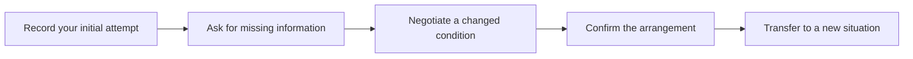

> 🌏 [中文版](/posts/learning/2026-10-19-amazingtalker-speaking-practice)

If you want to practise spoken English without first buying a large fixed course, [AmazingTalker](https://tw.amazingtalker.com/tutors/english) offers one-to-one online tutoring with individually selected teachers and lessons or packages. You can look for everyday conversation, travel, interviews or business English, then agree on your level and materials.

That choice also means assessing the teaching yourself. For working adults in Taiwan, evening availability, useful follow-up materials and whether a package fits your schedule matter more than the number of profiles on the homepage.

This guide draws on official information and public learner accounts. We have not paid for or attended a trial, and this article contains no referral codes or commission links. Start with the [English Speaking Practice overview](/posts/learning/2026-10-19-english-speaking-practice-overview-en) to compare approaches.

## A tutoring marketplace: discuss materials with your teacher

The [English tutor directory](https://tw.amazingtalker.com/tutors/english) includes Taiwanese and overseas teachers covering conversation, speaking, interviews and workplace English. Individual tutors provide their prices, available times and course descriptions. Watch introductions, read feedback and ask questions through platform messages.

The platform's [teacher recruitment guide](https://hk.amazingtalker.com/apply-to-teach/english) says teachers prepare their own materials; there is no single platform-wide textbook. That helps explain why lessons differ: one teacher may use an original syllabus, another may work well with articles you provide, and another may focus on conversation.

Before the trial, ask: “If I take four lessons, what would we do, what would I keep afterwards, and how would each lesson connect to the next?” Ask for an example in your actual situation. For interviews, examine how the teacher follows up on your experience. For travel, look for tasks requiring questions, clarification and decisions.

| Your difficulty | Look for |
|---|---|
| Fear of mistakes leads to one-sentence replies | Short prompts, suitable demonstrations and time to try again |
| Comfortable chatting, but unable to transfer to another situation | Changed-condition tasks and review, rather than a different casual topic every time |
| Limited foundations require frequent Chinese | A clear material sequence, bilingual explanation and gradually increased English use |
| Work conversations need greater precision | Follow-up questions, information structure and correction of vague explanations |

Nationality and qualifications can help you shortlist. The practical test is whether the tutor notices your difficulty and can guide you in a way you understand.

## Compare trial and regular prices separately

Official listings display trial and regular prices separately, commonly showing fifty-minute regular lessons. The [teacher guide](https://hk.amazingtalker.com/apply-to-teach/english) also describes twenty-five-minute trials and fifty-minute regular lessons. Check the selected tutor's actual duration and offers. A priced trial does not become generally free because a new-user promotion may exist.

Two lessons labelled “English speaking” may involve very different preparation, from basic materials to specialist interview practice. Compare duration, total payment, lesson count, materials and feedback together. A directory starting price is a weak basis for a monthly budget.

### Currency when paying from Taiwan

The [official currency guide](https://amazingtalker.elevio.help/zh-hant/articles/172) distinguishes display currency from payment currency. Eligible users physically in Taiwan can use Taiwan-dollar payment methods, including Taiwanese cards, ATM transfers, convenience-store payments and other listed methods. Some options have amount or lesson-count restrictions.

Seeing Taiwan dollars on a page does not replace checking the order. Confirm the payment method, charge currency, fees and discounts before paying. Recheck if you are abroad, use a non-Taiwanese card or change location settings.

Start with an affordable small purchase to assess regular teaching before considering a larger discount. A pleasant trial and sustained preparation across regular lessons are separate observations.

## Packages have booking deadlines

The [official expiry guide](https://amazingtalker.elevio.help/zh-hant/articles/111) gives these bands according to the number of lessons purchased in a transaction:

| Lessons bought together | Booking period |
|---|---|
| 1–10 | 3 months |
| 11–20 | 6 months |
| 21–30 | 12 months |
| 31 or more | 24 months |

Distinguish **when the booking must be made** from **when the lesson takes place**. The guide permits booking before expiry for lessons occurring after the package's expiry date. Check each package's own date and agree on times you can attend.

An extra lesson can cross an expiry band, but that alone is a poor reason to stockpile lessons. Estimate your actual attendance and the tutor's available slots first. Booking impossible dates merely turns an expiry problem into a late-cancellation problem.

The [extension guide](https://amazingtalker.elevio.help/zh-hant/articles/112) says an extension can be requested only after the package expires, with the new deadline decided by the tutor. If the tutor does not respond to an extension request within seven days, the discounted-price refund option opens automatically, allowing remaining lessons to become AT credits at the originally paid price. This specific process is not an unconditional extension or cash-refund promise.

### How this differs from a recurring subscription

The [current subscription help page](https://amazingtalker.elevio.help/zh-hant/articles/1193) says new subscriptions are temporarily unavailable. Existing subscriptions continue, and a cancelled subscription cannot be restarted. New learners buying individual lessons or packages therefore face a different arrangement from [Preply's twenty-eight-day renewal](/posts/learning/2026-10-19-preply-speaking-practice-en). Existing AmazingTalker subscribers still need to manage their own plans; suspension of new sign-ups does not cancel an old plan.

## Cancelling an appointment and returning a package are different actions

**To change a lesson time**, follow the [booking cancellation guide](https://amazingtalker.elevio.help/zh-hant/articles/338). At least twelve hours before the start, you can cancel without tutor approval. The lesson returns to the unscheduled balance for rebooking.

Inside twelve hours, use the [late-change negotiation process](https://amazingtalker.elevio.help/zh-hant/articles/355) and wait for a proposed resolution. Submitting a request is not unconditional cancellation. Complete the system confirmation when an agreement is reached and keep the outcome.

**To return remaining lessons and find another tutor**, use the [AT-credit refund process](https://amazingtalker.elevio.help/zh-hant/articles/993). It requires dealing with existing bookings before applying through purchase history. Resolve imminent lessons under the appropriate timing rules; returning a package is not a reason to miss an appointment without agreement.

Ordinary course returns become AT credits for buying other tutors' lessons. The [AT-credit guide](https://amazingtalker.elevio.help/zh-hant/articles/227) says one AT credit corresponds to one US dollar and student-account credits do not expire. This differs from a package's booking deadline and from a bank cash refund.

### Nine remaining lessons may not mean nine discounted lessons refunded

The [discount deduction guide](https://amazingtalker.elevio.help/zh-hant/articles/915) says used lessons are recalculated at their original single-lesson price when a student returns a package. The discount previously applied to those used lessons is deducted.

Using the official example's inputs: ten lessons originally cost US$10 each; a ten-percent discount makes the payment US$90. After taking one lesson, the remaining value, considering only this deduction, is **90 − 10 = US$80**, rather than nine discounted lessons totalling US$81. Other discounts and charges depend on the actual refund calculation.

If discount recovery makes the displayed refund negative, the official guide says no AT credits can be returned. Having lessons remaining does not guarantee recoverable credits; those lessons can still be used under their applicable booking rules.

For a problem caused by the tutor, the [official cancellation/refund guide](https://amazingtalker.elevio.help/zh-hant/articles/347) recommends contacting support with information such as message screenshots. State the date, intended lesson and problem clearly, then ask which treatment applies. The ordinary return process does not promise the same result for every dispute.

## A price increase does not require an immediate large purchase

A tutor's future selling price may change. The [user agreement](https://tw.amazingtalker.com/privacy-and-terms) says changes do not affect orders placed before the announcement. A later purchase still requires checking the current duration, package and price.

An [eligible-student renewal arrangement](https://amazingtalker.elevio.help/zh-hant/articles/1134) may offer one purchase at the previous price after an increase exceeding twenty percent in thirty days or thirty percent in ninety days. Eligibility requires no more than three remaining lessons, including booked lessons scheduled more than three days after the price change. The one-time purchase is capped at twenty fifty-minute or forty twenty-five-minute lessons. The deadline is normally seven days, reduced to two days if you completed a lesson in the preceding seven days. There is no repeat notification for the same tutor and language within thirty days.

Read the rule and account notice before acting, then calculate a realistic lesson amount. Buying ahead can preserve a rate temporarily while leaving more prepaid value tied to the same tutor. Consider both effects.

## Three community accounts show different teaching arrangements

**Materials and follow-up notes can distinguish teaching from casual chat.** In a [February 2024 Dcard account](https://www.dcard.tw/f/course/p/254826479), the writer reports twenty-six lessons, encounters with poorly prepared teachers and better experiences with teachers who used original materials, corrected sentences and sent notes. They also describe package returns and losing the discount on used lessons. No referral code appears in the accessible body; any commercial relationship is unstated. Historical prices, coupons, accent generalisations and a personal support adjustment are not treated as current platform-wide terms.

**After several months, check whether your actual difficulty is being addressed.** A [March 2024 Dcard request for advice](https://www.dcard.tw/f/language/p/254938688) comes from someone preparing for English interviews who felt lessons involved awkward chat and repeated explanations of completed homework. This is a one-sided account without independent access to the tutor's records. No referral incentive is visible in the accessible main post. Its useful question is whether this week's lesson addresses the obstacle identified last week.

**If you want recordings, test your own device and feature access.** In an [October 2026 Dcard comparison](https://www.dcard.tw/f/language/p/262275714), someone who tried two platforms discusses video, captions, connectivity and uncertainty about billing. No code appears in the accessible main body, and any commercial relationship is unstated. These are individual account and lesson observations, rather than guarantees of identical recordings, subtitles or connection quality for every class. Use the device you intend to study with and ask the tutor to demonstrate how you retrieve materials afterwards.

Useful trial questions follow from these accounts: how do materials connect, can you try again after correction, and can you recover the important points after class? Approval of one tutor does not establish how every tutor on the platform teaches.

## A practical task: clarify a group booking

This is an original task to discuss with a prospective tutor, rather than a guaranteed platform lesson. You are organising a meal with friends. The number of guests, date and preferences are not fully confirmed; you need to ask, negotiate and summarise the final arrangement.

**Before class**, record how you would make the booking without first finding a complete script. List three necessary facts and the question you find hardest to ask. Send that difficulty to the tutor and request follow-up questions.

**In the first round**, have the tutor play the restaurant and provide information only when you ask. Clarify the time and requirements, then summarise them in your own words. If the tutor fills in all the gaps, ask for less prompting in the next round.

**After feedback, repeat with one change:** the requested time is full or another friend joins. Propose an alternative and check whether it works. Ask the tutor to select the single problem that most affected understanding, then let you correct it and try again.

**After class**, record your side again without notes. The following day, change the situation to booking a workshop and use the same questioning and confirmation skills. Check whether you obtain the necessary information, handle a new constraint and summarise the agreement completely.

If you can only repeat the restaurant exchange, practise transfer again next lesson. Asking complete questions in an unfamiliar task is a better sign that you can use what you learned.

## Who should consider it?

AmazingTalker suits learners willing to choose a tutor, start with a small purchase and manage materials and booking deadlines. You can bring a specific obstacle to class, but you still need to assess teacher fit rather than relying entirely on recommendations.

For a regular peer group, timetable and institutional syllabus, compare [British Council adult courses](/posts/learning/2026-10-19-british-council-taiwan-speaking-practice-en). For more frequent lessons in spare time, see the [NativeCamp guide](/posts/learning/2026-10-19-nativecamp-speaking-practice-en). Decide on a purchase amount after considering your schedule, level and practice task.

## References

- [AmazingTalker Taiwan: English tutors and prices (in Chinese)](https://tw.amazingtalker.com/tutors/english)
- [Official teacher guide: durations, individual rates and materials (in Chinese)](https://hk.amazingtalker.com/apply-to-teach/english)
- [Payment currency and Taiwan options (in Chinese)](https://amazingtalker.elevio.help/zh-hant/articles/172)
- [Package booking periods (in Chinese)](https://amazingtalker.elevio.help/zh-hant/articles/111)
- [Package extensions (in Chinese)](https://amazingtalker.elevio.help/zh-hant/articles/112)
- [New subscriptions paused; existing-plan management (in Chinese)](https://amazingtalker.elevio.help/zh-hant/articles/1193)
- [Cancelling a booked lesson (in Chinese)](https://amazingtalker.elevio.help/zh-hant/articles/338)
- [Changes within twelve hours (in Chinese)](https://amazingtalker.elevio.help/zh-hant/articles/355)
- [Returning lessons for AT credits (in Chinese)](https://amazingtalker.elevio.help/zh-hant/articles/993)
- [AT credits and their validity (in Chinese)](https://amazingtalker.elevio.help/zh-hant/articles/227)
- [Discount deduction on returns (in Chinese)](https://amazingtalker.elevio.help/zh-hant/articles/915)
- [Tutor-related refund issues and support (in Chinese)](https://amazingtalker.elevio.help/zh-hant/articles/347)
- [Eligibility for renewal at the previous price (in Chinese)](https://amazingtalker.elevio.help/zh-hant/articles/1134)
- [AmazingTalker user agreement](https://tw.amazingtalker.com/privacy-and-terms)
- [Dcard: twenty-six-lesson account, February 2024 (in Chinese)](https://www.dcard.tw/f/course/p/254826479)
- [Dcard: speaking-practice advice request, March 2024 (in Chinese)](https://www.dcard.tw/f/language/p/254938688)
- [Dcard: platform trial comparison, October 2026 (in Chinese)](https://www.dcard.tw/f/language/p/262275714)
