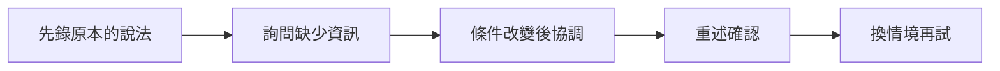

> 🌏 [English version](/posts/learning/2026-10-19-amazingtalker-speaking-practice-en)

想練英文口說，卻不想先買一大筆固定課程，[AmazingTalker](https://tw.amazingtalker.com/tutors/english) 提供的是自己挑老師、按堂或買課程包的一對一線上家教。你可以找生活會話、旅遊、面試或商務英文老師，再協調程度與教材。

自由選擇也代表要自己看教法。對台灣下班後練英文的人而言，老師能不能固定配合晚間時段、課後留下什麼，以及一包課能否用得完，都比首頁上有多少老師更重要。

本文依官方資料與公開學員分享整理，沒有實際付費試課，也沒有推薦碼或報名分潤連結。想先比較練習方式，可讀[英文口說練習總覽](/posts/learning/2026-10-19-english-speaking-practice-overview)。

## 它是家教媒合平台，教材要跟老師確認

[英文教師列表](https://tw.amazingtalker.com/tutors/english)包含台灣與外籍老師，能依需求找會話、口說、面試與商業英文等方向。價格、時段和課程內容由各位老師提供，挑選時可以先看影片、課程說明與學生回饋，再用站內訊息詢問。

平台的[教師招募說明](https://hk.amazingtalker.com/apply-to-teach/english)指出，老師需自備教材，沒有全站統一的一套課本。這解釋了為什麼不同老師的課可能差很多：有人帶自製教材，有人適合討論自備文章，也有人把重點放在對話。

試課前先問：「如果我接下來上四堂，你會怎麼安排？每堂課會留下什麼，下一堂又怎麼接？」請老師用你真的需要的場景回答。想練面試，就看他如何追問經驗；想練旅行，就看他怎麼安排需要詢問、澄清與做決定的情境。

| 你的卡點 | 看老師能不能提供 |
|---|---|
| 怕錯，常常只回答一句 | 分段引導、適合程度的示範，以及讓你重說的時間 |
| 聊天很順，換情境卻不會用 | 改變條件的任務與課後複習，而非每次換話題閒聊 |
| 基礎不足，常常要靠中文 | 清楚的教材順序、雙語解釋與逐步增加英文使用量 |
| 工作對話需要更精確 | 追問理由、整理資訊及修正含糊表達的練習 |

老師的國籍或證照可以作為篩選資訊。真正要確認的是：他能否聽見你卡在哪裡，並用你理解的方式帶著練。

## 費用看個別老師，試課和正式課分開比

官方列表把體驗課與正式課價格分開顯示，正式課常見以五十分鐘標價；[教師說明](https://hk.amazingtalker.com/apply-to-teach/english)也列二十五分鐘體驗課與五十分鐘正式課。實際課長與可買方案仍要看你選的老師頁面，體驗課有標價，不能因為新生優惠就直接當成免費。

例如同樣一堂「英文口說」，有人提供基礎教材，有人提供特定產業的面試演練，備課內容與價格不會相同。比較時把課長、實付總價、堂數、教材與回饋放在一起，別只拿老師列表的最低價乘上一個月。

### 台灣付款怎麼看幣別？

[官方付款幣別說明](https://amazingtalker.elevio.help/zh-hant/articles/172)區分「顯示貨幣」與「付款貨幣」。位於台灣境內的使用者，可依條件使用台幣付款方式，包括台灣信用卡、ATM、超商與其他指定方式；部分方式有金額或堂數限制。

頁面顯示台幣，不足以代替結帳明細。確認自己使用的支付方式、實際請款幣別、費用與優惠後再付款。若人在海外、拿非台灣卡或切換地區，就要重新確認，不能把台灣條件直接套用。

先用能負擔的少量課確認教法，再談多堂優惠。試課覺得好聊，和正式課能否持續準備、累積進度，仍是兩個要分開觀察的問題。

## 課程包有預約期限，別只看折扣

[官方課程期限說明](https://amazingtalker.elevio.help/zh-hant/articles/111)依同一次交易購買的堂數，列出以下級距：

| 一次購買堂數 | 預約期限 |
|---|---|
| 1–10 堂 | 3 個月 |
| 11–20 堂 | 6 個月 |
| 21–30 堂 | 12 個月 |
| 31 堂以上 | 24 個月 |

這裡要分清**完成預約的日期**與**實際上課日期**。官方說明允許在到期前排好課，上課日可以晚於課程包到期日。購買後到課程包查看自己的到期日，再與老師確認能實際出席的時段。

多買一堂可能跨到更長期限，仍然不應只為延長效期而囤課。先估算接下來能上幾次，以及老師的空堂夠不夠。預約一堆不可能出席的日期，會把期限問題變成臨時取消問題。

[延長說明](https://amazingtalker.elevio.help/zh-hant/articles/112)則規定，課程包要過期後才能提出展延，展延期限由老師決定。送出延期請求後若七天內未獲回覆，會自動開啟優惠價退課，剩餘課程可按原先付款價格退成 AT 幣。這是特定流程，不能把它當作每包課都能無條件延期或退現金。

### 和訂閱平台的差別

[目前官方訂閱說明](https://amazingtalker.elevio.help/zh-hant/articles/1193)寫明，新訂閱方案暫時停用；原有訂閱仍可繼續，取消後無法重新加入。因此，新生按堂或買課程包的使用方式，和 [Preply 的二十八天續訂](/posts/learning/2026-10-19-preply-speaking-practice)不同。若你是舊訂閱使用者，仍須另外管理自己的續訂，不要以為平台不收新訂閱，舊方案就會自動停止。

## 取消一堂與退掉整包課，處理不同

**只想改時間**，看[預約取消說明](https://amazingtalker.elevio.help/zh-hant/articles/338)：課程開始十二小時前可自行取消，不需老師同意，課程回到未預約堂數，再重新安排。

不到十二小時，則透過[臨時協調流程](https://amazingtalker.elevio.help/zh-hant/articles/355)通知老師並等待解決方式。送出協調請求，不代表課程已無條件取消。老師同意後也要完成系統上的確認，保留處理結果。

**想換老師、退掉剩餘課程**，則按[退 AT 幣流程](https://amazingtalker.elevio.help/zh-hant/articles/993)辦理。官方要求先處理已預約課程，再到消費紀錄申請；臨近上課的預約先依協調規則解決，不要為了退整包就直接缺席。

一般退課是退成平台內的 AT 幣，讓你購買其他老師的課。[AT 幣說明](https://amazingtalker.elevio.help/zh-hant/articles/227)寫明，一 AT 幣對應一美元，學生帳號內 AT 幣不會過期。這和課程包的預約期限不同，也不等於銀行現金退款。

### 為什麼剩九堂，不一定退九堂折扣價？

[優惠扣回說明](https://amazingtalker.elevio.help/zh-hant/articles/915)指出，學生中途退課時，已使用堂數按單堂原價結算，會扣回這部分原本享有的折扣。

用官方例子的條件計算：原價一堂 10 美元，十堂九折共付 90 美元。上完一堂後退課，若只考慮這項扣回，剩餘價值為 **90 − 10 = 80 美元**，不是九堂折扣價合計的 81 美元。其他優惠及費用仍依退課畫面結算。

若優惠扣回後，畫面顯示的退款金額為負數，官方說明此時沒有可退的 AT 幣；尚有剩餘課程，也不代表一定能取回點數。剩餘課程仍可依適用的預約規則使用。

如果因為老師的因素想退課，[官方取消退款說明](https://amazingtalker.elevio.help/zh-hant/articles/347)建議聯絡客服，附上對話截圖等資訊。把發生時間、原定課程與問題寫清楚，再請客服確認適用處理；一般退課規則不能保證每個爭議都得到相同結果。

## 老師調價時，不用急著囤課

老師之後的新售價可能改變，[使用條款](https://tw.amazingtalker.com/privacy-and-terms)說明，價格變動不影響公告前已成立的訂單。下一次續買仍應看新的課長、方案與價格。

官方另有[符合條件的原價續課安排](https://amazingtalker.elevio.help/zh-hant/articles/1134)：老師三十天內漲超過兩成，或九十天內漲超過三成時，符合剩餘堂數等條件的學生可獲一次原價購買機會。資格計算的剩餘堂數須合計不超過三堂，包含已預約、但在調價三天後才上的課。一次最多可買二十堂五十分鐘課，或四十堂二十五分鐘課；通知通常有七天期限，近七天內曾完課者則是兩天。同一老師、同一語言，三十天內不會重複通知。

看到通知時先回原規則與帳號確認資格，再算自己用得完的堂數。買更多能暫時保留單價，也會讓更多預付款留在同一位老師身上；這個取捨需要一起看。

## 三份社群分享，看到的是不同老師與學習安排

**有教材與課後筆記，和單純聊天差很多。** [2024 年 2 月 Dcard 使用心得](https://www.dcard.tw/f/course/p/254826479)作者自述上過二十六堂課，既遇過準備不足的老師，也找到會用自製講義、逐句修正並傳課後筆記的老師。文中還提到買多堂後不合適、退課改按原價結算的落差。可讀正文未見推薦碼，合作關係未交代；舊價格、贈券、口音概括與個別客服補償不當成現在的全站條件。

**練了幾個月，仍要看問題有沒有被處理。** [2024 年 3 月 Dcard 求助文](https://www.dcard.tw/f/language/p/254938688)發文者為外商面試練口說，卻覺得課堂一直尬聊、重複講解做過的作業，漸漸不想上課。這是個人單方經驗，沒有獨立核對老師紀錄；可讀主文未見推薦利益。它提醒你，試課後也要持續檢查：這週的練習，有沒有接著解決上週的卡點？

**想回聽的人，先試自己會用的設備與功能。** [2026 年 10 月 Dcard 平台比較](https://www.dcard.tw/f/language/p/262275714)發文者試過兩個平台，在意錄影、字幕與連線表現，對付款方式也有疑問。可讀主文未見推薦碼，合作關係未交代。這些是個別帳號與課堂的觀察，不能當成每堂都有相同錄影、字幕或網路品質的保證。試課時用正式上課會用的裝置，並請老師示範課後材料如何取得。

讀完分享，值得帶去試課的問題是：教材會怎麼接續、糾正之後能否重說、課後能否找回重點。有人喜歡某位老師，不代表同一平台上的其他老師也採同樣教法。

## 一堂「把訂位需求問清楚」的練習

以下是自訂任務，可以和候選老師討論，不是平台保證提供的教案。情境是替朋友預訂聚餐：人數、日期與用餐偏好都還沒確認完整，你要問清楚、協調，再重述安排。

**課前**，錄一段自己會怎麼訂位，不先查完整範本。列出三件必須知道的資訊，再標出你最不確定怎麼問的地方。把這個卡點傳給老師，請他在對話中追問。

**課中第一輪**，請老師扮演餐廳，只在你問到時提供資料。練習問清楚時間與需求，再用自己的話重述確認。老師若一直主動補完資訊，就請他下一輪少提示一點。

**修正後再來一輪**，改一個條件，例如原時段客滿，或朋友臨時多一人。這次要提出替代安排，問對方是否可行。請老師只挑最影響理解的一個問題，讓你當場修正後重說。

**課後**，不看筆記重錄完整對話中的自己那一側。隔天把情境換成預訂工作坊，用同樣的詢問與確認方式再說一次。檢查自己能否取得必要資訊、回應一個新條件，並完整重述最後安排。

如果你最後仍只會背餐廳那段對話，下一堂就繼續練換情境；若能在陌生題目問完整，才代表這次練到的做法開始用得出來。

## 適合誰？何時先選別的安排？

AmazingTalker 適合願意自行挑老師、先少量上課，並管理教材需求與預約期限的人。你可以把特定卡點帶進課堂，但也要花時間判斷老師是否合適，不能完全交給平台推薦名單。

若你希望固定同學、明確班表與機構課綱，可以比較[英國文化協會成人課](/posts/learning/2026-10-19-british-council-taiwan-speaking-practice)；若想用零碎時間增加上課次數，可看 [NativeCamp 專篇](/posts/learning/2026-10-19-nativecamp-speaking-practice)。回到自己的時間、程度與練習任務，再決定購課量。

## 參考資料

- [AmazingTalker：台灣英文家教列表與費用](https://tw.amazingtalker.com/tutors/english)
- [官方教師說明：課長、個別收費與自備教材](https://hk.amazingtalker.com/apply-to-teach/english)
- [付款貨幣與台灣付款方式](https://amazingtalker.elevio.help/zh-hant/articles/172)
- [課程包期限](https://amazingtalker.elevio.help/zh-hant/articles/111)
- [課程包展延](https://amazingtalker.elevio.help/zh-hant/articles/112)
- [訂閱方案暫停新申請與舊生管理](https://amazingtalker.elevio.help/zh-hant/articles/1193)
- [取消已預約課程](https://amazingtalker.elevio.help/zh-hant/articles/338)
- [十二小時內臨時協調](https://amazingtalker.elevio.help/zh-hant/articles/355)
- [申請退 AT 幣](https://amazingtalker.elevio.help/zh-hant/articles/993)
- [AT 幣定義與期限](https://amazingtalker.elevio.help/zh-hant/articles/227)
- [優惠扣回與退課結算](https://amazingtalker.elevio.help/zh-hant/articles/915)
- [教師因素的退課與客服處理](https://amazingtalker.elevio.help/zh-hant/articles/347)
- [原價續課資格](https://amazingtalker.elevio.help/zh-hant/articles/1134)
- [AmazingTalker 使用條款](https://tw.amazingtalker.com/privacy-and-terms)
- [Dcard：二十六堂課使用心得（2024-02）](https://www.dcard.tw/f/course/p/254826479)
- [Dcard：英語口說能力加強求助（2024-03）](https://www.dcard.tw/f/language/p/254938688)
- [Dcard：兩平台試用比較（2026-10）](https://www.dcard.tw/f/language/p/262275714)
