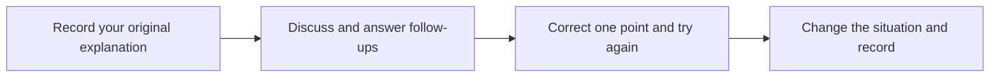

> 🌏 [中文版](/posts/learning/2026-10-19-british-council-taiwan-speaking-practice)

For adults in Taiwan who want a classroom, a teacher and other people to speak with, [British Council adult courses](https://www.britishcouncil.org.tw/english-courses/adults) are one option to assess. The British Council is the UK's international organisation for cultural relations and educational opportunities. Its teaching services in Taiwan extend beyond exam preparation to everyday, social and workplace English.

Older myClass reviews may describe buying lesson credits and choosing a different topic each time. Check the current product before registering: the adult English course now uses modules with the same teacher and classmates. For a working adult, being able to sustain the commute and attendance matters as much as the syllabus.

This guide draws on official information and public learner accounts. We have not enrolled or attended a trial, and this article contains no referral codes or commission links. Start with the [English Speaking Practice overview](/posts/learning/2026-10-19-english-speaking-practice-overview-en) if you are comparing practice channels.

## Identify the adult course you are asking about

The courses share a brand, but their formats and purchase conditions differ. Use the specific course name when contacting an adviser.

| Course | Format and starting point |
|---|---|
| [Beginner English Course](https://www.britishcouncil.org.tw/english-courses/adults/myfoundation) | A1, for learners with basic English knowledge who can communicate simply. Units A–D combine speaking, listening, reading, writing, grammar and pronunciation |
| [British Council English course](https://www.britishcouncil.org.tw/english-courses/adults/classes) | In-person modules covering work, study and social communication. The programme page lists A2+, B1 and B2 |
| [Professional Business Skills](https://www.britishcouncil.org.tw/english-courses/adults) | A separate workplace route listed on the adult landing page. Ask for the actual class, level and syllabus; the word “business” does not guarantee individual interview or presentation coaching |
| [English Online](https://www.britishcouncil.org.tw/english-courses/adults) | A separate fully online product offering group and private lessons. Its trial and plan conditions need separate checking; they do not automatically apply to a Taiwan classroom course |

Choose exam preparation if your goal is an IELTS score. Children and teenagers have separate age-based courses. If your immediate problem is explaining an idea at work, start with adult placement and the syllabus rather than buying an exam course because the organisation also offers IELTS services.

### How the current modules differ from older myClass accounts

The [current programme page](https://www.britishcouncil.org.tw/english-courses/adults/classes/programmes-pricing) describes ten three-hour lessons per module, with the same teacher and classmates throughout. Each level has four ten-week modules, and packages can include different numbers of modules.

The continuity gives people time to become familiar with how you express yourself. It also requires returning to the same group and continuing the work. Someone who wants to choose a teacher at short notice and fit one lesson into spare time is looking for a different scheduling pattern.

The beginner course has thirty hours per unit. Its page lists either one three-hour class a week or two ninety-minute classes; the actual arrangement depends on the centre and timetable. A ninety-minute lesson in an old review is therefore a poor basis for calculating every current adult course's cost per class.

## Which centre can you attend?

The [official centre directory](https://www.britishcouncil.org.tw/english-courses/language-schools) lists Xinyi, Songshan, Tienmu–Shipai and Linkou. Adult learners should check where their specific course runs.

- **Xinyi:** 2F-1 and 2, No. 106, Section 5, Xinyi Road, Xinyi District, Taipei.
- **Songshan:** 3–4F, No. 101, Section 3, Minsheng East Road, Songshan District, Taipei; consultations are on the fourth floor.

The beginner page explicitly offers Xinyi and Songshan, and the English centre directory identifies both as offering adult courses. The current directory describes Shipai as serving young learners. Linkou's presence in the directory does not establish that it has the adult class you need. Confirm the course, level and address before travelling.

Try the journey at your normal after-work time. A three-hour class plus a long commute may be difficult to sustain. A recognised brand and classroom equipment cannot solve a weekly attendance problem.

## Placement, materials and classroom interaction

The [registration page](https://www.britishcouncil.org.tw/english-courses/register) describes a written assessment and short speaking test, followed by a course recommendation based on the Common European Framework of Reference for Languages. The adult landing page offers a free level check. “Free” refers to that assessment, rather than tuition.

Avoid rehearsing answers simply to enter a higher level. Explain the real difficulty: understanding a question but failing to respond, reading a script in meetings, or giving only one sentence when someone asks why. Ask the adviser how the recommended course would address that problem.

The programme page places personal and professional information, group discussions and short presentations at A2+. B1 includes discussing problems and agreeing solutions; B2 includes expressing opinions and managing complex conversations. These descriptions establish a direction, without guaranteeing that every module covers your particular profession.

Ask to see materials for **the module you would actually purchase**, including preparation tasks and feedback. Older myClass accounts describe handouts and practice resources, but current materials should be demonstrated for the current class. Also ask about the enrolment limit, current class size, grouping and how the teacher listens to each group. Total classroom hours are shared learning time, rather than an equal amount of private conversation with the teacher for every student.

## Request a complete quote before comparing discounts

Tuition needs to match the current timetable, level and number of modules. The programme page does not put a complete Taiwan-dollar tuition table in its body, and the beginner page directs learners to individual centres. Request the current fee document and a written quote for a named class, including its start date.

A maximum discount describes the saving. To assess your own cost, divide **the amount you pay by the in-person hours you can realistically attend**, then account for travel and home practice. Treating every bonus as something you will certainly use overstates its value.

Send the adult course adviser a request along these lines before agreeing to a package:

> Please quote the adult course at the ___ centre for level ___. Include the current timetable, total price for one module and larger packages, in-person hours, materials and digital services, and the complete enrolment agreement. Please also include activation and completion deadlines, make-up lessons, transfers, cancellations and the refund calculation.

Pay particular attention to four areas:

1. **Materials and digital services.** The course page says online and AI practice are integrated without an additional charge. Have the written quote list materials and digital services, access periods and any optional charges.
2. **Credits and validity.** The current offer centres on modules. Avoid assuming older myClass lesson counts, credit rules or one-year validity still apply. Ask when multiple modules must be completed, whether a pause or extension is possible, and what any credits redeem for.
3. **Absence and make-up classes.** The current course page says one missed lesson per ten-week module can be made up. Check the request deadline, available replacement classes and treatment of further absences in the agreement. This wording does not establish free cancellation of every lesson.
4. **Cancellation and refunds.** Obtain the adult course agreement's application route, deadlines, deductions for attended classes and treatment of discounts, materials and digital services. IELTS exam policies and another country's course terms are separate products and jurisdictions.

## What learner accounts can help you observe

Public accounts are useful for understanding whether group interaction appeals to you. The following three sources concern older courses. Use them to prepare questions, then assess the actual class you would join under the current modular system.

**Participation depends partly on how the teacher distributes opportunities.** In a [2011 PTT learner account](https://www.ptt.cc/bbs/Eng-Class/M.1315307569.A.212.html), the writer initially worried about keeping up, then felt more comfortable because of adjustments, interaction and video activities. Homework included researching information online. This is a new student's report, without long-term outcome evidence. The post contains no visible referral code and does not disclose whether there was a commercial relationship.

**Look for a task that requires an answer from another person.** [Emilia's 2018 myClass trial account](https://lifebank.tw/my-class/) describes telephone-order role play: customers and sellers had to clarify menus and delivery arrangements, followed by a teacher's review of common mistakes. It suggests a useful observation: are you reading a script, or making a decision after listening? The original trial links contain a dedicated marketing campaign parameter. That promotional signal prevents treating the article as an unquestionably independent recommendation; its old lesson counts and validity also do not describe today's package.

**Someone who prefers private lessons may dislike a group format.** In a [2019 PTT discussion](https://www.pttweb.cc/bbs/Language/M.1561259175.A.A6A), one commenter said they tried a lesson but did not enrol, preferring the one-to-one online lessons they already used. The same commenter said the teacher paid attention to everyone. Another commenter considered the price relatively high. These are individual preferences and historical impressions, rather than evidence of current prices or representative learning results.

During a trial, observe both the teacher and your own interaction with classmates. Can you ask an unfamiliar classmate a follow-up question? Does the teacher notice where you get stuck? If you need an entire lesson dedicated to your interview and personal corrections, compare the [italki guide to choosing private lessons](/posts/learning/2026-10-19-italki-speaking-practice-en) before deciding.

## Book an assessment with a concrete speaking goal

The official registration page gives **02 8722 1000** for assessment and consultation bookings. Name the adult course, convenient centre and available times. Ask whether a suitable trial exists, whether it costs anything and whether it resembles the regular class at your level. A free level check and a free lesson are separate offers; an older free-trial account does not guarantee the same offer today.

The following self-designed task concerns explaining a delayed project to a colleague. It is a way to assess your speaking practice, rather than a promised British Council lesson plan.

**Before class**, record a one-minute explanation: the original deadline, the current obstacle and your proposed arrangement. Listen once and identify two things to improve. Explain this goal during consultation and ask which course topics support it.

**During class**, follow the actual lesson task. When there is an appropriate discussion of alternatives, give a reason and two options, then ask which one your partner prefers. Seek feedback on one point that most affected understanding, and try saying it differently immediately. Notice whether someone asks a follow-up and whether you get a chance to use the correction.

**After class**, record again without the original script. Change one condition: suppose your colleague rejects the extension. Explain the next step. Compare the recordings for a complete reason, proposal and question. Using one technique in a new conversation gives you a more practical result than remembering a page of notes.

## Who should consider it?

A modular course is worth assessing if you want a regular routine, are willing to work with classmates and can attend across ten weeks. Look for opportunities to participate, relevant learning outcomes and home practice you will actually use.

If unpredictable overtime or distance makes attendance difficult, compare shorter lessons or private options first. The same applies if your priority is intensive work on your own presentation or interview. If simple exchanges are still difficult, let the adviser assess the beginner route rather than rushing into a higher level.

Before purchasing, fit the actual timetable into a real week and see whether the trial helps you express one previously difficult idea more clearly. Those checks relate directly to why you wanted lessons in the first place.

## References

- [British Council Taiwan: adult English courses (in Chinese)](https://www.britishcouncil.org.tw/english-courses/adults)
- [Adult English course and make-up arrangements (in Chinese)](https://www.britishcouncil.org.tw/english-courses/adults/classes)
- [Modules, levels and packages (in Chinese)](https://www.britishcouncil.org.tw/english-courses/adults/classes/programmes-pricing)
- [English programme page and fee-document downloads](https://www.britishcouncil.org.tw/en/english-courses/adults/classes/programmes-pricing)
- [Beginner English Course (in Chinese)](https://www.britishcouncil.org.tw/english-courses/adults/myfoundation)
- [Teaching centre directory (in Chinese)](https://www.britishcouncil.org.tw/english-courses/language-schools)
- [Registration and placement (in Chinese)](https://www.britishcouncil.org.tw/english-courses/register)
- [PTT: first classes, 2011 (in Chinese)](https://www.ptt.cc/bbs/Eng-Class/M.1315307569.A.212.html)
- [Emilia: myClass trial, 2018; contains marketing campaign links (in Chinese)](https://lifebank.tw/my-class/)
- [PTT: myClass discussion and trial comments, 2019; mirror (in Chinese)](https://www.pttweb.cc/bbs/Language/M.1561259175.A.A6A)
