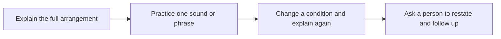

> 🌏 [中文版](/posts/learning/2026-10-19-elsa-speaking-practice)

You know what you want to say, but people keep asking which word you meant. An app offering specific pronunciation feedback, such as [ELSA Speak](https://tw.elsaspeak.com/elsa-premium/), may address that problem more directly than another vocabulary list. It analyzes speech with AI and offers pronunciation exercises, feedback, and scenario conversations for independent practice.

If the difficulty is deciding how to answer, repeating one sentence for a higher score may do less. Separate a troublesome sound, sentence rhythm, and spontaneous organization before choosing a plan.

This guide uses official sources and public learner accounts. We have not purchased or operated the app, and the article contains no referral codes or commission links. Start with the [English Speaking Practice overview](/posts/learning/2026-10-19-english-speaking-practice-overview-en) to compare practice options.

## Give pronunciation and conversation practice different jobs

The [official feature page](https://elsaspeak.com/en/) describes personalized paths, AI role-play, immediate feedback, and progress tracking. The [Taiwan product page](https://tw.elsaspeak.com/elsa-premium/) describes choosing or creating scenarios and reviewing feedback after AI conversations. These are AI exercises, rather than live tutoring.

| Difficulty | Practice option | Follow-up check |
|---|---|---|
| One word is repeatedly misunderstood | Pronunciation coaching and short exercises | Can you use it clearly in your own sentence? |
| Individual words are easy but sentences are hard to follow | Stress, rhythm, and listening to your recording | Can you express different content without the model sentence? |
| You can read a script but lose track under questioning | Role-play and open-ended AI dialogue | Can you continue after an unfamiliar question? |
| App scores are high but listeners remain confused | Keep a recording and ask a person to restate it | Was the problem pronunciation, missing information, or unfamiliar background? |

Scores can help identify practice targets. Repeating a familiar item also changes performance; real conversations require understanding questions, selecting information, and repairing misunderstandings. An app level or exam-score mapping is not an official examination result.

If judgments fluctuate, record again in the same environment and compare your audio with the example. Bring an unresolved sentence to a teacher. Look for a change you can understand rather than spending the evening chasing the final few points.

## Check what Free, Pro, and Premium actually include

The [official comparison](https://elsanow.freshdesk.com/en/support/solutions/articles/31000178976-choosing-the-right-elsa-plan-free-vs-pro-vs-premium) separates core pronunciation from advanced AI features.

| Plan | Main documented scope | What to check |
|---|---|---|
| Free | Selected pronunciation content, limited usage and lesson selection | Does recording work, and can you understand the feedback? |
| Pro | Pronunciation Coach and the core pronunciation library | Do you need sound practice or full conversational access? |
| Premium | Pro features plus AI Roleplays, AI Conversation Coach, Speech Analyzer, and Courses | Are your intended features included, with what allowances and conditions? |

Free and Pro may expose limited conversational previews. An available entry point is not a promise of continued full access. Check the purchase screen for the conversation rights you need.

Read “Lifetime” together with the plan name. The [Taiwan App Store release history](https://apps.apple.com/tw/app/elsa-speak-english-learning/id1083804886) already mentions a separate Professional Plan. Keep the entitlement list when buying Premium Lifetime and confirm whether your intended coach is included. Lifetime access to a named plan does not establish access to every future product.

## Compare Taiwan prices by plan, duration, and purchase channel

These named public items were listed on October 19, 2026, in New Taiwan dollars. The App Store lists several similarly named products at different prices. Your own purchase screen determines availability and the renewal charge.

| Channel and named item | Public price | What to compare |
|---|---:|---|
| [Taiwan website: ELSA Premium Lifetime](https://tw.elsaspeak.com/elsa-premium/) | Promotional NT$4,415; also displays NT$7,150 | One-time purchase; confirm activation and access |
| [Taiwan App Store: 1 Year Elsa Premium](https://apps.apple.com/tw/app/elsa-speak-english-learning/id1083804886) | NT$3,680 | Annual item; check trial eligibility and next billing |
| Same listing: 3 months Elsa Premium | NT$1,260 | Three-month Premium item |
| Same listing: 3 months Elsa Pro | NT$520 | Pro has a different feature scope |

These are named channel-specific items, not a universal offer guaranteed to every account. Android, other store regions, promotions, and add-ons need their own final-price check. Even when Lifetime looks close to one annual payment, test the free content and your willingness to keep practicing before deciding on a longer commitment.

Record five things: exact plan name, included features, charge today, renewal date and amount, and refund contact. Keep the receipt so an access or payment problem goes to the correct party.

## Trials, renewal cancellation, and refunds depend on where you buy

[ELSA's subscription guide](https://elsanow.freshdesk.com/en/support/solutions/articles/31000177556-understanding-subscriptions-and-cancellation) distinguishes renewable plans from one-time purchases. Monthly, quarterly, and annual subscriptions renew; Lifetime plans and voucher-activated plans do not. Its seven-day subscription trial converts to the full paid subscription unless canceled at least twenty-four hours before expiration.

Check the trial's actual expiry and renewal amount, and set a reminder immediately. A free download, free content, and a renewable free trial are different arrangements.

| Purchase channel on your receipt | Stop renewal | Request a refund |
|---|---|---|
| Apple App Store | [iPhone Settings → your name → Subscriptions → ELSA → cancel](https://support.apple.com/zh-tw/118428) | Apply to Apple under its review process |
| Google Play | [Open Google Play subscriptions, select ELSA, and cancel](https://support.google.com/googleplay/answer/7018481?hl=zh-Hant) | Apply to Google Play under its policies |
| Renewable ELSA website purchase | Use the [official web cancellation guide](https://elsanow.freshdesk.com/en/support/solutions/articles/31000176413-cancel-web-subscriptions-from-elsaspeak-com-) to enter the Customer Portal with an emailed link to your purchase address | Contact ELSA with your receipt and account |

The [official refund policy](https://elsanow.freshdesk.com/en/support/solutions/articles/31000177551-elsa-refund-policy) specifies requests within seven days for purchases through the ELSA website. Refunds return to the original payment method and take approximately thirty business days. That window does not guarantee approval for App Store or Google Play purchases, which follow their respective procedures.

Ordinary cancellation leaves access until the displayed expiration date and does not automatically refund a payment. Deleting the app or account, or buying a new plan, does not cancel the old subscription. In particular, buying a website voucher after starting a store trial still requires checking the old store subscription separately.

## Three learner accounts show why versions and goals matter

A [January 2026 Bahamut account](https://home.gamer.com.tw/artwork.php?sn=6269391) describes using Pro before buying Premium Lifetime. The writer valued pronunciation reports and AI dialogue but stopped for a period after interface changes and crashes, then later reported improved stability. Test the recording, playback, and report flow as well as the exercises. No referral code or sponsorship disclosure appeared in the retrieved main text. Historical purchase prices and concerns about future plans do not establish present entitlements or business risk.

In a [2025 three-month account](https://note.com/aoi_english_note/n/nbc398674b099), Japanese learner aoi found numerical feedback useful for directing practice but sometimes struggled with intonation scores and word substitutions that did not fit the intended conversation. The writer later shifted learning priorities toward an exam and chose not to continue for the time being. The main text showed no referral code or commercial disclosure. This is a Japanese learner's account, not evidence of Taiwan purchase terms. Its useful reminder is to listen to your own recording instead of accepting every suggested change.

In a [November 2024 Taiwan App Store review](https://apps.apple.com/tw/app/elsa-speak-english-learning/id1083804886), waidccccjj reported buying annual Premium and being disappointed by repetition-focused exercises that did not first leave room to organize an answer. The review shows no referral link or commercial disclosure. It concerns that version; it cannot establish that today's app lacks open dialogue or trials.

These examples cover different needs and periods, rather than average learning effectiveness. During a trial, ask whether you understand the feedback, can answer independently first, and can express new content after correction. For sustained questioning by a person, compare the practice arrangements in the [NativeCamp guide](/posts/learning/2026-10-19-nativecamp-speaking-practice-en) or [italki guide](/posts/learning/2026-10-19-italki-speaking-practice-en).

## A practice routine: bring one unclear meaning back into conversation

This is an original routine, not ELSA's guaranteed syllabus. Explain a weekend outing's meeting time and transport arrangements to a companion without memorizing a script.

1. **Try the whole message first.** Record the time, meeting place, and journey using fictional or public information rather than private plans.
2. **Choose one obstacle.** Use an available pronunciation exercise or coach for one word or short phrase. Compare the example and your recording, and name the change you intend to make.
3. **Return to the situation.** If your account has AI dialogue access, choose or create an outing scenario and add a late-arriving companion. Otherwise, record the adjusted arrangement yourself.
4. **Check with a person.** Ask a friend to restate the time, place, and transport, then ask an unfamiliar question. If they misunderstand, identify what information was unclear.

Keep one audible pronunciation change and one question a person still found unclear. Continue the first in ELSA; the second may call for better content, question-and-answer practice, or a teacher's help. That gives the next app session a specific purpose.

## References

- [ELSA Taiwan: Premium, pricing, and practice (in Chinese)](https://tw.elsaspeak.com/elsa-premium/)
- [Taiwan App Store: purchases, release history, and reviews](https://apps.apple.com/tw/app/elsa-speak-english-learning/id1083804886)
- [Official: Free, Pro, and Premium features](https://elsanow.freshdesk.com/en/support/solutions/articles/31000178976-choosing-the-right-elsa-plan-free-vs-pro-vs-premium)
- [Official: subscriptions, trials, and cancellation](https://elsanow.freshdesk.com/en/support/solutions/articles/31000177556-understanding-subscriptions-and-cancellation)
- [Official: cancel website subscriptions](https://elsanow.freshdesk.com/en/support/solutions/articles/31000176413-cancel-web-subscriptions-from-elsaspeak-com-)
- [Official: refunds by purchase channel](https://elsanow.freshdesk.com/en/support/solutions/articles/31000177551-elsa-refund-policy)
- [ELSA terms](https://elsaspeak.com/en/terms/)
- [Apple: cancel subscriptions (in Chinese)](https://support.apple.com/zh-tw/118428), [Google Play: manage subscriptions (in Chinese)](https://support.google.com/googleplay/answer/7018481?hl=zh-Hant)
- [Bahamut: purchase and usage account, 2026 (in Chinese)](https://home.gamer.com.tw/artwork.php?sn=6269391)
- [aoi: three-month account, 2025 (in Japanese)](https://note.com/aoi_english_note/n/nbc398674b099)
