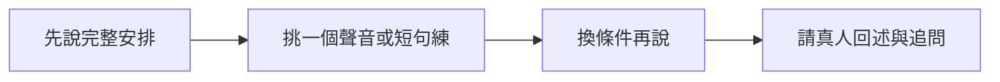

> 🌏 [English version](/posts/learning/2026-10-19-elsa-speaking-practice-en)

你知道想說什麼，對方卻常問「你剛才說哪個字？」這時，[ELSA Speak](https://tw.elsaspeak.com/elsa-premium/)這類會指出發音問題的 App，可能比再背一份單字表更貼近需要。它以 AI 分析說話，提供發音練習、回饋與情境對話，讓你在下班後自己反覆練。

如果卡住的是「不知道怎麼回答」，只把同一句念到高分，幫助可能有限。挑 ELSA 前，先分清楚自己要修一個聲音、練一句話的節奏，還是練臨場組織內容；這也會影響該買哪個方案。

本文整理官方資料與公開使用心得，沒有實際付費或操作 App，也沒有推薦碼或分潤連結。想先決定練習管道，可讀[英文口說練習總覽](/posts/learning/2026-10-19-english-speaking-practice-overview)。

## 發音回饋和對話練習，分別拿來做什麼？

[官方功能介紹](https://elsaspeak.com/en/)列有個人化學習路徑、AI 角色扮演、即時回饋與進度追蹤。[台灣產品頁](https://tw.elsaspeak.com/elsa-premium/)則描述可以選擇或建立情境，與 AI 對話後查看回饋。它提供的是 AI 練習，並非真人家教課。

| 你遇到的問題 | 可用的練習 | 完成後再檢查 |
|---|---|---|
| 一個字總被聽成另一個字 | 發音教練、單字或短句練習 | 把字放回自己的句子，是否仍說得清楚？ |
| 每個字都會念，整句卻很難跟上 | 短句的重音、節奏與回聽 | 不看原句，能否換內容再說？ |
| 看稿可以，接追問就停住 | AI 角色扮演與開放式對話 | 換一個沒準備過的問題，能否繼續？ |
| App 分數高，真人仍聽不懂 | 保留原錄音，請真人回述意思 | 是發音、資訊沒交代，還是對方不熟悉背景？ |

把分數當作找練習點的線索即可。當你反覆念同一題，熟悉題目也會改變表現；真人對話還有聽懂問題、選擇資訊、澄清誤解等工作。App 顯示的等級或考試對照分數，不等於正式考試成績。

遇到判分反覆變動，先在相同環境重新錄一次，再回聽自己與示範的差異。仍然不理解時，把那一句帶去問老師。目標是找出可修正的地方，不必把整晚用在追最後幾分。

## Free、Pro、Premium，要看你買到哪些功能

[官方方案比較](https://elsanow.freshdesk.com/en/support/solutions/articles/31000178976-choosing-the-right-elsa-plan-free-vs-pro-vs-premium)把發音練習與進階 AI 功能分開。

| 方案 | 官方說明的主要範圍 | 買之前先確認 |
|---|---|---|
| Free | 部分發音內容，使用量與可選課程有限 | 自己的聲音能否順利錄進去，回饋是否看得懂 |
| Pro | 發音教練與核心發音課庫 | 需要的是發音訓練，還是完整情境對話？ |
| Premium | 包含 Pro，另有 AI 角色扮演、AI Conversation Coach、Speech Analyzer 與 Courses | 想用的功能是否包含在這筆方案、是否有額度或其他條件 |

Free 與 Pro 的進階對話可能只提供受限體驗，不能因為看得到入口，就當成可持續完整使用。想練開放式對話，請在付款頁確認相應權限。

「終身」也要連同方案名稱讀。[台灣 App Store 頁面](https://apps.apple.com/tw/app/elsa-speak-english-learning/id1083804886)的版本紀錄已提到另外推出 Professional Plan。買 Premium Lifetime 時，應保留當次功能清單，確認你想用的教練是否包含；不要把終身使用某方案理解成未來所有新產品都會自動加入。

## 台灣價格怎麼比：同一方案、期間與付款管道放一起

以下是 2026 年 10 月 19 日公開頁面列出的項目，金額為新台幣。App Store 內購清單同時有多個名稱相似、價格不同的品項，實際可選項與續訂金額以自己付款畫面為準。

| 管道與具名品項 | 公開標價 | 比較時的重點 |
|---|---:|---|
| [台灣官網：ELSA Premium Lifetime](https://tw.elsaspeak.com/elsa-premium/) | 活動價 4,415 元；另列 7,150 元 | 一次購買；核對啟用方式與權限 |
| [台灣 App Store：1 Year Elsa Premium](https://apps.apple.com/tw/app/elsa-speak-english-learning/id1083804886) | 3,680 元 | 年度品項；確認是否有試用與下次扣款 |
| 同頁：3 months Elsa Premium | 1,260 元 | 三個月品項；不要拿它和 Pro 混比 |
| 同頁：3 months Elsa Pro | 520 元 | Pro 的功能範圍不同 |

這些是不同通路的具名品項，不是保證每個帳號都會看到的統一報價。Android、其他地區商店、促銷碼或另外加購，都要重新看總額。官網終身價看起來接近一年訂閱時，也先用免費內容確認自己願意持續練，再決定承諾多久。

最實用的比較表只有五欄：方案全名、包含的功能、一次扣款、續訂日與金額、退款對象。付款後留收據，遇到權限沒開或想退費時，才知道該找哪一方。

## 七天試用、停止續訂與退款，要照購買管道處理

[ELSA 的訂閱說明](https://elsanow.freshdesk.com/en/support/solutions/articles/31000177556-understanding-subscriptions-and-cancellation)區分可續訂方案與一次付款方案。月、季、年訂閱會續扣；終身方案及用兌換碼啟用的方案不自動續訂。若開通的是七天訂閱試用，結束後會扣完整訂閱費，至少提前二十四小時取消。

先查看試用畫面的到期日與續訂金額，當場設提醒。免費下載、免費可用內容與會續扣的免費試用，是三種不同情況。

| 收據上的購買管道 | 停止續訂怎麼做 | 想拿回已扣款項 |
|---|---|---|
| Apple App Store | [iPhone「設定」→姓名→訂閱項目→ELSA→取消](https://support.apple.com/zh-tw/118428) | 向 Apple 申請，依 Apple 審核 |
| Google Play | [進 Google Play 的訂閱頁，選 ELSA 並取消](https://support.google.com/googleplay/answer/7018481?hl=zh-Hant) | 向 Google Play 申請，依其政策審核 |
| ELSA 網站的可續訂方案 | 從[官方網站取消指南](https://elsanow.freshdesk.com/en/support/solutions/articles/31000176413-cancel-web-subscriptions-from-elsaspeak-com-)進 Customer Portal，以購買信箱收登入連結並取消 | 聯絡 ELSA，附上收據與帳號 |

[官方退款政策](https://elsanow.freshdesk.com/en/support/solutions/articles/31000177551-elsa-refund-policy)對 ELSA 網站購買列出七日內提出退款申請的條件，款項回原付款方式，處理約三十個工作天。這個窗口不適用來保證 App Store 或 Google Play 一定核退；商店內購須走各自的流程。

一般取消後，可用到所示到期日，取消本身不會自動退款。刪 App、刪帳號或買新方案，都不會自動取消舊訂閱。尤其原本已在商店試用，後來又買官網兌換碼，仍要回原商店檢查舊訂閱是否停止。

## 三份使用心得：回饋有用，也要看版本與自己的目標

[巴哈姆特 2026 年 1 月心得](https://home.gamer.com.tw/artwork.php?sn=6269391)回顧先訂 Pro、後買 Premium 終身的過程。作者喜歡發音分析與 AI 對話，曾因改版找不到喜歡的功能、對話當機而停用，之後又認為穩定性改善。這提醒你試用的不只是題目，也包含錄音、回聽與報告能否順利完成。原文可讀主體未見推薦碼或贊助揭露；歷史成交價和對未來方案的擔憂，都不是現行權利或營運風險的證據。

[日本學習者 aoi 的 2025 年三個月心得](https://note.com/aoi_english_note/n/nbc398674b099)覺得數字讓練習方向較清楚，也遇過語調難拿高分、AI 建議改字卻不符合自己對話目的的情況。作者後來因考試與學習重心改變，暫不續用。可讀主文未見推薦碼或商業合作聲明；這是日本學習者的自述，不代表台灣方案。可以借用的做法是回聽自己，而不是一直照單接受所有修改。

[台灣 App Store 的 2024 年 11 月評論](https://apps.apple.com/tw/app/elsa-speak-english-learning/id1083804886)中，waidccccjj 自述買年費 Premium 後，對練習太偏重重複句子、沒先讓自己組織答案感到失望。這則評論未見推薦連結，也未揭露合作關係；談的是當時版本，不能直接推論現在沒有開放對話或沒有試用。

三個例子呈現不同需求和時期，不能證明平均學習成效。試用時請回答：我能否理解回饋？有沒有機會先自己回答？改完後能否換內容再說？若你要的是長時間真人追問，另外比較 [NativeCamp](/posts/learning/2026-10-19-nativecamp-speaking-practice) 或 [italki](/posts/learning/2026-10-19-italki-speaking-practice) 的練習安排。

## 一次練習：把一個容易聽錯的意思帶回對話

以下是本站自訂安排，不是 ELSA 的固定課綱。情境是「向同伴說明週末出遊的集合時間與交通方式」，不需要背一份完整講稿。

1. **先自己說。** 錄一小段，交代何時、在哪裡集合，以及怎麼過去。只用虛構地點或公開資訊，不上傳私人行程。
2. **只挑一個卡點。** 用發音課或教練練一個難說的字或短句。聽示範、聽自己，記下你打算調整什麼。
3. **放回情境。** 若帳號有 AI 對話權限，就選或建立出遊情境，加入「同伴晚到」的新限制。沒有相應權限，也可以自己錄下調整後的安排。
4. **找真人確認。** 請朋友聽完後說出集合時間、地點與交通方式，再問一個新問題。若對方重述錯了，先找是哪個資訊沒講清楚。

留下兩份東西即可：一個可回聽的發音修改，以及一個真人仍不清楚的問題。前者接著用 ELSA 練，後者可能需要補內容、練問答或請老師協助。這樣分配，才知道下一次開 App 要做什麼。

## 參考資料

- [ELSA 台灣：Premium、價格與練習方式](https://tw.elsaspeak.com/elsa-premium/)
- [台灣 App Store：內購品項、版本紀錄與使用者評論](https://apps.apple.com/tw/app/elsa-speak-english-learning/id1083804886)
- [官方：Free、Pro、Premium 功能](https://elsanow.freshdesk.com/en/support/solutions/articles/31000178976-choosing-the-right-elsa-plan-free-vs-pro-vs-premium)
- [官方：訂閱、七天試用與取消](https://elsanow.freshdesk.com/en/support/solutions/articles/31000177556-understanding-subscriptions-and-cancellation)
- [官方：網站訂閱取消](https://elsanow.freshdesk.com/en/support/solutions/articles/31000176413-cancel-web-subscriptions-from-elsaspeak-com-)
- [官方：依付款管道申請退款](https://elsanow.freshdesk.com/en/support/solutions/articles/31000177551-elsa-refund-policy)
- [ELSA 服務條款](https://elsaspeak.com/en/terms/)
- [Apple：取消訂閱](https://support.apple.com/zh-tw/118428)、[Google Play：管理訂閱](https://support.google.com/googleplay/answer/7018481?hl=zh-Hant)
- [巴哈姆特：2026 年購買與使用心得](https://home.gamer.com.tw/artwork.php?sn=6269391)
- [aoi：2025 年三個月使用心得（日文）](https://note.com/aoi_english_note/n/nbc398674b099)
