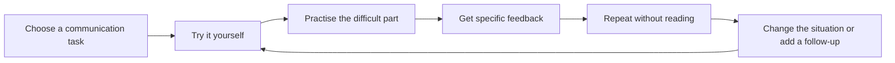

> 🌏 [中文版](/posts/learning/2026-10-19-english-speaking-practice-overview)

To speak English more smoothly, start with something familiar: give a work update, ask for help while travelling, or answer an interviewer’s follow-up question. Choose the task, then consider the practice, materials and feedback it needs.

If you work in Taiwan and can read documents but struggle to contribute to meetings, note where you get stuck. Are you missing an expression, struggling to understand a follow-up, or unsure whether the listener understood? That observation helps you choose what to read and practise next.

English Speaking Practice brings 34 articles into one series. It starts with practice methods and research evidence, moves into work, travel and interview materials, then explores platforms, tutors and language schools before covering review and selection. The shadowing evidence review and scenario materials are included in the series reading order. Methods help you decide how to practise; materials give you something to practise with.

The [English speaking hub](/english/) brings these articles and interactive practice together. Follow the series in order, or choose a situation you need, read the usage notes, then try saying it without looking at the English. The hub and interactive practice currently use a Chinese interface.

## How to read this series

| Stage | Question to work on | Where to start |
|---|---|---|
| 1. Methods and evidence | How should I organise practice? What can shadowing train, and what are its limitations? | [Speaking practice for working adults](/posts/learning/2026-09-03-work-english-speaking-tips-en), [shadowing evidence](/posts/learning/2026-10-08-shadowing-evidence-en), and [original audio and agency](/posts/learning/2026-10-10-agency-ai-shadowing-en) |
| 2. Scenario materials and speaking practice | How can I express what I mean in work, travel, surfing, climbing, daily conversation and interviews? | Choose a [scenario article](/english/#materials), then try the interactive practice |
| 3. Platforms, tutors and schools | Where can I get more follow-ups and feedback? | Read the individual guides below, or browse [platforms and schools](/english/#courses) |
| 4. Review after practice | How can I retain corrections and repeat the task in a different situation? | [Review routines and transfer checks](/posts/learning/2026-10-19-speaking-practice-review-routine-en) |
| 5. Make a choice | How do my goals, budget and available time fit together? | [Selection guide: goals, budget and exit terms](/posts/learning/2026-10-19-speaking-practice-selection-guide-en) |

Four new situations add more everyday practice: [talking with colleagues about health and lunch](/posts/learning/2026-10-25-daily-health-lunch-english-en), [flight delays and a missing cabin bag](/posts/learning/2026-10-25-travel-delays-lost-baggage-english-en), [asking about surf conditions and entry points](/posts/learning/2026-10-25-surf-conditions-entry-english-en), and [asking about moves at a climbing gym](/posts/learning/2026-10-25-climbing-gym-beta-english-en). Choose one you expect to encounter soon and practise connecting the questions into a conversation.

Move between methods and materials as needed. Return to a scenario article when you cannot express a particular idea, or explore [methods, research and original audio](/english/#methods) to understand a practice activity’s purpose and limitations. You can start speaking before choosing a course.

## Turn “poor speaking” into something you can practise

Silence can have different causes. You may know what you mean but struggle to form a sentence. You may read a script smoothly but lose the thread when someone changes the question. Or you may not have understood the question at all.

Tonight, record an answer to a familiar question without writing a complete script first. Listen for the first obstacle: no content, missing expressions, difficulty with follow-ups, or repeated restarts because you fear mistakes. This is observation, not a proficiency diagnosis. Several problems may occur together; start with one that obstructs communication most.

| What you notice | What to try next |
|---|---|
| You do not know what to say | Outline the situation, reason, and next step, then connect them aloud |
| You have an idea but translate word by word | Find a relevant expression in learning material and adapt it to your situation |
| You can recite an answer but cannot handle follow-ups | Ask a tutor or partner to vary the question; practise answering and clarifying |
| You finish but do not know whether you were understood | Ask the listener to restate your main point |
| Lessons become chats with nothing to carry forward | Bring one task and leave with a difficulty to revisit |

## Connect one practice session to the next

The series uses a simple routine: speak first, take a difficulty into practice, receive feedback, try again, then handle an unprepared follow-up. This is a practice design, not a promise to reach a level within a fixed number of days.

For example, explain why a task is delayed. Try it yourself and note where the explanation breaks down. In class, ask the tutor to act as a colleague and follow up. Afterwards, retain a small set of corrections. Next time, change the listener or a constraint and see whether you can continue.

For ready-made situations, choose a task from the site's [work update practice](/posts/learning/2026-10-07-work-standup-english-en), [travel conversations](/posts/learning/2026-10-08-travel-airport-hotel-restaurant-english-en), or [thinking time in interviews](/posts/learning/2026-10-12-interview-thinking-time-english-en). Work through one task before expanding your list.

## Where do the different practice options fit?

Choose the kind of help you need before comparing brands. The table gives questions to investigate during a trial. Specific formats, functions, and fees belong in the individual guides.

| Option | Practice you could arrange | Question to ask |
|---|---|---|
| Recording and recall | First attempts and repetition after class | Can I express the idea without reading? |
| AI voice tools | Rehearsal and repeated attempts | Is the feedback reliable, and does practice carry into human conversation? |
| Online live lessons | Follow-ups, clarification, and specific corrections | Does the tutor understand my goal? Do I need continuity with one teacher? |
| Local in-person classes | Regular attendance and group interaction | How is the class structured, and how much speaking will I personally do? |
| Language schools abroad | Concentrated classes and interaction outside class | Do the timetable, accommodation, and daily arrangements create opportunities to interact? |
| Language exchange and communities | Interaction with different people | Do our goals fit, and what feedback will each person provide? |

You can choose one main option and combine it with recording yourself. Establish a manageable routine before subscribing to several services.

Shadowing can be part of material-based practice. See the [review of shadowing evidence](/posts/learning/2026-10-08-shadowing-evidence-en) for its scope and limitations. Following a recording still needs to be complemented by opportunities to organise your own message and respond to questions.

## What will each service guide cover?

Choose a guide around the question you need to answer:

| Guide | Question to bring |
|---|---|
| [NativeCamp: immediate and booked lessons](/posts/learning/2026-10-19-nativecamp-speaking-practice-en) | How do costs and booking change when I want a particular tutor? |
| [Cambly: lesson types and subscription minutes](/posts/learning/2026-10-19-cambly-speaking-practice-en) | Can I use my weekly minutes and get the feedback I need? |
| [italki: tutors and packages](/posts/learning/2026-10-19-italki-speaking-practice-en) | How do I test a tutor’s teaching before buying a package? |
| [British Council Taiwan: adult courses](/posts/learning/2026-10-19-british-council-taiwan-speaking-practice-en) | Do the level, fixed group, and travel time fit? |
| [NTNU extension: named English classes](/posts/learning/2026-10-19-ntnu-extension-speaking-practice-en) | How do I compare teachers, levels, dates, and total fees? |
| [Preply: trials and renewals](/posts/learning/2026-10-19-preply-speaking-practice-en) | Can I use each tutor-specific subscription before renewal? |
| [Engoo Taiwan: booking and materials](/posts/learning/2026-10-19-engoo-speaking-practice-en) | Do the booking rules and monthly allowance fit my schedule? |
| [AmazingTalker: tutor pricing and packages](/posts/learning/2026-10-19-amazingtalker-speaking-practice-en) | How do booking deadlines, extensions, and refunds affect cost? |
| [Speak: AI conversations and practice](/posts/learning/2026-10-19-speak-speaking-practice-en) | What can I rehearse with AI, and when do I need a real listener? |
| [ELSA: pronunciation feedback and conversations](/posts/learning/2026-10-19-elsa-speaking-practice-en) | How do I bring pronunciation feedback back into a conversation? |
| [Wimbledon School of English: studying in the UK](/posts/learning/2026-10-19-wimbledon-school-english-speaking-practice-en) | How do tuition, accommodation, and cancellation terms fit together? |
| [EV Academy: intensive study in Cebu](/posts/learning/2026-10-19-ev-academy-speaking-practice-en) | How do I assess individual lessons, accommodation, and local fees? |
| [Tandem: reciprocal language exchange](/posts/learning/2026-10-19-tandem-speaking-practice-en) | How do we agree on language time and useful feedback? |
| [Review routine: a weekly plan and transfer checks](/posts/learning/2026-10-19-speaking-practice-review-routine-en) | How do I connect preparation, feedback, and my next conversation? |
| [Selection guide: goals, budget, and exit criteria](/posts/learning/2026-10-19-speaking-practice-selection-guide-en) | How do I choose a main option within my time and budget? |

Each guide provides a concrete practice task and questions for choosing a course. Assess it against your schedule, budget, and feedback needs. You do not need to subscribe to every service.

The platform and school section covers six live tutoring platforms, two AI tools, two institutions in Taiwan, two overseas schools, and Tandem language exchange. Each service has its own guide to getting started, costs, exit terms, and a concrete practice task. The review routine and selection guide connect those options to regular practice.

Official sources establish service features and fees. Teaching experience requires actual trial lessons. The series distinguishes researched introductions from first-hand reviews and does not treat marketing as proof of learning outcomes.

## Take a clear question into a trial lesson

Before a trial, complete this statement: “I want to practise ____. By the end, I want the listener to understand ____.” For a delayed task, that might be its status, impact, and next step.

Afterwards, ask whether the listener understood, whether the feedback identified a concrete problem, and whether you can explain the idea again without notes. Can you also respond to a different follow-up or ask for clarification? Those answers tell you more about fit than a friendly atmosphere alone.

To start tonight, choose a task, record an attempt, and identify the first difficulty. Bring that difficulty to a service guide or trial lesson so the next session has a clear starting point.

## Updates

- 2026-10-25: Brought methods and scenario materials into the same series, reordered its 34 articles, added daily, travel, surfing and climbing-gym situations, and updated the overview and practice links in both languages.
- 2026-10-19: Expanded the reading route to all 16 guides, including overseas schools, AI tools, language exchange, review, and selection.
- 2026-10-19: Added Preply and Engoo guides covering subscriptions and booking.
- 2026-10-19: Added British Council Taiwan and NTNU adult-course guides.
- 2026-10-19: Added Cambly and italki guides covering lesson types and tutor selection.

## References

- [NativeCamp lesson workflow](https://nativecamp.net/zh-tw/usage/lesson_start)
- [NativeCamp Taiwan plans](https://nativecamp.net/zh-tw/plan)
- [Site review of shadowing evidence](/posts/learning/2026-10-08-shadowing-evidence-en)
- [Site guide to work-English teaching materials](/posts/learning/2026-10-08-work-english-from-teaching-materials-en)
