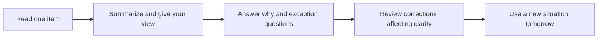

> 🌏 [中文版](/posts/learning/2026-10-19-engoo-speaking-practice)

You want regular English conversation without having to invent a topic every time. [Engoo Taiwan](https://engoo.com.tw/) offers 25-minute private online lessons: choose a tutor and bring platform materials or a news topic. A short session can be easier to fit into an evening after work.

You still decide what to practice, whom to work with, and how to retain feedback. A tutor who follows up and corrects you provides a different experience from one who simply gets through an article. Before buying, decide whether you need speaking opportunities or someone to manage a complete learning progression.

This guide uses Taiwan’s official information and public firsthand accounts. It is not a paid lesson test and contains no referral codes or compensation. See the [series overview](/posts/learning/2026-10-19-english-speaking-practice-overview-en) for other practice formats, or the [italki guide](/posts/learning/2026-10-19-italki-speaking-practice-en) for independently chosen tutor courses.

## Three access types mainly change which tutors you can book

The [Taiwan plans page](https://engoo.com.tw/plans) separates 一般課程, 雙享課程, and Premium. Choose the eligible tutor pool, then the lesson allowance and payment period.

| Type | Tutor access | Question to answer first |
|---|---|---|
| 一般課程: Standard | Mainly tutors from countries such as the Philippines and countries in Eastern Europe; excludes Premium tutors | Do you mainly want more speaking practice and feel comfortable interacting in English? |
| 雙享課程: mixed access | Half Standard, half Premium; eight lessons means four of each | Would alternating tutor types meet your goals without buying all-Premium access? |
| Premium | Includes Standard tutors, English native speakers, and Taiwanese tutors who can provide Chinese support, among others | Do you need Chinese assistance or a particular accent or conversation partner? |

Premium expands eligibility rather than reserving a place. [Section 10 of Taiwan’s terms](https://engoo.com.tw/terms_of_use) says Premium availability is limited and does not guarantee every lesson will be taught by a Premium tutor. If you only want one Taiwanese teacher, check your actual study times before paying.

Nationality is not a teaching method. During a trial, ask the tutor to identify errors that most affect understanding after you finish, give a concrete correction, and let you try again. Pleasant conversation alone is insufficient evidence for a long commitment.

## Calculate costs over 30 days, including lessons you might miss

These are public Taiwan prices shown on October 19, 2026, in New Taiwan dollars. Promotions and checkout eligibility may change. Each lesson lasts 25 minutes.

| Standard monthly plan | Payment per 30 days | Cost if every lesson is used |
|---|---:|---:|
| Eight lessons | NT$2,280 | NT$285 |
| Twelve lessons | NT$3,120 | NT$260 |
| Twenty lessons | NT$4,600 | NT$230 |
| Forty lessons | NT$8,800 | NT$220 |

The same page lists an eight-lesson monthly mixed-access rate of NT$510 per lesson, and a Premium rate of NT$635. Include tutor access in your budget: Standard pricing does not estimate a native-speaker plan.

Long prepayment can lower the advertised average while increasing your initial expense. The page displayed a promotional Standard eight-lesson annual total of NT$11,111. That supplies twelve allocations, totaling 96 lessons; using all of them works out to about NT$116 each. You prepay for 360 days. The displayed equivalent of about NT$926 per month is not a monthly installment.

Six-month plans prepay 180 days; annual plans prepay 360. Allowances arrive every 30 days, expire within that period, and do not roll over. Long plans cannot be extended, paused, or put on leave. You cannot save all 96 lessons for the final two months.

Recalculate using realistic attendance. Paying NT$2,280 but attending six lessons makes each attended lesson cost NT$380. Knowing how often you can actually show up matters more than reducing the advertised unit price.

Payment goes through [Worldpay](https://www.worldpay.com/). Taiwan’s payment explanation notes that banks may add an overseas-transaction fee; your issuer determines the rate. The calculations above exclude it. Your course period starts on purchase day, so buy when you are ready to begin.

## Flexible reservations do not mean reserving your favorite tutor for the month

[Section 11 of Taiwan’s terms](https://engoo.com.tw/terms_of_use) requires booking at least 15 minutes before a lesson and allows reservations up to eight days ahead, subject to plan limits. Monthly lesson-count plans generally require finishing the reserved lesson before booking the next; two consecutive sessions with the same tutor are allowed.

This suits people willing to choose among available tutors. If you need the same teacher and weekly slot, do not assume you can reserve the entire month. Search during your real after-work hours and identify several suitable tutors rather than testing availability only on weekday afternoons.

Cancel at least 30 minutes before the lesson. A later cancellation still cancels the session without compensation. Once canceled, that exact lesson cannot be booked again, so avoid canceling merely to reclaim the same slot immediately. Check that a successful reservation appears in your upcoming lessons.

Tutor or equipment problems may qualify for a makeup ticket under the terms. Tickets are valid for 30 days from issue, rather than indefinitely. Report lesson problems through online support or “Contact Us” within an hour after the lesson ends; leave the message even outside support hours.

## Materials supply a topic; correction preferences still need discussion

Topics include conversation, travel, business, and grammar. [Daily News](https://engoo.com.tw/app/daily-news) supplies current-affairs topics. If you can form sentences but struggle to extend a conversation, selecting material first gives you somewhere to begin.

The [official personalization guide](https://engoo.com.tw/blog/engoo/personalized-resquests-for-engoo-lessons/) explains how to choose a material category, paste a specific lesson link into special requests, decide whether to introduce yourselves, and choose active correction or conversational flow. It describes these original materials as free; the live lessons remain paid.

Start at the [materials directory](https://engoo.com.tw/app/materials), select a suitable level, and send the tutor the link. If access requires signing in, check the materials available in your account. You should understand the overall meaning and be able to express a view about one question. If every sentence needs a dictionary, choose easier material instead of spending the entire session looking up words.

For discussion practice, reduce reading aloud of passages you can already read and preserve time for follow-ups. For pronunciation work, request a model and a chance to repeat it. Keeping these goals distinct makes it easier to judge the lesson and choose the next task.

## Three learner accounts show useful materials and variable feedback

A [2017 PTT account](https://www.ptt.cc/bbs/Language/M.1510500484.A.EAB.html) reports 144 Engoo lessons. The writer valued short sessions and materials but found limited proactive correction and often generic lesson notes. Another learner in the same thread reported personalized feedback and suggested clarifying expectations at the start.

The writer had bought discounted group packages. Its daily plans and historical prices are not today’s rules. The useful question is whether a particular tutor leaves you with corrections you can apply next time; one person’s tutor selection does not establish average platform quality.

A [2022 PTT mixed-access review](https://www.ptt.cc/bbs/Language/M.1649146174.A.084.html) explicitly says the provider invited the writer to take 20 lessons and write about them. The author appreciated alternating tutor types and described finding a non-native tutor who corrected grammar and word stress carefully, then booking that teacher repeatedly. This account has a course-provision relationship. Its specific details are informative, but cannot establish that native or non-native tutors teach better as a group.

A [2019 Dcard trial comparison](https://www.dcard.tw/f/language/p/231140844) valued Engoo materials for continuing conversations when ideas ran out, while questioning the cost of a short lesson. The writer only tried non-native tutors and could not use that experience to decide on a native-speaker plan. The body contains no referral code, but the trial experience remains limited. Its trial count and tutor restrictions are historical.

Together, these accounts suggest a task-based tutor test: does the teacher identify a problem, provide a usable correction, and leave time for another attempt? Community posts help you formulate that test; they cannot confirm tonight’s tutor availability.

## Use the trial before deciding on renewal and refund exposure

Taiwan’s site offers a free-trial entry point. [Section 9 of the terms](https://engoo.com.tw/terms_of_use) says unused trial lessons disappear when you become a paying member. Finish the trial allowance available to you before buying.

Check your registered account for the actual lesson count, eligible tutors, and expiration. If unclear, ask Taiwan support: “What trial allowance, expiry date, and Premium eligibility apply to this new Taiwan account?” Do not assume an old review’s two trials or tutor restrictions still apply.

Monthly plans renew automatically. To stop after one period, complete cancellation in “我的課程” no later than the day before the next payment date, then check the confirmation email and account status. Closing the browser, attending less often, or canceling a lesson does not stop renewal. Six-month and annual plans are prepaid; the official explanation says billing does not continue after the contract ends.

The [Taiwan plans page](https://engoo.com.tw/plans) describes three refund situations:

- Within seven days of purchase, terminating without using any service returns all course fees. This is not an unconditional seven-day teaching trial.
- If both elapsed course time and reserved lessons have not exceeded one third, half of paid course fees is returned. If the company establishes that termination is attributable to the consumer, it may deduct a further 30% penalty from the amount being returned.
- If either time or reserved lessons exceeds one third, no refund is provided. Counting only attended lessons is insufficient.

The time thresholds are ten days for monthly plans, two months for six-month plans, and four months for annual plans. The plans page includes reservation thresholds for forty-lesson plans; the terms’ comparison table stops at twenty. Before buying forty lessons, request written confirmation of the applicable table, whether canceled reservations count, and a refund calculation for your intended plan. Retain the purchase-day offer and support response.

## Practice giving an opinion and handling a new follow-up

This is a suggested 25-minute trial task, not an Engoo-guaranteed syllabus. Choose a Daily News topic about work or everyday life that you understand; it need not be the hardest story.

**Before class**, prepare three ideas: what the story concerns, whether you agree, and how it connects to your life. Keep keywords rather than a full script. Paste the material link into your request, ask for discussion, and reserve time for corrections and another attempt.

**During class**, spend about five minutes introducing the topic, fifteen answering follow-ups, and five reviewing two important corrections and trying each again. This timing is a suggestion to agree with the tutor. If introductions consume too much time, change your next reservation settings.

**After class**, close the article and record yourself giving a view about a different situation the next day. After discussing remote work, for example, consider whether new colleagues should attend the office every day. Do not memorize the original article or record and republish the platform lesson.

Judge the tutor by whether the questions reach something you had not prepared, the feedback is specific, and your next attempt is clearer. If you only answer directly from the article, read less and request more follow-ups next time. Establish that practice before buying a larger allowance or a longer prepaid plan.

## References

- [Engoo Taiwan: plans, prices, renewal, and refunds (in Chinese)](https://engoo.com.tw/plans)
- [Engoo Taiwan terms of use (in Chinese)](https://engoo.com.tw/terms_of_use)
- [Engoo Taiwan: lesson length, devices, and booking lead times (in Chinese)](https://engoo.com.tw/)
- [Official personalization guide (in Chinese)](https://engoo.com.tw/blog/engoo/personalized-resquests-for-engoo-lessons/)
- [Materials directory](https://engoo.com.tw/app/materials) and [Daily News](https://engoo.com.tw/app/daily-news)
- [PTT: 2017 long-term account; writer used group discounts (in Chinese)](https://www.ptt.cc/bbs/Language/M.1510500484.A.EAB.html)
- [PTT: 2022 mixed-access account; provider offered 20 lessons in exchange for a review (in Chinese)](https://www.ptt.cc/bbs/Language/M.1649146174.A.084.html)
- [Dcard: 2019 Engoo and Cambly trials (in Chinese)](https://www.dcard.tw/f/language/p/231140844)
