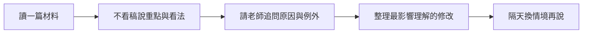

> 🌏 [English version](/posts/learning/2026-10-19-engoo-speaking-practice-en)

你想固定說英文，卻不想每次上課都從「今天要聊什麼」開始。[Engoo 台灣](https://engoo.com.tw/)提供一堂 25 分鐘的一對一線上課，可以自己選老師，也可以帶著平台教材或新聞討論。對下班後只想留一小段時間練習的人，這種安排比較容易放進行事曆。

它需要你自己決定練什麼、找誰練，以及如何整理回饋。挑到會追問、願意糾錯的老師，和只把文章念完的老師，上課感受會差很多。買課前，先確認自己需要的是對話機會，還是有人替你規劃完整進度。

本文依台灣站官方資料與公開第一手心得整理，未實際付費試課，沒有推薦碼或合作報酬。不同練習方式可先看[系列總覽](/posts/learning/2026-10-19-english-speaking-practice-overview)；若想看自行挑選個別課程的家教形式，可對照 [italki 專篇](/posts/learning/2026-10-19-italki-speaking-practice)。

## 三種課程方案，主要差在能約哪些老師

[台灣方案頁](https://engoo.com.tw/plans)把課程分為一般、雙享與 Premium。這個分類先決定可預約的師資範圍，再決定你的每月堂數與付款期間。

| 類型 | 可選師資 | 選購時先想什麼 |
|---|---|---|
| 一般課程 | 以菲律賓、東歐等非英語母語國家的講師為主；不能約 Premium 講師 | 主要想增加開口次數，能接受全英語互動 |
| 雙享課程 | 一半一般課、一半 Premium 課；例如八堂分成四堂加四堂 | 想交替接觸不同講師，又不想全部買 Premium |
| Premium | 包含一般講師、英語母語講師，以及可提供中文輔助的台灣講師等 | 是否真的需要中文協助，或特定英語口音與互動對象 |

Premium 提供較廣的選擇，仍要配合老師開課時間。[使用條款第 10 條](https://engoo.com.tw/terms_of_use)也提醒，Premium 講師每天開課數量有限，無法保證所有課程都由 Premium 講師授課。若你只接受某位台灣老師，先看自己能上的時段，不要把購買資格當成固定保留名額。

老師國籍也無法代替教法。試課時請老師在你說完後指出最影響理解的錯誤，觀察他能否給出具體修改，再讓你重說；不要只用聊天是否愉快來決定長約。

## 費用從 30 天算，年繳也不是整年任意用完

以下是 2026 年 10 月 19 日台灣方案頁的公開價格，金額為新臺幣；活動價與結帳資格會變動。每堂課都是 25 分鐘。

| 一般課程月繳 | 每 30 天付款 | 全部上完的單堂成本 |
|---|---:|---:|
| 八堂 | 2,280 元 | 285 元 |
| 十二堂 | 3,120 元 | 260 元 |
| 二十堂 | 4,600 元 | 230 元 |
| 四十堂 | 8,800 元 | 220 元 |

同一頁顯示，八堂月繳的雙享單堂均價是 510 元，Premium 是 635 元。需要比較時，要把師資類型一起寫進預算，不能拿一般課的價格去估母語講師方案。

長期付款會降低標示均價，也提高一次付出的金額。例如方案頁當時列出一般課八堂的年繳活動總額 11,111 元，分成十二期配額，總計九十六堂，全部用完平均約 116 元一堂。這是預付 360 天的費用，不是每個月只付 926 元。

半年繳是預付 180 天，年繳是預付 360 天；系統每 30 天發送固定堂數。當期沒用完會到期，不能累積到下個月，長期方案也不能延期、請假或暫停。八堂年繳的九十六堂，不能留到最後兩個月才一起上。

用自己的出席率再算一次：八堂月繳若只上六堂，實際每次出席成本就成了 380 元。比起多買堂數降牌價，先確認每週能穩定排出幾次，更接近真正的支出。

付款透過 [Worldpay](https://www.worldpay.com/)，台灣站說明境外刷卡可能另有銀行交易手續費，比例依發卡銀行。上述試算都未加這筆費用。購買日即開始計算課程期間，請挑你能開始上課的時間購買。

## 預約彈性有邊界：不是先把一整週喜歡的老師占滿

[台灣使用條款第 11 條](https://engoo.com.tw/terms_of_use)列明：最晚課前 15 分鐘完成預約，最多提前八天；個別方案的預約上限另有限制。月堂數方案須先上完已預約的課，才繼續約下一堂，可約同一老師連續兩堂。

這個方式適合能隨時間選老師的人。如果你希望每週固定同一老師、同一時段，不宜預設可以一次保留整月。試用時就用你平常下班後會上的時段搜尋，留下幾位合適的老師，而不是只看平日下午的選擇。

取消請在課前 30 分鐘以前完成；晚於期限，課程仍會取消，但不補償。取消後不能重新預約同一堂課，所以不要先取消，再想著馬上搶回原本那一格。課程沒出現在即將上課清單，也要先確認預約是否成功。

老師或設備問題造成課程無法正常進行時，依條款辦理補課券。補課券自發行日起有效 30 天，並非永久有效。課程發生問題，官方要求在結束後一小時內向線上客服或「聯絡我們」反映，非客服上班時間也先留下訊息。

## 教材能減少冷場，糾錯方式仍要先說清楚

Engoo 的主題材料包含會話、旅行、商務、文法等；[Daily News 每日新聞](https://engoo.com.tw/app/daily-news)則提供可拿來討論的時事題目。對於「會說幾句，但不知道怎麼延伸」的人，選定一篇再上課，比每次臨場找話題容易開始。

[官方個人化設定指南](https://engoo.com.tw/blog/engoo/personalized-resquests-for-engoo-lessons/)說明，預約時可以選教材主題，在特殊要求貼上詳細教材連結。你也能選是否自我介紹，以及希望老師積極糾錯或以對話流暢為主。官方把這些自編教材列為免費教材；這不代表真人課程免費。

第一次用，先到[教材入口](https://engoo.com.tw/app/materials)選程度合適的內容，再把連結傳給老師。若需要登入，就在帳號內確認可用材料。你應該能理解材料的大意，並對其中一題說出自己的看法；若每句都要查字典，先換簡單材料，避免整堂變成查單字。

想練口說時，可以減少已經會讀的段落朗讀，保留時間讓老師追問。若想處理發音，就明確要求示範和重說。把這兩種目標分開，你才知道一堂課為什麼有效，下一堂該延續什麼。

## 三份社群經驗：材料有幫助，回饋品質不會自動一致

[2017 年 PTT 的長期使用心得](https://www.ptt.cc/bbs/Language/M.1510500484.A.EAB.html)提到，作者已上過 144 堂 Engoo，喜歡教材選擇和短課彈性。作者也認為自己遇到的老師較少主動訂正，課後留言常偏制式。同串另有學員表示自己的老師會提供客製回饋，並建議課前說清楚需求。

作者曾透過團購取得折扣。文中的每日方案和價格屬於當時制度，今天不能直接沿用。能帶走的問題是：「這位老師會不會留下我下一次能用的修改？」一位作者的選師經驗，無法代表整個平台的平均品質。

[2022 年 PTT 雙享二十堂心得](https://www.ptt.cc/bbs/Language/M.1649146174.A.084.html)則明確揭露，業者邀請作者試上二十堂後寫文。作者喜歡在不同類型老師間切換，也描述遇到一位會仔細改文法與重音的非母語老師，後來經常約他。這是有課程提供關係的體驗文，仍有具體可參考的教學細節；它不能證明母語或非母語老師整體上哪一群教得更好。

[2019 年 Dcard 的雙平台試聽文](https://www.dcard.tw/f/language/p/231140844)認為 Engoo 教材可以在沒話題時接續討論，但也覺得短課單價值得衡量。作者當時只試到非母語老師，無法據此決定是否購買母語方案。這篇正文沒有推薦碼，體驗仍很有限；當年的試聽堂數和師資限制，不作為目前規則。

三篇放在一起看，重點是用同一項任務比較老師：有沒有聽出你的問題、給你修改、留時間重說。社群分享可以幫你設計試課問題，不能替你確認今晚有哪些老師可約。

## 先用試課確認教法，再決定續訂與退費風險

台灣站提供免費試聽入口，[條款第 9 條](https://engoo.com.tw/terms_of_use)說明，轉成付費會員時，未用完的免費試聽會歸零。先完成你可用的試聽，再購買比較穩妥。

實際開放幾堂、哪些師資和使用期限，請看註冊後帳號領到的額度；有疑問就請官網客服確認：這個新帳號有幾堂試聽、何時到期，以及能約哪些講師。不要照舊心得假設一定送兩堂，或一定能試到想買的老師。

月繳會自動續扣。若只想買一期，請在下次扣款日期前一天完成「我的課程」裡的解除合約流程，確認收到信件和帳戶狀態。關閉瀏覽器、少上課或取消單堂預約，都不等於停止續訂。半年繳及年繳則是一次付清，官方說明合約結束後不再請款。

台灣站[方案頁退費規定](https://engoo.com.tw/plans)把退費分成三種情況：

- 購買日起七日內，**未使用任何服務**即終止契約，返還全部課程費用。這不是先上七天再無條件退費。
- 課程期間與已預約課程都未逾三分之一，退還已繳課程費用的一半。若公司證明終止可歸責於消費者，還可能從返還金額扣百分之三十違約金。
- 課程期間或已預約課程任一超過三分之一，不退費。不能只算自己實際上過幾堂。

時間門檻分別是月繳十天、半年繳兩個月、年繳四個月。四十堂方案的預約門檻列在方案頁，使用條款的對照表則只列到二十堂。買四十堂前，請客服以書面確認適用表格、取消預約是否計入，以及你的退費試算。保存購買當天的方案與客服回覆，再付款。

## 把新聞討論練成「能說看法，也接得住追問」

以下是自訂的 25 分鐘試課任務，不是 Engoo 保證的教案。從 Daily News 選一個自己理解的工作或生活題目，不必追最難的新聞。

**課前**先用自己的話準備三個重點：這件事在說什麼、你同不同意、和自己的生活有何關係。只留關鍵字，不寫整份逐字稿。預約時貼材料連結，說明想以討論為主，並請老師保留時間糾錯與重說。

**課中**先花五分鐘介紹內容，再用十五分鐘回答追問；最後五分鐘整理兩個最需要改的地方，各重說一次。這是時間分配建議，需和老師協調。若自我介紹占太久，下次就調整預約設定。

**課後**把文章關掉，隔天自己錄一段不同情境的看法。例如這次談遠距工作，下次改成「新同事應不應該每天進辦公室」，不要背原文或轉錄平台課堂。

選老師的判準也在這裡：老師是否問到你沒準備的部分、修改是否具體、你重說後是否更清楚。若只能照文章回答，下一堂就少讀一段，多請老師追問。先用這種方式練穩，再決定要不要加堂數或預付長期方案。

## 參考資料

- [Engoo 台灣：方案、費用、續訂與退費](https://engoo.com.tw/plans)
- [Engoo 台灣使用條款](https://engoo.com.tw/terms_of_use)
- [Engoo 台灣首頁：課長、設備與預約時間](https://engoo.com.tw/)
- [官方個人化設定指南](https://engoo.com.tw/blog/engoo/personalized-resquests-for-engoo-lessons/)
- [教材入口](https://engoo.com.tw/app/materials)、[Daily News](https://engoo.com.tw/app/daily-news)
- [PTT：2017 年長期上課心得，作者曾團購折扣](https://www.ptt.cc/bbs/Language/M.1510500484.A.EAB.html)
- [PTT：2022 年雙享課程心得，業者提供二十堂試上換文](https://www.ptt.cc/bbs/Language/M.1649146174.A.084.html)
- [Dcard：2019 年 Engoo 與 Cambly 試聽比較](https://www.dcard.tw/f/language/p/231140844)
