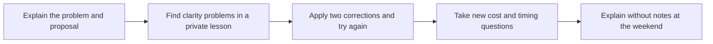

> 🌏 [中文版](/posts/learning/2026-10-19-ev-academy-speaking-practice)

If you want to devote a block of leave to English and have teachers prompting you to speak daily, a residential school in the Philippines is one option. [EV Academy](https://www.evenglish.net/) in Cebu City combines private and group classes, concentrating study and everyday life into one trip.

It suits people able to step away from work and accept residential arrangements and school rules. If you must work remotely every day, or only want conversation twice a week, online tutoring may fit better. The cost of intensive study includes leave, transport, accommodation habits, and the stamina to attend.

This guide covers adult courses at the [official Nasipit, Talamban, Cebu City address](https://www.evenglish.net/page/page3), rather than La Mer family or junior-camp packages. It uses public official information and firsthand student accounts. We have not visited, requested a quote, or enrolled, and have no agency relationship or referral code. Start with the [series overview](/posts/learning/2026-10-19-english-speaking-practice-overview-en) to compare routes.

## Choose the lesson mix before the course label

The [official ESL course](https://www.evenglish.net/page/page42) covers listening, speaking, reading, and writing. [Power Speaking 6/8](https://www.evenglish.net/page/page43) raises the private-lesson proportion and emphasizes oral communication. MTM means one-to-one; it does not mean every session is free conversation.

| Course | Official structure | Who should consider it first? |
|---|---|---|
| ESL | Four private subjects: speaking, reading, writing, listening; small-group grammar and presentation, large-group listening and active speaking | Learners strengthening foundations across four skills and willing to join groups |
| Power Speaking 6 | Six private sessions plus two groups; private subjects include fluent speaking, conversation, vocabulary, effective communication, current issues, and reading; group presentation and active speaking | Learners prioritizing individual practice while retaining peer interaction |
| Power Speaking 8 | Eight private sessions, adding Northstar Speaking and Public Speech to the individual subjects above | Learners able to sustain intensive private work with a clear purpose |

These numbers describe the mix, rather than hours spent personally speaking. Confirm session length, your actual timetable, electives, self-study, placement, and closure dates for your intake. Do not add supervised study, vocabulary tests, and activities to live private-teaching hours.

If basic sentence construction is difficult, eight private sessions may not offer better value than six; you need time to absorb corrections. If everyday conversation is manageable and presentations or workplace explanations are the priority, bring a concrete task when asking about Power Speaking. A listening-and-reading test score alone does not establish a sustainable speaking workload.

## “Sparta” needs actual rules, rather than assumptions about effort

Student accounts describe Sparta and semi-Sparta arrangements involving outings, study periods, and tests. For an adult from Taiwan, these affect whether you can eat out, work in your room, make up missed study time, or change a teacher or course without extra cost.

Request current rules for your chosen course: weekday and weekend curfews, attendance, compulsory versus optional sessions, leave, and changes. If outing restrictions are unacceptable, enrolling merely to force yourself to study may be counterproductive. Excessive pressure can also eliminate time to process feedback.

Accommodation is part of course selection. Twin and four-person rooms differ in air-conditioning preferences, schedules, bathrooms, and quiet time as well as price. Ask about facilities, electricity allocation, room changes, and refunds. Nationality mix changes by intake; an old report of few Taiwanese students is not a promise.

## Three student accounts: more private lessons can also mean fatigue

A [Dcard account of a six-week stay in 2024](https://www.dcard.tw/f/language/p/256210117) describes two weeks of Power Speaking 6 followed by four weeks of IELTS. The writer valued individual turns in small groups and current-affairs material, but found six private sessions exhausting and some teachers insufficiently guiding or too dominant. The post also discusses a twin room and meals, with an agency-selection narrative. Any benefits received are undisclosed, so its recommendation is not an independent inspection.

A [2025 account of twelve weeks of IELTS](https://www.dcard.tw/f/language/p/259246430) describes more useful practice after changing speaking and writing teachers, alongside mismatched group levels, four-person-room routines, and electricity concerns. It explicitly recommends Xinfei, without disclosing paid cooperation. These are examination-course experiences: useful for asking about changes and accommodation, but not proof of current ESL or Power Speaking quality.

A [twelve-week account published in July 2026](https://www.dcard.tw/f/southeastasia_studytour/p/261852428) describes eight weeks of ESL and four of IELTS. The writer valued management, full attendance, and campus activities. It extensively recommends iOutback and a named adviser, without disclosing an exchange of benefits. The graduation score is expressly a mock-test result, not an official IELTS score or a replicable outcome for every student.

Each account depends on personal background, teachers, and that intake. Turn “I improved” into questions you can use: will the teacher let you finish, how are corrections retained, how are groups placed, and who can help if you cannot follow or contribute for a week?

## Separate school payments, local charges, and your own expenses

The complete price should be a written quote for your dates from the school or its appointed agency. The public course pages available in October 2026 do not provide a complete current schedule directly applicable to a Taiwanese adult. This article therefore does not relabel another country’s agency prices as a Taiwan official total.

Organize costs into three layers without double-counting:

| Budget layer | Request these items | Conditions often missed |
|---|---|---|
| School or agency payment | Course, accommodation, registration, meals, transfer, included materials, seasonal or room surcharges | Currency, exchange handling, actual nights, promotion expiry |
| Charges after arrival | Applicable study/stay documentation, student ID, materials, utilities, administration, deposits | Government versus school charges, deposit return, excess electricity calculation |
| Your own expenses | Flights, insurance, communication, meals out, local transport, trips, leave or lost income | Rebooking and a reserve for unexpected health or accommodation changes |

The 2024 writer reported about NT$107,000 for six weeks of mixed courses, a twin room, and school charges, and roughly NT$150,000 for the whole trip. The 2025 twelve-week IELTS writer reported about NT$170,000 for tuition, accommodation, and school charges, and NT$220,000–230,000 including travel and other spending. These historical cases differ in course, duration, and spending. Dividing them into a weekly rate does not establish today’s price.

Retain original-currency amounts in a mixed-currency quote, then state the exchange-rate date and payment fees. Dividing the complete trip cost by actual teaching days can estimate daily trip cost; group classes, study periods, and breaks still are not personal speaking time.

## Use a specific quotation request

The [school contact page](https://www.evenglish.net/page/page3) lists ev-global@hanmail.net and +63-32-384-4755. Ask for the adult admissions team and Taiwan-market contact. The following is an inquiry example, not confirmation that this intake is available:

> I am an adult from Taiwan comparing Power Speaking 6 and ESL at the Nasipit, Cebu City campus for four weeks, January 11–February 5, 2027, checking out February 6. Please quote on-campus twin and triple rooms separately, with possible arrival dates, itemized tuition and accommodation, meals, all mandatory local charges, refundable deposits, currency, discounts, and quote expiry.

Request these details in the same quote or attachments:

- **Teaching:** daily private/group allocation, minutes per lesson, maximum group size, placement, teacher-change dates and costs, and any test days, closures, half-days, and makeup arrangements during the four weeks.
- **Living arrangements:** confirmed room availability, nights included, roommate allocation, electricity and other extras, room changes, early departure, arrival and departure transport.
- **Authorization and documents:** current legal entity for that address, registered course and permit documents, basis for accepting foreign short-term adults, and which study/stay documents apply to your dates, who obtains them, and each charge.
- **Contract:** receipt issuer, cancellation date calculation, predeparture and post-arrival refunds, illness or visa problems, and separate agency-service refunds.

The school’s history page mentions past TESDA accreditation, which does not replace current course-and-address documentation. Use the [Philippine Bureau of Immigration’s accredited-entities entry point](https://immigration.gov.ph/resources/accredited-entities/) to cross-check documents supplied by the school. Corporate registration, authorization to accept foreign students, and teaching effectiveness are different matters. Obtain matching written details before relying on an agency’s general assurance of accreditation.

## The public refund table covers predeparture cancellation

The [official refund page](https://www.evenglish.net/page/page49) lists three situations:

| Public wording | Tuition and accommodation | Registration |
|---|---|---|
| Cancellation 29 days before departure | Listed as fully refunded | Listed as fully refunded |
| 14–28 days before departure | Listed as fully refunded | Not refunded |
| Less than fourteen days | Deduct one week of each | Not refunded |

The first heading says “29 days prior” without explicitly extending the boundary to all earlier cancellations. Do not silently rewrite it as an unrestricted earlier-cancellation promise. Ask the school to calculate your actual cancellation and departure dates and the resulting amount.

The page also does not fully address early departure after arrival, room/course changes, government charges, materials, flights, or agency-service fees. Obtain rules applying to your transaction before signing. This table alone cannot establish the refund for an entire trip.

## An original routine: transfer private-lesson corrections to a new question

This is a suggested personal routine, not EV’s guaranteed syllabus. Use a public fictional situation: explain delayed delivery to a client and propose an alternative. Ask whether the teacher can work with it.

**Before departure**, record your own explanation of the cause, impact, and proposed arrangement. Do not include client information.

**At school**, ask the private teacher to listen first, then identify two changes affecting understanding most. Try again, then change the listener or constraint: no delay is possible, or the budget has shrunk. Avoid learning only one answer.

**Review weekly** whether you can answer an unfamiliar question without a script, explain the trade-off, and have the listener restate your proposal. Count that alongside attendance. If the schedule keeps you busy but leaves no energy to review, reduce optional activity or discuss the workload instead of adding another class to demonstrate commitment.

EV’s distinctive option is concentrated private teaching within a residential environment. A worthwhile package must also fit your stamina and living needs, with a quote and refund terms you can examine item by item.

## References

- [EV Academy ESL](https://www.evenglish.net/page/page42) and [Power Speaking 6/8](https://www.evenglish.net/page/page43)
- [Campus address and admissions contact](https://www.evenglish.net/page/page3), [school history](https://www.evenglish.net/page/page2), and [predeparture refund policy](https://www.evenglish.net/page/page49)
- [Philippine Bureau of Immigration: accredited entities](https://immigration.gov.ph/resources/accredited-entities/)
- [Dcard: six weeks of Power Speaking/IELTS and twin-room experience in 2024 (in Chinese)](https://www.dcard.tw/f/language/p/256210117)
- [Dcard: twelve weeks of IELTS and four-person accommodation in 2025, with agency recommendation (in Chinese)](https://www.dcard.tw/f/language/p/259246430)
- [Dcard: ESL/IELTS account published in 2026, recommending a named agency and adviser (in Chinese)](https://www.dcard.tw/f/southeastasia_studytour/p/261852428)
