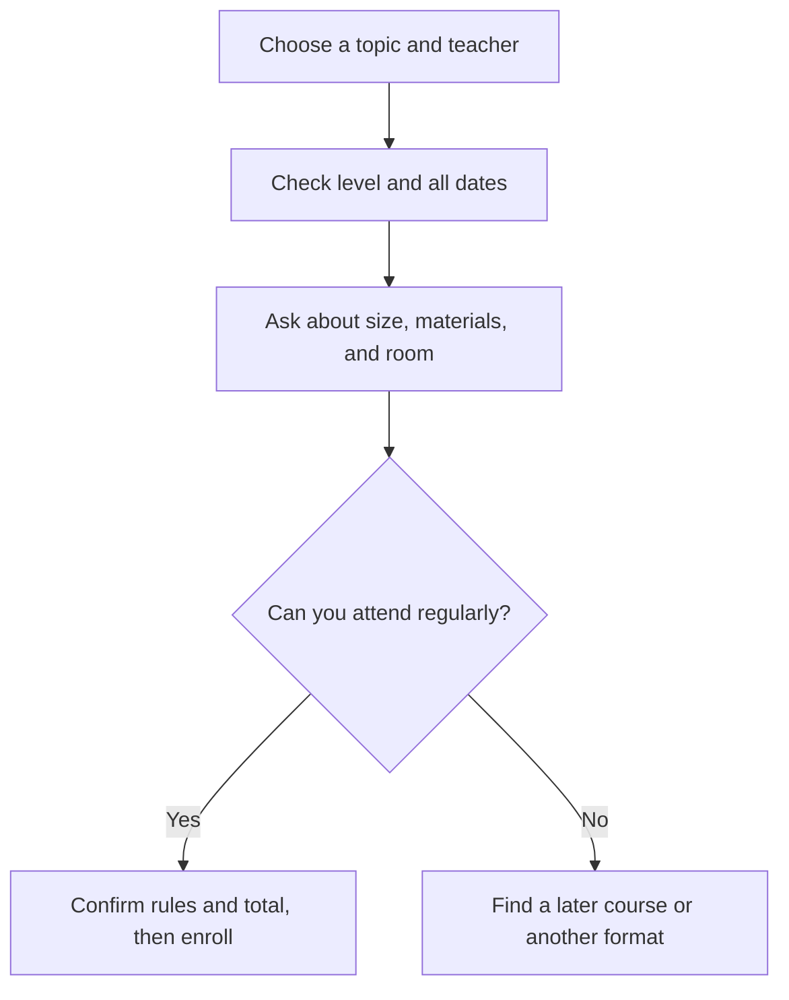

> 🌏 [中文版](/posts/learning/2026-10-19-ntnu-extension-speaking-practice)

If studying English keeps slipping off your evening schedule, a weekly appointment with the same classmates may help. The [English series at National Taiwan Normal University’s School of Continuing Education](https://www.sce.ntnu.edu.tw/home/course/list.php?series=G) offers adult classes with defined schedules and syllabuses.

This guide covers noncredit extension classes. These are separate from NTNU degree programs and Mandarin courses for international learners. Sharing a university name does not make every class alike: the teacher, entry level, and activities still matter.

This article draws on official information and public student accounts; it is not a paid classroom trial. It contains no referral codes or group-buy links. For a broader comparison of learning formats, see the [English Speaking Practice overview](/posts/learning/2026-10-19-english-speaking-practice-overview-en).

## A regular class creates structure and reserves a whole time slot

This format suits people who can protect a regular weekend slot, prepare between lessons, and enjoy working with peers. Role-plays and discussions require you to understand other learners and respond, rather than relying on a private tutor to follow your pace throughout.

You pay for a full course. A three-hour group class includes instruction, listening to classmates, and activities; it does not mean three hours of personal speaking. If your work regularly changes your schedule, or you mainly need feedback on your own interview answers, compare it with [italki private lessons](/posts/learning/2026-10-19-italki-speaking-practice-en), where you can arrange a more individual task.

## Three classes with different speaking goals

The following schedules and list prices reflect October 19, 2026. All amounts are in New Taiwan dollars. Status can change: reopen the detailed page before payment. All three list their location as the NTNU Library Campus or Main Campus, rather than a confirmed building and room.

| Class and teacher | Level and focus | Schedule | Full-course price and status |
|---|---|---|---|
| [Lower-intermediate English Conversation, 1153G023](https://www.sce.ntnu.edu.tw/home/course/detail.php?course=1153G023), 李國仲 | English-medium; TOEIC 500+ suggested; everyday life, travel, and culture | Oct 31–Dec 12; Saturdays 09:00–12:00; no class Nov 28; 18 hours | Tuition NT$4,000 + registration NT$300; materials extra; recruiting |
| [Lower-intermediate Office English Conversation, 1153G024](https://www.sce.ntnu.edu.tw/home/course/detail.php?course=1153G024), 李國仲 | English-medium; CEFR A2–B1, with high-school English or GEPT Elementary also listed; work roles, meetings, and presentations | Oct 31–Dec 12; Saturdays 13:30–16:30; no class Nov 28; 18 hours | Tuition NT$4,000 + registration NT$300; materials extra; recruiting |
| [Advanced English Conversation and Activities Course, 1153G022](https://www.sce.ntnu.edu.tw/home/course/detail.php?course=1153G022), Tim O’Brien | Adult English discussion; target students listed as C1–C2; current affairs, everyday issues, and team activities | Nov 7–Jan 30, 2027; Saturdays 10:00–13:00; no class Nov 28, Dec 26, or Jan 2; 30 hours | Tuition NT$6,800 + registration NT$300; activity handbook NT$85; confirmed to run |

The first two share a teacher but use different situations. The general conversation course moves through first impressions, planning travel, airports and hospitality, cultural differences, current trends, and travel memories. The office course covers social introductions, responsibilities, daily work, problem-solving meetings, presentations, and online marketing. Both use teacher-created handouts and allow adjustments to students’ abilities.

The official profile for 李國仲 includes teaching in the foreign languages department at National Taipei University. Office-class activities include individual conversations, relaying information, group discussions, and presentations. Compare those activities with what you need to do at work, rather than choosing by the word “business” alone.

The advanced class follows a more flexible discussion format. The teacher announces upcoming topics so students can prepare, then develops them through discussions and team activities. Materials include an activity handbook, audiovisual resources, online material, and handouts. Tim’s official profile describes experience teaching advanced speaking and writing at tertiary institutions in Taiwan. That background helps explain the course; it does not guarantee every learner will enjoy its pace.

Its general description says upper-intermediate and above, while the target-student section specifies C1–C2. If you sit between those descriptions, ask the coordinator which entry threshold to use. Describe whether you can discuss current affairs without a script, explain reasons, and handle follow-up questions. A listening-and-reading test score supplies background; it does not directly establish readiness for oral discussion.

## Divide the full price by the classes you can attend

At the undiscounted rate, the general conversation class costs NT$4,300 before materials and transport. Across six meetings, that is about NT$717 per meeting, or NT$239 per scheduled hour. These are group-class attendance costs. If you can attend only four meetings, the same fixed payment becomes NT$1,075 per attended meeting.

The advanced course costs NT$7,185 including the stated handbook: about NT$719 across each of ten meetings. Because the page also lists other material formats, ask whether anything else carries a charge. The first two classes say materials are self-funded without specifying an amount; that does not mean zero.

Course pages list several possible discounts, including group enrollment, alumni, and consecutive study. One offer may be selected, and the discount applies to tuition. Confirm eligibility and payment arrangements before checking the final total. A group discount is poor value if the class is at the wrong level or you cannot attend regularly.

Include commuting. If a return journey takes an hour, six meetings require another six hours in your calendar. This is a planning example, not a university requirement. Get the actual classroom before navigating to “NTNU.” If two Saturdays already clash with travel, finding a later course is more realistic than expecting makeup classes.

## Student accounts show both encouragement and frustration

A [2025 Dcard account about Peter 羅德恩](https://www.dcard.tw/f/language/p/256763593) looks back at starting an elementary conversation class in early 2021. The writer had feared an English-only classroom and valued weekly homework, attention to whether each student spoke, and role-play. The writer was also recruiting group-enrollment partners, creating a discount incentive. Later test preparation was separate self-study; the resulting score and career changes cannot all be attributed to this class.

That account concerns Peter’s elementary course, not the classes taught by 李國仲 or Tim in the table. It supplies useful questions about quieter students and homework feedback, rather than evidence that every teacher works the same way.

In a [2010 PTT account of an upper-intermediate conversation class](https://www.ptt.cc/bbs/Eng-Class/M.1281662951.A.F0F.html), the writer appreciated stronger classmates but initially could not understand the teacher’s jokes. A friend stopped attending because of the frustration; the writer continued studying outside class and gradually caught up. The teacher is unnamed and the account is old. It illustrates a level-selection risk, rather than today’s classroom composition.

A [2017 PTT selection discussion](https://webptt.com/m.aspx?n=bbs%2FLanguage%2FM.1498754780.A.156.html) includes a firsthand reply about 徐薇’s pronunciation class and attention to common pronunciation errors. This brief report concerns another class type, not a comparison of speaking outcomes. The reply says recording was allowed at the time; current official rules prohibit classroom audio and video recording, so follow the current policy.

These accounts reveal two sides of a fixed group course. Some learners benefit from homework and peer expectations; others leave when the pace is too demanding. Make “I want a challenge” concrete: can you understand activity instructions, contribute a complete turn in a group, and study unfamiliar material afterward?

## Check the level, class size, and dates before enrollment

Start with the English-series listing, then open the detailed page for the course code, teacher, dates, and breaks. The listing also retains classes already running or completed. If the start date has passed, ask about late entry or notification of the next course instead of treating an old page as new recruitment.

The three examples above had not reached their first meeting on the article date. A recruiting label still leaves uncertainty about whether a class will run. Their detailed pages do not publish a minimum enrollment or maximum class size, so they should not be described as small classes. Contact the named coordinator with the course code before paying:

- **1153G023 / 1153G024: Ms. Tsai, 02-7749-5853.** Ask about enrollment so far, the minimum required to run, the class limit, handout costs, the classroom, and whether your current ability fits.
- **1153G022: Ms. Yang, 02-7749-5843.** Ask about remaining places, how to interpret C1–C2 entry requirements, fees beyond the handbook, class size, and the classroom.

Explain your goal, such as being able to introduce your work but struggling to answer meeting follow-ups. Ask how speaking turns and individual feedback are organized. Official rules do not provide auditing, so do not assume you can sit in for free first. Complete registration, course selection, and payment; placing a class in a cart does not complete enrollment.

The [official extension FAQ](https://www.sce.ntnu.edu.tw/home/course/qa.php) states the noncredit-course refund schedule: 90% before the start date, half if requested from the start without exceeding one third of the course, and no refund after that threshold. If the school cannot run the class, the paid fees are refunded in full. The calculation uses scheduled course hours, not the hours you personally attended, and processing takes about four weeks. Ask how separately paid material charges enter your own refund calculation.

Personal absences and missed lessons before late entry do not receive makeup classes. Enrollment cannot be transferred to another person, and classroom recording is prohibited. A class transfer must be requested before the original class’s second meeting, is limited to once, and removes eligibility for a later refund. Consider these rules beside your calendar, not only the hourly price.

## Turn an office-English lesson into usable practice

The following is a suggested personal routine, not a promised school assignment. Use the office class’s problem-solving meeting topic as an example:

1. **Before class: choose a work problem you can discuss publicly.** A deadline and resource conflict works well. Note the background, two possible approaches, and your choice. Say it once and identify where you get stuck. Leave out confidential company or client information.
2. **During class: complete a reason-and-follow-up exchange.** State your choice in the group, explain the trade-off, then respond to classmates’ questions. Write down corrections the teacher actually gives. Do not record the classroom.
3. **After class: explain it again with your notes closed.** At home, record your own new version and ask a friend to question the content. Compare whether the background is clearer, whether you answer the actual question, and whether you still depend on a script.

A useful test is whether you can later explain a similar decision without the original handout and answer an unprepared follow-up. If you only memorize the same passage, bring a request for more “why” questions into your next practice.

NTNU extension classes offer a regular rhythm and peer interaction. A suitable class also needs a manageable level, dates you can attend, and activities that address your own speaking goals.

## References

- [NTNU School of Continuing Education: English-series listing (in Chinese)](https://www.sce.ntnu.edu.tw/home/course/list.php?series=G)
- [1153G023: Lower-intermediate English Conversation (in Chinese)](https://www.sce.ntnu.edu.tw/home/course/detail.php?course=1153G023)
- [1153G024: Lower-intermediate Office English Conversation (in Chinese)](https://www.sce.ntnu.edu.tw/home/course/detail.php?course=1153G024)
- [1153G022: Advanced English Conversation and Activities Course](https://www.sce.ntnu.edu.tw/home/course/detail.php?course=1153G022)
- [Extension FAQ: enrollment, refunds, transfers, and course rules (in Chinese)](https://www.sce.ntnu.edu.tw/home/course/qa.php)
- [Dcard: Peter’s elementary conversation class; posted in 2025 about study beginning in 2021; includes group-enrollment recruitment (in Chinese)](https://www.dcard.tw/f/language/p/256763593)
- [PTT: upper-intermediate conversation experience, 2010 (in Chinese)](https://www.ptt.cc/bbs/Eng-Class/M.1281662951.A.F0F.html)
- [PTT discussion mirror: course selection and a pronunciation-class reply, 2017 (in Chinese)](https://webptt.com/m.aspx?n=bbs%2FLanguage%2FM.1498754780.A.156.html)
