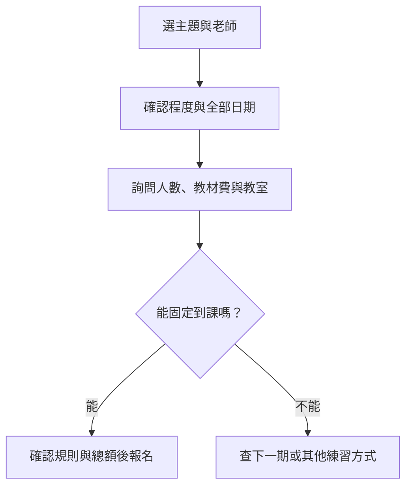

> 🌏 [English version](/posts/learning/2026-10-19-ntnu-extension-speaking-practice-en)

如果你下班後很難自動打開英文教材，固定每週去一個地方，和同一群人說英文，可能比較容易持續。[國立臺灣師範大學進修推廣學院的英語系列](https://www.sce.ntnu.edu.tw/home/course/list.php?series=G)，就是這種有班期、有課綱的成人進修選擇。

這裡介紹的是推廣非學分班，不是師大學位班，也不是教外國人中文的華語課。報名單位雖然同樣叫師大，實際選課還是要看那一班的老師、程度與課程安排。

本文以官方課程資訊和公開學員心得整理，未實際付費上課，也沒有推薦碼或團報連結。先比較實體班與線上家教，可從[英文口說練習總覽](/posts/learning/2026-10-19-english-speaking-practice-overview)開始。

## 固定班期能幫你建立節奏，也會占住整個時段

推廣課適合能預留固定週末、願意預習，也喜歡和同學一起練的人。班上有角色扮演與討論時，你得理解不同人的說法，再接著回答；這和一對一老師一路配合你的速度不同。

相對地，你買的是整期課程。三小時的團體課包含講解、聽別人說和活動時間，不能當成自己說了三小時。如果你經常臨時加班，或只想密集處理自己的面試答案，[italki 一對一課程](/posts/learning/2026-10-19-italki-speaking-practice)這類可自行安排任務的方式，也值得一起比較。

## 三個班，練的是不同的事

以下是 2026 年 10 月 19 日的班期與牌價，金額為新臺幣。狀態會變動，繳費前回詳細頁確認。三班教室都列為「師大圖書館校區或校本部」，不是已指定同一棟樓。

| 班別與老師 | 程度及內容 | 班期與上課時間 | 整期費用與狀態 |
|---|---|---|---|
| [英語口說會話班－初中級，1153G023](https://www.sce.ntnu.edu.tw/home/course/detail.php?course=1153G023)，李國仲 | 全英語；建議多益 500 分以上；生活、旅遊、文化話題 | 10/31–12/12，週六 09:00–12:00；11/28 停課；共 18 小時 | 學費 4,000 元＋報名費 300 元；教材自費；招生中 |
| [實用辦公室英語會話班－初中級，1153G024](https://www.sce.ntnu.edu.tw/home/course/detail.php?course=1153G024)，李國仲 | 全英語；CEFR A2–B1，另列高中程度或全民英檢初級；職場角色、會議、簡報 | 10/31–12/12，週六 13:30–16:30；11/28 停課；共 18 小時 | 學費 4,000 元＋報名費 300 元；教材自費；招生中 |
| [Advanced English Conversation and Activities Course，1153G022](https://www.sce.ntnu.edu.tw/home/course/detail.php?course=1153G022)，Tim O’Brien（歐廷熙） | 成人英語討論；授課對象列 C1–C2；時事、生活議題與團隊活動 | 11/7–2027/1/30，週六 10:00–13:00；11/28、12/26、1/2 停課；共 30 小時 | 學費 6,800 元＋報名費 300 元；活動手冊 85 元；確定開班 |

前兩班由同一位老師授課，差別主要在練習情境。生活會話班的六堂安排，從第一印象、旅程規劃，到機場飯店餐廳、文化差異、流行話題與旅遊回憶。辦公室班則從社交與職責，走到日常工作、解決問題的會議、簡報和網路行銷。兩班都用教師自編講義，會依同學能力調整。

李國仲的官方介紹列有國立臺北大學外語系講師等經歷。辦公室班包含個別對話、訊息傳達、分組討論與簡報。想練工作英文的人，可以拿自己的目標去對照這些活動。

進階討論班的設計又不同。老師會提前公布下週主題，讓學生預習，再用討論和團隊活動延伸。材料包括活動手冊、影音、網路與講義。官方師資介紹寫 Tim 有在台灣大專院校教授進階寫作與口說的經驗。這些經歷能幫助了解課程背景，不能保證每位學員都會喜歡同樣的節奏。

進階班的課程說明寫「中高級以上」，授課對象則更明確列 C1–C2。程度介於中間的人，先問承辦人該依哪個門檻判斷，並描述自己能否不看稿討論時事、解釋理由和回應追問。多益聽讀成績可以當溝通背景，不能直接代表你跟得上口語討論。

## 費用要除以整期能上的課，再加通勤

以生活會話班未折扣牌價計算，學費加報名費是 4,300 元。六次課平均約 717 元一次，除以總課時約 239 元一小時；這些都是團體課的在場成本，尚未加教材及交通。若只能去四次，固定支出攤到每次出席就成了 1,075 元。

進階班加上已列明的手冊，合計 7,185 元；十次課平均約 719 元一次。頁面還列有其他材料形式，繳費前可再確認是否有額外收費。前兩班的「教材自費」沒有列金額，不要把它算成零元。

課程頁列出團報、校友、續讀等不同折扣，優惠限選一種，折的是學費。先確認資格與付款方式，再看結帳總額；不要因為想湊折扣，就報程度不合或無法固定出席的班。

通勤也一起算。假設每次往返花一小時，六次課就要再安排六小時，這是時間試算，並非校方規定。到課前先確認實際教室，別只導航到「師大」。若兩個週六已排好出遊，先找下一期，通常比報名後期待補課實際。

## 學員心得：有人靠固定作業開口，也有人被程度差距勸退

[2025 年 Dcard 的羅德恩 Peter 老師心得](https://www.dcard.tw/f/language/p/256763593)，回顧作者從 2021 年初級會話班開始的學習。作者原本害怕全英文課，認為每週作業、老師注意每人是否發言，以及角色扮演，幫助自己建立信心。作者同時正在徵團報夥伴，具有折扣誘因；文內也說明後來另行自修考試，不能把考試成績或職涯變化全歸給這堂課。

這篇談的是羅德恩的初級班，不是上表李國仲或 Tim 的班。它能提醒你詢問「會不會照顧少開口的人、作業如何回饋」，無法用來保證全院老師都有同樣做法。

另一篇 [2010 年 PTT 中高級會話經驗](https://www.ptt.cc/bbs/Eng-Class/M.1281662951.A.F0F.html)，作者喜歡和程度較強的同學一起上課，但起初連老師的笑話都聽不懂。同行朋友因挫折中途不去了，作者則靠課後加強，逐漸跟上。文章未具名老師，年代也久，只能作為選程度時的提醒，不能代表今天的班級組成。

[2017 年 PTT 選班討論](https://webptt.com/m.aspx?n=bbs%2FLanguage%2FM.1498754780.A.156.html)裡，有回覆者分享徐薇發音班會指出常見錯音。這是另一種班型的簡短經驗，不是口說成效比較。留言提到當時可錄音複習；現在官方規則禁止課堂錄音錄影，不能照舊文操作。

這些分享呈現了固定班的兩面：有人需要作業與同儕的推力，有人會因速度差距退出。挑課時，請把「我願意被挑戰」再問具體一點：我能否聽懂活動指令、在小組裡完整說一段，並在課後補足不懂的材料？

## 報名前，把程度、班級人數與日期問清楚

先在英語系列總表選主題，再進詳細頁看課號、老師、日期與停課日。總表也保留上課中和已結業的課；日期已過，即使仍有頁面，也先詢問能否插班或如何登記下期通知，別直接把舊班當新招生。

上表三班尚未到首堂日期，但「招生中」仍有開班不確定性。詳細頁沒有公布這三班的最低開班人數或班級上限，因此不把它們稱為小班。付款前可直接帶課號聯絡：

- **1153G023／1153G024：蔡小姐，02-7749-5853。** 問目前報名人數、最低開班條件、班級上限、自編講義費、確定教室，以及自己的程度是否適合。
- **1153G022：楊小姐，02-7749-5843。** 問剩餘名額、C1–C2 門檻如何判斷、活動手冊以外費用、班級人數與教室。

再說明你的目標，例如「能介紹工作，但會議被追問就答不完整」，詢問課堂如何安排發言與個別回饋。官方不提供旁聽，不宜預設能先免費坐一堂看看。確認後再註冊、選課與繳費；只把課放購物車不算完成報名。

[官方推廣 QA](https://www.sce.ntnu.edu.tw/home/course/qa.php)的非學分班退費規定，是開班上課日前申請退九成；開班起算未逾全期三分之一退半數；超過後不退。學校因故未開班則全額退費。計算依正常課程時數，不是你實際出席多少，辦理入帳約四週。教材等個別款項若已支付，請承辦人說明如何納入你的退費計算。

個人請假或插班缺課不補課，課程也不能轉讓；課堂不得錄音錄影。轉班須在原班第二次上課前申請，限一次，轉班後不得再退費。把這些限制和行事曆一起看，比只看每小時價格更能避免買了卻上不了。

## 用一堂辦公室課，練出能帶回工作的表達

以下是自訂練習安排，並非校方承諾的作業。以辦公室班「會議解決問題」主題為例：

1. **課前：準備一個可公開的工作問題。** 例如交付日期和資源衝突，寫下背景、兩種做法與你的選擇。先自己說一遍，記下最容易卡住的位置，不帶客戶或公司的機密資料。
2. **課中：爭取完成一輪理由與追問。** 小組討論時先說選擇，再解釋代價；聽同學的問題後補充。筆記只留下老師實際給過的修改，課堂不錄音。
3. **課後：關掉筆記再說一次。** 回家錄自己的重說版本，請朋友針對內容追問。比較兩次是否能把背景交代清楚、是否回答到問題、是否仍靠逐字稿。

判斷一堂課有沒有幫上忙，可以看下次遇到類似問題時，能否在沒有原講義的情況下說清楚選擇，並回應一個沒準備過的追問。若每次都只背熟同一段，下一堂就把「請多問我為什麼」帶進練習。

師大推廣值得考慮的地方，是固定班期和同儕互動能替練習建立節奏。真正適合你的那一班，還得同時滿足程度接得住、日期上得到，以及活動能練到自己的目標。

## 參考資料

- [師大進修推廣學院：英語系列課程總表](https://www.sce.ntnu.edu.tw/home/course/list.php?series=G)
- [1153G023：初中級英語口說會話班](https://www.sce.ntnu.edu.tw/home/course/detail.php?course=1153G023)
- [1153G024：初中級辦公室英語會話班](https://www.sce.ntnu.edu.tw/home/course/detail.php?course=1153G024)
- [1153G022：Advanced English Conversation and Activities Course](https://www.sce.ntnu.edu.tw/home/course/detail.php?course=1153G022)
- [推廣 QA：報名、退費、轉班與課程規定](https://www.sce.ntnu.edu.tw/home/course/qa.php)
- [Dcard：羅德恩 Peter 老師初級會話班心得，2025 年發文、回顧 2021 年學習，含徵團報](https://www.dcard.tw/f/language/p/256763593)
- [PTT：中高級會話班經驗，2010 年](https://www.ptt.cc/bbs/Eng-Class/M.1281662951.A.F0F.html)
- [PTT 討論鏡像：選班與徐薇發音班回覆，2017 年](https://webptt.com/m.aspx?n=bbs%2FLanguage%2FM.1498754780.A.156.html)
