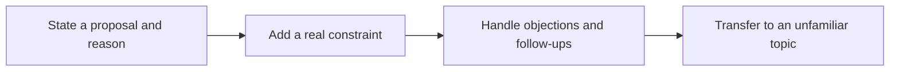

> 🌏 [中文版](/posts/learning/2026-10-19-preply-speaking-practice)

You may be able to explain an idea in a meeting, then lose your thread when someone asks why you chose that option. [Preply](https://preply.com/zh/online/english-tutors) offers a way to practise with an online tutor who can listen, ask follow-up questions and build lessons around your goals.

There is considerable choice in tutors. The payment structure deserves equal attention: regular lessons primarily use a recurring subscription with a particular tutor. For working adults in Taiwan, that means checking evening availability, the tutor's ability to maintain a routine and your own willingness to manage bookings and renewal dates.

This guide uses official information and three public community accounts. We have not paid for or attended a trial, and this article contains no referral codes or commission links. Start with the [English Speaking Practice overview](/posts/learning/2026-10-19-english-speaking-practice-overview-en) to compare practice channels.

## What is Preply? Choose the tutor and the lessons together

Preply connects learners with tutors. Profiles show specialisms, experience, prices and available times; you then book a trial and meet in an online classroom. It is an option for learners seeking continued conversation and feedback with a chosen person. Discuss the actual materials and teaching approach with that tutor.

The [English tutor directory](https://preply.com/zh/online/english-tutors) offers filters such as price, availability, accent and specialism. Write down your difficult speaking situation first, then select two or three tutors who can work on it. That is easier than browsing a large collection of highly rated profiles without a goal.

| Need | Ask before the trial |
|---|---|
| Explain reasons in work meetings | Can we use my proposal and practise follow-up questions and argument structure? |
| Build complete sentences | Do you provide a sequence of materials, demonstrations and short speaking tasks? |
| Keep everyday conversations going | How do you guide follow-up questions and topic changes while leaving me time to speak? |
| Stay with one tutor for several months | Can you maintain a Taiwan evening slot, and how do you record errors and track progress? |

Look for concrete teaching behaviour in reviews: what gets recorded, when corrections happen and whether there is a follow-up task. Nationality and ratings can narrow the field; the trial must still establish whether the tutor can handle your problem. An easy-to-understand introduction video does not establish how much speaking time you will get in a lesson.

## Compare individual prices using the same lesson length

The [official subscription guide](https://help.preply.com/en/articles/4966680-how-does-my-preply-subscription-work) says the charge depends on the tutor's rate and the plan's lesson amount. Listings display prices against durations such as fifty minutes. Compare trial, short-session and regular-lesson prices separately. One tutor's starting price is not a platform-wide rate.

Record four things from your checkout: lesson length, lessons per cycle, currency and total charge. For Taiwan-dollar budgeting, also consider your card issuer's conversion or foreign-transaction fees. The [subscription terms](https://termsofuse.preply.com/terms_of_use/en_SubscriptionServicesTerms.pdf) also discuss possible taxes, transaction costs and payment-provider charges. Read the final amount before paying. The official guide also says a change to your tutor rate requires notification and your acceptance.

The minimum standard plan contains four fifty-minute lessons per cycle. Switching to twenty-five-minute sessions divides the same total learning time into more sessions. A larger session count does not itself mean more learning time.

Here is an **illustrative calculation**, rather than a Preply quote: if your selected tutor's checkout price is NT$600 per fifty-minute lesson, four lessons cost NT$2,400 before any other applicable charges. Replace those inputs with your actual tutor and checkout details.

## Take a paid trial before choosing a subscription

The [trial guide](https://help.preply.com/en/articles/4179487-how-to-book-a-trial-lesson) offers twenty-five- or fifty-minute trials, with one trial per student for each tutor. Trials are paid lessons. Select the duration when booking; it cannot simply be changed after confirmation. A standard trial does not require a subscription, and you decide whether to continue afterwards.

A typical trial includes goals, a short level check, a sample activity and a suggested plan. Send your goal beforehand and ask for time to try an actual speaking task. A lesson spent entirely on platform explanations or casual introductions gives you little evidence of how the tutor would teach you.

Afterwards, answer three questions:

- What specific problem did the tutor identify that I had missed?
- Did I get to use the feedback and say it again?
- Could the tutor explain what the next few lessons would involve?

If the trial is a poor fit, the [official replacement process](https://help.preply.com/en/articles/4182743-how-to-request-a-free-trial-lesson-replacement) lets you ask support for a free trial with a different tutor. Each account can receive up to two replacements in total. An approved replacement is a discount on a new trial. It is no longer available once you have started a subscription with that tutor. A tutor who did not attend at all is handled through a separate process.

This is a remedy for finding a suitable tutor, rather than unlimited free trials or an unconditional refund of regular subscription lessons.

## A 28-day cycle does not mean the same date each month

A [standard subscription](https://help.preply.com/en/articles/4966680-how-does-my-preply-subscription-work) renews every twenty-eight days and applies to one tutor. The first cycle starts when the initial payment is completed. Renewal therefore moves relative to calendar months. Learning with two tutors at once requires separate subscriptions.

Regular lessons are not currently sold as standalone, non-subscription packs, including through support. A minimum plan lets you start with fewer lessons, but it still renews automatically. A community description such as “no six-month or yearly commitment” needs that additional qualification.

**After subscribing, put the next billing date in your calendar and book the lessons you can actually attend.** Intending to study every week does not reserve those lessons.

| Situation | Standard-cycle treatment |
|---|---|
| Lessons not booked before renewal | They expire at renewal and do not automatically accumulate |
| Lessons successfully booked before renewal | They can take place after renewal and remain protected |
| You need a short break | Pause renewal once per cycle, by up to twenty days, before billing |
| You want to stop the next charge | Cancel that tutor's subscription at least one day before the next billing date |

Avoid filling your calendar with appointments you cannot attend just to protect a balance. Agree on feasible future slots with the tutor and use the rescheduling process when plans change.

The [terms also describe yearly plans](https://termsofuse.preply.com/terms_of_use/en_SubscriptionServicesTerms.pdf), billed every 364 days while lessons refill every twenty-eight days. Availability depends on your checkout. Under the stated yearly trial conditions, you may request a full refund if no lessons were used, or a refund for unused lessons if some were used; the processing fee is not refunded in the latter case. Cancellation after the fourteen-day trial does not qualify for a refund under that clause, and lessons continue to refill until the subscription ends. If a yearly or free-trial promotion appears, check its commitment and conditions before comparing discounts.

## Cancelling a lesson, stopping renewal and getting a refund are separate actions

Telling a tutor you no longer want lessons does not complete the necessary account actions.

**To cancel or reschedule one lesson**, check the [twelve-hour policy](https://help.preply.com/en/articles/4179413-cancellation-policy-for-students). With at least twelve hours' notice, a cancellation can return the lesson to your available balance. A cancellation within twelve hours or a missed lesson can consume it. If the tutor agrees to a last-minute change, the lesson must actually be rescheduled in the system; a message alone does not change its status. Act early rather than aiming for the exact deadline.

**To stop the next charge**, use subscription settings. The [subscription cancellation guide](https://help.preply.com/en/articles/15432023-what-happens-when-i-cancel-my-subscription) requires at least twenty-four hours' notice. Inside that window, contact support promptly before the charge processes. Confirm that you receive an email and that the tutor's subscription shows as cancelled in settings. Subscriptions with other tutors remain separate.

**To recover a payment already made**, request a refund separately. The [refund guide](https://help.preply.com/en/articles/9901475-how-do-refunds-work-at-preply) says a refund may be approved after cancellation if no lessons from the billing cycle have been used and the request is within twenty-eight days of the charge. Cases are reviewed individually. Cancellation does not issue a refund automatically. Approved funds return to the original payment method and may take up to thirty days to appear.

Stopping a recurring weekly lesson setup also does not stop subscription billing. Before cancelling the subscription, inspect unscheduled and booked lessons, then save the confirmation so you know what remains to be done.

## Switching tutors transfers lesson value

You may have alternatives to continuing with an unsuitable tutor. The [tutor-switch guide](https://help.preply.com/en/articles/7924262-how-do-i-move-my-lessons-to-another-tutor) describes moving the value of remaining lessons to a new tutor's plan. A higher rate can mean fewer lessons or a payment difference. Leftover value becomes platform credits that cannot be withdrawn as cash.

The process asks whether you want to replace the tutor or keep both. Keeping both preserves the old subscription and creates a new one. Before confirming, count the active subscriptions and check each renewal date. Moved lessons follow the new tutor's cycle for expiry, so switching is not a way to store tuition indefinitely.

Take a trial with an unfamiliar tutor and confirm that they accept your level, materials and goal. Check individual appointments carefully when keeping lessons with the previous tutor.

## Three community accounts suggest three questions

**Does the low unit price match how often you will study?** A [2024 PTT account](https://www.ptt.cc/bbs/Language/M.1725175723.A.20D.html) describes combining platforms, choosing a small regular plan, sharing web pages and using preparation materials. It contains Preply referral links and promotion for another platform. Use it for concrete usage examples, then check today's checkout for prices and offers. Its descriptions of a “free” trial and a discounted trial are inconsistent, so neither establishes a current free-trial guarantee.

**Will the tutor help you develop an argument, or end the conversation early?** In a [June 2026 Dcard account](https://www.dcard.tw/f/language/p/261715634), a graduate student describes struggling with spontaneous academic discussions after exam preparation and using a tutor for discussions and presentations. The post includes a referral link. In the accessible comments, another learner says a tutor tried to end a fifty-minute trial early and left them to generate topics. That is an independently unverified, one-sided account. It supports agreeing on tasks and practice time beforehand, rather than a conclusion about every tutor.

**Are you willing to manage renewals, and can you access the review materials you want?** An [October 2026 Dcard comparison](https://www.dcard.tw/f/language/p/262275714) comes from someone who tried two platforms and was concerned about Preply's renewal and recording arrangements. One accessible commenter describes their own audio-review workflow. Video, audio, subtitles and lesson analysis are separate features. Check the actual options for your account and lessons; one person's audio download is not a promise of video recordings for every class. No referral code appears in the accessible body, and any commercial relationship is unstated.

These are individual accounts. Tutor fit, scheduling, materials and subscription management all shape the experience. A recommendation or a bad trial does not establish the platform's overall learning effectiveness.

## A four-lesson plan for defending a proposal

This is a self-designed practice sequence to discuss with a prospective tutor, rather than a standard Preply syllabus. Pick an everyday decision you understand, such as a team tool or a weekend activity. Use a version of any work example that is safe to share publicly.

**Before class**, record one minute explaining your preferred option, your reason and a drawback of the alternative. Avoid writing a full script. Note where you get stuck.

**Lesson one:** ask the tutor to hear the original explanation and question your reason. Correct the problem that most affects understanding, then try again.

**Lesson two:** use the same proposal with a new constraint, such as a reduced budget. Acknowledge the constraint and adapt the recommendation. Ask the tutor to record information you tend to omit.

**Lesson three:** have the tutor disagree. Clarify the objection, offer an alternative and ask whether it is acceptable. Avoid simply repeating your original reason.

**Lesson four:** switch to an unfamiliar topic and use the same speaking structure. This tests whether you can organise an answer rather than remember earlier wording.

After each lesson, keep a revised recording and one point to improve next time. Compare lessons one and four for a clear recommendation, supporting reason and response to an unprepared follow-up. Places where the tutor still has to finish your sentences identify the next practice target.

## Who should consider it?

Preply is worth assessing if you want continued work with a chosen tutor, will use a trial and can manage bookings and renewal. Start by placing feasible lessons in your actual schedule, then choose the plan size.

For occasional standalone lessons without recurring billing, compare the [italki guide](/posts/learning/2026-10-19-italki-speaking-practice-en). For classroom interaction with peers, see the [British Council Taiwan adult course guide](/posts/learning/2026-10-19-british-council-taiwan-speaking-practice-en). Choose an arrangement you can maintain, then compare tutors and cost.

## References

- [Preply: English tutors and selection](https://preply.com/zh/online/english-tutors)
- [Official: subscriptions, 28-day cycles, duration and expiry](https://help.preply.com/en/articles/4966680-how-does-my-preply-subscription-work)
- [Official: booking a paid trial](https://help.preply.com/en/articles/4179487-how-to-book-a-trial-lesson)
- [Official: trial replacement requests](https://help.preply.com/en/articles/4182743-how-to-request-a-free-trial-lesson-replacement)
- [Official: student cancellation policy](https://help.preply.com/en/articles/4179413-cancellation-policy-for-students)
- [Official: subscription cancellation and remaining lessons](https://help.preply.com/en/articles/15432023-what-happens-when-i-cancel-my-subscription)
- [Official: refunds and the original payment method](https://help.preply.com/en/articles/9901475-how-do-refunds-work-at-preply)
- [Official: moving lesson value to another tutor](https://help.preply.com/en/articles/7924262-how-do-i-move-my-lessons-to-another-tutor)
- [Subscription Services Terms, updated August 28, 2026 (PDF)](https://termsofuse.preply.com/terms_of_use/en_SubscriptionServicesTerms.pdf)
- [PTT: learner account, 2024; referral links (in Chinese)](https://www.ptt.cc/bbs/Language/M.1725175723.A.20D.html)
- [Dcard: graduate-student account, June 2026; referral link (in Chinese)](https://www.dcard.tw/f/language/p/261715634)
- [Dcard: platform trial comparison, October 2026 (in Chinese)](https://www.dcard.tw/f/language/p/262275714)
