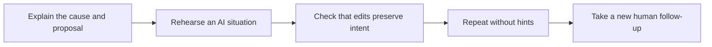

> 🌏 [中文版](/posts/learning/2026-10-19-speak-speaking-practice)

You can write an explanation in English, but freeze when your turn arrives in a meeting. A private lesson feels intimidating too; you would prefer to rehearse without an audience first. [Speak](https://www.speak.com/tw/) offers phone-based AI speaking practice: learn an expression, answer aloud, then try a simulated situation.

Real people appear in its recorded teaching videos, while the interactive partner is AI. A subscription does not include a live tutor teaching your lesson. Repetition is convenient, but you still need to check whether you can communicate with someone after removing the prompts.

This article uses Taiwan’s official information and public firsthand accounts. It is not a subscription test and contains no referral codes or paid relationship. See the [series overview](/posts/learning/2026-10-19-english-speaking-practice-overview-en) for other formats, or the [italki guide](/posts/learning/2026-10-19-italki-speaking-practice-en) for live private tutoring and individual follow-up.

## From videos and short responses to a situation you choose

The [official product page](https://www.speak.com/tw/purchase) describes a sequence of topic videos, speaking exercises, quick responses, and role-play. If you do not know where to begin, a prepared progression can be easier than planning materials in an empty chat window.

Beyond the core lessons, [Speak Tutor](https://help.speak.com/zh-TW/articles/11396739-speak-tutor-speak-講師-是什麼) accepts questions and creates personalized speaking lessons. For example, request practice explaining a delayed delivery to a colleague. “Tutor” here names an AI feature, rather than a live teacher assigned to you.

Feedback can draw attention to grammar, vocabulary, and expression. It is not an official examination score, nor a guarantee that every suggested edit preserves your intent. Ask whether a rewrite changes what you meant. Have a teacher check consequential workplace wording when needed.

## Premium versus Plus: estimate your personalized-lesson needs

The [official comparison](https://help.speak.com/zh-TW/articles/5358417-premium-和-premium-plus-有什麼差別) says both plans include the full course content and core features. Plus adds advanced personalization and unlimited access to some tools.

| What you want to do | Premium | Premium Plus |
|---|---|---|
| Use existing courses, situational practice, and core features | Included | Included |
| Use “For You” personalized lessons | Up to three per day | Unlimited |
| Create Speak Tutor personalized lessons | Daily limit | Unlimited |
| Main buying question | Is the allowance enough for regular short practice? | Do you frequently need additional topics or targeted lessons? |

The three-lesson “For You” limit does not apply to all conversation. Premium also has personalized content. Speak Tutor has a separate daily restriction, without a fixed number on that comparison page. If it is your main reason to subscribe, inspect the trial allowance or ask support about the current limit and reset time.

The [official upgrade guide](https://help.speak.com/zh-TW/articles/6853161-要怎麼升級訂閱方案呢) says Premium can be upgraded to Plus, while direct downgrading is unavailable. If your needs are uncertain, record actual trial usage before buying the highest tier.

## Annual prices divided by twelve are not monthly charges

These are the [Taiwan purchase page’s](https://www.speak.com/tw/purchase) annual prices on October 19, 2026, in New Taiwan dollars. Verify promotion eligibility, purchasing channel, and renewal price at checkout.

| Plan | Listed regular annual price | Displayed discounted annual price | Annual cost divided by twelve |
|---|---:|---:|---:|
| Premium | NT$3,490 | NT$3,191 | About NT$266 |
| Premium Plus | NT$5,990 | NT$5,691 | About NT$474; page displays about NT$475 |

The annual fee is a whole subscription expense. An equivalent of NT$266 per month does not mean using it for two months costs only two monthly payments. In-app monthly plans or other promotions are separate offers; their actual prices must be checked independently.

Attendance changes value. At the displayed Premium annual rate, 200 practice sessions cost about NT$16 each, while twenty sessions cost about NT$160 each. This is a planning calculation, not an effectiveness prediction. You purchase access; value depends on whether you keep speaking.

After buying on the website, sign into the app with the same Speak account. If paid access is missing, compare your receipt email and login method before buying again.

## The trial renews automatically; cancel through the original channel

The [official trial guide](https://help.speak.com/zh-TW/articles/5458519-可以免費試用嗎) describes seven free days after registration, plan selection, and linking a payment method. The chosen subscription starts charging afterward. The purchase page limits trials to once per account, covering the selected plan’s features; do not assume every trial includes Plus.

The trial guide requires cancellation at least a day before expiry. [General terms section 8.4](https://www.speak.com/tw/terms) instead specifies notice three days before the next period. Record the actual billing date when starting, and decide three days early to leave processing time. Ask support to confirm an unclear deadline or channel in writing rather than waiting until the final day.

The [cancellation guide](https://help.speak.com/zh-TW/articles/5355569-要怎麼取消訂閱) distinguishes original payment channels:

- **Apple App Store:** open Settings on the iPhone or iPad, enter the Apple account’s subscriptions, select Speak, and cancel.
- **Google Play:** open the store’s profile, Payments and subscriptions, then Subscriptions, select Speak, and cancel.
- **Website or promotional webpage:** open Speak’s profile, settings, and membership management, then cancel and confirm. Contact Speak if this fails; its guide says not to approach Paddle directly for cancellation.

Changing phones does not change the original billing channel. If the subscription is missing, check the original Apple or Google account, Speak email, and receipt. Cancellation stops the next renewal; it does not automatically refund an existing payment.

## Refunds differ across the website, Google Play, and Apple

The [official refund policy](https://help.speak.com/zh-TW/articles/5358679-退款政策) permits full refund requests within thirty days of payment for website and Google Play purchases, with no requests accepted afterward. Exceptions include carrier-billed charges already appearing on a bill and Google Play gift-card purchases. Refund requests are also limited to once for the same app.

Apple App Store refunds use Apple’s process and cannot be handled directly by Speak. The website’s thirty-day policy is not a promise of Apple approval.

The [official application guide](https://help.speak.com/zh-TW/articles/5358401-如何申請退款) directs website buyers to Speak support. Google Play buyers first request a recent-purchase refund; if unsuccessful, send Speak the order information beginning with GPA. Apple buyers use its refund channel. Retain receipts, payment dates, and cancellation confirmation to distinguish a refund request from renewal or wrong-account problems.

Chinese-language support is available through the app’s support center or support@speak.com. This describes public platform policies; individual payment disputes remain with the original purchasing channel.

## Three accounts: lower pressure, useful rehearsal, and recognition frustration

A [February 2025 Dcard account](https://www.dcard.tw/f/language/p/257935124) describes a learner who could manage workplace reading and writing but became nervous speaking. After several months, the writer valued progressive videos, adjustable dialogue difficulty and speed, and follow-up exercises based on errors. They also reported a lack of immediate word lookup at the time. The post mentions a promotion, without disclosing a partnership or referral code in its body; it is not independently verified progress testing.

A [May 2025 Dcard account](https://www.dcard.tw/f/language/p/258946291) describes short daily sessions and Speak Tutor rehearsal before speeches. The writer also participated in live speaking activities. Their confidence and interaction outcomes cannot all be attributed to the app. The body does not disclose a partnership; promotional referral material in the comments is separate from the author’s experience.

For a negative experience, a [July 2024 Dcard comparison favoring Toko](https://www.dcard.tw/f/language/p/256189423) reports a seven-day Speak trial, repeated failures to recognize a word, and resulting frustration. The writer also saw value in Speak’s progressive foundational lessons. The post primarily recommends a competitor and supplies no Speak usage proof. Treat it as self-report, rather than proof that the same fault persists today or that one service has the best recognition.

These are not controlled studies, and none tests the version on your phone. During the trial, speak several complete passages in your normal practice environment. Check whether the transcript preserves your meaning, explanations justify corrections, and repeated attempts make you want to stop.

## Connect AI rehearsal to a real person

AI lets you pause, read hints, and restart. A colleague may suddenly ask about costs or misunderstand your point. Usage logs and streaks show attendance; they do not by themselves demonstrate readiness for those situations.

Use Speak to prepare, then ask a colleague, exchange partner, or tutor an unfamiliar question without app prompts. Every check need not be a paid lesson, but someone should have a chance to hear whether your explanation makes sense.

The following delayed-delivery task is self-designed, not an existing platform lesson or a tested outcome:

**Before practice**, choose a public, nonconfidential situation: why delivery is late, what you can provide now, and the arrangement you want accepted. Record your own first explanation without a full script.

**During practice**, set the partner as a colleague expecting delivery tomorrow. Request one question at a time, including disagreement with your proposal. Take one correction affecting clarity per round, verify the meaning, and try again. If recognition repeatedly fails, check audio capture and the transcript before assuming every marked word is a pronunciation failure.

**After practice**, close the hints and ask a friend to change the question: what if delay is impossible, or which part can be delivered first? Assess whether you answer the new question, explain the constraint, and offer a workable next step. If you only repeat a prepared passage, change the constraints next time instead of memorizing it more closely.

Speak is worth trying when it helps you start speaking daily. A subscription earns its place when you continue using it, can act on its feedback, and communicate more clearly after leaving the app.

## References

- [Speak Taiwan purchase page: features, annual prices, and trials (in Chinese)](https://www.speak.com/tw/purchase)
- [Premium comparison](https://help.speak.com/zh-TW/articles/5358417-premium-和-premium-plus-有什麼差別), [Speak Tutor](https://help.speak.com/zh-TW/articles/11396739-speak-tutor-speak-講師-是什麼), and [upgrades](https://help.speak.com/zh-TW/articles/6853161-要怎麼升級訂閱方案呢) (in Chinese)
- [Seven-day trial](https://help.speak.com/zh-TW/articles/5458519-可以免費試用嗎) and [cancellation](https://help.speak.com/zh-TW/articles/5355569-要怎麼取消訂閱) (in Chinese)
- [Refund policy](https://help.speak.com/zh-TW/articles/5358679-退款政策), [application procedure](https://help.speak.com/zh-TW/articles/5358401-如何申請退款), and [Taiwan terms](https://www.speak.com/tw/terms) (in Chinese)
- [Dcard: February 2025 speaking-practice account, mentioning a promotion (in Chinese)](https://www.dcard.tw/f/language/p/257935124)
- [Dcard: May 2025 Speak and live presentation practice (in Chinese)](https://www.dcard.tw/f/language/p/258946291)
- [Dcard: July 2024 competitor comparison and self-reported seven-day Speak trial (in Chinese)](https://www.dcard.tw/f/language/p/256189423)
