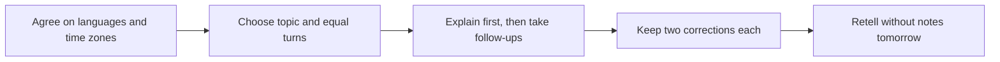

> 🌏 [中文版](/posts/learning/2026-10-19-tandem-speaking-practice)

You want someone to speak English with, without necessarily taking a lesson every time. If you are also willing to help that person practice Chinese, [Tandem](https://tandem.net/) can help you find a language-exchange partner. Each person offers a language they know in return for practice in another.

That relationship needs coordination. Your partner is not a paid teacher, may not know how to explain grammar, and may not always have time to reply. Starting free lowers the financial barrier, but searching, scheduling, and supporting the other learner all cost time.

This article uses official rules and public firsthand accounts. We have not registered, messaged members, or tested a subscription; there are no referral codes or paid relationships. This guide focuses on Tandem. See the [series overview](/posts/learning/2026-10-19-english-speaking-practice-overview-en) for other routes, or the [italki guide](/posts/learning/2026-10-19-italki-speaking-practice-en) for lessons organized around your own progress.

## Find someone who wants to practice a language you can offer

The [official FAQ](https://tandem.net/pages/faq) describes selecting the languages you speak and want to learn, then finding members with complementary needs. For an adult in Taiwan practicing English, explain that you can help with Traditional Chinese or everyday Taiwanese usage and name the English situations you want to practice. “I want foreign friends” gives prospective partners less to work with.

Include availability and your time zone. If Taiwan evenings work for you, look for overlapping hours. Ask people in Britain, Canada, or elsewhere about their actual availability instead of inferring a schedule from nationality.

The [community guidelines](https://tandem.net/pages/community-guidelines) require members to be at least sixteen and provide authentic information and a clear personal photo. Applications are reviewed, with waiting lists possible in some regions. Review does not guarantee teaching ability or appropriate intentions. The routine below is intended for adults.

## Text, voice messages, and live calls train different things

The platform offers text, voice messages, audio/video calls, and group audio spaces called Language Parties. Correction tools support feedback, while translation can help conversations continue.

| Format | Useful practice | Common stopping point |
|---|---|---|
| Text | Breaking the ice, agreeing on goals, scheduling | Continuing to type without speaking |
| Voice messages | Complete explanations, listening back, lower-pressure answers | Re-recording perfectly instead of responding spontaneously |
| Live audio/video | Understanding follow-ups, clarifying, taking turns | Time-zone clashes, cancellations, or using only one language |
| Language Parties | Hearing different speakers and joining group discussion | Listening throughout without getting a turn |

Your current plan determines access. The [official Pro article](https://tandem.zendesk.com/hc/en-us/articles/360045166332-What-is-included-in-a-Tandem-Pro-subscription) lists direct audio/video calling among Pro features, and the [dedicated calling article](https://tandem.zendesk.com/hc/en-us/articles/360045165272-Is-Tandem-Pro-required-to-make-a-call) notes an exception for some earlier members. Their continued free calling does not establish a new account’s access. Inspect your available voice tools before arranging a format with a partner.

Tandem has also discontinued its former professional-tutor feature. Historical references to Tandem Tutors do not mean the platform assigns a teacher to your exchange.

## Pro buys tools and visibility, rather than guaranteed practice partners

The Pro article lists unlimited translation, voice-message transcription, saved expressions, AI tools, direct calls, private Language Parties, more new-member contacts, nearby discovery, and no ads, among other features. Limits and interfaces can change; consult the Pro screen in your account.

Tools can support contact, but a recurring exchange still requires agreement. If you repeatedly find incompatible goals, improve your profile and invitation before assuming an upgrade will produce committed partners.

On October 19, 2026, the [Taiwan App Store listing](https://apps.apple.com/tw/app/tandem-語言學習/id959001619) displayed these named items in New Taiwan dollars:

| In-app item | Public price | Interpretation |
|---|---:|---|
| Tandem Pro introduction — 12 months | NT$1,190 | Introductory item, not guaranteed available to every account |
| Tandem Pro Plus — 12 months | NT$2,290 | Different name from ordinary Pro; verify entitlements |
| Several items named only “Tandem Pro” | NT$390, 790, 1,490, 1,990, and others | Individual durations are not stated; do not label one the monthly price |

Dividing the two named twelve-month prices gives about NT$99 and NT$191 per month. Payment is for the whole period, rather than those monthly installments. Ordinary Pro documentation does not establish every current Pro Plus entitlement. Check the exact name, calling access, duration, charge today, and renewal price. Android and web offers need their own price check.

Time is another cost. If a forty-minute exchange splits evenly, you receive twenty minutes of English practice and spend twenty helping with Chinese. This is fair reciprocity, but the entire forty minutes cannot be compared directly with a private lesson’s price.

## Separate cancellation, trial conversion, and refunds

The [terms](https://tandem.net/pages/termsofservice) describe automatic subscription renewal and possible conversion from a trial to paid access. Check your confirmation screen for eligibility, length, and the next charge; this article does not assume a universal trial duration.

The Taiwan App Store description requires stopping renewal at least twenty-four hours before expiry. The [cancellation guide](https://tandem.zendesk.com/hc/en-us/articles/360045166372-How-can-I-cancel-my-Tandem-Pro-membership) directs Apple buyers to Apple subscriptions and Google Play buyers to Play’s subscription management. For web or partner purchases, follow the channel on the original receipt. Deleting the app or Tandem account does not cancel the paid subscription.

Cancellation generally leaves access until the current period ends and stops the next renewal. It is not a refund. The [current refund support article](https://tandem.zendesk.com/hc/en-us/articles/15311634202898-How-can-I-get-a-refund) distinguishes:

- **Apple:** Apple handles payments and refund requests. Apply through the purchase-confirmation email or Apple support, subject to its process.
- **Google Play:** within forty-eight hours, request through Google Play first. Afterward, contact Tandem within fourteen days for a one-month subscription or thirty days for a three- or twelve-month subscription, supplying the receipt and email address.
- **Other channels:** confirm the applicable rules using the original receipt and Tandem support. Android’s windows cannot simply be applied elsewhere.

Different official pages summarize policies differently. Before paying, ask support@tandem.net or the support form which cancellation and refund rules apply to your purchase, and retain the response. Keep the receipt accessible.

## Three accounts show the search effort behind a regular exchange

A [2023 Dcard account of Chinese–Japanese exchange](https://www.dcard.tw/f/japan_life/p/253012372) describes meeting several potential partners in Japan before settling on one recurring partner. After connecting through Tandem, they arranged two hour-long sessions per week, divided equally between Chinese and Japanese, and prepared topics beforehand. This is Japanese practice, not evidence of English improvement. Its transferable lesson concerns agreeing on goals, frequency, and time allocation.

In a [December 2024 LingQ forum thread](https://forum.lingq.com/t/tandem-good-or-bad-alternatives/836369), some members found recurring partners while others described conversations ending after greetings. kristenqattan explained how specifying European Portuguese, filtering interests and location, and coordinating time zones produced compatible partners. Voice messages maintained contact when calls did not fit. Other replies discussed unwanted advances, money requests, and searching overhead. This is another learning service’s member forum, not a controlled comparison or authority on current Taiwan prices and features.

A [negative Dcard self-report](https://www.dcard.tw/f/mood/p/224828343) describes a week of nonresponses, inadequate reciprocity, and pressure to meet after moving to another messaging service. The retrieved version shows no publication date, so it is treated as a historical case. The writer’s generalizations about entire groups of users are not adopted as facts.

The three main texts showed no referral codes or partnership disclosures; that does not establish the absence of a commercial relationship. Together they show variable results: some find a sustainable exchange, while others spend substantial time searching. A subscription does not remove that difference.

## Reciprocity and boundaries matter more than sending more messages

Official guidelines identify language learning as the purpose and prohibit flirting, harassment, promotion, and requests for money. You need not preserve an unwanted conversation out of politeness. End it, block if needed, and use the [official reporting process](https://tandem.net/pages/faq), including relevant conversation context.

Establish goals and expectations within the platform first. Avoid using workplace documents, addresses, or financial details as practice material. There is no need to transfer money or supply private photos to prove commitment. Respect a partner’s reluctance to call; if they do not want reciprocal practice, find someone else rather than persuading them to become your teacher.

If you need scheduled teaching, comprehensive correction, and tracked progress, paid tutoring makes those responsibilities easier to agree on. Exchange suits people willing to plan together and help another learner.

## An original forty-minute exchange: move from typing to speaking

This suggested routine requires mutual agreement and is not a platform course. Choose a public topic, such as recommending a weekend itinerary in your hometown, and split the languages evenly. If direct calling is unavailable, use voice messages for the same task; do not move someone to another service without consent.

1. **Prepare separately.** For the English turn, note places, transport, and reasons rather than scripting everything. Ask what your partner wants to practice in Chinese.
2. **Use the first twenty minutes for English.** Complete your explanation, then take questions about a changed route or reduced time. Agree to save two clarity-related corrections for the end instead of interrupting every small error.
3. **Switch to Chinese for twenty minutes.** Give your partner equal control and reusable expressions. Admit when you cannot explain a grammar point rather than inventing expertise.
4. **Check the next day.** Close the conversation history and explain again with a different route or budget. If you can only repeat the original, change the questions next time instead of merely extending the chat.

Afterward, record whether both people spoke, understood the corrections, and want to arrange another exchange. Once those foundations hold, assess whether Pro tools actually save searching or preparation time.

## References

- [Tandem homepage](https://tandem.net/) and [official FAQ](https://tandem.net/pages/faq)
- [Direct-calling access](https://tandem.zendesk.com/hc/en-us/articles/360045165272-Is-Tandem-Pro-required-to-make-a-call)
- [Official Pro features](https://tandem.zendesk.com/hc/en-us/articles/360045166332-What-is-included-in-a-Tandem-Pro-subscription)
- [Taiwan App Store listing and named purchases (in Chinese)](https://apps.apple.com/tw/app/tandem-語言學習/id959001619)
- [Cancellation](https://tandem.zendesk.com/hc/en-us/articles/360045166372-How-can-I-cancel-my-Tandem-Pro-membership) and [refund support](https://tandem.zendesk.com/hc/en-us/articles/15311634202898-How-can-I-get-a-refund)
- [Community guidelines](https://tandem.net/pages/community-guidelines) and [terms](https://tandem.net/pages/termsofservice)
- [Dcard: 2023 Chinese–Japanese exchange experience (in Chinese)](https://www.dcard.tw/f/japan_life/p/253012372)
- [LingQ forum: December 2024 Tandem experiences](https://forum.lingq.com/t/tandem-good-or-bad-alternatives/836369)
- [Dcard: negative exchange self-report, publication date unavailable in retrieved version (in Chinese)](https://www.dcard.tw/f/mood/p/224828343)
