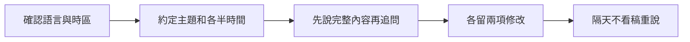

> 🌏 [English version](/posts/learning/2026-10-19-tandem-speaking-practice-en)

你想找人說英文，又不一定需要每次都有老師上課。如果你也願意花時間幫對方練中文，[Tandem](https://tandem.net/)可以用來找語言交換夥伴：雙方各提供自己熟悉的語言，交換練習機會。

這種互惠關係需要一起安排。對方不是收費老師，不一定知道怎麼講解文法，也不保證每次都有空回覆。免費開始使用可以降低金錢門檻，但找人、約時間和幫對方練習，都要算進成本。

本文整理官方規則與公開第一手心得，未註冊、傳訊或訂閱測試，沒有推薦碼或合作報酬。本文聚焦 Tandem；其他管道可看[系列總覽](/posts/learning/2026-10-19-english-speaking-practice-overview)。若你希望有人依照自己的進度教課，可另看 [italki 專篇](/posts/learning/2026-10-19-italki-speaking-practice)。

## 先找想練你會的語言的人

[Tandem 官方說明](https://tandem.net/pages/faq)的基本方式，是設定你會的語言、想學的語言，再找互相符合需求的成員。台灣成人想練英文，可以清楚寫自己能協助繁體中文或台灣日常用語，想練哪類英文，而不是只留下「想認識外國朋友」。

個人資料也寫出可用時段與時區。例如平日台灣晚上有空，就先找時間重疊的對象。對方住英國、加拿大或別處，仍要問他實際方便的時間，不要只靠國籍推算作息。

[社群規範](https://tandem.net/pages/community-guidelines)要求年滿十六歲、真實資料與清楚的本人照片；申請會審核，部分地區可能有等候名單。這不等於平台替每個人保證教學能力或交往意圖。本文的練習安排以成人為對象。

## 文字、語音留言與即時通話，練到的不同

平台有文字、語音留言、語音／視訊通話，以及群組語音空間 Language Parties。訊息修正工具可以用來回饋對方，翻譯則能協助接續內容。

| 方式 | 適合練什麼 | 容易停在哪裡 |
|---|---|---|
| 文字訊息 | 破冰、確認目標、約時間 | 一直打字，卻沒真正開口 |
| 語音留言 | 完整敘述、回聽、較低壓力的回答 | 反覆重錄到完美，避開臨場反應 |
| 即時語音／視訊 | 聽懂追問、澄清、輪流說話 | 時差、臨時取消，或只用其中一種語言 |
| Language Parties | 聽不同人表達、加入多人對話 | 一直旁聽，輪不到自己說 |

使用權限要以目前帳號方案為準。[官方 Pro 說明](https://tandem.zendesk.com/hc/en-us/articles/360045166332-What-is-included-in-a-Tandem-Pro-subscription)已將直接語音／視訊通話列為 Pro 功能。[通話支援頁](https://tandem.zendesk.com/hc/en-us/articles/360045165272-Is-Tandem-Pro-required-to-make-a-call)補充，早期加入的部分成員仍可能免 Pro 通話，這不適用來推定新帳號權限。第一次使用，先檢查自己能用哪些語音功能，再和語伴約適合的形式。

Tandem 也已停止原本的專業家教功能。不要因為看到舊文章寫 Tandem Tutors，就把語伴當成平台安排的老師。

## Pro 買的是工具與曝光，不是保證有人陪練

官方列出的 Pro 功能包括無限翻譯、語音訊息轉文字、收藏表達與 AI 工具。直接通話、私人語言派對、較多接觸新成員的額度、附近搜尋與無廣告，也列在 Pro 說明裡。各項限制與實際介面可能調整，請看帳號內的 Pro 頁。

這些工具能協助聯絡，對方是否願意固定交換仍要另外談。你若一直找不到目標一致的人，先修改介紹與邀請方式；不要把升級當成一定約得到認真語伴的解法。

2026 年 10 月 19 日的[台灣 App Store](https://apps.apple.com/tw/app/tandem-語言學習/id959001619)列有以下具名品項，金額為新臺幣：

| 內購清單項目 | 公開價格 | 解讀方式 |
|---|---:|---|
| Tandem Pro 介紹－12 個月 | 1,190 元 | 介紹優惠品項，不保證所有帳號都可選 |
| Tandem Pro Plus－12 個月 | 2,290 元 | 與一般 Pro 名稱不同，先核對包含功能 |
| 多筆僅標「Tandem Pro」 | 390、790、1,490、1,990 元等 | 清單未逐筆標期間，不能直接推定哪筆是月費 |

前兩筆按十二個月均攤，約為每月 99 元與 191 元，但實際是整期預付，不是每月扣這個均價。Pro Plus 的目前權限，不能直接從一般 Pro 說明推過去。買前確認方案全名、通話權限、期間、一次扣款與續訂價格；Android 和網頁購買另外看自己的報價。

真正的成本還有時間。假設一次交換四十分鐘，雙方各練二十分鐘，你取得的英文練習就是二十分鐘，另外二十分鐘是履行中文交換。這是合理互惠，不能拿整段四十分鐘去和家教單堂價格直接比較。

## 取消、試用與退款分開處理

[官方條款](https://tandem.net/pages/termsofservice)說明，訂閱會自動續期，若獲得免費試用，結束後也可能自動轉成付費。是否有試用、多久和下一次扣款多少，請看自己確認畫面，本文不預設人人有相同試用天數。

台灣 App Store 說明要求至少提前二十四小時停止自動續費。依[官方取消指南](https://tandem.zendesk.com/hc/en-us/articles/360045166372-How-can-I-cancel-my-Tandem-Pro-membership)，Apple 購買回 Apple 訂閱項目取消，Google Play 購買回 Play 商店的訂閱管理。網頁或其他購買夥伴則依原收據的管道處理。刪除 App 或 Tandem 帳號，都不會自動停止付費訂閱。

取消後通常可用到當期結束，下一期不再續扣；這不等於退款。[目前退款支援頁](https://tandem.zendesk.com/hc/en-us/articles/15311634202898-How-can-I-get-a-refund)按管道說明：

- **Apple：**由 Apple 處理付款與退款，透過購買確認信或 Apple 支援申請，核准依其流程。
- **Google Play：**購買四十八小時內可先向 Google Play 申請。超過後，一個月訂閱須在十四日內、三或十二個月訂閱須在三十日內聯絡 Tandem，附 Google Play 收據及信箱。
- **其他管道：**帶原收據向該付款管道與 Tandem 確認，不把 Android 的期限直接套上去。

平台不同頁面的概括說法可能不同，付款前可從 support@tandem.net 或支援表單確認自己這筆訂閱的取消與退款規則，保存回覆。別等收據信都找不到才處理。

## 三份社群經驗：找到固定語伴之前，通常要花時間篩選

[2023 年 Dcard 的中日交換心得](https://www.dcard.tw/f/japan_life/p/253012372)，作者自述在日本找了多位交換對象，最後固定下來一位。透過 Tandem 認識後，約定每週兩次、每次一小時，中文和日文各半，也會先準備話題。這是練日文的個人經驗，不能當作英文進步證據；可以參考的是目標、頻率與時間分配要先講好。

[2024 年 12 月 LingQ 論壇的 Tandem 討論](https://forum.lingq.com/t/tandem-good-or-bad-alternatives/836369)，有使用者找到固定語伴，也有人覺得常停在打招呼。kristenqattan 描述為了練歐洲葡萄牙語，先說清目標、篩選地點與興趣，再協調時差；不能通話時用語音留言維持。其他回覆則談到騷擾、金錢要求和尋人耗時。這是另一家語言學習服務上的會員論壇，並非對照實驗，也不是台灣價格或當期功能的依據。

另一篇 [Dcard 負面使用自述](https://www.dcard.tw/f/mood/p/224828343)，作者說自己使用一週，遇到不回覆、互惠不足，以及換聯絡方式後被要求見面的情況。本文引用的版本未顯示發文日期，只作歷史個案，不把作者對整群使用者的負面概括當成事實。

這三份主文未見推薦碼或合作揭露，仍不能據此認定沒有商業關係。它們共同提醒的是：有人能固定交換，有人花很多時間卻找不到。訂閱工具不會消除這個差異。

## 互惠與界線，比傳更多訊息重要

官方規範明確說 Tandem 用於語言學習，禁止搭訕、騷擾、推銷和金錢要求。遇到不受歡迎的聯絡，不必勉強維持禮貌對話；可以結束、封鎖，並依[官方檢舉方式](https://tandem.net/pages/faq)保留聊天脈絡後回報。

先在平台內確認目標與相處方式。不要把工作文件、住址或金融資料拿來練習，也不用為了證明自己有誠意而匯款或提供私人照片。語伴不想通話時就尊重對方；對方不願互惠，也可以換人，不需要說服他當你的老師。

如果你的需求是固定時間上課、完整糾錯與進度追蹤，付費家教比較容易事先約定這些責任。語言交換則適合你願意一起規劃、也願意幫別人練習的情況。

## 自訂一次四十分鐘交換：把打字變成口說

以下是雙方同意後可採用的安排，不是平台固定課程。先用文字確認一個可公開的主題，例如「推薦家鄉的一個週末行程」，並約好兩種語言各半。若即時通話權限不適用，就把同樣任務改成語音留言，不擅自把對方移到其他平台。

1. **課前各自準備。** 英文部分只寫地點、交通、推薦理由等關鍵字，不寫完整稿；也先問對方中文想練什麼。
2. **前二十分鐘練英文。** 先讓你完整說一遍，再請對方追問路線改變、時間不足等情況。說好最後才整理兩個最影響理解的地方，避免每個小錯都打斷。
3. **後二十分鐘換中文。** 同樣把主導權交給對方，幫他整理可重用的表達。自己不確定的文法就說不確定，不冒充專業解釋。
4. **隔天檢查。** 不看聊天紀錄，自己再說一次，換一條路線或不同預算。如果仍只能背原本內容，下次換問題，而非只延長聊天時間。

一次交換結束，留下是否有各自開口、能否理解修改，以及願不願意再約三項紀錄。能穩定做到這些，再評估 Pro 工具是否真的省下找人或整理材料的時間。

## 參考資料

- [Tandem 首頁](https://tandem.net/)、[官方 FAQ](https://tandem.net/pages/faq)
- [直接通話權限](https://tandem.zendesk.com/hc/en-us/articles/360045165272-Is-Tandem-Pro-required-to-make-a-call)
- [Pro 功能說明](https://tandem.zendesk.com/hc/en-us/articles/360045166332-What-is-included-in-a-Tandem-Pro-subscription)
- [台灣 App Store：內購清單及開發者說明](https://apps.apple.com/tw/app/tandem-語言學習/id959001619)
- [取消訂閱](https://tandem.zendesk.com/hc/en-us/articles/360045166372-How-can-I-cancel-my-Tandem-Pro-membership)、[退款支援](https://tandem.zendesk.com/hc/en-us/articles/15311634202898-How-can-I-get-a-refund)
- [社群規範](https://tandem.net/pages/community-guidelines)、[服務條款](https://tandem.net/pages/termsofservice)
- [Dcard：2023 年中日交換心得](https://www.dcard.tw/f/japan_life/p/253012372)
- [LingQ 論壇：2024 年 12 月 Tandem 經驗討論（英文）](https://forum.lingq.com/t/tandem-good-or-bad-alternatives/836369)
- [Dcard：負面交換經驗，引用版本未顯示發文日期](https://www.dcard.tw/f/mood/p/224828343)
