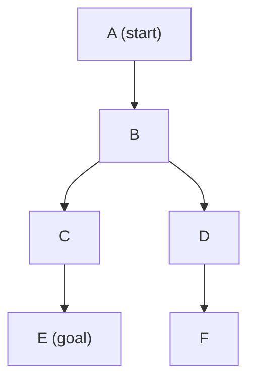
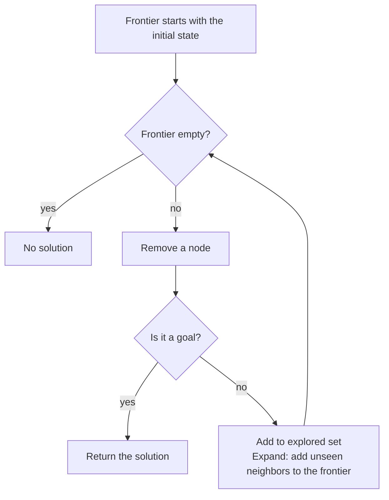
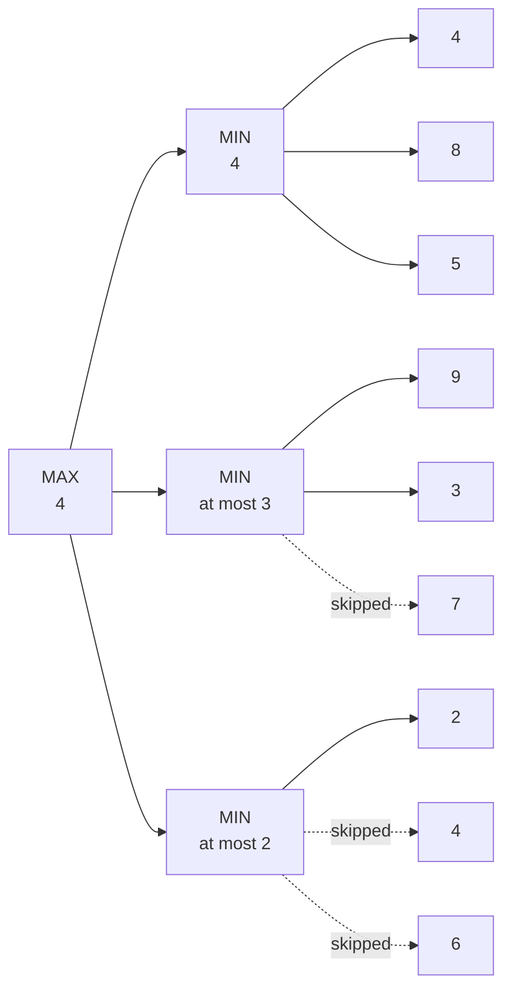

> 🌏 [中文版](/posts/tech/2026-08-27-harvard-cs50ai-w00-search)

**Video status: Videos included.** The lecture runs 1:49:29. The "Lecture walkthrough" below is written section by section from the recording's English captions, and each section opens with a time link that moves the player on this page to that point. The lecture does not cover this week's projects; those sections follow the course website. [Jump to the player](#lecture-video--timestamps) | [Source details](#course-video-sources)

> ⚠️ **Version note**: This week's lecture videos were **recorded in Spring 2020**; project specs, distribution code, and check50 slugs follow the 2026 course website (i.e., `ai50/projects/2024/x/...`).

## TL;DR

Week 0 uses search to set up the most basic problem-solving framework: write the problem as states, actions and a goal, then compare ways of walking through it. DFS and BFS ignore where the goal is, greedy best-first and A* estimate the distance with a heuristic, and Minimax handles the case with an opponent. The two projects map to BFS (Degrees) and Minimax (Tic-Tac-Toe).

The article has two halves. The first, "Lecture walkthrough", follows the recording; the second covers the approach to the two projects and how to check your work; the lecture does not mention the projects.

## Lecture Video & Timestamps

The recording runs 1 hour 49 minutes. The first three minutes introduce the course as a whole, and the nine sections of "Lecture walkthrough" below cover everything after 3:14 in order. Every time link, at the top of a section or inside the text, moves the player on this page to that point, so when a section does not make sense you can go straight back and listen.

```youtube
url: https://www.youtube.com/watch?v=WbzNRTTrX0g
title: Search - Lecture 0 - CS50's Introduction to Artificial Intelligence with Python 2020
```

YouTube: [Week 0 Search (2020 recording)](https://www.youtube.com/watch?v=WbzNRTTrX0g)

> Timing note: the times below were checked against the timecoded English captions (2026-10-13) and mark where the lecturer starts each topic; they are not official chapters. This table describes only the 2020 recording; the current course version may differ in content and order, and the video itself does not introduce this week's projects.

| Time (click to play from there) | Content |
|---|---|
| [0:00–3:14](https://www.youtube.com/watch?v=WbzNRTTrX0g&t=0s) | Course intro and a preview of the seven topics (search, knowledge, uncertainty, optimization, learning, neural networks, language) |
| [3:14–15:12](https://www.youtube.com/watch?v=WbzNRTTrX0g&t=194s) | Defining a search problem: agent, state, actions, transition model, goal test, path cost |
| [15:12–25:34](https://www.youtube.com/watch?v=WbzNRTTrX0g&t=912s) | Nodes, the frontier, the generic search loop and the explored set |
| [25:34–36:22](https://www.youtube.com/watch?v=WbzNRTTrX0g&t=1534s) | DFS (stack) and BFS (queue), and how each behaves in a maze |
| [36:22–50:06](https://www.youtube.com/watch?v=WbzNRTTrX0g&t=2182s) | The `maze.py` code and runs on three mazes |
| [50:06–1:03:57](https://www.youtube.com/watch?v=WbzNRTTrX0g&t=3006s) | Informed search: heuristics, Manhattan distance, greedy best-first search |
| [1:03:57–1:11:45](https://www.youtube.com/watch?v=WbzNRTTrX0g&t=3837s) | A* search, admissible and consistent heuristics |
| [1:11:45–1:36:30](https://www.youtube.com/watch?v=WbzNRTTrX0g&t=4305s) | Adversarial search: Minimax |
| [1:36:30–1:43:59](https://www.youtube.com/watch?v=WbzNRTTrX0g&t=5790s) | Alpha-beta pruning |
| [1:43:59–1:49:29](https://www.youtube.com/watch?v=WbzNRTTrX0g&t=6239s) | Depth-limited minimax, evaluation functions and the wrap-up |

> Official notes and slides: [Week 0 Notes](https://cs50.harvard.edu/ai/2020/notes/0/)

## Lecture walkthrough

What follows is written section by section from the recording's English captions. Captions alone do not show the slides, so this article does not reconstruct the shape of the mazes or the layout of the boards; it reports only the numbers and reasoning the lecturer says aloud. The figures for Manhattan distance, Minimax and alpha-beta are in the [official notes](https://cs50.harvard.edu/ai/2020/notes/0/). The self-check at the end of each section is my own question, not lecture content. Where a question reuses a lecture example it says so; where it is marked "my own", the example is mine as well.

### How a search problem is defined

[Recording 3:14–15:12](https://www.youtube.com/watch?v=WbzNRTTrX0g&t=194s)

The lecturer, Brian Yu, opens with three examples: sliding the tiles of a 15-puzzle back into order, finding a way through a maze, and a maps app working out driving directions. What they share is a starting point and a sequence of actions that leads to a goal. He then breaks that into a set of terms that every later algorithm reuses.

- **Agent**: an entity that perceives its environment and acts on it. In driving directions it is the car; in the 15-puzzle it is the person or program solving the puzzle.
- **State**: one configuration of the agent in its environment. Each arrangement of the 15-puzzle tiles is a state.
- **Initial state**: the state the search starts from.
- **Actions**: the choices available in a state. The lecturer defines this as a function, `Actions(s)`, which takes a state and returns the set of actions that can be executed there. The 15-puzzle usually has four (slide a tile up, down, left or right), but some actions are valid only in some states.
- **Transition model**: a description of which state you reach after taking an action in a state. Also a function, `Result(s, a)`, which takes a state and an action and returns the new state.
- **Goal test**: a way to decide whether a state is a goal. For driving directions it is "have we reached the destination the user typed in"; for the 15-puzzle it is "are the numbers in order".
- **Path cost**: a numerical cost for each path. With directions you want to arrive without pointless detours, so the program is told to look for a low-cost path. In the 15-puzzle every move costs the same, so each step can cost 1 and the cost is just the number of steps.

Apply the transition model across the whole problem and you get the **state space**: every state reachable from the initial state by any sequence of actions. The lecturer draws it as a graph, with circles for states and arrows for actions, and all the algorithms that follow walk this graph.

With these in hand, a search problem is five things: an initial state, actions, a transition model, a goal test and a path cost. A **solution** is a sequence of actions from the initial state to a goal. An **optimal solution** is one with the lowest path cost among all solutions, and there may be more than one.

**Check yourself. Write your answer down before opening the fold.** Write "drive from Taipei Main Station to Taoyuan Airport" as a search problem. What are the five parts? (My own example.)

<details>
<summary>Answer</summary>

The initial state is the car at Taipei Main Station. The actions are the roads you can take from the current intersection. The transition model says which intersection you reach by taking a given road from a given intersection. The goal test asks whether the current location is Taoyuan Airport. The path cost depends on what you want to save: travel time if you care about time, distance if you care about fuel. The costs the lecturer mentions are money, time or some other resource; a different choice of cost gives a different optimal solution, and that last point is my own inference.

</details>

### Nodes, the frontier and the generic search loop

[Recording 15:12–25:34](https://www.youtube.com/watch?v=WbzNRTTrX0g&t=912s)

A program has to remember many half-finished routes at once, so the lecturer introduces a data structure called a **node**. Each node records four things:

- state: the state it stands for
- parent: the node it was reached from
- action: the action taken from the parent to get here
- path cost: the cost from the initial state to this node

The parent is there so that, once the goal is reached, the program can trace back: the goal's parent, that node's parent, and so on to the start, which yields the whole sequence of actions.

Next comes the **frontier**: every node that could be explored next but has not been yet. The search is a loop:

1. The frontier starts with just the initial state.
2. If the frontier is empty, there is no solution.
3. Remove a node from the frontier.
4. If it is a goal, return the solution.
5. Otherwise **expand** it: find every node reachable from it and add those to the frontier. Go back to step 2.

The lecturer runs this on a small graph ([19:31](https://www.youtube.com/watch?v=WbzNRTTrX0g&t=1171s)): A leads to B, B leads to C and D, C leads to E, D leads to F, and the task is to get from A to E. The frontier starts as A. Remove A and add B. Remove B and add C and D. Remove C and add E. Remove E, which is the goal, and stop.



The lecturer's demo graph, drawn here from his step-by-step run. DFS and BFS in the next section both walk this graph.

The loop has a hole ([22:08](https://www.youtube.com/watch?v=WbzNRTTrX0g&t=1328s)). If arrows run both ways, then after going from A to B, B's neighbors include A again, and the program can bounce between A and B forever. The 15-puzzle works like that: slide a tile right and you can slide it straight back.

The fix is one more structure, the **explored set**, holding the states already explored. Two steps change:

- When a removed node is not the goal, add it to the explored set.
- When expanding, add a node to the frontier only if it is neither in the frontier nor in the explored set.



The diagram shows the revised loop. I drew it from the lecturer's spoken description; it is not the slide.

**Check yourself. Write your answer down before opening the fold.** Take the lecture's graph (A→B, B→C, B→D, C→E, D→F) and add a reverse arrow B→A. With the revised loop, which nodes go into the frontier when B is expanded, and why?

<details>
<summary>Answer</summary>

Only C and D. B's neighbors are A, C and D, but A went into the explored set after it was removed and checked, so it is not added again. Without the explored set, A would return to the frontier and an unlucky run would loop between A and B indefinitely.

</details>

### DFS and BFS: the only difference is which node leaves the frontier

[Recording 25:34–36:22](https://www.youtube.com/watch?v=WbzNRTTrX0g&t=1534s)

Step 3 above says "remove a node" without saying which. The lecturer points out that this choice decides the character of the whole algorithm.

**Treat the frontier as a stack (last in, first out) and you get depth-first search (DFS).** The node added last is removed first. On the same graph, searching for E: explore A, add B; explore B, add C and D; D came in last, so explore D and add F; explore F, which has no neighbors; go back and explore C, add E; explore E, the goal. The order explored is A, B, D, F, C, E. It goes all the way down first and backs up to the last fork only at a dead end.

**Treat the frontier as a queue (first in, first out) and you get breadth-first search (BFS)** ([28:31](https://www.youtube.com/watch?v=WbzNRTTrX0g&t=1711s)). The node added first is removed first. On the same graph: after A and B, C entered before D, so explore C and add E; then explore D and add F; only then E. The order explored is A, B, C, D, E. It looks at everything one step from the start, then two steps, then three.

In a maze the two behave very differently. At a fork DFS picks one branch and follows it to the end, and at a dead end it returns to the last fork and takes the other side. BFS takes both sides at every fork, advancing one step on each in turn. The lecturer then asks two questions ([32:02](https://www.youtube.com/watch?v=WbzNRTTrX0g&t=1922s)):

- **Will DFS always find a solution?** Yes, as long as the maze is finite, because it eventually visits every cell. With an infinite state space that no longer holds.
- **Is the solution DFS finds optimal?** Not necessarily. When two routes reach the goal, which one DFS takes depends only on which node entered the frontier first, and with bad luck it takes the longer one. BFS explores from near to far, so the route it finds always has the fewest steps.

The price is that BFS often explores many cells it never needed in order to work outward evenly. The lecturer mentions here that DFS can save memory in some cases, without going further.

**Check yourself. Write your answer down before opening the fold.** Use the lecture's graph, adding neighbors to the frontier in alphabetical order. Change the goal from E to F. How many nodes does DFS remove from the frontier before it finishes, and how many does BFS? Compared with the goal being E, which algorithm is faster and which is slower? (My own question.)

<details>
<summary>Answer</summary>

DFS removes A, B, D, F: four nodes. BFS removes A, B, C, D, E, F: six. With E as the goal it is the other way round: DFS needs six (A, B, D, F, C, E) and BFS needs five (A, B, C, D, E). Whether DFS is fast depends on whether the goal lies on the branch it dives into first; how much BFS explores depends on how far the goal is from the start.

</details>

### The maze program: swap one class and DFS becomes BFS

[Recording 36:22–50:06](https://www.youtube.com/watch?v=WbzNRTTrX0g&t=2182s)

The lecturer opens `maze.py`, whose structure matches the last two sections piece by piece.

- The `Node` class stores state, parent and action. Path cost is left out here, because the number of steps can be counted once a route has been found.
- `StackFrontier` keeps nodes in a Python list: `add` appends a node to the end, and `remove` takes the last item (index `-1`), which makes it last in, first out. It also has `empty` and `contains_state`.
- `QueueFrontier` inherits from `StackFrontier` and overrides only `remove`, taking the first item (index `0`) instead, which makes it first in, first out.
- `Maze.solve` is the loop: raise an exception for "no solution" when the frontier is empty; remove a node and add one to the count of explored states; if it is the goal, follow the parents back collecting actions and cells, then reverse them to get the route from start to goal; if not, add it to the explored set and put each neighbor that is in neither the frontier nor the explored set into the frontier.

The two frontiers differ only in these lines:

```python
# util.py / maze.py: the two frontiers differ only in which end remove() takes
class StackFrontier():
    def remove(self):
        if self.empty():
            raise Exception("empty frontier")
        else:
            node = self.frontier[-1]          # the last one added
            self.frontier = self.frontier[:-1]
            return node

class QueueFrontier(StackFrontier):
    def remove(self):
        if self.empty():
            raise Exception("empty frontier")
        else:
            node = self.frontier[0]           # the first one added
            self.frontier = self.frontier[1:]
            return node
```

The `util.py` that ships with the Degrees project is these three classes, and the excerpt under Project 0A below is the same file.

The three mazes he runs:

| Maze | DFS | BFS |
|---|---|---|
| `maze1.txt` | explores 11 states and finds a route | not run in the lecture |
| `maze2.txt` ([44:42](https://www.youtube.com/watch?v=WbzNRTTrX0g&t=2682s)) | explores 399 states | explores 77 states and finds the same route |
| `maze3.txt` | finds a longer route | finds the optimal 4-step route |

On `maze2`, DFS chose one direction first and followed every branch in that direction to its end before turning back, which is where the extra three hundred or so states come from. `maze3` has two routes to the goal and DFS took the long one. Switching from DFS to BFS is a one-line change: replace `StackFrontier()` with `QueueFrontier()`.

These are the numbers from the lecture run. How many states DFS explores depends on the order in which neighbors enter the frontier, so running the public code yourself may give different counts (this sentence is my own addition).

The lecturer then tempers the praise for BFS ([50:06](https://www.youtube.com/watch?v=WbzNRTTrX0g&t=3006s)): when the goal is far from the start, BFS ends up walking nearly the whole maze.

**Check yourself. Write your answer down before opening the fold.** On `maze2` DFS explores 399 states and BFS only 77. Does that mean BFS always explores fewer states?

<details>
<summary>Answer</summary>

No. 77 against 399 is the result for this maze: the goal is not far from the start, and DFS happened to dive in the wrong direction first. The lecturer points out right afterwards that with a distant goal BFS explores almost the entire maze. What BFS guarantees is the route with the fewest steps; it guarantees nothing about how much it explores.

</details>

### Informed search: greedy best-first search

[Recording 50:06–1:03:57](https://www.youtube.com/watch?v=WbzNRTTrX0g&t=3006s)

At a fork, neither DFS nor BFS looks at where the goal is. The lecturer asks what a person would do. If you know the goal is up and to the right, going right "feels" closer. That needs an assumption: the maze can be laid out on a coordinate grid, and you know your own coordinates and the goal's.

He uses that difference to split search algorithms into two kinds ([53:11](https://www.youtube.com/watch?v=WbzNRTTrX0g&t=3191s)):

- **Uninformed search**: uses no problem-specific knowledge. DFS and BFS are both uninformed, and they would do exactly the same thing on any other problem.
- **Informed search**: uses problem-specific knowledge to find a solution more efficiently.

The first informed algorithm is **greedy best-first search**: always expand the node it believes is closest to the goal. The program cannot actually know which node is closest (if it did, the problem would be solved), so it uses an estimate called a **heuristic**, written as a function `h(n)` that takes a state and returns roughly how far it is from the goal.

The heuristic for the maze is the **Manhattan distance** ([56:39](https://www.youtube.com/watch?v=WbzNRTTrX0g&t=3399s)): pretend the walls are not there, allow only up, down, left and right, and count the steps from this cell to the goal. You compute it by subtracting the two x coordinates and the two y coordinates and adding the absolute values. The lecturer stresses that it is only an estimate: a cell with `h` of 2 may in practice need a long way round, but on the whole cells nearer the goal have smaller `h`.

In the lecture's maze, at the first fork the cell to the left has `h` of 13 and the cell to the right has 11, so greedy takes 11. At every later fork it takes the smallest `h`. It still walks into one dead end and backs out, but it explores far fewer cells than BFS.

Then comes its weakness ([1:01:54](https://www.youtube.com/watch?v=WbzNRTTrX0g&t=3714s)). The lecturer switches to another maze: at one fork `h` is 12, the cell to the left is 13 and the cell above is 11. Greedy takes 11 and does reach the goal, but by a longer route; the truly shortest route goes through the 13 (the A\* section that follows counts the steps on both routes). That is what "greedy" means here: each step is the best-looking choice at that moment, and the choices together are not necessarily the best.

**Check yourself. Write your answer down before opening the fold.** You are at (2, 1) and the goal is at (6, 4). What is the Manhattan distance? If there are walls in between, will the real number of steps be larger or smaller than that? (My own question.)

<details>
<summary>Answer</summary>

|6 − 2| + |4 − 1| = 4 + 3 = 7. Moving only up, down, left and right, 7 steps is the minimum with no walls; walls can only make the route longer, so the real number of steps is always 7 or more. The Manhattan distance never overestimates, a property the next section relies on.

</details>

### A* search: counting the steps already taken

[Recording 1:03:57–1:11:45](https://www.youtube.com/watch?v=WbzNRTTrX0g&t=3837s)

On the route where greedy went wrong, `h` first fell very low and then climbed back up to 12. The lecturer's observation: rather than take many steps to reach a cell with `h` = 12, it is better to reach a cell with `h` = 13 in only 6 steps. Looking at `h` alone misses how much it cost to get here.

**A\* search** always expands the node with the smallest `g(n) + h(n)`:

- `g(n)`: the cost already paid from the start to this node (here, the number of steps)
- `h(n)`: the estimated cost from this node to the goal (the same heuristic greedy uses)

The lecturer reads out the numbers cell by cell on the same maze ([1:06:49](https://www.youtube.com/watch?v=WbzNRTTrX0g&t=4009s)):

| Position | g | h | g + h |
|---|---|---|---|
| Step 1 | 1 | 16 | 17 |
| Step 2 | 2 | 15 | 17 |
| Step 5 | 5 | 12 | 17 |
| Fork, going left | 6 | 13 | 19 |
| Fork, going up | 6 | 11 | 17 |

17 is less than 19, so A\* goes up first, the same as greedy so far. The difference shows after a long stretch along the upward route: the node there has `g` = 15 and `h` = 6, a total of 21, while the cell that was skipped at the fork is still in the frontier with `g` = 6 and `h` = 13, a total of 19. 19 is less than 21, so A\* turns back and takes the left branch, and ends up with the shortest route. Greedy compares only 6 and 13 and keeps going up.

A\* is guaranteed to find an optimal solution provided the heuristic satisfies two conditions ([1:09:31](https://www.youtube.com/watch?v=WbzNRTTrX0g&t=4171s)):

1. **Admissible**: `h(n)` never overestimates the true cost. Getting it exactly right or underestimating are both fine.
2. **Consistent**: for every node `n` and successor `n'`, if the step between them costs `c`, then `h(n) ≤ h(n') + c`. In plain words, taking one step must not reduce the estimate by more than that step actually cost.

The lecturer's closing point is that A\* itself is not hard to code; choosing the heuristic is the hard part, and the better the heuristic, the fewer states have to be explored. He also notes that A\* tends to use a lot of memory and that variants exist which use less, without going into them.

**Check yourself. Write your answer down before opening the fold.** The frontier holds two nodes. Node P has taken 15 steps and has `h` = 6. Node Q has taken 6 steps and has `h` = 13. Which does greedy expand first, and which does A\*? If someone changes the heuristic to "twice the Manhattan distance", does A\* still guarantee an optimal solution?

<details>
<summary>Answer</summary>

Greedy compares only `h` and expands P first (6 is less than 13). A\* compares `g + h`: P is 21 and Q is 19, so it expands Q first. That is exactly the moment A\* turns back in the lecture's maze.

Twice the Manhattan distance overestimates: with no walls and a true cost of 7 steps it says 14. An overestimating heuristic is not admissible, and A\* may avoid a good route because it "looks expensive", so the guarantee is gone. The second half of this question is my own.

</details>

### Adversarial search: Minimax

[Recording 1:11:45–1:36:30](https://www.youtube.com/watch?v=WbzNRTTrX0g&t=4305s)

Every problem so far had a single agent. In a game there is an opponent whose objective is the opposite of yours. The lecturer calls this **adversarial search** and uses tic-tac-toe as the example.

A computer does not understand winning and losing, only bigger and smaller, so the outcomes are first turned into numbers: O winning is −1, a draw is 0, X winning is 1. X wants the score as high as possible and is called the **max player**; O wants it as low as possible and is the **min player**. "Wanting to win" becomes pushing one number up or down.

For a program to play, the game has to be written as six things ([1:17:18](https://www.youtube.com/watch?v=WbzNRTTrX0g&t=4638s)). Most of the functions the Tic-Tac-Toe project asks for map onto these, plus `winner` and `minimax`:

| Name | Meaning |
|---|---|
| `S₀` | the initial state, an empty board |
| `Player(s)` | whose turn it is on this board |
| `Actions(s)` | the moves available on this board |
| `Result(s, a)` | the new board after playing `a` on board `s` |
| `Terminal(s)` | whether the game is over (three in a row, or a full board) |
| `Utility(s)` | the score of a finished board: 1, 0 or −1 |

The lecturer stresses that things a person takes for granted, such as what the board looks like after playing in the upper-left corner, have to be spelled out for the program through `Result`.

What is a board worth when the game is not over? He works through an endgame ([1:22:21](https://www.youtube.com/watch?v=WbzNRTTrX0g&t=4941s)). It is O's turn and two squares are open: the upper left and the bottom middle.

- O plays the upper left: X takes the remaining square, gets three in a row, and the result is 1. This board can only lead to 1, so its value is 1.
- O plays the bottom middle: X plays the upper left, nobody has three in a row, and the result is 0. This board's value is 0.

O is the min player and picks 0 over 1. So the original board is worth 0, and O should play the bottom middle.

That is the logic of Minimax: to decide what to play now, stand in your opponent's place and ask what they would play; to know that, ask how you would answer on the move after, and so on down to the end of the game. On the way back up, each level takes the maximum on max's turn and the minimum on min's turn.

The lecturer then replaces the boards with an abstract tree ([1:28:24](https://www.youtube.com/watch?v=WbzNRTTrX0g&t=5304s)): a max node choosing among 5, 3 and 9 takes 9; another max node beside it is worth 8; the min node one level up takes 8 over 9.

In pseudocode ([1:30:21](https://www.youtube.com/watch?v=WbzNRTTrX0g&t=5421s)):

```text
function Max-Value(state):
    if Terminal(state): return Utility(state)
    v = −∞
    for action in Actions(state):
        v = max(v, Min-Value(Result(state, action)))
    return v

function Min-Value(state):
    if Terminal(state): return Utility(state)
    v = +∞
    for action in Actions(state):
        v = min(v, Max-Value(Result(state, action)))
    return v
```

`v` starts at negative infinity because the options are not known yet and any of them will beat it. On max's turn, pick the action with the highest `Min-Value(Result(s, a))`; on min's turn, pick the action with the lowest `Max-Value(Result(s, a))`. The two functions call each other until they reach a terminal state.

**Check yourself. Write your answer down before opening the fold.** A two-level tree: the root is a max node with two min nodes under it, whose leaves are (3, 12) and (8, 6). What is the root's value? If the root becomes a min node and the two below become max nodes, what is it then? (My own question.)

<details>
<summary>Answer</summary>

First case: the min nodes take 3 and 6, and the root takes the larger, 6. The max player does not choose the side that contains 12, because the opponent will never let them have 12 and will hand them 3.

Second case: the max nodes take 12 and 8, and the root takes the smaller, 8. Same numbers, and the result changes with who moves first.

</details>

### Alpha-beta pruning

[Recording 1:36:30–1:43:59](https://www.youtube.com/watch?v=WbzNRTTrX0g&t=5790s)

Minimax has to evaluate the whole tree. The lecturer uses a small tree to show which calculations can be skipped. I am the max player with three options; after each one the opponent (the min player) also has three options, and the leaves score as follows.

| My option | Scores the opponent can give me | Opponent picks |
|---|---|---|
| Left | 4, 8, 5 | 4 |
| Middle | 9, 3, 7 | 3 |
| Right | 2, 4, 6 | 2 |

With everything computed, I choose 4 from 4, 3 and 2. The middle branch contains 9, the highest score anywhere, but the opponent will not let me have it and will give me 3.

Now compute it again and watch the order. The left branch gives 4, so I already hold an option that guarantees 4. In the middle, the first leaf is 9 and the second is 3. The moment 3 appears I can stop: the opponent can hold this branch to at most 3, so whatever the third leaf is, this branch is worth no more than 3 and cannot beat the 4 in hand. The right branch is the same: the first leaf is 2, the branch is worth at most 2, and the other two need not be looked at.

The lecturer says this is **alpha-beta pruning**: keep two extra numbers, the best I can do so far and the worst I can do so far, and use them to decide which branches can be cut. The result is identical to full Minimax, with fewer nodes evaluated. The two extra parameters that the project's reference implementation carries through the recursion are those two numbers; at the opponent's level, once this branch has been pushed down to no more than the score I already hold, it stops looking, which is the "stop when you see the 3" above.

**Check yourself. Write your answer down before opening the fold.** The tree above has 9 leaves. Evaluating left to right with alpha-beta pruning, how many are actually looked at? If the middle branch were ordered 3, 9, 7, would more or fewer be pruned?

<details>
<summary>Answer</summary>

Six: the three on the left (4, 8, 5), two in the middle (9 and 3, skipping 7) and one on the right (2, skipping 4 and 6).



Solid lines are leaves that get evaluated; dashed lines are leaves pruned away. Drawn from the numbers the lecturer reads out; it is not the slide.

Ordered 3, 9, 7, the first leaf is already 3 and the search can stop at once, skipping both 9 and 7, for a total of five. At an opponent's node, the earlier the low score the opponent wants shows up, the sooner that branch is cut. The leaf count is my own tally from the lecture's example, and the second half of the question is my own.

</details>

### When the tree is too big: depth-limited Minimax

[Recording 1:43:59–1:49:29](https://www.youtube.com/watch?v=WbzNRTTrX0g&t=6239s)

Even with pruning, complex games cannot be computed to the end. The lecturer gives three numbers: tic-tac-toe has about 255,000 possible games; chess has 288 billion after just four moves by each side; and there are more than 10 to the power 29,000 possible complete chess games. Minimax has to reach the end of the game, which is impossible for chess.

The practical approach is **depth-limited Minimax**: look ahead a fixed number of moves, say 10 or 12, and stop. The board where it stops is usually not finished and has no `Utility`, so one more piece is needed, an **evaluation function** that estimates the expected utility of that board. In chess, with 1 for a white win and −1 for a black win, an evaluation of 0.8 means white is very likely to win but not certain. The simplest evaluation compares the pieces each side has left, with a value for each kind of piece; in practice more has to be considered.

The lecturer's conclusion: how good the evaluation function is sets the ceiling on how well the AI plays.

**Check yourself. Write your answer down before opening the fold.** Why does depth-limited Minimax have to come with an evaluation function? Why is `Utility` alone not enough?

<details>
<summary>Answer</summary>

`Utility` is defined only for finished boards. With a depth limit the search stops at boards that are not finished, where there is no win or loss to report, so an estimate has to stand in. The estimates travel up the tree through the same max and min steps and decide the move in the end, so a poor estimate leads to a poor move.

</details>

## Project 0A: Degrees — BFS for Actor Degrees of Separation

This section covers the approach and how to check your work first; the full reference implementation is folded at the end and hidden by default.

### Task

Two actors who starred in the same film are one step apart. Find the fewest steps that connect one actor to another, and which film each step goes through. The spec frames it as a search problem: states are people, actions are movies (a movie takes you from one actor to another), and the initial state and the goal are the two people to connect.

The only thing to write is `shortest_path(source, target)` in `degrees.py`, where `source` and `target` are the two actors' IMDb ids. The spec requires:

- When a path exists, return a list in which each item is the next `(movie_id, person_id)` pair on the path, both values being strings. The spec's example: a return value of `[(1, 2), (3, 4)]` means the source starred in movie 1 with person 2, person 2 starred in movie 3 with person 4, and person 4 is the target.
- When several paths have the minimum length, any of them may be returned.
- When no path connects the two, return `None`.
- You may call `neighbors_for_person`. Nothing in the file other than `shortest_path` may be changed; you may add functions and import modules from the Python standard library.

The file to submit is `degrees.py`.

### What the distribution code already provides

The zip contains `degrees.py`, `util.py`, and two sets of CSV files, `small` and `large` (each with `people.csv`, `movies.csv` and `stars.csv`). `degrees.py` already has `load_data` for reading the files, the `main` program, `person_id_for_name` for turning a name into an id, and `neighbors_for_person`; `shortest_path` has only a docstring and `raise NotImplementedError`.

```python
# degrees.py (provided, excerpt)
from util import Node, StackFrontier, QueueFrontier

# Maps names to a set of corresponding person_ids
names = {}

# Maps person_ids to a dictionary of: name, birth, movies (a set of movie_ids)
people = {}

# Maps movie_ids to a dictionary of: title, year, stars (a set of person_ids)
movies = {}
```

```python
# degrees.py (provided, excerpt)
def shortest_path(source, target):
    """
    Returns the shortest list of (movie_id, person_id) pairs
    that connect the source to the target.

    If no possible path, returns None.
    """

    # TODO
    raise NotImplementedError
```

```python
# degrees.py (provided, excerpt)
def neighbors_for_person(person_id):
    """
    Returns (movie_id, person_id) pairs for people
    who starred with a given person.
    """
    movie_ids = people[person_id]["movies"]
    neighbors = set()
    for movie_id in movie_ids:
        for person_id in movies[movie_id]["stars"]:
            neighbors.add((movie_id, person_id))
    return neighbors
```

`neighbors_for_person` lists every star of every movie the person appeared in and does not exclude the person, so the neighbors it returns always include that same person.

`main` uses the return value like this, and the path format has to fit it:

```python
# main in degrees.py (provided, excerpt)
    path = shortest_path(source, target)

    if path is None:
        print("Not connected.")
    else:
        degrees = len(path)
        print(f"{degrees} degrees of separation.")
        path = [(None, source)] + path
        for i in range(degrees):
            person1 = people[path[i][1]]["name"]
            person2 = people[path[i + 1][1]]["name"]
            movie = movies[path[i + 1][0]]["title"]
            print(f"{i + 1}: {person1} and {person2} starred in {movie}")
```

The number of steps is the length of the list, and `main` adds the source to the front itself.

`util.py` holds the lecture's three classes, `Node`, `StackFrontier` and `QueueFrontier`:

```python
# util.py (provided, excerpt)
class Node():
    def __init__(self, state, parent, action):
        self.state = state
        self.parent = parent
        self.action = action


class StackFrontier():
    def __init__(self):
        self.frontier = []

    def add(self, node):
        self.frontier.append(node)

    def contains_state(self, state):
        return any(node.state == state for node in self.frontier)

    def empty(self):
        return len(self.frontier) == 0
```

The `remove` method of each class is shown in "[The maze program](#the-maze-program-swap-one-class-and-dfs-becomes-bfs)" in the walkthrough and is not repeated here. `Node` takes exactly three arguments: `state`, `parent` and `action`.

### Approach

**Line up the vocabulary first.** In the terms of "[Nodes, the frontier and the generic search loop](#nodes-the-frontier-and-the-generic-search-loop)" ([Recording 15:12–25:34](https://www.youtube.com/watch?v=WbzNRTTrX0g&t=912s)), each node records a state, a parent and an action. In this project the state is an actor's id, the action is the `(movie_id, person_id)` pair that led to this actor, and the parent is the previous actor's node. `neighbors_for_person` hands you all of a person's neighbors at once, and each neighbor is exactly one pair that can be stored in a node as its action.

**Use a queue for the frontier.** The task asks for the path with the fewest steps. "[DFS and BFS](#dfs-and-bfs-the-only-difference-is-which-node-leaves-the-frontier)" covers why ([28:31](https://www.youtube.com/watch?v=WbzNRTTrX0g&t=1711s)): taking out whatever went in first means looking at everyone one step from the start, then everyone two steps away, so the first time the target turns up the route to it is a shortest one. The first-in, first-out class in `util.py` is `QueueFrontier`.

**The loop follows the skeleton of the maze program.** `Maze.solve` in "[The maze program](#the-maze-program-swap-one-class-and-dfs-becomes-bfs)" ([Recording 36:22–50:06](https://www.youtube.com/watch?v=WbzNRTTrX0g&t=2182s)) is the thing to write: put the start in the frontier; each round take a node out, record it in the explored set, and add those of its neighbors that are in neither the frontier nor the explored set; if the frontier runs empty with nothing found, there is no path. The explored set cannot be dropped, for the reason given in "Nodes, the frontier and the generic search loop" ([22:08](https://www.youtube.com/watch?v=WbzNRTTrX0g&t=1328s)): co-starring goes both ways, so B is among A's neighbors and A is among B's.

**Test for the target before adding to the frontier.** The lecture's code tests a node when it comes out of the frontier. The spec's hint suggests doing it earlier: when a neighbor is the target, do not add it, return at once. Both versions find the same number of steps; the difference is how long you wait on the `large` dataset, and the numbers are under "Where it goes wrong".

**Trace back once it is found.** You hold the target's `(movie_id, person_id)` pair and the current node. Walk along the parents back to the source; the action of each node on the way is one step of the path. The source's node has no parent and no action, so it contributes nothing. The steps collected this way run from target to source and have to be reversed before returning.

**Source and target are the same person.** The path then has 0 steps and an empty list is the return value. This case has to be handled before the loop, because a person is among their own neighbors.

### Pseudocode

```text
shortest path (source, target)
    if source is the target: return an empty path

    frontier ← a first-in, first-out queue holding the source's node (no parent, no action)
    explored ← empty set

    while the frontier is not empty:
        node ← take out the one that was added earliest
        add the node's person to explored

        for each neighbor (movie, actor) of that person:
            if the actor is the target: build the path as in "Trace back once it is found" and return it

            if the actor is neither in the frontier nor in explored: add the actor to the frontier

    return no path
```

### Where it goes wrong

Every item below is something I saw on 2026-10-13 by putting a wrong version into the provided files and running it (Python 3.15.0). The `large` numbers come from three runs; Python walks sets in a different order on each run, so they are given as ranges.

- **Passing a path cost to `Node`.** In the walkthrough the lecturer says a node records four things, the fourth being the path cost; the `Node` in `util.py` takes three arguments. Pass a fourth as the lecture describes and the program stops at once with `TypeError: Node.__init__() got an unexpected keyword argument 'path_cost'`. The earlier reference implementation in this article had exactly this mistake.
- **Using `StackFrontier` goes unnoticed on `small`.** The five movies in `small` form a single chain, so there is only one way to get from one movie to another and no longer route to wander into: I ran all 240 pairs with a different source and target on `small`, and the stack version returned the correct number of steps for every one of them and satisfied all seven of check50's public checks. It shows on `large`: Emma Watson to Jennifer Lawrence should be 3 steps and the three runs gave 13, 900 and 680; Jennifer Lawrence to Tom Hanks should be 2 and the runs gave 35, 9 and 4. The step count swings widely from run to run, and a long detour can also take a long time (the 900-step run here took about 7 seconds). How to notice: always run the two examples from the spec page on `large`.
- **No separate handling when source equals target.** A person is among their own neighbors, so "a neighbor is the target" is true immediately. Robin Wright to Robin Wright returns 1 step, for example `[('93779', '705')]`, and the program prints `1 degrees of separation.` and `1: Robin Wright and Robin Wright starred in The Princess Bride`. She is in two movies in `small`, and which one comes up first changes from run to run: over 10 runs here, each with a different `PYTHONHASHSEED`, 2 gave The Princess Bride and 8 gave Forrest Gump (returning `[('109830', '705')]`). The correct return value is an empty list.
- **Without an explored set, things break only when there is no path.** Tom Cruise to Tom Hanks still returns the correct 2 steps. Dustin Hoffman to Emma Watson (who has no movies in `small`) never stops: I let it take 100,000 nodes out of the frontier and it was still running, with 15 nodes in the frontier at that point; the correct version returns `None` after taking out 15. How to notice: the tests must include a pair that cannot be connected.
- **Forgetting to reverse the path.** Tom Hanks to Mandy Patinkin returns `[('93779', '1597'), ('109830', '705')]`. The step count is right, but the program prints `1: Tom Hanks and Mandy Patinkin starred in The Princess Bride` and `2: Mandy Patinkin and Robin Wright starred in Forrest Gump`. Tom Hanks is not in The Princess Bride, and the path now ends at Robin Wright. The step count alone will not catch it; read every printed line.
- **A return value whose format does not fit `main`.** Put the source into the path as well (an extra `(None, source)` at the front) and Kevin Bacon to Tom Hanks first prints `2 degrees of separation.` and then raises `KeyError: None`. Return an empty list when there is no path and the program prints `0 degrees of separation.`; the correct output is `Not connected.`.
- **Testing for the target only when a node comes out gives the right answer, after a long wait on `large`.** Emma Watson to Jennifer Lawrence: the version that tests before adding returned within 0.3 seconds in all three runs, taking 63 to 89 nodes out of the frontier; the version that tests on removal took 57 to 142 seconds and 2,656 to 3,118 removals, with the frontier growing past thirty thousand nodes. Both return 3 steps. These ranges are only what three runs here produced, and your counts and times may fall outside them; the gap of more than an order of magnitude will not change. The slowness comes from the provided frontier: `contains_state` compares against every node in the list and `remove` rebuilds the list each time, so both get slower as the frontier grows.

### How to check your own work

**`small` can be done by hand.** `small` has 16 people and 5 movies, and the movies are chained together by shared actors:

```text
The Princess Bride ─(Robin Wright)─ Forrest Gump ─(Tom Hanks, Gary Sinise)─ Apollo 13 ─(Kevin Bacon)─ A Few Good Men ─(Tom Cruise)─ Rain Man
```

The names in parentheses are the actors two neighboring movies share. Find which movie each of the two people is in and how many movies lie between them, and you have the number of steps. The table shows what the reference implementation on this site returns on `small` (2026-10-13); all 256 pairs were also checked against a separately written BFS:

| Source | Target | Should return |
|---|---|---|
| Kevin Bacon | Tom Cruise | 1 step |
| Kevin Bacon | Tom Hanks | 1 step |
| Tom Cruise | Tom Hanks | 2 steps |
| Tom Hanks | Mandy Patinkin | 2 steps, and there is only one path: `[('109830', '705'), ('93779', '1597')]` |
| Robin Wright | Dustin Hoffman | 4 steps |
| Robin Wright | Robin Wright | 0 steps (an empty list) |
| Dustin Hoffman | Emma Watson | `None` |

Apart from the Kevin Bacon to Tom Hanks and Tom Cruise to Tom Hanks rows, the other five are the inputs used by [check50's public check file](https://github.com/ai50/projects/blob/2024/x/degrees/__init__.py).

**Run it once.**

```bash
# Download distribution (2023/x version)
wget https://cdn.cs50.net/ai/2023/x/projects/0/degrees.zip
unzip degrees.zip && cd degrees

# With no argument it reads large; start with small
python degrees.py small
```

Enter `Tom Hanks` and `Mandy Patinkin`, and you should see:

```text
2 degrees of separation.
1: Tom Hanks and Robin Wright starred in Forrest Gump
2: Robin Wright and Mandy Patinkin starred in The Princess Bride
```

Enter `Dustin Hoffman` and `Emma Watson`, and you should see `Not connected.`.

**Then run the spec page's examples on `large`.** `python degrees.py large`; loading the data took about 9 seconds here.

- Emma Watson to Jennifer Lawrence: the sample output on the spec page shows 3 steps.
- Jennifer Lawrence to Tom Hanks: the background section of the spec page says 2 steps.

The number of steps has to match; the people and movies along the way may differ. The spec's sample goes through Brendan Gleeson and Michael Fassbender, while one of the runs here went through Daniel Radcliffe and Woody Harrelson, and the same program may pick another route on the next run. Both pairs should return within a few seconds; if nothing has come back after ten seconds or so, go back to the last item of the previous section.

**Checks that need no answer key.**

- Read every line the program prints: the second person on one line is the first person on the next, and the second person on the last line is the target.
- Swap source and target; the number of steps should be the same.
- Every item in the path is a tuple of two strings, with no `None`.

**The official tools.**

```bash
check50 ai50/projects/2024/x/degrees
style50 degrees.py
```

### Full reference implementation

<details>
<summary>Full reference implementation (open only after you have written and submitted your own)</summary>

> ⚠️ If you are taking this course, or plan to apply for a CS50 certificate: the course's [academic honesty policy](https://cs50.harvard.edu/ai/honesty/) says you may not look at someone else's solution before submitting your own work. Finish and submit first, then use this part to compare. This implementation has been run only in the setup described on this site and has not been through check50.

```python
# degrees.py snippet
from util import Node, QueueFrontier

def shortest_path(source, target):
    """BFS for shortest path; returns [(movie_id, person_id), ...] or None"""
    if source == target:
        return []

    start = Node(state=source, parent=None, action=None)
    frontier = QueueFrontier()
    frontier.add(start)
    explored = set()

    while not frontier.empty():
        node = frontier.remove()
        explored.add(node.state)

        for movie_id, person_id in neighbors_for_person(node.state):
            if person_id == target:
                # Reconstruct path
                path = [(movie_id, person_id)]
                while node.parent is not None:
                    path.append(node.action)
                    node = node.parent
                path.reverse()
                return path

            if not frontier.contains_state(person_id) and person_id not in explored:
                child = Node(state=person_id, parent=node, action=(movie_id, person_id))
                frontier.add(child)
    return None
```

Run results (2026-10-13, Python 3.15.0, inside the provided `degrees.py` with the provided `util.py`): on `small`, all seven rows of the table under "How to check your own work" match, and the step counts for all 256 pairs agree with a separately written BFS; on `large`, Emma Watson to Jennifer Lawrence is 3 steps and Jennifer Lawrence to Tom Hanks is 2. I also ran check50's public check file locally against a stand-in module, and all seven conditions hold; that is not the same as having run check50.

</details>

---

## Project 0B: Tic-Tac-Toe — Minimax Optimal Play

This section covers the approach and how to check your work first; the full reference implementation is folded at the end and hidden by default.

### Task

Use Minimax to write an AI that never loses at Tic-Tac-Toe. Seven functions in `tictactoe.py` have to be completed, and the spec asks the following of each:

| Function | What it returns | What the spec adds |
|---|---|---|
| `player(board)` | Whose turn it is, `X` or `O` | X moves first on the empty board, then the players alternate. Any return value is acceptable on a terminal board |
| `actions(board)` | A set of all possible moves, each an `(i, j)` | `i` is the row (0, 1 or 2) and `j` is the cell within that row (0, 1 or 2). Any return value is acceptable on a terminal board |
| `result(board, action)` | The new board after the move | The original board must not be modified; raise an exception when `action` is not a valid action for the board |
| `winner(board)` | `X`, `O` or `None` | Three in a row horizontally, vertically or diagonally wins. You may assume there is at most one winner. Return `None` both for a game in progress and for a tie |
| `terminal(board)` | `True` or `False` | The game is over when someone has won or every cell is filled |
| `utility(board)` | `1` if X has won, `-1` if O has won, `0` for a tie | You may assume it is only called on terminal boards |
| `minimax(board)` | The optimal move `(i, j)` for the player to move | When several moves are equally good, any of them is acceptable. Return `None` on a terminal board |

Three more rules: the number and order of the functions' arguments must not change; helper functions may be added as long as their names do not collide with names already in the module; alpha-beta pruning is optional, and the spec says it may make the AI run more efficiently.

The file to submit is `tictactoe.py`.

### What the distribution code already provides

The zip contains `tictactoe.py` and `runner.py`. `runner.py` is a finished graphical interface written with pygame and needs no changes. `tictactoe.py` already defines three constants and `initial_state`; each of the seven functions to write has only a docstring and `raise NotImplementedError`.

```python
# tictactoe.py (provided, excerpt)
X = "X"
O = "O"
EMPTY = None


def initial_state():
    """
    Returns starting state of the board.
    """
    return [[EMPTY, EMPTY, EMPTY],
            [EMPTY, EMPTY, EMPTY],
            [EMPTY, EMPTY, EMPTY]]


def player(board):
    """
    Returns player who has the next turn on a board.
    """
    raise NotImplementedError
```

The board is a list of three lists, each inner list being a row, and a cell holds `X`, `O` or `EMPTY`. `EMPTY` is `None`.

`runner.py` calls your functions like this:

```python
# runner.py (provided, excerpt)
        game_over = ttt.terminal(board)
        player = ttt.player(board)
```

```python
# runner.py (provided, excerpt)
        # Check for AI move
        if user != player and not game_over:
            if ai_turn:
                time.sleep(0.5)
                move = ttt.minimax(board)
                board = ttt.result(board, move)
                ai_turn = False
            else:
                ai_turn = True
```

The return value of `minimax` is passed to `result` unchanged, so it has to be an `(i, j)`; the board `result` returns replaces the old `board`.

### Approach

**The first six functions map onto the lecture's table.** "[Adversarial search: Minimax](#adversarial-search-minimax)" lists the six things needed to write a game as a program ([1:17:18](https://www.youtube.com/watch?v=WbzNRTTrX0g&t=4638s)): `S₀`, `Player`, `Actions`, `Result`, `Terminal` and `Utility`. `S₀` is already there as `initial_state`; the other five, plus `winner`, are yours to write.

- `player`: count the X's and O's on the board. X moves first, so it is X's turn when the counts are equal and O's turn when X has one more.
- `actions`: go over the nine cells and collect the positions that are still `EMPTY`.
- `result`: first confirm the position is a valid action, then make a copy of the board, place the mark on the copy and return the copy. Whose mark it is depends on whose turn it is on the original board. The least error-prone test for "valid" is whether the position is in the set `actions(board)` returns, which rejects occupied cells, positions out of range and negative positions alike.
- `winner`: there are eight lines, three rows, three columns and two diagonals. If the three cells of a line hold the same mark and that mark is not `EMPTY`, return it.
- `terminal`: there is a winner, or there are no empty cells.
- `utility`: turn the winner into 1, −1 or 0.

**`minimax` has to return a move, while the lecture's pseudocode returns a score.** `Max-Value` and `Min-Value` in the same section ([1:30:21](https://www.youtube.com/watch?v=WbzNRTTrX0g&t=5421s)) compute what a board is worth. The project wants to know where to play, so the top level has one more job: try each available position in turn and remember which one gave the best score. On X's turn, compute for each position the value of "the board after the move, handed to `Min-Value`" and pick the largest; on O's turn compute "handed to `Max-Value`" and pick the smallest. The lecturer states this rule before writing those two functions. On a terminal board there is no move to choose, so return `None`.

To confirm you have it, work the lecture's endgame by hand first ([1:22:21](https://www.youtube.com/watch?v=WbzNRTTrX0g&t=4941s)): it is O's turn with two cells open, one leading to an X win (value 1) and the other to a tie (value 0), and O picks the move worth 0.

**Pruning is optional.** The version without pruning meets the spec; it only takes longer to choose the first move on an empty board (the times measured here are below). If you add it, follow the reasoning in "[Alpha-beta pruning](#alpha-beta-pruning)" ([Recording 1:36:30–1:43:59](https://www.youtube.com/watch?v=WbzNRTTrX0g&t=5790s)): carry two extra numbers through the recursion, the score max is already guaranteed from another branch and the score min is already guaranteed from another branch. At a min node, once the current value is no higher than what max already holds, the remaining moves need not be examined; a max node is the mirror image. After pruning, the move chosen on every board must be worth the same as without it.

### Pseudocode

The pseudocode for `Max-Value` and `Min-Value` is in "[Adversarial search: Minimax](#adversarial-search-minimax)" in the walkthrough; it is the lecture's version and is not repeated here. What follows is everything else.

```text
whose turn (board)
    equal numbers of X and O: X's turn
    otherwise: O's turn

available positions (board)
    return the set of (row, column) for every empty cell

board after a move (board, position)
    if the position is not among "available positions (board)": raise an exception
    new board ← a complete copy of the board, with every row new as well
    on the new board, place the mark of "whose turn (board)" at the position
    return the new board

winner (board)
    for each of the eight lines, three rows, three columns and two diagonals:
        if the three cells hold the same mark and it is not empty: return that mark
    return no winner

game over (board)
    there is a winner, or there are no empty cells

score (board)
    winner is X: 1; winner is O: −1; otherwise: 0

best move (board)
    if the game is over: return no move
    if it is X's turn:
        for each available position, compute Min-Value(board after the move)
        return the position with the largest value
    otherwise:
        for each available position, compute Max-Value(board after the move)
        return the position with the smallest value
```

The optional pruning is given only as principles; fitting it into `Max-Value` and `Min-Value` is left to you:

```text
pruning (Max-Value and Min-Value each pass two extra numbers down)
    first number: the score max is guaranteed from the branches already examined
    second number: the score min is guaranteed from the branches already examined

    at a max node: once the current value is no lower than the second number, skip the remaining positions
    at a min node: once the current value is no higher than the first number, skip the remaining positions
    after each position, update the number that belongs to your own side with the value obtained
```

### Where it goes wrong

Every item below is something I saw on 2026-10-13 by plugging a wrong version into the provided `tictactoe.py` and running it (Python 3.15.0). A "wrong move" means the chosen move is not optimal: I wrote a separate exhaustive program that does not depend on the reference implementation and computes the value of all 5,478 reachable boards, 4,520 of which are not yet over, and compared against it board by board. "Against a random opponent" means 1,000 games each way against an opponent that plays at random (seed 0), with wins and losses judged by that separate program.

- **A negative position is not rejected.** When `result` only checks whether the cell is empty, `(3, 1)` raises `IndexError` because it is outside the list, which looks like a rejection; `(-1, 2)` does not, because Python reads `-1` as the last row. Calling `result(board, (-1, 2))` on the board `[[EMPTY, EMPTY, X], [EMPTY, EMPTY, O], [X, EMPTY, EMPTY]]` raises nothing and returns a board with an extra O in the bottom-right corner. check50's public check file has one check for exactly this. The earlier `result` in this article had this mistake.
- **`result` modifies the board it was given.** Placing the mark directly on the original board makes `minimax` on the empty board raise `Exception: Invalid action`, and when you look at that empty board afterwards all nine cells are filled. `board.copy()` does the same: it copies only the outer list and the three rows are still shared, and the run here gave the same result as not copying at all. How to notice: keep a complete copy before calling `minimax` and compare afterwards. In my stand-in run, the "result does not change the original board" check in check50's public file did not catch either version; the three `minimax` checks did, so do not rely on that one check.
- **`winner` does not exclude empty cells.** If it only tests whether three cells are equal, a line of three `EMPTY` cells counts as equal too, and the function returns `None` right there. On the board `[[EMPTY, EMPTY, EMPTY], [X, X, X], [O, O, EMPTY]]` X already has a row, yet `winner` returns `None` and `terminal` returns `False`. The mistake hides well: only 18 of the 5,478 reachable boards are judged wrongly, the AI as X lost none of 1,000 games against a random opponent, and only as O did it lose 13. How to notice: test a board whose first row is empty and whose winner is in the second or third row.
- **`winner` misses a line.** With the diagonal from top right to bottom left left out, 133 of the 958 finished boards are judged wrongly, and the AI loses 56 games as X and 146 as O. Testing is not done until each of the eight lines has been tried.
- **`terminal` only checks for a full board.** On the board `[[X, X, X], [O, O, EMPTY], [EMPTY, EMPTY, EMPTY]]`, where X already has three in a row, `terminal` returns `False` and `minimax` returns `(1, 2)`; the correct return value is `None`. The search carries on past boards that are already decided: 866 wrong moves on the 4,520 boards, and the AI loses 197 games as X and 122 as O.
- **O also picks the largest value.** The score from `utility` is always from X's point of view, so O has to pick the smallest. There are two places to make this mistake, and they look different. Wrong only where the top level of `minimax` chooses a move (scores further down are still computed correctly): the AI is entirely normal as X (no losses in 1,000 games) and loses 950 games as O; playing against itself, X wins on the seventh move. Wrong where the scores are computed further down (the level where O moves also takes the largest): the AI loses 413 games as X and 564 as O, and playing against itself X wins on the fifth move. How to notice: test both sides, since playing as X alone will not show the first kind.
- **The two pruning numbers are swapped.** When the top level hands its best score so far to the next level, it goes into the other parameter. The program still finishes and still returns legal positions, but it makes 459 wrong moves on the 4,520 boards and loses 269 games as X and 547 as O. How to notice: keep the version without pruning; on the same set of boards, the moves the two versions choose must be worth the same.
- **`actions` returns a list.** Play is completely normal (no wrong moves on the 4,520 boards), but the spec asks for a set; check50's public check file compares the return value with a set, and all three `actions` checks fail to match.
- **Leaving out pruning is not a mistake, only slower.** Choosing the first move on an empty board, the version without pruning has to generate 549,945 boards; the reference implementation here, with pruning, generates only 22,846. Times depend on the machine: about 5.8 seconds and under half a second here. Neither version makes a wrong move on the 4,520 boards.

### How to check your own work

**A few fixed boards.** As the spec's hint suggests, you can test from another file by importing with `from tictactoe import ...`. Of the expected results below, the first five rows and the three `result` exceptions come from [check50's public check file](https://github.com/ai50/projects/blob/2024/x/tictactoe/__init__.py), and the last row is my own, built to the conditions of the lecture's endgame; the reference implementation here matches all of them (2026-10-13).

| Board (three rows, top to bottom) | To move | `minimax` should return |
|---|---|---|
| `[EMPTY, X, O]`, `[EMPTY, X, EMPTY]`, `[EMPTY, EMPTY, EMPTY]` | O | `(2, 1)`, blocking the middle column |
| `[EMPTY, EMPTY, EMPTY]`, `[X, O, O]`, `[EMPTY, X, EMPTY]` | X | `(2, 0)`, after which the left column and the bottom row are each one cell short |
| `[O, X, O]`, `[X, X, EMPTY]`, `[X, O, EMPTY]` | O | `(1, 2)`, blocking the middle row |
| `[O, X, O]`, `[X, X, O]`, `[X, O, X]` (a tie) | game over | `None` |
| `[X, X, X]`, `[O, O, EMPTY]`, `[EMPTY, EMPTY, EMPTY]` (X has won) | game over | `None` |
| `[EMPTY, X, O]`, `[O, X, X]`, `[X, EMPTY, O]` | O | `(2, 1)` |

The last row can be worked by hand: if O takes the top left, X takes the bottom middle and completes the middle column, value 1; if O takes the bottom middle, X takes the top left and nobody has a line, value 0. O picks 0, so the answer is `(2, 1)`.

On the board `[[EMPTY, EMPTY, X], [EMPTY, EMPTY, O], [X, EMPTY, EMPTY]]`, `result` has to raise an exception for each of the three positions `(2, 0)` (occupied), `(3, 1)` and `(-1, 2)`.

**Whole-game checks.** None of these needs the correct answer for any single move.

- Let the AI play itself: a tie after nine moves.
- Let the AI play 1,000 games against an opponent that moves at random, once as X and once as O: the number of losses has to be 0. The reference implementation here scored 961 wins and 39 ties as X, and 785 wins and 215 ties as O; the win and tie counts change with the random numbers and with which of several equally good moves your AI picks, and "0 losses" is the only part that must hold.
- Before and after every call to `minimax`, the board passed in is the same cell for cell.
- Set up one winning board for each of the eight lines; `winner`, `terminal` and `utility` all have to be right, and at least one of those boards should have an empty first row.

**A number you can match.** Run from the empty board to the end, the version without pruning calls `utility` 255,168 times (measured here), which is the number of all possible games; it is the "about 255,000" the lecturer mentions in the last section of the walkthrough ([Recording 1:43:59–1:49:29](https://www.youtube.com/watch?v=WbzNRTTrX0g&t=6239s)). A counter inside your own `utility` is enough to check it. With pruning the number is far smaller and depends on the order of traversal, so there is no fixed answer.

**Play a game.**

```bash
wget https://cdn.cs50.net/ai/2023/x/projects/0/tictactoe.zip
unzip tictactoe.zip && cd tictactoe
pip3 install -r requirements.txt  # pygame

python runner.py
```

As the spec puts it, Tic-Tac-Toe is a tie when both sides play optimally, so you should never be able to beat the AI. I have not opened this graphical interface; the checks above call the functions directly, the way `runner.py` calls them.

**The official tools.**

```bash
check50 ai50/projects/2024/x/tictactoe
style50 tictactoe.py
```

### Full reference implementation

<details>
<summary>Full reference implementation (open only after you have written and submitted your own)</summary>

> ⚠️ If you are taking this course, or plan to apply for a CS50 certificate: the course's [academic honesty policy](https://cs50.harvard.edu/ai/honesty/) says you may not look at someone else's solution before submitting your own work. Finish and submit first, then use this part to compare. This implementation has been run only in the setup described on this site and has not been through check50.

It goes after `initial_state` in the provided `tictactoe.py`, replacing the seven functions that only `raise NotImplementedError`; `import copy` can be moved to the top of the file. `max_value` and `min_value` are added helper functions and include the optional alpha-beta pruning.

```python
import copy


def player(board):
    x_count = sum(row.count(X) for row in board)
    o_count = sum(row.count(O) for row in board)
    return X if x_count == o_count else O


def actions(board):
    return {(i, j) for i in range(3) for j in range(3) if board[i][j] == EMPTY}


def result(board, action):
    if action not in actions(board):
        raise Exception("Invalid action")
    i, j = action
    new_board = copy.deepcopy(board)
    new_board[i][j] = player(board)
    return new_board


def winner(board):
    lines = [[(i, 0), (i, 1), (i, 2)] for i in range(3)]
    lines += [[(0, j), (1, j), (2, j)] for j in range(3)]
    lines += [[(0, 0), (1, 1), (2, 2)], [(0, 2), (1, 1), (2, 0)]]
    for line in lines:
        a, b, c = (board[i][j] for i, j in line)
        if a != EMPTY and a == b == c:
            return a
    return None


def terminal(board):
    return winner(board) is not None or not actions(board)


def utility(board):
    won = winner(board)
    if won == X:
        return 1
    if won == O:
        return -1
    return 0


def minimax(board):
    if terminal(board):
        return None

    current = player(board)
    best_action = None

    if current == X:  # Maximizer
        best_val = float('-inf')
        for action in actions(board):
            val = min_value(result(board, action), best_val, float('inf'))
            if val > best_val:
                best_val = val
                best_action = action
    else:  # Minimizer
        best_val = float('inf')
        for action in actions(board):
            val = max_value(result(board, action), float('-inf'), best_val)
            if val < best_val:
                best_val = val
                best_action = action
    return best_action


def max_value(board, alpha, beta):
    if terminal(board):
        return utility(board)
    v = float('-inf')
    for action in actions(board):
        v = max(v, min_value(result(board, action), alpha, beta))
        if v >= beta:
            return v
        alpha = max(alpha, v)
    return v


def min_value(board, alpha, beta):
    if terminal(board):
        return utility(board)
    v = float('inf')
    for action in actions(board):
        v = min(v, max_value(result(board, action), alpha, beta))
        if v <= alpha:
            return v
        beta = min(beta, v)
    return v
```

Run results (2026-10-13, Python 3.15.0, plugged into the provided `tictactoe.py`): the fixed boards and the three exceptions listed under "How to check your own work" all match; the move chosen is optimal on all 4,520 reachable boards that are not yet over; playing itself it ties after nine moves; it lost none of 1,000 games each way against a random opponent; and with every possible line of play by the opponent walked through, it lost none as X or as O. I also ran check50's public check file locally against a stand-in module, and all 33 conditions hold; that is not the same as having run check50. style50 was not run, and the graphical interface in `runner.py` was not opened.

</details>

---

## Learning Checklist

- [ ] Can say whether DFS, BFS, greedy best-first and A* each guarantee the shortest path, and why
- [ ] Degrees: on `small`, your own `shortest_path` returns `[('109830', '705'), ('93779', '1597')]` for Tom Hanks to Mandy Patinkin, 4 steps for Robin Wright to Dustin Hoffman, an empty list for the same person, and `None` for Dustin Hoffman to Emma Watson; on `large`, Emma Watson to Jennifer Lawrence is 3 steps
- [ ] Tic-Tac-Toe: your own AI ties itself after nine moves; over 1,000 games against a random opponent as X and 1,000 as O, the number of losses is 0 both times
- [ ] Tic-Tac-Toe: `result` raises an exception for an occupied cell, for `(3, 1)` and for `(-1, 2)`; before and after a call to `minimax`, the board passed in is the same cell for cell
- [ ] Can explain why O picks the smallest value, and why alpha-beta pruning does not change the value of the move that is chosen
- [ ] Both projects pass `check50` clean

## Course video sources

The official CS50 YouTube playlist (CS50’s Introduction to Artificial Intelligence with Python, 8 videos) was checked live on 2026-10-10; the Week 0 lecture recording is listed there.

Original videos: [Search - Lecture 0 - CS50's Introduction to Artificial Intelligence with Python 2020](https://www.youtube.com/watch?v=WbzNRTTrX0g)

Course and recording entries:

- [CS50 AI Week 0 — official video, slides and notes](https://cs50.harvard.edu/ai/weeks/0/)
- [CS50's Introduction to AI with Python — official YouTube playlist (8 videos)](https://www.youtube.com/playlist?list=PLhQjrBD2T381PopUTYtMSstgk-hsTGkVm)

Checked: 2026-10-10.

Content check: verified against the video transcript (2026-10-13): the timecoded English captions were fetched with yt-dlp and read in full (1:49:29) before "Lecture walkthrough" was rewritten. Section start times and the numbers quoted (states explored in each maze, heuristic and g + h values, scores in the Minimax and pruning examples, counts of possible games) come from the captions; the slides were not viewed, and the mazes and boards on screen are not reconstructed. At 19:31 the captions read the demo graph as "C is connected to D, E is connected to F", which does not match the step-by-step run that follows, so this article uses C to E and D to F as in the run. The transcript never mentions this week's projects (Degrees, Tic-Tac-Toe); project descriptions come from the course site, not the video.

## Update Log

- 2026-10-10: Added explicit video status and checked recording sources and access notes.
- 2026-10-10: Rechecked video status. The official CS50 YouTube playlist was checked live and lists this week’s lecture recording, so the status is now Videos included.
- 2026-10-10: Checked the video content against its transcript. The original timecodes could not be verified and were clearly off; replaced with approximate times estimated from the transcript, and removed content the video does not cover.
- 2026-10-13: Moved the player from the source section to "Lecture Video & Timestamps" and added the running time to the opening.
- 2026-10-13: Rechecked the timeline against timecoded captions; the approximate minutes are now actual start times, each linked to that point in the video.
- 2026-10-13: Wording and one time link corrected after independent review; added the `remove` code of the two frontiers.
- 2026-10-13: The `util.py` excerpt under Project 0A now matches the official distribution (`Node` has no `path_cost`, `QueueFrontier` inherits from `StackFrontier`); the reference implementation was corrected to match and now imports `Node`. The earlier version would fail against the official file.
- 2026-10-13: Rewrote the "Core Concepts Cheat Sheet" from the captions as a nine-section "Lecture walkthrough", each section with a time link and one self-check question. The priority queue and complexity comparison in the old cheat sheet, which the lecture does not cover, were removed.
- 2026-10-13: Restructured both project sections: task, what the distribution code provides, approach, pseudocode, where it goes wrong and how to check come first, and the full reference implementation is folded at the end of each project with a warning that links to the course's [academic honesty policy](https://cs50.harvard.edu/ai/honesty/). The Degrees reference code is unchanged. Tic-Tac-Toe previously showed only `minimax` and `result`; it is now the full seven functions that plug into the provided file, with `result` corrected: the earlier version did not raise an exception for a negative position such as `(-1, 2)`.

## References

- [Week 0 Search lecture page](https://cs50.harvard.edu/ai/weeks/0/) — video, slides, transcript, quiz
- [Search - Lecture 0 (YouTube)](https://www.youtube.com/watch?v=WbzNRTTrX0g) — the basis of "Lecture walkthrough"; content, numbers and time links come from its English captions
- [Week 0 Notes (2020 edition)](https://cs50.harvard.edu/ai/2020/notes/0/) — the official notes, useful for the figures on the slides
- [Degrees project spec](https://cs50.harvard.edu/ai/projects/0/degrees/) — Distribution `2023/x`, check50 slug `ai50/projects/2024/x/degrees`
- [Tic-Tac-Toe project spec](https://cs50.harvard.edu/ai/projects/0/tictactoe/) — Distribution `2023/x`, check50 slug `ai50/projects/2024/x/tictactoe`
- [CS50 AI YouTube playlist](https://www.youtube.com/playlist?list=PLhQjrBD2T381PopUTYtMSstgk-hsTGkVm) — includes full Week 0 video
- [check50 documentation](https://cs50.readthedocs.io/projects/check50/en/latest/index.html)
- check50's public check files: [Degrees](https://github.com/ai50/projects/blob/2024/x/degrees/__init__.py), [Tic-Tac-Toe](https://github.com/ai50/projects/blob/2024/x/tictactoe/__init__.py) — the source of some of the test inputs in the two "How to check your own work" sections (read 2026-10-13)
- [CS50 AI academic honesty policy](https://cs50.harvard.edu/ai/honesty/) — the reason project solutions are folded (read 2026-10-13)
- On this site: [Harvard CS50 AI Overview](/posts/ai/2026-08-26-harvard-cs50-ai-guide-en) — series entry & version notes
- On this site: [Global AI/CS Course Map](/posts/learning/2026-08-21-global-ai-cs-course-map-en) — A3 tier definition