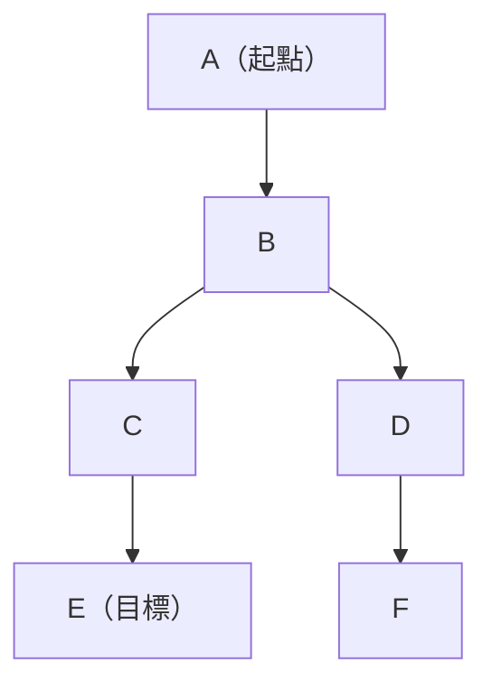
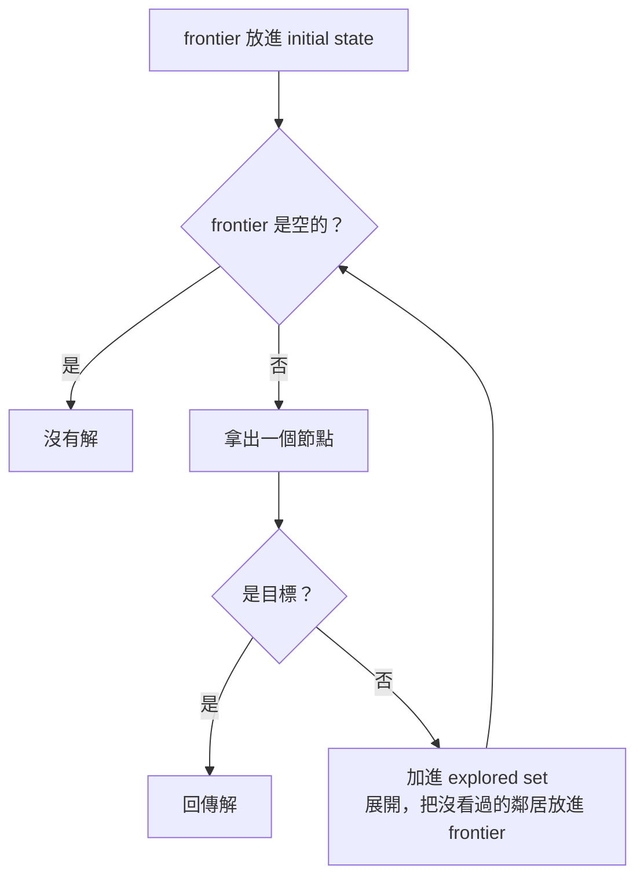
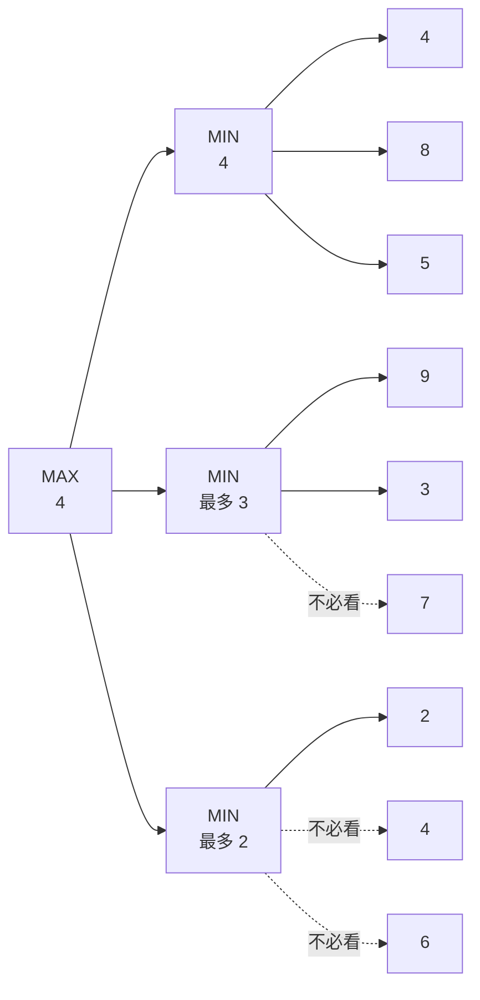

> 🌏 [English version](/posts/tech/2026-08-27-harvard-cs50ai-w00-search-en)

**影片狀態：已附影片。** 全片 1:49:29。本文的「講課導讀」依這支錄影的英文字幕逐段寫成，每一節開頭有時間連結，點了頁面上的播放器會跳到那一段。講課沒有介紹本週專案，專案部分依課程官網寫成。[跳到播放器](#課程影片與時間軸)｜[影片來源與說明](#課程影片來源)

> ⚠️ **版本提醒**：本週講課影片為 **2020 年春季錄製**；專案規格、distribution code、check50 slug 均以 2026 年課程官網最新版為準（`ai50/projects/2024/x/...`）。

## TL;DR

第 0 週用搜尋建立最基本的解題框架：先把問題寫成 state、action 與 goal，再比較幾種走法。DFS 與 BFS 不看目標在哪裡，greedy best-first 與 A* 用啟發式估計距離，Minimax 處理有對手的情況。兩個專案分別對應 BFS（Degrees）與 Minimax（Tic-Tac-Toe）。

這篇分成兩半：前半「講課導讀」跟著錄影走，後半是兩個專案的解題思路與檢查方式，講課沒有提到專案。

## 課程影片與時間軸

全片 1 小時 49 分。開頭 3 分鐘是整門課的簡介，下面「講課導讀」的九個小節依序涵蓋 3:14 之後的全部內容。每一節開頭和文中的時間連結都能點，頁面上的播放器會跳到那一段；某一節看不懂時，直接回去聽講者怎麼講。

```youtube
url: https://www.youtube.com/watch?v=WbzNRTTrX0g
title: Search - Lecture 0 - CS50's Introduction to Artificial Intelligence with Python 2020
```

YouTube：[Week 0 Search (2020 錄製)](https://www.youtube.com/watch?v=WbzNRTTrX0g)

> 時間說明：下表時間已依帶時間碼的英文字幕核對（2026-10-13），是講者開始講各主題的位置，不是官方章節。此表只描述這支 2020 年的錄影；課程目前版本的講課內容與順序可能不同，且影片本身沒有介紹本週專案。

| 時間（點了從該處播放） | 內容 |
|---|---|
| [0:00–3:14](https://www.youtube.com/watch?v=WbzNRTTrX0g&t=0s) | 課程簡介與七大主題預告（搜尋、知識、不確定性、最佳化、學習、神經網路、語言） |
| [3:14–15:12](https://www.youtube.com/watch?v=WbzNRTTrX0g&t=194s) | 搜尋問題的定義：agent、state、actions、transition model、goal test、path cost |
| [15:12–25:34](https://www.youtube.com/watch?v=WbzNRTTrX0g&t=912s) | 節點、frontier、通用搜尋流程與 explored set |
| [25:34–36:22](https://www.youtube.com/watch?v=WbzNRTTrX0g&t=1534s) | DFS（stack）與 BFS（queue），在迷宮上的行為 |
| [36:22–50:06](https://www.youtube.com/watch?v=WbzNRTTrX0g&t=2182s) | `maze.py` 程式碼與三個迷宮的實測 |
| [50:06–1:03:57](https://www.youtube.com/watch?v=WbzNRTTrX0g&t=3006s) | 有資訊搜尋：啟發式、曼哈頓距離、greedy best-first search |
| [1:03:57–1:11:45](https://www.youtube.com/watch?v=WbzNRTTrX0g&t=3837s) | A* 搜尋，admissible 與 consistent |
| [1:11:45–1:36:30](https://www.youtube.com/watch?v=WbzNRTTrX0g&t=4305s) | 對弈搜尋：Minimax |
| [1:36:30–1:43:59](https://www.youtube.com/watch?v=WbzNRTTrX0g&t=5790s) | Alpha-Beta 剪枝 |
| [1:43:59–1:49:29](https://www.youtube.com/watch?v=WbzNRTTrX0g&t=6239s) | Depth-limited minimax、evaluation function 與收尾 |

> 官方筆記與投影片：[Week 0 Notes](https://cs50.harvard.edu/ai/2020/notes/0/)

## 講課導讀

以下依錄影的英文字幕逐段寫成。光讀字幕看不到投影片，迷宮的形狀與棋盤的擺法本文不重建，只寫講者口頭說出的數字與推理；曼哈頓距離、Minimax 與 Alpha-Beta 的圖在[官方筆記](https://cs50.harvard.edu/ai/2020/notes/0/)裡有。每節結尾的自我檢查都是本文出的題目，不是講課內容；其中沿用講課例子的會寫明，標「本文自擬」的連例子也是本文編的。

### 搜尋問題怎麼定義

[錄影 3:14–15:12](https://www.youtube.com/watch?v=WbzNRTTrX0g&t=194s)

講者 Brian Yu 用三個例子開場：把 15-puzzle 的方塊滑回順序、走出迷宮、地圖軟體找行車路線。三個問題的共同點是從某個起點出發，靠一連串動作到達目標。他接著把這件事拆成幾個名詞，後面每個演算法都用這套說法。

- **Agent**：能感知環境並對環境採取行動的實體。導航問題裡是那輛車，15-puzzle 裡是解題的人或程式。
- **State**：agent 在環境裡的一種狀況。15-puzzle 的每一種方塊排法就是一個 state。
- **Initial state**：搜尋開始時所在的 state。
- **Actions**：在某個 state 能做的選擇。講者把它定義成函數 `Actions(s)`，輸入一個 state，回傳在那裡可以執行的動作集合。15-puzzle 通常有四個動作（把方塊往上、下、左、右滑），但有些動作只在某些 state 才合法。
- **Transition model**：描述「在某個 state 做某個動作之後會到哪個 state」。同樣寫成函數 `Result(s, a)`，輸入 state 與動作，回傳新的 state。
- **Goal test**：判斷某個 state 是不是目標。導航問題是「到了使用者輸入的目的地沒有」，15-puzzle 是「數字是不是按順序排好」。
- **Path cost**：每條路徑的數值代價。導航時不只要到，還希望少繞路，所以要讓程式找代價低的路。15-puzzle 每一步都一樣貴，可以把每步的代價設成 1，代價就等於步數。

把 transition model 套在整個問題上，會得到 **state space**：從 initial state 出發，經過任意多個動作能到達的所有 state。講者把它畫成一張圖，圓圈是 state，箭頭是動作，之後的演算法都在這張圖上走。

有了這些，搜尋問題就是五樣東西：initial state、actions、transition model、goal test、path cost。**解**（solution）是一串從 initial state 走到目標的動作；**最佳解**（optimal solution）是所有解裡 path cost 最低的那一個，可能不只一個。

**自我檢查｜先寫下答案，再展開。** 把「從台北車站開車到桃園機場」寫成搜尋問題，五樣東西各是什麼？（本文自擬）

<details>
<summary>答案</summary>

Initial state 是車在台北車站。Actions 是在目前路口可以走的每一條路。Transition model 是「在這個路口走這條路，會到哪個路口」。Goal test 是「現在的位置是不是桃園機場」。Path cost 看你要省什麼：省時間就用行車時間，省油就用距離。講者舉的代價是金錢、時間或其他資源；選的代價不同，最佳解也會跟著不同，後面這句是本文的推論。

</details>

### 節點、frontier 與通用搜尋流程

[錄影 15:12–25:34](https://www.youtube.com/watch?v=WbzNRTTrX0g&t=912s)

程式要同時記住很多「走到一半」的狀況，所以講者引入**節點**（node）這個資料結構，每個節點記四樣東西：

- state：目前所在的狀態
- parent：是從哪個節點走過來的
- action：從 parent 走到這裡用的動作
- path cost：從 initial state 走到這裡的代價

記 parent 的用途是到達目標之後往回追：目標的 parent、parent 的 parent，一路追回起點，就得到整串動作。

接著是 **frontier**：所有「接下來可以探索、但還沒探索」的節點。搜尋流程是一個迴圈：

1. frontier 一開始只放 initial state。
2. 如果 frontier 是空的，代表沒有解。
3. 從 frontier 拿出一個節點。
4. 如果它是目標，回傳解。
5. 否則**展開**（expand）它：找出從它能到的所有節點，放進 frontier。回到第 2 步。

講者用一張小圖示範（[19:31](https://www.youtube.com/watch?v=WbzNRTTrX0g&t=1171s)）：A 連到 B，B 連到 C 和 D，C 連到 E，D 連到 F，要從 A 找到 E。frontier 先是 A；拿出 A，放進 B；拿出 B，放進 C 和 D；拿出 C，放進 E；拿出 E，它是目標，結束。



講者示範用的圖（本文依他逐步示範的內容畫出）。下一節的 DFS 與 BFS 都在這張圖上走。

這個流程有一個漏洞（[22:08](https://www.youtube.com/watch?v=WbzNRTTrX0g&t=1328s)）。如果箭頭是雙向的，從 A 到 B 之後，B 的鄰居裡又有 A，程式可能在 A 與 B 之間來回，永遠走不出去。15-puzzle 就是這樣：方塊往右滑之後可以再往左滑回來。

修正的方法是多記一個 **explored set**，存放已經探索過的 state。流程改兩處：

- 拿出來的節點不是目標時，把它加進 explored set。
- 展開時，只有「不在 frontier 裡、也不在 explored set 裡」的節點才放進 frontier。



上圖是修正後的流程，本文依講者口述畫成，不是投影片原圖。

**自我檢查｜先寫下答案，再展開。** 用講課那張圖（A→B、B→C、B→D、C→E、D→F），再加一條 B→A 的反向箭頭。使用修正後的流程，展開 B 的時候，哪些節點會被放進 frontier？為什麼？

<details>
<summary>答案</summary>

只有 C 和 D。B 的鄰居是 A、C、D，但 A 在拿出來檢查之後已經進了 explored set，所以不再放進 frontier。沒有 explored set 的話，A 會回到 frontier，運氣不好就在 A 與 B 之間來回，變成無限迴圈。

</details>

### DFS 與 BFS：差別只在從 frontier 拿哪一個

[錄影 25:34–36:22](https://www.youtube.com/watch?v=WbzNRTTrX0g&t=1534s)

上一節的第 3 步只說「拿出一個節點」，沒說拿哪一個。講者指出這個選擇決定了整個演算法的性格。

**把 frontier 當 stack（後進先出），得到深度優先搜尋（DFS）。** 最後放進去的最先拿出來。同一張圖找 E：探索 A，放進 B；探索 B，放進 C、D；D 最後進來，先探索 D，放進 F；探索 F，沒有鄰居；回頭探索 C，放進 E；探索 E，到達目標。探索順序是 A、B、D、F、C、E。它先一路走到底，碰到死路才退回上一個岔路。

**把 frontier 當 queue（先進先出），得到廣度優先搜尋（BFS）。**（[28:31](https://www.youtube.com/watch?v=WbzNRTTrX0g&t=1711s)）先放進去的先拿出來。同一張圖：探索 A、B 之後，C 比 D 早進來，所以先探索 C，放進 E；接著探索 D，放進 F；再來才輪到 E。探索順序是 A、B、C、D、E。它先看離起點一步的，再看兩步的，再看三步的。

放到迷宮上，兩者的行為差很多。DFS 在岔路任選一條走到底，死路就退回上一個岔路換邊。BFS 在每個岔路兩邊都走，一邊一步輪流往外推。講者接著問了兩個問題（[32:02](https://www.youtube.com/watch?v=WbzNRTTrX0g&t=1922s)）：

- **DFS 一定找得到解嗎？** 只要迷宮是有限的就會，因為它最終會把每個格子都走過。state space 無限大時就不一定。
- **DFS 找到的是最佳解嗎？** 不一定。兩條路都能到目標時，DFS 選哪一條只看哪個節點先進 frontier，運氣不好就走了比較長的那條。BFS 因為由近到遠探索，找到的一定是步數最少的路。

代價是 BFS 為了由近到遠，常常要探索很多用不到的格子。講者在這裡提到 DFS 在某些情況下比較省記憶體，但沒有展開。

**自我檢查｜先寫下答案，再展開。** 用講課那張圖，鄰居依字母順序放進 frontier。把目標從 E 改成 F，DFS 與 BFS 各會從 frontier 拿出幾個節點才結束？和目標是 E 的時候比，哪個演算法快哪個慢？（本文自擬）

<details>
<summary>答案</summary>

DFS 拿出 A、B、D、F，共 4 個。BFS 拿出 A、B、C、D、E、F，共 6 個。目標是 E 的時候剛好反過來：DFS 要 6 個（A、B、D、F、C、E），BFS 要 5 個（A、B、C、D、E）。DFS 快不快看它先鑽進去的那條路上有沒有目標；BFS 的探索量看目標離起點有多遠。

</details>

### 迷宮程式：換一個類別就從 DFS 變成 BFS

[錄影 36:22–50:06](https://www.youtube.com/watch?v=WbzNRTTrX0g&t=2182s)

講者打開 `maze.py`，裡面的結構和前兩節的說法一一對應。

- `Node` 類別記 state、parent、action。這裡沒有記 path cost，因為找到路之後再算步數就好。
- `StackFrontier` 用一個 Python list 存節點：`add` 把節點接在 list 尾端；`remove` 拿走 list 的最後一個（索引 `-1`），所以是後進先出。另有 `empty` 與 `contains_state`。
- `QueueFrontier` 繼承 `StackFrontier`，只改寫 `remove`：改拿 list 的第一個（索引 `0`），變成先進先出。
- `Maze.solve` 就是那個迴圈：frontier 空了就丟出例外表示無解；拿出節點、把已探索的數量加一；是目標就沿著 parent 一路往回收集動作與格子，最後把順序反轉，得到從起點到終點的路；不是目標就加進 explored set，再把不在 frontier、也不在 explored set 的鄰居放進 frontier。

兩種 frontier 的差別只有這幾行：

```python
# util.py／maze.py：兩種 frontier 只差在 remove 拿哪一端
class StackFrontier():
    def remove(self):
        if self.empty():
            raise Exception("empty frontier")
        else:
            node = self.frontier[-1]          # 最後放進去的
            self.frontier = self.frontier[:-1]
            return node

class QueueFrontier(StackFrontier):
    def remove(self):
        if self.empty():
            raise Exception("empty frontier")
        else:
            node = self.frontier[0]           # 最先放進去的
            self.frontier = self.frontier[1:]
            return node
```

專案 Degrees 附的 `util.py` 就是這三個類別，下面專案 0A 節錄的是同一份。

實測三個迷宮的結果：

| 迷宮 | DFS | BFS |
|---|---|---|
| `maze1.txt` | 探索 11 個狀態，找到路 | 講課沒有跑 |
| `maze2.txt`（[44:42](https://www.youtube.com/watch?v=WbzNRTTrX0g&t=2682s)） | 探索 399 個狀態 | 探索 77 個狀態，找到同一條路 |
| `maze3.txt` | 找到一條比較長的路 | 找到 4 步的最佳解 |

`maze2` 上，DFS 先選了一個方向，把那個方向每一條岔路都走到底才回頭，所以多探索了三百多個狀態。`maze3` 有兩條路能到終點，DFS 走了長的那條。從 DFS 換成 BFS 只改一行：把 `StackFrontier()` 換成 `QueueFrontier()`。

這些是講課當場的數字。DFS 探索幾個狀態取決於鄰居放進 frontier 的順序，自己跑公開的程式碼不一定相同（這一句是本文補的）。

講者接著替 BFS 潑了冷水（[50:06](https://www.youtube.com/watch?v=WbzNRTTrX0g&t=3006s)）：目標離起點很遠時，BFS 幾乎要把整個迷宮走完。

**自我檢查｜先寫下答案，再展開。** `maze2` 上 DFS 探索 399 個狀態，BFS 只要 77 個。能不能因此說「BFS 探索的狀態一定比較少」？

<details>
<summary>答案</summary>

不能。77 對 399 是這個迷宮的結果：目標離起點不遠，而 DFS 剛好先鑽進錯的方向。講者接著就提醒，目標很遠時 BFS 會把幾乎整個迷宮都探索一遍。BFS 保證的是找到步數最少的路，探索量並沒有保證。

</details>

### 有資訊搜尋：greedy best-first search

[錄影 50:06–1:03:57](https://www.youtube.com/watch?v=WbzNRTTrX0g&t=3006s)

DFS 與 BFS 在岔路口都不看目標在哪裡。講者問：人走迷宮時會怎麼選？如果知道終點在右上方，往右走「感覺」比較近。這需要一個前提：迷宮能表示成座標格，而且知道自己與終點的座標。

他用這個差別把搜尋演算法分成兩類（[53:11](https://www.youtube.com/watch?v=WbzNRTTrX0g&t=3191s)）：

- **無資訊搜尋**（uninformed search）：不使用任何與問題有關的知識。DFS 與 BFS 都是，換成別的問題，它們的做法完全一樣。
- **有資訊搜尋**（informed search）：使用與問題有關的知識來更快找到解。

第一個有資訊搜尋是 **greedy best-first search**：每次展開「它認為離目標最近」的節點。程式不會真的知道誰最近（知道的話問題就解完了），所以用一個估計值，叫**啟發式**（heuristic），寫成函數 `h(n)`，輸入一個 state，回傳「離目標大概多遠」。

迷宮用的啟發式是**曼哈頓距離**（[56:39](https://www.youtube.com/watch?v=WbzNRTTrX0g&t=3399s)）：假裝牆不存在，只能上下左右走，從這一格到終點要幾步。算的時候把兩格的 x 座標相減、y 座標相減，取絕對值相加。講者強調它只是估計：一格的 `h` 是 2，實際上可能要繞很遠才到，但整體來說離終點近的格子 `h` 比較小。

在講課的迷宮上，走到第一個岔路時，左邊那格的 `h` 是 13，右邊是 11，greedy 選 11。之後每個岔路都挑 `h` 最小的，中途仍會走進一條死路再退回來，但探索的格子比 BFS 少很多。

接著是它的問題（[1:01:54](https://www.youtube.com/watch?v=WbzNRTTrX0g&t=3714s)）。講者換了一個迷宮：某個岔路口的 `h` 是 12，往左那格是 13，往上那格是 11。Greedy 選 11，最後也走到終點，但那條路比較長；真正的最短路要先走進 13 那一格（兩條路各要幾步，下一節 A\* 會算）。這就是「貪婪」的意思：每一步都做當下看起來最好的選擇，合起來卻不一定最好。

**自我檢查｜先寫下答案，再展開。** 你在座標 (2, 1)，終點在 (6, 4)，曼哈頓距離是多少？如果中間有牆，實際要走的步數會比這個數字大還是小？（本文自擬）

<details>
<summary>答案</summary>

|6 − 2| + |4 − 1| = 4 + 3 = 7。只能上下左右走時，沒有牆最少就要 7 步；有牆只會讓路變長，所以實際步數一定大於或等於 7。曼哈頓距離不會高估，這個性質下一節會用到。

</details>

### A* 搜尋：把已經走的步數算進來

[錄影 1:03:57–1:11:45](https://www.youtube.com/watch?v=WbzNRTTrX0g&t=3837s)

Greedy 走錯的那條路上，`h` 先一路降到很低，後來又爬回 12。講者的觀察是：花了很多步才走到 `h` = 12 的格子，不如只花 6 步就走到 `h` = 13 的格子。只看 `h` 會漏掉「到這裡已經花了多少」。

**A\* 搜尋**每次展開 `g(n) + h(n)` 最小的節點：

- `g(n)`：從起點走到這個節點已經花的代價（這裡是步數）
- `h(n)`：從這個節點到目標的估計代價（和 greedy 用的是同一個）

講者在同一個迷宮上逐格報數字（[1:06:49](https://www.youtube.com/watch?v=WbzNRTTrX0g&t=4009s)）：

| 位置 | g | h | g + h |
|---|---|---|---|
| 第 1 步 | 1 | 16 | 17 |
| 第 2 步 | 2 | 15 | 17 |
| 第 5 步 | 5 | 12 | 17 |
| 岔路往左 | 6 | 13 | 19 |
| 岔路往上 | 6 | 11 | 17 |

17 小於 19，A\* 先往上走，到這裡和 greedy 一樣。差別出現在往上那條路走了很久之後：那裡的節點是 `g` = 15、`h` = 6，合計 21；而一開始沒走的那格還在 frontier 裡，是 `g` = 6、`h` = 13，合計 19。19 小於 21，A\* 回頭改走左邊，最後找到最短的路。Greedy 只看 6 和 13，會繼續往上。

A\* 能保證找到最佳解，條件是啟發式要滿足兩件事（[1:09:31](https://www.youtube.com/watch?v=WbzNRTTrX0g&t=4171s)）：

1. **Admissible**：`h(n)` 永遠不高估真正的代價。估對或低估都可以。
2. **Consistent**：對每個節點 `n` 和它的下一個節點 `n'`，如果這一步的代價是 `c`，要有 `h(n) ≤ h(n') + c`。用白話講，往前走一步之後，估計值減少的量不能超過這一步實際花的代價。

講者的結語是：A\* 的程式不難寫，難的是選啟發式。啟發式越好，要探索的狀態越少。他也提到 A\* 相當耗記憶體，另有較省記憶體的變形，但沒有細講。

**自我檢查｜先寫下答案，再展開。** frontier 裡有兩個節點：甲已經走了 15 步、`h` = 6；乙已經走了 6 步、`h` = 13。Greedy 和 A\* 各會先展開哪一個？如果有人把啟發式改成「曼哈頓距離的兩倍」，A\* 的最佳解保證還在嗎？

<details>
<summary>答案</summary>

Greedy 只比 `h`，先展開甲（6 小於 13）。A\* 比 `g + h`，甲是 21、乙是 19，先展開乙。這就是講課迷宮裡 A\* 回頭的那一刻。

曼哈頓距離的兩倍會高估：沒有牆、實際只要 7 步的時候它說 14。高估就不是 admissible，A\* 可能因為某條好路「看起來很貴」而不去走，最佳解的保證就沒了。後半題是本文自擬的。

</details>

### 對弈搜尋：Minimax

[錄影 1:11:45–1:36:30](https://www.youtube.com/watch?v=WbzNRTTrX0g&t=4305s)

前面的問題都只有一個 agent。下棋時多了一個目標與你相反的對手，講者稱為**對弈搜尋**（adversarial search），用井字遊戲（tic-tac-toe）當例子。

電腦不懂輸贏，只懂數字的大小，所以先把結果換成數字：O 贏是 −1，平手是 0，X 贏是 1。X 想讓分數越大越好，叫 **max player**；O 想讓分數越小越好，叫 **min player**。「想贏」就變成「把一個數字推高或壓低」。

要讓程式會玩，得先把遊戲寫成六樣東西（[1:17:18](https://www.youtube.com/watch?v=WbzNRTTrX0g&t=4638s)）。專案 Tic-Tac-Toe 要實作的函式大多對應這一組，另外多了 `winner` 與 `minimax`：

| 名稱 | 意思 |
|---|---|
| `S₀` | 初始狀態，空棋盤 |
| `Player(s)` | 這個盤面輪到誰 |
| `Actions(s)` | 這個盤面能下哪些位置 |
| `Result(s, a)` | 在盤面 `s` 下了 `a` 之後的新盤面 |
| `Terminal(s)` | 遊戲結束了沒（有人連成三個，或棋盤滿了） |
| `Utility(s)` | 結束盤面的分數：1、0 或 −1 |

講者強調，像「下在左上角之後棋盤長怎樣」這種人覺得理所當然的事，都要靠 `Result` 明確告訴程式。

遊戲還沒結束時，盤面值多少？講者用一個殘局說明（[1:22:21](https://www.youtube.com/watch?v=WbzNRTTrX0g&t=4941s)）。輪到 O，棋盤只剩兩個空格：左上與下中。

- O 下左上：剩下的一格由 X 下，X 連成三個，結果是 1。這個盤面只能走到 1，所以它的值是 1。
- O 下下中：X 下左上，沒有人連線，結果是 0。這個盤面的值是 0。

O 是 min player，在 1 和 0 之間選 0。所以原本那個盤面的值是 0，O 該下下中。

這就是 Minimax 的邏輯：要決定現在怎麼下，先站到對手的位置想他會怎麼下；要知道他會怎麼下，再想自己下一步怎麼回，一路想到遊戲結束。每往回一層，輪到 max 就取最大值，輪到 min 就取最小值。

講者接著把棋盤換成抽象的樹（[1:28:24](https://www.youtube.com/watch?v=WbzNRTTrX0g&t=5304s)）：一個 max 節點面對 5、3、9 三個選擇，取 9；旁邊另一個 max 節點的值是 8；上一層的 min 節點在 9 與 8 之間取 8。

寫成虛擬碼（[1:30:21](https://www.youtube.com/watch?v=WbzNRTTrX0g&t=5421s)）：

```text
function Max-Value(state):
    if Terminal(state): return Utility(state)
    v = −∞
    for action in Actions(state):
        v = max(v, Min-Value(Result(state, action)))
    return v

function Min-Value(state):
    if Terminal(state): return Utility(state)
    v = +∞
    for action in Actions(state):
        v = min(v, Max-Value(Result(state, action)))
    return v
```

`v` 先設成負無限大，是因為還不知道有哪些選擇，隨便一個都會比它好。輪到 max 時，挑讓 `Min-Value(Result(s, a))` 最大的動作；輪到 min 時，挑讓 `Max-Value(Result(s, a))` 最小的動作。兩個函數互相呼叫，直到碰到終局。

**自我檢查｜先寫下答案，再展開。** 一棵兩層的樹：根是 max 節點，底下兩個 min 節點，葉子分別是 (3, 12) 和 (8, 6)。根的值是多少？如果根改成 min 節點、底下兩個改成 max 節點，值又是多少？（本文自擬）

<details>
<summary>答案</summary>

第一種：兩個 min 節點各取 3 和 6，根取最大值，是 6。max player 不會選有 12 的那一邊，因為對手不會讓他拿到 12，只會給他 3。

第二種：兩個 max 節點各取 12 和 8，根取最小值，是 8。同一組數字，誰先手結果就不同。

</details>

### Alpha-Beta 剪枝

[錄影 1:36:30–1:43:59](https://www.youtube.com/watch?v=WbzNRTTrX0g&t=5790s)

Minimax 要把整棵樹算完。講者用一棵小樹示範哪些計算可以省：我是 max player，有三個選擇；每個選擇之後對手（min player）也有三個選擇，葉子的分數如下。

| 我的選擇 | 對手能給我的分數 | 對手會選 |
|---|---|---|
| 左 | 4、8、5 | 4 |
| 中 | 9、3、7 | 3 |
| 右 | 2、4、6 | 2 |

全部算完，我在 4、3、2 之間選 4。中間那一支裡有 9，是全場最高分，但對手不會讓我拿到，他會給我 3。

現在重算一次，注意順序。左邊算完得到 4，我已經有一個保證 4 分的選擇。看中間：第一個葉子是 9，第二個是 3。看到 3 的那一刻就可以停了，因為對手至少能把這一支壓到 3，第三個葉子不管是多少，這一支的值都不會超過 3，比不上已經到手的 4。右邊也一樣：第一個葉子是 2，這一支最多 2 分，後面兩個不必看。

講者說這就是 **alpha-beta 剪枝**：多記兩個數字，目前為止我最好能拿到多少、最差會拿到多少，用它們判斷哪些分支可以直接剪掉。結果和完整的 Minimax 完全相同，只是少算了一些節點。下面專案的參考實作在遞迴時多帶的兩個參數就是這兩個數字；輪到對手的那一層一旦發現這一支已經壓到不超過我手上的分數，就不再往下看，也就是上面的「看到 3 就停」。

**自我檢查｜先寫下答案，再展開。** 上面那棵樹有 9 個葉子。由左到右計算並使用 alpha-beta 剪枝，實際看了幾個？如果中間那一支的順序是 3、9、7，會多剪還是少剪？

<details>
<summary>答案</summary>

看了 6 個：左邊三個（4、8、5），中間兩個（9、3，跳過 7），右邊一個（2，跳過 4、6）。



實線是實際計算的葉子，虛線是被剪掉、不必看的葉子。本文依講者報的數字畫成，不是投影片原圖。

順序換成 3、9、7 的話，第一個葉子就是 3，馬上可以停，9 和 7 都不用看，總共只看 5 個。在對手的節點上，對手最想選的低分越早出現，這一支就越早被剪掉。葉子數是照講課的例子自己數的，後半題是本文自擬的。

</details>

### 樹太大的時候：depth-limited Minimax

[錄影 1:43:59–1:49:29](https://www.youtube.com/watch?v=WbzNRTTrX0g&t=6239s)

剪枝之後，複雜的遊戲還是算不完。講者給了三個數字：井字遊戲大約有 255,000 種可能的對局；西洋棋雙方各下四步之後就有 2,880 億種；完整的西洋棋對局超過 10 的 29,000 次方種。Minimax 要一路算到終局，這在西洋棋上辦不到。

實際的做法是 **depth-limited Minimax**：只往前看固定的步數，例如 10 步或 12 步，到了就停。停下來的盤面通常還沒結束，沒有 `Utility` 可以用，所以要加一個 **evaluation function**，估計這個盤面的期望分數。以西洋棋為例，1 是白方贏、−1 是黑方贏，評估函數回傳 0.8 的意思是白方很可能贏，但還不確定。最簡單的評估方式是比雙方剩下的棋子，每種棋子給一個分數，實際上要考慮的更多。

講者的結論是：評估函數有多準，AI 的棋力上限就在哪裡。

**自我檢查｜先寫下答案，再展開。** Depth-limited Minimax 為什麼一定要搭配 evaluation function？只用 `Utility` 不行嗎？

<details>
<summary>答案</summary>

不行。`Utility` 只對已經結束的盤面有定義。限制深度之後，搜尋會停在還沒結束的盤面，那裡沒有輸贏可以回報，只能用估計值代替。估計值一路往上傳，經過同樣的取最大、取最小，最後決定下哪一步，所以估得不準，選出來的棋就不好。

</details>

## 專案 0A：Degrees —— BFS 找演員六度人脈

這一節先講做法與檢查方式；完整的參考實作摺疊在最後，預設不顯示。

### 任務

兩位演員合演過同一部電影算一步，找出從一位演員連到另一位最少要幾步，以及每一步靠的是哪部電影。規格頁把它寫成搜尋問題：state 是人，action 是電影（一部電影把你從一位演員帶到另一位），initial state 與 goal 是要連起來的兩個人。

要寫的只有 `degrees.py` 裡的 `shortest_path(source, target)`，`source` 與 `target` 是兩位演員的 IMDb id。規格的要求：

- 有路徑時回傳一個 list，每一項是路徑上的下一個 `(movie_id, person_id)`，兩個值都是字串。規格頁的例子：回傳 `[(1, 2), (3, 4)]` 的意思是，起點與 2 號演員合演 1 號電影，2 號演員與 4 號演員合演 3 號電影，4 號演員就是終點。
- 最短的路徑不只一條時，回傳哪一條都可以。
- 兩人之間沒有路徑時回傳 `None`。
- 可以呼叫 `neighbors_for_person`。除了 `shortest_path`，檔案其他地方不能改；可以另外加函式，也可以匯入 Python 標準函式庫的模組。

繳交的檔案是 `degrees.py`。

### 官方已提供的程式

下載的壓縮檔裡有 `degrees.py`、`util.py`，以及 `small`、`large` 兩組 CSV（各有 `people.csv`、`movies.csv`、`stars.csv`）。`degrees.py` 已經寫好讀檔的 `load_data`、主程式 `main`、把名字換成 id 的 `person_id_for_name` 與 `neighbors_for_person`；`shortest_path` 只有說明文字與 `raise NotImplementedError`。

```python
# degrees.py（官方提供，節錄）
from util import Node, StackFrontier, QueueFrontier

# Maps names to a set of corresponding person_ids
names = {}

# Maps person_ids to a dictionary of: name, birth, movies (a set of movie_ids)
people = {}

# Maps movie_ids to a dictionary of: title, year, stars (a set of person_ids)
movies = {}
```

```python
# degrees.py（官方提供，節錄）
def shortest_path(source, target):
    """
    Returns the shortest list of (movie_id, person_id) pairs
    that connect the source to the target.

    If no possible path, returns None.
    """

    # TODO
    raise NotImplementedError
```

```python
# degrees.py（官方提供，節錄）
def neighbors_for_person(person_id):
    """
    Returns (movie_id, person_id) pairs for people
    who starred with a given person.
    """
    movie_ids = people[person_id]["movies"]
    neighbors = set()
    for movie_id in movie_ids:
        for person_id in movies[movie_id]["stars"]:
            neighbors.add((movie_id, person_id))
    return neighbors
```

`neighbors_for_person` 把這個人演過的每部電影的每位演員都列出來，沒有排除他自己，所以回傳的鄰居裡一定有他本人。

`main` 拿到回傳值之後這樣用，路徑的格式要配合它：

```python
# degrees.py 的 main（官方提供，節錄）
    path = shortest_path(source, target)

    if path is None:
        print("Not connected.")
    else:
        degrees = len(path)
        print(f"{degrees} degrees of separation.")
        path = [(None, source)] + path
        for i in range(degrees):
            person1 = people[path[i][1]]["name"]
            person2 = people[path[i + 1][1]]["name"]
            movie = movies[path[i + 1][0]]["title"]
            print(f"{i + 1}: {person1} and {person2} starred in {movie}")
```

步數就是 list 的長度，起點由 `main` 自己補在最前面。

`util.py` 是講課的 `Node`、`StackFrontier`、`QueueFrontier` 三個類別：

```python
# util.py（官方提供，節錄）
class Node():
    def __init__(self, state, parent, action):
        self.state = state
        self.parent = parent
        self.action = action


class StackFrontier():
    def __init__(self):
        self.frontier = []

    def add(self, node):
        self.frontier.append(node)

    def contains_state(self, state):
        return any(node.state == state for node in self.frontier)

    def empty(self):
        return len(self.frontier) == 0
```

兩個類別各自的 `remove` 貼在導讀「[迷宮程式](#迷宮程式換一個類別就從-dfs-變成-bfs)」一節，這裡不重貼。`Node` 只收 `state`、`parent`、`action` 三個參數。

### 解題思路

**先把名詞對上。** 照導讀「[節點、frontier 與通用搜尋流程](#節點frontier-與通用搜尋流程)」一節的說法（[錄影 15:12–25:34](https://www.youtube.com/watch?v=WbzNRTTrX0g&t=912s)），每個節點記 state、parent、action。在這個專案裡，state 是一位演員的 id，action 是「走到這位演員靠的那一組 `(movie_id, person_id)`」，parent 是上一位演員的節點。`neighbors_for_person` 一次給你某人的所有鄰居，每個鄰居剛好就是一組可以存進節點的 action。

**frontier 用 queue。** 題目要的是步數最少的路徑。導讀「[DFS 與 BFS](#dfs-與-bfs差別只在從-frontier-拿哪一個)」一節講過（[28:31](https://www.youtube.com/watch?v=WbzNRTTrX0g&t=1711s)），先放進去的先拿出來，就會先看離起點一步的人、再看兩步的，所以第一次碰到終點時走的一定是最短的路。`util.py` 裡先進先出的那個類別是 `QueueFrontier`。

**迴圈照迷宮程式的骨架。** 導讀「[迷宮程式](#迷宮程式換一個類別就從-dfs-變成-bfs)」一節的 `Maze.solve`（[錄影 36:22–50:06](https://www.youtube.com/watch?v=WbzNRTTrX0g&t=2182s)）就是要寫的東西：frontier 放進起點；每一輪拿出一個節點，記進 explored set，把它的鄰居裡「不在 frontier、也不在 explored set」的放進 frontier；frontier 空了還沒找到，就是沒有路徑。explored set 不能省，原因在導讀「節點、frontier 與通用搜尋流程」一節講過（[22:08](https://www.youtube.com/watch?v=WbzNRTTrX0g&t=1328s)）：合演關係是雙向的，A 的鄰居裡有 B，B 的鄰居裡也有 A。

**在放進 frontier 之前檢查是不是終點。** 講課的寫法是節點從 frontier 拿出來時才檢查。規格頁的提示建議提早：某個鄰居就是終點時，不必放進 frontier，直接回傳。兩種寫法找到的步數相同，差在 `large` 資料集上要等多久，數字在「容易出錯的地方」。

**找到之後往回追。** 手上有終點那一組 `(movie_id, person_id)`，以及目前節點。沿著 parent 一路走回起點，沿途每個節點的 action 就是路徑上的一步；起點的節點沒有 parent，也沒有 action，不收。這樣收集到的順序是從終點到起點，回傳之前要反過來。

**起點與終點是同一個人。** 這時路徑是 0 步，要回傳空的 list。這個情況要在進迴圈之前另外處理，原因是鄰居裡有他本人。

### 虛擬碼

```text
最短路徑（起點, 終點）
    如果 起點就是終點：回傳 空的路徑

    frontier ← 先進先出的佇列，放進起點的節點（沒有 parent，沒有動作）
    已探索 ← 空集合

    只要 frontier 不是空的：
        節點 ← 從 frontier 拿出最早放進去的那一個
        把 節點代表的人 加進 已探索

        對 這個人的每一個鄰居（電影, 演員）：
            如果 演員就是終點：照「找到之後往回追」組出路徑，回傳

            如果 演員不在 frontier 裡，也不在 已探索 裡：把他放進 frontier

    回傳 沒有路徑
```

### 容易出錯的地方

以下每一條都是本站 2026-10-13 把寫錯的版本放進官方檔案實跑看到的（Python 3.15.0）。`large` 上的數字跑了三次，Python 每次執行走訪集合的順序不同，所以寫成範圍。

- **給 `Node` 多傳一個 path cost。** 導讀裡講者說節點記四樣東西，第四樣是 path cost；`util.py` 的 `Node` 只收三個參數。照講課的說法多傳一個，一執行就停在 `TypeError: Node.__init__() got an unexpected keyword argument 'path_cost'`。本文舊版的參考實作就是這個錯。
- **用了 `StackFrontier`，`small` 完全看不出來。** `small` 的五部電影串成一條線，要從一部走到另一部只有一種走法，繞不出比較長的路：本站把 `small` 全部 240 組「起點、終點不同」的配對跑過一遍，用 stack 的版本每一組的步數都與正確答案相同，check50 公開的七項檢查也全數符合。換成 `large` 才現形：Emma Watson 到 Jennifer Lawrence 應該是 3 步，三次分別跑出 13、900、680 步；Jennifer Lawrence 到 Tom Hanks 應該是 2 步，跑出 35、9、4 步。步數每次差很多，繞得遠的時候也可能跑很久（本站 900 步那一次花了約 7 秒）。察覺方式：一定要用 `large` 跑規格頁那兩個例子。
- **沒有另外處理起點等於終點。** 鄰居裡有本人，所以「鄰居就是終點」馬上成立。Robin Wright 到 Robin Wright 會回傳 1 步，例如 `[('93779', '705')]`，程式印出 `1 degrees of separation.` 與 `1: Robin Wright and Robin Wright starred in The Princess Bride`。她在 `small` 裡演了兩部，先碰到哪一部每次執行不同：本站指定 10 個不同的 `PYTHONHASHSEED` 各跑一次，2 次是 The Princess Bride，8 次是 Forrest Gump（回傳 `[('109830', '705')]`）。正確的回傳值是空的 list。
- **少了 explored set，只有在沒有路徑時才出事。** Tom Cruise 到 Tom Hanks 照樣回傳正確的 2 步。Dustin Hoffman 到 Emma Watson（`small` 裡 Emma Watson 沒有任何電影）就停不下來：本站讓它從 frontier 拿了 100,000 次節點還在跑，那時 frontier 裡有 15 個節點；正確的版本拿 15 次就回傳 `None`。察覺方式：測試一定要包含一組連不到的人。
- **路徑忘了反過來。** Tom Hanks 到 Mandy Patinkin 會回傳 `[('93779', '1597'), ('109830', '705')]`，步數是對的，但程式印出 `1: Tom Hanks and Mandy Patinkin starred in The Princess Bride`、`2: Mandy Patinkin and Robin Wright starred in Forrest Gump`。Tom Hanks 沒有演 The Princess Bride，終點也變成了 Robin Wright。只看步數抓不到，要把印出來的每一行讀過。
- **回傳值的格式與 `main` 對不上。** 把起點也放進路徑（開頭多一組 `(None, source)`），Kevin Bacon 到 Tom Hanks 會先印出 `2 degrees of separation.`，接著丟出 `KeyError: None`。沒有路徑時回傳空的 list，程式會印 `0 degrees of separation.`，正確的輸出是 `Not connected.`。
- **節點拿出來才檢查終點，答案對，但 `large` 要等很久。** Emma Watson 到 Jennifer Lawrence：放進 frontier 前就檢查的版本三次都在 0.3 秒內回傳，從 frontier 拿了 63 到 89 次節點；拿出來才檢查的版本花了 57 到 142 秒，拿了 2,656 到 3,118 次，frontier 最多堆到三萬多個節點。兩種都回傳 3 步。這些範圍只是本站三次的結果，你跑出來的次數與秒數可能落在範圍外，差一個數量級以上這件事不會變。慢的原因在官方的 frontier：`contains_state` 逐一比對 list 裡的每個節點，`remove` 每次都重建一個 list，frontier 越長兩者都越慢。

### 怎麼檢查自己寫的對不對

**`small` 可以用手算。** `small` 有 16 個人、5 部電影，電影靠共同演員串成一條線：

```text
The Princess Bride ─(Robin Wright)─ Forrest Gump ─(Tom Hanks、Gary Sinise)─ Apollo 13 ─(Kevin Bacon)─ A Few Good Men ─(Tom Cruise)─ Rain Man
```

括號裡是相鄰兩部電影的共同演員。兩個人各自在哪部電影、中間隔幾部，步數就出來了。下表是本站的參考實作在 `small` 上的結果（2026-10-13），另外用一支獨立寫的 BFS 核對過全部 256 組配對：

| 起點 | 終點 | 該回傳 |
|---|---|---|
| Kevin Bacon | Tom Cruise | 1 步 |
| Kevin Bacon | Tom Hanks | 1 步 |
| Tom Cruise | Tom Hanks | 2 步 |
| Tom Hanks | Mandy Patinkin | 2 步，只有一條路：`[('109830', '705'), ('93779', '1597')]` |
| Robin Wright | Dustin Hoffman | 4 步 |
| Robin Wright | Robin Wright | 0 步（空的 list） |
| Dustin Hoffman | Emma Watson | `None` |

表中除了 Kevin Bacon 到 Tom Hanks、Tom Cruise 到 Tom Hanks 兩列，其餘五組就是 [check50 公開的檢查檔](https://github.com/ai50/projects/blob/2024/x/degrees/__init__.py)用的輸入。

**實際跑一次。**

```bash
# 下載 distribution（2023/x 版）
wget https://cdn.cs50.net/ai/2023/x/projects/0/degrees.zip
unzip degrees.zip && cd degrees

# 不加參數會讀 large；先用 small
python degrees.py small
```

輸入 `Tom Hanks` 與 `Mandy Patinkin`，應該看到：

```text
2 degrees of separation.
1: Tom Hanks and Robin Wright starred in Forrest Gump
2: Robin Wright and Mandy Patinkin starred in The Princess Bride
```

輸入 `Dustin Hoffman` 與 `Emma Watson`，應該看到 `Not connected.`。

**再用 `large` 跑規格頁的例子。** `python degrees.py large`，本站載入資料約 9 秒。

- Emma Watson 到 Jennifer Lawrence：規格頁的範例輸出是 3 步。
- Jennifer Lawrence 到 Tom Hanks：規格頁的背景說明寫的是 2 步。

步數要相同，經過的人與電影可以不同。規格頁的範例經過 Brendan Gleeson 與 Michael Fassbender，本站其中一次跑出來的是 Daniel Radcliffe 與 Woody Harrelson；同一份程式每次執行也可能換一條。這兩組都該在幾秒內回傳，等了十幾秒還沒有結果就回頭看上一節的最後一條。

**不看答案也能做的檢查。**

- 把程式印出來的每一行讀過：前一行的第二個人是下一行的第一個人，最後一行的第二個人是終點。
- 起點與終點對調，步數應該相同。
- 路徑裡每一項都是兩個字串組成的 tuple，沒有 `None`。

**官方工具。**

```bash
check50 ai50/projects/2024/x/degrees
style50 degrees.py
```

### 完整參考實作

<details>
<summary>完整參考實作（先自己寫完並繳交，再打開）</summary>

> ⚠️ 如果你正在修這門課、或打算申請 CS50 的證書：課程的[學術誠信政策](https://cs50.harvard.edu/ai/honesty/)規定，繳交自己的作業之前不能看別人的解答。請先完成並繳交，再用這一段對照。這份實作只在本站列出的環境實跑過，沒有經過 check50。

```python
# degrees.py 片段
from util import Node, QueueFrontier

def shortest_path(source, target):
    """BFS 找最短路徑，回傳 [(movie_id, person_id), ...] 或 None"""
    if source == target:
        return []

    start = Node(state=source, parent=None, action=None)
    frontier = QueueFrontier()
    frontier.add(start)
    explored = set()

    while not frontier.empty():
        node = frontier.remove()
        explored.add(node.state)

        for movie_id, person_id in neighbors_for_person(node.state):
            if person_id == target:
                # 重建路徑
                path = [(movie_id, person_id)]
                while node.parent is not None:
                    path.append(node.action)
                    node = node.parent
                path.reverse()
                return path

            if not frontier.contains_state(person_id) and person_id not in explored:
                child = Node(state=person_id, parent=node, action=(movie_id, person_id))
                frontier.add(child)
    return None
```

實跑結果（2026-10-13，Python 3.15.0，放進官方 `degrees.py`，搭配官方 `util.py`）：`small` 上「怎麼檢查」那張表的七組全部相符，256 組配對的步數與獨立寫的 BFS 一致；`large` 上 Emma Watson 到 Jennifer Lawrence 是 3 步、Jennifer Lawrence 到 Tom Hanks 是 2 步。另外把 check50 公開的檢查檔接上一個替身模組在本機執行，七項條件全部符合；這不等於跑過 check50。

</details>

---

## 專案 0B：Tic-Tac-Toe —— Minimax 最佳策略

這一節先講做法與檢查方式；完整的參考實作摺疊在最後，預設不顯示。

### 任務

用 Minimax 寫一個下井字遊戲不會輸的 AI。要在 `tictactoe.py` 裡完成七個函式，規格頁對每一個的要求如下：

| 函式 | 要回傳什麼 | 規格頁的補充 |
|---|---|---|
| `player(board)` | 輪到誰，`X` 或 `O` | 空棋盤由 X 先下，之後輪流。盤面已結束時回傳什麼都可以 |
| `actions(board)` | 所有可下位置的 set，每個位置是 `(i, j)` | `i` 是列（0、1、2），`j` 是那一列的第幾格（0、1、2）。盤面已結束時回傳什麼都可以 |
| `result(board, action)` | 下了這一步之後的新盤面 | 不能改到原本的盤面；`action` 不是這個盤面的合法動作時要丟出例外 |
| `winner(board)` | `X`、`O` 或 `None` | 橫、直、斜任一條連成三個就贏。可以假設不會兩邊同時連線。還在進行或平手都回傳 `None` |
| `terminal(board)` | `True` 或 `False` | 有人贏了，或格子全滿，就是結束 |
| `utility(board)` | X 贏是 `1`，O 贏是 `-1`，平手是 `0` | 可以假設只會在已結束的盤面上被呼叫 |
| `minimax(board)` | 輪到的那一方的最佳動作 `(i, j)` | 同樣好的動作不只一個時，回傳哪個都可以。盤面已結束時回傳 `None` |

另外三條：不能改這些函式的參數個數與順序；可以加輔助函式，名稱不要和模組裡已有的名稱衝突；alpha-beta 剪枝是選做，規格頁說它可能讓 AI 跑得比較快。

繳交的檔案是 `tictactoe.py`。

### 官方已提供的程式

壓縮檔裡有 `tictactoe.py` 與 `runner.py`。`runner.py` 是用 pygame 寫好的圖形介面，不用改。`tictactoe.py` 已經定義三個常數與 `initial_state`，七個要寫的函式都只有說明文字與 `raise NotImplementedError`。

```python
# tictactoe.py（官方提供，節錄）
X = "X"
O = "O"
EMPTY = None


def initial_state():
    """
    Returns starting state of the board.
    """
    return [[EMPTY, EMPTY, EMPTY],
            [EMPTY, EMPTY, EMPTY],
            [EMPTY, EMPTY, EMPTY]]


def player(board):
    """
    Returns player who has the next turn on a board.
    """
    raise NotImplementedError
```

盤面是三個 list 組成的 list，每個內層 list 是一列，格子的值是 `X`、`O` 或 `EMPTY`。`EMPTY` 就是 `None`。

`runner.py` 這樣呼叫你的函式：

```python
# runner.py（官方提供，節錄）
        game_over = ttt.terminal(board)
        player = ttt.player(board)
```

```python
# runner.py（官方提供，節錄）
        # Check for AI move
        if user != player and not game_over:
            if ai_turn:
                time.sleep(0.5)
                move = ttt.minimax(board)
                board = ttt.result(board, move)
                ai_turn = False
            else:
                ai_turn = True
```

`minimax` 的回傳值會原封不動交給 `result`，所以它必須是一個 `(i, j)`；`result` 回傳的盤面會取代原本的 `board`。

### 解題思路

**前六個函式對應講課的那張表。** 導讀「[對弈搜尋：Minimax](#對弈搜尋minimax)」一節列了把遊戲寫成程式要的六樣東西（[1:17:18](https://www.youtube.com/watch?v=WbzNRTTrX0g&t=4638s)）：`S₀`、`Player`、`Actions`、`Result`、`Terminal`、`Utility`。`S₀` 官方已經寫成 `initial_state`，其餘五個加上 `winner` 要自己寫。

- `player`：數盤面上 X 與 O 各有幾個。X 先下，所以兩者一樣多時輪到 X，X 多一個時輪到 O。
- `actions`：走過九格，收集還是 `EMPTY` 的位置。
- `result`：先確認這個位置是合法動作，再做一份盤面的複本，在複本上放棋子，回傳複本。放誰的棋子，要問原本的盤面輪到誰。「合法」最省事的判斷是看它在不在 `actions(board)` 回傳的集合裡，這樣已經有棋子的格子、超出範圍的位置、負的位置都會被擋下。
- `winner`：一共八條線，三列、三行、兩條對角線。某一條的三格是同一個棋子，而且那個棋子不是 `EMPTY`，就回傳它。
- `terminal`：有贏家，或沒有空格。
- `utility`：照贏家換成 1、−1、0。

**`minimax` 要回傳動作，講課的虛擬碼回傳的是分數。** 導讀同一節的 `Max-Value` 與 `Min-Value`（[1:30:21](https://www.youtube.com/watch?v=WbzNRTTrX0g&t=5421s)）算的是一個盤面值多少。專案要的是該下哪裡，所以最上面那一層要自己多做一件事：把每個可下的位置逐一試過，記住哪一個位置得到的分數最好。輪到 X 時，對每個位置算「下了之後的盤面交給 `Min-Value`」的值，挑最大的；輪到 O 時算「交給 `Max-Value`」的值，挑最小的。講者在寫這兩個函式之前先講了這條規則。盤面已經結束時沒有動作可選，回傳 `None`。

想確認自己懂了，可以先用講課那個殘局手算（[1:22:21](https://www.youtube.com/watch?v=WbzNRTTrX0g&t=4941s)）：輪到 O，剩兩個空格，一個走下去 X 會贏（值 1），另一個走下去平手（值 0），O 挑 0 那一步。

**剪枝是選做。** 不剪枝的版本就符合規格，只是從空棋盤算第一步比較久（本站實跑的時間在下面）。要加的話，照導讀「[Alpha-Beta 剪枝](#alpha-beta-剪枝)」一節的推理（[錄影 1:36:30–1:43:59](https://www.youtube.com/watch?v=WbzNRTTrX0g&t=5790s)）：遞迴時多帶兩個數字，一個是 max 這一方在別的分支已經保證拿得到的分數，一個是 min 這一方已經保證壓得到的分數。在 min 的節點上，一旦目前的值已經不比 max 手上的保證高，剩下的動作就不用看了；max 的節點反過來。剪枝之後每個盤面選出來的動作，價值要和不剪枝時相同。

### 虛擬碼

`Max-Value` 與 `Min-Value` 的虛擬碼在導讀「[對弈搜尋：Minimax](#對弈搜尋minimax)」一節，是講課的版本，這裡不重複。下面是它們以外的部分。

```text
輪到誰（盤面）
    X 與 O 的個數一樣多：輪到 X
    否則：輪到 O

可下的位置（盤面）
    回傳 所有空格的（列, 欄）組成的集合

下了之後的盤面（盤面, 位置）
    如果 位置不在「可下的位置（盤面）」裡：丟出例外
    新盤面 ← 盤面的完整複本，每一列也是新的
    在 新盤面 的這個位置放上「輪到誰（盤面）」的棋子
    回傳 新盤面

贏家（盤面）
    對 三列、三行、兩條對角線 共八條線的每一條：
        如果 三格是同一個棋子，而且不是空格：回傳 那個棋子
    回傳 沒有贏家

結束了沒（盤面）
    有贏家，或沒有空格

分數（盤面）
    贏家是 X：1；贏家是 O：−1；其他：0

最佳動作（盤面）
    如果 盤面已經結束：回傳 沒有動作
    如果 輪到 X：
        對每個可下的位置，算 Min-Value(下了之後的盤面)
        回傳 值最大的那個位置
    否則：
        對每個可下的位置，算 Max-Value(下了之後的盤面)
        回傳 值最小的那個位置
```

選做的剪枝只寫原則，怎麼接進 `Max-Value` 與 `Min-Value` 留給你：

```text
剪枝（Max-Value 與 Min-Value 各多帶兩個數字往下傳）
    第一個數字：max 在已經看過的分支裡保證拿得到的分數
    第二個數字：min 在已經看過的分支裡保證壓得到的分數

    在 max 的節點：目前的值已經不低於第二個數字，剩下的位置不必看
    在 min 的節點：目前的值已經不高於第一個數字，剩下的位置不必看
    每看完一個位置，用得到的值更新屬於自己這一方的那個數字
```

### 容易出錯的地方

以下每一條都是本站 2026-10-13 把寫錯的版本接進官方 `tictactoe.py` 實跑看到的（Python 3.15.0）。「下錯」的意思是選的動作不是最佳：本站另外寫了一支不依賴參考實作的窮舉程式，算出全部 5,478 個可達盤面的值，其中 4,520 個還沒結束，逐一比對。「對隨機對手」是讓 AI 與隨機落子的對手各下 1,000 局（亂數種子 0），輸贏由那支獨立的程式判定。

- **負的位置沒有被擋下。** `result` 只檢查「那一格是不是空的」時，`(3, 1)` 會因為超出 list 範圍而丟出 `IndexError`，看起來有擋到；`(-1, 2)` 卻不會，Python 把 `-1` 當成最後一列。在盤面 `[[EMPTY, EMPTY, X], [EMPTY, EMPTY, O], [X, EMPTY, EMPTY]]` 上呼叫 `result(board, (-1, 2))`，不丟例外，回傳右下角多了一個 O 的盤面。check50 公開的檢查檔裡有一項專門測這個。本文舊版的 `result` 就是這個錯。
- **`result` 改到了傳進來的盤面。** 直接在原盤面上放棋子，對空棋盤呼叫 `minimax` 會丟出 `Exception: Invalid action`，回頭看那個空棋盤，九格已經被填滿。用 `board.copy()` 也一樣：它只複製最外層的 list，三列還是同一份，本站實跑的結果與完全不複製相同。察覺方式：呼叫 `minimax` 之前先留一份完整的複本，呼叫之後比對。check50 公開檢查檔裡「result 不改動原盤面」那一項，在本站的替身執行下沒有擋到這兩種寫法，擋到的是 `minimax` 的三項，所以不要只靠那一項。
- **`winner` 沒有排除空格。** 只比「三格是否相同」，三格都是 `EMPTY` 的線也算相同，函式在那裡就回傳 `None` 了。盤面 `[[EMPTY, EMPTY, EMPTY], [X, X, X], [O, O, EMPTY]]` 上 X 已經連成一列，`winner` 卻回傳 `None`，`terminal` 回傳 `False`。這個錯很隱蔽：5,478 個可達盤面只有 18 個判錯，AI 當 X 對隨機對手 1,000 局沒有輸，當 O 才輸了 13 局。察覺方式：測一個第一列全空、贏家在第二或第三列的盤面。
- **`winner` 少看一條線。** 漏掉右上到左下那條對角線時，958 個已結束的盤面有 133 個判錯，AI 當 X 輸 56 局、當 O 輸 146 局。八條線各測一次才算測完。
- **`terminal` 只看格子滿了沒。** X 已經連線的盤面 `[[X, X, X], [O, O, EMPTY], [EMPTY, EMPTY, EMPTY]]` 上，`terminal` 回傳 `False`，`minimax` 回傳 `(1, 2)`，正確的回傳值是 `None`。搜尋會越過已經分出勝負的盤面繼續往下算，4,520 個盤面下錯 866 個，AI 當 X 輸 197 局、當 O 輸 122 局。
- **輪到 O 時也挑最大值。** `utility` 的分數永遠從 X 的角度算，O 要挑最小的。這個錯有兩個地方可以犯，現象不同。只錯在 `minimax` 最上層挑動作的地方（往下算分數時仍然正確）：AI 當 X 完全正常（1,000 局沒有輸），當 O 卻輸了 950 局；讓它自己對自己下，X 在第七步贏。錯在往下算分數的地方（輪到 O 的那一層也取最大）：AI 當 X 輸 413 局、當 O 輸 564 局，自己對自己下 X 在第五步贏。察覺方式：兩邊都要測，第一種只當 X 測不出來。
- **剪枝的兩個數字傳反。** 最上層把手上最好的分數交給下一層時，放到了另一個參數的位置。程式照樣跑完、照樣回傳合法的位置，但 4,520 個盤面下錯 459 個，AI 當 X 輸 269 局、當 O 輸 547 局。察覺方式：留著不剪枝的版本，兩個版本在同一批盤面上選的動作，價值要相同。
- **`actions` 回傳 list。** 下棋完全正常（4,520 個盤面沒有下錯），但規格要的是 set；check50 公開檢查檔拿回傳值和 set 比，`actions` 的三項都不相符。
- **不剪枝沒有錯，只是慢。** 從空棋盤算第一步，不剪枝的版本要產生 549,945 個盤面；本站的參考實作加上剪枝後只產生 22,846 個。秒數因機器而異，本站分別是約 5.8 秒與不到半秒。兩者在 4,520 個盤面上都沒有下錯。

### 怎麼檢查自己寫的對不對

**幾個固定的盤面。** 可以照規格頁的提示，另開一個檔案用 `from tictactoe import ...` 匯入來測。下面的預期結果，前五列與 `result` 的三種例外取自 [check50 公開的檢查檔](https://github.com/ai50/projects/blob/2024/x/tictactoe/__init__.py)，最後一列是本文照講課殘局的條件自擬的；本站的參考實作全部相符（2026-10-13）。

| 盤面（由上到下三列） | 輪到 | `minimax` 該回傳 |
|---|---|---|
| `[EMPTY, X, O]`、`[EMPTY, X, EMPTY]`、`[EMPTY, EMPTY, EMPTY]` | O | `(2, 1)`，擋住中間那一行 |
| `[EMPTY, EMPTY, EMPTY]`、`[X, O, O]`、`[EMPTY, X, EMPTY]` | X | `(2, 0)`，下了之後左邊那一行與最下面那一列都只差一格 |
| `[O, X, O]`、`[X, X, EMPTY]`、`[X, O, EMPTY]` | O | `(1, 2)`，擋住中間那一列 |
| `[O, X, O]`、`[X, X, O]`、`[X, O, X]`（平手） | 已結束 | `None` |
| `[X, X, X]`、`[O, O, EMPTY]`、`[EMPTY, EMPTY, EMPTY]`（X 贏） | 已結束 | `None` |
| `[EMPTY, X, O]`、`[O, X, X]`、`[X, EMPTY, O]` | O | `(2, 1)` |

最後一列可以手算：O 下左上，X 接著下下中，中間那一行連成三個，值是 1；O 下下中，X 下左上，沒有人連線，值是 0。O 挑 0，所以是 `(2, 1)`。

`result` 在盤面 `[[EMPTY, EMPTY, X], [EMPTY, EMPTY, O], [X, EMPTY, EMPTY]]` 上，對 `(2, 0)`（已有棋子）、`(3, 1)`、`(-1, 2)` 三個位置都要丟出例外。

**整盤棋的檢查。** 這幾項不需要知道任何一步的正確答案。

- 讓 AI 自己對自己下：九步之後平手。
- 讓 AI 對隨機落子的對手下 1,000 局，當 X 與當 O 各一輪：輸的局數必須是 0。本站的參考實作當 X 是 961 勝 39 和，當 O 是 785 勝 215 和；勝與和的局數會隨亂數與你的 AI 在同分動作裡挑哪一個而變，只有「輸 0 局」是一定要成立的。
- 每次呼叫 `minimax` 前後，傳進去的盤面逐格相同。
- 八條線各擺一個贏的盤面，`winner`、`terminal`、`utility` 三個都要對；其中至少一個盤面的第一列全空。

**可以對的數字。** 不剪枝的版本從空棋盤算到底，`utility` 會被呼叫 255,168 次（本站實跑），也就是所有可能的對局數；導讀最後一節講者說的「大約 255,000 種」就是這個數（[錄影 1:43:59–1:49:29](https://www.youtube.com/watch?v=WbzNRTTrX0g&t=6239s)）。在自己的 `utility` 裡加個計數器就能核對。加了剪枝之後這個數字會少很多，而且隨走訪順序不同，沒有固定答案。

**實際下一盤。**

```bash
wget https://cdn.cs50.net/ai/2023/x/projects/0/tictactoe.zip
unzip tictactoe.zip && cd tictactoe
pip3 install -r requirements.txt  # pygame

python runner.py
```

規格頁的說法是：雙方都下得最好時井字遊戲是平手，所以你應該贏不了 AI。本站沒有開過這個圖形介面，上面的檢查都是照 `runner.py` 呼叫函式的方式直接測的。

**官方工具。**

```bash
check50 ai50/projects/2024/x/tictactoe
style50 tictactoe.py
```

### 完整參考實作

<details>
<summary>完整參考實作（先自己寫完並繳交，再打開）</summary>

> ⚠️ 如果你正在修這門課、或打算申請 CS50 的證書：課程的[學術誠信政策](https://cs50.harvard.edu/ai/honesty/)規定，繳交自己的作業之前不能看別人的解答。請先完成並繳交，再用這一段對照。這份實作只在本站列出的環境實跑過，沒有經過 check50。

接在官方 `tictactoe.py` 的 `initial_state` 之後，取代七個只有 `raise NotImplementedError` 的函式；`import copy` 可以移到檔案開頭。`max_value` 與 `min_value` 是另外加的輔助函式，含選做的 alpha-beta 剪枝。

```python
import copy


def player(board):
    x_count = sum(row.count(X) for row in board)
    o_count = sum(row.count(O) for row in board)
    return X if x_count == o_count else O


def actions(board):
    return {(i, j) for i in range(3) for j in range(3) if board[i][j] == EMPTY}


def result(board, action):
    if action not in actions(board):
        raise Exception("Invalid action")
    i, j = action
    new_board = copy.deepcopy(board)
    new_board[i][j] = player(board)
    return new_board


def winner(board):
    lines = [[(i, 0), (i, 1), (i, 2)] for i in range(3)]
    lines += [[(0, j), (1, j), (2, j)] for j in range(3)]
    lines += [[(0, 0), (1, 1), (2, 2)], [(0, 2), (1, 1), (2, 0)]]
    for line in lines:
        a, b, c = (board[i][j] for i, j in line)
        if a != EMPTY and a == b == c:
            return a
    return None


def terminal(board):
    return winner(board) is not None or not actions(board)


def utility(board):
    won = winner(board)
    if won == X:
        return 1
    if won == O:
        return -1
    return 0


def minimax(board):
    if terminal(board):
        return None

    current = player(board)
    best_action = None

    if current == X:  # Maximizer
        best_val = float('-inf')
        for action in actions(board):
            val = min_value(result(board, action), best_val, float('inf'))
            if val > best_val:
                best_val = val
                best_action = action
    else:  # Minimizer
        best_val = float('inf')
        for action in actions(board):
            val = max_value(result(board, action), float('-inf'), best_val)
            if val < best_val:
                best_val = val
                best_action = action
    return best_action


def max_value(board, alpha, beta):
    if terminal(board):
        return utility(board)
    v = float('-inf')
    for action in actions(board):
        v = max(v, min_value(result(board, action), alpha, beta))
        if v >= beta:
            return v
        alpha = max(alpha, v)
    return v


def min_value(board, alpha, beta):
    if terminal(board):
        return utility(board)
    v = float('inf')
    for action in actions(board):
        v = min(v, max_value(result(board, action), alpha, beta))
        if v <= alpha:
            return v
        beta = min(beta, v)
    return v
```

實跑結果（2026-10-13，Python 3.15.0，接進官方 `tictactoe.py`）：「怎麼檢查」列的固定盤面與三種例外全部相符；4,520 個還沒結束的可達盤面上選的動作都是最佳；自己對自己下九步平手；對隨機對手各 1,000 局沒有輸；把對手每一種下法都走過一遍，當 X、當 O 也都沒有輸。另外把 check50 公開的檢查檔接上一個替身模組在本機執行，33 項條件全部符合；這不等於跑過 check50。沒有跑 style50，也沒有開 `runner.py` 的圖形介面。

</details>

---

## 學習檢核清單

- [ ] 能說出 DFS、BFS、greedy best-first、A* 各自保不保證找到最短路，以及原因
- [ ] Degrees：自己寫的 `shortest_path` 在 `small` 上，Tom Hanks 到 Mandy Patinkin 回傳 `[('109830', '705'), ('93779', '1597')]`，Robin Wright 到 Dustin Hoffman 是 4 步，同一個人回傳空的 list，Dustin Hoffman 到 Emma Watson 回傳 `None`；在 `large` 上，Emma Watson 到 Jennifer Lawrence 是 3 步
- [ ] Tic-Tac-Toe：自己寫的 AI 自己對自己下九步平手；當 X、當 O 各對隨機對手下 1,000 局，輸的局數都是 0
- [ ] Tic-Tac-Toe：`result` 對已有棋子的格子、`(3, 1)`、`(-1, 2)` 都丟出例外；呼叫 `minimax` 前後，傳進去的盤面逐格相同
- [ ] 能說明輪到 O 時為什麼挑最小值，以及 alpha-beta 剪枝為什麼不會改變選出來的動作的價值
- [ ] 兩個專案 `check50` 全綠

## 課程影片來源

官方 CS50 YouTube 播放清單（CS50's Introduction to Artificial Intelligence with Python，8 支）已於 2026-10-10 即時核對，第 0 週的講課錄影在清單中。

原始影片：[Search - Lecture 0 - CS50's Introduction to Artificial Intelligence with Python 2020](https://www.youtube.com/watch?v=WbzNRTTrX0g)

課程與錄影入口：

- [CS50 AI Week 0 — official video, slides and notes](https://cs50.harvard.edu/ai/weeks/0/)
- [CS50's Introduction to AI with Python — official YouTube playlist (8 videos)](https://www.youtube.com/playlist?list=PLhQjrBD2T381PopUTYtMSstgk-hsTGkVm)

查核日期：2026-10-10。

內容核對：已依字幕核對（2026-10-13）：用 yt-dlp 取得帶時間碼的英文字幕，讀完全片 1:49:29 後重寫「講課導讀」，各節起點、文中引用的數字（迷宮探索狀態數、啟發式與 g + h 的值、Minimax 與剪枝例子的分數、對局數）都取自字幕；沒有看投影片，迷宮與棋盤的畫面沒有重建。字幕在 19:31 把示範圖唸成「C 連到 D、E 連到 F」，與接下來的逐步示範不合，本文依示範寫成 C 連到 E、D 連到 F。字幕全程未提到本週專案（Degrees、Tic-Tac-Toe），專案說明來自課程官網而非影片。

## 更新紀錄

- 2026-10-10：標註影片狀態，核對錄影來源與取得方式。
- 2026-10-10：重查影片狀態。官方 CS50 YouTube 播放清單即時核對，本週講課錄影存在，狀態改為已附影片。
- 2026-10-10：依字幕核對影片內容。原時間碼無法驗證且明顯偏差，改為依字幕估算的約略時間；移除影片未提及的內容。
- 2026-10-13：播放器從文末來源區移到「課程影片與時間軸」，開頭補上片長。
- 2026-10-13：用帶時間碼的字幕重新核對時間軸，約略分鐘數改為實際起點，每一列連到影片的對應位置。
- 2026-10-13：依獨立審稿修正用語與一處時間連結，補上兩種 frontier 的 `remove` 程式碼。
- 2026-10-13：專案 0A 的 `util.py` 片段改成官方發佈的內容（`Node` 沒有 `path_cost`，`QueueFrontier` 繼承 `StackFrontier`），參考實作同步修正並補上 `Node` 的匯入；原本的寫法搭配官方檔案會出錯。
- 2026-10-13：「核心概念速覽」依字幕重寫成九節的「講課導讀」，每節附時間連結與一題自我檢查。原速覽裡講課沒有提到的 priority queue 與複雜度比較已移除。
- 2026-10-13：兩個專案節改成任務、官方已提供的程式、解題思路、虛擬碼、容易出錯的地方、檢查方式在前，完整參考實作摺疊在各專案最後並加上警語，連到課程的[學術誠信政策](https://cs50.harvard.edu/ai/honesty/)。Degrees 的參考實作沒有更動。Tic-Tac-Toe 原本只貼了 `minimax` 與 `result`，現在補成能接進官方檔案的七個函式，並修正 `result`：原本的寫法遇到負的位置（例如 `(-1, 2)`）不會丟例外。

## 參考資料

- [Week 0 Search 講課頁](https://cs50.harvard.edu/ai/weeks/0/) — 影片、投影片、逐字稿、Quiz
- [Search - Lecture 0（YouTube）](https://www.youtube.com/watch?v=WbzNRTTrX0g) — 「講課導讀」的底本，內容、數字與時間連結取自它的英文字幕
- [Week 0 Notes (2020 版)](https://cs50.harvard.edu/ai/2020/notes/0/) — 官方筆記，可對照投影片上的圖
- [Degrees 專案規格](https://cs50.harvard.edu/ai/projects/0/degrees/) — Distribution code `2023/x`、check50 slug `ai50/projects/2024/x/degrees`
- [Tic-Tac-Toe 專案規格](https://cs50.harvard.edu/ai/projects/0/tictactoe/) — Distribution code `2023/x`、check50 slug `ai50/projects/2024/x/tictactoe`
- [CS50 AI YouTube 播放清單](https://www.youtube.com/playlist?list=PLhQjrBD2T381PopUTYtMSstgk-hsTGkVm) — 含第 0 週完整影片
- [check50 文件](https://cs50.readthedocs.io/projects/check50/en/latest/index.html)
- check50 公開的檢查檔：[Degrees](https://github.com/ai50/projects/blob/2024/x/degrees/__init__.py)、[Tic-Tac-Toe](https://github.com/ai50/projects/blob/2024/x/tictactoe/__init__.py) — 「怎麼檢查」兩節的部分測試輸入取自這裡（2026-10-13 讀取）
- [CS50 AI 學術誠信政策](https://cs50.harvard.edu/ai/honesty/) — 專案解答摺疊顯示的依據（2026-10-13 讀取）
- 站內：[Harvard CS50 AI 總覽](/posts/ai/2026-08-26-harvard-cs50-ai-guide) — 系列入口與版本說明
- 站內：[世界名校 AI／CS 課程地圖](/posts/learning/2026-08-21-global-ai-cs-course-map) — A3 分級定義