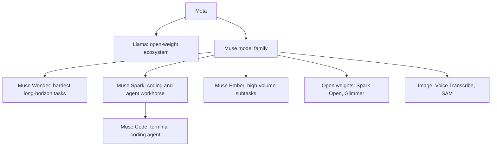

> :globe: [繁體中文版](/posts/tech/2026-09-19-ai-model-family-muse-spark)

Muse is the model family from Meta Superintelligence Labs (MSL). It isn't Llama 5, and it isn't Llama renamed for an API: Llama remains Meta's open-weight ecosystem, while Muse is a separate product line built around Meta Model API and agent workflows. This post is for agent developers choosing within Muse: how the Wonder, Spark, and Ember tiers divide the work, what the Contributor discount trades away, and what license conditions the two open-weight lines carry.

The April 2026 launch had only Muse Spark; by November, Meta had filled out its reasoning models into three tiers and released flagship weights for the first time. "The Muse Spark family" here centers on Spark's version line but also covers Wonder and Ember on the same API.

For how to read the benchmark numbers cited here, see the [AI model evaluation sources guide](/posts/tech/2026-08-24-ai-model-evaluation-sources-en). For Muse Code's harness details, see [Meta Muse Code: Trading Training Rights for a 20% Discount](/posts/tech/2026-08-24-muse-code-meta-coding-agent-en); for Meta's consumer agent product Muse, see [the Meta Muse post in the always-on AI agents series](/posts/ai/2026-11-20-meta-muse-en).

## Family positioning and model matrix

From the [Meta Model API model overview](https://dev.meta.ai/docs/models) and [pricing page](https://dev.meta.ai/docs/pricing-rate-limits), checked 2026-11-20; prices per 1M tokens:

| Model / line | Role | Key difference | Access and price |
|---|---|---|---|
| Muse Wonder (`muse-wonder-1.0`) | Hardest software engineering and long-horizon agent tasks | Default reasoning effort max; currently in preview | API: $4/$20, cached input $0.20; Standard only |
| Muse Wonder Full | Higher-capability variant | Not on the API | Muse Code subscriptions only |
| **Muse Spark 1.3** (`muse-spark-1.3`) | Coding and agent workhorse | Default reasoning effort high; Meta notes 1.3's audio understanding isn't fully supported | API: Standard $1.25/$4.25 (cached $0.15); Contributor $0.10/$0.20 (cached $0.002) |
| Muse Ember (`muse-ember-1.0`) | High-volume subtasks, tool calls, routing | Max output 524,288 tokens; requests over 200K input tokens use long-context rates | API: $0.10/$0.50 up to 200K, $0.30/$1.50 above; Standard only |
| Muse Spark Open | Open-weight flagship | 816B / 42B active MoE, text/image/video/audio input | Self-host or third-party hosting; Muse Model License |
| Muse Glimmer | Local deployment | 30B, distilled from Spark, text and image input | Self-host; Apache 2.0 |
| Muse Image / Voice Transcribe / SAM 3.1 | Specialized modalities | Image generation, speech-to-text, image segmentation | API; billed per image, per hour, or per frame |

The three reasoning models share a 1,048,576-token context, the same input modalities, and the same request format (Responses, Chat Completions, Messages), so switching is usually just a change to the `model` field. Wonder and Spark have no long-context premium; Ember does.

### First, Muse is the family and Spark is one line

- **Muse Wonder / Spark / Ember**: closed, used through the API, tiered by capability and cost.
- **Muse Code**: not another model but a coding agent / harness built on these three models.
- **Muse Spark Open / Glimmer**: downloadable open-weight lines that differ widely in size and license.
- **Muse Image / Voice Transcribe / SAM**: specialized-modality products that shouldn't be compared directly with the reasoning models' coding scores.

## Family evolution

| Date | Version | What changed for selection | On this site |
|---|---|---|---|
| 2026-04-08 | Muse Spark launch | Native multimodal reasoning, tool use, and multi-agent orchestration; launched on meta.ai and the Meta AI app first, with the API in closed preview | — |
| 2026-07 | Muse Spark 1.1 | The first numbered version in the Model API docs; developers can integrate against a stable model ID | — |
| 2026-08-05 | Muse Spark 1.2 + Muse Code | Coding becomes the focus, alongside the terminal coding agent Muse Code | [1.2 model card](/posts/daily/2026-08-24-model-meta-muse-spark-1-2-en) |
| 2026-08 | Muse Glimmer | 30B open weights distilled from Spark, Apache 2.0 | [Model card](/posts/daily/2026-08-17-model-meta-muse-glimmer-en) |
| 2026-09-02 | Muse Spark 1.3 | Fewer tool calls and tokens on long-horizon agent tasks; the current recommended Spark version | — |
| 2026-10-12 | Muse Wonder / Wonder Full | The first frontier-class model, priced to match Claude Opus 5.5; Spark becomes the middle tier | [Model card](/posts/daily/2026-10-12-model-meta-muse-wonder-en) |
| 2026-10-15 | Muse Spark Open | Flagship weights released for the first time, 816B / 42B | [Model card](/posts/daily/2026-10-16-model-meta-muse-spark-open-en) |
| 2026-11-09 | Muse Ember | A small model trained using Wonder Full, running high-volume subtasks for larger models | — |

The first half of the year was about "turning one model into an agent platform"; the second half became "tiering by task difficulty": Wonder handles planning and the hardest steps, Spark is the value workhorse, and Ember runs volume. When this post first published, Spark 1.3 was the main pick; Spark is now the middle tier, the 1.0–1.3 evolution details remain in the next section, and Wonder's and Spark Open's full evaluations are in their daily model cards.

One naming trap: Meta's public pages use both "Muse Spark" and API model names like `muse-spark-1.1`, `muse-spark-1.2`, and `muse-spark-1.3`. This post calls the April 2026 launch 1.0 only to make the timeline readable — **1.0 is not a model ID you can call**.

## Architecture and training trade-offs

### Spark 1.0→1.3: from capability demo to work loop

- **1.0**: put text, image, video, document understanding, tool use, and multi-agent orchestration into one model. Meta acknowledged at the time that long-horizon agentic systems and coding workflows were still gaps.
- **1.1**: turned Muse Spark from consumer-product language into an API model developers could integrate. Capabilities only become infrastructure a harness can rely on once they sit behind a stable model ID, context, tool calling, and billing interface.
- **1.2 + Muse Code**: focused on real coding workflows — reading repos, proposing changes, calling tools, running tests, retrying on failure. Muse Code wraps this in a terminal agent with persistent sub-agents, worktree isolation, and a recoverable event log. The model version determines understanding and tool-calling behavior; the harness determines how tasks split, how sub-agents run, and how crashes recover — evaluate them separately.
- **1.3**: the [official release notes](https://research.meta.ai/blog/introducing-muse-spark-1-3) focus on usability: fewer unnecessary turns and less verbosity than 1.2, and Meta engineers' internal comparison reports about 20% fewer tool calls and 25% fewer tokens. These are vendor-reported figures. The [Muse Spark docs](https://dev.meta.ai/docs/muse-spark) still state that **1.3's audio understanding isn't fully supported**; for audio, use 1.2 or Muse Voice Transcribe.

### Wonder: a bigger base for better generalization

The [Muse Wonder announcement](https://research.meta.ai/blog/muse-wonder) says it was trained at Meta's Prometheus data center and highlights two capabilities: **Active Memory** (carrying context about the user across conversations and retrieving what's relevant) and **Active Focus** (trying alternative approaches and working through blockers on long tasks, asking for clarification when needed and checking in before important actions).

The most notable part of the announcement is a generalization chart comparing Spark 1.3 and Wonder Full: at similar scores on tasks targeted in post-training, Wonder Full does better on tasks that weren't targeted. Meta attributes this to a larger, stronger base model whose post-training gains carry over better. That is also why it chose to price-match Opus 5.5 rather than compete on price. The parameter count is undisclosed.

### Ember: a large model training a small one

The [Muse Ember announcement](https://research.meta.ai/blog/muse-ember) says it is the first model trained using Wonder Full, delivering on the promise at Wonder's launch to use the frontier model to develop specialized models. It's designed for the repeated, bounded work inside agents: sub-agent tasks, tool calls, routing and classification, and processing large sets of images and documents. It takes the same request format as Spark, so a common pattern is to plan with Wonder or Spark on the main loop and hand subtasks to Ember.

### Spark Open and Glimmer: two open-weight lines

The [Muse Spark Open model card](https://huggingface.co/meta-models/Muse-Spark-Open-816B-A42B) describes an 816B-total, 42B-active MoE that is natively multimodal, with additional safety post-training for the open-weight version; it ships in BF16 and NVFP4 and deploys with SGLang, vLLM, TensorRT-LLM, or llama.cpp. [Muse Glimmer](https://huggingface.co/meta-models/Muse-Glimmer-30B) is a 30B distilled model with text and image input that can run on-device with ExecuTorch. Neither matches the full behavior of the API's Spark 1.3.

## Evaluation and alternatives

### Where the tiers land

Compiled from the site's daily model cards and official announcements. All scores are Meta-reported or run by third-party tools on Meta's behalf, under conditions that don't fully match, so they can't be merged into one ranking:

| Model | Representative results | Source |
|---|---|---|
| Muse Wonder | Terminal-Bench 4.0-AA 85.6 and SWE-Marathon 78.8, both above Claude Opus 5.5 (81.5, 74.2); DeepSWE 1.1 52.0, below Opus 5.5's 59.6 | [Wonder model card](/posts/daily/2026-10-12-model-meta-muse-wonder-en) |
| Muse Wonder Full | JobBench 75.3 and Vals Finance Agent 59.1, far above the API's Wonder (30.8, 10.0) | Same |
| Muse Ember | Meta says it delivers more intelligence per dollar than Claude Haiku 5.5 and GPT-6 Luna at every reasoning setting, at about $0.14 per Artificial Analysis task | [Ember announcement](https://research.meta.ai/blog/muse-ember) |
| Muse Spark Open | JobBench 61.8 and MCP-Atlas 89.2 top the official table; Artificial Analysis Intelligence Index 39, behind GLM 5.3 (45) and Kimi K3 (44) | [Spark Open model card](/posts/daily/2026-10-16-model-meta-muse-spark-open-en) |

Two gaps worth noting:

- **Wonder's self-reported and independent scores differ.** Meta reports an Artificial Analysis Intelligence Index of 56 (Wonder) / 59 (Full); Artificial Analysis's own leaderboard shows 52 / 56, with Opus 5.5 at 58. The benchmarks Meta highlighted, Terminal-Bench and SWE-Marathon, happen to be where Wonder leads.
- **The API doesn't get the strongest model.** Wonder Full leads the API's Wonder by wide margins on JobBench, finance, and memory evaluations, but it's tied to Muse Code subscriptions.

### Relationship to Llama: not a successor, but two tracks

- **Llama**: open weights, community deployment, fine-tunable, with the most mature tooling and community.
- **Muse API (Wonder / Spark / Ember)**: closed and hosted, quick to integrate, centered on agent workflows.
- **Muse Spark Open / Glimmer**: open weights, but with licenses different from Llama's and no guarantee of replicating the full API behavior.

"Meta pivoted from open to closed" doesn't capture this. Meta kept Llama, built a closed Muse product line alongside it, and in October released Muse's own flagship weights. The real selection question is whether your task needs control or a hosted end-to-end workflow.

## Licensing, pricing, and deployment

### Standard vs Contributor: the discount buys data rights

Per the [Meta pricing page](https://dev.meta.ai/docs/pricing-rate-limits):

| Tier | Model ID | Input | Cached input | Output | Data use |
|---|---|---:|---:|---:|---|
| Standard | `muse-spark-1.3` | $1.25 | $0.15 | $4.25 | Content not used to train Meta models |
| Contributor | `muse-spark-1.3-contributor` | $0.10 | $0.002 | $0.20 | Meta may train future models on your prompts, code, files, and responses |

- Contributor is available only for Spark 1.3 and 1.2; **Wonder and Ember have no Contributor variant**.
- Contributor has lower rate limits: 150 requests and 3M tokens per minute, versus 3,000 requests and 4M tokens for Standard; 1.3 Contributor also can't use the `max` reasoning effort.
- **Muse Code subscriptions default to Contributor mode**, which can be turned off in settings. Check this before running Muse Code on a company repo.
- Rule of thumb: personal public projects and throwaway prototypes can use Contributor; company repos, customer data, and compliance scenarios default to Standard.

### Other billing details

- **Ember's long-context rate applies to the whole request**: if a single request exceeds 200K input tokens (including cached tokens and history carried in via `previous_response_id`), the entire request is billed at $0.30/$1.50, not just the part past 200K. Sub-agents with long conversations can cross this line without noticing.
- **Web search is extra**: the `web_search` tool on reasoning models costs $2.50 per 1,000 queries.
- Meta's injected system prompt isn't billed and isn't counted in reported tokens.

### Open-weight licenses

| Weights | License | Conditions |
|---|---|---|
| Muse Glimmer | Apache 2.0 | Keep the license notice |
| Muse Spark Open | Muse Model License | Every product using it or its derivatives must display "Built with Muse Spark Open" in the UI, documentation, website, or settings menu; providers that offer models to third parties via API or similar, with group gross revenue over US$20M in any 12 months, must notify Meta and sign a separate written agreement; a usage policy is attached |

Spark Open's attribution requirement has no revenue threshold, unlike Kimi and Qwen, which require attribution only for large products. The Model-as-a-Service clause doesn't apply to internal use, research, or using the model as a component of your own product's features. Downloading requires an application form on HuggingFace (gated).

## Agent integration and selection

| Need | Recommendation | Why |
|---|---|---|
| Hardest long-horizon coding and agent tasks | Muse Wonder | The most capable API model; priced the same as Opus 5.5, so compare on your own tasks first |
| Workhorse for coding agents and tool loops | Muse Spark 1.3 Standard | The value tier, with 1M context and no long-context premium |
| Sub-agents, routing, bulk document processing | Muse Ember | Lowest unit price; watch the 200K input threshold |
| Public repos or personal prototypes | Muse Spark 1.3 Contributor | Very cheap; only for non-sensitive content |
| Terminal coding experience | Muse Code | The only place to use Wonder Full; check the Contributor setting first |
| Self-hosted flagship, data that can't leave | Muse Spark Open | Open weights; check the attribution requirement and MaaS clause first |
| On-device or small self-hosting | Muse Glimmer | Apache 2.0, 30B |
| Speech-to-text | Muse Voice Transcribe, or Spark 1.2 | 1.3's audio understanding still has an official limitation |

A common combination: plan and judge on the main loop with Wonder or Spark, and hand subtasks to Ember. All three share a request format, so the harness only needs to switch `model` by task.

A minimum viable evaluation shouldn't just ask which benchmark is highest. Run the same 10–20 real tasks and record completion rate, tool-call count, total tokens, retries, average latency, and steps needing human intervention.

## Limitations and trade-offs

1. **1M context is a ceiling, not a guarantee of usable memory.** Long repos, long videos, and large tool outputs can still dilute attention and raise costs.
2. **The Contributor discount has a data cost**, and Muse Code subscriptions turn it on by default.
3. **The API version isn't the strongest one.** Wonder Full is only in Muse Code subscriptions.
4. **Evaluations are mostly self-reported.** Wonder's self-reported and Artificial Analysis scores differ.
5. **Spark Open isn't unconditionally open.** Every product must display attribution, and large API providers need a separate agreement.
6. **Muse Code scores aren't model scores**; they include harness design.

What's worth tracking in Muse isn't any single version's score, but whether Meta can turn three model tiers, data-rights options, and a coding harness into one workflow that needs less supervision and less rework from developers.

---

## Update history

- **2026-11-20**: Added Muse Wonder, Muse Ember, and Muse Spark Open. The matrix, evolution, architecture, evaluation, pricing, licensing, and selection were rewritten (Meta Model API model overview, pricing and rate-limits page, Muse Spark and Ember docs, Wonder and Ember announcements, and the Spark Open and Glimmer HuggingFace model cards and licenses, read 2026-11-20); added the three-tier division, Contributor being Spark-only, Muse Code defaulting to Contributor, Ember's long-context billing rule, and the Spark Open license terms. Spark 1.3 moved from main pick to middle tier, and the 1.0–1.3 evolution was condensed into one section; the timeline now notes what changed for selection and links to daily model cards. Correction: the earlier matrix and text listed 1.3's input as "text, image, video, PDF"; the official docs include audio as an input, but 1.3's audio understanding quality isn't fully supported.
- 2026-10-11: Reorganized format, the model matrix, and selection sections, keeping existing sources and dates; no new fact-check this round.

## References

- [Models: Meta Model API model overview](https://dev.meta.ai/docs/models)
- [Pricing and rate limits: Meta Model API](https://dev.meta.ai/docs/pricing-rate-limits)
- [Muse Spark: Meta Model API docs](https://dev.meta.ai/docs/muse-spark)
- [Muse Ember: Meta Model API docs](https://dev.meta.ai/docs/muse-ember)
- [Choose a model: Meta Model API](https://dev.meta.ai/docs/choose-a-model)
- [Muse Wonder: A Frontier Model For Personal & Professional AI Agents — Meta AI Research, 2026-10-12](https://research.meta.ai/blog/muse-wonder)
- [Introducing Our Smallest, Most Efficient Model: Muse Ember — Meta AI Research, 2026-11-09](https://research.meta.ai/blog/muse-ember)
- [meta-models/Muse-Spark-Open-816B-A42B: HuggingFace model card and Muse Model License](https://huggingface.co/meta-models/Muse-Spark-Open-816B-A42B)
- [meta-models/Muse-Glimmer-30B: HuggingFace model card](https://huggingface.co/meta-models/Muse-Glimmer-30B)
- [Introducing Muse Spark — Meta AI Research, 2026-04-08](https://ai.meta.com/blog/introducing-muse-spark-msl)
- [Introducing Muse Spark 1.3 — Meta AI Research, 2026-09-02](https://research.meta.ai/blog/introducing-muse-spark-1-3)
- [Meet Muse Spark 1.2 and Muse Code — Meta AI Developer Blog](https://developer.meta.com/ai/resources/blog/build-with-muse-code)
- [Muse Code docs](https://dev.meta.ai/docs/muse-code/)
- [Model card: Meta Muse Wonder](/posts/daily/2026-10-12-model-meta-muse-wonder-en) — this site
- [Model card: Muse Spark Open](/posts/daily/2026-10-16-model-meta-muse-spark-open-en) — this site
- [Related on this site: Muse Code — Meta's First Coding Agent](/posts/tech/2026-08-24-muse-code-meta-coding-agent-en)
- [Related on this site: Llama — Meta's Open-Weight Path](/posts/tech/2026-08-24-ai-model-family-llama-en)
