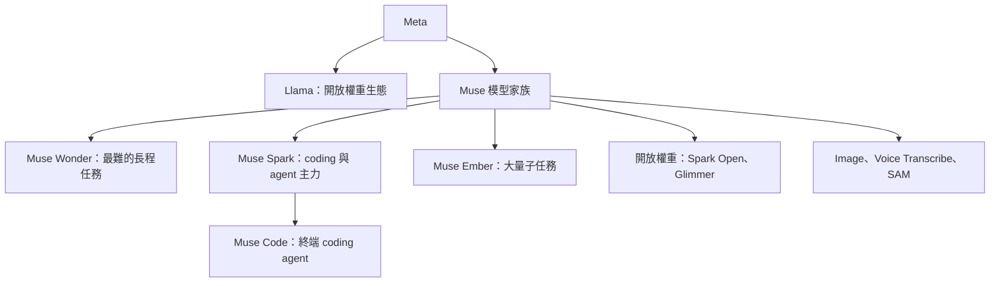

> :globe: [English version](/posts/tech/2026-09-19-ai-model-family-muse-spark-en)

Muse 是 Meta Superintelligence Labs（MSL）的模型家族。它不是 Llama 5，也不是 Llama 的 API 改名：Llama 仍是 Meta 的開放權重生態，Muse 則是另一條以 Meta Model API 為入口、以 agent 工作流為中心的產品線。這篇寫給要在 Muse 裡挑模型的 Agent 開發者：Wonder、Spark、Ember 三層怎麼分工，Contributor 折扣換掉什麼，兩條開放權重線各有什麼授權條件。

2026 年 4 月的首發只有 Muse Spark；到 11 月，Meta 已經把推理模型補成三層，並第一次公開旗艦權重。這篇的「Muse Spark 家族」以 Spark 的版本線為主軸，也涵蓋同一套 API 上的 Wonder 與 Ember。

怎麼解讀文中引用的 benchmark 數字，請參考[AI 模型評測來源指南](/posts/tech/2026-08-24-ai-model-evaluation-sources)。Muse Code 的 harness 細節另見[Meta Muse Code：用訓練權換八折定價](/posts/tech/2026-08-24-muse-code-meta-coding-agent)；Meta 的消費者 agent 產品 Muse 另見[常駐型 AI agent 系列的 Meta Muse 篇](/posts/ai/2026-11-20-meta-muse)。

## 家族定位與版本矩陣

依 [Meta Model API 模型總覽](https://dev.meta.ai/docs/models)與[價格頁](https://dev.meta.ai/docs/pricing-rate-limits)，2026-11-20 核對，價格為每 1M tokens：

| 模型／產品線 | 定位 | 關鍵差異 | 存取方式與價格 |
|---|---|---|---|
| Muse Wonder（`muse-wonder-1.0`） | 最難的軟體工程與長程 agent 任務 | 預設推理強度 max；目前為 preview | API：$4／$20，快取輸入 $0.20；僅 Standard |
| Muse Wonder Full | 更高能力版 | 不開放 API | 只在 Muse Code 訂閱中提供 |
| **Muse Spark 1.3**（`muse-spark-1.3`） | coding 與 agent 主力 | 預設推理強度 high；1.3 的音訊理解官方標示未完整支援 | API：Standard $1.25／$4.25（快取 $0.15）；Contributor $0.10／$0.20（快取 $0.002） |
| Muse Ember（`muse-ember-1.0`） | 大量重複的子任務、工具呼叫、路由 | 最大輸出 524,288 tokens；請求超過 200K 輸入改收長 context 價 | API：200K 以內 $0.10／$0.50，超過 $0.30／$1.50；僅 Standard |
| Muse Spark Open | 開放權重旗艦 | 816B／42B 啟用 MoE，文字／圖片／影片／音訊輸入 | 自架或第三方託管；Muse Model License |
| Muse Glimmer | 本地部署 | 30B，從 Spark 蒸餾，文字與圖片輸入 | 自架；Apache 2.0 |
| Muse Image／Voice Transcribe／SAM 3.1 | 專門模態 | 圖片生成、語音轉文字、影像分割 | API；按張、按小時或按影格計費 |

三個推理模型共用 1,048,576 tokens context、相同的輸入模態與相同的請求格式（Responses、Chat Completions、Messages），切換多數時候只要改 `model` 欄位。Wonder 與 Spark 沒有長 context 加價，Ember 有。

### 先釐清：Muse 是家族，Spark 是其中一條線

- **Muse Wonder／Spark／Ember**：閉源、透過 API 使用，依能力與成本分三層。
- **Muse Code**：不是另一個模型，而是建立在這三個模型上的 coding agent／harness。
- **Muse Spark Open／Glimmer**：可下載的開放權重線，規模與授權差很多。
- **Muse Image／Voice Transcribe／SAM**：專門模態產品，不應該拿來跟推理模型的 coding 分數直接比較。

## 家族演化

| 時間 | 版本 | 改變了什麼選型 | 站上紀錄 |
|---|---|---|---|
| 2026-04-08 | Muse Spark 首發 | 原生多模態推理、工具使用與多 agent 編排；先在 meta.ai 與 Meta AI app 推出，API 仍是封閉預覽 | — |
| 2026-07 | Muse Spark 1.1 | Model API 文件中的第一個編號版本，開發者可以用穩定 model ID 串接 | — |
| 2026-08-05 | Muse Spark 1.2＋Muse Code | coding 成主軸，並推出終端 coding agent Muse Code | [1.2 模型卡](/posts/daily/2026-08-24-model-meta-muse-spark-1-2) |
| 2026-08 | Muse Glimmer | 從 Spark 蒸餾的 30B 開放權重，Apache 2.0 | [模型卡](/posts/daily/2026-08-17-model-meta-muse-glimmer) |
| 2026-09-02 | Muse Spark 1.3 | 長程 agent 任務更省工具呼叫與 token；目前的 Spark 建議版本 | — |
| 2026-10-12 | Muse Wonder／Wonder Full | 第一款前沿級模型，價格對齊 Claude Opus 5.5；Spark 退為中間層 | [模型卡](/posts/daily/2026-10-12-model-meta-muse-wonder) |
| 2026-10-15 | Muse Spark Open | 第一次公開旗艦權重，816B／42B | [模型卡](/posts/daily/2026-10-16-model-meta-muse-spark-open) |
| 2026-11-09 | Muse Ember | 用 Wonder Full 訓練的小模型，替大模型跑大量子任務 | — |

前半年的劇本是「把一個模型做成 agent 平台」，下半年變成「依任務難度分層」：Wonder 負責規劃與最難的步驟，Spark 是性價比主力，Ember 跑量。本篇首發時以 Spark 1.3 為選型主角；現在 Spark 退為中間層，1.0 到 1.3 的演化細節保留在下一節，Wonder 與 Spark Open 的完整評測見各自的每日模型卡。

這裡有一個命名陷阱：Meta 的公開頁面同時使用「Muse Spark」與 `muse-spark-1.1`、`muse-spark-1.2`、`muse-spark-1.3` 這類 API 型號。本文把 2026 年 4 月的首發稱為 1.0 只是為了時間線好讀，**1.0 不是可以呼叫的 model ID**。

## 架構與訓練取捨

### Spark 1.0→1.3：從能力展示到工作迴圈

- **1.0**：先把文字、圖片、影片、文件理解、工具使用與多 agent 編排放進同一個模型。Meta 當時也承認，長程 agentic 系統與 coding workflow 仍是缺口。
- **1.1**：把 Muse Spark 從消費者產品語言轉成開發者可串接的 API 模型。能力只有在穩定的 model ID、context、tool calling 與計費介面上，才會變成 harness 可以依賴的基礎設施。
- **1.2＋Muse Code**：重心是真實 coding workflow：讀 repo、提出修改、呼叫工具、執行測試、失敗重試。Muse Code 把這套行為包成終端代理，提供 persistent sub-agent、worktree 隔離與可恢復的 event log。模型版本決定理解與工具呼叫行為，harness 決定任務怎麼拆、子 agent 怎麼跑、崩潰後怎麼恢復，兩者要分開評估。
- **1.3**：[官方發布說明](https://research.meta.ai/blog/introducing-muse-spark-1-3)把改進集中在可用性：相較 1.2 減少不必要的回合與贅字，Meta 工程師的內部比較報告約少 20% 工具呼叫、25% tokens。這是廠商自報數字。[Muse Spark 文件](https://dev.meta.ai/docs/muse-spark)至今仍標示 **1.3 的音訊理解未完整支援**，需要音訊時改用 1.2 或 Muse Voice Transcribe。

### Wonder：更大的基座換泛化能力

[Muse Wonder 官方公告](https://research.meta.ai/blog/muse-wonder)說明它在 Meta 的 Prometheus 資料中心訓練，主打兩個能力：**Active Memory**（跨對話記住並取回與使用者相關的資訊）與 **Active Focus**（長任務中嘗試替代做法、排除障礙，必要時詢問澄清、重要動作前先確認）。

公告裡最值得注意的是一張泛化圖：拿 Spark 1.3 與 Wonder Full 比較，在後訓練有針對的任務上分數相近時，Wonder Full 在沒針對過的任務上表現更好。Meta 的解釋是更大、更強的基座模型讓後訓練的收益更能遷移。這也是它選擇「同價對打 Opus 5.5」而不是走低價路線的理由。參數量未公開。

### Ember：大模型訓練小模型

[Muse Ember 官方公告](https://research.meta.ai/blog/muse-ember)說明它是第一個用 Wonder Full 訓練的模型，兌現 Wonder 發布時「用前沿模型開發專用模型」的說法。設計用途是 agent 裡重複、範圍明確的工作：子 agent 任務、工具呼叫、路由分類、大量圖片與文件處理。它和 Spark 接受同一種請求格式，所以常見做法是主迴圈用 Wonder 或 Spark 規劃，子任務交給 Ember。

### Spark Open 與 Glimmer：兩條開放權重線

[Muse Spark Open 模型卡](https://huggingface.co/meta-models/Muse-Spark-Open-816B-A42B)寫明它是 816B 總參數、42B 啟用的 MoE，原生多模態，並針對開放權重版本多做了安全後訓練；提供 BF16 與 NVFP4 版本，可用 SGLang、vLLM、TensorRT-LLM、llama.cpp 部署。[Muse Glimmer](https://huggingface.co/meta-models/Muse-Glimmer-30B) 則是 30B 的蒸餾模型，文字與圖片輸入，可用 ExecuTorch 跑在裝置上。兩者都不等於 API 版 Spark 1.3 的完整行為。

## 評測與競品比較

### 三層的位置

以下整理自站上每日模型卡與官方公告，全部是 Meta 自報或 Meta 委託第三方工具執行的分數，條件不完全一致，不能直接混成單一排名：

| 模型 | 代表結果 | 來源 |
|---|---|---|
| Muse Wonder | Terminal-Bench 4.0-AA 85.6、SWE-Marathon 78.8，兩項高於 Claude Opus 5.5（81.5、74.2）；DeepSWE 1.1 52.0 低於 Opus 5.5 的 59.6 | [Wonder 模型卡](/posts/daily/2026-10-12-model-meta-muse-wonder) |
| Muse Wonder Full | JobBench 75.3、Vals Finance Agent 59.1，遠高於 API 版 Wonder（30.8、10.0） | 同上 |
| Muse Ember | 官方稱任何推理強度下每美元能拿到的智慧都高於 Claude Haiku 5.5 與 GPT-6 Luna，Artificial Analysis 每任務約 $0.14 | [Ember 公告](https://research.meta.ai/blog/muse-ember) |
| Muse Spark Open | JobBench 61.8、MCP-Atlas 89.2 為官方表最高；Artificial Analysis Intelligence Index 39，落後 GLM 5.3（45）與 Kimi K3（44） | [Spark Open 模型卡](/posts/daily/2026-10-16-model-meta-muse-spark-open) |

兩個值得注意的落差：

- **Wonder 的自報與獨立分數不同。** Meta 自報 Artificial Analysis Intelligence Index 56（Wonder）／59（Full），Artificial Analysis 自己的榜單是 52／56，Opus 5.5 是 58。Meta 公告挑出的 Terminal-Bench、SWE-Marathon 正好是 Wonder 領先的項目。
- **API 拿不到最強的那顆。** Wonder Full 在 JobBench、財務、記憶類評測大幅領先 API 版 Wonder，但只綁在 Muse Code 訂閱裡。

### 跟 Llama 的關係：不是接班，是雙軌

- **Llama**：開放權重、社群部署、可微調，工具鏈與社群最成熟。
- **Muse API（Wonder／Spark／Ember）**：閉源託管、快速接入、以 agent workflow 為中心。
- **Muse Spark Open／Glimmer**：開放權重，但授權與 Llama 不同，也不保證複製 API 版的全部能力。

這不是「Meta 從開源轉向閉源」一句話能概括的。Meta 同時保留 Llama，另外建立 Muse 的閉源產品線，又在 10 月開放了 Muse 自己的旗艦權重。真正的選型問題是「我的任務需要控制權，還是需要託管的完整工作流」。

## 授權、價格與部署

### Standard vs Contributor：折扣換的是資料權利

依 [Meta 價格頁](https://dev.meta.ai/docs/pricing-rate-limits)：

| Tier | Model ID | Input | Cached input | Output | 資料使用 |
|---|---|---:|---:|---:|---|
| Standard | `muse-spark-1.3` | $1.25 | $0.15 | $4.25 | 內容不用於訓練 Meta 模型 |
| Contributor | `muse-spark-1.3-contributor` | $0.10 | $0.002 | $0.20 | 允許 Meta 用你的 prompt、程式碼、檔案與回應訓練未來模型 |

- Contributor 只提供給 Spark 1.3 與 1.2；**Wonder 與 Ember 沒有 Contributor 版**。
- Contributor 的限流比 Standard 低：每分鐘 150 次請求、300 萬 tokens，Standard 是 3,000 次、400 萬 tokens；1.3 Contributor 也不能用 `max` 推理強度。
- **Muse Code 訂閱預設開啟 Contributor mode**，可在設定關閉。用公司 repo 跑 Muse Code 前要先確認這個設定。
- 判斷方式：個人公開專案、拋棄式 prototype 可以用 Contributor；公司 repo、客戶資料、合規場景預設 Standard。

### 其他計費細節

- **Ember 的長 context 價是整筆計算**：單次請求輸入超過 200K tokens（含快取與 `previous_response_id` 帶入的歷史），整筆改收 $0.30／$1.50，不只超過的部分。長對話的子 agent 容易不小心跨過門檻。
- **網路搜尋另計**：推理模型的 `web_search` 每 1,000 次查詢 $2.50。
- Meta 注入的系統提示不計費，也不算進回報的 token 數。

### 開放權重的授權

| 權重 | 授權 | 條件 |
|---|---|---|
| Muse Glimmer | Apache 2.0 | 保留授權聲明即可 |
| Muse Spark Open | Muse Model License | 所有使用它或其衍生模型的產品，都要在介面、文件、網站或設定選單標示「Built with Muse Spark Open」；本身與關係企業 12 個月總營收超過 2,000 萬美元、且以 API 等形式提供模型給第三方的業者，要通知 Meta 並另簽書面協議；另附使用政策 |

Spark Open 的標示義務沒有營收門檻，和 Kimi、Qwen 只在大型產品才要求標示不同。Model as a Service 條款不適用於內部使用、研究，或只把模型當作自家產品的一個功能。下載前需在 HuggingFace 填寫申請表（gated）。

## Agent 使用與選型

| 需求 | 建議 | 原因 |
|---|---|---|
| 最難的長程 coding 與 agent 任務 | Muse Wonder | 能力最強的 API 版本；價格與 Opus 5.5 相同，先用自己的任務比較 |
| coding agent 與工具 loop 的主力 | Muse Spark 1.3 Standard | 性價比主力，1M context、無長 context 加價 |
| 子 agent、路由、大量文件處理 | Muse Ember | 單價最低；注意 200K 輸入門檻 |
| 公開 repo 或個人 prototype | Muse Spark 1.3 Contributor | 成本極低，只放不敏感的內容 |
| 終端 coding 體驗 | Muse Code | 唯一能用 Wonder Full 的地方；先確認 Contributor 設定 |
| 自架旗艦、資料不出域 | Muse Spark Open | 開放權重；先確認標示義務與 MaaS 條款 |
| 裝置端或小型自架 | Muse Glimmer | Apache 2.0，30B |
| 語音轉文字 | Muse Voice Transcribe，或 Spark 1.2 | 1.3 的音訊理解仍有官方限制 |

一個常見組合：主迴圈用 Wonder 或 Spark 規劃與判斷，子任務交給 Ember。三者請求格式相同，在 harness 裡只要依任務切換 `model`。

最小可行評估不要只問「哪個 benchmark 最高」。拿同一組 10–20 個真實任務，分別記錄完成率、工具呼叫數、總 token、重試次數、平均延遲與需要人工介入的步驟。

## 限制與取捨

1. **1M context 是上限，不是可用記憶的保證。** 長 repo、長影片與大量工具結果仍可能稀釋注意力、推高成本。
2. **Contributor 的折扣有資料代價**，而且 Muse Code 訂閱預設開啟。
3. **API 版不是最強的版本。** Wonder Full 只在 Muse Code 訂閱中。
4. **評測多為自報。** Wonder 的自報與 Artificial Analysis 獨立分數有落差。
5. **Spark Open 不是無條件開放。** 所有產品都要標示，大型 API 業者要另簽約。
6. **Muse Code 的分數不能直接等同模型分數**，前者包含 harness 設計。

Muse 值得追蹤的，不是單一版本分數，而是 Meta 能不能把三層模型、資料權利選項與 coding harness 做成一套讓開發者少監控、少返工的工作流。

---

## 更新紀錄

- **2026-11-20**：補上 Muse Wonder、Muse Ember 與 Muse Spark Open。矩陣、演化、架構、評測、價格、授權與選型改寫（Meta Model API 模型總覽、價格與限流頁、Muse Spark 與 Ember 文件、Wonder 與 Ember 官方公告、Spark Open 與 Glimmer 的 HuggingFace 模型卡與授權，2026-11-20 讀取）；新增三層分工、Contributor 只適用 Spark、Muse Code 預設 Contributor、Ember 長 context 計價規則、Spark Open 授權條款。Spark 1.3 從選型主角降為中間層，1.0 到 1.3 的演化濃縮為一節；時間線補「改變了什麼選型」並連每日模型卡。修正：原矩陣與文中寫 1.3 支援「文字、圖片、影片、PDF」，官方文件列的輸入其實包含音訊，只是 1.3 的音訊理解品質未完整支援。
- 2026-10-11：整理格式、版本矩陣與選型章節，沿用既有來源與日期；本次未重新查證事實。

## 參考資料

- [Models：Meta Model API 模型總覽](https://dev.meta.ai/docs/models)
- [Pricing and rate limits：Meta Model API](https://dev.meta.ai/docs/pricing-rate-limits)
- [Muse Spark：Meta Model API 文件](https://dev.meta.ai/docs/muse-spark)
- [Muse Ember：Meta Model API 文件](https://dev.meta.ai/docs/muse-ember)
- [Choose a model：Meta Model API](https://dev.meta.ai/docs/choose-a-model)
- [Muse Wonder: A Frontier Model For Personal & Professional AI Agents：Meta AI Research，2026-10-12](https://research.meta.ai/blog/muse-wonder)
- [Introducing Our Smallest, Most Efficient Model: Muse Ember：Meta AI Research，2026-11-09](https://research.meta.ai/blog/muse-ember)
- [meta-models/Muse-Spark-Open-816B-A42B：HuggingFace 模型卡與 Muse Model License](https://huggingface.co/meta-models/Muse-Spark-Open-816B-A42B)
- [meta-models/Muse-Glimmer-30B：HuggingFace 模型卡](https://huggingface.co/meta-models/Muse-Glimmer-30B)
- [Introducing Muse Spark：Meta AI Research，2026-04-08](https://ai.meta.com/blog/introducing-muse-spark-msl)
- [Introducing Muse Spark 1.3：Meta AI Research，2026-09-02](https://research.meta.ai/blog/introducing-muse-spark-1-3)
- [Meet Muse Spark 1.2 and Muse Code：Meta AI Developer Blog](https://developer.meta.com/ai/resources/blog/build-with-muse-code)
- [Muse Code 文件](https://dev.meta.ai/docs/muse-code/)
- [模型卡｜Meta Muse Wonder](/posts/daily/2026-10-12-model-meta-muse-wonder) — 本站
- [模型卡｜Muse Spark Open](/posts/daily/2026-10-16-model-meta-muse-spark-open) — 本站
- [站內延伸閱讀：Muse Code——Meta 的第一個 Coding Agent](/posts/tech/2026-08-24-muse-code-meta-coding-agent)
- [站內延伸閱讀：Llama——Meta 的開放權重路線](/posts/tech/2026-08-24-ai-model-family-llama)
