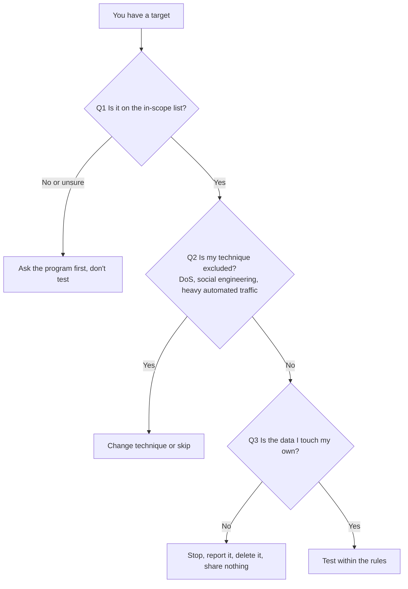

> 🌏 [中文版](/posts/tech/2026-10-13-bug-bounty-zero-01-rules-and-scope)

In the previous post I checked three viral payout numbers against the official tables and concluded that [a reward table gives a ceiling, not a success rate](/posts/tech/2026-10-13-bug-bounty-top-payouts-fact-check-en). If that made you want to start, the first thing to learn isn't a technique. It's what you are allowed to touch. This post answers one question: given a bug bounty program page, how do you decide whether a target is testable, and what happens if you cross the line? Actual vulnerability mechanics come in later posts.

## An analogy first

A bug bounty is a landlord posting a notice: "Come check the locks on my building and I'll pay you for what you find." The notice says which units are included (scope), what you may not do (don't break down doors, don't trick tenants into opening up), and that you test with your own key on your own unit. The neighbor's unit or the next building over isn't the landlord's to hand out.

Now the same idea with real text.

## Scope: a program can only authorize what it owns

Scope is the list of targets the program lets you test; everything else is out of scope. [Meta's program scope page](https://bugbounty.meta.com/scope/) gives a table of eligible and ineligible properties per product. For Facebook, as I read it on 2026-10-13:

| Item | Eligible | Ineligible |
|---|---|---|
| Websites | facebook.com, fb.com, fb.me, thefacebook.com, m.facebook.com | fbsbx.com, investor.fb.com, accountkit.com |

Same brand, different answers by domain. "It belongs to Meta" is not the same as "it's in scope," so check domain by domain.

Google's [VRP rules page](https://bughunters.google.com/about/rules/google-friends/google-and-alphabet-vulnerability-reward-program-vrp-rules) (Vulnerability Reward Program) names two important exclusions:

- Third-party websites: some Google-branded services on less common domains may be run by vendors or partners. Google says it "can't authorize you to test these systems on behalf of their owners" and won't reward such reports. It tells you to check WHOIS records, and "If in doubt, talk to us first!"
- Recent acquisitions: a six-month blackout applies, and bugs reported sooner typically won't qualify.

Both come from one principle: **only the owner can authorize testing.** A program page can only authorize what it itself owns.

Meta says the same about third-party apps: its terms "do not provide any authorization allowing you to test an app or website controlled by a third-party."

## Rules exclude techniques, not just targets

Beyond the target list, programs rule out certain methods. The first two items in Meta's Out of scope list are:

- Spam or social engineering techniques
- Denial-of-service attacks

Google's page limits the program to technical vulnerabilities ("please do not try to sneak into Google offices, attempt phishing attacks against our employees") and asks you not to run DoS attacks, use black hat SEO, or spam people. It also discourages tools that automatically generate very significant volumes of traffic.

In plain terms:

- **DoS** knocks a service over, and the people hurt are ordinary users.
- **Social engineering** targets people, not systems, and a company can't consent on behalf of its employees being tricked.

Even if the target is in scope, these methods are off the table.

## Only test your own accounts

Both programs share this core rule. Google: "only ever target your own accounts. Never attempt to access anyone else's data and do not engage in any activity that would be disruptive or damaging to your fellow users or to Google."

Meta is more detailed. Its [terms page](https://bugbounty.meta.com/terms/), under the responsible research and disclosure policy, requires that you:

- do not interact with an individual account (including accessing or modifying its data) without the owner's explicit written consent;
- test only on your own account, a [test account](https://www.facebook.com/whitehat/accounts/), or an account whose owner gave explicit written consent;
- if you inadvertently access someone else's data, stop, tell Meta what you accessed, delete it from your system, and share it with no one. Continuing "may demonstrate a lack of good faith."

Google adds a practical tip: create an account dedicated to testing, since it can't guarantee you'll get an account back if testing gets it disabled.

## When you're not sure

Meta says to submit a new report asking for clarification before doing anything the terms don't address. Google says "talk to us first" for ambiguous domains. Both answers are the same: **ask first, test second.**

## What safe harbor is, and isn't

Safe harbor is the program's promise not to come after you if you follow the rules. Meta's Safe harbor provisions break down like this:

1. The terms count as authorization to test the in-scope products and systems, including under the Computer Fraud and Abuse Act (CFAA, a US law) and similar laws.
2. That authorization does not cover intentionally accessing company data or another person's account data without their express consent, personal information included.
3. If Meta determines "in its sole discretion" that you complied "in all respects," it won't initiate a complaint to law enforcement or pursue a civil action.
4. Meta also won't pursue legal action for clear accidental or good-faith violations.
5. If a third party sues you over conduct Meta determines complied with the terms, Meta will make it known to the public or the court that your actions were authorized.

The limits are visible in the text itself:

- The condition is full compliance, as judged by Meta.
- It describes Meta's own actions. The text doesn't promise to bind anyone else.
- It doesn't extend to out-of-scope targets or to other people's data.

The Google page I read doesn't use the term "safe harbor." The closest line is: "your testing must not violate any law, or disrupt or compromise any data that is not your own." Whether Google has a separate legal statement elsewhere, I **could not verify**. So "has a program" does not mean "has a safe harbor." Read each program's own text.

## What Taiwan's law says

> This is not legal advice. What follows only describes the wording of Chapter 36 ("Offenses Against Computer Use," 妨害電腦使用罪) of the Criminal Code of the Republic of China, as published on the [Laws & Regulations Database of the Republic of China](https://law.moj.gov.tw/LawClass/LawAll.aspx?pcode=C0000001) (read 2026-10-13). Whether conduct is an offense, or whether a program's terms count as having cause in a given case, is a question for a qualified lawyer.

| Article | Gist (paraphrased) | Penalty |
|---|---|---|
| 358 | Without cause, entering another person's account and password, breaking a computer's protection measures, or exploiting a computer system's vulnerability to intrude into another person's computer or related equipment | Up to 3 years imprisonment, detention, or a fine up to NT$300,000 (alone or in addition) |
| 359 | Without cause, obtaining, deleting, or altering electromagnetic records on another person's computer or related equipment, causing harm to the public or others | Up to 5 years, detention, or a fine up to NT$600,000 (alone or in addition) |
| 360 | Without cause, interfering with another person's computer or related equipment by program or other electromagnetic means, causing harm to the public or others | Up to 3 years, detention, or a fine up to NT$300,000 (alone or in addition) |
| 361 | Committing the offenses above against a government agency's computer or related equipment | Penalty increased by up to one half |
| 362 | Making a program specifically for committing offenses in this chapter, and providing it for oneself or others to commit them, causing harm to the public or others | Up to 5 years, detention, or a fine up to NT$600,000 (alone or in addition) |
| 363 | Offenses under arts. 358-360 are prosecuted only upon complaint | n/a |

Three details are visible in the text:

- Articles 358 to 360 each turn on acting "without cause" (無故). The statute doesn't define it; interpretation is for courts and legal professionals.
- Article 358 lists "exploiting a computer system's vulnerability" as a means of intrusion, which overlaps with a bug hunter's daily work.
- Article 363 says arts. 358-360 require a complaint. Article 361 adds an aggravation for government systems.

Use the table as a reminder that out-of-scope systems, other people's accounts, and interfering with a service are exactly the kinds of conduct these articles describe. How a program's authorization plays out legally is something this post does not conclude. Laws also differ by country: if your target is abroad, local law may apply, and I haven't checked other countries.

## Three questions to decide if a target is testable

Walking through real text:

1. You see `fbsbx.com`. Q1: Meta lists it as ineligible. Stop.
2. You see a site at `foo.appspot.com` that seems Google-related. Q1: Google's Non-qualifying list says `*.appspot.com` and `*.bc.googleusercontent.com` host Google Cloud customers' apps, and "the Vulnerability Reward Program does not authorize the testing" of them. Stop.
3. You find something on `*.google.com` and want to scan it with a script that fires thousands of requests. Q2: Google discourages tools that generate very significant traffic. Slow down or go manual.
4. On Facebook, you realize another user's account would reveal private data. Q3: Meta says use your own or a test account; for anyone else you need written consent. If you've already touched it, stop and report as the rules describe.

## "No reward" is not the same as "not allowed"

Google's Non-qualifying list is introduced as common low-risk issues that "typically do not earn a monetary reward": URL redirection, logout CSRF, exposed version banners. Those are **no payout**. But the `*.appspot.com` entry on the same list adds that testing is not authorized, which is **do not touch**. Meta's False positives list (open redirects, public profile pictures) is the first kind: not a vulnerability, not an authorization issue.

When reading a list, look for the two phrasings. "Doesn't earn a reward" means you won't be paid. "Doesn't authorize" means you shouldn't be there.

## Limits

- Rules change. Meta's page itself says "bounty amounts and qualifying issues may change with time," and Google says it can cancel the program at any time. This post reflects 2026-10-13. Re-read the original page before you test.
- Programs differ. Meta requires participants to be at least 14, while Google's VRP page says participation is restricted to those 18 and older, with a parent or guardian submitting for anyone under 18. Programs on HackerOne or Bugcrowd have their own rules, which this post doesn't cover.
- The Taiwan section paraphrases statute text only. It doesn't include case law and isn't a legal opinion.

## What to do tonight

1. Open [Meta's program scope](https://bugbounty.meta.com/scope/), copy the six Out of scope items, and write next to each one who it would hurt.
2. Open the Non-qualifying list in [Google's VRP rules](https://bughunters.google.com/about/rules/google-friends/google-and-alphabet-vulnerability-reward-program-vrp-rules) and label each entry "no reward" or "not authorized."
3. Register an account used only for testing, and use only that for practice.

## Next

Post 2 will cover how websites work: what a browser sends, what a server answers, and how a login remembers you. You need that before vulnerability descriptions start to make sense.

## References

- [Meta Bug Bounty: Program scope](https://bugbounty.meta.com/scope/)
- [Meta Bug Bounty: Terms & conditions (responsible research and disclosure policy, safe harbor provisions)](https://bugbounty.meta.com/terms/)
- [Meta Bug Bounty: Test accounts](https://www.facebook.com/whitehat/accounts/)
- [Google and Alphabet Vulnerability Reward Program (VRP) Rules](https://bughunters.google.com/about/rules/google-friends/google-and-alphabet-vulnerability-reward-program-vrp-rules)
- [Laws & Regulations Database of the Republic of China: Criminal Code, Chapter 36, arts. 358-363 (in Chinese)](https://law.moj.gov.tw/LawClass/LawAll.aspx?pcode=C0000001)
- [Fact-Checking Bug Bounty's Top Payouts: Google RCE, Meta $300K, Hyper-V $250K (this site, post 0)](/posts/tech/2026-10-13-bug-bounty-top-payouts-fact-check-en)
